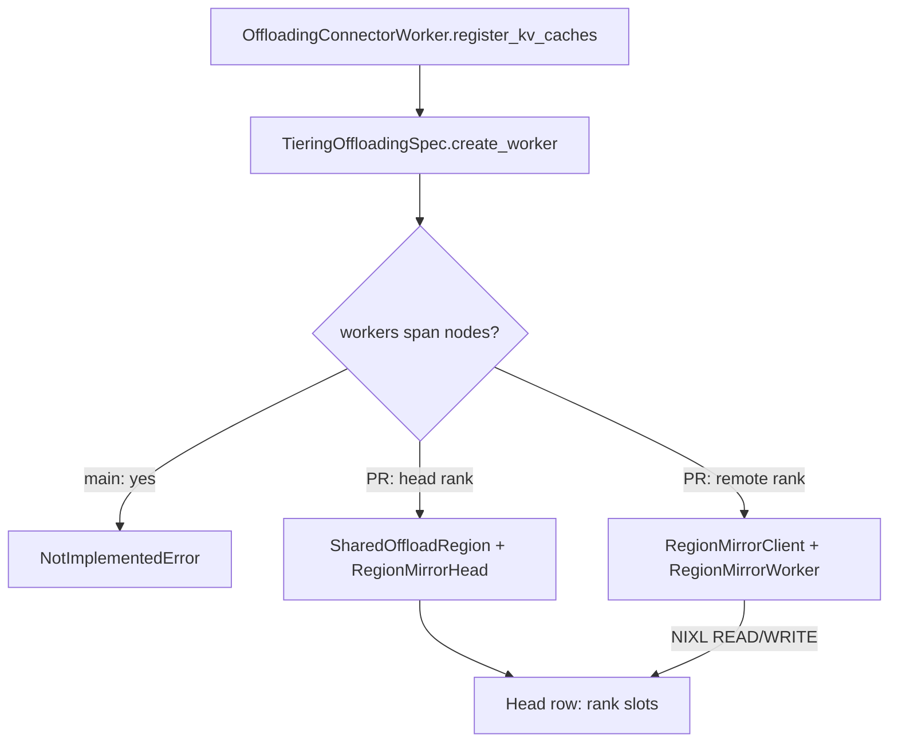
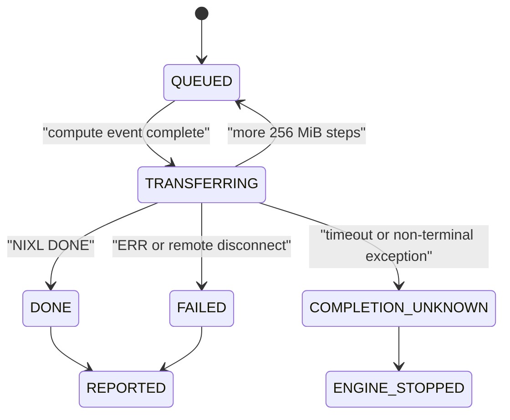

> 源码基线：[`46f36fa2`](https://github.com/vllm-project/vllm/commit/46f36fa294559d080edc61a09e5b57826218a2bf)，即研究时 `vllm-project/vllm` 默认分支最新提交。相对上一章基线前进 [110 个提交](https://github.com/vllm-project/vllm/compare/d3fb7166e0ac9db82158129face12ae28209757a...46f36fa294559d080edc61a09e5b57826218a2bf)，但本篇涉及的 main 侧 multi-node 拒绝、Shared Region 与 worker copy 路径没有被这些提交改写。Region Mirror 来自仍然 **open、未合入** 的 [PR #62933](https://github.com/vllm-project/vllm/pull/62933)，本文会把 main 事实、PR 事实与推导严格分开。

## 本篇在课程路线中的位置

这是课程第 77 章，仍处于“测试、性能与故障诊断”。第 76 章证明 reset 不能只清 metadata：secondary tier 自己的 I/O 与 worker GPU↔CPU copy 是两个 writer 域，必须 `drain secondary → reset primary → 等待 worker report → reopen promotion`。

本章把 worker writer 再拆开：单机 worker 写同一 `/dev/shm` mapping；跨节点 worker 无法看到 Head 节点的 mmap。若要让 EngineCore 上的 secondary tier仍然读取一棵完整 CPU cache，就必须增加一个跨节点 writer。它的终态不仅决定 job 是否成功，还决定 Head CPU chunk 和远端 GPU block 何时可以复用。

## 前置知识回顾

`SharedOffloadRegion` 将 CPU cache 暴露成 `memoryview[num_chunks, row_stride_bytes]`。每一行是一个 chunk，不同 worker 占用互不重叠的 slot。Scheduler/secondary tiers 运行在 EngineCore 所在节点，只读取这一棵 region。

当前 main 的关键安全策略不是“尝试远程拷贝”，而是 [`_reject_workers_across_nodes()`](https://github.com/vllm-project/vllm/blob/46f36fa294559d080edc61a09e5b57826218a2bf/vllm/v1/kv_offload/tiering/spec.py)：只要配置了 secondary tiers，且 TP、PP 或 PCP group 有任一跨节点，worker 初始化立即抛 `NotImplementedError`。这是 fail-closed：牺牲能力，避免把缺 slot 的行持久化后静默命中错误 KV。

## 本篇要回答的核心问题

1. 如果放开 main 的拒绝，远端 worker 怎样把自己的 GPU KV 精确写进 Head Region 的 slot，并让 Scheduler 的现有 `pending_count` quorum 仍然成立？
2. NIXL transfer 超时后，为什么不能把它当作普通失败返回；什么状态才有权复用 Head chunk 或 GPU block？

## 组件在全局架构中的位置

当前 main 的链路在 worker construction 阶段停止；PR #62933 提议在同一接口下替换 remote worker 的实现，而不改变 Scheduler 的 job 协议：



上游输入仍是 Scheduler 产生的 `job_id`、GPU block IDs 与 CPU chunk IDs；下游消费者仍是 `TieringOffloadingManager`、FS/OBJ/P2P secondary tiers。新增层只负责把远端 rank 的 bytes 放到 Head row 的正确 slot，并在完成后产生原有 `TransferResult`。

## 完整调用链

先看已合入 main。`OffloadingConnectorWorker.register_kv_caches()` 根据真实 KV tensors 构造 `CanonicalKVCaches`，随后 `spec.get_worker()` 进入 `TieringOffloadingSpec.create_worker()`。配置有 secondary tiers 且 `world_size>1` 时，`_reject_workers_across_nodes()` 对 TP/PP/PCP 三组执行 node-local collective；发现跨节点就停止初始化。当前公开能力到此为止。

PR #62933 的候选链路是：

1. `create_worker()` 调 `_mirror_topology()`，确认整个 engine 是否跨节点，并拒绝 DP、`canonical_layout`、`replicated_layout`、KVCR 等不能安全映射的组合。
2. Head 节点创建 `SharedOffloadRegion` 与普通 `CPUOffloadingWorker`；远端节点不分配 CPU region。
3. [`attach_region_mirror()`](https://github.com/javieratomic/vllm/blob/79be207ed311c8f05e20c63872f7e40df7e3ccc6/vllm/v1/kv_offload/cpu/region_mirror.py) 让 `RegionMirrorHead` 注册 Head DRAM，让 `RegionMirrorClient` 注册远端 VRAM，并用 all-gather 交换 agent metadata。
4. `slot_planners()` 把 GPU block pointer 与 `head_base + rank × slot_size + chunk × row_stride + tensor_offset` 组成 copy descriptors。
5. 每个 store/load job 经 `RegionMirrorWorker.submit_store/submit_load` 入后台队列；copy thread 等待 compute-stream event，然后执行 NIXL `WRITE` 或 `READ`。
6. 只有 `DONE` 或 `ERR` 才生成 `TransferResult`。worker report 回到 Scheduler 后，既有 `pending_count` 按 rank 归零；最后一票才让 store/cascade 进入完成状态。

因此，Region Mirror 没有另造一套 Scheduler protocol，而是把“本地 CUDA copy 的一票”替换成“远端 NIXL copy 的一票”。

## 关键类型、字段和状态生命周期

候选实现的核心对象是 `_Copy`：

| 字段 | 含义 | 生命周期约束 |
| --- | --- | --- |
| `job_id` | 与 Scheduler job 对齐的身份 | report、wait、reset fence 都以它关联 |
| `steps` | 按约 256 MiB 切分的 NIXL transfer | 单个大 store 可被 load 插队 |
| `is_load` / `expedited` | 队列优先级 | expedited load > load > store，但每 4 个普通 load 必须给 store 机会 |
| `result` | 成功时的 bytes/time receipt | 最后一个 step terminal 后才可见 |
| `done` | worker 内等待边界 | 只表示 copy thread 已处理，不自动证明跨重启安全 |
| `error` | 已知失败 | terminal `ERR` 可报告失败；unknown completion 不可降级成普通失败 |

状态机如下：



`COMPLETION_UNKNOWN` 是本篇最重要的状态：代码刻意不 release transfer handle、不产生成功或失败 report，并让 `get_finished()` 抛错。因为旧 WRITE 仍可能稍后落到已重新分配的 Head chunk；若是 READ，旧操作也可能覆盖已复用的 GPU block。

## 逐函数源码解读

### main：`_reject_workers_across_nodes`

函数查询每个 TP/PP/PCP group 是否与 source rank 同节点，而且要求所有 rank 先完成全部 collective 再抛错，避免部分 rank 提前退出让其他 rank 永久等待。对应 [`test_tiering_spec_rejects_secondary_tiers_across_nodes`](https://github.com/vllm-project/vllm/blob/46f36fa294559d080edc61a09e5b57826218a2bf/tests/v1/kv_offload/test_factory.py) 验证 TP、PP、PCP 任一跨节点都会拒绝，无 secondary tier 时则不查询。

### PR：`slot_planners` 与 `CopyPlanner`

候选 PR 将普通 `SingleDirectionOffloadingHandler` 的地址规划抽成 `CopyPlanner`。`TensorRows(base,stride,size,num_rows)` 只描述地址几何，不要求当前进程拥有对应 CPU tensor；这正是远端进程为 Head DRAM 生成 descriptors 的必要条件。

planner 还验证本 rank 的全部 tensor chunk pages 能装进一个 slot。如果 PP stage 的 KV geometry 不一致，`attach_region_mirror()` 会汇总所有 rank 的 `SlotLayout` 并整体失败，不能允许某些 rank 按错误 row stride 写入。

### PR：`RegionMirrorClient._run`

`transfer()` 后轮询 state。`DONE` 是成功；`ERR` 是已知 terminal failure；明确 remote disconnect 也按失败处理。超过 `mirror_timeout_s`，或 NIXL 抛出无法证明 terminal 的异常，则转入 `MirrorStuckError`。这里 timeout 是故障检测，不是 memory-reuse witness。

### PR：`RegionMirrorWorker._copy_loop`

每次只运行一个 step。大 copy 的剩余 steps 回到队首，使新到的 load 最多等待一个 256 MiB store segment。普通异常记录为 failed `TransferResult`；`MirrorStuckError` 则 stop client、保存 `_stuck` 并终止线程。`shutdown()` 若线程或 stuck transfer 未闭合，会保留 GPU registration，而不是假装释放成功。

## 具体示例与 shape/状态演算

设两节点、TP=2、每个 chunk 的每 rank slot 为 64 KiB，Head region 为 `memoryview[4, 131072]`：

- rank 0 slot：每行 `[0, 65536)`；
- rank 1 slot：每行 `[65536, 131072)`；
- `job_id=41` 要把两个 rank 的 GPU block 写到 CPU chunk 3；Scheduler 侧 `pending_count=2`。

rank 0 用本地 CUDA copy 写 `row3+0`，报告第一票，`pending_count: 2→1`。rank 1 的 planner 形成：

```text
src = remote_gpu_block_address
dst = head_base + 3 * 131072 + 65536
size = 65536
op = NIXL WRITE
```

若 NIXL 返回 `DONE`，rank 1 报第二票，`pending_count: 1→0`；此时 128 KiB row 完整，FS/OBJ tier 才能读取并 publish。若 30 秒无 terminal state，不能报告 job 41 failed 后释放 chunk 3：旧 WRITE 可能在 chunk 3 已分配给 key B 后落地，形成 policy 标记 B、rank 1 bytes 却属于 A 的 silent corruption。候选 PR 选择让 Engine fail-stop，并保留相关 registration。

同理，load 是反方向 `NIXL READ`：Head slot 是 source，远端 GPU block 是 destination。在 terminal receipt 前，Scheduler 不能让请求 forward，也不能把 destination block交给另一请求。

## 为什么这样设计及替代方案

当前 main 的拒绝是最小充分方案：无法证明跨节点 row 完整，就不要提供 secondary-tier hit。它损失功能，却没有新增 RDMA writer、超时和 registration 生命周期。

PR 的直接 GPU↔Head DRAM 方案保持单一事实源，没有每节点 CPU 副本，也避免额外 Host copy；代价是需要 GPUDirect RDMA、Head 节点聚合带宽，以及一个新的 unknown-completion writer 域。

替代方案一是“远端节点先写本地 CPU region，再 CPU↔CPU RDMA 镜像”。PR 作者在不支持 GPUDirect RDMA 的 GB10 上报告约 11 GB/s，而直接路径因 UCX Host staging 只有约 1.3–1.45 GB/s；但该结果是 PR 实验事实，不代表数据中心 GPU。此方案多一份 CPU cache和一次 copy，却在无 GDR 机器上更现实。

替代方案二是每节点独立 secondary shard，EngineCore 只维护 metadata。它消除 Head row 聚合和单点带宽，但 lookup/publish/eviction 需要跨 rank事务，维护成本更高。替代方案三就是 main 的 fail-closed，适合能力尚未通过真 GDR 与 crash fault matrix 验证的阶段。

## 性能、并发、正确性与边界条件

- **延迟**：load 优先于等待中的 store，且大 store 分段，目标是降低 restore 的 head-of-line blocking；但 load 连续四次后让出一次 store，防止持久 pin。
- **吞吐**：Head CPU region 是所有远端 rank 的聚合入口。实际上限取决于 NIC、PCIe/NVLink、DRAM 与 descriptor 数，而不是 Python queue 名称。
- **内存**：remote rank 不分配 CPU region，稳态更省 Host memory；stuck 时故意保留 VRAM registration，故障态资源不会立即归零。
- **正确性**：`pending_count` 仍是每 worker 一票的 AND fence；单个 rank 的 DONE 不能授权 secondary tier读取整行。
- **graphability**：copy 在模型 graph 外的 worker/IO 线程，不改变 CUDA Graph shape；但 restore 未完成会阻止请求进入 forward。
- **支持边界**：开放 PR 限制为无 DP、同 KV geometry、NIXL/UCX、非 canonical/replicated layout，并要求 EngineCore 与 rank 0 同节点。

## 测试证据与未覆盖风险

**main 测试事实**：`test_tiering_spec_rejects_secondary_tiers_across_nodes` 构造 TP/PP/PCP group，验证跨任意组都在 CPU region 分配前失败；它证明 fail-closed detection，不证明 Region Mirror。

**开放 PR 测试事实**：候选 [`test_region_mirror.py`](https://github.com/javieratomic/vllm/blob/79be207ed311c8f05e20c63872f7e40df7e3ccc6/tests/v1/kv_offload/cpu/test_region_mirror.py) 验证 NIXL write 只填 remote slot、read 只填指定 GPU blocks、slot address 公式、store/load terminal report、失败 transfer、unknown transfer fail-stop、load 插队、256 MiB 分段、layout mismatch 与 shutdown。PR 作者还报告 2×DGX Spark 的 64k/200k 恢复正确性及相关测试套件结果；这些是 PR/实验事实，尚未成为 main CI 契约。

未覆盖风险更关键：没有支持 GPUDirect RDMA 的硬件性能结果；没有 owner process crash 后旧 WRITE 与 same-address reuse；没有 Head agent 重启、boot generation、remote-registration revoke receipt；没有 stuck transfer 的节点级 reset 收敛；DP、异构 PP geometry 与多 Engine world group 被直接排除。换言之，候选实现通过 fail-stop 避免进程内误复用，但尚未给出跨进程 generation ownership。

## 与前后章节的连接

第 76 章的 worker reset fence假设 worker 最终能回报旧 job；本章加入跨节点 NIXL writer 后，`pending_count` 仍能覆盖正常 DONE/ERR，却无法把 timeout 洗成安全。若进程仍活，fail-stop + 保留 registration 能守住地址；若进程直接死亡，所有 `_Copy`、handle census 与 `_stuck` 都消失，问题重新落到第 73–74 章的 boot identity 与 destination quarantine。

## 本篇结论、知识债、三个理解检查问题和下一章

结论：当前 main 正确地拒绝 multi-node secondary tiers；Region Mirror 仍是 open PR。候选设计的精髓不是 RDMA 本身，而是保留既有 job quorum，同时把 `DONE/ERR` 与 `COMPLETION_UNKNOWN` 分开：前两者可产生 report，后者必须 fail-stop，不能授权 chunk 或 GPU block 复用。

知识债：PR 合入状态与 API 演进、真 GDR 性能、Head 带宽/公平性、boot generation、registration revoke receipt、Head crash、remote process kill、stuck transfer 节点 reset、跨重启 physical writer census、DP/异构 geometry，以及真实 same-address late-write 故障注入。

理解检查：

1. 为什么 rank 0 的 local copy 完成，仍不能让 FS tier读取 row？
2. `mirror_timeout_s` 为什么只能触发 fail-stop，不能直接产生 failed `TransferResult`？
3. 保留 VRAM registration 能解决活进程内的什么问题；为什么它不能覆盖 owner 被 `SIGKILL` 后的新进程复用？

下一章：**Head Region Owner 崩溃后谁撤销旧 WRITE——Mirror Generation、Remote Registration Revoke 与 Rebuild Census。**

## 课程账本增量

- 新覆盖：main 的 multi-node fail-closed detection；PR #62933 的 `MirrorTopology/SlotLayout/RegionMirrorHead/RegionMirrorClient/RegionMirrorWorker/CopyPlanner`。
- 新不变量：完整 CPU row 需要所有 worker quorum；NIXL timeout 不是 terminal receipt；unknown copy 不得产生 report或授权地址复用。
- 证据边界：main 仅实现拒绝；Region Mirror、性能数字和 mirror tests 均属于未合入 PR 事实。
- 后续：研究 Head/remote owner crash 后的 generation、registration revoke 与 physical writer census。
