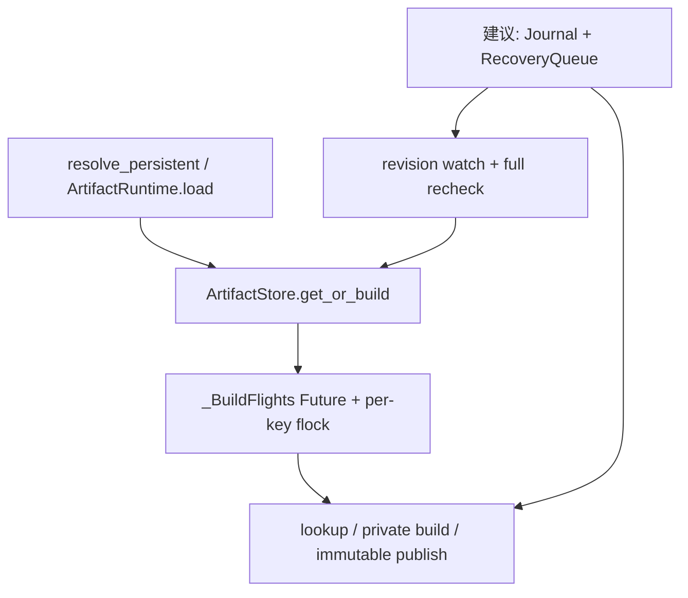
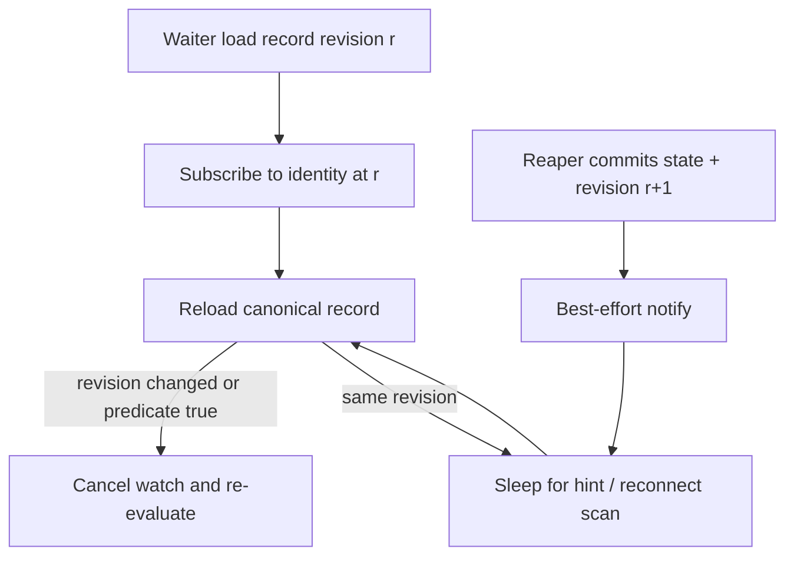

> 源码基线：`hw-native-sys/pypto` 默认分支 [`6d0ac8b5`](https://github.com/hw-native-sys/pypto/commit/6d0ac8b5a1c1407a5b8b425c6b4ec4ffa1aadb52)。相对上一章的 [`396e1b6b`](https://github.com/hw-native-sys/pypto/commit/396e1b6b447bc57802fb1ee573b6daae01b3f280)，默认分支前进了 [8 个提交](https://github.com/hw-native-sys/pypto/compare/396e1b6b447bc57802fb1ee573b6daae01b3f280...6d0ac8b5a1c1407a5b8b425c6b4ec4ffa1aadb52)；最新提交 [#3294](https://github.com/hw-native-sys/pypto/pull/3294) 主要是 cast/predicate selection 的 Buffer IR lowering，本篇直接涉及的 Artifact Store、persistent path、runtime retention 和测试没有改变。当前 PyPTO **仍无** durable build journal、recovery queue、online reaper、capacity ledger 或跨进程 revision watch；本文会严格区分源码事实与建议协议。

## 本篇在 PTO 课程路线中的位置

这是课程第 88 章。第 86 章回答 owner 死亡后谁能接管，第 87 章回答 reaper 能相信哪一份 journal bytes；现在恢复者终于知道“该做什么”，但系统仍可能停住：等待同一 Artifact 的线程、进程或 runtime 不知道 canonical state 已改变，或者 recovery queue 被一个暂时不可执行的大 orphan 卡在队首。

第 79 章已经讲过**新 admission ticket** 的公平与取消，本章不重复。今天研究的是另一条队列：已经欠下的 recovery debt 如何被认领、执行、提交，以及它的结果怎样唤醒旧等待者。前者分配未来容量，后者消费受保护的恢复资源来关闭既有不确定性；两者不能共用一个“谁先来谁先走”的模糊队列。

本章仍位于 Python/JIT Artifact Store 的 Host 控制面，不新增 PTO ISA、Tile、layout 或 device pipeline 语义。

## 前置知识

需要带着四个已确认结论：

1. artifact completion manifest 证明 immutable payload；建议的 build journal 证明 owner、phase 与 ledger effect，二者职责不同。
2. journal recovery 必须验证 A/B record、revision/digest chain 与 owner/reaper epoch，`CURRENT` 只是一条 hint。
3. physical delete、capacity release、waiter 可见状态是三个提交点；只有 durable state revision 能跨 crash 充当唤醒依据。
4. private output 可能仍被 `ArtifactRuntime` 或编译对象持有。没有 runtime member lease/native terminal receipt 时，reaper 只能 BLOCKED 或 quarantine，不能因排队太久就删除。

## 今日 1–2 个核心问题

1. recovery record 已从 revision `r` 推进到 `r+1`，怎样保证 waiter 无论在 commit 前、commit 后还是 notify 丢失时到达，都不会永远睡下去？
2. metadata replay、96 MiB orphan 删除、仍有 runtime lease 的 512 MiB private tree 同时出现时，reaper 怎样既不被 blocked head 卡死，也不让大任务被小任务无限绕过？

## PTO 全栈中的位置

当前已合入路径只有进程内 Future 和跨进程 `flock`；建议的 recovery queue 位于 durable journal/ledger 与这些调用者之间：



上游是稳定的 `ArtifactKey + ArtifactSpec`、建议的 reservation/journal identity 和 runtime lease；下游是 `lookup()` 的 `HIT/MISS/INVALID/STORAGE_ERROR`、builder 是否重新 admission，以及 `ArtifactRuntime` 是否可以继续使用 private path。notification 只缩短反应时间，真正授权下游动作的是 durable record 加完整 lookup/recheck。

## 概念和精确语义

### Recovery task 不是普通函数调用

建议的 `RecoveryTask` 至少绑定：

```text
task_id = H(reservation_id, source_revision, target_action)
artifact = (environment_digest, key_digest, spec_digest, state)
claim = (reaper_epoch, lease_deadline, expected_record_revision)
state = READY | BLOCKED | CLAIMED | DONE | QUARANTINED
action = VERIFY_FINAL | DELETE_PRIVATE | DELETE_STAGING |
         RECONCILE_CHARGE | RELEASE_RESERVATION
prerequisite = runtime_lease_revision / writer_terminal_revision /
               cleanup_reserve_revision
```

`task_id` 让重复扫描与重启 enqueue 合并成同一 logical work；`expected_record_revision` 防止旧 reaper 把结果提交到已前进的 record；`prerequisite` 说明任务为什么不可运行。任务 `DONE` 不是“Python 函数返回”，而是目标 record transition 与相关 `effect_id` CAS 已 durable commit。

### No-lost-wake 是 level state，不是可靠 edge

waiter 的正确协议是：`load revision → subscribe(observed_revision) → reload → unchanged 才 sleep`。reaper 则必须先原子提交 canonical state/revision，再发送 notify。于是两种最难的 crash 都可收敛：

- commit 成功、notify 前 reaper crash：waiter 的第二次 reload 或重连 full scan看到新 revision；
- notify 先到但 durable state 未变：waiter醒来完整重查，不能把 notify 当成 `HIT`、grant 或删除凭证。

订阅可以由 condition variable、eventfd、socket、inotify 或轮询实现；它们都是易失的加速器。跨进程真相必须仍在 journal/ledger 中。wait predicate 还要包含 artifact incarnation/record identity，不能只比较一个会 ABA 的枚举状态。

这里的 predicate 也不能简单写成“`revision > r` 就成功”。revision 前进可能表示 `PUBLISHED`，也可能表示 `QUARANTINED`、owner 换代、reservation 释放或 runtime lease 尚未归零。正确后置条件是“同一 identity 的 canonical record 已经改变，调用者必须重新做完整决策”。因此 waiter 醒来后至少要验证 identity/incarnation、record digest chain、terminal state、manifest lookup 与自身 cancellation；只有 lookup 返回可信 `HIT` 才能把 shared directory 交给下游。若状态转成 `QUARANTINED`，它应传播确定错误或继续等待运维动作，而不是因 revision 增加误报成功。

observe-subscribe-reload 还必须和订阅建立的返回值约定配合：watch provider 接受 `(identity, observed_revision)`，若服务端已见到更高 revision，应立即返回“stale”而不是先登记再睡；若连接在登记后断开，客户端不能尝试推断漏了几条通知，只需重新读 canonical record，并以新 revision 重新订阅。这把复杂的消息补洞问题降为可重复的 level check。相反，若只做 `load → sleep → notify`，commit 恰好发生在 load 与 sleep 之间，哪怕 reaper 完全正常也会产生永久睡眠。



### Reaper fairness 先判断 runnable，再谈顺序

`BLOCKED` task 不应占着 worker，也不应被当作 queue head 阻止其他 recovery。它进入按 prerequisite identity 索引的 wait set：runtime lease revision、native writer terminal revision或 cleanup reserve revision变化后，才重新进入 `READY`。

在 `READY` 集合中，最小充分策略是 oldest-runnable 加有界绕过：小的 metadata replay可以绕过需要较多 I/O headroom 的删除，但绕过次数必须可观测且有上界；达到保护条件后，为最老 eligible task积累资源。这里不预设固定次数或权重，它们应由 oldest-ready age、服务时间、bytes retired 与恢复 SLO 校准。公平承诺也有前提：task持续 eligible、所需资源最终可得、reaper服务持续前进。

调度循环可以保持很小：先把 prerequisite 已变化的 task 从 wait set 重新验证并转入 READY；再从 READY 中选择“最老且当前资源可满足”的任务；若最老项暂时缺 cleanup headroom，允许执行不消耗同一瓶颈资源的任务，但记录一次 bypass debt；当 debt/age 达到保护条件后，暂停会继续占用该资源的新 admission，让 headroom 向该项收敛。worker 完成后不直接删除 queue item，而是提交 outcome CAS；只有 CAS 成功才进入 DONE，CAS 失败说明 claim 过期或 record 已前进，必须丢弃旧结果并重新分类。

这并不承诺不可实现的绝对 FIFO。一个 runtime 永不释放 lease 的 512 MiB task永远不 eligible；强迫它排在队首只会牺牲其他可回收 bytes。真正需要保证的是：持续 READY 的任务不会被后来 READY 的小任务无限绕过，BLOCKED 原因可观测，资源不足时 admission 会为 recovery 让路。这样 liveness 的前提和失败方式都能被测试，而不是把“最终会清理”写成无法证伪的愿望。

还要区分三种“结束”。worker 返回只说明一次尝试结束；physical effect 完成只说明文件系统观察到目标结果；record/effect CAS 成功才说明其他进程可依据该结果继续。比如 `rmtree` 返回后进程在 ledger commit 前死亡，空间确实释放了，但 reservation 仍可能保守计费；下一 reaper 必须以同一 `effect_id` 验证 path identity/absence并重放 reconcile。反过来，ledger 不能先减账再尝试删除，否则 delete 失败会造成 under-account，新 admission 可能使用并不存在的容量。正确次序宁可短时 over-account，也不能让物理预算被双花。

同理，claim lease 到期只允许另一 reaper重新认领，不能证明旧 worker的系统调用已经停止。若 action 可能跨 claim deadline持续执行，必须把删除目标移入不可复用的 reservation namespace，或由外部 process-group terminal receipt证明旧执行者不能再写。否则新 reaper与迟到旧 worker可能对同一路径并发操作，epoch fencing只能拦住旧结果提交，拦不住已经发出的文件系统副作用。

## 真实文件、类型、API 或指令逐段解读

### `_BuildFlights.run()`：当前进程内 wakeup

[`artifact_cache.py`](https://github.com/hw-native-sys/pypto/blob/6d0ac8b5a1c1407a5b8b425c6b4ec4ffa1aadb52/python/pypto/jit/artifact_cache.py) 的 `_BuildFlights.pending` 以 `(root, private_root, readonly, key.digest, spec.digest)` 为键。leader 创建 `Future`；waiter 调 `Future.result()`。leader 成功时先 `set_result`，失败或 cancellation 时先 `set_exception`，最后才在锁内删除 pending entry。这样现有线程 cohort 不会因正常异常丢失唤醒，完成后也不把 private object永久 memoize。

但 Future 完全在进程内；`os.register_at_fork(after_in_child=_build_flights.reset)` 明确让 fork child丢弃父进程 flight，因为父线程永远不可能在 child内完成。它证明了一个边界：跨 crash waiter不能依赖继承来的内存 Event。

### `file_lock()`：当前跨进程重新检查入口

[`_fslock.py`](https://github.com/hw-native-sys/pypto/blob/6d0ac8b5a1c1407a5b8b425c6b4ec4ffa1aadb52/python/pypto/_fslock.py) 用持久 inode 上的 blocking `flock(LOCK_EX)` 串行化同 key writer；kernel 在 process exit释放 lock。锁文件不 unlink，所有合作进程始终锁同一 inode。取得锁后 `_get_or_build()` 必须再次 `lookup()`，所以前一个进程发布成功时，后继看到 `HIT` 而不重复 build。

这不是 recovery notification API：代码没有 timeout、queue position、fairness guarantee、owner epoch或 durable completion payload。内核唤醒某个 lock waiter只授权其进入 critical section，不证明 journal 已恢复，更不能代替 revision recheck。

### `ArtifactStore._get_or_build/_publish`

真实链路是 `lookup → file_lock → lookup again → _build_private → _publish`。不同 key有意并发；invalid final slot不在线修复，private/staging crash残留也只留给 offline cleanup。[Artifact Store 文档](https://github.com/hw-native-sys/pypto/blob/6d0ac8b5a1c1407a5b8b425c6b4ec4ffa1aadb52/docs/en/dev/09-artifact-store.md)明确没有 automatic cleanup。因此 recovery queue必须作为新层加入，不能把它描述成当前 `_publish()` 的隐藏行为。

### `ArtifactRuntime.load()`：删除前的真实消费者

[`_artifact_runtime.py`](https://github.com/hw-native-sys/pypto/blob/6d0ac8b5a1c1407a5b8b425c6b4ec4ffa1aadb52/python/pypto/runtime/_artifact_runtime.py) 在 READY promotion失败为 PRIVATE 时，把 `directory` 指向 `result.private_directory`，并把加载后的 `_chips` 缓存在 runtime对象生命周期内。当前没有 member lease/reaper handoff，所以建议队列中的 `DELETE_PRIVATE` 在得到外部 lease/terminal evidence前必须 BLOCKED。

## 对象/Tile/Buffer/IR 生命周期

本章没有 Tile；核心对象是一条 durable recovery record：

1. startup/full scan验证 build journal，按 `(reservation_id, source_revision, target_action)` 幂等生成 task。
2. queue owner判断 prerequisites；满足者进入 `READY`，否则记录具体 blocker与 observed revision。
3. reaper以 `expected revision + reaper_epoch` CAS claim，获得有期限的 apply权；claim不转移 artifact payload所有权。
4. worker执行 manifest verify、physical delete或ledger reconcile。native/runtime ownership不明时不能用 timeout假装成功。
5. outcome通过 record transition与稳定 `effect_id` CAS提交；旧 claim若发现 revision变化，结果作废并重新 census。
6. commit后 best-effort notify。waiter醒来重新走 lookup/admission/runtime decision；最后一个 waiter取消只影响订阅，除非协议另有权威 cancellation intent，不能反向撤销正在修复的 shared task。
7. terminal task可从 active queue压缩，但其最终 record/effect evidence必须保留到 reader/checkpoint watermark允许 compaction。

## 端到端调用链或指令链

建议链路从一次 cache lookup开始：

```text
resolve_persistent / ArtifactRuntime.load
  → ArtifactStore.lookup returns MISS/INVALID or recovery-pending
  → _BuildFlights elects same-process representative
  → persistent per-key lock + journal full reload
  → record says recovery required: register revision watch
  → RecoveryQueue scans/claims task with reaper_epoch
  → verify final OR wait runtime/native prerequisite OR delete/reconcile
  → commit record revision + effect CAS
  → notify hint
  → waiter reloads record + ArtifactStore.lookup
  → HIT / new admission / PRIVATE fallback / continued quarantine
```

关键是 waiter不能在持有 per-key lock时睡等 reaper，而 reaper又需要同一锁或record CAS推进状态，否则形成自锁。waiter完成 subscribe双读后释放控制锁；reaper提交后也立即释放 ledger锁，再做 notification fan-out。

## 具体 shape、Tile 和状态演算

设重启后扫描到三项；它们没有 tensor shape/dtype/device，真实资源是 Host目录、bytes 与 ownership evidence：

| Task | 初始证据 | 物理规模 | 当前资格 |
| --- | --- | ---: | --- |
| A / `R77` | record rev 18=`PUBLISHING`，final manifest完整 | metadata-only | `READY: VERIFY_FINAL` |
| B / `R78` | rev 31=`QUARANTINED`，writer terminal，private tree存在 | 96 MiB | `READY: DELETE_PRIVATE` |
| C / `R79` | rev 12=`PRIVATE_READY`，runtime member lease仍活 | 512 MiB | `BLOCKED: runtime lease` |

waiter `W_A` 对 key A 读取 rev 18并看到 recovery-pending。它注册 watch前，reaper epoch 5 claim A，复用现有 `read_manifest(key,spec)` 验证 final slot，然后原子写 rev 19=`PUBLISHED`；reaper在 notify前崩溃。`W_A` 随后以 observed rev 18订阅并立刻重读，发现 19，取消 sleep并重新 lookup得到 `HIT`。这就是 no-lost-wake：没有依赖那条永远没发出的消息。

C 虽比 B更老，但其 runtime lease revision未闭合，因此它离开 runnable head并订阅 lease变化；不能占着唯一 reaper worker。B被 claim后删除 96 MiB private tree，再以稳定 `effect_id=release:R78:31` 对账。若 physical delete后、ledger CAS前崩溃，下一 reaper看到 path absent，重放同一 effect；CAS只生效一次。C的 lease最终 terminal后重新入 READY。若运行期间小 metadata task不断到来，调度器必须在可观测的有限绕过后保护 C所需的 cleanup headroom，不能让它永久饥饿。

## 为什么这样设计及替代方案

**推荐：durable revision + ephemeral hint + prerequisite-aware oldest-runnable。** 它把 correctness放在可重读状态上，把低延迟放在可丢 notification上；队列只调度真正可运行的任务，blocked task等待其具体 prerequisite。

替代一是只复用当前 Future/`flock`。实现最小，但进程死亡会清空 Future，`flock`也不携带恢复结果；只能覆盖正常同 key build，不能覆盖 journal/reaper。

替代二是只做周期性全盘扫描。它天然不会永久丢 edge，但恢复延迟与目录规模绑定，容易重复 hash/manifest校验并形成扫描风暴。可以保留为 reconnect/审计 fallback，不能替代精确 revision watch。

替代三是 durable message queue，把每个 wake/event持久化。它能降低扫描，但仍必须面对重复投递、consumer crash与消息先于filesystem effect；最终仍需要 canonical state + idempotent effect。因此首版没有必要把“每个 waiter的每次 wake”都做成 durable消息。

严格 FIFO也不是答案：最老 task若仍有 live runtime lease，会让所有可运行 cleanup停止；纯 shortest-job-first则会饿死大 orphan。先分 READY/BLOCKED，再对 READY做带老化/保护的 work-conserving调度，复杂度更低且直接对应不变量。

## 访存、计算、流水、并行和硬件约束

- 这是 Host recovery 控制面，不改变 PTO ISA、Tile shape、NPU kernel或 pipeline。主要成本是 manifest hashing、目录 I/O、fsync、删除与 ledger CAS。
- recovery queue需要受保护 headroom：journal/tombstone/临时目录操作即使最终释放容量，也可能先需要少量 inode与写入空间。新 admission不能耗尽这部分资源。
- metadata verify与physical delete可分 lane并行，但同 reservation/target record只能有一个有效 claim；并行度受磁盘、inode、hash CPU和runtime/native terminal adapter约束。
- notify应按 artifact identity合并 waiter，携带最新 revision hint，避免每次小 transition广播全局形成 thundering herd。
- 指标至少包括 `ready/blocked/claimed` task数与bytes、oldest-ready age、blocked reason/age、claim conflict、stale-result CAS、revision wake lag、coalesced waiter数、scan fallback次数和每类 action服务时间。
- fairness参数不能拍脑袋。只有观测到 service-time/bytes 分布、recovery SLO与headroom恢复速度后，才能设置绕过或aging阈值。

## 测试证据与未覆盖风险

当前 [`test_artifact_cache.py`](https://github.com/hw-native-sys/pypto/blob/6d0ac8b5a1c1407a5b8b425c6b4ec4ffa1aadb52/tests/ut/jit/test_artifact_cache.py) 能证明四件事：

1. `test_same_key_threads_build_once`：4线程同 key只有1次builder、1个`PUBLISHED`和3个`HIT`。
2. `test_coalesced_compiler_errors_wake_waiters_and_allow_retry`：leader抛普通异常或 cancellation时，4个Future waiter收到同一异常，pending清空且下一次可成功。
3. `test_forked_child_does_not_wait_for_parent_build`：fork child重置内存 flight，不会等待只存在于父进程的builder。
4. `test_spawned_processes_deduplicate_and_dead_process_releases_lock`：3个spawn process得到1 publish/2 hit；持锁进程 `os._exit(7)` 后 kernel释放同一 lock inode。

这些是直接测试事实，只覆盖进程内 Future和正常/死亡后的 `flock` handoff；它们没有 durable revision、reaper queue、individual subscription、lost-notify、stale claim或fairness。最新 Buffer IR提交报告的大规模测试也不能作为 Artifact recovery证据。

建议新增三层测试：

- 协议单测：commit后notify前kill、waiter落在observe/subscribe窗口、重复/乱序notify、incarnation ABA，要求 full reload决定结果。
- queue/property test：重复scan只生成一个`task_id`；旧 reaper结果CAS失败；blocked head不阻塞ready tail；小任务连续到达时最老eligible大任务最终受保护；单个waiter取消不取消仍被其他waiter依赖的task。
- 多进程/故障测试：两个reaper竞争claim；delete后ledger前kill；runtime lease释放触发BLOCKED→READY；重启时没有notification也靠revision/full scan前进；ENOSPC只允许使用预留recovery headroom。真机层还需验证编译子进程、NPU worker与native handle的terminal adapter。

## 与前后章节的连接

第 86 章建立 owner/reaper epoch，第 87 章建立可相信的record chain；本章让恢复结果可被等待者可靠观察，并让多个recovery item有条件前进。第 79 章的 admission fairness只调度“谁拿新容量”，本章则调度“谁先关闭已有debt”；后者完成后会推进capacity revision，从而间接唤醒前者。

下一章将研究 queue自身长期堆积：scan怎样增量化、terminal task何时compaction、backlog watermarks何时必须把系统保持在 recovery-only admission，而不是依靠越来越频繁的全盘扫描。

## 本篇结论、知识债、三个理解检查问题和下一章

结论：当前 PyPTO 已正确实现同进程 Future coalescing、异常广播、fork reset和跨进程 persistent `flock` recheck，但没有 durable recovery/wakeup。建议协议的最小核心是：canonical record与单调revision先提交，notification只作hint；waiter采用observe-subscribe-reload；reaper以epoch+expected revision claim；BLOCKED task订阅具体prerequisite，READY task按 oldest-runnable与有界绕过调度。这样丢notify不会失去progress，blocked orphan也不会制造全局head-of-line blocking。

知识债：durable RecoveryTask/claim schema、revision watch实现、reconnect/full-scan索引、runtime/native terminal adapter、cleanup reserve、cost estimator、aging校准、task/result compaction、跨文件系统语义、两reaper故障注入和真实NPU process-group retirement。

三个理解检查问题：

1. reaper 已提交 rev 19却在notify前崩溃，waiter为什么仍不会永久睡眠？
2. 为什么持有live runtime lease的最老task不能继续占据runnable queue head？
3. `flock`唤醒一个进程为什么只授权重新检查，不能直接证明Artifact已经PUBLISHED或private tree可删除？

下一章：**Recovery Queue 越积越多怎么办——Backlog Watermark、Incremental Scan 与 Journal Compaction。**

## 课程账本增量

- 章节：课程 88；所选仓库仅 `hw-native-sys/pypto`。
- 新覆盖：`_BuildFlights.run/reset`、`file_lock`、`ArtifactStore.get_or_build/_get_or_build/_publish`、`ArtifactRuntime.load`，以及线程Future、fork reset、spawn/flock handoff测试。
- 新确认：Future/notify/`flock`都只是进程内或易失协调；跨crash progress必须依赖canonical state+revision；waiter采用observe-subscribe-reload；reaper claim绑定epoch与expected revision；BLOCKED与READY分离后再做fairness。
- 证据边界：当前没有journal/reaper/revision watch；`RecoveryTask`、prerequisite索引和调度策略都是基于源码缺口的建议协议。
- ISA知识地图：无新增指令、Tile、layout或memory-location语义；补齐Host Artifact recovery调度与wakeup层。
- 后续：研究recovery backlog的增量扫描、watermark、compaction和recovery-only admission。
