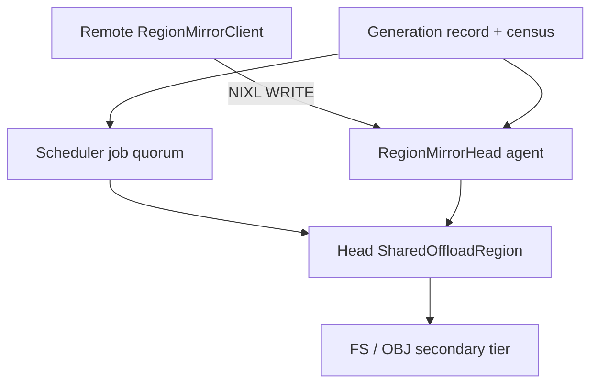
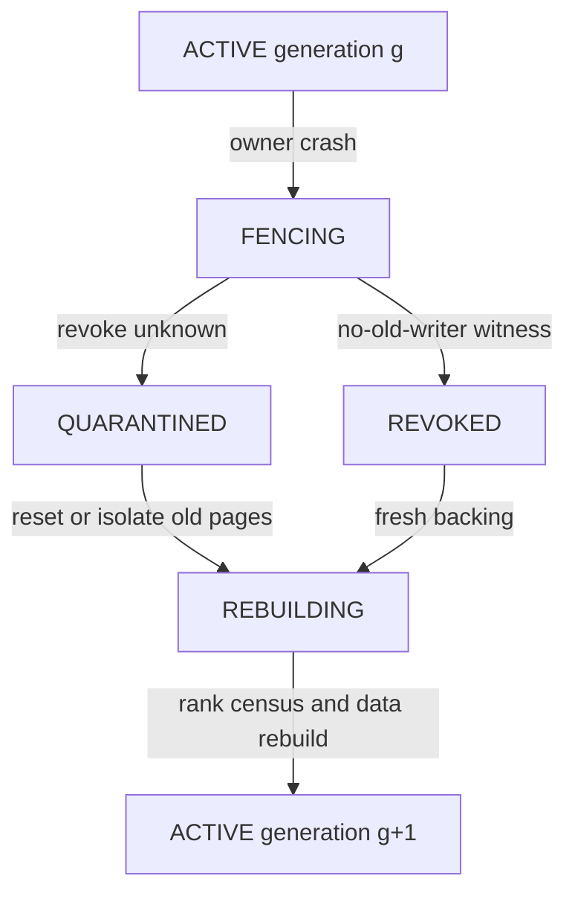

> 源码基线：[`70455184`](https://github.com/vllm-project/vllm/commit/7045518494fdf62472947e38fdbe9367ecbd1b71)，即研究时 `vllm-project/vllm` 默认分支最新提交。相对上一章基线前进 [103 个提交](https://github.com/vllm-project/vllm/compare/46f36fa294559d080edc61a09e5b57826218a2bf...7045518494fdf62472947e38fdbe9367ecbd1b71)，本篇直接相关的 multi-node 拒绝、Shared Region 生命周期没有变化。Region Mirror 仍来自 **open、未合入** 的 [PR #62933](https://github.com/vllm-project/vllm/pull/62933)，候选 head 仍为 [`79be207e`](https://github.com/javieratomic/vllm/commit/79be207ed311c8f05e20c63872f7e40df7e3ccc6)。下文把“main 事实”“PR 事实”和“建议协议”分开。

## 本篇在课程路线中的位置

这是课程第 78 章，仍在“测试、性能与故障诊断”。第 77 章讲清跨节点 Region Mirror 的稳态：远端 GPU 通过 NIXL `WRITE` 填 Head CPU row 的对应 slot，所有 worker 的 terminal report 组成 job quorum；状态未知时 fail-stop，不能复用地址。

本章只追问一个 crash 边界：**Head Region owner 在旧 WRITE 可能仍会落地时死亡，新进程凭什么宣布新 generation 可以复用同一块物理内存？** 这不是再讲一次 timeout，而是区分“拒绝旧控制消息”和“物理上撤销旧 writer”。

## 前置知识回顾

当前 main 的 [`TieringOffloadingSpec.create_worker()`](https://github.com/vllm-project/vllm/blob/7045518494fdf62472947e38fdbe9367ecbd1b71/vllm/v1/kv_offload/tiering/spec.py) 在配置 secondary tier 且 worker 跨 TP/PP/PCP 节点时调用 `_reject_workers_across_nodes()`，并在分配 `SharedOffloadRegion` 之前抛 `NotImplementedError`。所以 main 仍是 fail-closed；它没有承诺跨节点恢复。

开放 PR 的 `RegionMirrorHead` 注册 Head DRAM，remote `RegionMirrorClient` 注册 GPU VRAM；`attach_region_mirror()` 交换 `agent metadata`、`head.base` 与 `SlotLayout`。进程内 clean shutdown 会 `remove_remote_agent()`、`deregister_memory()`；unknown transfer 则保留 handle/registration并停止 engine，防止误复用。这些机制守住的是**活着的本 generation**，没有给重启后的新进程一个 durable revoke receipt。

## 本篇要回答的核心问题

1. `generation` 能挡住哪些旧状态，为什么它单独挡不住迟到的 DMA WRITE？
2. Head owner crash 后，rebuild census 至少要收集什么证据，才能创建并开放下一代 Region？

## 组件在全局架构中的位置

候选实现把 Head Region 同时暴露给本地 CPU worker、Scheduler/secondary tier 和远端 NIXL writer。故障恢复必须跨越三个所有权域：逻辑 job、进程内 mapping、NIC registration。



上游输入是 `engine_id`、worker rank、`job_id`、chunk/slot geometry 与 NIXL endpoint；下游消费者是 CPU chunk lookup 和 secondary-tier publish。若恢复只重建 Python 对象，却没证明旧 NIC writer 失权，那么新旧 generation 会同时拥有同一 destination。

## 完整调用链

先看当前已实现链路。main 在 `_reject_workers_across_nodes()` 终止初始化；对应测试构造 TP、PP、PCP 三类跨节点 group，验证 region constructor 尚未调用。这是当前唯一合入的安全结论。

PR #62933 的候选正常路径为：

1. `TieringOffloadingSpec` 在 Head 创建 `/dev/shm/vllm_offload_{engine_id}.mmap` 对应的 `SharedOffloadRegion`；remote worker 不建 CPU region。
2. [`attach_region_mirror()`](https://github.com/javieratomic/vllm/blob/79be207ed311c8f05e20c63872f7e40df7e3ccc6/vllm/v1/kv_offload/cpu/region_mirror.py) 在 rank 0 构造 `RegionMirrorHead`，注册 `[base, num_chunks × row_stride)` DRAM。
3. remote rank 用 Head metadata 建 `RegionMirrorClient`，注册自己的 KV-cache VRAM；planner 由 `head_base + rank × slot_size` 推导 remote descriptor。
4. `RegionMirrorWorker` 提交 `WRITE`，只在 NIXL `DONE/ERR` 后形成 `TransferResult`；unknown completion 不报告并停止 engine。
5. clean shutdown 才走 `remove_remote_agent → deregister_memory`。若 owner 被 `SIGKILL`，这段 Python cleanup 不会运行，内存里的 `_Copy`、handle 与 `_stuck` census 也一起丢失。

与此同时，main 的 [`SharedOffloadRegion`](https://github.com/vllm-project/vllm/blob/7045518494fdf62472947e38fdbe9367ecbd1b71/vllm/v1/kv_offload/cpu/shared_offload_region.py) 用 `O_CREAT|O_EXCL` 选 creator；joiner 只等待 `st_size >= expected_size`。这个检查没有 generation header、boot nonce 或 inode 身份。若未使用构造 barrier，pathname 会留到 creator `cleanup()`；creator crash 时，幸存 mapping 和具名旧文件的关系不能靠 size 区分。

## 关键类型、字段和状态生命周期

**代码事实：**候选 `MirrorTopology` 只有 `group/rank/on_head/remote_ranks`；Head endpoint 是 `(metadata, base)`，名称由 `engine_id` 与 rank 构成。`_Copy` 保存 `job_id/steps/result/error/done/next_step`。它们都没有跨进程 `mirror_generation`。

**建议协议：**恢复需要一个持久、单调的 `MirrorGenerationRecord`：

```text
identity = (engine_id, generation, head_boot_nonce,
            region_identity, head_agent_nonce)
rank census = (rank, last_submitted, last_terminal,
               completion_unknown, registration_state)
```

`region_identity` 应来自不可混淆的 backing identity（例如受控 memfd/新 inode），不能只是可能复用的 pathname 或 virtual address。`registration_state` 必须区分“新进程注册成功”和“旧 writer 已撤销”；两者不是同一事实。

把接口契约摊开后，恢复需要回答的不是一个布尔值，而是四层所有权：

| 对象 | 创建与持有者 | 正常消费/释放 | crash 后仍需证明的事实 |
| --- | --- | --- | --- |
| `SharedOffloadRegion` backing | creator 创建，Head workers/Scheduler mmap | CPU worker 与 secondary tier读写；cleanup/unlink | 旧 physical pages 是否仍可被 native writer引用 |
| Head DRAM registration | `RegionMirrorHead` 的 NIXL agent | remote descriptor；`deregister_memory` | deregistration 是否只发起，还是已经 drain全部旧 WRITE |
| remote VRAM registration | 每个 `RegionMirrorClient` | `READ/WRITE` local descriptor；clean unregister | 该 rank 是否仍有 queued/inflight/unknown handle |
| `_Copy`/`TransferResult` | `RegionMirrorWorker` copy thread | Scheduler per-worker quorum | 内存对象丢失后，哪些 job从未取得 terminal receipt |
| generation record | 建议由独立 recovery owner持有 | endpoint发布、late report过滤、activation | expected ranks、backing identity、revoke witness是否同属一次 boot |

shape/dtype 也有明确边界：Region 是 Host `uint8` byte view，逻辑 shape 为 `[num_chunks, row_stride_bytes]`；remote copy descriptors 是一组 `(address, size, device)`，不携带 KV tensor的 dtype/shape语义。因而恢复层不能从一段长度正确的 bytes反推“这个 chunk完整且属于哪个 key”，必须依赖 job quorum与 namespace metadata。



生命周期的硬不变量是：**generation `g+1` 不得开放 chunk，也不得让 allocator 复用旧物理页，直到系统证明 generation `g` 的每个 writer 已经不可能提交或完成 WRITE。** generation tag 可以丢弃迟到 report，却不能让已经下发到 NIC 的 DMA 消失。

按 crash 时间点再拆一次，会看到不能只记录“Head死了”：

- **注册之前死亡**：remote rank还没有可用 descriptor；只要 construction collective明确失败，新 generation可从空状态开始。这是最容易的阶段。
- **descriptor 已发布、transfer 尚未提交**：Head不知道 remote client本地是否已经构造 handle。若没有带 generation的 admission token，新 owner不能从“Head没看见 job”推导 remote没有提交。
- **WRITE 已提交、状态未 terminal**：这是最危险阶段。bytes可能未写、写了一部分、已经写完但 receipt丢失。对 cache内容而言三种状态都只能视为不可见；对内存复用而言则必须继续视为 active writer。
- **WRITE terminal、report 未到 Scheduler**：物理 row可能已经完整，但 logical quorum仍缺票。恢复不能通过扫描 bytes补造 report，因为 bytes没有 key、job与顺序的自描述；应由 durable terminal journal或重算恢复。
- **report 已到、secondary publish未 durable**：primary row可作为本 generation的暂存事实，却不能声称跨 crash持久。若 recovery目标包含进程重启，只能依赖 secondary tier自己的 commit/manifest协议。

这五个阶段对应两个相互独立的 fence：`writer fence` 决定物理页能否复用，`visibility fence` 决定 logical cache entry能否命中。前者已闭合并不自动补齐后者；后者看似齐票，也不能覆盖一个 completion receipt丢失但仍可能落地的旧 WRITE。rebuild census必须同时回答两组问题。

还要避免把“进程不存在”当成“能力不存在”。remote NIC queue、peer transport状态和已注册 memory region的清理主体可能不在同一个 Python进程内；公开代码只展示调用入口，没有给出异常退出后的全局完成证明。因此文章只把 clean shutdown写成代码事实，把 crash后的撤销视为待定义契约，而不猜测具体硬件会自动做什么。

这也是恢复设计必须保守取证、拒绝乐观猜测的原因。

## 逐函数源码解读

### main：`SharedOffloadRegion.__init__`

creator 独占创建、`ftruncate` 后 mmap；joiner 打开同名文件并轮询 size。`_wait_for_file_size()` 还会在 `st_nlink==0` 时拒绝 creator 初始化失败，但没有读取版本化 header。由此只能确认“文件足够大”，不能确认“它属于本次 boot”。

### main：`SharedOffloadRegion.cleanup`

清理顺序是 host unregister、释放 views/base、关闭 mmap/fd、creator unlink。若 native user 仍导出 buffer，`mmap.close()` 抛 `BufferError`，实现会故意保留 mapping，注释明确指出：否则 NIC 可能写到被复用的地址空间。这是代码层面的强证据——**地址复用安全依赖 writer 生命周期，而非 Python 名称生命周期。**

### PR：`RegionMirrorHead.shutdown` 与 `RegionMirrorClient.shutdown`

Head clean path 对每个 peer 执行 `remove_remote_agent()`，再 `deregister_memory()`；client clean path移除 Head endpoint并注销 VRAM。`unregister_kv_caches()`/`restore_kv_caches()` 支持 sleep-mode 的受控 remap，但它先等待已知 copy 收敛。owner crash 绕过这些函数，所以“新 agent 创建成功”不等于“旧 registration 收到撤销并完成 drain”。

### PR：`RegionMirrorWorker.shutdown`

若 copy thread 仍活或 `_stuck` 非空，shutdown 明确保留 GPU registration；这是正确的 fail-stop 语义。不过它依赖对象仍在、进程仍能执行分支。跨进程恢复必须把同一保守性提升为外部 generation/census 协议。

## 具体示例与 shape/状态演算

设两节点 TP=2，4 个 CPU chunks；每 rank slot 为 64 KiB，`row_stride=128 KiB`。generation `g=7` 中，`job_id=41` 把两 rank 的 KV 写入 chunk 3：

- rank 0 本地 copy 已 terminal，Scheduler quorum `2→1`；
- rank 1 的 NIXL destination 为 `head_base + 3×128KiB + 64KiB`，但状态是 `COMPLETION_UNKNOWN`；
- 此时 Head owner 被杀，Python handle 与 job map 消失；Scheduler 进程可能仍持有旧 mmap。

若新 owner 仅以相同 `engine_id` 打开同名 512 KiB 文件，或在相同 virtual address 注册新 backing，旧 rank 1 WRITE 仍可能迟到并覆盖 chunk 3 的后半行。把控制面 generation 改为 `8` 不会改写已经下发的 descriptor。

安全恢复应逐步执行：

1. 冻结新 store/load/promotion，generation 7 的全部 chunks 进入 quarantine。
2. recovery owner 领取 generation 8，收集 expected ranks `{0,1}` 的最后 submitted/terminal/unknown job；缺一 rank 就不能激活。
3. 向传输 backend 获取 `NO_OLD_WRITER(g=7)` witness。它可以来自可验证的 remote-agent removal + registration drain，或更强的进程/NIC/node reset；若 backend没有该语义，只能隔离旧物理页并 fail-stop。
4. 用不同 `region_identity` 创建 generation 8 backing，交换包含 generation 的 endpoint；旧 generation report 一律不进入新 quorum。
5. 重建 logical mapping。旧 RAM bytes 本身不是 cache hit 证据；job 41 从未完成两票，不能 publish。只有已 durability-committed 的 FS/OBJ entry 可重载，否则重算。
6. 所有 rank 完成 registration census、region row处于可解释状态后，generation 8 才转 `ACTIVE`。

可以把 activation gate 写成下面的伪代码；其中 `backend_witness` 是新协议必须向 NIXL/UCX或外部 reset owner索取的证据，不是当前 vLLM API：

```python
def recover(old, new):
    freeze_admission(old.generation)
    quarantine(old.region_identity)

    census = gather_exactly(old.expected_ranks)
    if census.missing_rank or census.has_unknown_write:
        witness = revoke_or_reset(old.registration_set)
        if not witness.no_old_writer:
            fail_stop_and_keep_pages(old.region_identity)

    new.region = create_fresh_backing(new.region_identity)
    rebuild_only_from_durable_entries_or_recompute(new.region, census)
    require(all_rank_registrations_match(new.generation))
    publish_active(new)
```

注意顺序：先 freeze，再 census/revoke，最后才建并发布新 endpoint。若先让 remote ranks连接 generation 8，再回头撤 generation 7，系统会短暂存在两组可向同一地址域写入的 capability；即使窗口很短，也破坏了所有权唯一性。

## 为什么这样设计及替代方案

最简单且当前最可信的方案仍是 **main fail-closed + 整体 engine 重启**：为新 boot 使用唯一 `engine_id`/fresh backing；若存在 unknown WRITE，再要求传输域 reset 或隔离旧页。它牺牲可用性，但状态机小、故障证据清楚。

在线 generation takeover 能缩短 downtime，却需要 durable leader、rank census、backend revoke receipt、旧页 quarantine 和 late report fence；维护成本远高于增加一个整数 epoch。没有这些部分，generation 只是 control-plane decoration。

另一替代是每节点先写本地 CPU region，再复制已 terminal 的 Host 数据到 Head。它减少 remote GPU 对 Head backing 的直接 WRITE 权限，但增加 Host memory、一次 copy 和新的 CPU↔CPU复制 generation。每节点独立 secondary shard则彻底移除 Head 单点 writer，不过 lookup、eviction 与 publish 必须跨 shard 达成事务。

因此本章的第一性原理结论是：在公开 NIXL/vLLM 契约尚无 durable revoke receipt 时，不应声称支持 Head worker 原地在线重启；继续 fail-stop 是正确选择。

| 方案 | 延迟/可用性 | 内存与带宽 | 正确性证明 | 维护成本 |
| --- | --- | --- | --- | --- |
| main fail-closed + whole-engine restart | downtime 最大 | 无稳态新增副本 | 最短；unknown 时 reset/隔离 | 最低 |
| generation + revoke + census | 可局部恢复 | 故障期可能双 region | 需要 durable witness与严格 activation gate | 最高 |
| 每节点 Host region再镜像 | 可独立收敛 remote GPU writer | 多一份 Host cache与一次 copy | 仍需 CPU mirror generation | 中高 |
| 只换 pathname/agent name | 看似最快 | 可能复用旧 physical pages | **不成立**，无法阻止 late DMA | 表面低、风险最高 |

选择触发器应当明确：只有当真实故障预算证明 whole-engine restart不可接受，并且 backend能暴露可测试的 revoke completion语义时，才值得进入在线 takeover；否则复杂协议没有提供相应的可验证收益。

## 性能、并发、正确性与边界条件

- **延迟/吞吐**：generation/census 只在初始化与恢复控制面，不应进入每 token hot path；稳态 NIXL copy planner 不必改变。恢复时全局 fence 会抬高可用性延迟，但避免 silent corruption。
- **内存**：没有 revoke witness 时 quarantine 会暂时保留旧 mapping/registration，峰值内存可能接近两代 region；这是 correctness 换空间，不应偷偷复用。
- **并发**：generation 必须与 job sequence共同验证。旧 rank 的 late completion/report 即使 `job_id` 数值碰巧复用，也不能减少 generation 8 的 `pending_count`。
- **正确性**：fresh pathname、fresh agent metadata、不同 virtual address都不是单独充分条件；充分条件是旧 writer失权，或旧 destination pages永不复用。
- **失败方式**：census 缺 rank、revoke timeout、registration state unknown、backing identity冲突都应 fail-stop；不能降级为“清空 metadata 后继续”。
- **graphability**：协议位于 offload/runtime 控制面，不改变模型 CUDA Graph shape；代价是恢复期间请求 admission/promotion关闭。

## 测试证据与未覆盖风险

**main 测试事实：**[`test_tiering_spec_rejects_secondary_tiers_across_nodes`](https://github.com/vllm-project/vllm/blob/7045518494fdf62472947e38fdbe9367ecbd1b71/tests/v1/kv_offload/test_factory.py) 验证跨 TP/PP/PCP 节点时在分配 region 前拒绝。`test_cleanup_keeps_region_mapped_while_buffers_are_exported` 验证仍有 native export 时保留 mapping；`test_mp_barrier_unlinks_file_and_survives_sigkill` 验证**使用 barrier 且提前 unlink**的配置在 worker `SIGKILL` 后不泄漏 pathname，并能新建 region。后者没有 NIXL writer，也不证明 candidate tiering 的无 barrier路径或 RDMA revoke。

**开放 PR 测试事实：**[`test_write_after_reregistration`](https://github.com/javieratomic/vllm/blob/79be207ed311c8f05e20c63872f7e40df7e3ccc6/tests/v1/kv_offload/cpu/test_region_mirror.py) 验证 clean `unregister → restore → write`；`test_a_stuck_transfer_is_never_reported_and_stops_the_engine` 验证 unknown copy 不产生 report，且保留 registration。它们没有 kill Head、重启同 `engine_id`、复用 inode/address，也没有验证旧 WRITE 在新 generation 后迟到。

合入前需要新增 fault matrix：分别在 `initialize_xfer/transfer/check/release/deregister` 前后杀 Head；用同 engine ID 测相同/不同 inode和 same-address reuse；延迟 generation 7 WRITE 到 generation 8 激活之后；注入旧 report、重复 report、rank census缺失与 revoke error；只有 backend给出 no-old-writer witness或旧页被永久隔离时才允许 `ACTIVE`。这些是建议测试，不是当前仓库已经通过的事实。

## 与前后章节的连接

第 77 章建立“terminal report 才能进入 per-worker quorum”；本章把该规则扩展到 owner crash：失去进程内 handle census 后，必须依靠外部 generation、physical revoke witness 与 rebuild census重建所有权。它也复用第 73–74 章的 boot identity思想，但把 identity 从控制消息推进到实际 destination pages。

下一章将继续收窄到 recovery 后的消息竞态：generation 已切换，旧 `TransferResult` 或 late completion 迟到时，怎样用 job sequence与 Scheduler quorum避免 ABA。

## 本篇结论、知识债、三个理解检查问题和下一章

结论：当前 main 继续 fail-closed是正确事实；PR #62933 的进程内 unknown-completion fail-stop也是正确方向，但没有证明 Head owner crash后的在线复用安全。`generation` 负责拒绝旧控制状态，`registration revoke/reset witness` 负责让旧 writer物理失权，`rebuild census` 负责证明新一代所有 rank和数据状态闭合；三者缺一不可。

知识债：NIXL/UCX 在 remote process crash、agent removal、memory deregistration后的精确 completion保证；PR最终合入形态；同地址重用下的真实 late DMA；跨节点 supervisor和 durable generation store；两代 region的内存上限；DP/异构 PP geometry；真实 GDR硬件故障注入。

理解检查：

1. 为什么 `generation=8` 能拒绝旧 report，却不能单独阻止 generation 7 的 late WRITE？
2. `SharedOffloadRegion` 的 pathname 已 unlink，为什么仍不能直接推导 NIC 不会写旧 mapping？
3. rank 1 的 generation 7 store completion unknown时，为什么旧 RAM bytes与新的空 metadata都不能授权 chunk 3命中？

下一章：**Generation 已切换但旧 Report 迟到怎么办——Job Sequence、Late Completion Fence 与 Scheduler Quorum Rebuild。**

## 课程账本增量

- 新覆盖：`SharedOffloadRegion` creator/joiner/backing identity与 exported-buffer cleanup；PR `RegionMirrorHead/Client` clean revoke路径和 crash缺口。
- 新不变量：generation tag只隔离控制状态；复用 destination pages必须先有 no-old-writer witness，或永久 quarantine旧页；新一代激活需要 expected-rank census与可解释数据来源。
- 证据边界：main只实现 fail-closed；Region Mirror仍是 open PR；generation record、revoke witness与 rebuild protocol均为基于代码缺口提出的设计，不是已合入能力。
- 后续：研究 generation切换后的 late `TransferResult`、job sequence ABA与 Scheduler quorum重建。
