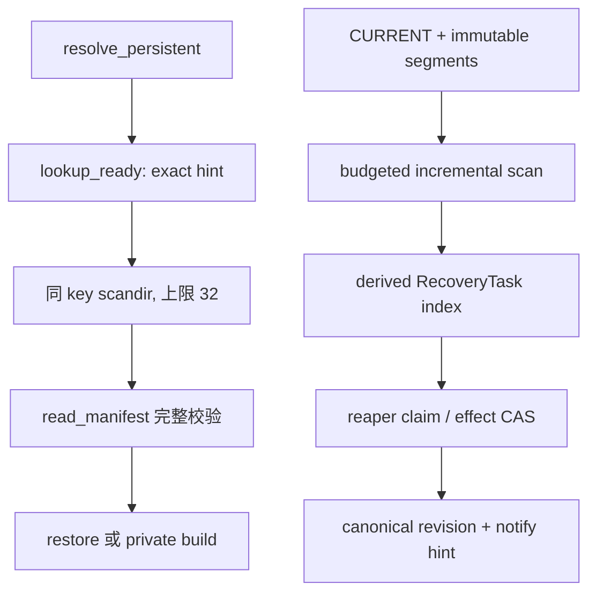
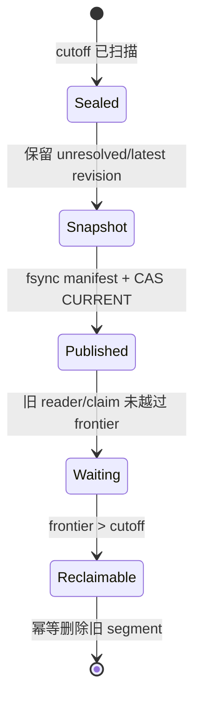

> 源码基线：`hw-native-sys/pypto` 默认分支 [`15cee98e`](https://github.com/hw-native-sys/pypto/commit/15cee98ec9d065283f1310174a4bc5a47b925e0e)。相对上一章的 [`6d0ac8b5`](https://github.com/hw-native-sys/pypto/commit/6d0ac8b5a1c1407a5b8b425c6b4ec4ffa1aadb52)，默认分支前进了 [9 个提交](https://github.com/hw-native-sys/pypto/compare/6d0ac8b5a1c1407a5b8b425c6b4ec4ffa1aadb52...15cee98ec9d065283f1310174a4bc5a47b925e0e)。最新提交修复 AutoTile Mat scratch 的 valid extents；比较结果没有改动 Artifact Store、persistent JIT、`ArtifactRuntime`、文档或直接测试。当前代码仍无 durable build journal、RecoveryTask queue、online reaper、revision watch 或 journal compaction；本文把**当前代码/测试事实**与**建议协议**明确分开。

## 本篇在 PTO 课程路线中的位置

这是课程第 89 章。第 87 章让 torn journal 可以 deterministic replay，第 88 章定义了 `READY/BLOCKED`、epoch claim 与 no-lost-wake。现在假设这条建议的 recovery path 已经开始工作，新的问题是：重启后不能每次遍历整个 cache，积压也不能只用一个“队列长度”表示，append-only journal 更不能无限长。

课程 56–70 已讨论过设备侧 lease/WAL 的通用 compaction 与 backpressure。本章不重复那套抽象，而是把它约束到 PyPTO 的真实边界：`artifacts/<environment>/<key>/<spec>/<state>` 目录、最多 32 个 READY candidate、每次命中都完整重算 manifest、private/staging orphan，以及 JIT waiter 需要看到的 canonical revision。

本章仍是 Host Artifact 控制面，不新增 PTO ISA、Tile、layout、memory location 或 NPU pipeline 语义。

## 前置知识

先固定四条结论：

1. shared final slot 的 completion manifest 证明 payload 完整性；build/recovery journal 证明 owner、phase、claim 和 ledger effect。前者不能兼任后者。
2. `RecoveryTask` 是从 canonical BuildRecord 派生出的可重建索引，不是唯一真相；queue entry 丢失时必须能从 revision log 或审计扫描恢复。
3. `BLOCKED` 任务仍是 recovery debt，必须计费、保留并可观测；它只是不占 runnable head，不能被 compaction 当作“旧记录”删除。
4. waiter notification 只是 hint。无论 scan、reaper 还是 compactor 完成工作，调用者都必须按 durable revision 重新读取 canonical state。

## 今日 1–2 个核心问题

1. Artifact 数量变大后，如何只扫描自上次 cursor 之后的新 revision，同时保证 crash 重放不漏任务、不重复计费？
2. recovery backlog 与 journal 同时增长时，怎样从 RTO、处理速率和磁盘余量推导 watermarks，并在 compaction 后仍保留所有未闭合的 `READY/BLOCKED` 任务？

## PTO 全栈中的位置

当前实现与建议控制面应保持分层。`lookup_ready()` 继续服务一次 JIT resolution；增量 scanner/reaper 服务跨 crash 的控制面闭环，不能让一次前台 lookup 承担全局恢复。

上半段是当前代码事实；下半段是本文建议。二者共享 `ArtifactKey/ArtifactSpec` identity 和 manifest verifier，但不能共享“目录枚举结果就是 durable queue”这一假设。

## 概念和精确语义

### Backlog 不是一个数字

至少要同时观测三组向量：

| 压力 | 最小观测量 | 它回答的问题 |
| --- | --- | --- |
| discovery debt | `latest_revision - scanned_revision`、最老未扫描时间 | 还有多少 canonical 变化尚未物化成 task？ |
| executable debt | READY/BLOCKED 数量、charged bytes、oldest eligible age | 恢复工作能否在目标时间内收敛？ |
| durability debt | live segment bytes、snapshot peak、quarantine bytes、reserve | compaction 自己会不会把磁盘写满？ |

令 recovery debt 到达速率为 `λ`，验证并闭合的服务速率为 `μ`。如果长期 `μ ≤ λ`，调整 scan cadence 或更频繁 compaction 只会改写磁盘形状，不会让 backlog 收敛；必须增加 reaper service、降低新 debt 的 admission，或把前台构建降级到已有的 private fallback。磁盘侧还必须满足：

`live_journal + compaction_peak + unresolved_quarantine + emergency_reserve ≤ durable_budget`

因此源码没有提供的“80%/60%”阈值不能凭空写入设计。高低水位应由观测到的 `λ/μ`、恢复目标时间、snapshot 写放大和真实磁盘 headroom 反推，并用 hysteresis 防止 NORMAL/PRESSURE 抖动。

### Incremental scan 的 cursor 是提交点

建议 journal 采用 immutable ordered segment，record 带单调 `revision`。scanner cursor 至少保存：

`(segment_id, record_offset, manifest_digest, scan_generation)`。

处理某条 record 时，顺序必须是：验证 record 与 previous-digest chain → 以稳定 `task_id` 幂等 materialize/update task → durable 提交 task index → 再推进 cursor。`task_id = H(artifact_id, reservation_id, source_revision, target_action)`；如果在 task durable 后、cursor checkpoint 前崩溃，重启只会重新得到同一 task，而不会重复 charge 或重复 delete。

每个 tick 可以按 records、bytes 和 wall time 三个预算取最先耗尽者。cursor 的权威顺序来自 segment/offset，不来自 `os.scandir()` 的枚举顺序、mtime 或“先看到的 N 个目录”。快速增量链之外，还需要按 digest range 分片的低频 full audit：增量 log 负责低延迟，审计负责发现 index write 丢失、目录损坏和实现 bug；两者都只能把证据写回 canonical record，不能直接释放容量。

### Watermark 改变 mode，不改变安全规则

建议 mode 至少包含：

- `NORMAL`：scan horizon、oldest eligible age 和 compaction peak 都在测得预算内；新构建走常规 admission。
- `RECOVERY_PRESSURE`：优先保留 scanner/reaper/compactor 的 I/O、内存与容量 reserve；节流会制造新 debt 的 shared publication，必要时只允许已获授权的 private fallback。
- `EMERGENCY_FAIL_CLOSED`：emergency reserve 将被侵占时拒绝新增 durable debt，但仍允许能降低 debt 的 VERIFY、DELETE、snapshot cutover 与 release effect。

mode transition 必须绑定 `pressure_epoch + expected_revision` CAS。queue length 下降不代表可立刻恢复 admission：还要确认 scan cursor 追上安全 prefix、最老任务年龄恢复、compaction peak 可容纳，且 BLOCKED bytes 没有被从账上藏掉。

### Compaction cutoff 与 cutover 不是一次文件删除

可安全选择的 cutoff `C` 必须同时满足：所有 `revision ≤ C` 已被 scanner 验证并 materialize；snapshot 能表达该前缀内每个 Artifact 的 latest state 和全部 unresolved task；所有已吸收的 terminal effect 已经 durable。compactor 先 seal 输入 segment，再生成 immutable snapshot 与新 manifest，写入 previous-manifest digest、cutoff、scan generation 和 effect watermark；文件与父目录 durable 后，才以旧 generation 为 expected value CAS `CURRENT`。`CURRENT` 依旧只是加速入口：恢复时必须验证它指向的 manifest，若 pointer torn/stale，就沿有效 digest chain 选择最高可达 generation，冲突则 fail closed。

cutover 成功也只表示新 reader 应打开新 generation，不表示旧 segment 已无人持有。scanner 可能还保留旧 cursor view，reaper 可能拿着旧 claim 的 evidence offset，waiter 也可能在 subscribe/reload 窗口读取旧 snapshot。故删除另由 reader/claim frontier 驱动；compactor没有资格用进程 PID、mtime 或固定宽限期推断“读者大概走了”。这正是下一章要展开的边界。

### 关键接口契约

| 接口 | 输入与前置条件 | 输出、所有权与失败方式 |
| --- | --- | --- |
| `scan_tick(cursor, budget)`（建议） | 已验证的 segment manifest；budget 为 records/bytes/time 向量；Host CPU/持久存储，无 device tensor | durable task updates 与新 cursor；scanner只拥有临时 buffer。record 断链、schema unknown、generation 变化时停止并 quarantine，不跳过 |
| `materialize(record)`（建议） | canonical identity、source revision、target action；同一 `task_id` 可重复调用 | 创建或幂等更新 derived task；不能直接 delete/release。identity 冲突或旧 revision 返回 fail-closed verdict |
| `compact(C, expected_generation)`（建议） | `C` 已扫描；snapshot peak 已 reservation；无未知 unresolved state | immutable snapshot/manifest 与新 generation；CAS 失败则新产物保持未发布、不得删除旧 segment |
| `read_manifest(directory,key,spec)`（当前） | 指定 Artifact 目录和精确 key/spec；普通文件系统字节，无 shape/dtype/device tensor | 返回经 inventory/hash/canonical compare 验证的 manifest或 INVALID；调用者不取得 payload 删除权 |

并发假设也必须写进 API：多个 scanner 可以处理不同 shard，但只有持有当前 `scan_generation` 的提交者能推进对应 cursor；多个 reaper 可并发 claim 不同 task，同一 task 的 result 必须匹配 claim epoch 与 expected record revision；compactor与它们并行时只发布新 generation，不原地改写 reader 正在使用的 segment。

## 真实文件、类型、API 或指令逐段解读

### 1. `ArtifactStore` 留下了哪些可恢复对象

[`artifact_cache.py`](https://github.com/hw-native-sys/pypto/blob/15cee98ec9d065283f1310174a4bc5a47b925e0e/python/pypto/jit/artifact_cache.py) 把 shared slot 定位为 immutable store。`_build_private()` 在 private root 下创建 `pypto-build-*`；`_publish()` 复制到 destination parent 内的 `.tmp.*` staging，重新校验后最后写 completion marker，再用 no-replace rename 发布。当前进程会 best-effort 删除自己的 staging，但 fresh `ArtifactBuild` 会保留 private directory/value；类型文档明确说明没有 automatic cleanup。

这意味着 full scan 至少会遇到三类目录：valid final、永不命中的 `.tmp.*`、可能仍被 live Python/runtime object 使用的 private tree。path age 不能区分三者，建议 scanner 必须先生成 evidence/task，等 runtime lease、writer terminal 和 generation fence 闭合后才让 reaper 删除。

### 2. `read_manifest()` 的成本决定 scanner 不能无界

[`_artifact_manifest.py`](https://github.com/hw-native-sys/pypto/blob/15cee98ec9d065283f1310174a4bc5a47b925e0e/python/pypto/jit/_artifact_manifest.py) 的 `read_manifest()` 不只解析 `artifact_manifest.json`。它会按给定 `ArtifactKey/ArtifactSpec` 重新构造 inventory、hash payload，再 canonical compare；manifest 自身上限为 16 MiB。这个设计给出强完整性，却也说明“启动时 rglob 所有目录并完整 hash”会把前台延迟和 I/O 与 cache 总体积绑定。

建议 queue snapshot 只保存 identity、latest revision、task state、effect/retire watermark 与证据 digest，不能复制 artifact payload，也不能在每次 compaction 时重新 hash 全部 payload。只有 task action 真正需要 `VERIFY_FINAL` 时才调用现有 verifier；snapshot digest 证明的是控制状态，不冒充 payload manifest。

### 3. 当前 READY candidate scan 是局部 fail-closed，不是全局恢复

[`_persistent.py`](https://github.com/hw-native-sys/pypto/blob/15cee98ec9d065283f1310174a4bc5a47b925e0e/python/pypto/jit/_persistent.py) 的 `_lookup_ready_candidates()` 只枚举**同一 ArtifactKey 的 stage parent**。它先收集 64-hex 目录名；超过 `_MAX_READY_CANDIDATES = 32` 就返回 `INVALID`，没有悄悄选前 32 个。候选随后排序，按 metadata 推导 `ready_spec`，再对每个候选执行完整 `lookup()`；多命中同样 fail closed。

这是一条很好的局部安全线：候选爆炸或歧义不能随机选中。但它既没有 durable cursor，也没有跨 key index；把上限从 32 调大只会放大单次 lookup 成本，不能解决 recovery backlog。控制面应借鉴“有界、歧义 fail closed、完整验证”的原则，而不是复用这次前台目录扫描充当 recovery queue。

### 4. runtime 持有权使 BLOCKED 必须穿过 compaction

[`_artifact_runtime.py`](https://github.com/hw-native-sys/pypto/blob/15cee98ec9d065283f1310174a4bc5a47b925e0e/python/pypto/runtime/_artifact_runtime.py) 的 `ArtifactRuntime` 持有 path 与 live callables；`load()` 还能将 GENERATED promotion 为 READY/private。当前没有显式 online cleanup/lease receipt。因而 scanner 发现 512 MiB private tree 只得到“可能需要回收”，不能得到“现在可以删除”。

建议 snapshot 必须保留这类 task 的 `BLOCKED(prerequisite=runtime_terminal)`、charged bytes、source revision 和 lease evidence digest。compactor 若只复制 runnable queue，就会把最大的真实 debt 从系统视图和 admission 预算中抹掉。

仓库的 [Artifact Store 文档](https://github.com/hw-native-sys/pypto/blob/15cee98ec9d065283f1310174a4bc5a47b925e0e/docs/en/dev/09-artifact-store.md) 也明确给出当前操作边界：invalid final slot 不在线修复，lock file 不 unlink，没有 online garbage collection、diagnostic index、global statistics 或 automatic stage preference，cleanup 必须在所有 consumer 停止后离线执行。这些是本文需要控制面协议的证据，不是“主干已经有 online compactor”的证据。

## 对象/Tile/Buffer/IR 生命周期

本章的核心对象不是 device Tile，而是一条 `RecoveryTask` 派生记录：

1. canonical BuildRecord append revision `r`，例如 owner-loss 后需要 `DELETE_PRIVATE`。
2. scanner 从 segment offset 读取并验证 `r`，派生稳定 task identity；task 由 recovery index 持有。
3. prerequisite evaluator 把它分成 `READY` 或 `BLOCKED`；两者都继续计入 backlog/容量，只有 READY 进入 runnable scheduler。
4. reaper 以 `reaper_epoch + expected_record_revision` claim，执行 manifest verify、physical delete 或 ledger CAS。
5. effect durable 后，canonical record 单调推进到 `r+1`；task 变 terminal，waiter 收到 hint 后 full reload。
6. compaction 只有在 effect/reader/claim watermark 足够时才把 terminal history吸收进 snapshot；未闭合任务跨 generation 继续存在。

Artifact 的 shape、dtype、layout 和 device memory 不在这个对象里。`Tensor[1024,1024] FP16` 等 specialization 已被编码进 `ArtifactKey.specialization_digest`；RecoveryTask 只引用其稳定 digest，不能重新解释 Tensor 语义。

## 端到端调用链或指令链

从公开 JIT resolution 到建议的恢复闭环，完整链条是：

`resolve_persistent → capture toolchain/specialization → object-cache check → construct ArtifactKey/Spec → lookup_ready exact hint/candidates → lookup GENERATED → private generate/publish → ArtifactBuild/ArtifactRuntime`。

crash 后旁路控制链是：

`validate CURRENT/segment manifest → load cursor → scan new BuildRecord → materialize RecoveryTask → prerequisite classify → reaper claim → read_manifest/physical effect → capacity effect CAS → BuildRecord revision commit → notify hint → resolve_persistent reload`。

注意最后一步没有“把 reaper 的 path 直接塞回 waiter”。waiter 仍从 `ArtifactKey/Spec` 执行正常 lookup，故重复、乱序或丢失 notify 都不会改变正确性。

## 具体 shape、Tile 和状态演算

下面是教学演算，不是仓库实测阈值。假设某 `1024×1024 FP16` kernel 的 private READY tree 为 96 MiB；segment `S12` 含 revision 100–107，scanner 每 tick 最多处理 3 条 record：

| rev | Artifact / action | charged bytes | 扫描后的状态 |
| --- | --- | ---: | --- |
| 100 | A / `VERIFY_FINAL` | 0 MiB | 验证成功，canonical 变 PUBLISHED |
| 101 | B / `DELETE_PRIVATE` | 96 MiB | READY；task id 稳定派生 |
| 102 | C / `DELETE_PRIVATE` | 512 MiB | BLOCKED：runtime lease active |
| 103 | B / claim-result | 96 MiB | 合并到同 identity 的新 revision |
| 104 | D / invalid final slot | 48 MiB | quarantine，需 operator/repair evidence |
| 105–107 | 其他状态 | — | 后续 tick 处理 |

scanner 在 materialize B 后、写 cursor 前崩溃。重启仍从 revision 101 开始；稳定 `task_id` 使重复 materialize 成为 update/no-op，不会再加 96 MiB charge，也不会产生第二个 delete authorization。

现在 compactor 选择 cutoff `C=106`。它必须先确认 scanner 已 durable 扫过 106，且没有 claim 仍把 106 之前的旧 state 当 current。新 snapshot 写入每个 Artifact 的 latest revision、B/C/D 的 unresolved state、effect watermark 与 previous manifest digest；A 的 terminal history只有在 PUBLISHED effect 已 durable 时才可吸收。snapshot 与 manifest fsync 后，compactor以 old generation 为 expected value CAS `CURRENT`。即使 C 仍 BLOCKED 512 MiB，它也进入新 generation；旧 `S12` 要等 reader/claim frontier 越过 106 才可删。

## 为什么这样设计及替代方案

| 方案 | 延迟/吞吐 | 正确性与维护成本 |
| --- | --- | --- |
| 每次启动全量 `rglob/scandir` | 无 index 写放大；cache 大时启动与磁盘 I/O 无界，完整 hash 更昂贵 | 目录是真相，结构简单；但难以给 RTO、cursor 与公平性承诺 |
| 只有 append-only task queue | 入队/消费快，易做顺序 replay | queue write 丢失就永远看不到 orphan；若把它当真相，无法从 Artifact/BuildRecord 重建 |
| SQLite/外部 DB 为唯一真相 | transaction/index 方便 | filesystem payload 与 DB 仍有双写窗口；网络 FS、migration 和部署成本上升，不能消除 manifest 验证 |
| **segment journal + derived index + sharded audit** | 前台 scan 有界，compaction 可预算，audit 摊销 | 协议最复杂，但 queue 可重建、payload manifest 仍是最终完整性证据 |

推荐最后一种不是因为 segment 天然高级，而是它同时满足三个不可约束：immutable payload 已存在 filesystem、恢复工作必须有界、index 不能成为丢失 orphan 的单点真相。

## 访存、计算、流水、并行和硬件约束

本章没有 NPU Tensor shape 或 device buffer；成本主要是 Host metadata I/O、payload hash、目录项与 durable fsync。

- `read_manifest()` 对 payload inventory/hash 的工作量随文件数与字节增长，不能在 scanner 热路径无界并发。
- scanner、reaper、compactor 可流水，但必须分 resource reserve：scanner 产 task，reaper 降 debt，compactor 先增加临时 snapshot peak 再回收旧 segment。磁盘接近满时不能让 compactor 因没有 peak headroom 而永久无法启动。
- 多 scanner 可以按 immutable segment/digest shard 分工，cursor commit 仍要 generation fenced；多 reaper 按 task claim epoch 并发，不得让旧 claim 在 compaction 后提交到新 revision。
- graphability 不受影响：这些都是 JIT/Artifact Host 控制面，不进入 PTOAS kernel graph；但恢复节流会影响首次编译延迟和 cache hit 路径可用性。
- 对 NFS/对象存储不能默认本地 `flock`、no-replace、directory fsync 或 listing consistency。现有文档已要求先证明 filesystem contract；journal adapter 同样应 fail closed。

## 测试证据与未覆盖风险

[`test_artifact_cache.py`](https://github.com/hw-native-sys/pypto/blob/15cee98ec9d065283f1310174a4bc5a47b925e0e/tests/ut/jit/test_artifact_cache.py) 已提供这些直接事实：

- abandoned `.tmp.*` 不命中，empty final slot 返回 INVALID；fallback private 后 orphan 仍存在。
- `_copy_payload/_complete_staging/_rename_noreplace/_sync_directory` 注入失败时，private output 保持可用；当前进程 staging best-effort 清理。
- rename 后 parent sync 失败可同时留下 valid private 与 published output。
- 4 个线程同 key 只 build 一次；3 个 spawn process 得到 1 PUBLISHED/2 HIT；dead process 释放同一 lock inode；不同 key 可以并行 build。

这些测试验证了“为什么会有 debt”和“同 key 如何合并”，没有验证本文建议协议。最小新增测试矩阵应包含：

1. task durable 前/后与 cursor checkpoint 前/后逐点 kill，重启后恰好一个 stable task/charge。
2. segment manifest torn、`CURRENT` stale、同 generation 双 manifest、previous-digest 断链时 deterministic fail closed。
3. `BLOCKED` 跨 snapshot 保留，且 queue runnable head 不被占用、charged bytes 不下降。
4. CAS cutover 后旧 reader/claim 延迟完成，不能删除仍被引用的 segment，也不能把旧 effect 提交到新 revision。
5. `μ<λ` 压力下进入 RECOVERY_PRESSURE，停止制造新 shared debt；追平 cursor、关闭 oldest debt 并满足低水位后才以新 pressure epoch 恢复。
6. 目录 audit 发现“journal/index 没记录但物理 orphan 存在”时，只创建 quarantine evidence，不直接释放或删除。

仍未覆盖的风险包括：真实 cache 百万目录时的扫描成本、payload hash 与编译 I/O 争用、compaction ENOSPC、跨 filesystem private root、NFS listing/lock 语义、多进程 reaper ABA，以及 NPU runtime 意外死亡后 terminal evidence 的来源。

## 与前后章节的连接

上一章定义 task identity、READY/BLOCKED、claim 与通知；本章给这些 task 增加发现进度、压力模式与 durable generation，使它们不会因 crash、积压或 compaction 消失。

下一章将收紧这里暂时写成一句话的删除条件：**compaction 已切换到新 snapshot 后，旧 segment 何时真的无人使用？**我们将区分 scanner cursor、reader snapshot pin、reaper claim lease 与 waiter subscription，建立 generation GC 的 reader/claim frontier，避免刚完成 cutover 就删除慢 reader 仍要读取的证据。

## 本篇结论、知识债、三个理解检查问题和下一章

结论只有三条：

1. recovery queue 必须是可从 canonical revision 重建的索引；cursor 只在 task durable 后推进，stable identity 让 crash replay 幂等。
2. backlog watermark 必须是 scan horizon、READY/BLOCKED debt、oldest age、charged bytes 与 compaction headroom 的向量；若长期 `μ≤λ`，只能加恢复能力或限制新 debt。
3. compaction 的产物是 unresolved/latest state 的新 immutable generation；`BLOCKED`、quarantine 与未闭合 effect 必须保留，旧 segment 要等 reader/claim frontier 后再删。

知识债：PyPTO 仍缺 BuildRecord/RecoveryTask schema、segment codec、cursor store、pressure mode CAS、runtime lease adapter、capacity ledger、snapshot manifest、reader/claim frontier、full-audit sharding、metrics/阈值校准和 fault-at-every-boundary harness。本文没有声称这些已合入。

理解检查：

1. 为什么 `lookup_ready()` 的 32-candidate fail-closed scan 不能直接充当全局 recovery scanner？
2. scanner 在 task durable 后、cursor checkpoint 前崩溃，靠哪两个 identity/revision 条件避免重复 charge？
3. compaction 时一个有 512 MiB charge、runtime lease 未结束的 BLOCKED task应进入 snapshot、被丢弃，还是只留一条指标？为什么？

下一章：**Compaction 完成后旧 Segment 何时能删——Reader Frontier、Claim Lease 与 Snapshot Generation GC。**

## 课程账本增量

- 课程 89；源码基线 PyPTO `15cee98e`。
- 新覆盖：`_lookup_ready_candidates/_MAX_READY_CANDIDATES`、`read_manifest` 的完整验证成本、private/staging orphan、`ArtifactRuntime` retention，以及建议的 segment/cursor/snapshot 生命周期。
- 新确认不变量：derived queue 可重建；cursor-after-task；`BLOCKED` 穿过 compaction并继续计费；pressure mode 不改变安全规则；旧 segment 受 reader/claim frontier 保护。
- 无新增 ISA 语义；Host Artifact recovery 从“单任务正确”推进到“积压可收敛、日志可有界”。
- 下一章进入 generation GC，不提前跳到 serving。
