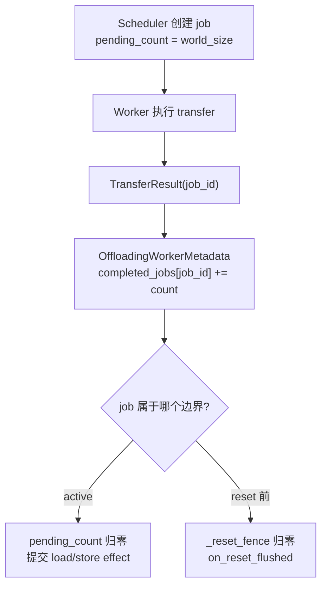
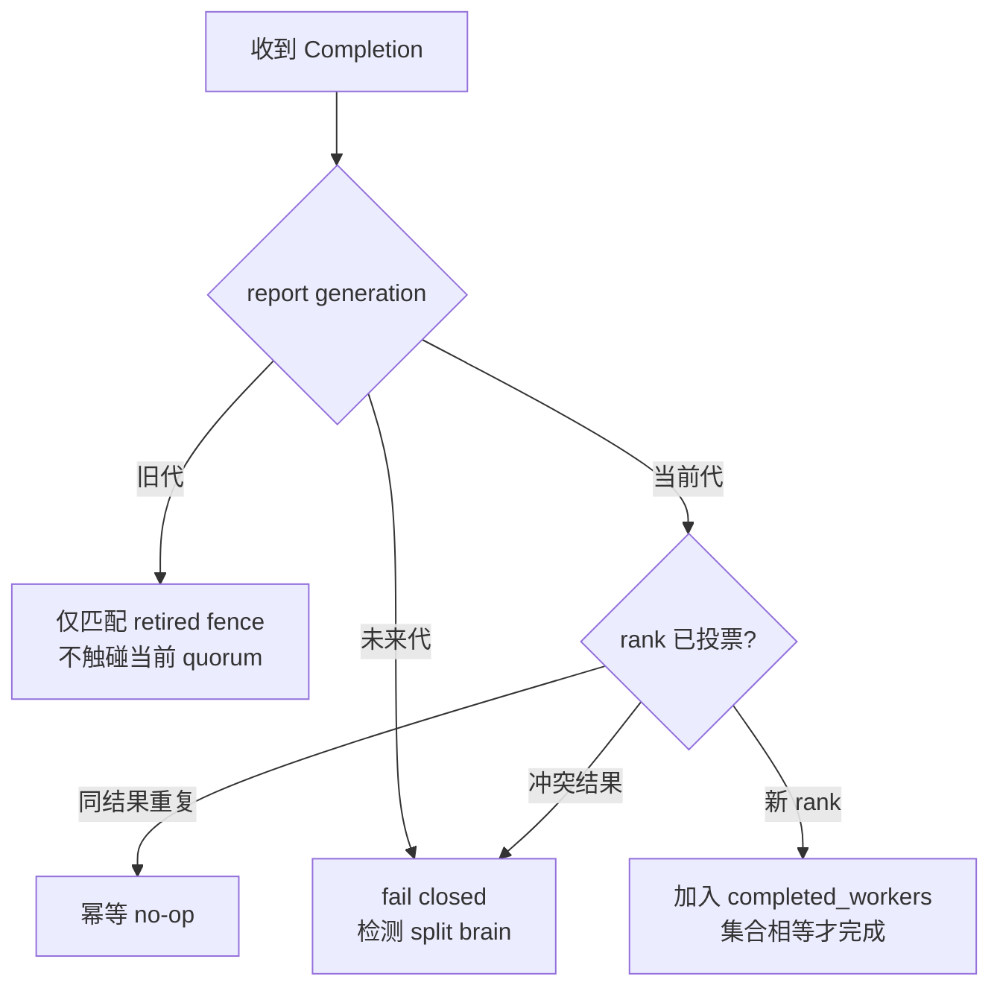

> 源码基线：[`8176238c`](https://github.com/vllm-project/vllm/commit/8176238c97f982ddc266e8bacb2aca9e11926af7)，即研究时 `vllm-project/vllm` 默认分支最新提交。相对上一章基线前进 [103 个提交](https://github.com/vllm-project/vllm/compare/7045518494fdf62472947e38fdbe9367ecbd1b71...8176238c97f982ddc266e8bacb2aca9e11926af7)；本篇直接分析的 completion、quorum 与 reset-fence 文件没有语义变化。跨节点 Region Mirror 仍来自 **open、未合入** 的 [PR #62933](https://github.com/vllm-project/vllm/pull/62933)，所以本文严格区分 main 事实、候选 PR 事实和建议协议。

## 本篇在课程路线中的位置

这是课程第 79 章，仍位于“测试、性能与故障诊断”。第 78 章已经得到物理层结论：mirror generation 能拒绝旧控制消息，却不能撤回已下发到 NIC 的 WRITE；复用 destination page 仍需 `no-old-writer` witness 或保留旧 backing。

本章只追问控制面的对应问题：**新 Scheduler 重启后，如果旧 generation 的 `TransferResult(job_id=41)` 迟到，怎样避免它误完成新 generation 恰好同号的 job？两份 report 又怎样证明来自两个不同 worker，而不是同一 worker 的重复投票？**

## 前置知识回顾

main 已经合入 [PR #62929](https://github.com/vllm-project/vllm/pull/62929)：cache reset 时不能立即允许 secondary tier promotion，因为旧 worker job 可能仍在向刚释放的 primary chunk 写 DMA。Scheduler 记录每个旧 job 尚欠多少 worker report，manager 在 fence 清空前把 secondary-only lookup 降级为 `MISS`。这是正确的**同一 Scheduler 生命周期内**安全协议。

开放 PR #62933 的候选 `RegionMirrorWorker` 也遵守相同 completion 口径：NIXL `DONE/ERR` 才生成 `TransferResult`；stuck transfer 不伪造终态，而是停止 engine。不过该候选实现仍只报告整数 `job_id`，没有把 mirror generation 或 worker rank带进 receipt。

## 本篇要回答的核心问题

1. 当前 `pending_count + _reset_fence` 精确保证了什么，依赖哪些隐藏前提？
2. 进程重启、report replay 或连接重建后，为什么整数 `job_id` 和匿名计数会产生 ABA？
3. 不引入完整共识系统，最小恢复协议需要给 job、report 和 quorum 增加哪些身份？

## 组件在全局架构中的位置



上游是 Scheduler 生成的 load/store job 与 worker metadata fan-out；下游是 `complete_load/complete_store`、primary chunk 释放、secondary cascade 和 promotion reopen。换言之，report 不是普通指标：它是**允许数据 effect 提交或地址重新使用的控制票据**。

## 完整调用链

当前 main 的真实链路如下：

1. [`OffloadingConnectorScheduler`](https://github.com/vllm-project/vllm/blob/8176238c97f982ddc266e8bacb2aca9e11926af7/vllm/distributed/kv_transfer/kv_connector/v1/offloading/scheduler.py) 用进程内 `_job_counter` 分配整数 ID，并创建 `TransferJobStatus(pending_count=num_workers)`。
2. metadata 被所有 worker消费；canonical writer真正搬数据，非 writer仍需 ack，因为 Scheduler 等待 `parallel_config.world_size` 张票。
3. [`OffloadingConnectorWorker.get_finished()`](https://github.com/vllm-project/vllm/blob/8176238c97f982ddc266e8bacb2aca9e11926af7/vllm/distributed/kv_transfer/kv_connector/v1/offloading/worker.py) 把底层 [`TransferResult`](https://github.com/vllm-project/vllm/blob/8176238c97f982ddc266e8bacb2aca9e11926af7/vllm/v1/kv_offload/base.py) 转成 `completed_jobs[job_id]=1` 或 `failed_jobs.add(job_id)`。
4. `build_connector_worker_meta()` 取走本轮结果并换成空 metadata；多 rank 输出经 [`OffloadingWorkerMetadata.aggregate()`](https://github.com/vllm-project/vllm/blob/8176238c97f982ddc266e8bacb2aca9e11926af7/vllm/distributed/kv_transfer/kv_connector/v1/offloading/common.py) 合并为 `{job_id: count}`。
5. Scheduler 对 active job 扣减 `pending_count`；对 `job_id < _stale_job_threshold` 的旧 job，只扣 `_reset_fence`。最后一票到达后，active job 提交 effect，或 reset fence 调用 `manager.on_reset_flushed()`。

这条链在正常进程内成立，因为每个 worker 的结果被 drain 一次、`_job_counter` 单调增加、worker 集合固定。源码没有把这些前提持久化为协议字段。

## 关键类型、字段和状态生命周期

`TransferResult` 只有 `job_id/success/transfer_size/transfer_time`。它不携带 engine boot、mirror generation、worker rank、attempt 或 destination identity。

`OffloadingWorkerMetadata.completed_jobs` 是 `dict[int, int]`。`aggregate()` 只相加计数，来源 rank 在聚合后消失。正常路径利用“每 rank 每 job只 drain 一次”保证计数可信；一旦允许重放、重连或 crash recovery，匿名票数就无法去重。

`TransferJobStatus.pending_count` 从 `world_size` 递减到零；`_reset_cache()` 则把当前 job 的剩余 `pending_count` 复制进 `_reset_fence`，提高 `_stale_job_threshold`，清空 `_jobs`。旧 report 从此只能排空 fence，不能再次提交 load/store effect。[`TieringOffloadingManager`](https://github.com/vllm-project/vllm/blob/8176238c97f982ddc266e8bacb2aca9e11926af7/vllm/v1/kv_offload/tiering/manager.py) 在 fence 清空前保持 `_promotions_held=True`。

但 Scheduler 进程死亡后，`_job_counter`、`_stale_job_threshold`、`_reset_fence`、`_jobs` 都消失。新进程又从 0 计数；这正是生命周期断裂点。

把接口契约压缩成表格，更容易看到缺失的是哪一种 identity：

| 接口/对象 | 输入与输出 | shape/dtype/device | 所有权与前置条件 | 失败方式 |
| --- | --- | --- | --- | --- |
| `OffloadingWorker.get_finished()` | 无参数；返回 `list[TransferResult]` | 控制面 Python 对象；`job_id: int` | worker持有底层 transfer，只有 terminal 才上报 | `success=False` 表示已知失败；unknown 不能伪装成完成 |
| `OffloadingWorkerMetadata` | `completed_jobs: dict[int,int]`、`failed_jobs: set[int]` | CPU metadata，无 tensor | 单 worker构造；跨 rank aggregate 后丢失来源 | 重放场景无法按 rank去重 |
| `TransferJobStatus` | job identity、keys、`pending_count`、load/store状态 | `keys` 指向 CPU/GPU KV chunk；数量依请求而变 | Scheduler独占；`pending_count` 初值必须等于 expected workers | 未知 `job_id`、过量 count 或计数负值破坏断言/正确性 |
| `_reset_fence` | `job_id → remaining reports` | CPU `dict[int,int]` | 仅当前 Scheduler进程持有；reset前复制欠票数 | 进程死亡即丢失，不能跨 boot解释迟到票 |

数据本体仍是 worker侧的 KV tensor/chunk：GPU device、模型 KV dtype、形状由 cache group决定；本文所改的是它的控制面 receipt，不改 tensor layout。关键所有权关系是：worker拥有 transfer终态，Scheduler拥有“何时提交 effect”的唯一决策权，manager拥有 primary/secondary chunk复用。任何一层都不能用自己看见的局部事实越权替另一层作证。

## 逐函数源码解读

### `_generate_job_id()`：单调只限于一次进程生命

函数返回当前 `_job_counter` 后加一。它足以避免活进程内重号，却没有 durable boot/generation 前缀。若 transport 或远端 worker跨 Scheduler 重启存活，旧 `(generation=7, job_id=41)` 与新 `(generation=8, job_id=41)` 在 wire 上都是 `41`。

### `OffloadingWorkerMetadata.aggregate()`：票数不等于投票人集合

聚合逻辑近似 `merged[job_id] += worker_count`。它高效且 payload 小，但无法判断收到的是 ranks `{0,1}`，还是 rank 1 的同一 completion 被 replay 两次。当前实现的安全性来自调用路径，而不是数据结构本身。

### `_reset_cache()` 与 `_update_connector_output()`：正确的进程内 fence

reset 先让 manager drain secondary jobs，再把 active job 的欠票数转为 fence。迟到 report 若小于 threshold，只能减少对应 fence；错误 job 的 report不能解锁另一个 job。这个设计把“逻辑 cache 已 reset”与“旧 worker DMA 已排空”明确分开，是本章建议协议的正确起点。

然而 threshold 只是一个进程内整数分界。重启后旧 report 与新 job没有可比较的 generation；恢复端也没有 rank-attributed census，无法重建“究竟欠谁一票”。

这里要明确事实层级：**代码事实**是 main 只实现进程内计数与 fence；**测试事实**是既有用例证明迟到的“其他 job”不能清掉当前 fence；**PR 事实**是 #62933 延续 `TransferResult(job_id)` 口径且 stuck 时 fail-stop；`JobKey`、rank receipt、durable ledger 都是本文依据这些边界提出的**建议协议**，不是仓库已经承诺的 roadmap。

## 具体示例与 shape/状态演算

沿用两节点 TP=2：4 个 chunk，每 rank slot 为 64 KiB，因此一个完整 row 为 128 KiB。chunk 3 的 rank 1 目标地址是：

`head_base + 3 × 131072 + 65536`。

旧 generation 7 创建 job 41，expected ranks 为 `{0,1}`：rank 0 已报 success，rank 1 的 NIXL WRITE 仍 unknown；此时 Scheduler 崩溃。generation 8 重启后又分配整数 job 41。

- 只有整数 ID：旧 rank 1 的迟到 success 会被解释为新 job 41 的票。
- 只有匿名 count：rank 1 的同一 report若被 replay 两次，计数也可能从 2 扣到 0，看起来像 TP=2 quorum 已齐。
- 使用 `JobKey=(generation, job_seq)` 和 `worker_rank`：`(7,41,1)` 只能处理 generation 7 的 retired fence；新 job假设为 `(8,0)`，rank 0 重复两次仍只算一票，必须收到 `(8,0,1)` 才能闭合 `{0,1}`。

report 还应绑定 destination generation/row identity。否则即使 `(7,41,1)` 真是 terminal，也只能证明旧 backing 上的旧 WRITE 结束，不能授权 generation 8 复用另一块或同一块 backing。

把状态逐步展开：

| 时刻 | 输入 | generation 7 ledger | generation 8 ledger | 可否发布/复用 |
| --- | --- | --- | --- | --- |
| T0 | 提交旧 job 41 | expected `{0,1}`，completed `{}` | 不存在 | 不可 |
| T1 | rank 0 terminal | completed `{0}`，rank 1 unknown | 不存在 | 不可；row仍可能被 rank 1晚写 |
| T2 | Scheduler crash，generation 8启动 | 转为 retired/quarantined | 创建 job 0，completed `{}` | 不可；先完成 census |
| T3 | 旧 `(7,41,1)` 迟到 | completed `{0,1}`，可关闭逻辑旧账 | 仍为 `{}` | 不能完成新 job；物理复用另等 revoke witness |
| T4 | `(8,0,0)` 重放两次 | 不变 | completed始终 `{0}` | 不可；重复票不增加集合基数 |
| T5 | `(8,0,1)` 到达 | 不变 | completed `{0,1}` | 新 job逻辑 quorum成立；仍按 destination fence决定复用 |

这张表揭示了两个独立提交点：T3最多让旧 ledger从 unknown变 terminal，T5让新 job的软件参与者集合闭合；真正允许同一物理 row复用，还要把两者与旧 writer失权证据做 AND。把三件事压成一个 `pending_count==0` 会丢失恢复所需的因果关系。

## 为什么这样设计及替代方案

最小充分设计不需要每个 job 跑一次 Raft；Scheduler 仍可作为唯一权威，但 receipt 必须可幂等重放：

```text
JobKey = (engine_boot_id 或 mirror_generation, job_seq)
Completion = (JobKey, worker_rank, attempt, outcome,
              destination_identity, terminal_epoch)
JobRecord = (expected_workers, completed_workers,
             failed_workers, destination_identity, phase)
```



恢复顺序是：冻结 activation 与地址复用；读取 durable generation/next sequence/job ledger，或声明全新 generation；向 expected ranks收集 last-submitted、terminal 与 unknown census；按 `(generation, seq, rank)` 对账；最后同时满足 report quorum 与第 78 章的物理 `no-old-writer` 条件，才允许新 generation激活。

替代方案比较：全局持久化 64-bit job ID 或 UUID能解决重号，却仍不能去重同一 rank，也没有绑定 destination；重启后全局 barrier若缺少 transport/NIC 的撤销证据，也不能证明旧 DMA 已停。完整分布式共识则成本过高；单 Scheduler authority + durable generation + rank set 已覆盖这里的最小一致性需求。

## 性能、并发、正确性与边界条件

集合式 quorum 的 CPU 成本是每份 report一次哈希或 bitset 更新；TP/PP rank数通常远小于 KV chunk 数，适合用 bitset压缩。持久化不必每个 completion 单独 `fsync`：可以按 generation/批次写 WAL，但 activation、backing reuse 与 ledger compaction 前必须有 durability barrier。

并发边界有三条：同 rank同结果重复是幂等；同 rank结果冲突或 destination digest 不同必须 fail-stop；未来 generation report说明当前 Scheduler落后或 split brain，不能静默丢弃。旧 generation report可清理旧 fence，但绝不能完成当前 job。

正确性还要求把“report quorum”和“物理 writer fence”分开：前者证明所有预期软件参与者给出终态，后者证明旧设备/NIC不再写目标页。任一缺失都不能复用 backing。

恢复时还要固定 expected-rank set。若 topology从 TP=2 变成 TP=4，不能把旧 `{0,1}` 的完成集合直接解释成新 quorum的一半并继续写同一 row；新 generation必须重新计算 `SlotLayout/destination_identity`。相反，某 rank永久丢失也不能通过把 expected set缩小来“完成”旧 job，因为旧 rank可能仍有 unknown WRITE。缩容只对新 generation的新 backing生效，旧 backing仍受旧 expected set与物理 revoke witness约束。

## 测试证据与未覆盖风险

当前 [`test_scheduler.py`](https://github.com/vllm-project/vllm/blob/8176238c97f982ddc266e8bacb2aca9e11926af7/tests/v1/kv_connector/unit/offloading_connector/test_scheduler.py) 直接验证：有 in-flight store 时 reset 后 engine 即使空闲也继续 step；promotion保持 `MISS`；只有被 flush 的精确 job report 到达才解锁；其他旧 job的迟到重复 report不能误清 fence；无 in-flight job时不持 fence；重复 reset 与长时间持 fence warning也有覆盖。端到端 connector 测试还验证 idle engine会收集 worker metadata并恢复 promotion。

这些测试证明的是进程内不变量，没有覆盖：Scheduler 重启后 `_job_counter` 回零、同 rank重复票、rank identity丢失、旧 generation report撞新 job、expected-rank census 缺失、未来 generation/split brain，以及 report terminal 但物理 WRITE 仍 unknown。开放 PR #62933 的 terminal/stuck 测试同样没有跨进程 job identity。

最小新增用例可以完全不依赖真 RDMA：构造 generations 7/8 和 ranks `{0,1}`，先给 `(8,0,0)` 两次，断言 quorum仍缺 rank 1；再给 `(7,41,1)`，断言只改变 retired fence；给 `(8,0,1)` 后才完成。随后让同 rank对同一 `JobKey` 先报 success再报 failure，必须进入冲突终态而非采用“最后写入者胜”。真机层再补 same-address late WRITE，验证控制面 fence与物理 quarantine缺一不可。

建议新增 deterministic fault matrix：在 job submit、单 rank terminal、aggregate 前后、reset-fence 转移和 Scheduler crash 各点注入故障；重启后 replay 旧/重复/冲突/未来代 report。oracle 必须验证：每个 rank最多计一次、旧代不改当前 quorum、缺 rank不完成、冲突 fail-stop、无 `no-old-writer` witness 不复用同一 row。

## 与前后章节的连接

第 78 章解决“旧 writer 是否物理失权”；本章解决“迟到 receipt 是否还能被当前控制面承认”。两者合起来才形成 restart-safe destination ownership：**物理层不能再写，逻辑层也不能把旧票算进新账。**

下一章将进入账本的空间与恢复成本：unknown job、retired generation 和 per-rank receipt不能无限保留，何时能用 watermark/compaction 删除，同时仍保留重启对账所需证据？

## 本篇结论、知识债、三个理解检查问题和下一章

结论：main 的 `_stale_job_threshold + _reset_fence` 是严谨的同进程 reset 协议，但不是 crash-restart generation 协议。跨重启的最小键必须至少是 `(generation, job_seq, worker_rank)`，并绑定 destination identity；quorum必须比较 expected/completed rank集合，而不是匿名计数。

知识债：真实 durable ledger/WAL schema、generation authority、expected-rank 变化、rank census RPC、receipt批量持久化、unknown transfer quarantine、retired generation保留期，以及 NIXL/UCX 跨重启 terminal/revoke 契约仍待实现和真机验证。PR #62933 仍未合入，接口也可能继续漂移。

理解检查：

1. 为什么持久化全局唯一 job ID 仍不足以防止同一 worker重复 report提前闭合 TP quorum？
2. `_reset_fence` 为什么能保护同进程 reset，却不能识别重启前后的两个 `job_id=41`？
3. 旧 generation 的 terminal report 到达后，为什么仍不能单独证明同一 physical row 可以被新 generation复用？

下一章：**Job Ledger 不能无限增长——Unknown Transfer Quarantine、Retired Generation Watermark 与 Crash-safe Compaction。**

## 课程账本增量

- 第 79 章补齐 `TransferResult → worker metadata aggregate → Scheduler pending_count/reset fence → manager promotion reopen` 的 report 生命周期。
- 新确认：匿名 completion count只在固定 worker 集合、单进程单调 job ID、每 rank至多投票一次的前提下等价于 rank quorum。
- 新边界：generation tag隔离逻辑 receipt；`no-old-writer` witness隔离物理 DMA，两者不可互相替代。
- 新建议：`JobKey=(generation, job_seq)`、rank-attributed idempotent receipt、expected/completed worker set、destination identity 与 fail-closed future-generation handling。
- 下一章转向 retained job/receipt ledger 的安全压缩。
