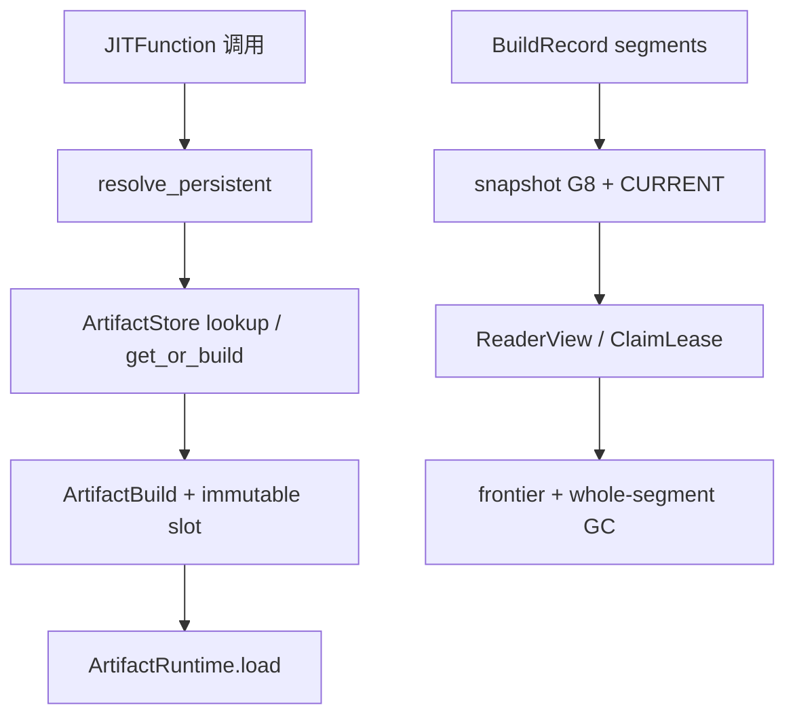
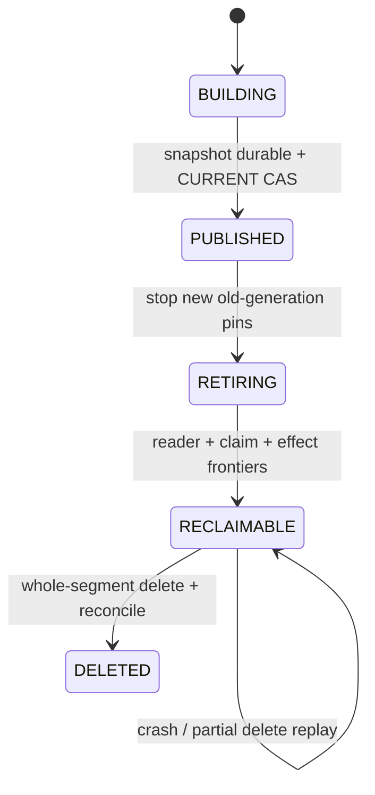

> 源码基线：`hw-native-sys/pypto` 默认分支 [`1f25c43d`](https://github.com/hw-native-sys/pypto/commit/1f25c43de09fe935574ffd815843dca26ccd13e9)。相对上一章的 [`15cee98e`](https://github.com/hw-native-sys/pypto/commit/15cee98ec9d065283f1310174a4bc5a47b925e0e)，默认分支前进了 [1 个提交](https://github.com/hw-native-sys/pypto/compare/15cee98ec9d065283f1310174a4bc5a47b925e0e...1f25c43de09fe935574ffd815843dca26ccd13e9)：[#3318](https://github.com/hw-native-sys/pypto/pull/3318) 定义 external kernel contract v1，没有改动本文直接分析的 Artifact Store、persistent JIT、`ArtifactRuntime`、文档或测试。当前主干仍没有 BuildRecord segment、snapshot generation、reader/claim frontier 或 online GC；下文明确标注**代码/测试事实**与**建议协议**。

## 本篇在 PTO 课程路线中的位置

这是课程第 90 章。第 89 章把 append-only BuildRecord journal 压缩为 snapshot，并留下最后一道门：`CURRENT` 已切到新 generation，只能证明**新读者应从新入口开始**，不能证明旧 segment 已无人使用。

本章与[课程 76]()不重复。课程 76 保护的是 GENERATED/READY **artifact payload slot** 与正在 promotion 的 builder；今天保护的是建议控制面中的 **BuildRecord segment / RecoveryTask evidence / snapshot generation**。前者回答“可执行文件何时能删”，后者回答“恢复证据何时能删”。

本章仍位于 Python/JIT Host Artifact 控制面，不新增 PTO ISA、Tile、layout、memory location 或 NPU pipeline 语义。

## 前置知识

先固定四条已经得到源码支持的边界：

1. [`ArtifactStore`](https://github.com/hw-native-sys/pypto/blob/1f25c43de09fe935574ffd815843dca26ccd13e9/python/pypto/jit/artifact_cache.py) 用 completion marker、完整 manifest、`RENAME_NOREPLACE` 发布 immutable slot，但类注释明确“不支持并发 cache mutation/deletion”。
2. `ArtifactBuild` 的 fresh result 即使成功 publish，仍保留 `private_directory` 与 builder value；[`ArtifactRuntime`](https://github.com/hw-native-sys/pypto/blob/1f25c43de09fe935574ffd815843dca26ccd13e9/python/pypto/runtime/_artifact_runtime.py) 也让 generated/private path 活到对象生命周期结束。
3. [`read_manifest()`](https://github.com/hw-native-sys/pypto/blob/1f25c43de09fe935574ffd815843dca26ccd13e9/python/pypto/jit/_artifact_manifest.py) 会重建 inventory/hash 并 canonical compare；manifest 上限 16 MiB。路径存在或 mtime 新，不是有效证据。
4. [Artifact Store 文档](https://github.com/hw-native-sys/pypto/blob/1f25c43de09fe935574ffd815843dca26ccd13e9/docs/en/dev/09-artifact-store.md) 明确：当前无 online GC，cleanup 要在所有 consumer 停止后离线执行；rename 本身不保护 reader。

## 今日 1–2 个核心问题

1. snapshot `G8` 已发布后，如何证明旧 segment `S12` 对所有 reader 都不再可达，而不是只靠固定宽限期猜测？
2. reaper 已 claim 一条来自 `S12` 的任务时，怎样允许 claim 超时接管，又禁止旧 claimant 在 segment 删除或 generation 切换后提交迟到 effect？

## PTO 全栈中的位置

当前真实链负责“找或造出可执行 artifact”；建议的 generation GC 只管理旁路的恢复证据，不能接管 payload 所有权。

上半段是当前代码；下半段是建议控制面。两者可以共享 `ArtifactKey/ArtifactSpec` 与 manifest digest，但 snapshot 不能冒充 artifact payload manifest，GC 也不能因为控制记录已压缩就删除 live payload。

## 概念和精确语义

### `CURRENT` 是入口，不是删除证书

建议每次 compaction 生成 immutable `SnapshotManifest(generation, cutoff_revision, absorbed_segments, state_digest)`，先同步 snapshot/manifest 与父目录，再以 expected generation CAS `CURRENT: G7→G8`。成功后的语义只有两条：新 reader 不再注册到 G7；恢复可从 G8 加未吸收 tail 重建 canonical state。

旧 segment 进入 `RETIRING` 后仍可能被两类 actor 使用：批量 scanner 的 `ReaderView` 正在读取旧 revision；reaper 的 `ClaimLease` 正在用旧 record 证明 delete/reconcile effect。因此安全删除前缀应写成：

`safe_delete_through = min(snapshot_cutoff, reader_safe_through, claim_safe_through, effect_safe_through)`。

这里每个 `*_safe_through` 都表示“不再需要的最大连续 revision”，不是“见过的最大 revision”。任何 gap、unknown 或未闭合 claim 都会把 frontier 卡在更小值。GC 只删除 `segment.end_revision <= safe_delete_through` 的完整 sealed segment；若 cutoff 落在 segment 中间，要么把尾部 record 搬进新 tail，要么把 cutoff 对齐到 segment 边界，不能删半个目录后假装日志仍连续。

### Reader frontier：先注册，再复查入口

建议 `open_view()` 返回 `ReaderView(reader_id, incarnation, generation, max_revision, segment_set_digest)`。为了关闭“先读 CURRENT、尚未登记，GC 已删旧段”的窗口，顺序必须是：

1. 读取并验证 `CURRENT=G7`；
2. durable 注册 G7 reader pin；
3. 再读 `CURRENT`。若已变成 G8，释放 G7 pin并重开；
4. 只读取 view manifest 列出的 immutable segment；完成后显式 release。

heartbeat/expiry 只是故障检测。若不能证明旧进程 incarnation 已终止、不会再打开文件，过期不能直接变成删除授权；宁可 quarantine。若实现选择 POSIX open-fd 在 unlink 后继续可读，也仍要处理“一个 segment 包含多文件、reader 尚未逐个 open”的窗口，不能把单个 fd 的性质扩大成整个目录快照。

### Claim lease：保护提交权，也 pin source evidence

建议 `ClaimLease` 至少携带 `task_id、claim_epoch、source_generation、source_revision、expected_task_revision、effect_id`。claim 可超时重领，但 effect 只允许当前 `claim_epoch + expected_task_revision` CAS 提交。旧 claimant 即使仍持有 `S12` 内容，也只能产生被拒绝的迟到结果。

reader lease 与 claim lease 不能合并：reader 只保护证据可读，不授予副作用；claim 授予单次 apply 权，并把 source evidence 纳入 claim frontier。合并会在“只读扫描很多、真正 effect 很少”时过度保留，或在 reader 释放时误删仍被 claim 使用的证据。

### 四个线性化点不能互相冒充

这套协议最容易出错的地方，是把“文件已经写完”“入口已经切换”“任务已经做完”“空间已经归还”压成一个完成状态。实际上至少存在四个不同的线性化点：

| 线性化点 | 它证明什么 | 它不能证明什么 |
| --- | --- | --- |
| snapshot manifest durable | 新快照字节完整、可独立验证 | 新 reader 已经看见它；旧 reader 已退出 |
| `CURRENT` CAS | 从这一刻起新 view 应选择 G8 | 旧 generation 无 pin；S12 可删 |
| effect CAS | 某 claim 的 delete/reconcile 结果已 exactly-once 进入 canonical state | source segment 已无人读取；磁盘 blocks 已归还 |
| physical delete + charge CAS | 目标 segment 已按 identity 删除并只释放一次容量 | 不能反推早先 effect 一定正确，仍须保留审计摘要 |

因此崩溃恢复只能单调向前。snapshot 写完但 `CURRENT` 未切换时，它只是 orphan candidate，恢复仍以 G7 为入口；`CURRENT` 已切换但 retire list 未写完时，可由 G8 manifest 的 `absorbed_segments` 重建候选集，不能回滚到 G7；tombstone 后删到一半时，新 GC owner 复验 generation、segment digest 与删除授权，再继续幂等删除；最后一个目录项消失但 charge CAS 未提交时允许暂时多计费，禁止先释放容量再删除造成 under-account。

claim 跨 generation 时也必须做显式选择。若 G8 snapshot 已把 unresolved task 以相同 stable `task_id`、source digest 与 expected revision 吸收，旧 claim 可以继续 pin S12，直到提交或被新 epoch fencing；若 snapshot 无法表达旧 claim 的全部前置证据，就必须保持 S12，不得仅复制 task 状态后丢弃 source。所谓“迁移 claim”不是换一个 generation 字段，而是保持幂等 identity、提交前置条件和可审计 evidence 三者等价。

## 真实文件、类型、API 或指令逐段解读

### 1. 真实入口为什么没有 generation pin

[`decorator.py`](https://github.com/hw-native-sys/pypto/blob/1f25c43de09fe935574ffd815843dca26ccd13e9/python/pypto/jit/decorator.py) 在 persistent cache 开启时调用 `resolve_persistent()`。后者捕获 toolchain/source/specialization identity，沿 object cache → READY → GENERATED → private build 查找；miss 最终进入 `ArtifactStore.get_or_build()`。当前接口只返回 artifact object/handle，没有 reader generation 或 durable release receipt，所以不能在它旁边偷偷加入 online segment deletion。

### 2. `ArtifactBuild` 证明“发布成功”不等于“旧路径已无人使用”

[`artifact_cache.py`](https://github.com/hw-native-sys/pypto/blob/1f25c43de09fe935574ffd815843dca26ccd13e9/python/pypto/jit/artifact_cache.py) 中，`_build_private()` 用 `mkdtemp(pypto-build-*)` 构建并写 manifest；`_publish()` 复制到同父目录 `.tmp.*`，复验、marker-last、no-replace rename。返回 `PUBLISHED` 时仍把原 `directory` 与 `value` 填进 `ArtifactBuild`。这条现有 ownership 事实直接否定“看到新 generation 就按路径年龄删除”的方案。

### 3. runtime promotion 又增加一个持有者

`ArtifactRuntime.load()` 对 GENERATED handle 调用 `store.get_or_build()` 生成 READY；命中 shared handle 时切换 `self.handle/self.directory`，失败则将 `self.directory` 指向 private result，并把 `_chips` 缓存在对象内。当前没有 `close()`/lease API。建议 snapshot GC 只能删除 BuildRecord segment；artifact/private tree 仍走此前定义的 runtime terminal 与 payload GC 协议。

### 4. 建议接口契约

| 接口 | 输入与前置条件 | 输出、所有权、失败方式 |
| --- | --- | --- |
| `open_snapshot_view()` | 已验证 `CURRENT`/snapshot manifest；Host CPU + filesystem metadata，无 tensor | `ReaderView` 拥有 generation pin；注册后复查 CURRENT。digest/chain 不一致 fail closed |
| `claim_task(task_id, expected_revision)` | task READY，source generation 尚可 pin，claim reserve 已授予 | durable `ClaimLease`；冲突返回 reload，不覆盖旧 claim |
| `commit_effect(claim, result)` | effect 完成且 identity/epoch/revision 全匹配 | canonical revision + effect watermark 原子推进；stale claimant 被拒绝 |
| `gc_segments(expected_generation)` | snapshot durable/current；segment sealed；四个 frontier 覆盖其 end revision | tombstone/幂等删除整段；任一 frontier unknown、CAS 失败或 partial delete 则保留 charge并重试 |

这些接口操作的是 Host 字节和元数据，没有 device tensor，因而 `shape/dtype/device` 为 N/A。上游 kernel 的 shape/dtype 已进入 `ArtifactKey/ArtifactSpec`；GC 不得改写它们。并发假设是多 reader、多 reaper、单 generation-CAS 提交者，所有 actor 都可能 crash/replay。

## 对象/Tile/Buffer/IR 生命周期

当前真实对象 `ArtifactBuild` 的生命周期是：`_build_private` 创建 private tree/value → `_publish` 可能再创建 immutable shared slot → `resolve_persistent` 将 compiled object 留在 owner cache → `ArtifactRuntime` 可能 promotion 并缓存 callables → Python/runtime terminal 后才可能清理。源码只自动 best-effort 清理 `.tmp.*` staging，不自动清理 private tree。

这里要特别区分“对象仍存在”和“对象仍有权行动”。ReaderView 只要仍有效，就有权继续打开 manifest 列出的 segment；进入 RETIRING 后旧 view 可以完成，系统只拒绝新 view 加入。ClaimLease 即使 Python 对象仍存在，只要 `claim_epoch` 已被接管，它就失去提交权；迟到 worker 可以被安全丢弃，但它持有的 source pin 仍须由 canonical claim/takeover 状态显式闭合。以垃圾回收器观察 Python 对象是否消失，既无法跨进程，也无法区分这两种权利。

建议的控制对象则是：compactor seal `S12` → 构建 `Snapshot G8` → reader 注册 `ReaderView(G7)` 或 claim 注册 `ClaimLease(source=G7)` → CURRENT cutover 后 G7 进入 RETIRING、禁止新 pin → reader release、claim effect/release 推进连续 frontier → `S12` 进入 RECLAIMABLE → tombstone、幂等删除、charge reconcile。generation 状态为 `BUILDING → PUBLISHED → RETIRING → RECLAIMABLE → DELETED`，不能从 PUBLISHED 直接跳 DELETED。

## 端到端调用链或指令链

真实调用链是 `JITFunction._prepare_call → resolve_persistent → JITArtifactStore.lookup_ready/lookup → ArtifactStore.get_or_build → _build_private → _publish → bind_artifact/restore_artifact → ArtifactRuntime.load`。读 hit 验证每个 payload byte；写 miss 在进程内 `_BuildFlights` 合并、跨进程 per-key `flock` 下 recheck，并以 immutable no-replace publication 收束。

建议在旁路追加：`append BuildRecord → incremental scan/materialize RecoveryTask → claim → effect CAS → snapshot build → CURRENT CAS → retire old generation → frontier scan → segment tombstone/delete`。这条链只消费真实链产生的 identity、manifest/effect evidence，不改变编译与设备执行。

恢复流程同样必须从 canonical state 开始：先验证 `CURRENT` 指向的 snapshot；再校验 snapshot 的 previous digest、cutoff 与 absorbed segment 清单；随后扫描未吸收 tail，重建 reader/claim registry 的活跃集合；最后才计算连续 frontier。任何未知 schema、同 generation 不同 digest、segment gap 或重复 revision 内容冲突都进入 quarantine。恢复程序不能用“目录中编号最大的 snapshot”代替这条验证链，否则一次未发布写入就可能越过真正的 CURRENT。

## 具体 shape、Tile 和状态演算

设 sealed `S12` 覆盖 revision 100–107，snapshot `G8.cutoff=107` 已完整吸收它。没有 Tile/device tensor；示例 artifact 是 `FP16[128,128]` kernel，但 GC 只看到 identity/digest 与 Host record。

- Reader `R1` 在 cutover 前打开 G7，仍需 revision 103–105，所以 `reader_safe_through=102`。
- Reaper `C1` claim 了 source revision 104 的 `DELETE_PRIVATE`，`claim_epoch=5`；effect 尚未 durable，所以 `claim_safe_through=103`、`effect_safe_through=103`。
- snapshot 已覆盖 107，但 `safe_delete_through=min(107,102,103,103)=102`，`S12.end=107`，不能删。
- R1 release 后 reader frontier 到 107，仍被 C1 卡在 103。
- C1 以 epoch 5 成功提交稳定 `effect_id`，canonical revision 推进到 108，再 release source pin；claim/effect frontier 到 107，此时 `S12` 才可整段删除。

若 epoch 5 超时、epoch 6 接管，epoch 5 的迟到 result 必须 CAS 失败；它仍能读到的旧证据不再等于提交权。若 snapshot cutoff 只有 106，而 S12 还含 revision 107，则即使所有 frontier 到 106 也不能删除 S12；必须先把 107 搬入新 tail或重做边界对齐。

## 为什么这样设计及替代方案

最小充分设计是 RCU 风格 immutable generation + 显式 reader pin + 独立 claim fencing + whole-segment GC。它复用当前 immutable/no-replace 思想，又把“可读性”和“副作用授权”分开。

- **永不删除**：最安全、实现最简单，但 journal 空间无界，最终反过来阻塞 build/admission。
- **按 TTL/mtime 删除**：元数据便宜，却把暂停进程、长 claim、时钟偏差误判为安全；不能接受。
- **stop-the-world compaction**：所有 consumer 停止后符合当前文档边界，正确但恢复扫描与 JIT 都停顿，跨进程协调成本高。
- **generation + 双 frontier**：每个 scan batch 只注册一次 view，不必每条 record 加锁；claim 才做 durable CAS。代价是 registry/heartbeat/frontier 与 fault recovery 复杂，但延迟、吞吐和维护边界可分别度量。

## 访存、计算、流水、并行和硬件约束

本章没有 NPU 访存或计算指令；瓶颈在 Host metadata I/O、manifest hashing、fsync 与目录删除。reader pin 应按一次 scan/view 批量摊销，不能按每个 artifact 获取；claim/effect 可 group commit，但不能跨越 stable `task_id/effect_id` 的幂等边界。

GC 的峰值容量至少为 `live_tail + new_snapshot + retained_old_segments + unresolved/quarantine backing`。cutover 并不会立即降低峰值：stalled reader/claim 会延长旧段保留。如果 frontier 长期不推进，正确动作是诊断、fence/reset actor 或反压新 debt，而不是强删。整段删除减少 syscall/元数据放大，也避免 partial-prefix 恢复；代价是最后一个 live revision 会 pin 住整段，segment 大小需由 replay/metadata成本与回收粒度实测决定，不能凭空给固定阈值。

并行度方面，多个 reader 可共享同一 immutable generation，多个 reaper 可 claim 不同 task；但 generation cutover、单 task effect 和单 segment delete authority 各自需要 expected revision/epoch 的 CAS。它们不是一把全局大锁：慢 reader 只阻塞其 frontier 之前的回收，不应阻塞新 snapshot 构建；慢 claim 只 pin 住其 source revision，不应占据 runnable queue 头部；GC 可以回收更早、完整落在 safe prefix 内的 segment。这样把吞吐冲突缩小到真实共享资源，而不是为了实现简单让所有 JIT 请求 stop-the-world。

## 测试证据与未覆盖风险

当前 [`test_artifact_cache.py`](https://github.com/hw-native-sys/pypto/blob/1f25c43de09fe935574ffd815843dca26ccd13e9/tests/ut/jit/test_artifact_cache.py) 已直接验证：fresh `PUBLISHED` 仍保留 private value/path；invalid manifest 不在线修复；orphan `.tmp.*` 与 empty final 不命中；publication/parent-sync failure 保留可用 private output；同 key 四线程只 build 一次、不同 key 可并行、spawn 进程只产生一个 publisher，dead process 释放 `flock`。`test_prebuilt_artifact.py` 还验证 READY candidates 超过 32 时 fail closed。

这些测试支持 immutable publication、live-path retention 和局部有界扫描，却**没有**测试 snapshot/frontier/GC。建议新增六类 deterministic fault tests：

1. 读 CURRENT 后、注册 reader 前发生 cutover，必须复查并重开；
2. reader crash/暂停时旧段保持，只有 incarnation terminal 证据后推进；
3. claim epoch 5 超时、epoch 6 接管后，epoch 5 effect CAS 必须失败；
4. cutoff 落在 segment 中部时拒绝整段删除或搬运 tail；
5. CURRENT CAS 后、retire metadata 前崩溃，恢复能从 manifest 重建 retire set；
6. tombstone/逐文件删除任一点崩溃，重放不回滚 CURRENT、不重复 release charge。

测试 oracle 也必须写成状态关系，而不是只断言“最终目录不存在”。每个 failpoint 后重启，都要重新读取 canonical generation、活跃 reader/claim 与 capacity charge，并检查：已发布的 `CURRENT` 不倒退；同一 `task_id/effect_id` 最多产生一次 canonical effect；任意尚可能访问旧段的 actor 都能在 registry 中找到 pin 或 quarantine；segment 消失前 charge 不减少；segment 消失后重复 replay 只会把相同 charge 推进到同一 reconciled 状态。对于并发测试，应固定两个 reader、两个 reaper 与一个 compactor 的 barrier 顺序，枚举 cutover、claim takeover、reader release 和 delete 的排列，而不是依赖调度器随机碰撞竞态。

还需验证负向恢复：伪造同 generation 不同 snapshot digest 时必须停止选主；删除一个中间 segment 造成 revision gap 时不能从后续段继续；旧 claim 携带正确 task id 但错误 source digest 时仍须拒绝；reader release 重放可以幂等，但未知 reader incarnation 不能被当成已释放。NFS 或容器共享卷测试则要主动测量 rename 可见性、目录 fsync、锁与删除后的重新打开行为，并把不满足的组合标记为 unsupported，而不是用本机 POSIX 结果替所有部署背书。

公开材料未证明具体 filesystem/NFS 对目录可见性、open-fd/unlink 与 fsync 的组合语义；这些必须按部署 adapter 验证，不能推断成 Ascend 硬件保证。本章也未在 NPU 上运行测试，因为控制面不执行 device kernel。

信任边界也没有改变：manifest digest 能发现意外损坏，不能抵御有权同时替换 payload 与 manifest 的恶意 cache writer。reader/claim registry、CURRENT 与 segment 根目录必须处于同一受信控制域，或由更强的签名/远端事务存储提供真实性。Generation GC 解决的是并发、崩溃和空间有界性，不是多租户对抗安全；若把两者混在一起，正确的 frontier 仍可能建立在伪造证据上。

## 与前后章节的连接

上一章解决 snapshot “如何生成并切换”，本章补齐 “何时物理回收旧证据”。两章合起来才形成可有界 journal：没有 snapshot 就没有覆盖证书；没有双 frontier，snapshot 后也只能永远保留旧段。

下一章进入 frontier 自己的故障边界：reader 长期失联、claim 永久 BLOCKED 或 generation registry 损坏时，如何用 stale-view diagnosis、terminal certificate 与 bounded quarantine 让 GC 继续推进，同时不把 failure detector 当成安全证据。

## 本篇结论、知识债、三个理解检查问题和下一章

结论：`CURRENT=G8` 不是 `rm S12` 的许可证。安全回收需要 snapshot 覆盖、reader 连续 frontier、claim/source frontier、effect frontier 四证合一，并按 sealed segment 整体删除；ReaderView 保护证据可读，ClaimLease 保护 effect 提交权，两者必须分离。当前 PyPTO 只提供 immutable Artifact Store 与 live-path ownership 证据，generation GC 尚未实现。

仍欠：durable reader/claim schema、incarnation terminal detector、claim migration、frontier 聚合、segment-size/cutoff policy、CURRENT/manifest codec、cross-filesystem/NFS adapter、partial-delete charge reconcile，以及 fault-at-every-boundary Golden。

理解检查：

1. 为什么 reader heartbeat 过期不能单独授权删除？什么证据才能把它升级为安全事实？
2. snapshot cutoff=106 而 segment end=107 时，frontier 已到 106 为什么仍不能删整段？
3. 一个 stale claimant 仍能读取旧 segment，为什么它也必须无法提交 effect？哪个字段完成 fencing？

下一章：**Frontier 卡住怎么办——Stale Reader Diagnosis、Claim Terminal Certificate 与 Bounded Quarantine。**

## 课程账本增量

- 课程：第 90 章；未触发七章回顾（下一次在课程 91 后追加）。
- 基线：PyPTO `1f25c43de09fe935574ffd815843dca26ccd13e9`；相对上一章仅 external kernel contract 变化，Artifact 路径未变。
- 新确认不变量：cutover 不等于 reclaim；安全前缀取 snapshot/reader/claim/effect 四 frontier 的最小连续值；GC 只删完整 sealed segment；reader pin 与 claim authority 分离；stale claim result 以 epoch/revision CAS 拒绝。
- 当前实现边界：无 snapshot generation、reader registry、claim lease、frontier aggregator、online segment GC。
- 知识债与下一章：见上节；继续研究 stuck frontier 的安全处置，不提前进入 serving。
