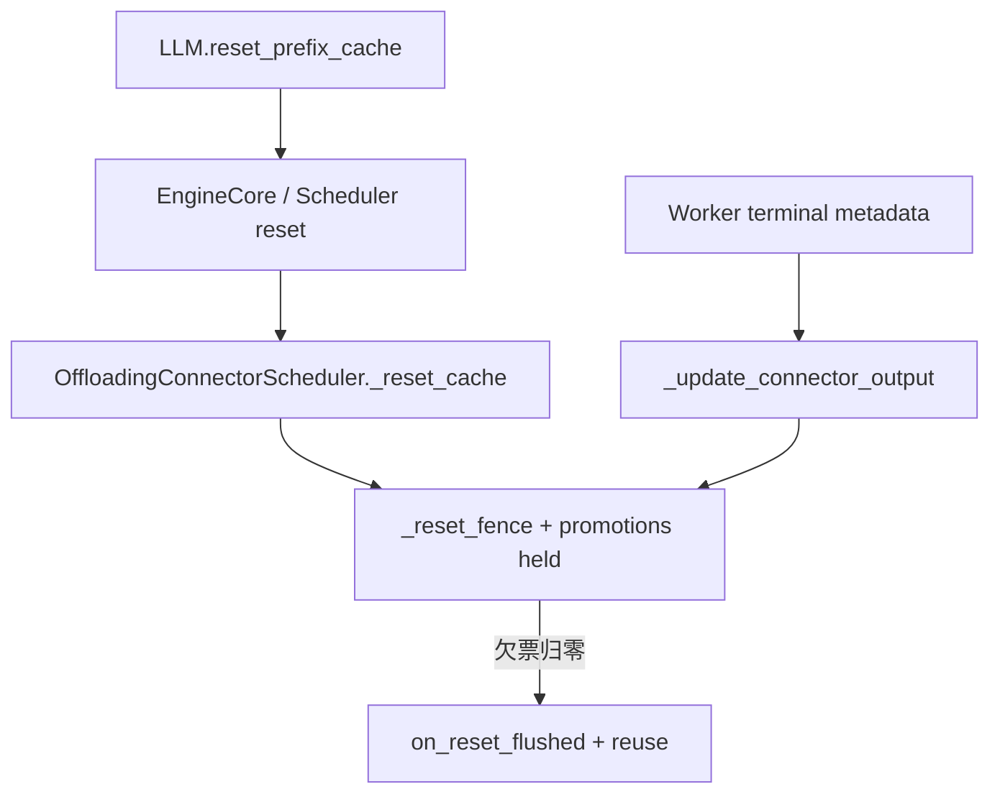
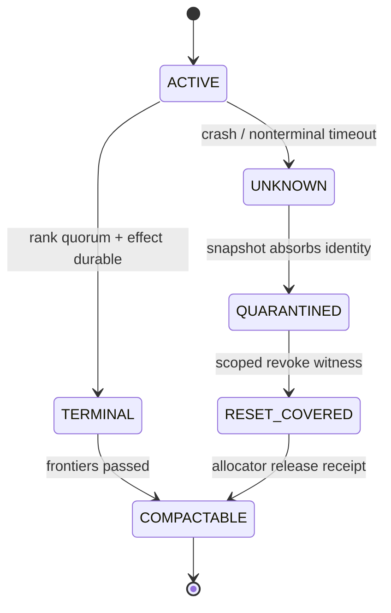

> 源码基线：[`fd8f3f39`](https://github.com/vllm-project/vllm/commit/fd8f3f398e0b720f58a682edf2888549cea71451)，即研究时 `vllm-project/vllm` 默认分支最新提交。相对上一章基线前进 [34 个提交](https://github.com/vllm-project/vllm/compare/8176238c97f982ddc266e8bacb2aca9e11926af7...fd8f3f398e0b720f58a682edf2888549cea71451)；本文直接涉及的 offloading Scheduler、metadata、tiering manager 与测试没有变化。跨节点 Region Mirror 仍来自 **open、未合入** 的 [PR #62933](https://github.com/vllm-project/vllm/pull/62933)。本文的 durable ledger、quarantine 与 compaction 均为基于现有不变量推导的建议协议，不是 main 已有功能。

## 本篇在课程路线中的位置

这是课程第 80 章，仍位于“测试、性能与故障诊断”。第 79 章把跨重启 job 身份收敛为 `(generation, job_seq, worker_rank)`，并证明 receipt quorum 与物理 `no-old-writer` witness 不能互相替代。

本章只回答一个后续问题：**为了拒绝旧 generation 的迟到 report，我们保存了 durable Job Ledger；但 ledger 不能无限增长。什么记录可以删除，unknown transfer 又怎样在不释放危险 destination 的前提下退出热日志？**

## 前置知识回顾

当前 main 的安全边界只跨“同一 Scheduler 进程内的 reset”。`_reset_cache()` 把在途 job 的 `pending_count` 移入 `_reset_fence`，并提高 `_stale_job_threshold`；旧 report 只排空 fence，不会再提交 load/store effect。所有欠票到齐前，`TieringOffloadingManager` 保持 `_promotions_held`，secondary-only lookup 降级为 `MISS`。

这套机制有两个重要结论。第一，**逻辑失败或超时不等于 DMA 已停**；第二，Scheduler crash 会同时丢失 `_job_counter`、`_jobs`、`_reset_fence` 和 destination 关联。若要跨重启，只能把 job identity、rank receipt、effect 与物理 writer 证据持久化。问题也随之从“内存字典何时 pop”变为“持久日志何时可压缩”。

## 本篇要回答的核心问题

1. 当前 main 从公开 reset 到旧 report 消费，真实调用链和对象生命周期是什么？
2. 为什么 TTL、进程死亡、单一 generation 最大值都不是删除 unknown job 的充分条件？
3. 最小可行的 quarantine、vector watermark 与 crash-safe snapshot 协议是什么？

## 组件在全局架构中的位置

上游是 public reset 与 Scheduler job；下游是 `complete_load/complete_store`、primary row 复用和 secondary promotion。建议 ledger 位于两者之间的控制面：它不搬 KV tensor，却决定旧 writer 是否仍能污染 destination，因此它的回收条件必须比普通审计日志更强。

## 完整调用链

当前 main 的真实链路如下。

1. [`LLM.reset_prefix_cache(reset_connector=True)`](https://github.com/vllm-project/vllm/blob/fd8f3f398e0b720f58a682edf2888549cea71451/vllm/entrypoints/llm.py) 经 [`LLMEngine`](https://github.com/vllm-project/vllm/blob/fd8f3f398e0b720f58a682edf2888549cea71451/vllm/v1/engine/llm_engine.py)、[`EngineCore`](https://github.com/vllm-project/vllm/blob/fd8f3f398e0b720f58a682edf2888549cea71451/vllm/v1/engine/core.py) 和 core [`Scheduler`](https://github.com/vllm-project/vllm/blob/fd8f3f398e0b720f58a682edf2888549cea71451/vllm/v1/core/sched/scheduler.py) 请求 connector reset。
2. [`OffloadingConnectorScheduler._reset_cache()`](https://github.com/vllm-project/vllm/blob/fd8f3f398e0b720f58a682edf2888549cea71451/vllm/distributed/kv_transfer/kv_connector/v1/offloading/scheduler.py) 收集 active job，调用 manager reset，把每个 `job_id` 的剩余 `pending_count` 写进 `_reset_fence`，再清空 `_jobs`。
3. worker 在后续 engine step 返回 [`OffloadingWorkerMetadata`](https://github.com/vllm-project/vllm/blob/fd8f3f398e0b720f58a682edf2888549cea71451/vllm/distributed/kv_transfer/kv_connector/v1/offloading/common.py)。`aggregate()` 把各 worker 的 `{job_id: 1}` 相加为匿名 count。
4. `_update_connector_output()` 对 `job_id < _stale_job_threshold` 只扣 fence；active job 则扣 `TransferJobStatus.pending_count`，归零后才调用 manager 的 `complete_store/complete_load`。
5. 最后一份 reset 欠票到达后，Scheduler 调用 [`TieringOffloadingManager.on_reset_flushed()`](https://github.com/vllm-project/vllm/blob/fd8f3f398e0b720f58a682edf2888549cea71451/vllm/v1/kv_offload/tiering/manager.py)，解除 `_promotions_held`。`has_pending_push_work()` 在 fence 未清空时保持 idle step，60 秒只记录 warning，不自动释放。

完整链说明：main 把“最后一票”当作地址复用门槛，但所有状态都在内存中；它没有恢复时可读的 ledger，更没有 compactor。

## 关键类型、字段和状态生命周期

当前 `TransferJobStatus` 由 Scheduler 创建并独占，`pending_count` 初值等于 worker 数。reset 时它的欠票数被复制进 `_reset_fence`，随后原对象删除；worker metadata 消费后 count 递减，归零时 fence 删除并恢复 promotion。进程退出则整条生命周期无持久尾声。

建议状态机必须把 outcome、物理安全和存储保留分开。`TERMINAL_SUCCESS/FAILED` 回答“软件 effect怎样收敛”；`UNKNOWN` 回答“尚不能证明 writer终止”；`QUARANTINED` 回答“危险 destination由谁继续持有”；`RESET_COVERED` 回答“哪个 scoped witness使旧 writer失权”；`COMPACTED` 只回答“历史已被 snapshot吸收”。因此 `COMPACTED` 绝不能被 allocator解释成“row已经可用”。只有 quarantine entry也得到 release receipt，physical owner才可把 row放回 free list。

建议把跨重启对象拆成三类，避免用一个“完成”位混淆不同证据：

| 对象 | 输入/输出与位置 | 所有权、前置/后置条件 | 失败方式 |
| --- | --- | --- | --- |
| 当前 `OffloadingWorkerMetadata` | CPU Python metadata；`completed_jobs: dict[int,int]`、`failed_jobs: set[int]`；无 tensor | worker构造，Scheduler聚合；正常路径假设每 rank每 job只 drain一次 | 聚合后丢 rank，不能跨重启去重 |
| 建议 `JobRecord` | `(generation, job_seq)`、expected/terminal rank set、effect、destination identity | ledger owner追加；effect持久化后才能推进 effect frontier | torn append、重复/冲突 receipt、旧代 ABA |
| 建议 `QuarantineEntry` | unknown ranks、region/row/slot、held bytes、closure requirement | allocator与恢复 owner共同负责；存在期间 destination 继续计费且禁止复用 | backend永不返回、容量耗尽 |
| 建议 `LedgerSnapshot` | retired generations、quarantine set、各 frontier、前 manifest digest | compactor写 immutable 文件并原子发布 manifest | fsync失败、发布前崩溃、旧 reader仍在读 |

数据 row 的 shape/dtype/device不由 compactor改变。以本文例子为准，Head CPU row 是 `uint8` 视图下的 128 KiB backing，逻辑上由两个 rank 的各 64 KiB KV slot 组成；真正模型 KV dtype/shape 由 region layout identity绑定。ledger 只持有 control metadata，不能靠删除 metadata释放 CPU/GPU backing。

## 逐函数源码解读

`_generate_job_id()` 只递增进程内整数，证明它不是 durable sequence。`_reset_cache()` 把 `_stale_job_threshold` 设为当前 counter，并以 `{job_id: pending_count}` 建 fence；这是一次内存态“热记录转 retired fence”，可视为 compaction 的最小雏形，但重启即丢。

`_update_connector_output()` 对 stale job 优先处理 `_reset_fence`，而 active 路径直接索引 `_jobs[job_id]`。这保证同进程 reset 前后不串 effect，却没有“未知旧 generation report”分支。60 秒 warning也刻意没有改变状态：时间只能触发诊断，不能证明 DMA 终止。

`OffloadingWorkerMetadata.aggregate()` 相加 count，适用于固定 worker set 的正常 step；durable ledger 必须改为 rank-attributed receipt set，否则同一 rank重放两次会伪造 quorum。

`TieringOffloadingManager.reset_cache()` 在有 secondary tier时设置 `_promotions_held=True`；`on_reset_flushed()` 才解除。CPU-primary manager还要求 deferred-release chunk 已清空。两者共同说明可回收条件不是“请求已失败”，而是“所有可能写该 backing 的路径已有终态或物理失权证明”。

## 具体示例与 shape/状态演算

设两节点 TP=2，Head 有 4 个 row；每 rank slot 64 KiB，因此每 row 128 KiB。generation 7 有两个 job：

- `(7,41)` 写 row 3：rank 0 已 terminal，rank 1 WRITE unknown。
- `(7,42)` 写 row 1：ranks `{0,1}` 均 terminal，`complete_store` effect 已持久化。

owner 切到 generation 8，并分配新 backing `D8`。不能因为 `(7,41)` 超时就删除记录并复用 `D7/row3`；旧 rank 1 WRITE 仍可能迟到。建议 compactor选择 cutoff 42 时：把 `(7,42)` 的终态吸收到 snapshot；把 `(7,41)` 变成 `Q=(gen7,job41,D7,row3,complete={0},unknown={1},charge=128KiB)`。热日志可以缩短，但 row 3 仍计入 quarantine capacity。

若随后得到覆盖 rank 1 registration、generation 7、destination `D7` 的 backend reset/revoke receipt，`Q` 才转为 `RESET_COVERED`，allocator确认后释放 128 KiB。迟到 `(7,41,rank1)` 只能关闭匹配 identity 的 quarantine，永远不能作用于 generation 8。

crash-safe publish顺序是：seal旧 segment → 写 immutable snapshot与 manifest → `fsync` 两者 → CAS `CURRENT` → 等 reader frontier → 幂等删除旧 segment。若在 CAS 前崩溃，旧 manifest仍是权威，新 snapshot只是 orphan；若在 CAS 后、删除前崩溃，新 manifest可恢复，旧 segment保留只浪费空间，不破坏正确性。

## 为什么这样设计及替代方案

可压缩 cutoff 不是单一 generation 数，而应取多个单调 frontier 的交集：

`safe_cutoff = min(receipt_frontier, effect_frontier, physical_frontier, reader_frontier)`。

其中 receipt frontier证明 expected ranks已有 terminal或显式 unknown；effect frontier证明逻辑 effect/补偿已持久化；physical frontier证明 destination不再被旧 writer触达，或危险对象已完整进入 quarantine snapshot；reader frontier保证恢复者不再依赖旧 segment。每个 frontier最好按 region/reset domain分片，避免一个 unknown job阻塞无关 backing；但共享 registration/reset域不能被错误拆分。

这里的“显式 unknown”不是把 job变成成功或失败，而是把不确定性从顺序日志转换成带资源责任的持久集合。snapshot必须同时包含 destination identity、expected/terminal/unknown ranks、仍持有的 backing、closure predicate与容量记账；缺任一字段都无法在恢复后重建禁止复用集合。watermark只能单调前进，旧 receipt若落在 cutoff之前，只能按 snapshot/quarantine索引处理，不能重新打开已压缩的 active segment。

替代一是永远保留全部 ledger：安全直观，却让磁盘、replay和恢复时间无界。替代二是按 TTL 删除：成本最低，但把“没看到 report”误当作“不会再写”，直接违反 late-DMA安全。替代三是每次 generation切换都新建 backing并永久保留旧 backing：正确但内存无界。snapshot + bounded quarantine把“历史证据成本”与“危险 destination成本”分账，是满足安全与可运营性的最小方案。

## 性能、并发、正确性与边界条件

ledger append与 snapshot fsync在控制面，可用 group commit摊薄，但不能在 durable receipt前推进 watermark。compaction需要额外峰值磁盘，quarantine则消耗真实 backing；二者不能互相抵扣。容量不变量是：

`active + quarantined + rebuild + reserved_headroom <= physical_capacity`。

若 unknown产生速率 `λu` 长期大于 revoke/reset关闭速率 `μu`，quarantine必然填满；compaction只缩短日志，不能消灭物理债务。此时必须对新 mirror/promotion admission施加 backpressure或 fail-stop，而不是提高 TTL。该机制不进入模型 CUDA Graph，所以 graphability不变；代价体现在控制面 fsync、恢复延迟、可用容量和降级吞吐。

并发上，manifest发布必须使用 generation-aware CAS；receipt按 `(generation, job_seq, worker_rank)` 幂等，重复同结果不增票，冲突结果 fail closed。`CURRENT`只能作为提示，恢复者还要校验 schema、digest和 manifest链，选择最高的有效提交点。

把崩溃点逐个展开，可看到为什么“先删 segment、后写 snapshot”不可接受：

| 崩溃位置 | 恢复时可见状态 | 正确动作 |
| --- | --- | --- |
| snapshot `fsync` 前 | 旧 manifest + 完整旧 segments | 丢弃临时文件，重放旧日志 |
| snapshot durable、manifest未发布 | 旧 manifest + orphan snapshot | 仍以旧日志为准；orphan可验证后复用或删除 |
| 新 manifest durable、`CURRENT` CAS 前 | 两套完整证据，旧指针仍有效 | 不得删旧 segment；重试CAS或保持旧版 |
| CAS 后、旧 segment删除前 | 新 snapshot已权威，旧日志仍在 | 从新snapshot恢复，后台幂等GC旧段 |
| 删除过程中 | 新snapshot + 部分旧段 | 不回滚提交；按manifest重试删除 |

若磁盘满导致snapshot或manifest无法durable，系统可以继续使用旧ledger并暂停compaction；不能为恢复可用性跳过quarantine entry或强推watermark。安全降级方向是“多保留证据/少接新job”，不是“删掉不确定性”。

## 测试证据与未覆盖风险

main 的直接测试位于 [`test_scheduler.py`](https://github.com/vllm-project/vllm/blob/fd8f3f398e0b720f58a682edf2888549cea71451/tests/v1/kv_connector/unit/offloading_connector/test_scheduler.py)：

- `test_cache_reset_holds_promotions_until_flushed_jobs_report` 构造在途 store，reset后验证 engine继续 idle stepping、secondary-only lookup为 `MISS`，精确 job的全部 report到达后才恢复 promotion。
- `test_cache_reset_fence_ignores_reports_of_other_jobs` 验证其他旧 job的重复 report不能清除当前 fence。
- `test_cache_reset_fence_held_too_long_warns_on_idle_steps` 验证 60 秒边界只告警一次，不自动释放。
- 无在途 job、连续两次 reset等测试验证空 fence与 flush保留。

这些测试证明当前进程内 fence不变量，不证明跨重启 ledger。开放 PR #62933 的 terminal/stuck transfer测试提供“unknown不能伪造完成”的候选证据，但仍是未合入 PR事实。

建议新增 crash-at-every-boundary 矩阵：在 receipt append、effect durable、snapshot write/fsync、manifest fsync、`CURRENT` CAS、旧 segment delete处注入崩溃；oracle要求 unknown永不释放 row、重复 rank不增票、冲突票 fail-stop、旧代 report不改新代状态、一个 region的 unknown不阻塞无关 region compaction、恢复只选择 digest链完整的最高 manifest。还缺真实 NIXL/UCX same-address late-WRITE 与 revoke/reset receipt语义，这是当前最关键的硬件风险。

还应增加容量与并发联合测试：用4个128 KiB row制造2个active、1个quarantined、1个headroom；确认新promotion被拒绝而quarantined row不进入evictable/free集合。随后提交覆盖正确generation/rank/registration的reset certificate，确认只有对应row释放；wrong generation、漏rank或destination mismatch都不得改变capacity。这样才能同时验证 ledger compaction、allocator ownership和admission backpressure，而不是只测文件格式。

## 与前后章节的连接

第 79 章解决“receipt属于谁”；本章解决“receipt和危险 destination的历史何时可删”。二者共同把跨重启控制面从匿名计数提升为可恢复状态机。下一章将继续收窄到 quarantine的退出条件：backend reset certificate或 registration revoke 到底要覆盖哪些 rank、memory registration和 generation，才能安全归还容量。

## 本篇结论、知识债、三个理解检查问题和下一章

结论只有三条：

1. main 的 `_reset_fence` 是正确的进程内安全屏障，但不是 durable Job Ledger。
2. unknown transfer可以离开热日志，却不能离开责任边界；必须以完整 destination identity进入持久 quarantine，并继续占用容量。
3. crash-safe compaction的提交点是校验过的 snapshot manifest CAS；可删 cutoff必须同时越过 receipt、effect、physical和reader frontiers。

知识债：NIXL/UCX deregistration与remote crash的物理保证；rank-scoped reset certificate；quarantine容量水位和backpressure；ledger schema/version迁移；真实 fsync成本；same-address late-DMA故障注入。

理解检查：

1. 为什么 `(7,41)` 超时且 owner进程已死，仍不能释放 `D7/row3`？
2. 为什么把 unknown job完整写入 snapshot后可以删除旧 log segment，却仍不能减少 quarantine容量计费？
3. 若 `effect_frontier=100`、`receipt_frontier=98`、`physical_frontier=95`、`reader_frontier=97`，安全 cutoff是多少？哪类证据最先阻塞？

下一章：**Unknown Transfer 什么时候能离开 Quarantine——Backend Reset Certificate、Registration Revoke 与 Capacity Release。**

## 课程账本增量

- 新覆盖：`_reset_cache/_update_connector_output/_RESET_FENCE_WARN_S/has_pending_push_work`、`OffloadingWorkerMetadata.aggregate`、`TieringOffloadingManager.reset_cache/on_reset_flushed` 与 reset-fence直接测试。
- 新确认不变量：日志压缩不能创造物理释放证明；unknown必须以 destination identity和capacity charge进入 snapshot；安全 cutoff是多 frontier交集；manifest发布是提交点，segment删除只是可重试回收。
- 事实边界：main没有 durable ledger、quarantine registry、retired-generation watermark或compactor；PR #62933仍 open。本文协议与故障矩阵是建议设计。
- 新知识债：backend reset/revoke certificate的最小字段、quarantine closure rate与admission、跨版本snapshot恢复和真机 late-WRITE测试。

## 补记：第十一次七章知识图谱回顾（第 71–77 章）

第 71–74 章把 timeout、session close、connection epoch和process restart逐层拆开，结论是：控制连接结束不等于remote writer物理失权，consumer slot必须按destination隔离。第 75 章把隔离转成容量与backpressure问题；第 76 章建立reset后的promotion fence；第 77 章把同一不变量扩展到跨节点Region Mirror的per-rank slots与unknown-completion fail-stop。闭合链为：`timeout → terminal/release分离 → epoch拒旧 → restart census → slot quarantine → capacity admission → reset fence → cross-node quorum`。第 78–80 章继续补上generation rebuild、rank-attributed receipt和crash-safe compaction。
