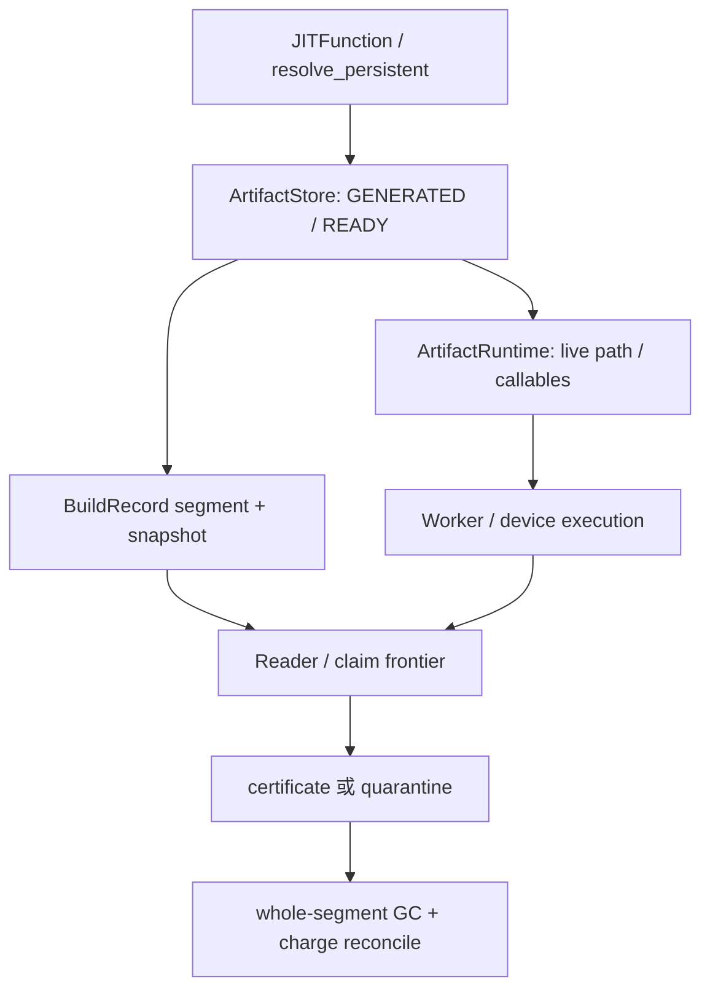
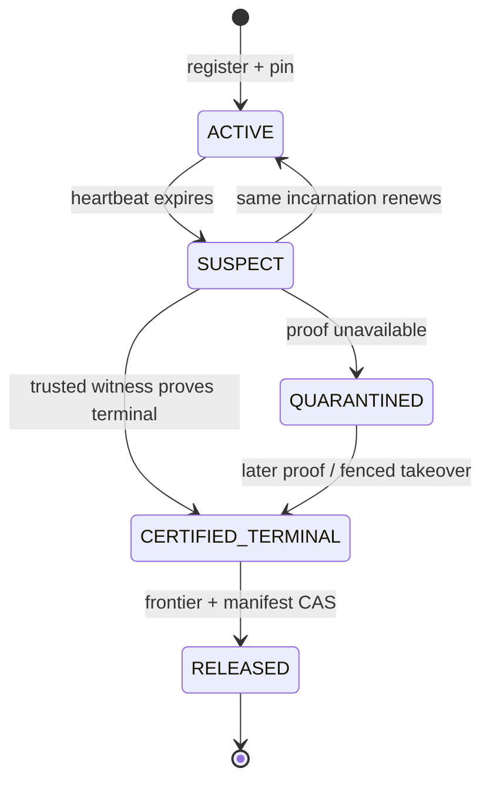

> 源码基线：[`hw-native-sys/pypto@9339b96d`](https://github.com/hw-native-sys/pypto/commit/9339b96dd6d42e69b1dee8f43316d407887e2d43)。相对上一章的 [`1f25c43d`](https://github.com/hw-native-sys/pypto/commit/1f25c43de09fe935574ffd815843dca26ccd13e9) 前进 [5 个提交](https://github.com/hw-native-sys/pypto/compare/1f25c43de09fe935574ffd815843dca26ccd13e9...9339b96dd6d42e69b1dee8f43316d407887e2d43)；这些提交涉及 external provider、SIMT/AutoTile 等路径，没有修改本文直接依赖的 Artifact Store、persistent JIT、`ArtifactRuntime`、Artifact 文档或测试。本文区分“当前代码/测试事实”和“建议恢复协议”，后者不是现有 API。

## 本篇在 PTO 课程路线中的位置

这是课程第 91 章，仍处在第二阶段“ISA 如何被上层生成和落地”的 Host artifact 恢复支线。第 90 章已得到删除门槛：

```text
safe_delete_through = min(snapshot_cutoff,
                          reader_safe_through,
                          claim_safe_through,
                          effect_safe_through)
```

四个量都必须是无 gap 的连续前缀。今天只处理一个紧邻问题：reader 或 claim 失联后，frontier 永远不前进怎么办？选择 PyPTO 一个仓即可闭合证据链；本章不新增 ISA、Tile、layout 或 memory-location 语义，也不提前进入 serving。

## 前置知识

`CURRENT` 从旧 generation 切到新 generation，只阻止**新 reader**进入旧代；它不让已经持有旧路径的对象凭空消失。`ReaderView` 保护 source evidence 可读，`ClaimLease` 则授权某个 recovery task 尝试提交 effect。两者的终止条件不同：reader terminal 证明“不会再读”，claim terminal 还要证明“不会再产生迟到 effect”。

PyPTO 当前采用更强但粗粒度的规则：文档明确要求 published 路径在所有用户释放前保持存在，并规定 cleanup 必须在全部 consumer 停止后离线进行。所以下文不是解释已经实现的 online GC，而是从这个安全基线推导可上线的增量协议。

## 今日 1–2 个核心问题

1. heartbeat 超时、PID 不存在或 `flock` 自动释放，为什么都不是 terminal certificate？怎样把 `ACTIVE → SUSPECT` 的观测升级成覆盖确定 incarnation、generation 和 revision 的可审计证明？
2. 若永远拿不到证明，怎样把最小 source evidence 转入 bounded quarantine，让旧大 segment 可回收，同时不靠 TTL 强删、也不让 quarantine 无界吞掉磁盘？

## PTO 全栈中的位置

上游是 `JITFunction` 的 Python/kernel 表达和 persistent key；本层把 GENERATED/READY artifact、manifest、恢复 BuildRecord 变成可复用 Host 文件。下游 `ArtifactRuntime` 与 Worker 通过路径加载 callable，最终才执行 PTOAS/ISA 产物。terminal certificate 只回答 Host 路径和 effect authority 是否终止，不证明 NPU 指令完成；如果 claim 已触发 device/runtime side effect，还必须消费那个下游 owner 提供的 terminal evidence。



## 概念和精确语义

### Stale 只是怀疑，不是死亡

建议给 reader 一个不可复用的身份：

```text
ReaderId = (node_id, boot_id, process_start_nonce, pid, reader_seq)
```

PID 只能用于定位，不能单独作为身份；PID 重用、容器重启和 supervisor 重拉起都会制造 ABA。heartbeat 过期只允许把 `ACTIVE` 标成 `SUSPECT`，并冻结它覆盖的最早 revision。随后有三种结果：同一 incarnation 带更大 monotonic I/O sequence 续租，回到 `ACTIVE`；可信 owner 证明该 incarnation 及其子进程/文件句柄不会再访问，进入 `CERTIFIED_TERMINAL`；证据不足则进入 `QUARANTINED`。

### Terminal certificate 必须说清“谁、对什么、到哪里”

最小证书可写成：

```text
TerminalCertificate {
  certificate_id, actor_kind, actor_id, incarnation,
  source_generation, revision_interval, last_io_seq,
  terminal_reason, witness_authority, issued_epoch, digest
}
```

`witness_authority` 必须是实际拥有生命周期的 supervisor/runtime owner，而不是 GC 自己。reader 证书只覆盖 no-more-read；claim 证书还要绑定
`(task_id, claim_epoch, source_generation, source_revision, expected_revision, effect_id)`，并证明 effect 已 durable、已明确失败且 epoch 被 fence，或已由新 claimant 接管。覆盖不同 actor/incarnation/generation 的证书不能拼接使用。

证书的后置条件也必须比“进程退出”更精确。对 reader，它表示该 incarnation 不会再从覆盖区间发起新的文件读取，且已经发出的读取要么完成、要么由拥有 I/O queue 的 witness 取消并 drain；对 claim，它还表示旧 epoch 不再拥有提交权。证书本身不改变 frontier，frontier aggregator 只在证书 digest 校验、witness epoch 仍有效、覆盖区间连续且 ledger CAS 成功后消费它。重复提交同一 `certificate_id` 必须幂等；同一 actor 出现相互矛盾的 terminal/renew 记录时必须停在 quarantine，而不是按时间较新的记录“猜”一个答案。

这也解释了为什么单纯读取 `/proc/<pid>` 不够。GC 观察不到 PID，可能是目标已退出，也可能是它位于不同 PID namespace；即使主进程退出，fork child、异步 I/O 或另一个 rank 仍可能持有路径。只有掌握 process-group membership、启动 nonce 与 teardown/drain 顺序的 owner，才有资格为相应 scope 作证。部署若没有这样的 owner，就只能继续执行当前文档规定的全体 consumer 停机清理。

### Bounded quarantine 是保留未知，不是宣布无害

无法签证时，系统可以把 claim 所需的最小 source record、manifest digest、claim fence 和诊断日志复制到新的 immutable quarantine segment；先 `fsync` payload/manifest，再以 revision CAS 让 snapshot 指向它，最后才能让旧 segment 的 reader/claim frontier 前进。quarantine 中对象继续计费、不可执行普通 GC。

容量不变量是：

```text
live_bytes + retiring_bytes + quarantined_bytes + rebuild_headroom
    <= artifact_budget_bytes
```

“bounded”来自 admission：到 high watermark 后停止新的 shared persistent build，按策略回退 private/readonly 或拒绝；绝不是“隔离超过 24 小时就删除”。

迁移事务必须保持“至少有一份可读证据”。建议顺序是：以 `quarantine_id=(source_generation, source_revision, claim_epoch)` 创建唯一 bundle；复制并重新校验 source record 与其引用的 manifest；同步 bundle 数据和目录；在 ledger 中 CAS 写入 `QUARANTINE_READY`；再提升 claim epoch、切换 snapshot 引用与 charge owner；最后才允许旧 segment 进入 tombstone。任一步崩溃后，恢复器根据 bundle marker、snapshot revision 和 charge id 决定重放或丢弃未引用 bundle，不能同时把旧、新两份都当 free。若 copy 后 source digest 不一致，说明旧证据在迁移期间发生了不允许的修改，事务必须 fail closed。



## 真实文件、类型、API 或指令逐段解读

### `resolve_persistent`：reader 真实入口，但没有 generation pin

[`_persistent.py`](https://github.com/hw-native-sys/pypto/blob/9339b96dd6d42e69b1dee8f43316d407887e2d43/python/pypto/jit/_persistent.py) 的 `resolve_persistent` 先捕获 toolchain/source/specialization，查 `owner._artifact_objects`，再依次尝试 READY、GENERATED，最后调用 `store.get_or_build`。命中后，compiled object 被放回 object cache。这里已经形成“对象持有路径”的长生命周期，却没有 `generation_id`、reader registry 或 release receipt；因此 GC 不能从一次 `lookup()` 返回推断 reader 已结束。

### `ArtifactStore`：publication 锁不是 reader lease

[`artifact_cache.py`](https://github.com/hw-native-sys/pypto/blob/9339b96dd6d42e69b1dee8f43316d407887e2d43/python/pypto/jit/artifact_cache.py) 明确写着 concurrent cache mutation/deletion unsupported。`get_or_build` 先做无写 lookup，再拿 per-key `flock`、recheck、在 cache 外 `_build_private`，最后通过 staging + `RENAME_NOREPLACE` 发布。`_build_private` 特意不删除 returned object 仍持有的目录；publication 失败也返回可用 private build。

这个锁只串行化 builder/publisher。readonly hit 不需要锁，已经 attach 的 `ArtifactRuntime` 也不会持续持锁。内核在进程退出后释放 `flock`，只能证明“这个 lock owner 消失了”，不能证明其他 reader、fork child 或已下发 effect 都终止。

### `ArtifactRuntime`：路径所有权是当前最直接的不变量

[`_artifact_runtime.py`](https://github.com/hw-native-sys/pypto/blob/9339b96dd6d42e69b1dee8f43316d407887e2d43/python/pypto/runtime/_artifact_runtime.py) 的类注释要求 generated path 在 promotion 后继续存活，private build 也活到对象生命周期结束。`load()` 在锁内完成 GENERATED→READY，只初始化一次 `_chips`；若 READY publication 失败，`directory` 直接指向 private output。它证明需要 reader pin，却没有显式 `close()` 或跨进程 terminal certificate。

### 规范的保守基线

[`09-artifact-store.md`](https://github.com/hw-native-sys/pypto/blob/9339b96dd6d42e69b1dee8f43316d407887e2d43/docs/en/dev/09-artifact-store.md) 规定 writer 不得与 reader 竞速删除，当前没有 online GC/diagnostic index，cleanup 要在全部 consumer 停止后执行；private directory 也必须等 owner 释放所有用户。RFC [#2653](https://github.com/hw-native-sys/pypto/issues/2653) 与实现 PR [#2723](https://github.com/hw-native-sys/pypto/pull/2723) 同样把 online GC/eviction 排除在初始范围外。这是代码/规范事实；本文的 registry/certificate/quarantine 是补足该缺口的建议。

## 对象/Tile/Buffer/IR 生命周期

追踪一个 compiled object：`JITFunction` 调用进入 `resolve_persistent`；READY hit 由 `restore_artifact` 构造对象，GENERATED hit 先 attach 再懒 promotion，miss 则在 private directory 生成并尝试发布。对象进入 `owner._artifact_objects`；`ArtifactRuntime` 持有 `handle.directory`、可能另持 private `directory` 和 `_chips`。现有生命周期到 Python 对象失效为止，没有可持久化的 release 事件。

建议在 dereference `CURRENT` 后、读取 segment 前注册 `ReaderView(generation, min_revision, incarnation)`；attach 成功后周期性更新 `last_io_seq`，对象显式关闭或 owner terminal 时提交 release/certificate。claim 另建 lease，不借用 reader heartbeat 表示 effect authority。quarantine extraction 完成后，旧 reader pin 转为 quarantine bundle pin；只有 manifest CAS 和 charge transfer 都成功，旧 segment 才失效。

注册必须解决 cutover 竞态：reader 先读取 `CURRENT=G8`，再登记时若发现 current revision 已变化，就撤销登记并从新 generation 重试；不能拿着 G8 指针却只在 G9 registry 留记录。release 同样不能仅从内存表删除，应该以 reader identity 和最后 I/O sequence 写 durable terminal/release record，再由 aggregator 推进连续前缀。对象缓存命中不会重新访问磁盘时可以减少 heartbeat，但只要 `ArtifactRuntime` 仍可能 lazy load 或 promotion，就必须保持 pin；“Python 层暂时没调用”不等于路径可回收。

## 端到端调用链或指令链

```text
JITFunction.__call__
  → resolve_persistent
  → JITArtifactStore.lookup_ready / lookup
  → ArtifactStore.get_or_build
  → _build_private → _publish
  → restore_artifact / bind_artifact
  → ArtifactRuntime.load → _chips
  → [建议] ReaderView heartbeat / ClaimLease effect
  → diagnose(SUSPECT)
  → terminal certificate 或 quarantine extract
  → frontier recompute → whole-segment GC → charge CAS
```

失败方式也由此确定：证书 actor/incarnation 不匹配、quarantine payload/manifest 未同步、snapshot CAS 失败、预算不足或 effect 状态未知，都必须保持 pin 和 charge，不能推进 frontier。

恢复器还需要把“发现”和“执行”分开。diagnoser 可以并行把多个 actor 标成 `SUSPECT`、收集 supervisor/OS/runtime 证据；只有持有当前 recovery epoch 的 aggregator 能落 terminal certificate、提升 claim epoch 和修改 snapshot。这样，重复扫描不会重复 effect，旧 reaper 即使在网络分区后恢复，也会因 expected recovery epoch 不匹配而失败。这里的并发控制针对恢复元数据；它不能替代 `ArtifactStore` 自己的 per-key build lock，两者保护的是不同对象。

## 具体 shape、Tile 和状态演算

这里处理 Host control record，不伪造 NPU Tile shape。沿用上章：sealed `S12` 覆盖 revision 100–107，每条控制记录 4 KiB，共 32 KiB；`G8.cutoff=107`。reader `R1=(node7,bootA,start42,pid500,seq3)` pin 103–105；claim `C1` 的 `task_id=T9, claim_epoch=5, source_revision=104, expected_revision=108, effect_id=E9`。

1. 09:00，R1 heartbeat 过期。它只变为 `SUSPECT`；reader frontier 仍是 102，S12 不能删。
2. 09:02，`pid=500` 查不到，但 supervisor 尚未证明 bootA/start42 的子进程和句柄终止。仍不能签证；PID 消失不是证据闭包。
3. 09:05，supervisor 对准确 incarnation 签发 reader certificate，覆盖 `last_io_seq=88` 与 revision 103–105。reader frontier 可越过 105；但 C1 的 effect 未知，claim/effect frontier 仍卡在 103。
4. recovery owner 先把 rev104、manifest digest、epoch-5 fence 与诊断记录写入 `Q9`，共 6 KiB；校验并 `fsync` 后，CAS snapshot revision 108 指向 Q9，同时把 C1 提升为 epoch 6，旧 claimant 即使复活也会在 `(claim_epoch, expected_revision)` CAS 处失败。
5. 容量账从 `retiring=32 KiB` 变为 `quarantined=6 KiB`；四个 frontier 才可覆盖 107，S12 整段删除。Q9 仍保留并计费，直到 E9 有 durable terminal/effect receipt。

若预算是 40 KiB、已有 live 28 KiB、rebuild headroom 8 KiB，则只有 4 KiB 可用，连 Q9 都放不下。正确结果是冻结新 shared build、保留 S12 32 KiB 并报告压力；直接删 S12 会以“腾空间”破坏正确性。

## 为什么这样设计及替代方案

| 方案 | 延迟/吞吐 | 空间 | 正确性与维护 |
| --- | --- | --- | --- |
| TTL 到期强删 | 快，无诊断写放大 | 表面最省 | 无法处理暂停、PID reuse、late effect；不可接受 |
| 全局停机离线 cleanup | 有停机窗口 | 可完全回收 | 与当前文档一致、证明简单；大集群可用性差 |
| incarnation certificate + bounded quarantine | 正常路径只付注册/批量 heartbeat，异常路径较重 | 保留最小 evidence，并有 admission 上限 | 在线、可审计；需要 durable registry、可信 witness、CAS 与 fault testing |

选择第三种不是因为它“更复杂所以更安全”，而是约束决定的：未知 actor 不能被宣告 terminal；又不能让一条未知 claim 永久占住整个大 segment。证据迁移把 correctness debt 压缩到最小对象，admission 再把空间债务变成显式背压。

还要避免把 quarantine 当成普通压缩。普通 compaction 可以只保留最新逻辑状态；quarantine 必须保留足以重放或驳回旧 claimant 的原始 source digest、claim/effect identity 与 witness 链，否则缩小了字节，却丢了判定迟到 effect 的依据。相反，若系统能够通过全局停机取得完整 terminal proof，就不必创建 quarantine bundle，直接按整段 GC 更简单。选择条件不是固定阈值，而是“是否存在在线且可信的终止证明”和“最小证据迁移后是否仍满足预算不变量”。

## 访存、计算、流水、并行和硬件约束

本章热路径不是 NPU 访存，而是 Host 元数据 I/O。每次读取都 `fsync` heartbeat 会把吞吐交给文件系统尾延迟；应按 reader incarnation 批量更新、让注册与 release durable，heartbeat 只做有界频率的故障检测。certificate 只走冷路径，验证复杂度应与 active/suspect actor 数量相关，而不是每次全扫所有 segment。

quarantine extraction 产生一次读旧段、写最小 bundle 的放大，但比永久保留整个段小。不同 generation 可并行诊断；同一 actor/incarnation 和 snapshot revision 的证书/迁移必须串行 CAS。对 NFS、overlayfs、容器 PID namespace 或多 rank worker，`pidfd`/boot ID 是否可用是部署适配问题，不能当作仓库已保证的硬件事实。NPU mapping 在本章没有公开证据，故不推断。

## 测试证据与未覆盖风险

当前 [`test_artifact_cache.py`](https://github.com/hw-native-sys/pypto/blob/9339b96dd6d42e69b1dee8f43316d407887e2d43/tests/ut/jit/test_artifact_cache.py) 的直接证据包括：四线程同 key 只 build 一次；三个 spawned process 得到 1 个 PUBLISHED、2 个 HIT；持锁进程 `os._exit(7)` 后内核释放同一 inode 的 `flock`，新 build 可继续。它验证 builder handoff，不验证 reader terminal。`test_forked_child_does_not_wait_for_parent_build` 反而提示 fork 后进程内 flight 状态不能当全局 reader registry。

测试中“dead process 后还能继续 build”容易被误读。真正断言的是 lock inode 未变、后继者能取得同一锁并发布；测试没有让退出进程先 attach 一个 artifact，也没有让 fork child 保留 handle，更没有并发删除目录。因此它支持“内核锁可作为 builder ownership 的一部分”，不支持“锁释放可作为 path readership 的 terminal witness”。同理，READY candidate 超过 32 个时 fail closed 只限制目录扫描成本，不能替代 quarantine 容量账。

[`test_prebuilt_artifact.py`](https://github.com/hw-native-sys/pypto/blob/9339b96dd6d42e69b1dee8f43316d407887e2d43/tests/ut/runtime/test_prebuilt_artifact.py) 验证 storage failure 保留可用 private output、并发 `ArtifactRuntime.load()` 只编译一次、promotion 保持对象 hash/IR/source path，以及 private fallback 的并发 object reuse。这些测试确认“live path 不可早删”，但没有以下场景：

- heartbeat 过期后同 incarnation 续租、PID reuse/boot 变化；
- 证书 actor/generation/revision 不匹配的拒绝；
- claim 在证书前后提交同一 `effect_id`，epoch fence 是否阻止迟到 effect；
- quarantine payload、manifest、snapshot CAS、charge transfer 每个边界崩溃后的幂等 replay；
- quarantine 到 high watermark 后 private fallback/拒绝且绝不强删；
- multi-rank 子进程、NFS 可见性与 `CURRENT` cutover 并发注册。

这些应成为实现前的 deterministic fault matrix；真实硬件只需覆盖 claim 已下发 device work 时的 terminal adapter，Host codec/CAS 可先在 CPU 文件系统测试。

最小可执行测试夹具应使用可控的 fake clock 和 durable file harness，而不是依赖真实 sleep。每个 case 固定 reader incarnation、claim epoch、ledger revision 与注入崩溃点，重启恢复器两次，断言最终 snapshot/charge 相同且 effect 至多一次；再把同一 PID 配给新 start nonce，断言旧证书不能释放新 reader。容量测试同时检查“拒绝没有副作用”：预算不足时不得创建半成品 bundle、不得提升 claim epoch，也不得推进任何 frontier。最后用多进程测试让旧 claimant 在 snapshot CAS 前后各尝试一次提交，只有当前 epoch 且 expected revision 匹配的那次可以成功。这样验证的是协议不变量，而不是某次调度碰巧安全。

## 与前后章节的连接

课程 90 给出“什么 frontier 覆盖后能删”；本章补“frontier 不动时怎样区分慢、死和未知”。它也把课程 84 的 dead-letter/quarantine 容量准入与课程 87–89 的 journal/recovery queue/snapshot 串成闭环：quarantine 不是旁路目录，而是 canonical recovery state 的一种、必须进入 snapshot 和预算。

下一章应研究 **Terminal Certificate 如何跨进程/跨 rank 聚合——Supervisor Witness、Process-group Terminal 与 Claim Migration CAS**，把本文单 actor 证书接到真实 distributed Worker 生命周期；在 durable schema 尚未实现前，不进入 serving。

## 本篇结论、知识债、三个理解检查问题和下一章

结论只有三条：timeout 只能触发诊断；terminal certificate 必须绑定不可复用 incarnation 与明确覆盖范围；证据不足时只能保留最小、持续计费且由 admission 约束的 quarantine。这样才能同时守住 no-late-read、no-late-effect 和 bounded-capacity 三个不变量。

恢复协议的目标不是尽快删除，而是在任何崩溃与重试交错下，都能解释“为何此刻仍保留”或“凭什么已经释放”。

知识债：PyPTO 当前没有 durable reader/claim registry、terminal certificate codec、witness authority、quarantine segment、snapshot migration CAS、容量账或 online GC；也没有 NFS/container/multi-rank adapter 与 fault-at-every-boundary Golden。

理解检查：

1. 为什么 dead process 释放 `flock` 不能让 GC 删除它曾读取的 published path？
2. reader certificate 与 claim certificate 分别还缺哪类 effect 证明？
3. quarantine 已经复制了 rev104 后，为什么仍要先 fence claim epoch、再 CAS snapshot，最后才删除 S12？

下一章：**Terminal Certificate 如何跨进程/跨 rank 聚合——Supervisor Witness、Process-group Terminal 与 Claim Migration CAS。**

## 课程账本增量

- 课程：91；仓库：仅 `hw-native-sys/pypto`；基线：`9339b96d`。
- 新增不变量：`expired != terminal`；证书绑定 actor/incarnation/generation/revision/authority；reader 与 claim terminal 分离；quarantine 先 durable migration、后 frontier release；未知字节持续计费并触发 fail-closed admission。
- 直接测试边界：现有 UT 证明 build/flock handoff、private/runtime path retention，不证明 stale reader/claim、certificate 或 bounded quarantine。
- ISA 知识地图：无新增指令语义；补齐 Host Artifact generation GC 的 stuck-frontier 恢复边界。

## 第十三次七章知识图谱回顾（课程 85–91）

这七章形成一条连续恢复链：`capacity revision CAS → reservation owner lease → A/B phase journal → recovery queue/no-lost-wake → incremental scan/backlog pressure → snapshot generation frontier → terminal certificate/bounded quarantine`。已经闭合的是“容量不能双花、effect 不能重复、未知 ownership 不能释放”；仍未落地的是 durable schema、真实 witness/runtime adapter 和完整 crash matrix。后续不再扩写抽象队列，先把 terminal evidence 接回 distributed Worker 的真实进程组生命周期。
