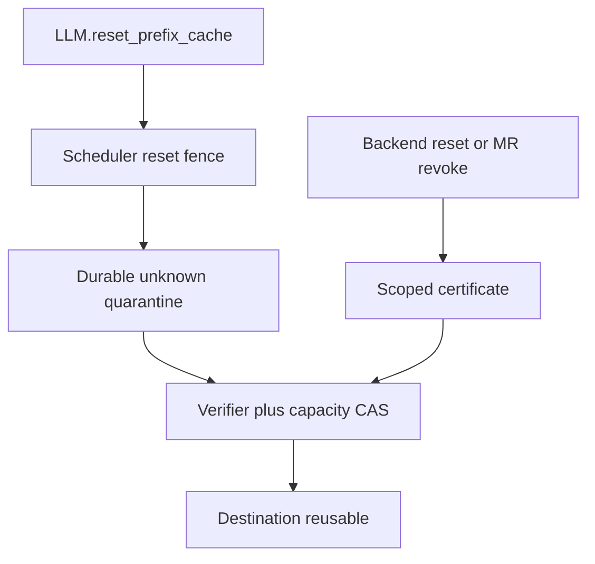
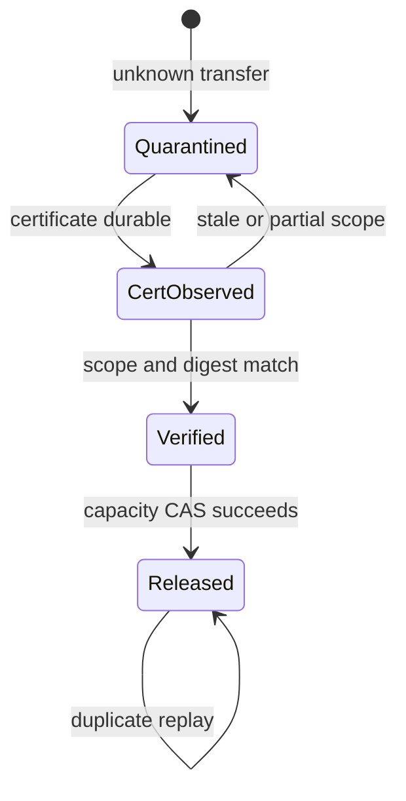

> 源码基线：[`3b33a845`](https://github.com/vllm-project/vllm/commit/3b33a845c6733a50aafae933c10ac0be0f18be93)，即研究时 `vllm-project/vllm` 默认分支最新提交。相对上一章基线前进 [32 个提交](https://github.com/vllm-project/vllm/compare/fd8f3f398e0b720f58a682edf2888549cea71451...3b33a845c6733a50aafae933c10ac0be0f18be93)；直接相关的 offloading Scheduler、tiering manager 与 NIXL registration 代码没有变化。本文的 `BackendResetCertificate`、durable quarantine 与 capacity ledger 是由现有不变量推导出的建议协议，不是 main 已有功能。跨节点 Region Mirror 仍是 **open、未合入** 的 [PR #62933](https://github.com/vllm-project/vllm/pull/62933)，仅作为“远端 writer + timeout”风险的对照证据。

## 本篇在课程路线中的位置

这是课程第 81 章，仍位于“测试、性能与故障诊断”。[第 80 章]({{ '/articles/vllm-job-ledger-unknown-transfer-quarantine-retired-generation-compaction/' | relative_url }}) 已经把 crash 后无法判定完成状态的 transfer 移入 durable quarantine：热日志可以 compact，但危险 destination 的 identity 与 capacity charge 必须留下。

本章只回答一个边界清晰的问题：**什么证据足以证明旧 writer 不会再触碰 destination，从而让 unknown transfer 离开 quarantine，并且只释放一次容量？**

## 前置知识回顾

第 79～80 章确认了三类不能互相替代的事实：worker receipt 说明控制面看到了什么；effect record 说明逻辑结果是否发布；`no-old-writer` witness 才说明旧 DMA/RDMA 不再可能写目标内存。timeout、进程重启和“没有看到 report”都不是第三类证据。

当前 main 的 `_reset_fence` 只在同一 Scheduler 进程内等待旧 job 的 worker report。若 Scheduler 与 backend 一起崩溃，内存中的 job、fence 和 pending count 都消失；因此 durable quarantine 不能凭“新进程已经起来”自动释放。

## 本篇要回答的核心问题

1. 当前 main 的 cache reset、NIXL deregistration 与 registration generation 各自证明什么？
2. 一个可用于关闭 quarantine 的 certificate，最少必须绑定哪些 scope？
3. certificate 到达后，怎样防止 stale certificate、ABA destination reuse 和重复释放容量？

## 组件在全局架构中的位置



当前 main 实现了左上角的进程内 reset fence，以及 NIXL registration 的撤销/重建；中间的 durable certificate、quarantine verifier 和 capacity CAS 仍是缺口。

## 完整调用链

公开入口从 [`LLM.reset_prefix_cache()`](https://github.com/vllm-project/vllm/blob/3b33a845c6733a50aafae933c10ac0be0f18be93/vllm/entrypoints/llm.py) 进入 `LLMEngine`、`EngineCore`，最后到 [`Scheduler.reset_prefix_cache()`](https://github.com/vllm-project/vllm/blob/3b33a845c6733a50aafae933c10ac0be0f18be93/vllm/v1/core/sched/scheduler.py#L3324-L3383)。`reset_connector=True` 时，Scheduler 先尝试清 GPU prefix cache，再调用 connector 的 `reset_cache()`；两者逻辑与运算后才返回 `bool`。

对于 `OffloadingConnector`，[`_reset_cache()`](https://github.com/vllm-project/vllm/blob/3b33a845c6733a50aafae933c10ac0be0f18be93/vllm/distributed/kv_transfer/kv_connector/v1/offloading/scheduler.py#L2624-L2668) 把在途 job 加入下一步的 flush 集合，调用 manager reset，随后用 `_stale_job_threshold` 把旧 job 与新 job 分界。旧 job 的 `(job_id, pending_count)` 进入 `_reset_fence`；worker report 在 [`_update_connector_output()`](https://github.com/vllm-project/vllm/blob/3b33a845c6733a50aafae933c10ac0be0f18be93/vllm/distributed/kv_transfer/kv_connector/v1/offloading/scheduler.py#L2438-L2456) 中逐票扣减，最后一票才调用 `manager.on_reset_flushed()`。[`TieringOffloadingManager`](https://github.com/vllm-project/vllm/blob/3b33a845c6733a50aafae933c10ac0be0f18be93/vllm/v1/kv_offload/tiering/manager.py#L1302-L1313) 在这段时间保持 `_promotions_held`，避免 secondary-tier promotion 复用仍可能被旧 worker 写入的 primary slot。

这条链证明的是：**当前进程收齐了 reset 时已知 job 的 worker report**。它不生成 durable backend receipt，也没有覆盖 Scheduler crash 后无法重建的 unknown job。

NIXL 有另一条相关但不同的链。worker 在 [`register_kv_caches()`](https://github.com/vllm-project/vllm/blob/3b33a845c6733a50aafae933c10ac0be0f18be93/vllm/distributed/kv_transfer/kv_connector/v1/nixl/base_worker.py#L1552-L1960) 汇总每个 KV tensor 的地址范围，按 memory type 调用 `register_memory()`，保存 `_registered_descs`，再发布 agent metadata。sleep 时 [`unregister_kv_caches()`](https://github.com/vllm-project/vllm/blob/3b33a845c6733a50aafae933c10ac0be0f18be93/vllm/distributed/kv_transfer/kv_connector/v1/nixl/base_worker.py#L2020-L2047) 先释放 local transfer handles、清理 remote engine，再逐组 `deregister_memory()`；wake 时用相同 descriptors 重新注册并发布新 metadata。

Scheduler 的 [`set_xfer_handshake_metadata()`](https://github.com/vllm-project/vllm/blob/3b33a845c6733a50aafae933c10ac0be0f18be93/vllm/distributed/kv_transfer/kv_connector/v1/nixl/base_scheduler.py#L296-L335) 只要 payload bytes 改变就递增 `_registration_generation`。pull worker 收到更大的 generation 后，会在 [`_read_blocks_for_req()`](https://github.com/vllm-project/vllm/blob/3b33a845c6733a50aafae933c10ac0be0f18be93/vllm/distributed/kv_transfer/kv_connector/v1/nixl/pull_worker.py#L151-L168) 清理旧 remote agent 并重新 handshake。它保证**新请求不会继续使用已知过期的 remote registration**，但没有返回一个可持久化 certificate，证明 crash 前某个 transfer handle 已物理终止。

## 关键类型、字段和状态生命周期

当前 main 的真实对象是 `TransferJobStatus`、`_reset_fence`、`_registered_descs`、`_registration_generation` 与 remote agent。建议补充的 durable 对象可写成：

```text
BackendResetCertificate {
  certificate_id, backend_instance_id, transport_domain_id,
  old_registration_generation, covered_worker_ranks,
  covered_region_ids, covered_job_cutoff,
  action: REVOKE_REGISTRATION | RESET_DOMAIN,
  result: NO_OLD_WRITER, issued_at, issuer_epoch, digest
}
```

这里 `region_id` 不能只是虚拟地址；allocator 释放后同一地址可能承载新对象，形成 ABA。它至少应包含 allocation/registration generation、memory type、device/rank、base、length 与不可变 nonce。`covered_job_cutoff` 也不能只用单一最大 job id：TP/PP ranks 的进度不一致时，必须是 per-rank frontier 或明确的 job 集合。



生命周期的所有权也应清楚：backend supervisor 签发 certificate；quarantine ledger 持有危险 destination 与 charge；verifier 只验证 scope；allocator ledger 才拥有容量。这样 certificate 不能越权直接 free 内存。

从接口契约看，四个动作也不能合并成一个模糊的 `reset() -> bool`：

| 动作 | 输入与所有权 | 成功后的后置条件 | 失败时允许的动作 |
| --- | --- | --- | --- |
| `logical_reset` | Scheduler 持有 job set；CPU metadata，无 tensor | 旧 job 不再提交逻辑 effect | 保留 fence，继续 step/告警 |
| `revoke_registration` | backend 持有旧 MR/rkey 与 transfer handle；MR 指向 GPU/DRAM bytes | 旧 registration 不再授权新的或在途 writer | 保持 region pinned，不发布 certificate |
| `verify_certificate` | verifier 读取 immutable certificate 与 quarantine entry | 证明 scope 完整、issuer epoch 单调、digest 匹配 | 保持 `QUARANTINED`，记录拒绝原因 |
| `release_capacity` | allocator 独占 `charge_id/region_id` 状态 | 精确 charge 从 `QUARANTINED` 变为 `RELEASED` 一次 | 重试同一 CAS；不对地址执行猜测性 free |

这里没有新的 model tensor shape：certificate 和 ledger 都是 host-side metadata。真正受保护的是 `region_id` 对应的 GPU/DRAM byte range；它的 dtype 对 allocator 来说是 opaque bytes，但 registration geometry 必须保留 base、length、device/memory type 与各 rank slot，因为 backend 的写权限正是按这些物理范围生效。

## 逐函数源码解读

### 1. `_reset_cache()`：逻辑代际切换，不是 backend reset

`_stale_job_threshold = _job_counter` 使旧 report 不再提交 store/load effect；`_reset_fence` 保存“还有多少 worker report 未到”。这是正确的进程内安全边界，因为迟到 report 仍能被识别。它没有调用 NIXL domain reset，也没有记录 MR revoke receipt，所以不能跨 crash 推出 `no-old-writer`。

### 2. `unregister_kv_caches()`：撤销 registration，但当前返回值不是证书

代码先释放基于 registration 构建的 local handles，再清 remote agents，最后 deregister descriptors，并用 `_kv_unregistered` 保证重复调用幂等。这是构造 revoke protocol 的良好骨架。不过函数返回 `None`，没有 durable `certificate_id`、覆盖范围、backend epoch 或完成 digest；调用方也没有把结果与 unknown job/destination 关联。

### 3. `_registration_generation`：防止新请求复用旧 metadata

payload 不变时 generation 不变，payload 改变才递增；远端看到更大 generation 后重新握手。这是 registration identity 的必要组成，但不是充分证据：generation 8 的存在只说明“8 是新版本”，并不能单独证明 generation 7 的所有旧 transfer 已经 `DONE/ERR` 或被 backend reset 不可逆地终止。

### 4. `_finish_shutdown()`：清理顺序是事实，异常路径暴露证据缺口

[`_finish_shutdown()`](https://github.com/vllm-project/vllm/blob/3b33a845c6733a50aafae933c10ac0be0f18be93/vllm/distributed/kv_transfer/kv_connector/v1/nixl/base_worker.py#L4195-L4227) 释放 local handles、remote agents，随后 deregister memory，最后清 descriptor 与 tensor references。异常会记录日志并继续清理。对普通进程退出这是合理 best effort；对 durable quarantine 来说，“尝试过”不能等价于“backend 已确认”。certificate 必须只在 backend 返回成功、scope 完整且结果先落盘之后签发。

还要注意并发假设：`_registration_generation` 由 Scheduler 发布，remote agent/transfer handle 则由各 worker 进程持有；DP/TP/PP 下它们不是同一个故障域。单个 Scheduler 观察到 metadata generation 前进，不能代表所有 worker rank 都完成 revoke。因此 certificate aggregation 必须保留 `covered_worker_ranks`，只有与该 job 创建时冻结的 rank census 相等，才能闭合；不能用“当前仍在线的 ranks”缩小 expected set，否则 crash 的 rank恰好会从责任集合中消失。

## 具体示例与 shape/状态演算

延续上一章：TP=2，每个 rank 的 destination slot 为 `64 KiB`，一个完整 row 为 `128 KiB`。generation 7 的 job 41 写 `row=3`：rank 0 有 terminal receipt，rank 1 在 crash 后 unknown。quarantine 保存：

```text
charge_id = q-7-41
region_id = (alloc_gen=22, reg_gen=7, row=3, nonce=9f...)
covered = {rank0: terminal, rank1: unknown}
bytes = 128 KiB
```

新进程重建 registration generation 8 不能立即释放 row 3。安全路径是 backend 对旧 transport domain 执行 `RESET_DOMAIN`，或对 generation 7 的精确 MR 执行 `REVOKE_REGISTRATION`，并产出覆盖 rank 1、旧 region identity 与 job 41 的 `NO_OLD_WRITER` certificate。verifier 检查：issuer epoch 未回退、digest 有效、rank/region/job scope 全覆盖、当前 allocator 仍把 `q-7-41` 记在同一 `region_id`。随后执行：

```text
CAS charge(q-7-41, QUARANTINED -> RELEASED)
free(region_id)             # 仅 CAS 胜者执行
quarantined_bytes -= 128KiB
append ReleaseApplied(certificate_id, charge_id)
```

若 certificate 只覆盖 rank 0、绑定 `reg_gen=8`、只给出相同地址但 nonce 不同，或 allocator 已把 row 3 分配给 alloc_gen 23，全部拒绝。重复回放同一 certificate 时 CAS 看到 `RELEASED`，只返回既有结果，不再次减容量。

该例也说明为什么要把“证书验证”和“容量应用”拆开。验证成功后进程仍可能在 CAS 前 crash；恢复时 certificate 仍可重放。CAS 成功后又可能在 `ReleaseApplied` 日志写入前 crash；恢复时 charge 已是 `RELEASED`，因此只补写审计记录，不再次 free。若把两步写成普通的 `verify(); free(); decrement()`，任何一个 crash 点都可能造成容量泄漏或 double free。下一章会把这段状态转换展开成 WAL/replay 协议。

## 为什么这样设计及替代方案

最小不变量是：**任何可能仍被旧 writer 触碰的 byte，都不能进入可复用 free pool。** 由此反推 certificate 必须覆盖 writer authority、registration identity 与 destination identity；capacity release 必须是独立的幂等事务。

替代方案一是 TTL：实现最简单、容量回收快，但无法给未知网络/driver 队列建立有限上界，会把低概率迟到写变成 silent corruption，排除。替代方案二是逐 MR revoke：隔离粒度细、可回收大部分容量，但 backend 必须保证 revoke completion 对在途操作有明确语义，证书也较复杂。替代方案三是销毁并重建整个 backend/process domain：停机与重握手成本更高，却容易形成强作用域；若 backend 不能提供细粒度 revoke receipt，这是更可信的退化路径。最保守方案是永久 pin/quarantine；正确但容量最终耗尽，因此必须配合 admission backpressure 或 fail-stop，而不是偷偷超时释放。

选择细粒度 revoke 还是 domain reset，不能只看恢复延迟。先问 backend 能证明的最小 authority 是什么：若 API 只保证 agent teardown 后旧 rkey 失效，就应让整个 agent/transport domain 成为 certificate scope；若 API 明确保证某 MR deregistration 返回前所有引用它的 operation 已 terminal，才可以缩小到 region。证据能力决定恢复粒度，而不是反过来先选一个漂亮粒度再假设底层满足。

## 性能、并发、正确性与边界条件

- **延迟**：细粒度 revoke 只阻塞相关 region；domain reset 会让所有 peers 重新 handshake，恢复延迟更大。
- **吞吐**：certificate 落盘不应进入每个正常 transfer 热路径；只在 reset/recovery/unknown closure 路径执行。正常 completion 仍走现有 report aggregation。
- **显存/主存**：容量上限必须按 `active + quarantined + rebuilding + reserved_headroom <= physical_capacity` 记账。unknown 产生速率长期大于 closure 速率时，正确动作是背压。
- **并发**：revoke 与新 registration 不能共享模糊的“当前 generation”。旧 scope 的 revoke 完成、certificate durable、generation 8 publish 应有单调 epoch；否则新 MR 可能被旧 revoke 误伤。
- **graphability**：该协议位于 control plane，不进入 model forward 或 CUDA Graph；代价是恢复阶段的 I/O 与 handshake，不改变 steady-state tensor shape。
- **失败方式**：certificate 丢失可重试查询或重置；certificate 重复靠 `certificate_id + charge_id` 幂等；scope 不完整保持 quarantine；allocator identity 不匹配进入人工/自动审计，绝不猜测释放。

## 测试证据与未覆盖风险

**当前代码事实对应的测试：**

1. [`test_sleep_unregisters_and_restores_kv_caches`](https://github.com/vllm-project/vllm/blob/3b33a845c6733a50aafae933c10ac0be0f18be93/tests/v1/kv_connector/unit/test_nixl_connector.py#L3160-L3199) 创建 2 blocks、`float16`、4 KV heads、head size 16 的 BLHNC cache；连续两次 unregister 只对每组 descriptors deregister 一次，清空 remote agents；连续两次 restore 只重新注册一次，并发布新 agent metadata。它验证幂等与重建顺序，不验证在途 DMA 被 revoke。
2. [`test_registration_generation_bumps_on_changed_payload`](https://github.com/vllm-project/vllm/blob/3b33a845c6733a50aafae933c10ac0be0f18be93/tests/v1/kv_connector/unit/test_nixl_connector.py#L3202-L3223) 依次发布 `old, old, new` payload，断言 generation 只在 bytes 改变时上升。它验证 freshness，不验证 durable witness。
3. [`test_tiering_cache_reset_resumes_promotions_on_idle_engine`](https://github.com/vllm-project/vllm/blob/3b33a845c6733a50aafae933c10ac0be0f18be93/tests/v1/kv_connector/unit/test_offloading_connector.py#L795-L880) 暂停 worker reports，确认 reset 后 promotion 被 hold；重新开放 report 并让 idle engine step 后才恢复。它验证“最后一票解锁”，但无法强制真实硬件上的 late DMA。

**未覆盖风险：** 没有 crash/restart 后的 durable certificate 测试；没有真实 NIXL backend 证明 deregister completion 与在途 RDMA 的 happens-before；没有 stale/partial certificate、ABA allocation、重复 release、certificate 落盘中断和多 rank 部分 revoke 的故障注入。open PR #62933 明确指出 timeout 后的 transfer 仍可能落到 reused chunk，因此选择 engine stop；这是规划/候选实现证据，不是 main 行为。

最小补测矩阵应把“状态正确”和“数据未被迟到写破坏”分开。状态层用 fake backend 依次注入：certificate 写到一半进程崩溃、只覆盖 TP rank 0、issuer epoch 回退、旧 certificate 在同地址新 nonce 上重放、两个恢复进程并发应用同一 charge，以及 CAS 成功但审计日志尚未追加。oracle 分别是 entry 继续 quarantine、拒绝并记录原因、只允许一个 CAS 胜者、恢复后补日志但容量只减一次。硬件层则预填 row 3 为已知 pattern A，挂起 generation 7 的 WRITE B，触发 revoke/reset，再把同一地址交给 generation 8 写入 pattern C；只有在 certificate 完成后 B 永远不能覆盖 C，才证明 backend 契约足以支持容量释放。该测试必须跨真实进程和 transport，纯 mock 只能验证控制流，不能证明 DMA/RDMA happens-before。

## 与前后章节的连接

第 80 章解决“unknown 怎样退出热日志但不释放 destination”；本章解决“需要什么外部证据才能关闭 quarantine”。下一章将进入证书之后仍不可跳过的一步：**Crash-safe Capacity Ledger**——charge、release intent、allocator CAS 与重放怎样共同保证容量不泄漏、不双重释放。

## 本篇结论、知识债、三个理解检查问题和下一章

结论只有一句：**reset success、new registration generation 和 process restart 都不是容量释放证据；只有覆盖旧 writer authority、旧 registration 与精确 destination identity 的 durable `NO_OLD_WRITER` certificate，才能驱动幂等 capacity release。**

知识债：main 尚无 durable job/quarantine ledger、backend reset/revoke certificate、可查询的 NIXL revoke receipt、certificate verifier 与 allocator capacity CAS；真实 RDMA backend 对 deregistration completion 的语义还需通过上游 API 文档和硬件故障注入确认。

理解检查：

1. 为什么 `remote_registration_generation` 足以让新请求重新 handshake，却不足以关闭旧 job 的 quarantine？
2. 为什么 certificate 必须绑定 allocation nonce，而不能只绑定虚拟地址和长度？
3. 当 backend 无法签发细粒度 revoke receipt 时，为什么“重建整个 transport domain”比 TTL 更可信？

下一章：**Quarantine 关闭之后怎样不双重释放——Crash-safe Capacity Ledger、Release Intent 与 Allocator CAS。**

## 课程账本增量

- 课程位置：测试、性能与故障诊断；`unknown quarantine -> backend reset/MR revoke certificate -> verified capacity release`。
- 新覆盖：NIXL `register_kv_caches/unregister_kv_caches/restore_kv_caches`、`_registration_generation`、pull worker generation re-handshake、`_finish_shutdown`；offloading `_reset_cache/_reset_fence/_update_connector_output` 与 tiering promotion hold。
- 新不变量：generation freshness 不等于物理终止；certificate 必须 scope 到旧 backend/registration/rank/region/job；capacity release 由 allocator ledger 以 `charge_id` CAS，certificate 不能直接 free；任何 scope 不完整或 identity 不匹配都继续 quarantine。
- 事实边界：main 已有进程内 reset fence、NIXL deregister/re-register 与 generation re-handshake；durable certificate、quarantine verifier、capacity ledger 均为建议协议；PR #62933 未合入。
- 下一章：Crash-safe Capacity Ledger、Release Intent 与 Allocator CAS。
