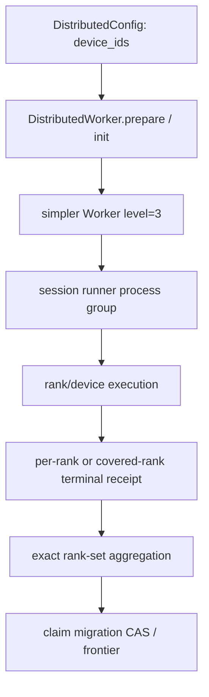
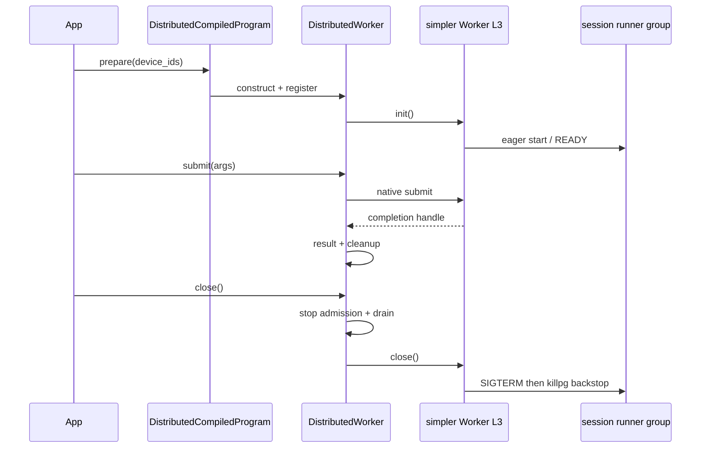

> 源码基线：[`hw-native-sys/pypto@04aed691`](https://github.com/hw-native-sys/pypto/commit/04aed6915460a98d1ecd07fe29c6e0e7c6da3022) 与 [`hw-native-sys/simpler@c77294c0`](https://github.com/hw-native-sys/simpler/commit/c77294c0323bb3c0f145bf5af8729436a3c64d13)，均为研究时默认分支最新提交。PyPTO 相对上一章基线 [`9339b96d`](https://github.com/hw-native-sys/pypto/commit/9339b96dd6d42e69b1dee8f43316d407887e2d43) 前进 [7 个提交](https://github.com/hw-native-sys/pypto/compare/9339b96dd6d42e69b1dee8f43316d407887e2d43...04aed6915460a98d1ecd07fe29c6e0e7c6da3022)，未修改本文直接依赖的 distributed runner 文件；simpler 最新提交只增加生产调度基准，本文所读 remote L3 文件 blob 未变。直接相关的历史实现是 simpler [PR #1397](https://github.com/hw-native-sys/simpler/pull/1397)：它引入 eager、transactional、recursive `Worker.init()` 和 process-group cancellation。本文严格区分“当前代码/测试事实”与“建议的 durable certificate 协议”；后者尚不是现有 API。

## 本篇在 PTO 课程路线中的位置

这是课程第 92 章，承接第 91 章的 stuck frontier。上一章解决单个失联 actor：证据足够就签 terminal certificate，证据不足就把最小 source evidence 迁入持续计费的 quarantine。今天只补一个缺口：一次 L3 分布式执行横跨多个 logical rank、runner 和子进程时，**谁有资格证明整个 claim 已经 terminal**？

本章位于 `Python HOST program → PyPTO DistributedWorker → simpler L3 process tree → rank/device execution` 的生命周期边界；不新增 ISA 指令、Tile、layout 或 memory-location 语义，也不进入 serving 调度。

## 前置知识

`ReaderView` 的终止只需证明 no-more-read；`ClaimLease` 还必须证明 no-more-effect。heartbeat 超时、PID 消失和 `flock` 自动释放都只能产生 `SUSPECT`。若一个 claim 曾派发到四个 rank，那么“父进程返回”“看见三个 PID 退出”或“收到了三个终止消息”都不等于第四个 rank 不会迟到写入。

删除 frontier 需要的是无 gap 的覆盖证明；因此多 rank terminal 也必须以**精确成员集合**聚合，而不是以计数聚合。

## 今日 1–2 个核心问题

1. PyPTO 当前怎样把 `device_ids` 变成 logical rank 集合，并怎样从 `prepare()`、`submit()` 走到 drain 与 `Worker.close()`？simpler 的 remote L3 daemon 又怎样拥有 runner process group？
2. 如何把这些进程内终止事实提升为可持久化的 `ProcessGroupTerminalCertificate`，再用 claim migration CAS fence 住旧 rank 的迟到 effect？

## PTO 全栈中的位置

上游 `DistributedCompiledProgram` 给出程序、参数元数据和 `DistributedConfig.device_ids`；PyPTO 构造并初始化 simpler `Worker(level=3)`。下游 simpler eager 启动 L3→L2 子树，rank 最终运行 PTOAS 生成的设备产物。证书层不替代设备 completion：它只能消费各 owner 已确认的 completion、cancel、drain 和 process reaping 事实。



## 概念和精确语义

### Rank 集合不是“启动了几个进程”

[`DistributedConfig`](https://github.com/hw-native-sys/pypto/blob/04aed6915460a98d1ecd07fe29c6e0e7c6da3022/python/pypto/ir/distributed_compiled_program.py) 要求 `device_ids` 非空、非负且互异。logical rank 是列表索引：`rank r → device_ids[r]`，world size 是 `len(device_ids)`；[分布式调试文档](https://github.com/hw-native-sys/pypto/blob/04aed6915460a98d1ecd07fe29c6e0e7c6da3022/docs/zh/user/distributed/04-debugging.md) 也明确要求 host dispatch 次数等于该长度。

因此 expected membership 是 `{0, …, world_size-1}`，不是进程表快照。一个 session runner 可以管理多个本地 device rank；跨节点时多个 supervisor 又可各自覆盖一个 rank 子集。证书必须携带 `covered_ranks`，聚合器验证这些集合的并集恰好等于 expected set，并拒绝缺口、重叠冲突和错误 epoch。

### 当前 runtime terminal 与 durable terminal 的边界

PyPTO 的 `DistributedRunHandle.result()` 等 native handle 完成后执行 dispatch cleanup 与 postprocess，再把 `_terminal=True` 并从 worker active set 退休。这个 terminal 是**本进程内、内存态、单 dispatch**事实；进程在写 durable receipt 前崩溃，恢复器看不到它。

`DistributedWorker.close()` 则先停止新 admission，FIFO drain 全部 published handles，释放 persistent domains 和 owned tensors，最后调用 simpler `Worker.close()`。只有后者成功才设置 `_close_complete`。这提供了正确的本地 teardown 顺序，但仍没有 certificate id、supervisor incarnation、rank coverage 或 durable log。

simpler 的 [`remote_l3_worker.py`](https://github.com/hw-native-sys/simpler/blob/c77294c0323bb3c0f145bf5af8729436a3c64d13/python/simpler/remote_l3_worker.py) 把 session runner 以 `start_new_session=True` 启动，使它成为 process-group leader。`_wait_or_kill_runner` 先等待，再发 cooperative `SIGTERM`，让 runner 关闭内层 Worker、回收 L3→L2 子树并 unlink nested shm；仍不退出才 `killpg(SIGKILL)`。这给 supervisor 一个真实 ownership scope，但 hard kill 只证明 host 进程树消失，不能凭空证明 device side effect 已完成或共享 backing 已按正常路径释放。

### 建议证书：集合覆盖 + incarnation fence

最小 receipt 可写成：

```text
RankTerminalReceipt {
  group_id, group_epoch, supervisor_incarnation,
  covered_ranks, device_ids, runner_pid, process_start_nonce,
  last_dispatch_id, last_claim_epoch, last_effect_id,
  host_tree_reaped, device_effect_terminal, buffer_retire_state,
  close_mode, witness_id, digest
}
```

聚合得到：

```text
ProcessGroupTerminalCertificate {
  claim_id, source_generation, expected_ranks,
  group_epoch, receipt_digests, terminal_cutoff,
  missing_ranks, conflict_set, supervisor_epoch, digest
}
```

后置条件不是“receipt 数量等于 world size”，而是：所有 receipt 的 claim/source/group epoch 一致；`covered_ranks` 无冲突且并集等于 `expected_ranks`；每个 rank 的 `device_effect_terminal` 为真，或者该 rank 的旧 claim epoch 已被持久化 fencing 且最小证据已进入 quarantine。重复 receipt 必须按 digest 幂等；同一 rank 同一 epoch 出现两个不同 digest 则进入 conflict，不得按时间戳任选其一。

### Claim migration CAS

当 rank 2 的 effect 状态未知时，新的 claimant 不能直接“接管并重跑”。建议 CAS 的 expected value 至少绑定：

```text
(claim_id, old_claim_epoch, source_generation,
 source_revision, expected_ledger_revision, effect_id)
```

迁移顺序是：先写并校验 immutable quarantine bundle；再 durable 记录 supervisor receipts；CAS 把 claim epoch 从 5 提升到 6，并把 source/charge owner 指向 bundle；最后才推进旧 segment frontier。旧 rank 即使迟到，也因 epoch 5 与 canonical epoch 6 不符而不能提交 E9。CAS 失败者只复读 canonical state，不重复 charge，也不重复 effect。

## 真实文件、类型、API 或指令逐段解读

### `DistributedCompiledProgram.prepare`：建立一次、复用多次

[`prepare()`](https://github.com/hw-native-sys/pypto/blob/04aed6915460a98d1ecd07fe29c6e0e7c6da3022/python/pypto/ir/distributed_compiled_program.py) 加载/组装 chip callable、生成模块，构造 `Worker(level=3)`、注册并 `init()` 一次，然后返回 `DistributedWorker`。直接 dispatch 的 host `torch.Tensor` 必须在 fork 前建立共享映射；worker-resident `DeviceTensor` 则由 handle 持有并跨 dispatch 复用。非法条件包括空/重复/负 device id、普通非 shared host dispatch tensor、跨程序 platform/runtime/device set 不一致，以及关闭后继续 submit。

### `_construct_worker` 与 `DistributedWorker.__init__`：expected set 的唯一来源

[`_construct_worker`](https://github.com/hw-native-sys/pypto/blob/04aed6915460a98d1ecd07fe29c6e0e7c6da3022/python/pypto/runtime/distributed_runner.py) 把 `level=3`、`device_ids`、sub-worker 数、platform/runtime 交给 simpler。`DistributedWorker` 先为两个 bounded metadata frame 分配状态，加载各程序的 `host_orch` 与 chip callable，检查所有程序使用相同 `device_ids`，再注册并 eager `init()`。这里的 `len(device_ids)` 同时传给 HOST scratch allocator，并记录为每程序 `device_nums`。

这意味着 certificate expected set 应由已验证的 distributed config/生成 artifact 派生，不能由“本次收到了哪些 rank 消息”反推。

### `submit/result/close`：先 drain effect，再拆 owner

[`DistributedRunHandle`](https://github.com/hw-native-sys/pypto/blob/04aed6915460a98d1ecd07fe29c6e0e7c6da3022/python/pypto/runtime/distributed_runner.py) 持有 worker、native handle、dispatch frame、参数 keepalive 与 cleanup，直至 terminal publication；多个 waiter 观察同一个 cached outcome。`close()` 将 `_accepting_dispatches=False`，drain active handles，释放 persistent domain 与 `DeviceTensor`，再调用 `_w.close()`；失败会保留首个 error，并允许底层 cleanup 重试。

关键边界是：这些状态都在 Python 对象内。恢复系统必须由拥有进程树的 supervisor 在 teardown 完成后另行 durable 写 receipt，不能把 GC 对象“看不见 worker”当 terminal。

### `_start_session/_serve_connection`：ownership handoff 不等于对端确认

simpler daemon 校验 manifest 中 `device_ids` 与 `global_device_ranks` 等长，且 global ranks 唯一、非负。runner ready 后，`_serve_connection` 先把 reply 发给 parent，再把 process handle 交给 background reaper；发送失败或 reaper thread 无法启动时，`finally` 仍精确回收一次。源码还明确写着：send 成功只代表 bytes 进入本地 socket，不代表 parent 已读取；当前 `host_tcp` 没有 ACK/lease。

所以 supervisor witness 不能把“ready reply send returned”当作 rank owner 已转移的 durable 证据。若需要跨 crash 恢复，必须补 receipt ACK 或由独立 durable supervisor log 记录 ownership handoff。

## 对象/Tile/Buffer/IR 生命周期

本章追踪的是 `DistributedWorker → DistributedRunHandle → simpler session runner proc`：

1. `DistributedConfig.device_ids` 创建 expected rank set；`prepare()` 构造一个持有程序、buffer、registration 和 simpler Worker 的 `DistributedWorker`。
2. `submit()` 占用一个 metadata frame，创建 `DistributedRunHandle`；handle 持有输入/输出、cleanup 与 native completion，防止运行中失效。
3. `result()` 在 native completion 后执行 cleanup/postprocess，清空引用并把 frame 归还复用。
4. `close()` 停 admission、drain 全部 handle、释放 persistent domain/owned tensor，再关闭 simpler Worker。
5. 远端路径上 daemon 持有 session runner `Popen`；正常 reply 后把它交给 reaper，异常则 cooperative terminate，必要时 kill 整个 process group。
6. 当前生命周期到此结束；durable terminal receipt、group aggregator 与 claim CAS 均不存在，是本章建议补层。

## 端到端调用链或指令链



当前真实链到 `killpg`/reap 为止。建议链在每个 group owner 完成 teardown 后追加 `durable receipt → exact rank-set aggregate → claim migration CAS`，而不是把它伪装成现有调用。

## 具体 shape、Tile 和状态演算

设 `DistributedConfig(device_ids=[4,5,6,7])`，因此 logical rank 为 `{0,1,2,3}`，映射到四张卡。host 输入/输出是 fork 前创建的 shared FP16 tensor `[4,32,128]`；每个 rank 处理 `[32,128]`，每片 `32×128×2=8192 B`，四片共 32768 B。这里不改变 Tile layout；shape 只用于把运行中的 effect scope 具体化。

claim `C1=(epoch=5, source=S12/rev104, effect=E9)` 已 dispatch。PG-A 覆盖 `{0,1}`，PG-B 覆盖 `{2,3}`：

1. rank 0、1、3 都返回 completion；rank 2 的 parent 断线。收到 3 份 receipt 仍不能 terminal：`expected={0,1,2,3}`，实际覆盖缺 rank 2。
2. PG-B supervisor 用 `(group_epoch=7, process_start_nonce=n2)` 关闭 runner，cooperative SIGTERM 成功，确认 inner Worker drain、process group reaped；若它还能证明 rank 2 的 device effect terminal，就签覆盖 `{2,3}` 的 receipt。聚合器验证它与 rank 3 既有 receipt 不冲突后，集合闭合。
3. 若 PG-B 只能证明 host tree 已死，不能证明 E9 的 device effect，rank 2 保持 unknown。先把 rev104/effect E9 的最小证据放入 `Q9` 并计费，再做 `CAS(C1 epoch5, ledger_rev=108 → epoch6, source=Q9)`。
4. CAS 成功后，任何 epoch5 的迟到提交被拒绝；group terminal 对旧 epoch 才成立，S12 frontier 可继续。`Q9` 仍占容量，直到 E9 被证明 complete/reset-covered。

注意：3/4 不是“75% quorum”；这是 safety certificate，缺一 rank 就缺一段 no-more-effect 证明。

## 为什么这样设计及替代方案

| 方案 | 延迟/吞吐 | 资源与并发 | 正确性 | 维护成本 |
| --- | --- | --- | --- | --- |
| parent 返回或 PID 消失即 terminal | 最快 | 几乎无元数据 | 无法覆盖子进程、socket 未 ACK、device late effect；不安全 | 表面最低，事故恢复最高 |
| 收到 `N` 份消息的计数 quorum | 聚合便宜 | 可批量 | duplicate rank 可补足计数，错误 epoch/重叠 coverage 仍可能漏 rank | 协议简单但难审计 |
| exact rank-set receipt + supervisor witness + CAS | close 路径增加 O(world size) 元数据与一次 durable CAS | quarantine 会保留未知证据并占预算；不同 group 可并行收集 | 明确绑定 membership、incarnation、effect 与 owner epoch；fail-closed | schema/codec/fault testing 较多，但边界稳定 |

证书不应在每个 token 或每个 Tile 上 `fsync`。合理粒度是 dispatch/claim ownership 边界：rank completion 可在内存中合并，只有 terminal handoff、quarantine migration 和 claim epoch CAS 进入 durable control path。这样不污染设备热路径，也不妨碍 graphability；代价主要在异常恢复和 worker close，而不是 kernel latency。

## 访存、计算、流水、并行和硬件约束

本协议不改变 FP16 payload 的 H2D/D2H 量，也不改变 AICore Tile、PTO 指令或 pipeline。性能影响来自 Host control-plane：receipt 大小随 process group/rank 数线性增长；多个 supervisor 可以并行签发，聚合器做 set/digest 校验。

cooperative SIGTERM 优于直接 SIGKILL，因为正常 `Worker.close()` 能先 drain handle、释放 domain/buffer 并回收子树；但它有 bounded timeout，不能无限阻塞恢复。超时升级 killpg 后，host process terminal 与 device effect terminal 必须分开：前者可由 wait/reap 证明，后者若无 backend completion/reset certificate，就只能 quarantine。预算约束仍是上一章的不变量：`live + retiring + quarantined + rebuild_headroom <= artifact_budget`。

## 测试证据与未覆盖风险

**PyPTO 测试事实。** [`test_distributed_worker.py`](https://github.com/hw-native-sys/pypto/blob/04aed6915460a98d1ecd07fe29c6e0e7c6da3022/tests/ut/runtime/test_distributed_worker.py) 的 `test_close_drains_outstanding_handle_before_worker_close` 用可控 native handle：另一个线程调用 `close()` 后必须阻塞，底层 `worker.close` 尚未发生；handle complete 后才关闭，之后再 submit 必须报错。`test_close_idempotent_and_closes_worker` 连续调用两次 close，底层只执行一次。这验证 admission/drain/teardown 顺序和幂等性，不验证进程崩溃后的 durable receipt。

**simpler 测试事实。** [`test_remote_l3_lifecycle.py`](https://github.com/hw-native-sys/simpler/blob/c77294c0323bb3c0f145bf5af8729436a3c64d13/tests/ut/py/test_remote_l3_lifecycle.py) 覆盖三条关键路径：runner-ready timeout 时先 `terminate` 再 hard kill；ready reply 成功后 runner 精确交给 reaper 一次；reply `BrokenPipeError` 或 reaper thread 启动失败时由 `finally` 精确 reclaim 一次。它们验证单 daemon 内 runner ownership 不丢不重，不验证 parent 已消费 reply、跨节点 supervisor 接管或 rank-set certificate。

**未覆盖风险。** 当前没有：PID reuse/namespace 隔离、duplicate 或 overlap `covered_ranks`、错误 group epoch、receipt durable-before-ACK、supervisor 在 receipt 与 CAS 间崩溃、只 kill host tree 而 device effect 迟到、两个 claimant 同时迁移、CAS 后旧 epoch late effect、quarantine charge 双计/漏计，以及 4/8 rank 真机故障注入。它们应成为协议落地前的 fault-at-every-boundary Golden。

## 与前后章节的连接

第 91 章给出单 actor certificate 与 bounded quarantine；本章把 actor 扩展为由 `device_ids` 定义的精确 rank set，并把 simpler process group owner 接入 witness。下一章应回答证书落在哪里、如何跨 supervisor crash 重放：canonical codec、durable receipt log、ACK 与 takeover replay。再下一步才适合把这条 Host ownership 证据回接 PTOAS/runtime generation 的设备 completion adapter。

## 本篇结论、知识债、三个理解检查问题和下一章

结论只有一句：**process-group terminal 不是“足够多进程退出”，而是同一 claim/group epoch 下，expected rank set 被无冲突 terminal evidence 完整覆盖；任何 device effect unknown 都必须先 quarantine，再以 claim epoch CAS 接管。**

知识债：当前 PyPTO/simpler 没有 durable receipt schema、canonical codec、supervisor log、ACK/lease、rank-set aggregator、claim migration CAS 或 capacity charge ledger；也没有跨节点和真机 late-effect Golden。

理解检查：

1. 为什么 `device_ids=[4,5,6,7]` 收到四条 terminal 消息仍可能不构成 group certificate？
2. cooperative SIGTERM 成功并 wait 到 process group 退出，为什么仍可能只能证明 host terminal、不能证明 device effect terminal？
3. claim migration 为什么必须先 durable quarantine evidence，再提升 claim epoch，而不能先 CAS 后复制？

下一章：**Terminal Receipt 写到哪里——Canonical Codec、Durable Receipt Log 与 Supervisor Takeover Replay。**

## 课程账本增量

- 课程 92；源码基线 PyPTO `04aed691`、simpler `c77294c0`。
- 新增真实链：`DistributedConfig.device_ids → DistributedCompiledProgram.prepare → DistributedWorker submit/result/close → simpler remote L3 session runner → cooperative SIGTERM / killpg / reaper`。
- 新确认：expected membership 来自 validated config；本地 run terminal、process-tree terminal 与 device-effect terminal 是三个不同证明层；group certificate 必须 exact rank-set cover；claim migration 以 source/effect/epoch/revision CAS fence 旧 owner。
- 新知识债：receipt codec/log/ACK、supervisor incarnation registry、rank-set conflict handling、claim migration/charge CAS、跨节点与真机 fault Golden。
- ISA 知识地图无新增指令；全栈地图新增 distributed runtime terminal ownership 与 Artifact frontier 的连接。
- 下一章：canonical receipt 与 takeover replay。
