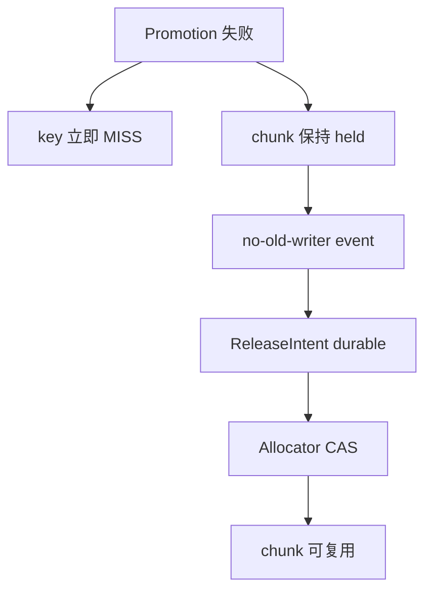
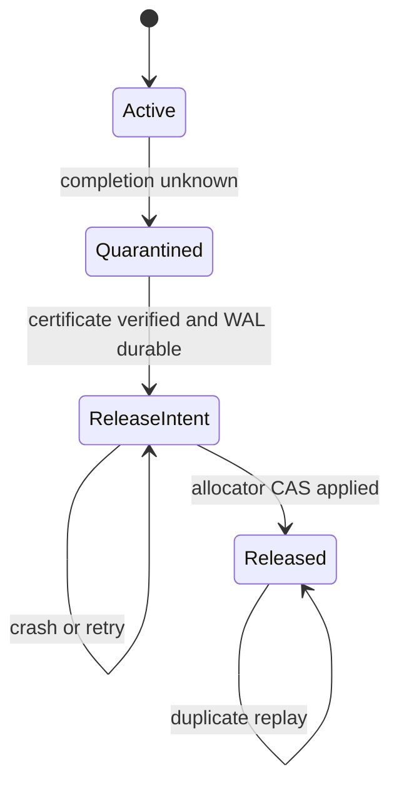

> 源码基线：[`05caae03`](https://github.com/vllm-project/vllm/commit/05caae03c20f69436ff7ec23ded339ea104f1a01)，即研究时 `vllm-project/vllm` 默认分支最新提交。相对上一章基线前进 [105 个提交](https://github.com/vllm-project/vllm/compare/3b33a845c6733a50aafae933c10ac0be0f18be93...05caae03c20f69436ff7ec23ded339ea104f1a01)；本文直接分析的 CPU manager、tiering manager/base、offloading reset fence 与 deferred-release 主测试文件 blob 均未变化，`test_obj_tier.py` 有测试演进，但不改变本文不变量。`CapacityCharge`、durable `ReleaseIntent` 和 allocator CAS 是由当前实现的崩溃窗口推导出的建议协议，**不是 main 已有功能**。

## 本篇在课程路线中的位置

这是课程第 82 章，仍位于“测试、性能与故障诊断”。[第 81 章]({{ '/articles/vllm-backend-reset-certificate-registration-revoke-capacity-release/' | relative_url }}) 已定义 quarantine 关闭条件：只有 scope 完整的 `NO_OLD_WRITER` certificate，才能证明旧 DMA/RDMA 已失去写入能力。

本章只追问下一步：**certificate 已经 durable，怎样把被隔离的 chunk 恰好一次地返还给 allocator？** “没有再写入”与“容量已经返还”仍是两个提交点。

## 前置知识回顾

当前 main 已把 promotion 的逻辑失败与物理 slot 复用分开：timeout 后 key 可以立即 `MISS`，请求转向重算；旧 chunk 却必须等 writer terminal 才能进入 free pool。这套进程内设计来自已合入的 [PR #63779 / commit `0beab6c2`](https://github.com/vllm-project/vllm/commit/0beab6c251e8046c0c6cf2fef114cd23b58cda74)，P2P timeout 又在 [PR #64256 / commit `16777da3`](https://github.com/vllm-project/vllm/commit/16777da3475084eda04813c98cfef4365d5dcb58) 上把“失败结果”与“release event”真正接通。

它解决的是活进程内的 late writer；它没有声称 `_free_list`、`_deferred_releases` 或 `threading.Event` 能跨 crash 恢复。

## 本篇要回答的核心问题

1. 当前 `defer_write_release → Event → release_deferred_write` 怎样保证旧 chunk 不被早复用？
2. 进程在 `pop`、计数递减、free-list append 之间崩溃，会泄漏还是双重释放？
3. durable ledger 的提交点应放在哪里，重放时怎样同时防 duplicate、ABA 与 partial-rank release？

## 组件在全局架构中的位置



图中 A～D 已存在于 main；E～G 是本章建议补上的 crash-safe 边界。它完全位于 Host 控制面，不改变 KV tensor 的 dtype 或 device，只决定 CPU primary region 中哪一行可以再次成为 transfer destination。

## 完整调用链

公开入口仍从 [`LLM.reset_prefix_cache(reset_connector=True)`](https://github.com/vllm-project/vllm/blob/05caae03c20f69436ff7ec23ded339ea104f1a01/vllm/entrypoints/llm.py) 经 `LLMEngine → EngineCore → Scheduler.reset_prefix_cache` 到 offloading connector。connector 的 [`_reset_cache()`](https://github.com/vllm-project/vllm/blob/05caae03c20f69436ff7ec23ded339ea104f1a01/vllm/distributed/kv_transfer/kv_connector/v1/offloading/scheduler.py) 建立旧 job fence；[`TieringOffloadingManager.reset_cache()`](https://github.com/vllm-project/vllm/blob/05caae03c20f69436ff7ec23ded339ea104f1a01/vllm/v1/kv_offload/tiering/manager.py#L1247-L1311) 逐 tier 调用 `drain_jobs()`，消费 completion，断言 `_jobs` 与 `_deferred_releases` 均为空，最后清 primary tier 并保持 `_promotions_held`，直到 worker reset report flush 完成。

真正的容量链从 secondary→primary promotion 开始：

1. `prepare_write()` 实际是 CPU manager 的 [`prepare_store()`](https://github.com/vllm-project/vllm/blob/05caae03c20f69436ff7ec23ded339ea104f1a01/vllm/v1/kv_offload/cpu/manager.py#L268-L379)。它从未分配尾部或 `_free_list` 取得 `ChunkStatus`，插入 cache policy，并增加 `_num_write_pending_chunks`。
2. secondary tier 回报失败但可能仍写 primary memory 时，`JobResult.deferred_release` 携带一个 `threading.Event`。[`_complete_promotion()`](https://github.com/vllm-project/vllm/blob/05caae03c20f69436ff7ec23ded339ea104f1a01/vllm/v1/kv_offload/tiering/manager.py#L539-L589) 对成功 key 正常 complete；对失败 key 调 `defer_write_release()`。
3. [`defer_write_release()`](https://github.com/vllm-project/vllm/blob/05caae03c20f69436ff7ec23ded339ea104f1a01/vllm/v1/kv_offload/tiering/manager.py#L168-L196) 要求每个 key 仍是 pending write，从 policy 删除它，却不减少 pending count、也不把 chunk id 放回 free list；因此 lookup 已 `MISS`，旧地址仍不可分配。
4. `_deferred_releases[job_id]` 持有 event、tier、chunk ids 与开始时间。每轮 [`_process_finished_jobs()`](https://github.com/vllm-project/vllm/blob/05caae03c20f69436ff7ec23ded339ea104f1a01/vllm/v1/kv_offload/tiering/manager.py#L591-L644) 轮询；event set 后，`_complete_deferred_releases()` 先 `pop(job_id)`，再调 `release_deferred_write()`。
5. [`release_deferred_write()`](https://github.com/vllm-project/vllm/blob/05caae03c20f69436ff7ec23ded339ea104f1a01/vllm/v1/kv_offload/tiering/manager.py#L198-L203) 对每个 id 执行三次内存 mutation：从 held set `remove`、pending count `-1`、append 到 `_free_list`。之后新 `prepare_store()` 才能 pop 并复用该 id。

`SecondaryTierManager.drain_jobs()` 的接口还明确要求：返回前所有 `JobResult.deferred_release` event 必须 set；这保证正常 reset 不与在途 tier I/O 竞争。失败方式也明确：tier 卡死会让 reset 可见地阻塞，优于静默复用。

## 关键类型、字段和状态生命周期

当前对象生命周期是：`OffloadKey → pending ChunkStatus → policy 移除 → _deferred_release_chunk_ids → _free_list → 新 OffloadKey`。`CPULoadStoreSpec.chunk_ids` 是 Host metadata；实际 KV 存储是 CPU `memoryview` 的 row。chunk 的 shape 由 `SharedOffloadRegion` 决定，allocator 本身只见整数 id，不见模型 dtype。

当前接口契约可压缩为：

| 接口 | 输入/输出 | 所有权与条件 | 失败方式 |
| --- | --- | --- | --- |
| `defer_write_release(keys)` | `Collection[OffloadKey] → list[int]` | manager polling path 独占 mutation；key 必须存在且 `not is_ready` | ready/missing key 触发 assertion，防止未持有地址被放行 |
| `Event.set()` | 无返回 | tier 可从任意线程单调 set；只表示其 I/O 不再触碰这些 chunk | event 丢失或进程崩溃，没有 durable 证据 |
| `release_deferred_write(ids)` | `Iterable[int] → None` | 假设每个 id 恰好释放一次 | duplicate `remove` 抛错；跨 crash 无法判断 append 是否已发生 |

建议增加两个 durable 对象：

```text
CapacityCharge {
  charge_id, region_id, chunk_ids, bytes,
  state, ledger_revision, certificate_digest
}

ReleaseIntent {
  intent_id, charge_id, expected_revision,
  region_id, chunk_ids, allocator_epoch, certificate_id
}
```

`region_id` 必须含 allocation generation/nonce，不能只有 base+length；`intent_id` 必须稳定可重放。状态机如下：



真正的线性化点不是 event set，也不是 intent fsync，而是 allocator 对 `(region_id, allocation_generation, intent_id)` 的幂等 CAS。`RELEASED` ledger record只是把已发生的 allocator verdict持久化，方便恢复与审计。

## 逐函数源码解读

`CPUOffloadingManager._get_num_free_chunks()` 计算 `len(_free_list) + num_chunks - num_allocated_chunks`。deferred chunk 已经 allocated，却不在 free list，所以天然占容量；这正是 fail-closed 的数学来源。

`prepare_store()` 先算需要 evict 的数量；若 free 与 evictable 都不足就返回 `None`，上层把 promotion 降为 `MISS`。这让容量压力影响性能而不破坏正确性。分配成功后 `_allocate_chunks()` 优先消费从未分配的 id，再从 `_free_list.pop()` 复用。

`defer_write_release()` 只从 policy 删除 key。这样同一 key 重新 store 会拿 fresh chunk；late writer 即使继续写 old id，也不会覆盖新值。它故意保留 `_num_write_pending_chunks`，使统计和 reset idle assertion都看到未清债务。

`_complete_deferred_releases()` 的顺序是 `dict.pop → held.remove → pending-- → free.append`。在一个 Python 进程里，这足够清晰；跨 crash 却出现四个窗口：

- event set、尚未 `pop`：重启丢失 event 与 dict，容量泄漏；
- 已 `pop`、尚未 release：同样泄漏，且恢复看不到 owner；
- 已 `pending--`、尚未 append：计数与可分配集合分叉；
- 已 append、尚未 durable 标记：若恢复重放 release，同一 chunk 可能进入 free list 两次，两个新 key随后拿到同一物理 row——这是比泄漏更危险的别名写。

因此不能用“把 `pop` 换到 release 后面”修补：它只把故障窗口从 leak 移到 duplicate。最小修复必须让 allocator 识别稳定 `intent_id`，并把旧 allocation generation 一并比较。

## 具体示例与 shape/状态演算

沿上一章例子：TP=2，每 rank slot 为 64 KiB，一个逻辑 row 共 128 KiB；旧 generation 7 的 `job_id=41` 占 `chunk_ids=[12,13]`，`charge_id=q-7-41`，`region_id=(alloc_gen=22, reg_gen=7, row=3, nonce=9f)`。rank 1 unknown，两个 chunk 都保持 quarantine。

1. scoped certificate `c-7-r1` durable 后，verifier确认它覆盖旧 registration、rank 1、job 41 与 exact region。ledger revision 900 仍是 `QUARANTINED`。
2. 写入 `intent_id=r-900`，fsync 后以 CAS 把 revision 900 变为 901/`RELEASE_INTENT`。此时容量公式仍把 128 KiB 算作已占用：

   `free = physical - Σ(ACTIVE, QUARANTINED, RELEASE_INTENT)`。
3. allocator 执行 `release_if_owned(region_id, alloc_gen=22, intent_id=r-900)`。若两 rank 的 slot 必须作为一行共同复用，rank 0 先成功也只记录 receipt，不对外 admission；rank 1 receipt齐全后，allocator把两 slot generation推进到 23，并原子发布 128 KiB free。
4. ledger CAS 为 revision 902/`RELEASED`。若此处前 crash，重放 `r-900` 只读到 allocator 的 `ALREADY_APPLIED`，不会第二次 append；若拿到 `OWNER_MISMATCH`，说明 slot 已是别的 generation，必须 fail closed并报警。

如果 allocator没有 durable applied-intent/tombstone查询能力，就不能在重启后盲目重放 `_free_list.append`。安全退化是从 durable non-released charges与物理 region census重建 free bitmap；无法证明的 slot继续 quarantine。

## 为什么这样设计及替代方案

方案一是保留当前 event+内存 free list。它没有 fsync热路径，延迟最低，适合单进程正常 reset；代价是 crash 后只能整体丢弃旧 region或接受容量泄漏，不能声称 restart-safe。

方案二是重启后扫描 cache policy，把“不在 policy 的 chunk”视为 free。它看似简单，却把 deferred、evicted、从未分配和 late-writer slot混在一起，也无法抵抗 address ABA，错误释放风险最高。

方案三是“先写 `ReleaseIntent`，再做 generation-fenced allocator CAS，最后写 `RELEASED`”。它增加 WAL与恢复复杂度，但把所有 crash落在可重放状态。性能上可以按 scheduler step或字节阈值 group commit；不能用任意 TTL跳过 intent。allocator hot path仍用内存 bitmap/free stack，durable ledger只约束跨 crash边界。

## 性能、并发、正确性与边界条件

- **延迟/吞吐**：每 chunk fsync会放大 promotion tail latency；按同一 certificate/region批量写 intent更合理。batch必须先 durable，不能“后台补写”。
- **内存**：`RELEASE_INTENT` 在最终 CAS前仍计费，会暂时降低可用容量，但不会让两个 owner共享 row。
- **并发**：event 可由任意 thread set，allocator mutation仍收敛到 manager/allocator owner。多 owner需要单一 linearizable CAS authority，不能各自 append local free list。
- **graphability**：协议在 Host 控制面，不进入 `torch.compile` 或 CUDA Graph；它间接影响 promotion是否命中，从而影响 recompute与 TTFT。
- **正确性**：duplicate certificate、duplicate event、owner crash、stale allocator epoch都必须得到相同终态；`RELEASED` 后的旧 intent永远不能修改 generation 23。
- **维护成本**：需要 schema version、snapshot/compaction和恢复工具；收益是容量 debt可审计，不再把“free count看起来恢复”误当作安全证明。

## 测试证据与未覆盖风险

[`test_tiering_offloading.py`](https://github.com/vllm-project/vllm/blob/05caae03c20f69436ff7ec23ded339ea104f1a01/tests/v1/kv_offload/tiering/test_tiering_offloading.py#L703-L811) 已直接验证六条进程内不变量：失败 key立即 `MISS`；两个 chunk继续占容量；event未 set 时重复 poll不释放；同 key restore拿到不同 chunk；partial failure只 hold失败项；`drain_jobs()` set event 后 reset成功。already-set event也在同一 poll轮释放。

[`test_obj_tier.py`](https://github.com/vllm-project/vllm/blob/05caae03c20f69436ff7ec23ded339ea104f1a01/tests/v1/kv_offload/tiering/test_obj_tier.py#L530-L558) 还验证 transfer-handle release第一次失败时，job结果不会丢失，下一次 cleanup重试后结果只返回一次。这是“先保留owner状态，再宣告terminal”的测试事实，不是 durable allocator测试。

仍缺少的关键 fault matrix：intent fsync后 crash；单 rank allocator apply后 crash；全部 apply但 `RELEASED` 未写；`RELEASED` 后 snapshot未更新；duplicate event/certificate；stale allocator epoch；same address/new nonce；同一 chunk两 intent竞争。oracle必须同时检查 free count、free-list/bitmap唯一性、generation、pending count与两个新 allocation绝不别名。

当前 main没有 durable capacity ledger、release intent或 allocator CAS，因此本章的 crash-safe结论是建议设计；现有测试只能证明单进程路径，不得外推为跨重启保证。

## 与前后章节的连接

第 81 章回答“谁有资格授权释放”；本章回答“授权怎样成为恰好一次的 allocator effect”。下一章将继续单点推进：当 unknown/quarantine长期产生时，如何用 `debt age × bytes × closure rate` 决定 admission、reset升级与 operator告警，而不让安全 debt被平均命中率掩盖。

## 本篇结论、知识债、三个理解检查问题和下一章

结论只有一句：**certificate 是 release 的前置证据，durable intent 是可恢复计划，generation-fenced allocator CAS 才是容量返还的唯一提交点。**

知识债：vLLM main尚无跨 crash allocator authority；NIXL/UCX revoke certificate仍缺正式契约；多 rank row是整体 charge还是独立 subcharge需要与真实 allocation粒度对齐；group commit成本、ledger compaction、真机 late-RDMA与 same-address复用仍需量化。

理解检查：

1. 为什么 event已经 set，仍不能把 `threading.Event` 当作 crash-safe release receipt？
2. 为什么“先 append free list，再写 RELEASED”在重放时可能让两个 key拿到同一 chunk？
3. TP=2 中 rank 0 已释放、rank 1 尚未完成时，什么条件下 rank 0 slot可以独立 admission；什么条件下必须保留整行 charge？

下一章：**Quarantine Debt 何时必须升级——Age×Bytes Budget、Closure Rate 与 Admission Escalation。**

## 课程账本增量

- 第 82 章补齐 `deferred release → durable intent → allocator CAS → replay`，把 no-old-writer evidence与容量 effect分离。
- 新覆盖：`CPUOffloadingManager.prepare_store/complete_store/reset_cache`、`CPUPrimaryTierOffloadingManager.defer_write_release/release_deferred_write`、`TieringOffloadingManager._complete_promotion/_process_finished_jobs/_complete_deferred_releases/reset_cache`、`JobResult.deferred_release/SecondaryTierManager.drain_jobs`。
- 新不变量：`RELEASE_INTENT` 仍计费；allocator CAS而非 event/certificate/ledger final是线性化点；idempotency key必须绑定 allocation generation；无法查询 applied intent时只能由 durable charge+census重建 free set。
- 新知识债：durable allocator authority、multi-rank原子粒度、WAL group commit、crash-at-every-boundary与真实 NIXL late-write测试。
- 下一章：**Quarantine Debt 何时必须升级——Age×Bytes Budget、Closure Rate 与 Admission Escalation。**
