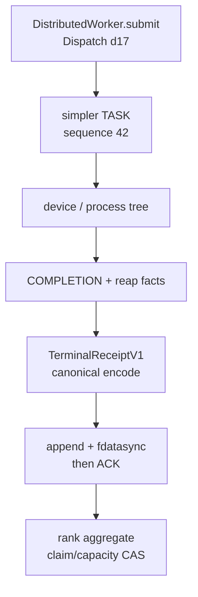
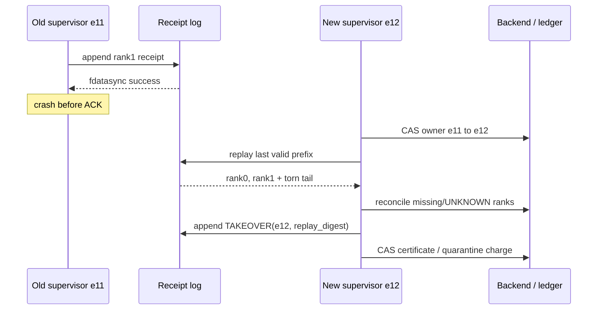

> 本文基于 PyPTO [`cc802e9b`](https://github.com/hw-native-sys/pypto/commit/cc802e9b84d428351f7693bf813d4c4b97f4994a) 与 simpler [`f65b6130`](https://github.com/hw-native-sys/simpler/commit/f65b613004d8c33939b69141d78484076d9232fd)。相对上一章，PyPTO 前进 [8 个提交](https://github.com/hw-native-sys/pypto/compare/04aed6915460a98d1ecd07fe29c6e0e7c6da3022...cc802e9b84d428351f7693bf813d4c4b97f4994a)，simpler 前进 [15 个提交](https://github.com/hw-native-sys/simpler/compare/c77294c0323bb3c0f145bf5af8729436a3c64d13...f65b613004d8c33939b69141d78484076d9232fd)；本文直接分析的 distributed handle、remote wire 与 remote session lifecycle 文件均未被这些提交改动。文中的 `TerminalReceiptV1`、durable log、ACK、takeover CAS 是设计推导，不是当前已合入功能。

## 本篇在 PTO 课程路线中的位置

第 92 章得到一个必要条件：四 rank 作业只有在同一 claim/group epoch 下覆盖**准确 rank 集合**，才可能形成 group terminal certificate；`3/4` 不是 quorum。今天只补下一块：证据应当编码成什么，在哪个时刻才算“交给了恢复系统”，supervisor 崩溃后如何不重做 effect、也不误释放 32 KiB workspace。

课程主链因此推进为：

`Python handle terminal → wire COMPLETION → canonical receipt → durable append/ACK → exact-rank aggregate → takeover replay → claim/capacity CAS`。

这仍处在第二阶段的 runtime/device 落地边界。没有新增 PTO ISA 指令，但它回答了 ISA kernel 已提交以后，Host 怎样保存“这次执行真的结束了”的恢复证据。

## 前置知识

- `DistributedConfig.device_ids=[4,5,6,7]` 定义 expected logical ranks `{0,1,2,3}`，到达了几条消息不能反推成员集合。
- PyPTO run-handle terminal、simpler session process-tree terminal、device-effect terminal 是三种不同强度的证明。
- `killpg` 后 `wait()` 只能证明 Host 子树被回收，不能自动证明已提交设备命令不再产生 effect。
- unknown effect 仍占容量；quarantine 是缩小证据保留范围，不是“免费释放”。

## 今日 1–2 个核心问题

1. 当前三种“完成”为什么都不能直接作为跨重启证据？
2. `TerminalReceiptV1` 的 canonical bytes 应在哪个持久化点 ACK；新 supervisor 又如何重放 torn tail、duplicate、conflict 与 stale epoch？

第二问是第一问的直接后果，不是另起一个无关主题。

## PTO 全栈中的位置

上游是 PyPTO `DistributedWorker.submit()` 产生的 dispatch，以及 simpler scheduler/remote endpoint 收到的完成消息；下游是上一章的 exact-rank aggregator、claim migration 和 Artifact snapshot frontier。Receipt log 不执行 kernel，也不分配 workspace；它只把“谁、在哪个 epoch、对哪个 effect、观察到何种 terminal scope”变成重启后仍可验证的 bytes。



图中 A–D 是当前代码可以提供的事实边界；E–G 是本文建议的恢复层。

## 概念和精确语义

### 三个 terminal 不能混用

PyPTO [`DistributedRunHandle`](https://github.com/hw-native-sys/pypto/blob/cc802e9b84d428351f7693bf813d4c4b97f4994a/python/pypto/runtime/distributed_runner.py#L99) 持有 worker、native handle、dispatch frame、argument keepalive 与 cleanup。`result()` 等 native completion，执行 cleanup/postprocess，随后把 `_error` 和 `_terminal=True` 缓存在对象里，清空引用并把 frame 退还 worker。接口输入只是可选 timeout，输出为 `None` 或抛出已缓存错误；它不产生可序列化证据，进程退出后状态消失。

simpler 的 [`CompletionPayload`](https://github.com/hw-native-sys/simpler/blob/f65b613004d8c33939b69141d78484076d9232fd/src/common/hierarchical/remote_wire.h#L133) 只有 `sequence:uint64`、`error_code:int32`、有界 UTF-8 `error_message`。[`encode_completion/decode_completion`](https://github.com/hw-native-sys/simpler/blob/f65b613004d8c33939b69141d78484076d9232fd/src/common/hierarchical/remote_wire.cpp#L568-L584) 使用显式 little-endian 字段，拒绝 sequence 不匹配、超长消息和 trailing bytes。它证明“这个 session 的 request sequence 收到结果”，但没有 claim epoch、rank、source revision、effect identity、supervisor incarnation，也没有持久化承诺。

remote daemon 的 [`_start_session`](https://github.com/hw-native-sys/simpler/blob/f65b613004d8c33939b69141d78484076d9232fd/python/simpler/remote_l3_worker.py#L163) 返回 `(reply, proc)`；[`_serve_connection`](https://github.com/hw-native-sys/simpler/blob/f65b613004d8c33939b69141d78484076d9232fd/python/simpler/remote_l3_worker.py#L251) 只有在 `_send_json()` 返回后才把 `proc` 交给后台 reaper，否则 `finally` 回收它。源码注释已经写明：成功 send 仅表示 bytes 在本地排队，当前 `host_tcp` 没有 ACK/lease。

因此三者可分别叫：

| 事实 | 所有者与寿命 | 能证明 | 不能证明 |
| --- | --- | --- | --- |
| `DistributedRunHandle._terminal` | Python 对象；进程内 | 同一 waiter cohort 得到一致 native/cleanup 结果 | 重启后仍 terminal |
| `COMPLETION(sequence, error)` | endpoint/session；链路内 | 对应 request 已返回或被合成失败 | claim、rank、device no-more-effect、durable |
| `proc.wait()/killpg` | remote daemon；Host 进程树 | runner 子树退出/被回收 | 设备异步 effect 已停止 |

### 建议的 `TerminalReceiptV1`

一个 receipt 至少要绑定以下不可歧义身份：

```text
header:
  magic="PTRC", version=1, record_type, record_bytes, flags=0
identity:
  receipt_id, claim_id, claim_epoch
  group_id, group_epoch, rank_id
  expected_rank_set_digest
  supervisor_id, supervisor_incarnation
execution:
  dispatch_sequence, effect_id
  source_generation, source_revision, expected_ledger_revision
verdict:
  scope = HOST_TREE | DEVICE_EFFECT
  status = SUCCESS | FAILED | UNKNOWN
  payload_digest, previous_record_digest
trailer:
  record_digest, crc32c
```

这是恢复协议，不是诊断日志。多字节整数固定 little-endian；enum 固定宽度且 unknown 值拒绝；reserved/flags 必须为零；字符串和 blob 有上限；rank list 若直接编码必须先按无符号 rank 排序并去重。`receipt_id` 应由稳定 identity 哈希导出，不能由进程内递增计数生成。时间戳只可诊断，不能作为 correctness key，因为 wall clock 可回拨、monotonic clock 不能跨主机/重启比较。

`record_digest` 解决内容身份；CRC 只快速发现 torn/corruption，不能替代 digest。`previous_record_digest` 可把 segment 内记录串联起来，避免在中间静默丢一条后仍把后缀误当完整前缀。

为什么不能只保留一个 `success: bool`？因为恢复时至少有四个互相独立的问题：这是不是本次 claim；是不是 expected rank；Host 进程结束是否同时覆盖 device effect；这条观察是否已经进入可重放的持久前缀。布尔值把它们压成一位后，任何缺失都只能靠猜。`scope` 与 `status` 也不能合并：`HOST_TREE/SUCCESS` 表示成功证明 Host 子树终止，不表示 kernel 业务成功；`DEVICE_EFFECT/FAILED` 则可以表示执行失败但已证明不会再触碰旧 backing。恢复系统关心的首先是 effect closure，其次才是业务结果。

建议 log 以 sealed segment 组织，而不是让每条 receipt 成为一个独立文件：

```text
SegmentHeader(segment_id, format_version, previous_segment_digest)
RecordLength + TerminalReceiptV1 + RecordTrailer
RecordLength + TerminalReceiptV1 + RecordTrailer
...
SegmentSeal(record_count, first_revision, last_revision, segment_digest)
```

独立小文件会把一次 receipt 变成 create/write/fsync directory/fsync 的多步协议，并在数万 dispatch 下制造 inode 与目录扫描压力。segment append 把顺序写和 group commit 结合起来，但 writer 必须维护一个明确的 `durable_offset`：内存中的 `written_offset` 不能发 ACK。ACK 最好携带 `(segment_id, durable_offset, record_digest)`；调用方重连后据此判断“本条已 durable”还是“需要按同一 stable id 重发”，而不是依赖 TCP 连接是否关闭。

并发上可以有多个 observation producer，却只能有一个 segment owner；或者允许多个 writer 先写各自 segment，再由 manifest 以 CAS 发布 segment 集合。无论选择哪一种，都不能让两个 writer 对同一 `segment_id+offset` 并发写。前者实现简单、可能在 fsync 路径形成队头阻塞；后者提高并行度，却把全局顺序和 snapshot cut 变成 manifest revision 问题。课程当前更适合单 writer + bounded group commit，因为 receipt 很小，正确性状态空间也更可控。

ACK 还要区分三种含义：`RECEIVED` 只说明进程内队列接收，`DURABLE` 说明 bytes 进入持久前缀，`APPLIED` 说明 aggregator/ledger 已消费。把三者都叫“完成”会导致上游在 `RECEIVED` 后释放输入，而 crash 后既找不到 receipt，也无法重建 effect；或在 `DURABLE` 后误以为容量已返还，跳过最终 CAS。本文只有 `DURABLE` 才是 receipt writer 的成功，`APPLIED` 属于下游 ledger。

### 前置、后置与非法组合

前置条件：expected rank set、claim/group epoch、source revision、dispatch/effect identity 已冻结；观察者知道自己能证明的最高 `scope`。后置条件：canonical bytes 被追加并达到配置的 durability boundary，才允许发 ACK；receipt 本身不释放任何容量。

以下组合必须 fail closed：

- 同一 `(claim_epoch, group_epoch, rank_id, effect_id)` 出现不同 digest；
- `scope=DEVICE_EFFECT` 却没有稳定 `effect_id`；
- `SUCCESS` 属于旧 supervisor incarnation 或旧 claim epoch；
- rank 不在 expected set，或 expected-set digest 不一致；
- decoder 遇到 unknown enum、non-zero reserved、长度越界、trailing bytes、坏 digest/CRC；
- 仅有 `HOST_TREE` receipt 却试图推进 device-effect frontier。

对错误的处理也要分层。编码错误是 producer bug，当前 dispatch 不能进入 log；I/O/ENOSPC 表示 observation 尚未 durable，writer 必须保持上游 ownership 并施加 backpressure；digest conflict 是恢复语义冲突，需要冻结对应 claim/rank，而不是重试覆盖；坏 CRC/torn tail 是 segment 物理问题，replay 只能采纳其前面的完整 prefix。四者都不能统一成“打印 warning 后继续”。

## 真实文件、类型、API 或指令逐段解读

### 1. `DistributedRunHandle.result()`：进程内 linearization

[`result()`](https://github.com/hw-native-sys/pypto/blob/cc802e9b84d428351f7693bf813d4c4b97f4994a/python/pypto/runtime/distributed_runner.py#L169) 用 condition variable 确保只有一个 waiter 进入 native wait；timeout 会清除 `_wait_in_progress`，但不会伪造 terminal。native completion 后，cleanup 失败也成为 terminal error；最终清空 native handle/worker/frame，并由 `_retire_dispatch_handle()` 释放双 metadata frame 的 slot。这里的关键不变量是：**cleanup 完成属于 terminal publication 的一部分**。

这正是 receipt adapter 应挂接的位置之一，但不能直接在持锁段做磁盘 I/O：那会把 fsync latency 扩散到 frame admission。更合理的边界是先生成 immutable `TerminalObservation`，由独立 receipt writer durable append；handle 只有在需要 crash-recoverable completion 时等待 durable ACK。

### 2. `remote_wire`：可复用 canonical 规则，不可复用语义

[`FrameHeader`](https://github.com/hw-native-sys/simpler/blob/f65b613004d8c33939b69141d78484076d9232fd/src/common/hierarchical/remote_wire.h#L94-L101) 带 magic/version/type/session/worker/sequence/payload length/flags。[`decode_frame()`](https://github.com/hw-native-sys/simpler/blob/f65b613004d8c33939b69141d78484076d9232fd/src/common/hierarchical/remote_wire.cpp#L258-L281) 先验 magic/version/type，限制 payload，再要求剩余 bytes 与声明长度完全相等。这个实现来自已合入 PR [#1008](https://github.com/hw-native-sys/simpler/pull/1008)：它有意把 codec 与 scheduler、transport、session loop 分开。

Receipt 应复用这种“显式 schema + strict decoder”的方法，而不是直接把现有 `COMPLETION` bytes 落盘。后者缺恢复 identity，且 `session_id/sequence` 在新 supervisor 下可能复用；把它原样当证书会产生 ABA。

### 3. reply/reaper：ownership handoff 不是 receipt handoff

`_serve_connection()` 的 ownership 非常清楚：send 前 daemon 持有 `proc`；send 返回且 reaper thread 启动后才把本地 owner 置空；send 或 thread launch 失败由 `finally` exactly-once reclaim。它解决“谁回收 runner”，没有解决“谁永久记住终态”。这一区别决定 ACK 必须来自 durable receipt writer，而不能把 socket send 返回当 ACK。

## 对象/Tile/Buffer/IR 生命周期

本篇追踪的是 `TerminalObservation → TerminalReceiptV1`：

1. `DistributedRunHandle` 创建时绑定 dispatch frame 和输入引用。
2. native completion、cleanup、postprocess 形成进程内 observation；simpler 另行提供 wire completion 与 process-tree observation。
3. adapter 只提升自己确知的 scope，填入冻结的 claim/rank/source/effect identity，canonical encode。
4. writer append bytes；`fdatasync` 成功后记录才进入 durable prefix，并返回 ACK。
5. aggregator 按 stable key 去重；完全相同的 duplicate 幂等，不同 digest 进入 conflict/quarantine。
6. group certificate 由 exact rank set 且所需 scope 全覆盖时形成。
7. claim/capacity ledger 以 expected revision CAS 消费 certificate；receipt log 仍保留到 snapshot/segment GC 的安全 cutoff。

Receipt 在被 snapshot 吸收前不会“失效”；即使已经形成 certificate，也不能在 reader、claim 与 effect frontier 之前删除原记录。

## 端到端调用链或指令链

当前真实链是：

`DistributedWorker.submit → simpler Worker.submit → TASK(sequence) → remote/local execution → COMPLETION/native handle → DistributedRunHandle.result → cleanup → frame retire`。

建议增加：

`terminal observation → encode TerminalReceiptV1 → append segment → fdatasync → ACK → rank aggregate → ledger CAS`。

Supervisor takeover 则沿反方向重建控制状态：



关键顺序是先取得 durable owner epoch，再让重放结果产生新 effect；否则 e11、e12 可能同时消费同一 receipt。重放先验证 segment header/chain/digest/CRC，到首条 torn record 停止；不能跨过坏记录继续“捡”后缀。

一次 takeover 可以拆成六个可测试步骤。第一，读取 durable supervisor registry，以 `(expected_incarnation=11)` CAS 到 12；失败说明已有别的接管者，本进程立即退出。第二，固定 log generation 与 segment manifest，避免扫描过程中把新旧目录混在一起。第三，从 snapshot cutoff 后逐条 decode，验证 length、CRC、digest chain 和 stable identity；只构造内存 `rank_id → latest compatible receipt` 映射，不产生 device/allocator side effect。第四，把完全相同 duplicate 折叠；同 key 异 digest、旧 epoch、新 rank 或 scope 降级都进入显式 conflict 集合。第五，对 missing/UNKNOWN rank 查询能够提供强证明的 backend；查询超时仍是 UNKNOWN，不可转换成失败或成功。第六，把 replay summary、conflict/quarantine 集合和新 incarnation 写成一条 durable `TAKEOVER` record，再用 expected ledger revision CAS 发布新 canonical state。

为什么 `TAKEOVER` record 要先于 ledger apply？如果 e12 在内存完成 replay、CAS ledger 后立刻崩溃，却没有记录它消费了哪个 prefix，e13 无法区分“ledger revision 已包含 receipt”与“需要再次 apply”。反过来，只有 TAKEOVER durable、ledger CAS 尚未发生也没关系：e13 重放时看到 intent，再对 expected revision 做幂等 CAS；revision 已前进则核对 effect id，未前进则继续提交。这里和数据库 write-ahead log 的原则相同：先保存可重做意图，再修改 canonical state。

重放期间不能用 arrival order 决定胜负。网络重试、group commit 和多 segment manifest 都可能改变物理顺序；有效排序键至少要包含 claim/group epoch、rank、source revision 和 receipt type。若两个记录在该偏序下不可比较，安全答案是 conflict，而不是“后写覆盖先写”。这会牺牲部分可用性，却避免 stale supervisor 用迟到成功覆盖新 supervisor 已确认的 UNKNOWN/quarantine。

## 具体 shape、Tile 和状态演算

沿用上一章的小例子：shared FP16 tensor shape `[4,32,128]`，logical rank 0–3 对应 device 4–7；每 rank view `[32,128]`，占 `32×128×2=8192 B`，总 workspace charge `32768 B`。dispatch `d17`、effect `E9`、claim epoch 5、group epoch 8、旧 supervisor incarnation 11。

这里要特别区分数据面与证据面。FP16 tensor 位于各 rank 可访问的 device/global backing，receipt 则是 Host durable storage 上的 byte record；receipt 不复制 `[32,128]` 数据，只保存稳定 buffer/source identity、shape contract 的 digest 与 effect identity。因此它的 I/O 大小不随 tensor 元素数线性增长。前置条件是 tensor 的 shape/dtype/device ownership 已在 dispatch contract 中冻结，receipt 的 digest 能唯一引用该 contract；若 rank2 实际收到 BF16、不同 view offset 或另一代 buffer，即使 `dispatch_sequence` 相同，也必须因 contract digest 不同而冲突，不能与 FP16 成功记录聚合。

`DistributedRunHandle.result()` 本身没有 tensor 返回 shape：成功返回 `None`，输出 tensor 通过原有 `Out/InOut` backing 可见。receipt 同样不是业务输出载体。它的所有权在 durable ACK 前属于 observation producer/writer；ACK 后由 log generation 持有，aggregator 只借读，直到 snapshot 与 reader/claim frontier 允许回收 segment。这个所有权划分避免 aggregator 崩溃时把唯一证据一并丢掉。

换句话说，数据可被下游消费与资源可被回收不是同一个时刻：前者由运行时完成语义决定，后者还必须等待可重放证据与容量账本闭合。

1. rank0 写入 `DEVICE_EFFECT/SUCCESS` receipt，append+sync+ACK。
2. rank1 receipt 已 `fdatasync`，但 e11 在回 ACK 前崩溃。调用方可能重发；e12 replay 后看到相同 `receipt_id+digest`，duplicate 幂等，不能重复计数或重复返还 8192 B。
3. rank2 没有 receipt；e12 必须保留其 8192 B charge。
4. rank3 只有 `HOST_TREE/FAILED`，说明 runner 已退场，却不能证明 E9 no-more-effect；另 8192 B 进入 quarantine。

此时 exact set 虽然“有四个 rank 名字”，`DEVICE_EFFECT` coverage 只有 `{0,1}`，所以不能形成释放证书。可释放量仍是 0；active/quarantine 合计仍计费 32768 B。若迁移协议把 rank2、rank3 的最小 source/effect evidence 各压缩到 8192 B quarantine，那么旧 segment 可以在 CAS 后脱钩，但这 16384 B 仍占预算。

随后 backend 对 rank2 返回可验证 terminal，rank3 的 device receipt 到达 e12；四条 receipt 的 claim/group epoch、expected-set digest、effect 均一致，aggregator 才可生成 certificate。容量 ledger 还要以 `expected_ledger_revision` 做一次 CAS：成功后这 32768 B 才算从 committed/quarantine 中释放。e11 的迟到 receipt 因 supervisor incarnation/claim epoch 过旧被拒绝，不能重开或覆盖 e12 结果。

## 为什么这样设计及替代方案

第一性约束只有三条：重启后可判定、duplicate 不重复 effect、conflict 不被多数票掩盖。因此 durability 必须先于 ACK，stable identity 必须先于去重，exact set 必须先于 group terminal。

替代方案一是 JSON Lines。它易读、调试便宜，但 canonical 数字/Unicode/字段顺序、长度边界和 torn tail 需要另建规则；若仍要 digest，最终会重新实现一套 binary contract。可保留 JSON 作为派生诊断视图，不应作为唯一 correctness record。

替代方案二是直接落盘现有 `COMPLETION` frame。实现最少，却缺 rank/claim/source/effect/scope，无法区分 session sequence ABA，也无法表达 `HOST_TREE` 与 `DEVICE_EFFECT`。它适合作为 observation 输入，不适合作为 durable certificate。

替代方案三是 SQLite WAL。它可提供事务、索引和 crash recovery，维护成本可能低于自研 segment；代价是锁/部署/文件系统语义进入 runtime 依赖。若通过多进程、power-loss、NFS/容器 volume fault matrix，SQLite 完全可能是更好的实现。本文定义的是逻辑 contract，不预设存储引擎。

## 访存、计算、流水、并行和硬件约束

Receipt 的计算量主要是 encode、digest、CRC，瓶颈是 durable flush。每条 receipt 单独 fsync 延迟最低但吞吐差；group commit 可把多 rank/dispatch 合并一次 flush，却把 ACK 延迟增加到 batch window。正确的优化顺序是：先保持“ACK 只覆盖已 durable prefix”，再按 bytes/时间做 bounded group commit；不能先 ACK 后异步刷盘。

Writer 与 aggregator 可流水：segment N append 时，aggregator 消费已 durable 的 N-1 prefix。每个 receipt 很小，主要资源不是 HBM，而是 Host page cache、storage IOPS、log bytes 与 replay CPU。硬件映射方面只能做有限推断：`DEVICE_EFFECT` 最终需要 platform/backend 提供 completion fence 或 reset coverage；公开代码未证明某个 Ascend queue reset 等价于所有旧 effect 消失，因此本文不把 `killpg` 或 Host reply 推断成 device terminal。

## 测试证据与未覆盖风险

当前直接测试给出三组可靠事实：

- PyPTO [`test_distributed_worker.py`](https://github.com/hw-native-sys/pypto/blob/cc802e9b84d428351f7693bf813d4c4b97f4994a/tests/ut/runtime/test_distributed_worker.py) 用 controllable native handle 验证 timeout 不终结 handle、cleanup 属于 terminal publication、`close()` 等 outstanding handle 后才关底层 worker、拒绝新 submit 且 close 幂等。
- simpler [`RemoteWire.CompletionAndControlReplyMatchSequences`](https://github.com/hw-native-sys/simpler/blob/f65b613004d8c33939b69141d78484076d9232fd/tests/ut/cpp/common/hierarchical/test_remote_wire.cpp#L191) 验证 COMPLETION round trip 与错 sequence 拒绝；`FrameRoundTripValidatesHeader`、`FrameRejectsBadVersionFlagsAndUnknownType`、`TruncatedControlPayloadIsRejected` 分别固定 magic/version/type/flags/truncation 不变量。
- [`test_remote_l3_lifecycle.py`](https://github.com/hw-native-sys/simpler/blob/f65b613004d8c33939b69141d78484076d9232fd/tests/ut/py/test_remote_l3_lifecycle.py#L729-L763) 验证 reply send 返回后 runner 才交给 reaper，send 失败则同步 reclaim，二者均 exactly once；ready timeout 还验证 cooperative terminate 后的 kill backstop。

这些测试不覆盖本文建议层。必须新增 fault-at-every-boundary matrix：append 前、write 中、append 后 sync 前、sync 后 ACK 前、ACK 后 index 前；还要覆盖 torn length/body/trailer、duplicate same digest、same-rank conflict、stale supervisor epoch、双 supervisor CAS、四 rank exact set、log rotation/snapshot、ENOSPC、磁盘只读和跨节点真实 device late effect。现有 wire UT 通过不等于 durable receipt protocol 已实现。

## 与前后章节的连接

上一章定义“哪些 rank/terminal scope 才够”；本章定义“证据怎样活过 supervisor crash”。两者合起来，claim migration CAS 才有可重放输入。下一章将处理 log 自身生命周期：无限追加会反过来耗尽 Host 容量，因此要定义 snapshot cut、per-rank frontier、segment seal 与 crash-safe compaction；它不能把尚未聚合、冲突或 quarantine 的 receipt 压掉。

## 本篇结论、知识债、三个理解检查问题和下一章

结论：`result()`、`COMPLETION`、`wait()/killpg` 都是真实而有用的 terminal observation，却不是 durable certificate。安全线性化点是 canonical receipt 到达持久前缀之后的 ACK；takeover 必须先 CAS supervisor/claim epoch，再重放严格验证的无 gap prefix，duplicate 幂等、conflict/UNKNOWN fail closed，最后由独立 ledger CAS 释放容量。

仍欠缺：`TerminalReceiptV1` 的真实实现、segment/snapshot codec、durability backend、supervisor incarnation registry、device-effect adapter、rank aggregator、claim/charge CAS、跨节点时钟与 storage fault Golden。

理解检查：

1. 为什么 `COMPLETION(sequence=42, error=0)` 即使 canonical encode，也不能单独证明 rank2 的 claim epoch 5 已可回收？
2. rank1 在 `fdatasync` 后、ACK 前崩溃，重发 receipt 为什么必须幂等，而不能再次推进 rank count？
3. rank3 的 Host process tree 已被 `killpg` 并 reaped，为什么其 8192 B 仍可能需要 quarantine？

下一章：**Receipt Log 如何压缩——Snapshot Cut、Rank Frontier 与 Crash-safe Segment Compaction。**

## 课程账本增量

- 第 93 章；主仓 PyPTO，关联仓 simpler。
- 新闭合：进程内 handle terminal、wire completion、Host process-tree terminal 到 durable receipt 的证据强度分层；canonical schema、ACK-after-durability 与 takeover replay 顺序。
- 新不变量：receipt durable 不等于 capacity released；duplicate 以 stable identity+digest 幂等，same-key different digest fail closed；takeover 先 CAS owner epoch，再重放与产生新 effect。
- 无新增 ISA 指令/Tile/layout 语义；补齐 distributed runtime terminal evidence 到 Artifact recovery ledger 的持久化桥梁。
- 新知识债：receipt/log/snapshot codec、device terminal adapter、storage fault matrix 与在线 compaction。
