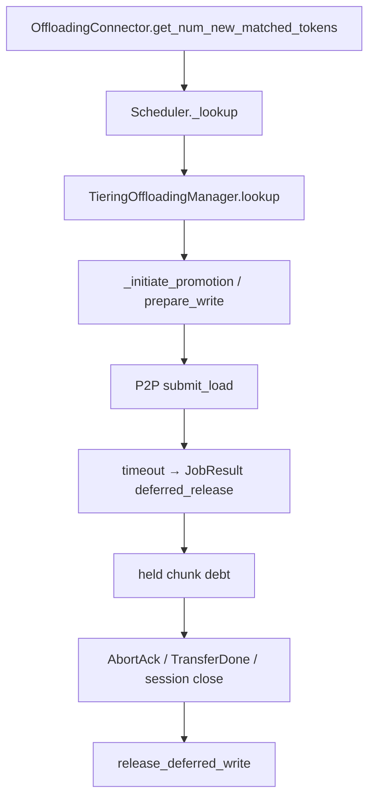
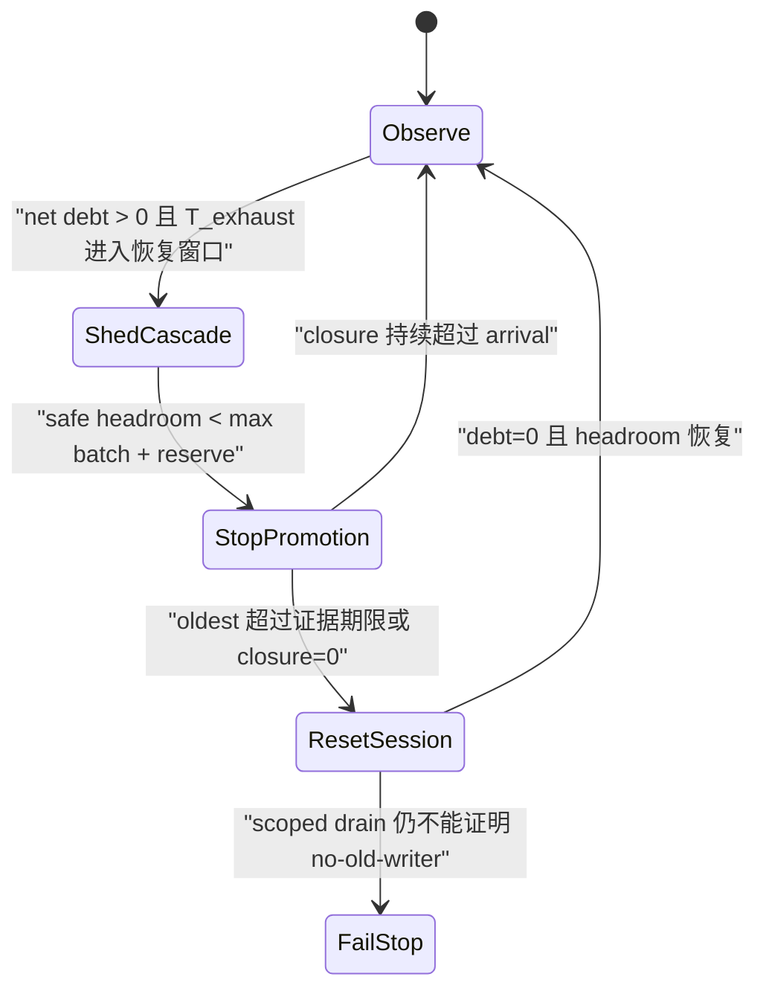

> 源码基线：[`c3cee35a`](https://github.com/vllm-project/vllm/commit/c3cee35ab85ccd1b9f2fb618927d4aa93183dd61)，即研究时 `vllm-project/vllm` 默认分支最新提交。相对上一章基线前进 [72 个提交](https://github.com/vllm-project/vllm/compare/05caae03c20f69436ff7ec23ded339ea104f1a01...c3cee35ab85ccd1b9f2fb618927d4aa93183dd61)；本文直接分析的 CPU manager、tiering manager/metrics/spec、P2P client 与主 deferred-release 测试文件 blob 均未变化。文中的 `Age×Bytes`、closure-rate controller 与分级 admission 是依据当前不变量推导的**建议设计**，不是 main 已有功能。

## 本篇在课程路线中的位置

这是课程第 83 章，仍在“测试、性能与故障诊断”。[第 82 章]({{ '/articles/vllm-crash-safe-capacity-ledger-release-intent-allocator-cas/' | relative_url }}) 解决“证明安全后怎样恰好一次释放”；本章只追问其前一刻：**安全证据迟迟不来时，系统何时应停止继续吃容量，又该升级到哪一级动作？**

## 前置知识回顾

`JobResult(success=False, deferred_release=event)` 把两个时刻拆开：请求立即失败并重算；旧 primary chunk 则在 event 证明 writer 不再写后才回 free pool。合入的 [PR #63779](https://github.com/vllm-project/vllm/pull/63779) 建立该抽象，[PR #64256](https://github.com/vllm-project/vllm/pull/64256) 让 P2P timeout 使用它，[PR #65124](https://github.com/vllm-project/vllm/pull/65124) 又让 reset drain 主动 abort inbound load。它们保证安全，但“安全地占着”仍会耗尽容量。

## 本篇要回答的核心问题

只有一个：**怎样用仍在增长的 quarantine debt，而不是已发生的 allocation failure，提前决定 admission escalation？**

结论先行：至少需要同时观察当前字节债务 `Q(t)`、字节秒债务 `D(t)`、进入/关闭速率 `λ/μ`、最老未关闭年龄以及可保证 headroom。年龄不能授权释放；它只能触发更强的隔离、停止 promotion 或 scoped reset。

## 组件在全局架构中的位置



上游是 Scheduler 的 external-KV prefix lookup；下游是 CPU primary allocator。债务若不关闭，最先受影响的不是 P2P 协议本身，而是下一次 `_initiate_promotion()` 的 `prepare_write()`。

## 完整调用链

公开 connector 入口 [`OffloadingConnector.get_num_new_matched_tokens`](https://github.com/vllm-project/vllm/blob/c3cee35ab85ccd1b9f2fb618927d4aa93183dd61/vllm/distributed/kv_transfer/kv_connector/v1/offloading_connector.py) 委托 scheduler；[`OffloadingConnectorScheduler.get_num_new_matched_tokens`](https://github.com/vllm-project/vllm/blob/c3cee35ab85ccd1b9f2fb618927d4aa93183dd61/vllm/distributed/kv_transfer/kv_connector/v1/offloading/scheduler.py) 进入 `_lookup`。Tiering manager 先 poll 已完成任务，再查 primary 和 secondary。secondary HIT 时 `_initiate_promotion()` 立即为一个 key 调 `primary_tier.prepare_write([key])`：成功则 slot 变成 pending，step 末 `_flush_pending_promotions()` 才批量 `submit_load()`；失败则增加 `PROMOTION_ALLOCATION_FAILURES` 并向上返回 MISS，模型改为计算。

P2P 超时后，[`ClientRole._abort_load`](https://github.com/vllm-project/vllm/blob/c3cee35ab85ccd1b9f2fb618927d4aa93183dd61/vllm/v1/kv_offload/tiering/p2p/session/client.py) 发送 `AbortFetch`，立即产生失败 `LoadResult`，并携带新建的 `threading.Event`。P2P manager 把它转成 `JobResult.deferred_release`。`_complete_promotion()` 让 failed key 离开 cache policy，却把 chunk id 放进 `_deferred_releases`；后续 `_complete_deferred_releases()` 只释放 event 已 set 的项。

## 关键类型、字段和状态生命周期

真实对象 `_DeferredRelease(event, tier_idx, chunk_ids, deferred_at)` 由 manager 创建并持有。其生命周期是：

1. P2P timeout 创建 event；请求结果已经失败，key 对 lookup 为 MISS。
2. `defer_write_release()` 删除 policy entry，但 chunk 仍是 write-pending、仍不在 `_free_list`。
3. AbortAck、晚到的 TransferDone 或 session close 设置 event；网络线程只交证据，不碰 allocator。
4. manager polling path 在自己的锁域中 pop entry，调用 `release_deferred_write()`，递减 pending 并把 chunk 放回 free list。

输入 key 是哈希身份；chunk id 是 CPU primary 的物理 slot；payload shape 由 offload group 决定，而债务计量单位是 `chunk_size_bytes`。event 未 set 时强行释放会允许 late WRITE 覆盖新请求，这是不可接受的失败方式。

这条控制链本身没有 `torch.Tensor` 输入输出：`OffloadKey`、`list[int]` 和 `threading.Event` 都在 host 侧，CPU primary 暴露的是 mmap-backed memoryview。真正的 KV shape/dtype 由注册时的 cache layout 决定，P2P 只拿 chunk 对应的连续字节区；因此 debt controller 不应假设 FP16 或某个 head shape，只能使用 allocator 给出的实际 `chunk_size_bytes`。所有 allocator mutation 都回到 manager polling/lock 域，network thread 只允许 set event。

## 逐函数源码解读

[`CPUOffloadingManager.prepare_store`](https://github.com/vllm-project/vllm/blob/c3cee35ab85ccd1b9f2fb618927d4aa93183dd61/vllm/v1/kv_offload/cpu/manager.py) 的可分配条件是：free chunk 不足时，只能从 evictable chunk 补；若需要数大于 `_num_evictable_cache_chunks`，或 policy 因 protected keys 无法给出候选，就返回 `None`。deferred chunk 既不 free，也不 evictable，所以会直接缩小 promotion admission。

[`TieringMetricsTracker`](https://github.com/vllm-project/vllm/blob/c3cee35ab85ccd1b9f2fb618927d4aa93183dd61/vllm/v1/kv_offload/tiering/metrics.py) 当前提供三类相关信号：

| 指标 | 能回答 | 不能回答 |
| --- | --- | --- |
| `DEFERRED_RELEASE_CHUNKS` gauge | 此刻每 tier 持有多少 chunk | 哪一个最老、还会占多久 |
| `DEFERRED_RELEASE_HOLD` histogram | 已关闭 hold 的持续时间分布 | 尚未关闭样本的实时年龄；它们是右删失样本 |
| `PROMOTION_ALLOCATION_FAILURES` counter | primary 已拒绝多少次 promotion | 拒绝前还剩多少时间、债务是否正在收敛 |

[`spec.py`](https://github.com/vllm-project/vllm/blob/c3cee35ab85ccd1b9f2fb618927d4aa93183dd61/vllm/v1/kv_offload/tiering/spec.py) 明确说明 hold histogram “observed at release”。因此最危险的永不完成项反而不会进入它。CPU primary 的 write usage 又混合正常 promotion write 与 deferred release，不能替代 debt-specific bytes。

## 具体示例与 shape/状态演算

设 primary 有 16 chunks，每块 64 KiB，总计 1 MiB。P2P load A 在 `t=0` 超时并 hold 3 块，B 在 `t=4` hold 2 块；到 `t=8` 仍未关闭：

```text
Q(8) = (3 + 2) × 64 KiB = 320 KiB
D(8) = 3×64×8 + 2×64×4 = 2048 KiB·s
加权平均年龄 = D / Q = 6.4 s，oldest = 8 s
```

过去 10 秒若共进入 6 块、只关闭 1 块，则 `λ=38.4 KiB/s`、`μ=6.4 KiB/s`，净增长 32 KiB/s。若保守可保证 free headroom 只有 4 块，即 256 KiB，则预测耗尽时间 `T_exhaust≈256/32=8s`。注意 `free + evictable` 只是潜在 headroom；protected keys 可能使 eviction 失败，不能当强保证。

再假设本环境允许的最大 promotion batch 是 3 块，另保留 2 块 recovery reserve，则 admission 需要 `3×64+2×64=320 KiB`，已经大于 256 KiB。这里应立即停止新 promotion、返回 MISS 让计算兜底；这些数字只是演算参数，不是建议写死的 vLLM 默认值。

## 为什么这样设计及替代方案

建议的最小 controller 是：



`ShedCascade` 可复用现有 secondary-store backpressure，减少 primary 被新的 cascade pin 住；但 [`EMABackpressureDetector`](https://github.com/vllm-project/vllm/blob/c3cee35ab85ccd1b9f2fb618927d4aa93183dd61/vllm/v1/kv_offload/tiering/backpressure.py) 依据 store latency EMA 节流写入，它既不度量 consumer-slot debt，也不能关闭旧 writer。`StopPromotion` 则利用现有“分配失败即 MISS”的正确兜底，只是把动作提前到容量真的归零之前。

替代方案一是固定 TTL 后 free：延迟低，却没有终止证据，破坏正确性。方案二是只等 allocation failure：实现最简单，但造成突发 MISS、尾延迟和恢复任务无 reserve。方案三是看到年龄大就全局 reset：安全上可行，但并发与可用性代价过大；应先按 peer/session scope 断开和 drain，只有 scoped closure 失败才 fail-stop。

## 性能、并发、正确性与边界条件

实时 `Q` 是 O(1) gauge；`D` 不必每次遍历所有 entry，可维护 `sum(deferred_bytes×deferred_at)`，采样时算 `t×Q-sum`。`λ/μ` 应用滚动窗口或 EMA，并设置进入/退出不同阈值，避免在零附近振荡。controller 只改变 admission，不改变 event→allocator 的唯一释放路径，因此保持 graphability 与数据面并发。

证据期限应来自协议预算：当前 P2P 对 symmetric load 是 10s、PD load 是 30s，AbortAck budget 是 5s；AbortAck 过期会 fault peer 并由 session close 设置 release。年龄超过期限的动作是“升级隔离”，绝不是“视为已安全”。公开 [Issue #63602](https://github.com/vllm-project/vllm/issues/63602) 仍跟踪 stalled WRITE 与 teardown fencing 等残余风险；它是计划证据，不是 main 已解决事实。

## 测试证据与未覆盖风险

[`test_deferred_release_misses_but_holds_chunks_until_released`](https://github.com/vllm-project/vllm/blob/c3cee35ab85ccd1b9f2fb618927d4aa93183dd61/tests/v1/kv_offload/tiering/test_tiering_offloading.py) 用 2 个 chunk 验证：失败后 lookup 都 MISS、free 减 2、event 前重复 poll 不释放；此时 gauge=2 且 histogram 没有 count。event set 后 histogram 才出现 1 个样本，free/pending/manager table 全归零。相邻测试还证明同 key restore 必须得到 fresh chunk、partial failure 只 hold failed keys、already-set event 同 poll 释放、reset drain 后可 reset。

P2P 测试验证 timed-out load 立即失败但保持 slot，AbortAck 才释放，以及 failed load 的 event 能穿过 `LoadResult → JobResult`。当前缺口是：没有 age/bytes/arrival/closure 指标测试，没有“债务增长时停止 promotion、恢复后带 hysteresis 重开”的 controller 测试，也没有真机 late-RDMA、peer hang 与容量压力联合故障注入。

## 与前后章节的连接

第 82 章给出 crash-safe release linearization；本章给出 release 之前的容量控制面。下一章将把 controller 变成可验证状态机：定义 per-peer debt attribution、窗口统计、hysteresis 和 deterministic failure-injection oracle，避免一次 reset 把所有健康 peer 一起牺牲。

## 本篇结论、知识债、三个理解检查问题和下一章

结论：当前 vLLM 已有安全的 in-process deferred release、实时 chunk gauge、完成后 hold histogram、allocation-failure counter，以及 P2P timeout→AbortAck/session-close 的升级链；但没有“未完成年龄 × 字节 × closure slope”的 admission controller。正确顺序是先限制新债务，再停止 promotion，再做 scoped reset，最后在无法取得 no-old-writer 证据时 fail-stop；任何年龄都不能替代终止证据。

知识债：right-censored age 指标设计；per-peer/tier debt attribution；safe headroom 与 protected eviction 的保守估计；batch/reserve 配置来源；hysteresis 窗口；真机 backend fencing 语义。

理解检查：

1. 为什么 `DEFERRED_RELEASE_HOLD` 的 p99 可能很好看，却仍有一个无限期占用 chunk 的任务？
2. 为什么 admission 要用 guaranteed free headroom，而不能直接把全部 evictable chunk 当可用？
3. `oldest_age` 超过 AbortAck budget 后，为什么应断开/重置 session，而不能直接 free？

下一章：**Per-peer Quarantine Controller 怎样可验证——Debt Attribution、Hysteresis 与 Deterministic Golden。**

## 课程账本增量

- 新确认：deferred chunk 同时属于 write-pending、非 free、非 evictable；完成后 histogram 不含未完成 hold；allocation failure 是滞后信号。
- 新模型：`Q(t)`、`D(t)`、`λ/μ`、`T_exhaust` 与 `max_batch + recovery_reserve` 共同决定 escalation。
- 新边界：age 只触发隔离升级，不授权释放；secondary-store EMA backpressure 与 consumer-slot quarantine controller 解决不同问题。
- 新覆盖：connector lookup → tier promotion → P2P abort → deferred event → primary release，以及对应 metrics/spec/tests。

