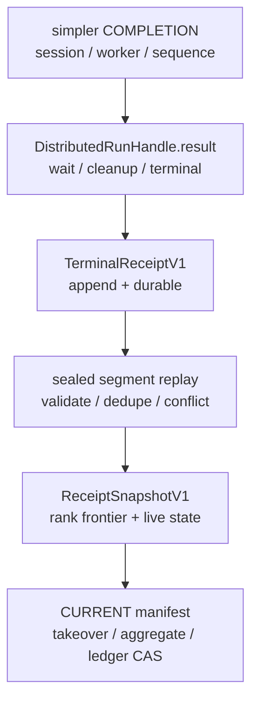
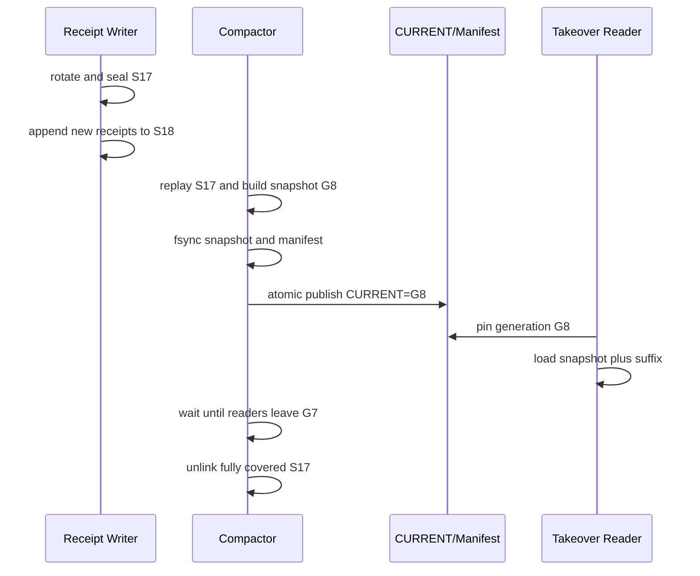

> 本文基于 PyPTO [`7f56be24`](https://github.com/hw-native-sys/pypto/commit/7f56be2474acc1c4db4034755e5df129a0caf404) 与 simpler [`e151a2d5`](https://github.com/hw-native-sys/simpler/commit/e151a2d5433fbc2acdfd21eca41afe3a7cca07c2)。相对上一章，PyPTO 前进 [7 个提交](https://github.com/hw-native-sys/pypto/compare/cc802e9b84d428351f7693bf813d4c4b97f4994a...7f56be2474acc1c4db4034755e5df129a0caf404)，simpler 前进 [15 个提交](https://github.com/hw-native-sys/simpler/compare/f65b613004d8c33939b69141d78484076d9232fd...e151a2d5433fbc2acdfd21eca41afe3a7cca07c2)；本文直接依赖的 distributed handle 与 remote wire 文件没有变化。当前仓库没有 receipt log、snapshot 或 compactor；文中 `TerminalReceiptV1`、`ReceiptSnapshotV1`、manifest 和 rank frontier 均是基于现有边界推导出的建议协议。

## 本篇在 PTO 课程路线中的位置

这是课程第 94 章，仍处在第二阶段的 runtime/device 恢复链。第 92 章建立 exact-rank terminal certificate，第 93 章把 `DistributedRunHandle` 的进程内终态接到 canonical receipt、durable append 和 supervisor takeover replay。今天只回答一个后继问题：**日志不能无限增长时，哪些 receipt 已经可以由快照替代，又在什么时刻可以物理删除旧 segment？**

本章不新增 ISA 指令、Tile、layout 或 memory location 语义。它补的是 terminal evidence 的存储生命周期；如果这里错删一个 rank 的凭据，上层看到的“资源已经安全释放”就可能是伪证。

## 前置知识

上一章确认了三个不能混淆的线性化点：

1. `DistributedRunHandle.result()` 完成 native wait、cleanup 和 postprocess 后，才发布进程内 terminal；
2. canonical receipt append 并达到约定 durability 后，才能 ACK；
3. exact-rank certificate 只允许 claim/capacity ledger 通过 expected revision CAS 释放资源。

因此 compaction 不能把“已经读过”当成“已经持久化进快照”，也不能把“快照文件写完”当成“旧日志已经可删”。它必须保持第 93 章的 duplicate 幂等、same-key conflict fail closed、torn tail 可截断和 stale epoch 不可接管。

## 今日 1–2 个核心问题

本篇聚焦一个主问题及其直接子问题：

- 多 rank receipt 的安全截断为什么是向量 `F[rank]`，而不是单个最大 `sequence`？
- `snapshot → manifest → CURRENT → segment delete` 如何排序，才能让任意一步掉电后仍有至少一份权威证据？

## PTO 全栈中的位置

上游是 PyPTO 的 dispatch terminal 和 simpler 的 remote `COMPLETION`；下游是 exact-rank aggregator、supervisor takeover、claim migration 与 capacity release。compactor 不改变 kernel、IR 或 device execution，它只把已经验证的历史 receipt 从逐条表示变为等价的快照表示。



## 概念和精确语义

先定义建议中的 receipt 身份：

```text
ReceiptKey =
  (claim_epoch, supervisor_epoch, session_id, worker_id, sequence)
```

`session_id`、`worker_id`、`sequence` 来自当前 simpler wire；claim/supervisor epoch 用来隔离重启与接管。不能只保留 `sequence`：当前代码只保证 completion payload 的 sequence 与该请求期望值一致，并没有承诺它跨 session、跨 worker 或跨 supervisor 全局唯一。

对每个 expected rank，定义：

```text
F[r] = 最大的 n，使得 r 在当前 identity/epoch 下截至 n 的必要 receipt
       构成连续、已验证且已被 durable snapshot 等价表示的前缀
```

`F` 是 rank frontier vector。它不是“见过的最大号”。若 rank 2 已看到 53 和 55、却缺 54，则 `F[2]=53`；55 仍是 live suffix。若一个 conflict 或 unknown-scope receipt 仍参与 quarantine/charge 决策，它也不能被普通 terminal 摘要吞掉。

`ReceiptSnapshotV1` 至少应绑定：

- `snapshot_generation`、schema/version 与前一 manifest digest；
- expected rank set 及其 digest，而不是仅存 rank 数量；
- 每个 `ReceiptKey` 域的 `rank_frontier`；
- 尚未闭合的 gap、conflict、quarantine、claim 与 charge 状态；
- 被吸收 segment 的 ID、prefix digest 和 source revision。

这里的接口不是 device Tensor API。输入是 Host 上的 canonical byte records；逻辑 dtype 是定宽整数、bounded byte string 和 enum，落盘后没有 `shape`，更没有 NPU device placement。唯一与“shape”相似的是 `rank_frontier` 的长度必须等于 expected rank set 的基数，且每个槽位按显式 rank ID 寻址，绝不能按到达顺序压成匿名数组。

| 接口 | 输入与所有权 | 输出/后置条件 | 并发与失败方式 |
| --- | --- | --- | --- |
| `append(receipt)` | writer 借用 canonical Host bytes；调用方持有业务对象 | segment 持有不可变副本；durability 达标后才允许 ACK | 多 writer 必须以 stable key+digest 幂等；ENOSPC、short write、CRC 不一致均不推进 ACK |
| `seal(segment)` | active writer 独占当前段 | 产生 immutable segment 与完整 footer/index | rotate 后旧段禁止追加；缺 footer 的尾段只能按已验证 record boundary 截断 |
| `build_snapshot(cut)` | compactor 只读 pin 住的 sealed segments | 临时 snapshot，包含 vector frontier 与 live suffix 摘要 | gap/conflict/unknown scope 使对应 rank 停步；不能为了推进 cut 丢弃异常项 |
| `publish(manifest)` | 单一 generation lease 持有者拥有候选 snapshot | `CURRENT` 原子指向新 generation，目录项持久化 | stale lease/CAS mismatch 失败；失败候选只是 orphan |
| `collect(generation)` | GC 借用 reader-pin registry | 只删除 manifest 已替代且无 pin 的完整 segment | unlink 失败可重试；不得反向撤销已发布 snapshot |

segment 的可删除条件不是“末尾 sequence 小于某个数”，而是：

```text
all records covered by F
AND CURRENT is durably published
AND no reader/takeover pins the old generation
AND no unresolved state depends on the segment
```

### 三个必须同时成立的证明义务

第一是**语义等价**。对任意合法历史 `H`，从头重放得到的 canonical state，必须等于“加载 snapshot，再重放 cut 后 suffix”的结果。这个等式不仅比较 terminal 数量，还要比较 expected membership、每 rank scope、conflict、quarantine、claim epoch 与 retained charge。只要 snapshot 省略其中一个会影响后续 CAS 的字段，它就不是历史的等价替代。

第二是**可达性**。任意已经对上游 ACK 的 receipt，在 crash 后必须至少存在一条恢复路径：要么仍在 manifest 引用的 segment 中，要么已经被 durable snapshot 吸收。snapshot file 自身存在但没有被 durable `CURRENT` 指向，不算可达；旧 segment 已 unlink 而新 manifest 目录项尚未持久化，也不算可达。这正是 publish 必须先于 GC 的原因。

第三是**单调性**。同一 identity/epoch 下，新的 `F[r]` 只能大于等于旧值；generation 增长不能让已确认前缀倒退，也不能把 conflict 静默改成成功。若新 compactor 发现旧 snapshot digest、rank-set digest 或 source segment digest 不匹配，它必须停止发布并 quarantine，而不是从“看起来最近”的文件重新拼一个较大的 frontier。

这三个义务分别约束内容、持久化引用图和并发状态机。只证明“文件写成功”没有证明语义等价；只证明“rename 原子”没有证明 gap 未丢；只证明 frontier 数字递增也没有证明底层 source digest 仍可信。

## 真实文件、类型、API 或指令逐段解读

### PyPTO：当前终态只活在进程内

[`DistributedRunHandle`](https://github.com/hw-native-sys/pypto/blob/7f56be2474acc1c4db4034755e5df129a0caf404/python/pypto/runtime/distributed_runner.py#L99-L124) 保存 `_dispatch_id`、`_terminal`、`_error` 以及 native handle/frame/worker 引用。[`result()`](https://github.com/hw-native-sys/pypto/blob/7f56be2474acc1c4db4034755e5df129a0caf404/python/pypto/runtime/distributed_runner.py#L169-L236) 先等待 native handle；timeout 不改变所有权。只有 native 完成且 cleanup/postprocess 结束，才在 condition variable 下缓存 terminal/error，清理引用并调用 worker retire。

[`_retire_dispatch_handle()`](https://github.com/hw-native-sys/pypto/blob/7f56be2474acc1c4db4034755e5df129a0caf404/python/pypto/runtime/distributed_runner.py#L2239-L2257) 随后移除 active handle、释放 frame 的 tensors/keepalive/cleanup 并唤醒等待者。[`submit()`](https://github.com/hw-native-sys/pypto/blob/7f56be2474acc1c4db4034755e5df129a0caf404/python/pypto/runtime/distributed_runner.py#L3375-L3398) 仍返回这个进程内对象；两个 bounded frame 都占用时，第三次提交会先 drain 最老 handle。这里没有 durable receipt writer、segment、snapshot 或 `CURRENT`。

这给 compactor 一个硬前置条件：它只能消费“已经越过 terminal→durable receipt adapter”的记录，不能直接扫描 frame 或 handle 状态。否则进程崩溃恰好会让要压缩的证据与内存对象一起消失。

还有一个容易忽略的所有权细节：handle terminal 后 PyPTO 会清空 native handle、postprocess、frame 和 worker 引用，这是正确的内存回收；但 durable adapter 若存在，就必须在这些 source objects 消失前把所需 identity 与 digest 拷入独立 canonical record。compactor 后来只认 record 和 manifest，不能依赖 Python object identity、PID 或指针值重建证据。

### simpler：frontier 的最小身份来自 wire

[`FrameHeader`](https://github.com/hw-native-sys/simpler/blob/e151a2d5433fbc2acdfd21eca41afe3a7cca07c2/src/common/hierarchical/remote_wire.h#L90-L97) 明确携带 `session_id`、`worker_id`、`sequence`；[`CompletionPayload`](https://github.com/hw-native-sys/simpler/blob/e151a2d5433fbc2acdfd21eca41afe3a7cca07c2/src/common/hierarchical/remote_wire.h#L129-L133) 再携带被完成的 sequence、error code 与 bounded message。[`encode_frame/decode_frame`](https://github.com/hw-native-sys/simpler/blob/e151a2d5433fbc2acdfd21eca41afe3a7cca07c2/src/common/hierarchical/remote_wire.cpp#L237-L335) 对 magic、version、enum、reserved flags 和 payload length 做显式编码/校验；[`decode_completion`](https://github.com/hw-native-sys/simpler/blob/e151a2d5433fbc2acdfd21eca41afe3a7cca07c2/src/common/hierarchical/remote_wire.cpp#L573-L581) 要求 payload sequence 等于 expected sequence，并拒绝尾随字节。

这些是当前代码事实。由此推导：snapshot frontier 至少要按 session/worker 隔离；“rank 0 的 sequence 45”不能覆盖另一个 session 的 45。PR [#1008](https://github.com/hw-native-sys/simpler/pull/1008) 解释了 transport-neutral codec 的历史动机，但它没有实现 durable receipt 或 compaction。

## 对象/Tile/Buffer/IR 生命周期

这里跟踪的对象不是 Tile，而是一条 terminal receipt。它的生命周期应是：

1. simpler 解码并匹配 `COMPLETION`；
2. PyPTO handle 完成 wait/cleanup/postprocess，发布进程内 terminal；
3. adapter 构造 canonical `TerminalReceiptV1`，append 到 active segment，durability 后才 ACK；
4. segment rotate 后变为 immutable sealed segment；
5. compactor replay sealed prefix，校验 CRC/digest、dedupe 与 conflict，构造 snapshot；
6. `CURRENT` durable publish 后，receipt 的**逻辑证据**由 snapshot 持有；
7. reader generation 全部越过旧 manifest 后，旧 segment 的**物理字节**才可删除。

所以“receipt 失效”并非 terminal 被消费的一刻，而是它的语义已被 snapshot 等价承接且旧 reader 不再需要原始记录的一刻。

## 端到端调用链或指令链



关键是 publish 与 delete 分离：`CURRENT` 是逻辑提交点；unlink 是可重试 GC。active writer 在 rotate 后只写新 segment，compactor 不原地改 sealed bytes。takeover reader 先 pin 一个稳定 generation，再读 snapshot 和 manifest 指定的 suffix，避免看到“一半旧、一半新”的目录状态。

把建议流程写成伪代码，更容易看清每个 durability 边界：

```text
compact(expected_generation):
  lease = acquire_compactor_lease(expected_generation)
  sealed = rotate_active_segment()
  pin = pin_manifest(expected_generation)

  state = replay_and_validate(pin.snapshot, pin.suffix, sealed)
  F = highest_contiguous_frontier_per_identity(state)
  candidate = encode_snapshot(state.at(F), F, source_digests)

  write(snapshot.tmp, candidate); fdatasync(snapshot.tmp)
  rename(snapshot.tmp, snapshot.G8)
  write(manifest.tmp, references(snapshot.G8, retained_suffix))
  fdatasync(manifest.tmp); rename(manifest.tmp, manifest.G8)
  fsync(directory)

  compare_and_publish_CURRENT(expected_generation, G8, lease)
  fsync(directory)                 # logical commit
  wait_until_no_reader_pins(G7)
  unlink(fully_covered_segments)  # retryable physical GC
```

`replay_and_validate` 不是简单 fold：它先验证 schema/length/CRC，再按完整 `ReceiptKey` 排序；同 key 同 digest 是 duplicate，同 key 异 digest 进入 conflict；只有连续且 scope 足够强的记录才推进对应 frontier。snapshot 的 canonical 编码也必须固定 field order、endianness、reserved bits 与 length bounds，否则两个 supervisor 可能对同一状态算出不同 digest。

## 具体 shape、Tile 和状态演算

例子只演算 receipt 状态，不虚构真实固定记录大小。expected ranks 为 `{0,1,2,3}`：

| sealed segment | rank 0 | rank 1 | rank 2 | rank 3 |
| --- | --- | --- | --- | --- |
| `S17` | 40–42 | 37–39 | 51–52 | 30–31 |
| `S18` | 43–45 | 40–42 | 53、55 | 32–34 |

假设此前前缀已闭合，compactor 得到 `F={0:45, 1:42, 2:53, 3:34}`。rank 2 的 54 缺失，因此 55 不能推进 frontier。若仅取全局 `max(sequence)=55` 并删除“小于 55”的记录，会把缺口和其他 rank 的身份一起抹掉。

更严格地说，frontier 表示的是一个按 rank 分解的 downward-closed set：若 `(rank=2, sequence=53)` 已被 snapshot 声称覆盖，则该 identity 域内所有 required predecessor 也必须可由 snapshot 证明。55 不能“跨过”54，因为 takeover 之后 54 仍可能到达；若 55 已被折叠成“rank 2 完成到 55”，新 supervisor 会把迟到的 54误判为 duplicate，或者错误地产生完整 certificate。连续性正是防止这两种错误的最小条件。

expected rank set digest 同样参与 snapshot identity。假设 generation G8 针对 `{0,1,2,3}`，后来配置错误地以 `{0,1,3}` 打开它；即使三条 frontier 数值都存在，也不能把缺失 rank 2 解释为“无需等待”。decoder 必须在应用任何 state 前拒绝 membership digest 不匹配。

`S17` 的所有记录都被 `F` 覆盖；`CURRENT` durable 且旧 reader 退出后可以整段删除。`S18` 不能删，因为 rank 2 的 55 仍在 frontier 之后。选择有两个：

- 保留整个 `S18`：零重写，空间浪费和 takeover replay 较大；
- 把 55 及其他 unresolved survivor 写入新 sealed `S19`，校验并发布下一代 manifest 后再删 `S18`：回放更短，但有 write amplification 和更多 crash window。

若仅为估算令每条 canonical receipt 为 256 B（示例参数，不是当前 ABI），`S17` 的 10 条占 2560 B，`S18` 的 11 条占 2816 B。复制一个 survivor 很便宜；真实系统仍应按实测 receipt rate、segment 大小、fsync p99、磁盘带宽与恢复 SLA 选择阈值。

## 为什么这样设计及替代方案

**永不压缩**最容易证明，append 路径也是顺序写；代价是磁盘无界、takeover replay 与启动延迟线性增长。它适合作为首个正确实现和 fault oracle，不适合作为长期策略。

**单一 global cut**元数据最小，却假设各 rank 同步前进且没有 gap；这与 exact-rank certificate 的不变量冲突。vector frontier 多 `O(ranks)` 空间，却能让快 rank 与慢 rank 独立推进，并把缺口显式留下。

**外置数据库/LSM**可以提供 WAL、snapshot 和 compaction 工具，但存储引擎不知道“same-rank conflict”“DEVICE_EFFECT scope”或“exact expected rank set”。它可以成为 backend，不能替代语义 frontier 和 manifest schema。

**原地删记录**看似省写，却制造 partial rewrite、offset 失效与 torn segment。immutable sealed segment 加整段 GC，把故障面收敛为“新 generation 是否已发布”，维护与审计成本更低。

## 访存、计算、流水、并行和硬件约束

热路径仍应只做 canonical encode、append 和批量 durability；snapshot/compaction 在 sealed segment 上异步运行，不能阻塞 device pipeline。snapshot 的状态量约为 `O(ranks + live claims + unresolved entries)`，恢复成本从“全部历史记录”降为“snapshot + cut 后 suffix”。

并发上只允许一个持有 compactor lease/owner epoch 的发布者；writer 在 rotate 后继续写新段，reader pin manifest generation。任何 survivor rewrite 都先写新段并校验，再通过 generation CAS 改 manifest，绝不让两个 compactor 同时宣称同一 source segment 已被替代。

从性能模型看，设 receipt 产生速率为 `λ` records/s、平均编码大小为 `b`、保留时间为 `T`，不压缩历史量约为 `λbT`；takeover 至少扫描同阶字节。snapshot 将稳定态恢复读量压到 `S_snapshot + λbΔ`，其中 `Δ` 是最近一次 cut 后的时间。segment 越大，rotate/fsync 次数越少，但一次 takeover suffix 和 straddling waste 越大；segment 越小，manifest 元数据与 fsync 压力越高。正确做法是用 replay SLA 和 durability p99 反推大小，而不是在协议里写死一个 MB 数。

compaction 也不能与 device execution 争用同一关键资源预算。虽然工作发生在 Host，读取、hash、重写和 fsync 会竞争 CPU、page cache 与存储带宽；应限制后台并发和 write amplification，并在 overload 时优先保留旧段而不是推迟 receipt durability。后者影响正确性与 ACK，前者只影响空间和下次恢复延迟。

崩溃窗口必须逐个定义：

- snapshot fsync 前崩溃：旧 log 唯一权威；
- snapshot durable、`CURRENT` 未发布：新文件是 orphan，可回收但不可采用；
- `CURRENT` 已 durable、旧段未删：两份证据并存，按新 manifest 恢复；
- unlink 中崩溃：目录 reconcile 只接受 manifest 引用的完整文件，缺失被引用文件必须 fail closed。

| crash 位置 | 重启时权威来源 | 必须允许的残留 | 禁止行为 |
| --- | --- | --- | --- |
| snapshot 临时文件写到一半 | 旧 `CURRENT` + 旧 suffix | `.tmp`、未引用 candidate | 猜测临时文件有效并推进 frontier |
| snapshot/manifest durable、发布前 | 旧 generation | 完整 orphan generation | 因文件较新就自动采用 |
| `CURRENT` rename 后、目录 fsync 前 | 由可恢复的原子发布协议判定；不确定则 fail closed | 新旧两代并存 | 删除旧段 |
| 新 `CURRENT` durable、GC 前 | 新 snapshot + retained suffix | 已覆盖旧段仍存在 | 重复应用已被 frontier 吸收的 vote |
| 删除若干旧段后 | 新 generation | 部分 source segment 已消失 | 回退到引用缺失文件的旧 generation |

这不是 NPU 内存屏障问题，而是 Host 持久化顺序问题；公开材料没有给出底层硬件映射，本文不作推断。

## 测试证据与未覆盖风险

当前 PyPTO UT [`TestAsyncDispatchHandle`](https://github.com/hw-native-sys/pypto/blob/7f56be2474acc1c4db4034755e5df129a0caf404/tests/ut/runtime/test_distributed_worker.py#L311-L566) 已验证：

- native 完成后 `result()` 退休 frame；
- timeout 保留 frame ownership，稍后完成才释放；
- 第三次 submit 必须先 drain 最老 handle；
- 失败结果会缓存并在再次 `result()` 时重抛；
- `close()` 先 drain outstanding handle，之后才关闭 worker。

simpler UT [`CompletionAndControlReplyMatchSequences`](https://github.com/hw-native-sys/simpler/blob/e151a2d5433fbc2acdfd21eca41afe3a7cca07c2/tests/ut/cpp/common/hierarchical/test_remote_wire.cpp#L252-L263) 用 sequence 42 验证匹配成功、expected 43 拒绝；同文件还覆盖 frame round-trip、非法 enum、reserved flag、bounds 与 truncation。它们证明进程内所有权和 wire identity，却没有证明持久化压缩。

建议新增无 sleep 的 deterministic fault matrix，在 rotate、snapshot write/fsync、manifest write/fsync、`CURRENT` rename/dir fsync、survivor rewrite、每个 unlink 之后注入 crash。恢复 oracle 必须逐项检查：

1. canonical state 与不压缩重放完全相同；
2. 每个 rank 的 vote 至多一次，gap 仍可见；
3. unresolved/quarantine bytes 仍计费；
4. stale generation 不覆盖新 owner；
5. 任一已 ACK receipt 都能从 snapshot 或仍存在的 segment 找回。

当前仍未覆盖真实 filesystem 的 rename/fsync 语义、ENOSPC、损坏 manifest、reader 长时间 pin、双 compactor lease、跨节点共享存储一致性和真机 late device effect。

测试还需要区分“实验事实”和“协议 oracle”。例如在 ext4 上一次 rename 后立刻掉电是否保留目录项，是特定挂载参数与设备栈的实验结果；协议不能把某次成功运行当成普遍保证，而应显式执行 directory fsync，并在不支持所需原语的 backend 上拒绝启用 destructive GC。对象存储没有 POSIX rename 时，也不能照搬文件步骤：应以 immutable object、带 generation 的 manifest 和条件写/CAS 实现同一提交关系，再用版本化 reader pin 延迟删除。实现原语可以不同，三项证明义务不能变化。

建议先做纯内存 reference model：随机生成四 rank 的 duplicate、gap、conflict、scope upgrade 和 crash 点，把“全量日志重放”作为 oracle，与任意 compaction 序列后的恢复状态逐字段比较。随后再用临时目录和可注入的 filesystem adapter 覆盖 short write、fsync error、rename error、ENOSPC 与 unlink error，最后才进入跨节点共享存储和真机 late-effect 测试。这样能把状态机错误与平台持久化差异分开定位。

## 与前后章节的连接

本章把第 93 章“receipt 如何写入并重放”推进为“历史 evidence 如何安全缩短”。它仍没有解决 quarantine 中 unknown device effect 的观测来源，也没有实现 claim/charge ledger。

下一章应继续沿同一因果链研究：**Compactor 如何取得唯一租约——Generation CAS、Reader Pin 与双 Supervisor 抢占。**这会把今天假设的单发布者与 reader frontier 变成可执行的并发协议。

## 本篇结论、知识债、三个理解检查问题和下一章

结论只有三条：

1. multi-rank receipt log 的 cut 是按完整 identity 域分组的 rank frontier vector，不是最大 sequence；
2. snapshot durable 不等于 segment 可删；只有 durable `CURRENT` 发布、reader 离开旧 generation、所有 unresolved dependency 都被保留后，才能整段 GC；
3. logical commit 与 physical deletion 分离，使 delete 可失败、可重试，却不破坏 takeover recovery。

知识债：仓库仍无 receipt/snapshot/manifest codec、durability backend、compactor lease、reader pin registry、device-effect witness、rank aggregator、claim/charge CAS，以及 fault-at-every-boundary Golden。

理解检查：

1. rank 2 已看到 sequence 53 和 55、缺 54 时，为什么 frontier 只能到 53？
2. snapshot 已 fsync 但 `CURRENT` 尚未发布就掉电，恢复为何必须忽略它？
3. 一个 segment 大部分记录都低于 frontier，但含一条 quarantine survivor，为什么不能原地删其余记录？

下一章：**Compactor 如何取得唯一租约——Generation CAS、Reader Pin 与双 Supervisor 抢占。**

## 课程账本增量

- 第 94 章；源码基线：PyPTO `7f56be2474acc1c4db4034755e5df129a0caf404`，simpler `e151a2d5433fbc2acdfd21eca41afe3a7cca07c2`。
- 新覆盖：PyPTO `DistributedRunHandle.result/_retire_dispatch_handle/submit`；simpler `FrameHeader/CompletionPayload/encode_frame/decode_frame/encode_completion/decode_completion` 及 sequence matching UT。
- 新确认不变量：cut 是 exact-rank contiguous vector；`CURRENT` durable publish 是 compaction 逻辑提交；segment delete 是 reader-safe、可重试 GC；straddling segment 必须保留或先 copy survivor。
- 当前代码边界：两仓均未实现 receipt log、snapshot、manifest、frontier、compactor lease 或 reader pin；本文协议是设计推导。
- ISA 地图：无新增 ISA 语义；新增 runtime terminal evidence 的 snapshot/segment 生命周期连接。
- 下一章：Compactor generation lease、reader pin 与双 supervisor 抢占。
