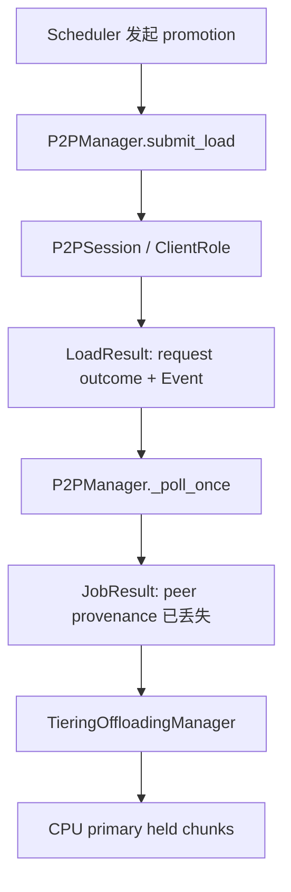
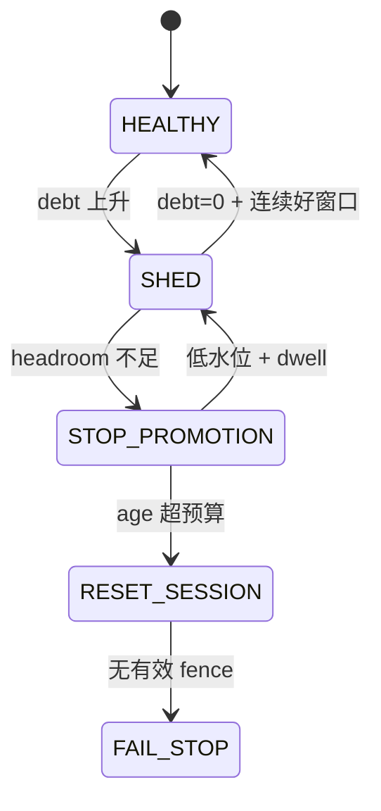

> 源码基线：[`3319c629`](https://github.com/vllm-project/vllm/commit/3319c629a148c8f7ce088445911d9db4119af134)，研究时 `vllm-project/vllm` 默认分支最新提交。它比第 83 章基线前进 [91 个提交](https://github.com/vllm-project/vllm/compare/c3cee35ab85ccd1b9f2fb618927d4aa93183dd61...3319c629a148c8f7ce088445911d9db4119af134)；本文直接涉及的 P2P client/session/manager、tiering manager/metrics 与测试文件 blob 未变化。

## 本篇在课程路线中的位置

第 83 章已经得到一个容量结论：quarantine debt 的 age、bytes 和 closure rate 可以决定何时停止新 promotion，却不能证明旧 WRITE 已终止，更不能授权释放 chunk。本篇只解决紧邻的一个问题：**当多个 P2P peer 共用同一 primary tier 时，怎样把物理债准确归到 peer，并把隔离策略写成可重复验证的控制器？**

课程位置是：

`P2P load timeout → deferred release → debt attribution → per-peer admission → hysteresis escalation → deterministic Golden`

这是第 84 章，也是第 78–84 章的七章回顾点。

## 前置知识回顾

Promotion 先在 CPU primary tier 预留 destination chunk。远端 WRITE 超时后，请求应立即失败并本地重算；但只要远端仍可能写这个地址，chunk 就不能回到 free list。当前代码用 `threading.Event` 拆开两个时刻：`JobResult(success=False)` 结束请求结果，`event.set()` 才允许 allocator 回收。

三个不变量必须保留：

1. 请求失败不等于内存可复用；
2. `AbortAck` 或 session close 是当前进程内 release witness，而不是跨进程、跨 backend 的持久 fencing certificate；
3. debt controller 只能限流、隔离和请求更强证据，不能用 timeout 代替证据。

## 本篇要回答的核心问题

1. 当前代码在哪一层还知道 peer，在哪一层把 peer 身份丢掉？
2. 一个可验证的 per-peer controller 最少要携带哪些不可变 provenance？
3. 为什么仅有阈值不够，怎样用 hysteresis 避免反复开关？
4. 怎样不用 `sleep()`，以 deterministic Golden 验证 exact-once、代际隔离和容量守恒？

## 组件在全局架构中的位置



上游 `ReqContext` 中的 `P2PSourceInfo` 决定 load 路由；下游 consumer 是 `TieringOffloadingManager` 和 CPU primary allocator。整个路径是 host control plane：没有 CUDA tensor，也没有 `shape/dtype/device` 变化；它影响的是哪些 KV chunk 可以进入模型执行，不进入 CUDA Graph 捕获本身。

## 完整调用链

真实链路如下。

1. `TransferJob` 带 `job_id/keys/chunk_ids/is_promotion/req_context/submit_time`；见 [`tiering/base.py`](https://github.com/vllm-project/vllm/blob/3319c629a148c8f7ce088445911d9db4119af134/vllm/v1/kv_offload/tiering/base.py#L74-L105)。`P2PManager.submit_load()` 从 `req_context` 取 source，选择 `peer_id` 对应的 session。
2. `ClientRole` 的 `_InboundLoadState` 由外层 `kv_request_id`、内层 `round_seq` 定位，保存 `job_id`、提交时间、timeout、abort 时间与 release `Event`；见 [`client.py`](https://github.com/vllm-project/vllm/blob/3319c629a148c8f7ce088445911d9db4119af134/vllm/v1/kv_offload/tiering/p2p/session/client.py#L35-L114)。
3. load 超过 P2P 10 秒或 PD 30 秒，`_abort_load()` 发送 `AbortFetchMsg`，立刻产出失败的 `LoadResult`，同时把新 `Event` 交给上层。若 5 秒内仍无 `AbortAck`，session 被判为 data-plane fault；见 [`collect_results()`](https://github.com/vllm-project/vllm/blob/3319c629a148c8f7ce088445911d9db4119af134/vllm/v1/kv_offload/tiering/p2p/session/client.py#L564-L643)。
4. `P2PManager._poll_once()` 按 session 遍历 `result.loads`，却只构造 `JobResult(job_id, success, deferred_release)`；`peer_id`、`kv_request_id`、`round_seq` 和 connection incarnation 都没有继续传递。丢失点就在 [`manager.py#L1146-L1179`](https://github.com/vllm-project/vllm/blob/3319c629a148c8f7ce088445911d9db4119af134/vllm/v1/kv_offload/tiering/p2p/manager.py#L1146-L1179)。
5. `_complete_promotion()` 让 failed key 立即 MISS，并把 chunk 放入 `_DeferredRelease(event, tier_idx, chunk_ids, deferred_at)`；event set 后 `_complete_deferred_releases()` 才调用 `release_deferred_write()`，见 [`tiering/manager.py#L539-L658`](https://github.com/vllm-project/vllm/blob/3319c629a148c8f7ce088445911d9db4119af134/vllm/v1/kv_offload/tiering/manager.py#L539-L658)。

结论不是“当前 P2P 完全没有 peer 状态”。相反，`P2PManager` 有 `_sessions[peer_id]`、进程生命周期内的 `_data_plane_faults[peer_id]`，甚至 source-side `_retained` 也保留 `(peer_id, store_job_ids, retained_at)`。精确结论是：**consumer deferred-release 债从 session 层进入通用 tiering 层时失去 peer provenance。**

## 关键类型、字段和状态生命周期

| 接口 | 输入 / 输出 | 所有权与并发 | 前置 / 后置条件 | 失败方式 |
|---|---|---|---|---|
| `_abort_load` | `kv_request_id, round_seq, _InboundLoadState` → failed `LoadResult` | session/client 持有状态；网络轮询线程创建 event | transfer 已交给 transport；返回后请求可 fallback，但 chunk 仍 held | send、load timeout、AbortAck timeout |
| `P2PManager._poll_once` | per-session results → `_finished_jobs` | 在 tiering manager lock 下运行 | 每个 load outcome 只上报一次 | 当前转换丢 peer provenance |
| `_complete_promotion` | `JobMetadata, JobResult` → cache policy/held table | manager lock 独占 allocator mutation | failed key 仍是 pending write | provenance 不足，只能按 tier 计量 |
| `_complete_deferred_releases` | set event → free-list release | event 可由任意线程 set；manager 线程应用释放 | event 是 tier 提供的 no-more-write witness | event 永不 set 会持续占容量 |

当前 `_DeferredRelease` 的生命周期是：job 完成时创建；held 期间 key 已 MISS、chunk 仍 write-pending；event set 后 manager 从表中 `pop`，释放 chunk 并记录 hold histogram；随后该对象失效。它没有字段支持 per-peer 归因。

建议增加不可变的 `QuarantineCause`，而不是把可变 session 对象塞进通用结果：

```python
QuarantineCause(
    peer_id, session_generation, kv_request_id, round_seq,
    job_id, tier_idx, chunk_ids, opened_at, reason, release_event
)
```

`session_generation` 必须是连接 incarnation/nonce，不能只用可复用的 `peer_id`。否则 peer 重连后，旧代迟到的 ack 可能对新代形成 ABA。`JobResult` 可以携带这个 context，`_DeferredRelease` 保存其不可变副本；release 仍由 event 决定，controller 不获得直接 free 权限。

归因表可以按 `(peer_id, session_generation)` 持有 `PeerDebt`：当前 `chunks/bytes`、最早 `opened_at`、窗口内 `arrived_bytes/closed_bytes`、controller state 与单调 `revision`。open 时先把 charge 插入全局 held table，再递增 peer 聚合；close 时必须由同一个 charge id 同时从两处移除。若任一步找不到对应项、chunk 集合不一致或聚合出现负数，应 fail-stop，而不是“尽量修正”指标。这样每轮都可检查两个独立事实：allocator 的物理 owner 集合是否完整，以及每个物理 owner 是否恰好映射到一个 peer charge。

这里不建议在 `JobResult` 里直接保存 `P2PSession` 引用。session 是可变对象，会被 close、reap 和重建；把它泄漏到通用 tiering 层既延长生命周期，也把网络锁和 allocator 锁耦合。不可变 provenance 只描述已经发生的事实，控制动作仍通过 `peer_id + generation + revision` 回到 P2P manager 执行。

## 逐函数源码解读

`ClientRole._abort_load()` 的设计是正确的拆分点：它先发送 abort，再把 `release=Event()` 放进 failed `LoadResult`。`AbortAck`、late `TransferDone` 或 `close()` 只 set event，不产生第二个 job outcome，因此请求语义是 exact-once。

`ClientRole.close()` 会 set 已报告失败 load 的 event；未报告的 load 则进入 `failed_jobs`。这使 session teardown 成为当前实现的最终回收点。合入的 [PR #64256](https://github.com/vllm-project/vllm/pull/64256) 正是把“请求现在失败”和“slot 稍后释放”接到 P2P 上；[PR #65124](https://github.com/vllm-project/vllm/pull/65124) 又让 reset drain 主动 abort inbound loads。

真正妨碍 per-peer controller 的是中间适配层：`for session in self._sessions.values()` 已经天然提供 peer 上下文，但构造通用 `JobResult` 时没有保存。下游 metrics 于是只能维护 per-tier deferred chunk gauge 和完成后的 hold histogram，无法计算 `debt_bytes{peer}`、`oldest_open{peer}` 或 closure slope。

已有 `EMABackpressureDetector` 使用 high/low watermarks，证明代码库接受 hysteresis 思路；但它控制 secondary store latency，不是 P2P consumer-slot debt，两者不能混用同一个状态或指标。

## 具体示例与 shape/状态演算

设 primary tier 有 16 个 chunk，每块 64 KiB，总容量 1 MiB；恢复 reserve 为 2 块。peer A、B 共用该 tier，单次 admission 按实际请求块数判断 `requested + reserve <= guaranteed_free`。

| 时刻 | 动作 | free | A debt | B debt | 决策 |
|---|---:|---:|---:|---:|---|
| t0 | 初始 active=6 | 10 | 0 | 0 | A/B 均 HEALTHY |
| t1 | A promotion 3 块后 timeout | 7 | 3 | 0 | A 进入 SHED，只接小批次 |
| t2 | B promotion 1 块成功 | 6 | 3 | 0 | B 保持 HEALTHY |
| t3 | A 再有 2 块 timeout | 4 | 5 | 0 | A STOP_PROMOTION |
| t4 | B 请求 1 块 | 3 | 5 | 0 | `1+2<=4`，仍可放行 |

A 的 5 块是 320 KiB。若 controller 只做全局 stop，B 会无辜失去 goodput；per-peer gate 可先拒绝 A，同时保留全局底线。若总 free 已低于 reserve，则所有 peer 都必须停止，因为物理容量是共享约束。

控制状态不应只用一个阈值：进入 `STOP_PROMOTION` 可由 `safe_headroom < requested + reserve` 或 debt age 超预算触发；退出必须同时满足更低的 debt、连续若干良好窗口和最短 dwell。更严重时，`RESET_SESSION` 只是主动索取 closure evidence；它本身不释放任何 chunk。

一次 admission 的建议顺序是：先在同一 manager lock 下读取 guaranteed free、该 peer 的 state 与请求块数；再计算“分配后是否仍保留 reserve”；通过才原子预留 chunk。不能先读指标、解锁、稍后再分配，否则两个并发请求都可能看到 4 个 free，各自通过 `1+2<=4`，却共同突破 reserve。controller 的 state transition 与 allocator reservation 可以共用线性化点，disconnect 等慢动作则记录为带 revision 的 outbox，解锁后执行。回报若携带旧 revision，说明动作已被更新状态 supersede，只做审计，不反向覆盖新状态。

滞回的参数也不能拍脑袋。entry 由容量安全条件、load/AbortAck 的协议时间预算和观察到的 closure slope推导；exit 则要求债务低于 entry 的更低水位、最老 charge 已关闭，并连续通过若干窗口。这样即使最后一个 `AbortAck` 与新 timeout 交错到达，也不会在 `HEALTHY` 与 `STOP_PROMOTION` 间每轮翻转。



## 为什么这样设计及替代方案

**方案一：只做全局 controller。** 状态少、实现简单，但一个坏 peer 会阻塞健康 peer，尾延迟和吞吐都恶化。

**方案二：只按 `peer_id` 归因。** 看似足够，却不能区分重连前后的 writer generation；维护成本低，正确性不成立。

**方案三：固定 TTL 后释放。** 显存/CPU 容量恢复最快，但 TTL 不是 no-old-writer witness，会把迟到 WRITE 写进复用后的 KV，不能采用。

**方案四：从 metrics 外部反推。** 适合告警，不适合成为 correctness authority。采样、聚合和 label 丢失都会制造竞态；Prometheus 也不应承载 allocator 所有权。

选择 provenance + 内部 per-peer state 的原因，是它把安全不变量留在唯一能看见真实 held chunk 的 manager 内。每次 open/close 只需 O(1) 更新 `chunks/bytes/oldest/arrivals/closures/state/revision`；无需为每次调度扫描全部 debt。外部指标可限制 peer label 基数，精确 map 仍保留在进程内。

## 性能、并发、正确性与边界条件

- **延迟/吞吐：** peer-local gate 避免健康 peer 被连坐；hysteresis 减少 session reset 和 admission 反复切换。
- **内存：** 必须始终满足 `free + active + quarantined + reserved = physical_capacity`，且 `sum(peer_debt.chunks) = held_chunks`。
- **并发：** 网络线程只能 set event；allocator 与 controller state 在 manager lock 下修改。可能阻塞的 disconnect/reset action 应带 `controller_revision` 幂等发出，并在锁外执行后回报。
- **graphability：** 这是 host admission path，不改变模型 tensor 的 shape、dtype 或 device；影响是某次请求选择 remote KV 还是 local prefill。
- **边界：** 多个小 peer 的 debt 仍可能合计耗尽全局 headroom；per-peer controller 必须叠加 global guard。进程重启后当前内存状态会丢失，持久 quarantine ledger 仍是知识债。

## 测试证据与未覆盖风险

**当前测试事实：**

这些测试已经给出很强的局部安全证据，但它们的 fixture 基本都只有一个 peer，因此即使实现把所有 debt 错归到同一个全局桶，测试仍会通过。新增 Golden 必须至少包含两个 peer、两代 session 和一个重叠 round；否则无法区分“release 正确”与“碰巧只有一个可能的归属”。

- [`test_deferred_release_misses_but_holds_chunks_until_released`](https://github.com/vllm-project/vllm/blob/3319c629a148c8f7ce088445911d9db4119af134/tests/v1/kv_offload/tiering/test_tiering_offloading.py#L703-L740) 证明 failed key 立即 MISS、2 个 chunk 在 event 前不回 free list、gauge 为 2，event 后 pending/table/gauge 归零；相邻测试证明 partial failure 只 hold 失败块。
- [`test_timed_out_load_holds_chunks_until_abort_ack`](https://github.com/vllm-project/vllm/blob/3319c629a148c8f7ce088445911d9db4119af134/tests/v1/kv_offload/tiering/p2p/test_manager.py#L650-L720) 用 fake monotonic clock 推进 PD timeout：job 先失败且 1 块 held，注入 `AbortAck` 后 free 才加一。
- [`test_finish_abort_timeout_emits_one_failure`](https://github.com/vllm-project/vllm/blob/3319c629a148c8f7ce088445911d9db4119af134/tests/v1/kv_offload/tiering/p2p/test_sessions.py#L719-L737) 证明 missed ack 不产生第二次 failure，session close 才 set release；`test_abort_loads_fails_each_load_once` 证明重复 abort 不重复结果。

**建议的 Deterministic Golden：** 使用 fake monotonic clock 和有序 action script，不用真实 `sleep()`。输入动作包含 `LOAD_SUBMIT/TIMEOUT/ABORT_ACK/SESSION_CLOSE/PEER_RECONNECT`；每一步都运行 oracle：

1. 物理容量和 per-peer attribution 同时守恒；同一 chunk 不属于两个 owner；
2. 没有 event/fence 就不能 release；旧 `session_generation` 的 ack 不能关闭新代 debt；
3. 每个 job outcome、controller action 与 release intent 都 exact-once；
4. A fault 时，只要 global reserve 仍安全，B 仍能 admission；
5. debt 在 entry threshold 附近抖动时，没有满足 exit threshold + dwell 就不能 reopen。

一个最小 Golden 可以固定为下列序列：A/generation 7 提交 job 10；时钟推进到 load timeout，观察一次失败和 1 块 A/7 debt；重复 `poll`，结果数和 debt 都不变；A 重连为 generation 8；向旧连接注入 `AbortAck(req, round=0)`，只允许关闭 A/7 的 charge，不能触碰 A/8；随后让 B/generation 3 成功 promotion，证明 A 的隔离没有阻塞 B。再构造 A debt 在高水位上下往返但未满足 dwell 的窗口，期望 state 始终不重开。最后注入 session close，所有旧代 event set、每个 chunk 恰好回收一次。

Golden 还应保存每一步的规范化 snapshot，例如 `free_chunks`、按 generation 排序的 charges、peer state/revision、已发 action id。测试比较完整 snapshot，而不只断言最终 free count；否则“先错误释放、后来又补扣”的瞬时安全破坏会被最终值掩盖。为了可重复，时间、job id、session generation 和 action dispatch 都由 fixture 显式提供，禁止后台线程与真实网络参与这组单元测试；真机 fault injection 属于另一层实验事实。

开放 [Issue #63602](https://github.com/vllm-project/vllm/issues/63602) 给出了 peer fault 下“请求失败与内存回收必须分离、健康 peer 不应被连坐”的目标和故障实验；它是 Issue/实验事实，不是 main 已实现的 per-peer controller。已合入的 [PR #63779](https://github.com/vllm-project/vllm/pull/63779) 与 [PR #64256](https://github.com/vllm-project/vllm/pull/64256) 提供 deferred-release 机制和 P2P 接线，但现有测试没有覆盖 peer attribution、generation ABA、hysteresis、跨 peer 隔离或 controller crash recovery。

## 与前后章节的连接

上一章回答“何时 debt 已危险”；本章回答“危险归谁、怎样隔离并证明控制动作正确”。下一章应继续处理控制器看见的最难输入：**guaranteed headroom 不是简单 free count，protected keys、可驱逐集合和并发 batch 会怎样改变 admission certificate。**

### 第十二次七章知识图谱回顾（第 78–84 章）

第 78–80 章从 mirror generation、rank-attributed receipt 走到 crash-safe compaction；第 81–82 章把 backend revoke certificate 接到 allocator release intent/CAS；第 83–84 章把未关闭债务量化，并落到 per-peer attribution 与可验证控制环。闭合主线是：

`writer generation → terminal quorum → unknown quarantine → scoped revoke → allocator CAS → debt budget → peer isolation`

路线调整：下一组先补 admission 所需的 guaranteed headroom 与 protected eviction，再回到真实 backend fence 和跨进程恢复 Golden，避免控制器只有漂亮状态机却没有可信输入。

## 本篇结论、知识债、三个理解检查问题和下一章

**结论：** 当前 main 已经正确拆开 request outcome 与 chunk release，并能在 session 内 exact-once 地 set release event；但 consumer debt 在 `LoadResult → JobResult` 适配处失去 peer/request/round/generation provenance，因此 per-peer controller 目前不存在。最小修复方向是让不可变 `QuarantineCause` 穿过通用 tiering 边界，再以 per-peer gate + global guard + hysteresis 控制 admission；任何 escalation 都不能越权释放内存。

**知识债：** session generation 的权威生成与持久化；peer label cardinality；protected/evictable headroom；controller restart；backend no-old-writer certificate；真实 NIXL/UCX late-WRITE、重连 ABA 与多 peer 压力测试。

**理解检查：**

1. 为什么 `P2PManager` 明明有 `_sessions[peer_id]`，下游 `_DeferredRelease` 仍无法计算 per-peer debt？
2. 为什么 `RESET_SESSION` 是 controller action，却不能作为 allocator release witness？
3. deterministic Golden 中，哪两个守恒式分别防止“容量凭空增加”和“同一债务被归给两个 peer”？

**下一章：** **Guaranteed Headroom 怎样计算——Protected Keys、Evictable Set 与 Concurrent Promotion Admission。**

## 课程账本增量

- 第 84 章；源码基线 `3319c629a148c8f7ce088445911d9db4119af134`。
- 新覆盖：`LoadResult`、`_InboundLoadState`、`P2PManager._poll_once`、`JobResult.deferred_release`、`_DeferredRelease`、deferred-release P2P/manager tests。
- 新不变量：归因守恒、generation 防 ABA、peer-local gate 叠加 global guard、entry/exit hysteresis、controller 无释放权限。
- 当前实现边界：main 没有 `QuarantineCause`、per-peer debt state、hysteresis controller 或相应 Golden。
- 七章回顾：完成第 78–84 章 writer generation → peer isolation 知识链。

