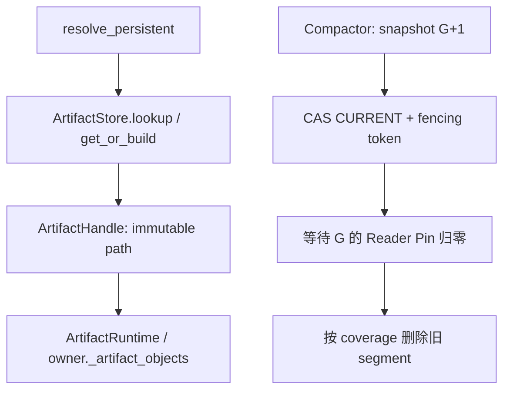

> 本文基于 PyPTO [`e35f3687`](https://github.com/hw-native-sys/pypto/commit/e35f3687af69f6acdea7d15e199df601f05ba007)，即研究时默认分支最新提交。相对上一章的 [`7f56be24`](https://github.com/hw-native-sys/pypto/commit/7f56be2474acc1c4db4034755e5df129a0caf404)，默认分支前进 [5 个提交](https://github.com/hw-native-sys/pypto/compare/7f56be2474acc1c4db4034755e5df129a0caf404...e35f3687af69f6acdea7d15e199df601f05ba007)；本文直接依赖的 `artifact_cache.py`、`_persistent.py`、`_artifact_runtime.py`、Artifact Store 文档与 UT 没有变化。当前代码**没有** online compactor、generation lease 或 reader pin；下文会把“代码/测试事实”和“由事实推导的建议协议”分开。

## 本篇在 PTO 课程路线中的位置

课程 94 已经回答“哪些 receipt segment 能被 snapshot 覆盖”：cut 必须是逐 rank 连续的 vector frontier，`CURRENT` durable publish 是逻辑提交点，旧 segment 只能在 reader 离开旧 generation 后回收。本篇只推进一步：**谁有权发布下一代 `CURRENT`，又如何证明旧 reader 已离开？**

这仍属于第二阶段的 Host Artifact/recovery 层，不新增 ISA 指令、Tile、layout 或 memory location。只选 PyPTO 一个仓库，因为当前 `ArtifactStore → ArtifactHandle → ArtifactRuntime` 已经完整给出 writer serialization、路径所有权与 reader lifetime 的证据；引入第二个仓库反而会混淆协议边界。

## 前置知识

上一章留下五个前提：snapshot 必须与全量日志 replay 等价；segment cut 是按完整 identity 域分组的 contiguous vector；snapshot 与 manifest 先 durable；`CURRENT` 再原子切换；straddling segment 不能原地删记录。注意这仍没有解决并发所有权：两个 Supervisor 都可能认为自己负责压缩，旧进程还可能在失联后恢复并执行迟到的 `rename` 或 `unlink`。

## 今日两个紧密关联的核心问题

1. 为什么现有 per-key `flock` 不能充当 compactor lease，租约为何必须带 generation 与 fencing token？
2. 为什么只检查“reader 心跳过期”仍不能删旧 generation，Reader Pin 应如何建立、重验和释放？

二者是同一删除授权的两面：lease 证明“只有我能改”，pin 证明“没人仍在读”。缺少任一项，GC 都可能把仍被执行对象引用的目录移走。

为避免把设计推导写成仓库事实，本文统一使用四类证据标签：`[代码事实]` 指当前默认分支可直接定位的行为；`[测试事实]` 指现有 UT 实际断言；`[历史说明]` 指已合入 PR 对适用范围的声明；`[建议协议]` 才是本篇提出、仍待实现和验证的机制。硬件是否缓存 inode、远端共享存储如何实现 lease、设备 callable 何时彻底失效，公开材料都没有给出，本文不猜测。

## PTO 全栈中的位置

公开 JIT 请求经 [`resolve_persistent`](https://github.com/hw-native-sys/pypto/blob/e35f3687af69f6acdea7d15e199df601f05ba007/python/pypto/jit/_persistent.py#L218-L379) 形成 `ArtifactKey/ArtifactSpec`，再进入 [`ArtifactStore.get_or_build`](https://github.com/hw-native-sys/pypto/blob/e35f3687af69f6acdea7d15e199df601f05ba007/python/pypto/jit/artifact_cache.py#L307-L350)。命中返回 immutable `ArtifactHandle`；未命中时同进程 flight 与跨进程 per-key lock 合并 builder，私有构建经 no-replace rename 发布。随后 [`restore_artifact`](https://github.com/hw-native-sys/pypto/blob/e35f3687af69f6acdea7d15e199df601f05ba007/python/pypto/runtime/_artifact_runtime.py#L172-L202) 把 handle 绑定到 `ArtifactRuntime`，后者才延迟加载可复用 callable。

compactor 位于这条链的旁路：它不能改变 key/spec 语义，只能把旧 receipt/snapshot generation 的物理表示替换为新 generation，并在证据充分后回收旧段。



## 概念和精确语义

### 1. per-key lock 与 generation lease 不是同一种锁

[`file_lock`](https://github.com/hw-native-sys/pypto/blob/e35f3687af69f6acdea7d15e199df601f05ba007/python/pypto/_fslock.py#L16-L34) 是 POSIX advisory `flock(LOCK_EX)`：不重入，进程退出时由内核释放，所有合作 writer 必须遵守。`ArtifactStore` 把锁文件放在 `locks/<key.digest>.lock`，加锁后重新 lookup，再 build/publish。它精确解决的是：**同一个 artifact key 的同一 slot 不要重复发布。**不同 key 允许并发，reader 完全不加锁。

compaction 的资源却是整个 manifest generation，不是一个 artifact key。若给每段各加一个 `flock`，两个 Supervisor 仍可能分别持有不同段锁、各自产生“下一代” manifest；若只加一个全局 `flock`，本机进程崩溃虽会释放锁，却无法阻止已经失联、仍能访问共享存储的旧 Supervisor 发出迟到操作，也没有持久化的 owner epoch 供恢复审计。

因此建议租约记录至少包含：

```text
CompactorLease {
  store_id, owner_id, owner_epoch,
  lease_revision, base_generation,
  expires_at, state
}
```

`expires_at` 只触发“允许发起 takeover”，**不证明旧 owner 已停止**。接管必须用 CAS 将 `(lease_revision, owner_epoch)` 单调推进；此后 `CURRENT` 发布、survivor rewrite、segment unlink 都携带新 epoch，存储层拒绝旧 token。这个 fencing check 才把“谁获胜”变成可线性化事实。

### 2. Reader Pin 不是缓存命中计数

当前 [`lookup`](https://github.com/hw-native-sys/pypto/blob/e35f3687af69f6acdea7d15e199df601f05ba007/python/pypto/jit/artifact_cache.py#L286-L305) 只验证目录与 manifest，随后返回 frozen `ArtifactHandle`，不创建 reader registry。`resolve_persistent` 又把恢复对象放入 `owner._artifact_objects`；[`ArtifactRuntime`](https://github.com/hw-native-sys/pypto/blob/e35f3687af69f6acdea7d15e199df601f05ba007/python/pypto/runtime/_artifact_runtime.py#L23-L96) 持有 `handle/directory/_chips`，并明确要求 published entry 在 runtime lifetime 内保持 immutable。文档也直说 [online GC 不存在，cleanup 必须停掉所有 consumer](https://github.com/hw-native-sys/pypto/blob/e35f3687af69f6acdea7d15e199df601f05ba007/docs/en/dev/09-artifact-store.md#L179-L204)。

Reader Pin 的目的，是把这个隐含 lifetime 变成跨进程可验证的 `Pin(reader_id, generation, pin_epoch)`。安全获取不能是“读一次 `CURRENT`，稍后再登记”，因为 compactor 可在两步之间发布并删除旧代。一个不依赖存储事务的最小协议是：

1. reader 读取 `CURRENT=G`；
2. 以自身 session/epoch 注册或续租 `Pin(G)`；
3. reader 再读 `CURRENT`；若仍为 `G`，才解析 G 内的 handle；若已变为 `G+1`，释放 `Pin(G)` 并重试；
4. runtime 最后一个 path/native user 退出后释放 pin。

这相当于 seqlock 风格的“register then validate”。心跳超时仍只产生 `suspect`：旧 reader 可能暂停、网络分区或保有 native callable。只有前文已经建立的 terminal certificate、进程/worker epoch fence 或受控 quarantine，才能把 stale pin 转成可回收结论。

### 3. 关键接口契约

这里没有 device tensor，因而 shape/dtype/device 均为 `N/A`；真正的载荷是 Host 路径、manifest digest 与单调 revision。把这些字段写清楚，比借用“锁住目录”这种含糊说法更重要。

| 接口 | 输入与位置 | 输出/所有权 | 前置与后置条件 | 并发假设与失败方式 |
| --- | --- | --- | --- | --- |
| `ArtifactStore.lookup` `[代码事实]` | `ArtifactKey`、`ArtifactSpec`；Host filesystem | HIT 时返回 frozen `ArtifactHandle`，调用方持有；store 不持有 reader pin | 前置：路径受可信 writer 管理；后置：当次读取的 manifest/payload 已验证 | lock-free read；MISS/INVALID/STORAGE_ERROR。并发删除明确不支持 |
| `file_lock` `[代码事实]` | 单个 `key.digest.lock` inode | context owner 临时持有排他锁 | 所有 writer 合作；进程退出后内核释放 | 只串行同 key；不能 fence 远端迟到写，也不覆盖 reader |
| `CASLease(expected_revision, base_generation)` `[建议协议]` | durable metadata store | 成功者得到 `(owner_epoch, lease_revision)` 与变更授权 | expected 必须匹配；成功后 revision/epoch 单调增加 | CAS 冲突重读；timeout 仅触发竞争，不能绕过 CAS |
| `PinGeneration(reader, G)` `[建议协议]` | durable/lease-backed reader registry | reader session 持有 pin；runtime path user 共享引用 | pin 后重读 `CURRENT` 仍为 G 才可暴露 handle | 冲突重试；失联转 suspect，不能直接当作 release |
| `PublishCURRENT(M, token)` `[建议协议]` | 已 durable、digest 校验的 manifest；Host metadata | 原子把 logical root 从 G 指向 G+1 | token epoch 当前且 base generation 匹配；成功不删除旧数据 | stale token/CAS 冲突拒绝；成功后的 GC 可独立重试 |
| `DeleteSegment(S, token)` `[建议协议]` | covered segment 与 current fencing token | compactor 暂时持有 deletion authority；physical store 消费 | coverage、无 unresolved、旧 pin 为空、token 当前 | `ENOENT` 仍须 identity/census 对账；部分失败保持 charge，不得假报释放 |

`ArtifactHandle` 的 `directory` 是绝对 Host path，payload 文件的 dtype/shape 由各自编译产物描述，并不是 compactor 的操作数。compactor 只能移动/删除完整、digest 可验证的 immutable segment；不得在 reader 可见的文件中原地重写字节。这个“不原地改”既继承当前 immutable publication，也使 crash 后能通过 manifest 选择完整版本。

## 真实文件、类型、API 逐段解读

[`ArtifactStore` 类注释](https://github.com/hw-native-sys/pypto/blob/e35f3687af69f6acdea7d15e199df601f05ba007/python/pypto/jit/artifact_cache.py#L256-L274) 给出最重要的当前事实：writer 依赖 Linux no-replace rename、POSIX `flock`，而 concurrent cache mutation/deletion **unsupported**。所以不能把本篇协议写成已实现功能。

`get_or_build` 先用 `_BuildFlights` 合并同进程重叠调用，再在 `_get_or_build` 中查找、取 per-key lock、二次查找、私有构建和发布。它的后置条件是 HIT/PUBLISHED 或仍可用的 PRIVATE；不是“全局只有一个 cache mutator”。[`_publish`](https://github.com/hw-native-sys/pypto/blob/e35f3687af69f6acdea7d15e199df601f05ba007/python/pypto/jit/artifact_cache.py#L377-L409) 把 payload 复制到同父目录 staging，校验、完成 marker、`RENAME_NOREPLACE`、sync parent。这个顺序非常适合复用到 snapshot，但 `RENAME_NOREPLACE` 只防同名覆盖，不能在两个不同候选 manifest 之间选出唯一 generation。

`bind_artifact/_attach` 把 `owner.output_dir` 重绑到 handle 目录，并设置 `owner._artifact_runtime`；之后 promotion 只换 runtime binary handle，不再改变 compiled object 的 path/hash。这说明 compactor 不能把“lookup 已结束”当作 reader 结束：路径所有权延续到 compiled object、worker registry 与 callable 的终态。

## 对象 / Handle / Pin 生命周期

`ArtifactHandle` 在 `lookup` HIT 或 `_publish` 成功时创建；`resolve_persistent` 选择 READY 或 GENERATED handle，交给 `restore_artifact/bind_artifact`；`ArtifactRuntime` 持有它，首次 `load()` 时还可能从 GENERATED promotion 到 READY 并更新 runtime 自己的 handle；编译对象由 `owner._artifact_objects[compatible]` 保存以便复用。当前没有自动删除 private directory，文档要求 owner 释放所有 user 后才能 cleanup。

建议的 pin 与这个对象链同寿命，而不是同一次函数调用同寿命：在 handle 可见前取得 pin；promotion 若进入新 generation，先 pin 新代、验证，再释放旧 pin；`_chips`、worker registration 与 in-flight native use 全部归零后才 release。异常退出交给 session epoch + terminal certificate 收束，不能由 TTL 猜测。

## 端到端调用链与双 Supervisor 抢占

```mermaid
sequenceDiagram
    participant R as Reader R1
    participant A as Supervisor A
    participant L as Lease/CURRENT Store
    participant B as Supervisor B
    R->>L: read CURRENT=G12, register Pin(G12), re-read
    A->>L: CAS lease rev40→41, epoch=5, base=G12
    A->>L: durable snapshot/manifest G13
    B->>L: lease timeout; CAS rev41→42, epoch=6
    A-->>L: late publish/unlink(epoch=5) rejected
    B->>L: verify G13 digest; CAS CURRENT G12→G13(epoch=6)
    L-->>B: Pin(G12) still active; GC denied
    R->>L: terminal release Pin(G12)
    B->>L: fenced delete of fully covered old segment
```

完整链是：JIT 入口生成 key/spec → `lookup/get_or_build` 得到 immutable handle → `restore_artifact` 建立 runtime → reader pin 保护所属 generation → compactor 以 CAS 取得 generation lease → durable 写 snapshot/manifest → 携 fencing token CAS `CURRENT` → 等旧 pin 归零 → 对每段重新验证 coverage/unresolved 状态 → fenced unlink。失败发生在任一步都必须可重试；`CURRENT` 前的孤儿 snapshot 可按 digest 收养或回收，不能视为已提交。

## 具体状态演算

设 `CURRENT=G12`，旧代有 `S17=8 KiB`、`S18=8 KiB`；课程 94 已证明 `S17` 被 frontier 全覆盖，`S18` 仍含 gap survivor。Reader R1 读取 G12、注册 `Pin(R1,G12,e9)`、重读仍是 G12，于是恢复一个 READY handle，`ArtifactRuntime._chips` 已加载。

Supervisor A 以 `expected lease_revision=40` CAS 得到 `(rev=41, owner_epoch=5, base=G12)`，写好 snapshot 与 `M13` 后失联。B 看到租约超时，只把它当作 takeover 候选；B CAS `41→42`，得到 epoch 6。A 恢复后发出的 `CURRENT(G12→G13, epoch=5)` 与 `unlink(S17, epoch=5)` 都被拒绝。B 校验已存在的 G13 内容 digest 后，以 epoch 6 发布 `CURRENT=G13`，避免重复生成。

此时 `S17` 虽已被 frontier 覆盖，仍不能删除，因为 R1 的 native callable 还引用 G12。R1 terminal 后释放 pin，B 再次验证自身 lease epoch、`PinSet(G12)=∅`、`S17` 无 unresolved dependency，才删除 8 KiB；`S18` 保留或先 copy survivor 到新 sealed segment。可以把删除条件写成：

```text
GCEligible(S, G) :=
  CURRENT.generation > G
  ∧ Covered(S, Frontier[G])
  ∧ Unresolved(S) = ∅
  ∧ ActivePins(G) = ∅
  ∧ Lease.owner_epoch = DeleteToken.owner_epoch
```

任何条件未知都按 false 处理。尤其 lease TTL、operator ack、心跳缺失、`CURRENT` 已前进，都不能单独推出 physical bytes 已无人使用。

## 为什么这样设计及替代方案

最简单替代是永不在线删除：保持 immutable generation，运维停掉所有 consumer 后离线 cleanup。它与当前代码完全一致，正确性最好、维护成本最低，但磁盘无界，长跑 serving 最终受空间反压。

第二种是全局 `flock`。单机、同一内核、合作进程下，它实现便宜，dead process 自动释放；但共享存储上的远端 Supervisor、旧 owner 迟到写、持久恢复审计和 lock-free reader 都没有 fencing 语义。它适合“停服清理”，不够支撑 online takeover。

第三种是 TTL lock file 或原子 `mkdir`。它能做 leader hint，却有 stale/ABA：新 owner 删除旧 lock 后，旧 owner仍可继续操作。CAS generation lease + 单调 owner epoch 多一次元数据写，却把每个 publish/delete 变成可拒绝的条件更新；Reader Pin 再把 lock-free 低延迟读取与安全 GC 解耦。这是本文选择的最小可辩护机制。

## 访存、计算、流水、并行和硬件约束

本篇对象位于 Host filesystem/object-store metadata，不改变 NPU Tile shape、dtype、layout 或 device memory。reader fast path 多两次 `CURRENT` read 和一次 pin register/renew；若每个 artifact lookup 都单独 pin，元数据写放大会很高，实际应按 reader session + generation 合并，并以引用计数覆盖多个 handle。compactor lease 是全局稀有写，不应占用 per-key builder lock；否则一个大 snapshot 会阻塞无关 key 的 JIT。

正确性优先级高于吞吐：pin batching 可以减少写量，但不得扩大“handle 已可见、pin 尚未生效”的窗口；heartbeat 可以批量续约，但失联只能进入 suspect/quarantine。对 NFS/object store 还必须明确 CAS、durability、list consistency 和 delete 可见性；当前文档只要求使用者先证明 filesystem 提供 `flock` 与 atomic no-replace rename，不能把本地 POSIX 结论外推为跨节点事实。

从资源角度看，generation 粒度 pin 是刻意的折中。按每个 handle 建 pin 最精确，却会让同一 Python 进程恢复 100 个 artifact 时产生 100 份续租与扫描状态；按整个进程只建一个“全局活跃”标记又过于粗糙，会让 G12 的一个慢对象阻挡与 G12 无关的所有 generation 回收。按 `(reader_session, generation)` 聚合时，100 个 G12 handle 只需一个 registry entry 和进程内引用计数；最后一个 handle/native user 退出才释放。这不改变安全条件，只减少 durable metadata 写放大。

compactor 也不应在持有 lease 期间一直占着阻塞锁。推荐把长时间 snapshot build 与短时间提交分开：取得 `(epoch, base_generation)` 后离线生成 immutable 候选，提交前再次验证 lease revision 与 `CURRENT`；失败者的候选按 content digest 作为 orphan 处理。这样不同 artifact key 的 `get_or_build` 仍可并行，reader fast path 也不等待 compactor，只在 pin register/revalidate 时访问很小的 metadata。代价是需要 orphan inventory 和容量预算，不能假定失败候选会自动消失。

延迟、吞吐与正确性的取舍可以具体化：reader 多一次 metadata round trip 会增加首次恢复延迟，但不会进入每次 kernel launch；pin renew 应由 session 后台批处理，而非每个 callable 调用写存储；compactor snapshot 的顺序 IO 可与在线构建争用磁盘带宽，应受 admission/IO budget 限流。无论怎样优化，三条线不能跨越：handle 暴露前 pin 已生效且重验通过；旧 token 的任何 durable mutation 都被拒绝；physical delete 之前所有旧代 path/native owner 都有可审计终态。

还要区分 graphability：这些操作全部在 Python/Host 控制面，不进入 PTOAS IR、device graph 或 CUDA/NPU graph capture，因此不会改变 kernel graph shape；但若在线 GC阻塞 JIT 首次恢复，会间接拉长 serving cold-start。将 lease/pin 与 per-key build lock 分离，正是为了避免把全局维护抖动传播到无关 kernel 的编译关键路径。

## 测试证据与未覆盖风险

当前 [`test_same_key_threads_build_once`](https://github.com/hw-native-sys/pypto/blob/e35f3687af69f6acdea7d15e199df601f05ba007/tests/ut/jit/test_artifact_cache.py#L516-L533) 用 4 个线程验证 builder 只调用一次，结果为 1 PUBLISHED + 3 HIT；[`test_different_keys_build_concurrently`](https://github.com/hw-native-sys/pypto/blob/e35f3687af69f6acdea7d15e199df601f05ba007/tests/ut/jit/test_artifact_cache.py#L706-L717) 用 barrier 证明不同 key 可并发；[`test_spawned_processes_deduplicate_and_dead_process_releases_lock`](https://github.com/hw-native-sys/pypto/blob/e35f3687af69f6acdea7d15e199df601f05ba007/tests/ut/jit/test_artifact_cache.py#L731-L772) 验证 3 个 spawn process 得到 1 PUBLISHED + 2 HIT，并验证异常退出后内核释放同一 inode 上的 lock。这些测试证明 per-key publication，不证明 generation compaction。

[`test_publish_then_hit_preserves_private_value_and_records`](https://github.com/hw-native-sys/pypto/blob/e35f3687af69f6acdea7d15e199df601f05ba007/tests/ut/jit/test_artifact_cache.py#L58-L84) 还证明 fresh publish 后 private value/path 继续存活；它正是“发布成功不等于旧引用可删”的测试事实。历史实现 PR [#2723](https://github.com/hw-native-sys/pypto/pull/2723) 明确写着没有 cleanup/eviction API，并只声称 cooperating writers 的 immutable cache。

尚缺的关键测试是：两个 compactor 对同一 base generation 竞争 CAS；旧 owner 在 takeover 后迟到 publish/unlink；reader 在“读 CURRENT/注册 pin/重读”每个边界崩溃；pin release 丢失、session epoch fence 与 quarantine；`CURRENT` 成功但 delete 失败；snapshot 已 durable 但未 publish；跨节点共享存储的一致性；真正 worker/native callable 长持有旧路径时的删除拒绝。应使用 deterministic barriers 和 fault-at-every-boundary matrix，而不是依靠 sleep/随机竞争。

最小新增测试集可以保持 device-free。测试一让 A/B 同时读取 lease revision 40，用 barrier 同时 CAS，断言只能一个获得 epoch 5，失败者必须重读；再放行失败者 takeover 到 epoch 6，注入 A 的迟到 `PublishCURRENT/DeleteSegment`，断言两者都因 stale fencing token 失败。这个测试验证的是“旧 owner 无法产生副作用”，不只是“最终 CURRENT 看起来正确”。

测试二让 reader 在 G12 注册 pin 后停在第二次 `CURRENT` read 前，compactor 发布 G13；reader 恢复后必须释放 G12 pin并重试到 G13，不能返回 G12 handle。测试三让 reader 已返回 G12 handle并长持有 `_chips`，断言即使 `CURRENT=G13`、S17 fully covered，GC 仍为 blocked；释放最后一个 runtime/native user 后才允许 delete。测试四在 `snapshot fsync`、`manifest fsync`、`CURRENT CAS`、`unlink`、capacity reconcile 每条边界注入 crash，重启后分别验证 orphan 收养、旧 CURRENT replay、幂等 unlink 与不提前返还容量。

仍有测试无法靠 mock 证明：NFS/object store 的真实 CAS/durability、进程冻结后的 lease takeover、NPU worker 是否还持有 native 侧路径或 mmap。它们需要多节点集成环境与设备 witness；在此之前，最安全的 production policy 仍是关闭 online deletion，保守保留旧 generation。

## 与前后章节的连接

向前，本篇消费课程 94 的 vector frontier、snapshot/manifest 与 reader-safe GC；它不重新定义哪些 receipt 被覆盖，只补上“谁能提交/删除”的所有权协议。向后，lease 与 pin 都需要 crash-safe canonical record、renew/release journal 和 recovery scan；下一章应研究 `CURRENT` 发布之后、segment unlink 之前崩溃时，如何用 delete intent、physical census 与幂等 reconcile 收束空间账本。

## 本篇结论、知识债、三个理解检查问题和下一章

结论只有三句：per-key `flock` 不是 compactor lease；租约过期不是 fencing，所有变更必须携带 CAS 推进后的 owner epoch；`CURRENT` 前进不是 reader 退出，旧代必须等有效 pin 归零或被更强 terminal certificate 收束。

知识债：仓库仍没有 `CompactorLease/ReaderPin/CURRENT` codec、CAS/durability backend、session epoch fence、pin batching、跨节点 adapter、takeover reconcile 或 fault matrix；硬件侧 late native use 也没有可观测 witness。

理解检查：

1. 为什么 A 的 lease TTL 过期后，B 仍不能仅凭“我拿到新锁”允许 A 的旧 token unlink？
2. reader 为什么要在注册 `Pin(G)` 后重读 `CURRENT`，少这一步会出现什么窗口？
3. `CURRENT=G13`、`S17` 已被 frontier 覆盖时，还有哪三个条件会阻止删除？

下一章：**`CURRENT` 已切换但 unlink 崩溃怎么办——Delete Intent、Physical Census 与幂等 Reconcile。**

## 课程账本增量

- 课程位置：`receipt vector frontier → snapshot/manifest → generation lease CAS → CURRENT publish → reader pin drain → fenced segment GC`。
- 新确认不变量：TTL 只允许发起 takeover；owner epoch/fencing token 才能拒绝旧写；reader pin 必须 register 后重验 `CURRENT`；pin stale 只表示 suspect；删除同时需要 coverage、无 unresolved、旧 pin 归零和当前 lease authority。
- 新覆盖：PyPTO `ArtifactStore.lookup/get_or_build/_publish`、`file_lock`、`resolve_persistent/owner._artifact_objects`、`ArtifactRuntime.bind/restore/load` 及并发 publication UT。
- 当前实现边界：无 online GC、generation lease、reader pin 或双 Supervisor 协议；本文协议为基于现有 path lifetime 与 publication contract 的推导。
- 下一章：Delete Intent、physical absence/census revision 与 crash-safe reconcile。
