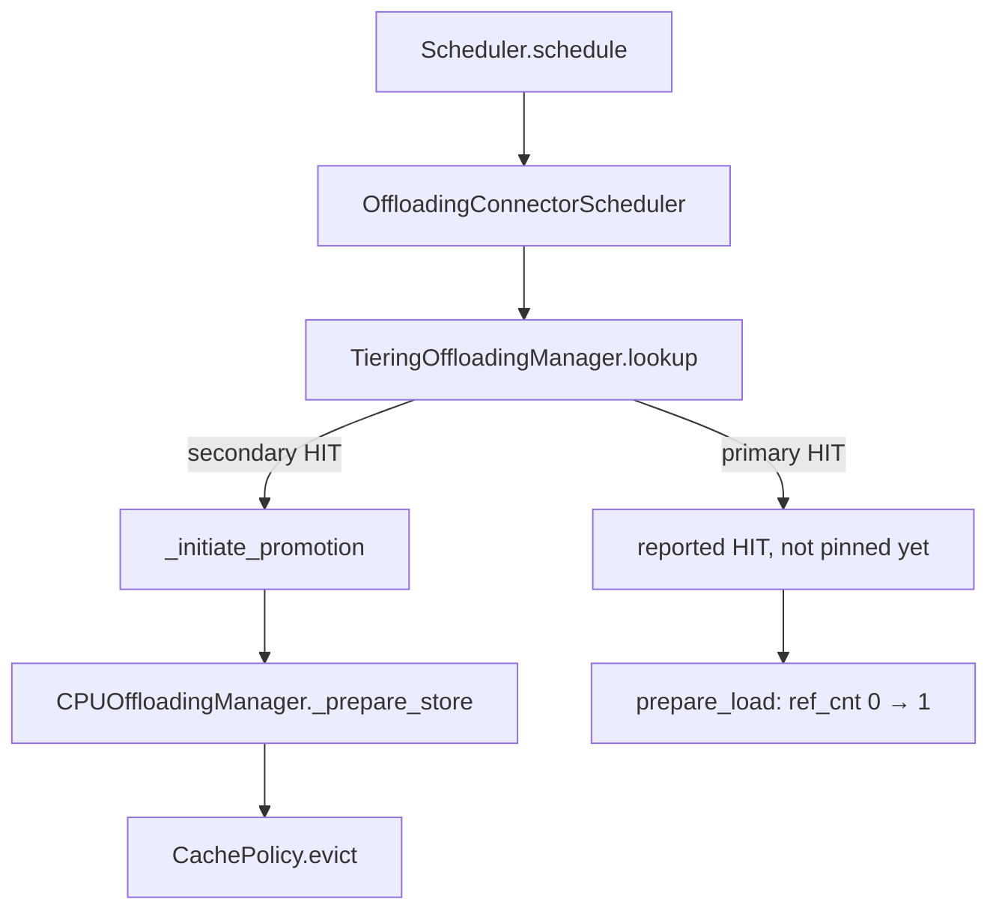
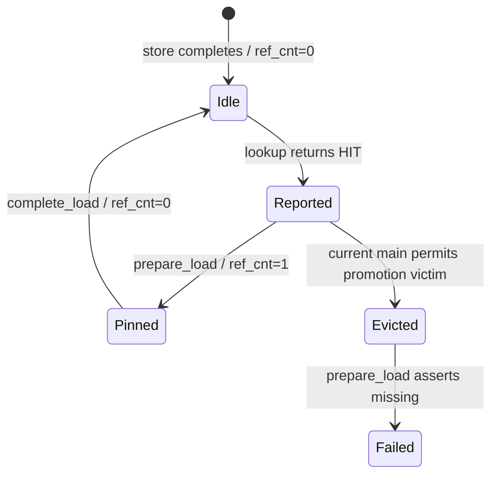

> 源码基线：[`c07d58dc`](https://github.com/vllm-project/vllm/commit/c07d58dc82d75f7d1a947b3264b460384ec3e18d)，研究时 `vllm-project/vllm` 默认分支最新提交。相对第 84 章基线前进 [91 个提交](https://github.com/vllm-project/vllm/compare/3319c629a148c8f7ce088445911d9db4119af134...c07d58dc82d75f7d1a947b3264b460384ec3e18d)；直接相关代码的语义未因这些提交改变。开放 [PR #63551](https://github.com/vllm-project/vllm/pull/63551) 尚未合入，本文把它当作候选修复与回归测试证据，而不是 main 事实。

## 本篇在课程路线中的位置

第 83–84 章把 quarantine debt 量化到 peer，并得到 `requested + reserve <= safe headroom` 这个 admission 形式。但 `safe headroom` 不能直接等于“free 加 idle”：idle chunk 里可能包含本步已经向 Scheduler 报告为 `HIT`、却尚未被 `prepare_load()` pin 住的 key。

本篇只回答一个问题：**一个 promotion batch 到来时，怎样在 protected keys、evictable set 和同一步并发需求下计算可证明的 Guaranteed Headroom？**

课程位置：

`per-peer debt gate → protected HITs → exact evictable set → atomic promotion reservation → MISS/recompute`

## 前置知识回顾

CPU primary tier 的 `ChunkStatus.ref_cnt` 有三个区间：`-1` 是 write pending，`0` 是 ready 且 idle，`>0` 是被 load pin 住。只有 `0` 会进入 eviction policy 的候选集合。上一章的 deferred/quarantine chunk 仍占物理槽位，但既不 free，也不 evictable。

因此容量判断首先要区分：

- `F`：尚未分配或已回到 free list 的 chunk；
- `E`：`ref_cnt == 0` 的 resident key 集合；
- `P`：当前操作明确不可驱逐的 key；
- `W/R/Q`：write-pending、read-pinned、quarantined；它们已不在 `F` 或 `E` 中，公式里不能再重复扣一次。

## 本篇要回答的核心问题

1. 为什么 Scheduler 已经拿到 `HIT`，key 仍可能处在 `E`？
2. 为什么 `_num_evictable_cache_chunks` 足以做快速失败，却不能证明本次 promotion 一定可分配？
3. 多个 promotion 在同一步出现时，什么才是可线性化的 admission certificate？

## 组件在全局架构中的位置



上游输入是 `Request` 的 block hashes 和当前本地 computed-token 边界；下游消费者是 CPU→GPU load job。promotion 则把 secondary key 先写进 CPU primary，再供后续 step 使用。两条路径共享同一个 primary allocator，因此 `HIT` 的承诺必须约束 promotion 的 victim 选择。

## 完整调用链

公开调度入口是 [`Scheduler.schedule()`](https://github.com/vllm-project/vllm/blob/c07d58dc82d75f7d1a947b3264b460384ec3e18d/vllm/v1/core/sched/scheduler.py#L685)。waiting request 做 prefix 查询时调用 [`connector.get_num_new_matched_tokens()`](https://github.com/vllm-project/vllm/blob/c07d58dc82d75f7d1a947b3264b460384ec3e18d/vllm/v1/core/sched/scheduler.py#L1144)，经 [`OffloadingConnector`](https://github.com/vllm-project/vllm/blob/c07d58dc82d75f7d1a947b3264b460384ec3e18d/vllm/distributed/kv_transfer/kv_connector/v1/offloading_connector.py#L165) 进入 [`OffloadingConnectorScheduler.get_num_new_matched_tokens`](https://github.com/vllm-project/vllm/blob/c07d58dc82d75f7d1a947b3264b460384ec3e18d/vllm/distributed/kv_transfer/kv_connector/v1/offloading/scheduler.py#L918)。

这里的 step-scoped lock 从第一次 lookup 持续到 `build_connector_meta()`，能阻止另一个线程插入 eviction；但它不能阻止**持锁的当前 step 自己**先报告 primary `HIT`，随后又因另一个 key 的 secondary `HIT` 发起 promotion。

[`TieringOffloadingManager.lookup`](https://github.com/vllm-project/vllm/blob/c07d58dc82d75f7d1a947b3264b460384ec3e18d/vllm/v1/kv_offload/tiering/manager.py#L713) 对 primary `HIT` 立即返回，没有 pin；secondary `HIT` 则进入 [`_initiate_promotion`](https://github.com/vllm-project/vllm/blob/c07d58dc82d75f7d1a947b3264b460384ec3e18d/vllm/v1/kv_offload/tiering/manager.py#L809)，马上 `prepare_write([key])` 预留 primary chunk，并把真正的 transfer 推迟到 `on_schedule_end()` 批量提交。

随后 Scheduler 完成 GPU block 分配，`update_state_after_alloc()` 才构造 load keys，并在 [`prepare_load`](https://github.com/vllm-project/vllm/blob/c07d58dc82d75f7d1a947b3264b460384ec3e18d/vllm/distributed/kv_transfer/kv_connector/v1/offloading/scheduler.py#L1180) 把 `ref_cnt: 0 → 1`。这就留下了“报告与 pin 之间”的窗口。

## 关键类型、字段和状态生命周期

[`ChunkStatus`](https://github.com/vllm-project/vllm/blob/c07d58dc82d75f7d1a947b3264b460384ec3e18d/vllm/v1/kv_offload/cpu/policies/base.py#L25) 保存 `ref_cnt: int32` 和 `chunk_id: int64`；数据本体位于 CPU `memoryview`，逻辑形状是 `(num_chunks, row_stride_bytes)`，policy 只管理 `OffloadKey → ChunkStatus`。

一个 primary HIT key `A` 的正确生命周期应为：



`Reported` 不是当前 `ChunkStatus` 的显式状态：main 中它仍是 `ref_cnt == 0`。这正是缺失的不变量。promotion key `X` 则在 `_prepare_store` 分配后为 `-1`，transfer 成功后转为 `0`；失败时删除 mapping 并释放，若存在 completion uncertainty 则由 deferred release 继续持有。

## 逐函数源码解读

[`CPUOffloadingManager._prepare_store`](https://github.com/vllm-project/vllm/blob/c07d58dc82d75f7d1a947b3264b460384ec3e18d/vllm/v1/kv_offload/cpu/manager.py#L278) 先算：

```text
need_evict = len(keys_to_store) - free_chunks
```

若 `need_evict > _num_evictable_cache_chunks`，直接失败；否则把本次 `keys` 自身放进 `protected`，调用 policy 的 `evict(need_evict, protected)`。这两级判断很合理：整数计数是 O(1) 的必要条件，policy 扫描才是充分条件。

[`CachePolicy.evict`](https://github.com/vllm-project/vllm/blob/c07d58dc82d75f7d1a947b3264b460384ec3e18d/vllm/v1/kv_offload/cpu/policies/base.py#L116) 的契约要求：要么返回恰好 `n` 个 victim，要么返回 `None` 且不改变状态。LRU 实现会暂存重复项和 protected 项，候选不足时把 heap 完整恢复。问题不在 eviction 原子性，而在 `protected` 只含 promotion 的输入，没有包含本步先前报告的 primary HITs。

因此准确公式是：

$$
H_{guaranteed}=|F|+|E\setminus(P_{input}\cup P_{step})|-A
$$

`A` 只表示尚未反映到 `F/E` 的并发 reservation。当前 manager 在同一把锁内完成 eviction 与 allocation，前一个 promotion 会立刻改变计数，所以串行调用时 `A=0`；若未来把检查和 reservation 拆到不同线程/进程，必须显式记账，不能让多个调用同时消费同一份余量。

最强的 admission certificate 不是一个瞬时数字，而是 policy 在锁内实际选出的 victim 与 allocator 返回的 chunk IDs。条件是 `demand <= H_guaranteed`；失败则 lookup 返回 `MISS`，让 Scheduler 重算，而不是对已经承诺的 HIT 失约。

## 具体示例与 shape/状态演算

设 primary 有 6 个 chunk，每个 64 KiB，总计 384 KiB：

| 类别 | 内容 | 是否能给 promotion |
| --- | --- | --- |
| `F` | 0 个 | 是，但当前为 0 |
| `E` | `{A,B,C,D}`，均 `ref_cnt=0` | 只有未保护项可用 |
| `R` | `{E}`，`ref_cnt=1` | 否 |
| `W` | `{F}`，`ref_cnt=-1` | 否 |

本步先查询两个请求，primary 依次对 `A`、`B` 返回 `HIT`，故 `P_step={A,B}`，但 main 中二者仍在 `E`。随后 secondary 命中 `X,Y`，promotion demand 为 2 个 chunk（128 KiB）。

- 当前快速计数看到 `|E|=4`，允许继续；若 `A,B` 恰好是 LRU 最老项，它们可能被选为 victim，稍后的 `prepare_load([A,B])` 触发 `Chunk ... not found in cache`。
- Guaranteed Headroom 为 `0 + |{C,D}| = 2`；正确 victim 只能是 `C,D`，恰好容纳 `X,Y`。
- 若 demand 是 3，则 nominal headroom 为 4，guaranteed headroom 只有 2，必须拒绝 promotion，并把 secondary key 当作 `MISS` 重算。

## 为什么这样设计及替代方案

开放 PR #63551 的候选方案是在 tiering manager 维护 `_step_hit_keys`：primary `HIT` 时加入，promotion 时作为 `extra_protected` 传给 CPU manager，`on_schedule_end()` 与 reset 时清空。它复用现有原子 `evict`，没有改变 data plane。

替代方案一是 lookup 时立刻 pin。它能消除窗口，但 lookup 只是在探索 prefix，最终 request 可能未被调度；这会扩大 refcount 清理面，把取消、preemption 和异常回滚都带进 lookup。替代方案二是预留固定百分比容量，实现简单，却既可能浪费命中率，也不能证明某个已报告 HIT 不被逐出。精确 protected set 加锁内 reservation，才同时满足正确性与容量利用率。

## 性能、并发、正确性与边界条件

- **延迟与吞吐**：保护 key 会减少可用 victim；容量不足时 promotion 降级为 recompute，单请求延迟可能上升，但避免崩溃和无界 retry。过度把“探测过”当“承诺过”会压低 promotion 命中率，因此集合应只覆盖本步实际返回的 primary `HIT`。
- **内存**：只增加 host 侧 `set[OffloadKey]`，不增加 KV data bytes；物理 CPU cache 仍由 chunk pool 决定。
- **并发**：step lock 解决外部线程竞态，protected set 解决同一临界区内部的语义竞态。若 `on_schedule_end()` 异常，集合的生命周期必须由 step generation 或 `finally` 约束，避免永久保护。
- **graphability**：逻辑全部在 Scheduler/CPU control plane，不改变 GPU tensor shape、device address 或 CUDA Graph key。
- **正确性边界**：reset 必须清空旧 generation 的 protection；key identity 若可跨 allocation generation 复用，还需 generation/nonce 防 ABA。`W/R/Q` 已从 `F/E` 排除，计算时不得重复扣除。

## 测试证据与未覆盖风险

main 的 [`test_lru_batch_eviction_failure_is_atomic`](https://github.com/vllm-project/vllm/blob/c07d58dc82d75f7d1a947b3264b460384ec3e18d/tests/v1/kv_offload/cpu/test_manager.py#L633) 建 4-key cache，保护其中 3 个：请求驱逐 2 个必须返回 `None` 且四个 key 仍为 HIT；请求 1 个只逐出未保护 key。它验证了 policy 的全有或全无语义。

[`test_evictable_cache_chunk_count`](https://github.com/vllm-project/vllm/blob/c07d58dc82d75f7d1a947b3264b460384ec3e18d/tests/v1/kv_offload/cpu/test_manager.py#L1499) 覆盖 store、双并发 load、逐次 complete、eviction、failed store 与 reset，验证 `ref_cnt 0↔1` 只在边界变化时增减 idle 计数。

但 main 没有把“primary HIT → secondary promotion → prepare_load”放在同一步。PR #63551 新增三条候选回归：保护最老 HIT、所有 idle 均已 HIT 时 promotion 退化为 MISS、下一步释放保护。它们直接覆盖竞态，但在 PR 合入并通过 main CI 前只能视为计划/实验事实。仍欠缺：ARC 同路径、多个 request/secondary tier、step 异常、reset 并发、generation ABA、真实内存压力与 promotion batch fairness。

## 与前后章节的连接

上一章的 per-peer controller 决定“谁可以申请”；本章定义 allocator 能够证明“现在可给多少”。两者组合应是：先做 peer/global debt gate，再在同一线性化点执行 `reserve(demand, protected)`。下一章将研究 backend fence 到达后，怎样把 quarantine capacity 安全地重新并入这个 guaranteed set，并验证跨进程恢复不会双计余量。

## 本篇结论、知识债、三个理解检查问题和下一章

结论：`free + evictable_count` 只是必要的 nominal headroom；Guaranteed Headroom 必须从 idle 集合扣掉本步已承诺但未 pin 的 HIT，并以锁内实际 victim/chunk reservation 作为 admission certificate。容量不足的安全结果是 `MISS/recompute`，不是驱逐承诺过的 key。

知识债：PR #63551 尚未合入；`_step_hit_keys` 的异常清理、generation fencing 与高基数成本仍需验证；还缺 ARC、多 tier、多 request 和 crash/reset 组合 Golden；quarantine release 如何原子加入可用集合尚未闭环。

理解检查：

1. 为什么 step-scoped manager lock 仍不能阻止本篇竞态？
2. 为什么 `_num_evictable_cache_chunks >= demand` 只是必要条件，不是充分条件？
3. 当 admission check 与 allocation 不在同一临界区时，公式中的 `A` 应由谁持有、何时释放？

下一章：**Backend Fence 如何把 Quarantine 容量重新并入 Guaranteed Headroom——Release Witness、Generation Fence 与 Recovery Golden。**

## 课程账本增量

- 第 85 章，源码基线 `c07d58dc82d75f7d1a947b3264b460384ec3e18d`。
- 新覆盖 `Scheduler.schedule`、offloading scheduler 的 lookup/pin step region、tiering lookup/promotion、CPU `prepare_store`、LRU protected eviction 与对应测试。
- 新确认：reported HIT 与 pinned 是两个状态；nominal count 不是 admission certificate；同锁内 eviction+allocation 可消除 concurrent reservation double-spend。
- 新债：候选修复未合入，异常/reset/generation 与多策略 Golden 未覆盖。
- 下一章进入 quarantine capacity 的 fence 后恢复与跨进程验证。
