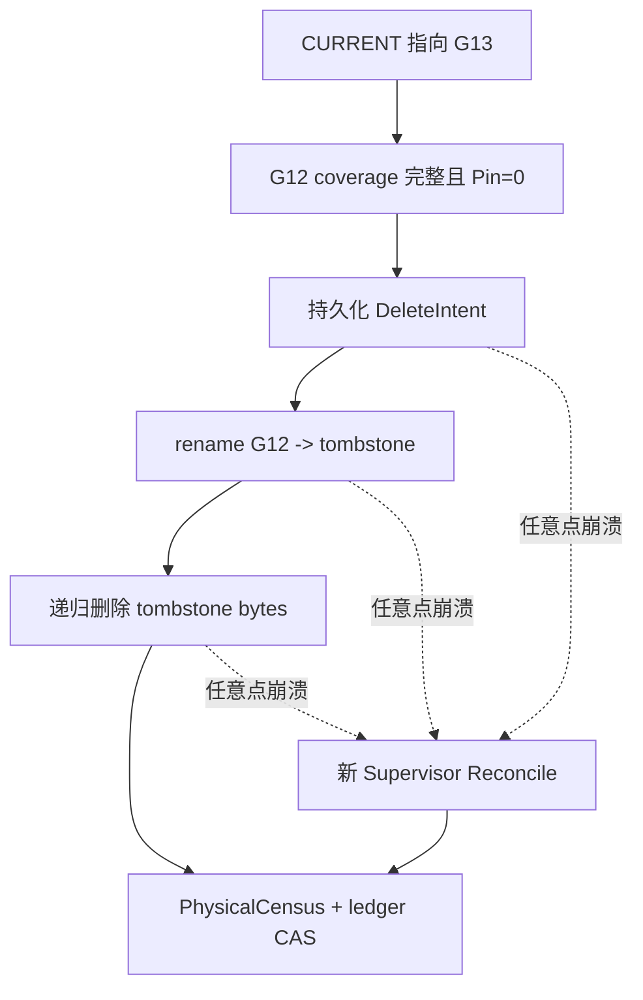
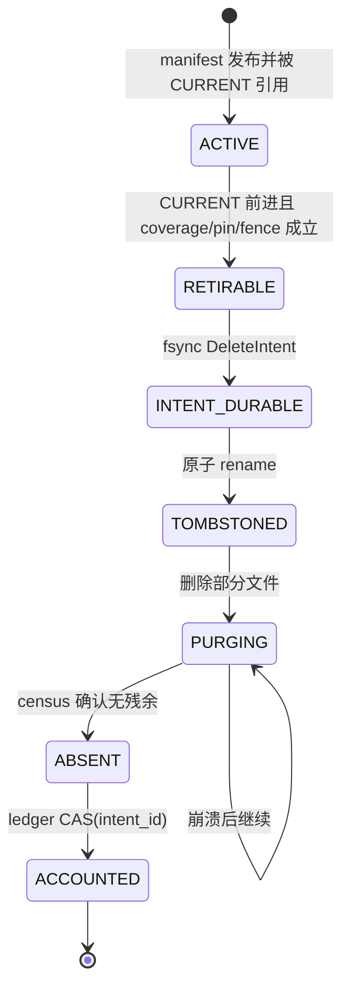

> 本文基于 PyPTO [`d0127ff7`](https://github.com/hw-native-sys/pypto/commit/d0127ff79cc0e829e420cd01ffded5f4084cdadb)，即研究时默认分支最新提交。相对上一章基线 [`e35f3687`](https://github.com/hw-native-sys/pypto/commit/e35f3687af69f6acdea7d15e199df601f05ba007)，主干前进了 [6 个提交](https://github.com/hw-native-sys/pypto/compare/e35f3687af69f6acdea7d15e199df601f05ba007...d0127ff79cc0e829e420cd01ffded5f4084cdadb)，但本文直接依赖的 Artifact Store、runtime adapter、文档和 UT 没有变化。当前代码明确不支持 concurrent deletion，也没有 `CURRENT`、Delete Intent、Physical Census 或 online reconciler；本文把已合入事实与建议协议严格分开。

## 本篇在 PTO 课程路线中的位置

课程 94 定义了 receipt log 的 vector cut、snapshot/manifest 与 `CURRENT` 原子切换；课程 95 又补上 generation lease、fencing token 和 Reader Pin。现在安全删除条件已经有了，但还有最后一个洞：**条件满足后执行物理删除，进程若在任意一次 `unlink` 前后崩溃，接管者如何判断“没删、删了一半、还是删完但没记账”？**

这是课程 96，仍在第二阶段的 PyPTO Host Artifact/recovery 层，不涉及新的 Tile、layout、ISA 指令或设备 memory location。它也不是课程 83 的重复：课程 83 处理单个 private artifact 的 tombstone；本篇处理的是带 `CURRENT`、generation coverage、Reader Pin 和双 Supervisor fence 的**共享 receipt generation**。删除原语相似，授权证据与恢复范围不同。

## 前置知识

先固定上一章留下的删除前置条件。旧 generation `G` 只有同时满足以下谓词才可退休：`CURRENT > G`；snapshot frontier 覆盖待删 segment；不存在 unresolved claim/effect；`ActivePins(G)=0`；执行者持有当前 owner epoch 的 fencing token。这里的“可退休”只是逻辑事实，不等于 bytes 已经消失，也不等于 capacity ledger 已经可以减账。

## 今日两个紧密关联的核心问题

1. 删除为什么必须先持久化 `DeleteIntent`，再把 generation 原子改名到 tombstone namespace，最后才递归清理？
2. 崩溃重启后，`PhysicalCensus` 如何把 intent、原路径、tombstone、残余文件和账本拼成唯一、可重复执行的结论？

证据标签沿用上一章：`[代码事实]`、`[测试事实]`、`[历史说明]` 与 `[建议协议]`。涉及文件系统崩溃持久性的部分还必须服从具体 backend 契约；本文只把 POSIX 同文件系统 rename 与显式 directory sync 当作候选机制，不把网络文件系统或 object store 的行为想当然。

## PTO 全栈中的位置

当前真实请求链是：[`resolve_persistent`](https://github.com/hw-native-sys/pypto/blob/d0127ff79cc0e829e420cd01ffded5f4084cdadb/python/pypto/jit/_persistent.py) 生成 `ArtifactKey/ArtifactSpec`，进入 [`ArtifactStore.get_or_build`](https://github.com/hw-native-sys/pypto/blob/d0127ff79cc0e829e420cd01ffded5f4084cdadb/python/pypto/jit/artifact_cache.py)，命中或发布 `ArtifactHandle`，再由 [`bind_artifact/restore_artifact`](https://github.com/hw-native-sys/pypto/blob/d0127ff79cc0e829e420cd01ffded5f4084cdadb/python/pypto/runtime/_artifact_runtime.py) 挂到 `ArtifactRuntime`。receipt compactor 是旁路维护者，不能修改 artifact identity；它只在 reader 与 runtime 生命周期结束后回收旧 generation。



## 概念和精确语义

### 1. Delete Intent 是授权记录，不是“待办备注”

`[建议协议]` 一个最小 intent 至少包含：

```text
DeleteIntentV1 {
  store_id, generation=G12, current_seen=G13,
  source_path, tombstone_path,
  manifest_digest, covered_frontier,
  expected_bytes, owner_epoch, lease_revision,
  intent_id, state=PREPARED
}
```

它必须在任何 destructive effect 之前 durable。`manifest_digest` 与规范化路径共同绑定“要删的是哪个物理对象”；`owner_epoch/lease_revision` 让 storage adapter 拒绝旧 Supervisor 的迟到操作；`expected_bytes` 只是 charge 上界，不能代替物理观测。后置条件也要分开：`RETIRED` 表示原 namespace 已不可发现，`PURGED` 表示 tombstone 已无 bytes，`ACCOUNTED` 才表示 capacity ledger 已用同一 `intent_id` 恰好结算一次。

直接对原目录递归 `unlink` 没有单一提交边界：崩溃后原路径可能还在但缺文件，既不再是合法 reader 输入，也无法证明该释放多少。先 `rename(G12, .trash/<intent_id>)` 把“对新 reader 隐藏”压成一次 namespace 变更；后面的递归删除即使执行十次，也只是让 tombstone 更接近空。注意 rename 只改善恢复分类，**不保护已经打开或仍持有旧路径的 reader**，因此它不能替代上一章的 Pin drain。

### 2. Physical Census 观测 bytes，不猜动作是否发生

`[建议协议]` Reconciler 不能靠“上次执行到第几行”恢复，而应重新枚举四类对象：active generation、tombstone、publication staging `.tmp.*`、private retained directory，并与 durable intents、manifest 和 capacity ledger join。对某个 intent，最小分类表是：

| 原路径 | tombstone | 结论 | 动作 |
| --- | --- | --- | --- |
| 匹配 digest | 不存在 | rename 尚未提交 | 重验 fence/Pin 后重试 rename |
| 不存在 | 匹配 digest | 已退休、未清完 | 继续幂等 purge |
| 不存在 | 不存在 | 可能已清完 | 以 intent identity 做一次 `ACCOUNTED` CAS |
| 两者都存在或 digest 不符 | 任意 | 证据冲突/ABA | quarantine，禁止减账 |

“两个路径都不存在”单独不是释放证明：名字可能被复用、census 可能来自旧 revision、另一个 writer 也可能改了 namespace。只有 durable intent、稳定 identity、当前 fence 和新鲜 census revision 一致时，absence 才能推进账本。任何 unknown 都 fail closed：保留 charge，不删除候选对象。

## 真实文件、类型、API 或指令逐段解读

### `ArtifactStore._slot/lookup`：当前路径是内容身份的一部分

`[代码事实]` [`_slot`](https://github.com/hw-native-sys/pypto/blob/d0127ff79cc0e829e420cd01ffded5f4084cdadb/python/pypto/jit/artifact_cache.py) 的目录为：

```text
root/artifacts/<environment.digest>/<key.digest>/<spec.digest>/<state>
```

`lookup` 先拒绝 symlink/special ancestor，再由 [`read_manifest`](https://github.com/hw-native-sys/pypto/blob/d0127ff79cc0e829e420cd01ffded5f4084cdadb/python/pypto/jit/_artifact_manifest.py) 重新遍历整棵 payload，核对 path、size、SHA-256 与 owner-executable flag。它返回 frozen `ArtifactHandle`，但不登记 reader lease。因此今天的 `CURRENT/G12` 目录是课程建议协议的 generation namespace，不是当前 `_slot` 已实现的字段。

### `_publish`：现有代码展示了正确的“先完成、后显现”边界

`[代码事实]` `_publish` 把 private build 复制到同级 `.tmp.*`，复算 manifest，fsync payload 与目录，最后写 `artifact_manifest.json`，再用 Linux `renameat2(RENAME_NOREPLACE)` 发布并 sync parent。失败时保留 usable private result；finally 只 best-effort 删除 staging。这个顺序是删除协议的镜像启发：发布用 completion marker + no-replace rename，把“不完整”与“可命中”隔开；删除则用 intent + tombstone rename，把“仍可发现”与“后台 purge”隔开。

`[历史说明]` 已合入的 [PR #2692](https://github.com/hw-native-sys/pypto/pull/2692) 明确把 invalid slot 留给 offline cleanup，并说明 private path 必须保留到 adapter 能安全 rebind live object。RFC [#2653](https://github.com/hw-native-sys/pypto/issues/2653) 更直接声明：初始范围没有 online `clear_cache`、eviction 或 cleanup CLI；online cleanup 需要另行评审 lifetime/lease protocol。

### `ArtifactBuild/ArtifactRuntime`：路径何时还能被消费

`[代码事实]` `ArtifactBuild` 即使发布成功仍保留 `value` 与 `private_directory`，因为 value 可能引用 private 文件，而且“没有 automatic cleanup”。`ArtifactRuntime` 又把 `handle.directory` 绑定到 compiled object；`load()` 可能从 `GENERATED` materialize 到 private directory、构建 `BINARY_READY`，再缓存 `_chips` callable。`resolve_persistent` 还把 compiled object 放进 `owner._artifact_objects`。所以 GC 的 ownership 条件不能退化成“lookup 已结束”：必须覆盖 object cache、runtime、native callable 的完整终态。

## 对象/Tile/Buffer/IR 生命周期

本篇追踪的对象是一个 generation directory 及其删除意图：



其中 manifest、segment 与目录由 generation 持有；Reader Pin/`ArtifactRuntime` 是借用者；Reconciler 只持有执行权，不拥有内容语义。进入 `TOMBSTONED` 后不允许新 reader 取得它，但旧 reader 早已必须在 rename 前归零。容量只有在 `ACCOUNTED` 后才能复用；重复 replay 同一 `intent_id` 不得二次加回 free bytes。

## 端到端调用链或指令链

当前真实链条与建议删除链要明确分界：

1. `resolve_persistent` 捕获 toolchain/source/specialization，查询 `owner._artifact_objects`。
2. `ArtifactStore.lookup/get_or_build` 验证或发布 immutable directory；fresh build 的 private path 继续保留。
3. `bind_artifact/restore_artifact` 创建 `ArtifactRuntime`，`load()` 才 materialize ready stage并生成 reusable callable。
4. `[建议协议]` reader/runtime 终态产生 Pin release；compactor 用 frontier 与 manifest 生成 G13 并 CAS `CURRENT`。
5. `[建议协议]` 当前 lease owner 重验 `CURRENT/coverage/unresolved/pins/fence`，写入 `DeleteIntent(G12)`，rename 到 tombstone，再 purge。
6. `[建议协议]` 任意 Supervisor 重启都从 intent log + Physical Census 重建状态；最终以 `intent_id` 对 capacity ledger 做 CAS。

## 具体 shape、Tile 和状态演算

这里没有设备 Tensor shape；用真实测试 payload 做最小可算例。当前 UT 的 builder 产生 `kernel/source.pto = 14 B` 与 `kernel_config.py = 13 B`，manifest 还记录二者 SHA-256 和 mode。设 receipt generation `G12` 同样包含 3 个 segment：`S17=64 KiB`、`S18=96 KiB`、`S19=40 KiB`，manifest/目录元数据按 census 计 `8 KiB`，总 charge 为 `208 KiB`；`CURRENT=G13`，G13 frontier 已覆盖三段，`ActivePins(G12)=0`，owner epoch 为 6。

步骤如下：

1. 写 `Intent I42(expected_bytes=208 KiB, epoch=6, digest=H12)` 并 fsync；此时崩溃，census 见原路径存在、tombstone 不存在，重试 rename。
2. rename 为 `.trash/I42-G12` 并 sync 两个相关 parent；此时崩溃，census 见原路径不存在、tombstone digest 为 H12，继续 purge。
3. 删除 S17、S18 后崩溃，tombstone 仍有 S19 与元数据约 `48 KiB`；账本仍计 208 KiB，避免过早准入。
4. replay 删除剩余 bytes；新 census revision 105 见两路径均 absent。`ledger.apply(I42, -208 KiB, expected_revision=104)` 成功一次，revision 变 105；再次 replay 因 `I42` 已 applied 返回 no-op。

这里宁可短暂少报 free capacity，也不能先减账再删：前者降低吞吐，后者会让 admission 把尚未释放的空间再分配，可能触发 ENOSPC 并破坏恢复通道。

## 为什么这样设计及替代方案

替代方案 A 是直接 `rmtree(G12)`。优点是元数据少；缺点是没有 namespace 提交点，reader 可见半棵树，crash 后难区分“非法 current”与“合法残余”，也无法把重试稳定绑定到一个 intent。

替代方案 B 是只 rename 到 trash，永不在线 purge。它对正确性最简单，也接近当前“停止全部 consumer 后 offline cleanup”的安全边界；代价是磁盘空间不返还，长期吞吐受容量限制。它适合作为 online protocol 未实现时的 production 默认。

建议方案多一次 intent 写和 parent fsync，增加删除延迟与 write amplification，却把正确性压缩成三个可审计不变量：**授权先于 effect、namespace retirement 先于 byte purge、capacity reuse 晚于新鲜 census**。这比依赖过程内 PC/异常栈更可维护，也允许新 Supervisor 接管。

## 访存、计算、流水、并行和硬件约束

这条链消耗 Host filesystem I/O，不是 NPU compute pipeline：hash/census 是顺序读，manifest/intent 是小写，purge 是 metadata-heavy 随机写。不同 generation 可并行扫描，但同一 `intent_id` 的 rename、purge、ledger apply 必须由 owner fence 或 CAS 串行化。批量 intent 能摊薄 fsync，却扩大 crash replay 与未返还空间；并发过高又会与 JIT publication 争用目录和 I/O bandwidth。

硬件侧只能确认一个约束：`ArtifactRuntime` 明确要求 generated path 在 promotion 后仍存活，compiled object path identity 附着后不再改变。公开材料没有证明 device/runtime 是否长期缓存 fd、inode 或二进制映射，因此不能据此缩短 Pin lifetime；terminal native witness 仍是未知项。

## 测试证据与未覆盖风险

`[测试事实]` [`test_artifact_cache.py`](https://github.com/hw-native-sys/pypto/blob/d0127ff79cc0e829e420cd01ffded5f4084cdadb/tests/ut/jit/test_artifact_cache.py) 已验证：

- fresh publish 后 private value/path 仍保留，第二次请求命中同一 handle；
- 3 个 spawned process 对同 key 只有 1 个 `PUBLISHED`、2 个 `HIT`，死进程释放 `flock` 且 lock inode 不变；
- copy corruption 不会发布；invalid manifest 不在线修复；publication failure 保留 private result；
- rename 已成功但 parent sync 注入失败时，private 与 published 两份都仍有效。

这些测试证明 publication 边界与保守 fallback，**没有**测试 online deletion。最低新增 fault matrix 应在 intent fsync、tombstone rename、两个 parent sync、每个 segment unlink、purge-result fsync 和 ledger CAS 前后逐点 kill；每次重启断言：current/pinned generation 从不删除、digest mismatch 必须 quarantine、charge 不提前释放、同一 intent 只结算一次、`.tmp.*`/private/tombstone 被分类而不是静默忽略。共享文件系统还需验证 rename/lock/visibility 契约；object store 则需要另一个 adapter，不能复用 POSIX 假设。

## 与前后章节的连接

向前，本篇消费课程 94 的 frontier/snapshot 与课程 95 的 lease/pin，把“允许删”推进为“删到一半也能恢复”。它复用了课程 83 的 tombstone 原语，但新增 generation identity、`CURRENT`、multi-Supervisor fence 与 ledger/census join，因而不是重讲 private artifact deletion。

这一步也为长达二十余章的 Host Artifact 恢复主线收口：源码仍没有上述 online GC，继续在无实现证据时细分协议收益递减。下一章回到当前已合入的 Python/kernel 生成链，研究 grouped A5 VF 的 helper artifact 如何从 `PTOCodegenBundle` 进入 group packaging 与 AIV runtime；课程 98 再按七章节奏做知识图谱回顾。

## 本篇结论、知识债、三个理解检查问题和下一章

结论：逻辑切换、物理消失与容量返还是三个不同提交点；Delete Intent 必须先于破坏性动作，tombstone rename 提供可恢复的 namespace 边界，Physical Census 与幂等 ledger CAS 才能把 crash 后的残余 bytes 收口。若任何 identity、fence、Pin 或 census revision 不确定，就保留 bytes 与 charge。

知识债：当前仓库仍无 `DeleteIntentV1` codec、tombstone namespace、Physical Census、online compactor、CAS capacity ledger、跨节点 backend 或 crash-at-every-boundary UT；native callable 的 terminal witness 也未公开闭合。上线前最安全策略仍是全部 consumer 停止后的 offline cleanup。

理解检查：

1. 为什么 `CURRENT=G13` 且 `Pin(G12)=0` 仍不能在 durable intent 之前直接 `rmtree(G12)`？
2. 原路径与 tombstone 都不存在时，为什么 absence 本身还不足以减掉 208 KiB charge？
3. tombstone rename 已完成、仅 S19 未删时，重启后的正确动作和账本状态分别是什么？

下一章：**Grouped A5 VF 的 helper artifact 如何真正执行——`PTOCodegenBundle`、Group Packaging 与 AIV Runtime。**

## 课程账本增量

- 课程位置：`receipt frontier → snapshot/CURRENT → generation lease + Reader Pin → DeleteIntent → tombstone → PhysicalCensus → ledger CAS`。
- 新确认不变量：logical retirement、physical purge、capacity accounting 分离；intent 先于 effect；rename 不替代 pin；absence 必须与稳定 identity、当前 fence 和新鲜 census join；charge 只能按 `intent_id` 结算一次。
- 新覆盖：PyPTO `ArtifactStore._slot/lookup/_publish`、`ArtifactBuild` private retention、`ArtifactRuntime.bind/restore/load`、manifest inventory、PR #2692、RFC #2653 及 publication/recovery UT。
- 当前实现边界：online deletion 仍明确不受支持；本文 Delete Intent/Census/Reconcile 是基于已合入 immutable publication 与 path-lifetime 事实推导的建议协议。
- 下一章：回到已合入生成链，追踪 grouped A5 VF helper artifact 的 package/load/execute 生命周期。
