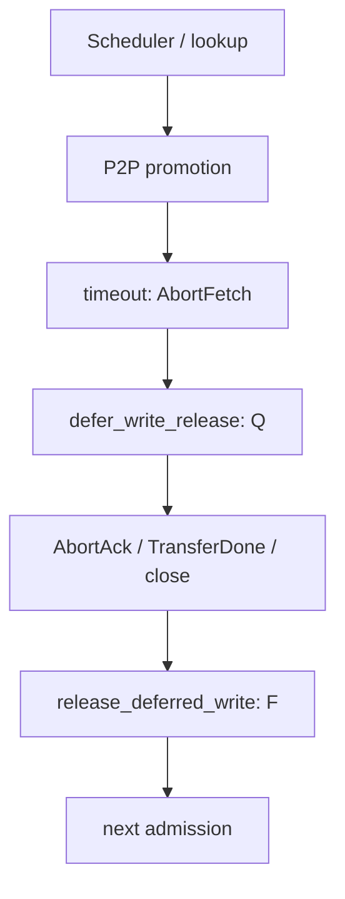
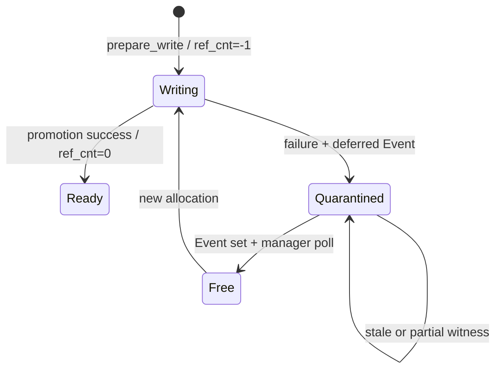

> 源码基线：[`555ae7d1`](https://github.com/vllm-project/vllm/commit/555ae7d1d1989dbf21abb6cee96d8f2cf810ff74)，研究时 `vllm-project/vllm` 默认分支最新提交。相对第 85 章基线前进 [103 个提交](https://github.com/vllm-project/vllm/compare/c07d58dc82d75f7d1a947b3264b460384ec3e18d...555ae7d1d1989dbf21abb6cee96d8f2cf810ff74)，直接相关的 tiering/P2P 文件未改变。deferred-release 主机制由已合入的 [PR #63779](https://github.com/vllm-project/vllm/pull/63779) 与 [PR #64256](https://github.com/vllm-project/vllm/pull/64256) 建立；开放 [PR #63551](https://github.com/vllm-project/vllm/pull/63551) 仍只作相邻主题的计划证据。

## 本篇在课程路线中的位置

第 85 章得到 `H_guaranteed = |F| + |E \ P| - A`：quarantined chunk 已经不在 free/evictable 集合，不能算作可承诺余量。今天只追问一个边界：**什么证据、在哪个线性化点，允许 held chunk 重新进入 `F`，从而让 Guaranteed Headroom 增长？**

课程位置：

`P2P timeout → failed promotion → deferred release → backend fence → free-list re-entry → next admission`

## 前置知识回顾

promotion 是 secondary→CPU primary 的异步写。超时只能证明“等待太久”，不能证明 peer 已停止写目标内存。因此 key 可以立刻变成 `MISS`，但底层 chunk 还不能复用。本文沿用 `Q` 表示这组 held/deferred chunks；它是分析名，当前代码类型仍叫 `_DeferredRelease`。

必须区分三个事实：

- **逻辑失败**：旧 key 已从 policy 删除，后续 lookup 返回 `MISS`；
- **writer closure**：`AbortAck`、`TransferDone` 或 session close 使 `Event` set；
- **容量生效**：manager 消费 Event，调用 `release_deferred_write()`，chunk 才进入 free list。

## 本篇要回答的核心问题

1. 当前代码把哪个 Event 当作 release witness，它能证明什么？
2. 为什么 `Event.is_set()` 还不是跨进程、跨 backend reset 的 generation fence？
3. 怎样用 deterministic Recovery Golden 证明 stale、partial、duplicate witness 都不会多释放容量？

## 组件在全局架构中的位置



上游输入是 `OffloadKey`、目标 `chunk_id` 和 P2P request/round；下游消费者是下一次 promotion/store allocator。数据 shape 不在控制层改变：primary backing memory 是固定 chunk pool，每个 job 只携带 chunk IDs；dtype/device 由实际 KV cache 配置决定，P2P control path 只管理所有权与可复用性。

## 完整调用链

公开入口仍从 [`Scheduler.schedule()`](https://github.com/vllm-project/vllm/blob/555ae7d1d1989dbf21abb6cee96d8f2cf810ff74/vllm/v1/core/sched/scheduler.py) 的 connector prefix lookup 开始，经 `OffloadingConnectorScheduler` 进入 [`TieringOffloadingManager.lookup()`](https://github.com/vllm-project/vllm/blob/555ae7d1d1989dbf21abb6cee96d8f2cf810ff74/vllm/v1/kv_offload/tiering/manager.py#L713)。secondary HIT 会预留 primary chunk 并提交 P2P load。

P2P client 的 [`_InboundLoadState`](https://github.com/vllm-project/vllm/blob/555ae7d1d1989dbf21abb6cee96d8f2cf810ff74/vllm/v1/kv_offload/tiering/p2p/session/client.py#L45) 由 `(kv_request_id, round_seq)` 持有，记录 `job_id/submitted_at/timeout_s/aborted_at/release`。load 超过 10 秒（symmetric P2P）或 30 秒（PD）时，`collect_results()` 调用 `_abort_load()`：发送 `AbortFetch`，创建 `threading.Event`，并立即上报 `LoadResult(success=False, deferred_release=event)`。

manager 在 [`_complete_promotion()`](https://github.com/vllm-project/vllm/blob/555ae7d1d1989dbf21abb6cee96d8f2cf810ff74/vllm/v1/kv_offload/tiering/manager.py#L553) 对失败 key 调用 `defer_write_release()`：删除 key→chunk mapping，但把 chunk ID 放入 `_deferred_release_chunk_ids`，保持 write-pending，不进 free list。随后 `_DeferredRelease(event, tier_idx, chunk_ids, deferred_at)` 进入 `_deferred_releases`。

每步 lookup 或 `on_schedule_end()` 会经 `_process_finished_jobs()` 调用 [`_complete_deferred_releases()`](https://github.com/vllm-project/vllm/blob/555ae7d1d1989dbf21abb6cee96d8f2cf810ff74/vllm/v1/kv_offload/tiering/manager.py#L660)。只有 `event.is_set()` 才 pop 记录，再进入 `release_deferred_write()`：

```text
held.remove(chunk_id)
write_pending -= 1
free_list.append(chunk_id)
```

这最后一行是当前进程内 allocator 可见的线性化点；下一次 `prepare_write()` 才能消费它。

## 关键类型、字段和状态生命周期



`defer_write_release()` 的前置条件是每个 key 仍存在且 `is_ready == False`；否则 assertion 失败，因为 missing/ready 意味着 manager 无法证明正在 hold 的正是旧 writer 可能触及的 chunk。后置条件是 key MISS、chunk 仍占容量。`release_deferred_write()` 的前置条件则是 chunk ID 必须在 held set；重复 release 会在 `remove()` 处失败，而不是静默重复 append。

并发假设也很关键：P2P transport/thread 可以 set Event，但 free-list mutation 只在 manager poll 路径执行。`AbortAck` 和 `TransferDone` 都会 set；AbortAck 5 秒仍不到，session 被标故障并断开，`close()` 再 set 所有已经报告失败的 release Event。这个机制把“异步证据到达”和“allocator mutation”分线程，避免 transport 线程直接修改 policy。

## 逐函数源码解读

[`ClientRole._abort_load()`](https://github.com/vllm-project/vllm/blob/555ae7d1d1989dbf21abb6cee96d8f2cf810ff74/vllm/v1/kv_offload/tiering/p2p/session/client.py#L197) 先发送 abort，再创建 Event、上报失败。顺序意味着消费者可以尽早 recompute；容量则继续 held。

[`on_transfer_done()`](https://github.com/vllm-project/vllm/blob/555ae7d1d1989dbf21abb6cee96d8f2cf810ff74/vllm/v1/kv_offload/tiering/p2p/session/client.py#L386) 与 [`on_abort_ack()`](https://github.com/vllm-project/vllm/blob/555ae7d1d1989dbf21abb6cee96d8f2cf810ff74/vllm/v1/kv_offload/tiering/p2p/session/client.py#L421) 都先从 `loads[round_seq]` pop，再 set Event，因此同一 load 的正常终止/abort ack 只能消费一次。duplicate message 只 warning。

[`CPUPrimaryTierOffloadingManager.defer_write_release/release_deferred_write`](https://github.com/vllm-project/vllm/blob/555ae7d1d1989dbf21abb6cee96d8f2cf810ff74/vllm/v1/kv_offload/tiering/manager.py#L182) 则实现 logical mapping 与 physical chunk 的分离。`reset_cache()` 明确断言 held set 必须为空；外层 reset 会先 `tier.drain_jobs()`、处理完成通知，并要求 `_deferred_releases` 为空，宁可阻塞也不重用仍可能被晚到 WRITE 触及的地址。

## 具体示例与 shape/状态演算

设 CPU primary 有 6 个 chunk，每块 64 KiB，总容量 384 KiB：`E={A,B}`、`P_step={A}`、`Q={C,D}`、`W={E}`、`F={F}`。当前 Guaranteed Headroom 为：

$$H_g=|F|+|E\setminus P|-A=1+1-0=2\text{ chunks}=128\text{ KiB}$$

job 41 对 `C,D` 的 P2P load 超时。key 立即 MISS，但 `Q` 仍是 2 块；此时把 Q 加回公式会虚增 128 KiB。随后只收到 `C` 的终止证据，也不能释放整个 job：若 release unit 按 job/chunk-set 绑定，`D` 的 writer 仍可能覆盖新数据。

当前实现用一个 job Event 表达 all-or-nothing closure；Event set 后 manager 依次把 `C,D` append 到 free list，`H_g` 从 2 增至 4。若进程恰在释放 `C` 后崩溃，内存状态消失，main 没有 durable record 判断 `C` 已释放而 `D` 未释放。这就是 in-process witness 与 recovery fence 的边界。

建议的跨崩溃 release witness 至少绑定：

```text
(backend_id, session_generation, transfer_id,
 allocation_generation, region_nonce, chunk_ids,
 closure=NO_OLD_WRITER, issuer_epoch, witness_id)
```

allocator 只接受 generation/nonce 与当前 quarantined charge 完全匹配的 witness，并以 `witness_id` 做幂等 CAS。成功的 CAS 才令 `Q→F`、增加 `H_g`；旧 generation 11 的 ack 不能关闭 generation 12 的 slot，即使物理地址相同。

## 为什么这样设计及替代方案

当前 Event 设计对单进程很精炼：失败快速可见，writer closure 与 free-list mutation分离，额外成本只是 set/dict/Event。它没有为未发生的持久恢复支付 WAL 成本。

替代方案一是 timeout 到点直接 free，延迟最低，却允许 late WRITE 覆盖新租户数据，错误不可接受。替代方案二是永不释放/重启即丢弃整个 pool，安全但会把短暂网络故障永久转为容量泄漏。最小充分的 durable 方案是：scoped generation fence 证明旧 writer 失权，allocator 用 generation-aware、idempotent CAS 应用 release，再把结果写入可重放 ledger。它增加控制面 I/O和维护成本，却不改变 GPU graph shape/device address，graphability 基本不受影响。

## 性能、并发、正确性与边界条件

- **延迟/吞吐**：key 先 MISS 让 recompute 继续；chunk 晚释放会暂时降低 promotion 吞吐，但避免全局 stall。
- **显存/主存**：影响的是 CPU primary capacity，而非 GPU KV shape；held bytes 必须继续计入占用。
- **并发**：witness 验证与 capacity reservation 必须共享 allocator revision，否则两个 admission 可同时消费刚释放的同一 chunk。
- **失败方式**：Event 永不 set 会表现为 pending work；AbortAck timeout 会断 session，由 close 释放。跨进程恢复若缺 witness，应 fail-closed 留在 Q，不能靠 TTL 猜测。
- **正确性**：partial witness 只释放其被 allocator 独立建模的 subcharge；共同 allocation unit 不允许拆放。duplicate/stale/conflicting witness 均不得改变 free count。

## 测试证据与未覆盖风险

[`test_deferred_release_misses_but_holds_chunks_until_released`](https://github.com/vllm-project/vllm/blob/555ae7d1d1989dbf21abb6cee96d8f2cf810ff74/tests/v1/kv_offload/tiering/test_tiering_offloading.py#L723) 用 2 个 key：失败后两者均 MISS、held=2、free 比之前少2；重复 poll 不释放；set Event 后 held/pending 清零、free 恢复，hold histogram 才出现一个完成样本。

相邻测试验证旧 chunk held 时同 key restore 必须拿 fresh chunk；3-key partial failure 中成功项 HIT、仅两个失败项 held。P2P 集成测试 [`test_timed_out_load_holds_chunks_until_abort_ack`](https://github.com/vllm-project/vllm/blob/555ae7d1d1989dbf21abb6cee96d8f2cf810ff74/tests/v1/kv_offload/tiering/p2p/test_manager.py#L651) 建 4-chunk primary，将 fake clock 推过 PD timeout：job 失败、key MISS、held=1、free 不变；注入 `AbortAck(req-1, round=0)` 后 held=0、free 精确加1。

这些是**当前测试事实**：证明进程内 no-early-reuse 与 exact-once message consumption。它们没有覆盖进程在 `held.remove/pending--/free.append` 任一边界崩溃、stale generation、address ABA、重复 witness 重放、partial backend reset 或持久 ledger。

建议 Recovery Golden 使用 fake allocator + crash matrix：在 `WITNESS_DURABLE`、`CAS_APPLIED`、`RELEASED_DURABLE` 三个边界逐一崩溃并重放；每步断言 `allocated + quarantined + free = physical`、free IDs 唯一、旧代 witness 无效、duplicate witness 不增 free、partial scope 仍 held。任何一项失败都说明 headroom 被双计。

## 与前后章节的连接

第 85 章定义如何消费 Guaranteed Headroom；本章定义 Q 何时能安全加入它。第 81–82 章给出的 certificate/intent/CAS 在这里落到真实 P2P Event 与 free-list 线性化点上：Event 是当前进程的 release witness，却不是 durable generation fence。

## 本篇结论、知识债、三个理解检查问题和下一章

结论：当前 main 的安全点不是 timeout，也不是 key MISS，而是 peer closure 使 Event set、manager 随后把 chunk 放回 free list。这个协议对单进程成立；跨崩溃要把 Event 扩展为带 generation/region identity 的 durable witness，并让 allocator CAS 成为唯一容量提交点。

知识债：backend 的正式 `NO_OLD_WRITER` 契约；witness issuer authority；multi-rank/subcharge 粒度；WAL/fsync 成本；真实 NIXL/UCX late-WRITE 与 restart fault injection；Recovery Golden 尚未进入 main。

理解检查：

1. 为什么 timeout 后 key 可以立即 MISS，但 chunk 不能立即 free？
2. `Event.set()` 与 `free_list.append()` 分别证明/改变了什么？
3. 为什么同一地址上的旧 generation AbortAck 不能释放新 allocation？

下一章：**Capacity Revision 怎样防止释放后被双重预订——Waiter Queue、Lost Wakeup 与 Fair Retry Golden。**

## 课程账本增量

本章以 `555ae7d1` 为基线，新增覆盖 `_InboundLoadState/_abort_load/on_abort_ack/close`、`_DeferredRelease/_complete_deferred_releases`、`defer_write_release/release_deferred_write` 及两组 direct tests；确认 in-process Event 的证据边界，补齐 `Q→F→H_guaranteed` 的线性化链，并把 durable generation fence、allocator CAS 与 crash-replay Golden 记入知识债。
