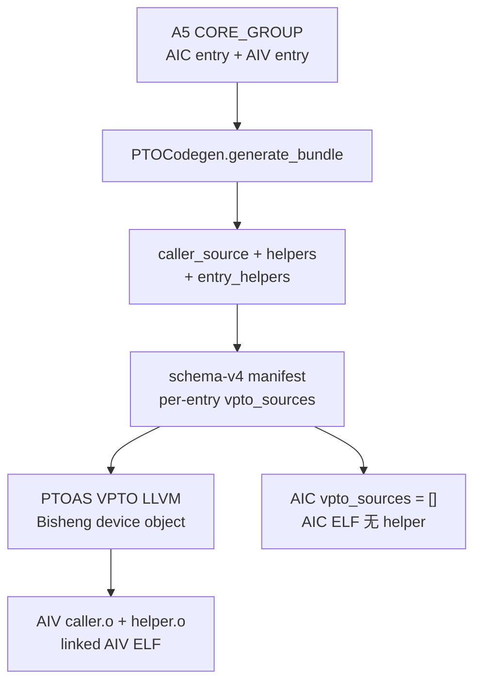
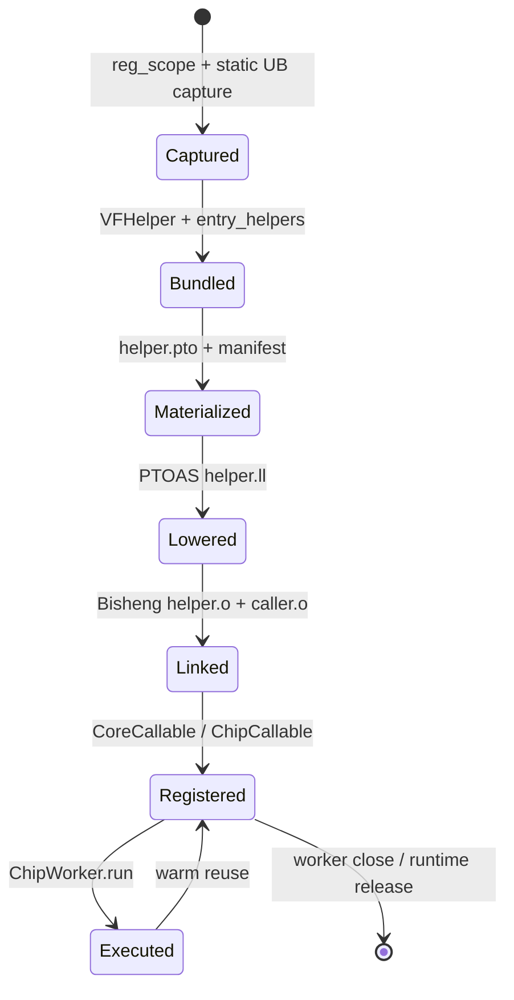

## 本篇在 PTO 课程路线中的位置

这是 PTO 全栈课程第 97 章。课程 92–96 暂时离开设备生成链，补完了 Host Artifact 的共享构建、generation、reader pin 与崩溃恢复建议协议；本章回到**已经合入且可执行**的主链，只回答一个问题：mixed `AIC + AIV` group 中，由 `reg_scope` 生成的 VF helper，怎样从 PyPTO 代码生成一路只跟随 AIV 进入设备 ELF，而不会误绑到 AIC。

分析基线：

- PyPTO [`d0127ff79cc0`](https://github.com/hw-native-sys/pypto/commit/d0127ff79cc0e829e420cd01ffded5f4084cdadb)
- PTOAS [`e26c3f2af051`](https://github.com/hw-native-sys/PTOAS/commit/e26c3f2af0517a37b71319e2b86ba452eeeecc3a)
- 直接功能合入：PyPTO [PR #3416](https://github.com/hw-native-sys/pypto/pull/3416)，merge commit [`afa2f8358aac`](https://github.com/hw-native-sys/pypto/commit/afa2f8358aac63727e74ca4ebb8f8e3861a1b921)

本文把“当前代码事实”“测试事实”“PR 验证记录”和“性能推断”分开陈述。

## 前置知识

前面课程已经建立三个概念：

1. `CORE_GROUP` 可以把一个 AIC 函数与一个 AIV 函数组成同一逻辑 kernel；AIC 负责 Cube 计算，AIV 负责 Vector 计算。
2. `reg_scope` 把一段寄存器级 Vector 工作圈起来，PyPTO 可把它提取成独立 VF helper；helper 操作的是 A5 AIV 的 UB 指针、标量与寄存器操作，不是新的 Host callable。
3. group 名称是**编译组织名**，真正被 runtime 调用的是 group 内的 AIC/AIV entry。若把 helper 依赖挂到 group 名，运行时无法知道该把它链接进哪个 core 的二进制。

## 今日两个紧密相连的核心问题

1. `PTOCodegenBundle.entry_helpers` 精确保存了什么，为何“空列表”也有语义？
2. helper 的 `.pto` 文件怎样被 PTOAS 降到 LLVM，再与 caller object 链成只属于 AIV 的 ELF？

第二问是第一问的消费者：没有 entry 级归属，独立编译只会把一个大文件拆成若干小文件，却没有正确链接依据。

## PTO 全栈中的位置

上游输入是 PyPTO memory planner 已经分配好静态 local UB 的 A5 AIV function；下游消费者是 PyPTO runtime compiler 与 PTOAS VPTO backend。完整边界如下：



这里没有让 PTOAS 理解“group”。PyPTO 在进入 PTOAS 之前已经把 group ownership 消解成两个 entry 的依赖清单；PTOAS 只负责编译每个 self-contained AIV helper。

## 概念和精确语义

### `VFHelper`：可独立编译的 helper 描述

[`pto_codegen.h`](https://github.com/hw-native-sys/pypto/blob/d0127ff79cc0e829e420cd01ffded5f4084cdadb/include/pypto/codegen/pto/pto_codegen.h) 中的 `VFHelper` 至少带有：

- `symbol` 与 `adapter_symbol`：独立函数符号及 caller 侧 adapter；
- `source`：完整 helper PTO source；
- `parameter_types` / `caller_parameter_types`：callee 与 caller ABI 类型；
- `parameter_effects`：参数是 read、write 还是 read-write；
- `parameter_indices`：helper 第 i 个参数来自 caller 的哪个参数；
- `capture_byte_offsets`：共享 UB base 上的静态 byte offset；标量/SIMT 参数用 0。

这里的 UB pointer 是 `!pto.ptr<dtype, ub>`；它是借用地址，不拥有 allocation。helper 的合法前置条件是：capture 已由 PyPTO planner 落到静态 local UB，offset 可确定，且 target 是 A5 AIV。parameter-backed Tile、直接 FIFO capture、CPU simulation、Bridge/Host dependency 以及 grouped SIMT 当前都不是该路径的合法输入。

### `PTOCodegenBundle`：产物加归属，而非“字符串列表”

同一头文件定义：

```cpp
struct PTOCodegenBundle {
  std::string caller_source;
  std::vector<VFHelper> helpers;
  std::map<std::string, std::vector<std::string>> entry_helpers;
};
```

`entry_helpers[entry]` 的 key 采用排序稳定的 `std::map`；value 按 helper 首次使用顺序保存符号，并去重。重要的是：受支持的 entry 即便不使用 helper，也会通过 `try_emplace` 留下空列表。因此 mixed group 的结果不是“只出现 AIV”，而是：

```text
AIC_entry -> []
AIV_entry -> [__pypto_vf_AIV_entry_0, ...]
```

“空”证明 AIC 已被分析且无依赖；“缺失”则可能表示 entry 不在支持集合或生成阶段未覆盖。把两者混为一谈，会把遗漏悄悄伪装成无依赖。

## 真实文件、类型、API 或指令逐段解读

### 1. `GenerateBundle` 建立本次生成的封闭状态

[`pto_codegen.cpp`](https://github.com/hw-native-sys/pypto/blob/d0127ff79cc0e829e420cd01ffded5f4084cdadb/src/codegen/pto/pto_codegen.cpp) 的 `GenerateBundle` 打开 `separate_vf_`，调用 `GenerateImpl`，返回 caller、helper 与 ownership map。每次 `GenerateImpl` 先清空 `vf_helpers_`、`entry_helpers_` 和 dedupe set，失败或下一次生成不会继承旧 helper。

支持集合是严格的：单个 incore function，或恰好两个 function 且为 `1 AIC + 1 AIV`。对每个支持 entry，代码先创建 map 项，再生成函数。`RecordEntryHelperUse` 只有在当前函数也是合法 entry 时才记录 `(entry, symbol)`，set 负责去重，vector 保留首次出现顺序。

### 2. `vf_codegen.cpp` 拆出 callee，caller 只留 adapter call

[`vf_codegen.cpp`](https://github.com/hw-native-sys/pypto/blob/d0127ff79cc0e829e420cd01ffded5f4084cdadb/src/codegen/pto/vf_codegen.cpp) 为第 i 段生成 `__pypto_vf_<entry>_<i>` 与 `_tile_adapter`。helper module 标记 `pto.aiv`；caller 侧不内联寄存器指令，而是调用 adapter。adapter 的 effect contract 使 PTOAS 能在 helper 内做 dependency/sync placement，kernel-tail 同步仍由 caller 所在主链承担。

### 3. backend 把 ownership 投影为 artifact

[`pto_backend.py`](https://github.com/hw-native-sys/pypto/blob/d0127ff79cc0e829e420cd01ffded5f4084cdadb/python/pypto/backend/pto_backend.py) 的 `_generate_pto_bundle` 再次拒绝 grouped SIMT、非 `1 AIC + 1 AIV` group，以及未使用 PyPTO planner 的 VF。`_emit_unit` 写出：

- `vpto/<group>/<helper.symbol>.pto`
- schema version 4 manifest，含 helper hash、types/effects/offsets、`entry_helpers`
- 每个真实 entry 的 `kernel_config.vpto_sources`

关键投影是按 `func.name` 查 `unit.entry_helpers`，而不是按 group name。AIC 的空列表不会写 `vpto_sources`；AIV 得到对应 helper 路径。

### 4. PTOAS 只负责 helper 的 VPTO lowering

[`kernel_compiler.py`](https://github.com/hw-native-sys/pypto/blob/d0127ff79cc0e829e420cd01ffded5f4084cdadb/python/pypto/runtime/kernel_compiler.py) 先编译 caller，再逐 helper 执行：

```text
helper.pto
  -- PTOAS: --pto-backend=vpto --emit-vpto-llvm-ir
  --> helper.ll
  -- Bisheng device compile
  --> helper.o
```

随后用固定 entry 与 symbol-order 文件把 `caller.o + helper.o...` 链成 ELF，再校验 device image。PTOAS [`ptoas.cpp`](https://github.com/hw-native-sys/PTOAS/blob/e26c3f2af0517a37b71319e2b86ba452eeeecc3a/tools/ptoas/ptoas.cpp) 暴露 `--emit-vpto-llvm-ir`、`--vmi-fastmath=false` 与 vecscope memory-barrier 选项；[`driver.cpp`](https://github.com/hw-native-sys/PTOAS/blob/e26c3f2af0517a37b71319e2b86ba452eeeecc3a/tools/ptoas/driver.cpp) 允许 VPTO LLVM text job 不依赖内置 device toolchain。PyPTO 随后自己调用相邻 Bisheng，工具版本与 helper 内容共同进入缓存 identity。

## 对象与 artifact 生命周期



所有权分为三层：

- `PTOCodegenBundle` 拥有内存中的 source/metadata；
- emitted artifact 目录拥有不可变 `.pto`、manifest 与 config；
- runtime callable/worker 拥有已编译、已注册的执行句柄，但不反向拥有或修改 source。

[`device_runner.py`](https://github.com/hw-native-sys/pypto/blob/d0127ff79cc0e829e420cd01ffded5f4084cdadb/python/pypto/runtime/device_runner.py) 读取每个 entry 的 config，只有非空 `vpto_sources` 才进入 helper compile。AIC 与 AIV 分别形成二进制，随后组装为 `ChipCallable`。[`worker.py`](https://github.com/hw-native-sys/pypto/blob/d0127ff79cc0e829e420cd01ffded5f4084cdadb/python/pypto/runtime/worker.py) 在 register 时惰性触发 compile/assemble，缓存 callable id；run 消费它，close 释放 runtime registration。编译临时目录在 build 后清理，artifact source 可供冷启动或 cache invalidation 重建。

失败方式包括：PTOAS 缺失/版本过低、helper 声明非 intrinsic 外部符号、出现不支持的 SIMT inline asm、Bridge dependency、Bisheng 编译/链接失败或 ELF 留有 unresolved symbol/relocation；这些都在注册执行前 fail closed。

## 端到端调用链或指令链

以 AIV 的一段寄存器加法为例，真实链可压缩为：

```text
reg_scope
→ PTOCodegen::GenerateBundle
→ GenerateVF / RecordEntryHelperUse
→ _generate_pto_bundle
→ _emit_unit(helper.pto, manifest, entry_helpers)
→ _generate_config_file(AIV.vpto_sources)
→ DeviceRunner._compile_kernel
→ compile_incore
→ _compile_vpto_helpers
→ PTOAS VPTO LLVM
→ Bisheng helper.o
→ link caller.o + helper.o
→ CoreCallable → ChipCallable → ChipWorker.run
```

数据链则是 `local UB Tile → helper vload → vadd/vmul → helper vstore → caller 后续 store`。helper 不从 GM 自行重新加载完整 Tensor，也不跨 core 持有 Tile；它借用 caller 已规划的 local UB region，调用结束后寄存器值失效，UB 内容继续归 caller 的 buffer lifetime 管理。

## 具体 shape、Tile 和状态演算

直接系统测试 [`test_mixed_reg_onboard.py`](https://github.com/hw-native-sys/pypto/blob/d0127ff79cc0e829e420cd01ffded5f4084cdadb/tests/st/runtime/vpto/test_mixed_reg_onboard.py) 使用 `a,b,dst: [32,32] BF16`：

1. AIC 把两个 `32×32` Tile 送入 Matmul，结果 cast 回 BF16，再转给 Vector 路径。语义元素数为 `1024`，payload 为 `1024×2 = 2048 B`。
2. AIV 将其 reshape 为 `[1024]`。单 AIV variant 的 `reg_scope` load 64 个 BF16 元素，即 128 B；执行 `x+x`，再写回同一 UB 前 64 元素。bundle 产生一个 helper。
3. 双 AIV variant 中，每个 lane 获得 `[16,32] = 512` 个 BF16。第一个 helper 处理全局区间 `[0,64)` 并做 double；第二个处理 `[64,128)` 并做 square。bundle 产生两个 helper，二者都归同一个 AIV entry。
4. config 中恰有 AIC/AIV 两项：`AIC.vpto_sources=[]`，`AIV.vpto_sources=[h0.pto]` 或 `[h0.pto,h1.pto]`。
5. 链接后 AIC ELF 不应出现 `__pypto_vf_`；AIV ELF 包含 helper 且无 unresolved symbol/relocation。最终 `dst` 仍是 `[32,32] BF16`，测试逐元素比较全部 1024 个元素，而不只检查前 64/128 个。

这个例子也说明 `capture_byte_offsets` 的作用：helper 不需要携带一个新 Tensor descriptor；它以共享 UB base 加静态 byte offset 定位 lane 所属片段。若 offset 不能静态证明，当前实现拒绝，而不是在 device 上猜测。

## 为什么这样设计及替代方案

### 当前设计：caller 与 helper 独立编译，entry 级链接

优点：

- **正确性**：AIC/AIV 依赖不串线，空 ownership 可显式验证；
- **缓存粒度**：helper 内容改变时，测试证明只重编 AIV，AIC cache 保持命中；
- **维护性**：PyPTO 管理 group/entry 语义，PTOAS 保持单个 VPTO module 的职责；
- **graphability**：最终仍是稳定的 AIC/AIV device ELF 与 callable，warm run 不需要重新做 codegen。

代价是更多小文件、一次额外 PTOAS/Bisheng job 与 device link，manifest/schema 也成为 ABI。短 kernel 下冷编译延迟可能上升。

### 替代一：把 helper 源码内联回 caller

它能减少 artifact 数量与链接步骤，也可能让编译器看到更大的优化范围；但 mixed group 中必须先拆分 AIC/AIV module，且 helper 小改会扩大 cache invalidation，caller 代码也混入 register/VMI lowering 细节。现有 `generate()` 保留 combined 形式用于诊断，runtime 选择 bundle，正是在“可读诊断”与“精确产物归属”之间分层。

### 替代二：helper 依赖挂到 group name

实现最简单，却没有可执行语义：group 自身不是 callable。后端要么把 helper 同时链接到 AIC/AIV，增加错误与体积；要么任意选择一方。`entry_helpers` 是解决这一歧义所需的最小关系，而不是冗余 metadata。

## 访存、计算、流水、并行和硬件约束

- **访存**：寄存器段复用已经位于 UB 的 Tile，避免重新走 GM；但 helper 的 read/write effect 必须覆盖真实 UB footprint，否则同步分析可能漏 RAW/WAR/WAW。
- **计算**：64×BF16 的例子映射为 AIV vector register 操作；公开代码能确认 VMI/VPTO 指令与 AIV target，不能据此断言具体物理 issue width 或 cycle。
- **流水**：PyPTO helper 编译显式启用 PTOAS sync insertion/vecscope memory barrier contract；PTOAS 测试 [`vecscope_membar_all.pto`](https://github.com/hw-native-sys/PTOAS/blob/e26c3f2af0517a37b71319e2b86ba452eeeecc3a/test/lit/vpto/vecscope_membar_all.pto) 证明开关会在 Vector/Scalar UB access 周围生成不同 barrier。该测试证明 pass 行为，不等于证明 mixed kernel 的最优 stall。
- **并行**：dual AIV 是两个 vector lane 对同一 AIV entry 的 helper 依赖集合，不是两个 Host callable。它们必须使用不重叠、静态规划的 UB 片段。
- **资源**：当前路径要求 local UB capture；直接 FIFO capture 和动态 borrowed pointer lifetime 没有进入 manifest 的可验证所有权模型。

基于证据的推断：独立 helper 可缩小增量编译失效域，系统测试已证明“改 helper 只重编 AIV”；但 cold compile 总时延、ELF 体积、link time 与 instruction-cache 影响仍无公开 benchmark，不能仅凭结构宣称端到端更快。

## 测试证据与未覆盖风险

### 当前测试事实

[`test_reg_bundle.py`](https://github.com/hw-native-sys/pypto/blob/d0127ff79cc0e829e420cd01ffded5f4084cdadb/tests/ut/codegen/test_reg_bundle.py) 验证：

- bundle 恰有一个 helper，`entry_helpers` 精确归属；
- caller 只含 adapter，helper 含 `vadd/vstore` 与 UB pointer/effect metadata；
- 重复生成 deterministic，空生成与失败生成不会泄漏上次状态；
- schema-v4 manifest 的 types/effects/offsets/hash 与 bundle 一致；
- 过低 PTOAS version 在 artifact emission 前被拒绝；
- parameter-backed Tile capture 被拒绝。

PTOAS [`vmi_ptoas_cli_pipeline.pto`](https://github.com/hw-native-sys/PTOAS/blob/e26c3f2af0517a37b71319e2b86ba452eeeecc3a/test/lit/vmi_new/vmi_ptoas_cli_pipeline.pto) 用 A5 VPTO 输入检查 VMI broadcast/load/convert/store 被降为 `pto.vecscope`、`vdup/vlds/vcvt/vsts`，并区分 fastmath 与 strict lowering。它证明 helper 所依赖的 VMI→VPTO CLI pipeline，而不证明 PyPTO ownership。

前述 mixed onboard 系统测试同时验证 config、manifest、compile 参数、ELF 符号/relocation、冷/暖 cache 行为与完整 1024 元素结果。PR #3416 记录的环境事实是：focused UT 377 passed；Ascend 950DT 上 single/dual 两个硬件 case 通过，共做 64 次完整输出比较。PR 同时明确没有宣称整个 UT suite 因无关环境问题全绿。

### 未覆盖风险

1. direct FIFO capture、动态 UB offset、parameter-backed Tile 与更宽 group 当前是明确拒绝，不是“尚未优化”。
2. helper ABI/schema 的跨 PyPTO/PTOAS 版本兼容、tool upgrade cache migration 与损坏 manifest 恢复尚缺组合矩阵。
3. `parameter_effects` 写小、alias view、两个 helper overlap、异常退出与 runtime reset 的负向测试仍不足。
4. 缺少 cold compile/link 时间、AIV ELF 增量体积、barrier stall 与 single/dual lane 真机性能对照。

## 与前后章节的连接

向前看，课程 92–96 讨论的是 source artifact 的 durable ownership 与崩溃恢复；本章展示了一个具体设备 artifact 包：helper source/hash/config 进入缓存 identity，最终变成可注册 ELF。两条线现在接上了。

向后看，第 98 章将继续沿 `adapter_symbol → parameter_indices/capture_byte_offsets → parameter_effects → PTOAS sync` 深挖 helper ABI 与同步证明，并在正常新章后追加课程 92–98 的七章知识图谱回顾。

## 本篇结论、知识债、理解检查与下一章

结论只有一句：**helper 能独立编译，不等于它能正确执行；真正闭合 mixed group 的是 `entry_helpers` 把 helper artifact 精确绑定到 AIV entry，再由 per-entry `vpto_sources` 驱动独立 lowering 与链接。**

新增知识债：direct FIFO/动态 capture ownership、helper ABI 版本矩阵、overlap/effect 负向测试、cold compile 与 barrier 性能数据。

三个理解检查问题：

1. 为什么 `AIC_entry -> []` 比 AIC key 缺失提供了更强的正确性证据？
2. helper source 改变后，为什么 AIC 不应重新编译，而 AIV 必须重新编译？
3. 如果 `capture_byte_offsets` 无法静态确定，为什么当前 fail closed 比传入动态裸指针更合理？

下一章：**Grouped A5 VF adapter ABI：`parameter_indices`、UB byte offset、effect 与 PTOAS 同步怎样组成一份可验证调用契约**；文末追加课程 92–98 知识图谱回顾。

## 课程账本增量

- 第 97 章；阶段从 Host Artifact recovery 回到已合入 Python IR → PTOAS → runtime/device 主链。
- 新增仓库基线：PyPTO `d0127ff7`，PTOAS `e26c3f2`。
- 新覆盖：`VFHelper`、`PTOCodegenBundle`、`GenerateBundle`、`RecordEntryHelperUse`、`_generate_pto_bundle`、`_emit_unit`、`vpto_sources`、`_compile_vpto_helpers`、PTOAS VPTO text job、device link 与 `ChipWorker` 注册执行。
- 新不变量：helper ownership 必须落到真实 entry；empty 与 missing 不等价；A5 VF helper 只允许静态 local UB capture；mixed group 中 AIC 无 helper，AIV 独立编译并链接全部归属 helper；helper 失败必须在 runtime 注册前 fail closed。
- 新测试证据：bundle/manifest deterministic 与隔离、VMI→VPTO CLI lowering、mixed single/dual AIV config/ELF/cache/1024 元素完整结果。
- 下一章按 adapter ABI 与同步证明继续，并执行七章知识图谱回顾。
