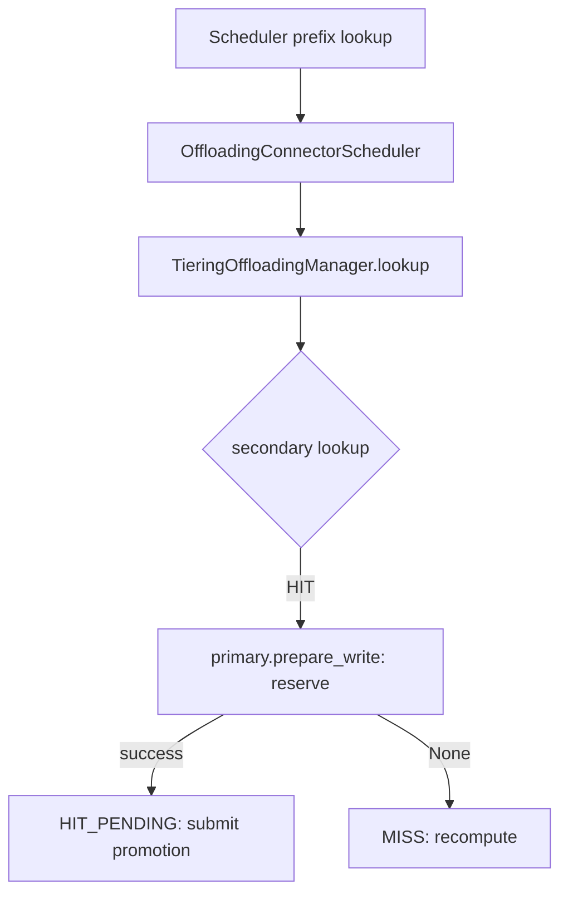

> 源码基线：[`a16bfee1`](https://github.com/vllm-project/vllm/commit/a16bfee11b92f1809628a8bd1f4bd70cdcb9b576)，研究时 `vllm-project/vllm` 默认分支最新提交。相对第 86 章基线前进 [46 个提交](https://github.com/vllm-project/vllm/compare/555ae7d1d1989dbf21abb6cee96d8f2cf810ff74...a16bfee11b92f1809628a8bd1f4bd70cdcb9b576)，直接相关的 CPU/tiering/offloading Scheduler 文件未改变。deferred release 的历史设计与测试证据来自已合入的 [PR #63779](https://github.com/vllm-project/vllm/pull/63779) 和 [PR #64256](https://github.com/vllm-project/vllm/pull/64256)。

## 本篇在课程路线中的位置

第 86 章确认：`release_deferred_write()` 把 held chunk 放回 `_free_list`，才真正恢复 headroom。今天只追问紧接着的一个问题：**容量刚恢复时，多个请求怎样避免把同一块容量都当成自己的？如果决定等待，怎样避免 release 恰好发生在“检查失败”和“开始睡眠”之间？**

课程位置：

`deferred release → free-list re-entry → promotion admission → MISS/recompute`；本文最后再推导可选的 `revision → waiter ticket → reserve → retry` 扩展。

## 前置知识回顾

CPU primary 是 secondary 与 GPU 之间的 staging tier。secondary 命中并不等于可直接加载到 GPU：`TieringOffloadingManager` 必须先在 primary 预订 chunk。`CPUOffloadingManager` 将空间分成 fresh、free、ready/evictable、read-pinned、write-pending 与 deferred-held；只有 fresh/free，或在同一 admission 中实际选中的 evictable victim，才是可交付容量。

## 本篇要回答的核心问题

1. primary 满时，secondary 的 `HIT` 为什么被改写为 `MISS`，而不是 `RETRY`？
2. 当前实现靠什么避免双重预订；它有没有 waiter、唤醒或公平性承诺？
3. 如果未来确实要等待容量，什么协议才能同时避免 lost wakeup、重复 reservation 与 starvation？

## 组件在全局架构中的位置

这是 Scheduler 控制面的 admission 决策，不搬运 tensor。`OffloadKey` 标识一个固定大小的 KV chunk；`CPULoadStoreSpec.chunk_ids` 是 CPU primary 中的物理槽位编号。真实 KV 的 dtype、attention shape 与 device buffer 由 cache 配置和 worker 管理，`lookup/_prepare_store` 本身只处理 key、状态和 slot ownership。



## 完整调用链

公开入口在 [`OffloadingConnectorScheduler.get_num_new_matched_tokens`](https://github.com/vllm-project/vllm/blob/a16bfee11b92f1809628a8bd1f4bd70cdcb9b576/vllm/distributed/kv_transfer/kv_connector/v1/offloading/scheduler.py)。它第一次触碰 manager 时调用 `_acquire_step()`，从 lookup 一直持有 `manager.lock`，到 `build_connector_meta()` 的 `finally` 才释放。注释明确说 manager 方法自身不加锁；Scheduler 线程与 tier-poll 线程的互斥边界在这里。

随后 `_maximal_prefix_lookup()` 逐 key 调用 `manager.lookup()`。在 [`TieringOffloadingManager.lookup`](https://github.com/vllm-project/vllm/blob/a16bfee11b92f1809628a8bd1f4bd70cdcb9b576/vllm/v1/kv_offload/tiering/manager.py) 中：

1. `_maybe_process_finished_jobs()` 先消费已完成 job，也会处理已经 set 的 deferred-release Event；
2. primary `HIT/HIT_PENDING` 直接返回；
3. secondary `HIT` 时调用 `_initiate_promotion()`；
4. `_initiate_promotion()` 调 `primary_tier.prepare_write([key])`；若返回 `None`，记录 promotion-allocation-failure 并返回 `False`；
5. `lookup()` 把它映射为 `MISS`。Scheduler 因此不等待该 chunk，而是从 miss 边界继续计算。

注意 `RETRY` 的现有含义：secondary 的位置判断尚未完成，Scheduler 下个 step 再查询；它不是“primary 容量不足，请排队”。源码甚至写明 primary 满时应把 chunk 当作 unavailable，避免无限 retry。

## 关键类型、字段和状态生命周期

跟踪 key `X`：secondary 已持有 `X`，primary 尚未持有。

- 创建：`RequestOffloadState.update_offload_keys()` 已生成 `OffloadKey X`；secondary lookup 返回 `HIT`。
- 预订尝试：`prepare_write([X])` 进入 [`CPUOffloadingManager._prepare_store`](https://github.com/vllm-project/vllm/blob/a16bfee11b92f1809628a8bd1f4bd70cdcb9b576/vllm/v1/kv_offload/cpu/manager.py)。它先算 `need_evict = 1 - free`，再检查 `_num_evictable_cache_chunks`，最后才 `_allocate_chunks()`。
- 失败：若没有可交付容量，返回 `None`。没有 `ChunkStatus(X)`、没有 `PendingPromotion`、没有 `CPULoadStoreSpec`，secondary 中的源副本仍在。
- 消费：Tiering 将失败改写为 `MISS`；Scheduler 不把 X 计入命中前缀，ModelRunner 重算相应 token。
- 后续：若旧 deferred chunk 后来释放，`release_deferred_write()` 执行 `held.remove → write_pending-- → free_list.append`。原请求没有 waiter，release 不会“唤醒 X”；下一次独立 lookup 才可能重新尝试 promotion。

所以当前系统没有 lost wakeup：**它从未承诺等待某次 wakeup。** 代价是刚恢复的容量可能被另一个请求先拿走，原请求已经选择重算。

## 逐函数源码解读

### `_prepare_store`：先证明能满足，再改变物理 ownership

`_get_num_free_chunks()` 等于 `len(_free_list) + num_chunks - num_allocated_chunks`。若请求需要的 victim 数超过 `_num_evictable_cache_chunks`，立刻 `None`；否则 policy 在 protected keys 之外原子选择完整 victim 集，失败仍返回 `None`。只有选择完整后才 free victims、分配 slots、插入 pending chunks。

这是“检查 + 预订”的线性化点。两个请求不能都看到 `free=1` 后各自成功：它们在同一个 manager lock 下顺序执行，第一个 `_allocate_chunks()` 会 `pop()`，第二个重新计算时看到容量已被扣除。容量数字只是提示，真实 slot ownership 才是结果。

### `_initiate_promotion`：成功才产生 pending ownership

成功路径立刻把 `ChunkStatus.ref_cnt` 置为 pending 状态，并把真实 `chunk_id` 写入 `PendingPromotion`；同 step 的重复 lookup 会看到 `HIT_PENDING`，不会再次 promotion。到 `on_schedule_end()` 才批量 `submit_load()`，但 reservation 已经完成。

失败路径没有半成品，也不进入 `_pending_load_submissions`。这比“先答应、稍后再抢 slot”更容易守住正确性。

### `release_deferred_write`：恢复供给，不分配给某个消费者

[`CPUPrimaryTierOffloadingManager.release_deferred_write`](https://github.com/vllm-project/vllm/blob/a16bfee11b92f1809628a8bd1f4bd70cdcb9b576/vllm/v1/kv_offload/tiering/manager.py) 只把 chunk id 重新放回 pool；它没有 request id、waiter id 或 fairness metadata。重复 release 会在 `_deferred_release_chunk_ids.remove()` 处失败，而不是重复 append。它保证 exact-once free-list re-entry，却不保证“谁先得到这块空间”。

## 具体示例与 shape/状态演算

设 primary 有 4 个 chunk，每个 64 KiB；每个 key 对应一个 chunk。当前：

| chunk | 状态 | 能否用于新 promotion |
| --- | --- | --- |
| A | ready，read-pinned | 否 |
| B | ready，evictable | 是，但一次只能给一个 reservation |
| C | deferred-held | 否，旧 writer 尚未闭合 |
| D | write-pending | 否 |

请求 X 一次需要 2 chunks。`free=0`、`evictable=1`，所以 `need_evict=2 > 1`，整次 `prepare_write([X0,X1])` 返回 `None`；B 不会被部分驱逐。X 的 secondary HIT 被当作 MISS，两个 chunk 对应的 token 都重算。

之后 C 的 Event set，manager poll 使 `free=1`。请求 Y 只需 1 chunk，它在锁内 pop C，reservation 成功；随后 Z 再来时不能再次得到 C。这里没有 double booking，但也没有“X 比 Y 更早失败，所以 X 优先”的公平承诺。

## 为什么这样设计及替代方案

当前 fail-fast `MISS` 的优势是 Scheduler 不阻塞、没有 waiter 内存与取消清理、没有唤醒风暴，也不会为了远端 cache hit 把整个 batch 卡在 host 条件变量上。代价是重复计算，且恢复容量可能被后来请求获得。

替代方案一是让 Scheduler 线程在 `Condition.wait()` 上睡眠。这会把一个 staging-slot 缺口放大成 batch head-of-line blocking；更危险的是若持锁睡眠，tier-poll 线程无法完成 release。该方案不成立。

替代方案二是跨 step 的异步 waiter。只有当“预计等待时间 × 重算代价”显著优于直接重算，才值得增加它；最低正确协议不是裸 Event，而是 `CapacityRevision + ticket + atomic reserve`：

```mermaid
sequenceDiagram
    participant W as Waiter X
    participant A as Allocator
    participant R as Release path
    W->>A: check-and-enqueue(need=2, observed=r7)
    A-->>W: ticket=41, unavailable
    W->>A: subscribe(revision > r7)
    R->>A: free chunk; revision r8; notify
    W->>A: retry ticket 41
    A-->>W: reserve chunk_ids or remain queued
```

`check/enqueue` 与读取 revision 必须在 allocator 同一互斥域；注册订阅后还要重读 revision。若 release 落在检查与订阅之间，`r8 != r7` 使 waiter 立即重试，不会永睡。醒来后必须重新执行真实 reservation，不能把“曾看到 free=2”当作所有权。

公平性的最小基线是单调 ticket 的 strict FIFO：可证明不饿死，但 2-chunk 队首会挡住后面只需 1 chunk 的请求。允许小请求绕行可提高利用率，却必须有 bounded bypass/aging，使队首最终获得保留；具体 bypass 次数与 deadline 需要工作负载实验，当前源码没有这些参数或结论。

## 性能、并发、正确性与边界条件

- **延迟/吞吐**：MISS 增加重算 FLOPs，却保护调度主循环的 P99；waiter 可能省算力，但增加排队与 HoL。
- **显存/主存**：控制面不改变 tensor shape/dtype。reservation 只决定 CPU 64 KiB slots 的 ownership；真实值仍由异步 copy 写入。
- **并发**：当前 step-scoped `threading.Lock` 在线程内给出单一线性化顺序；不是跨进程 durable allocator。崩溃恢复仍需第 86 章的 generation-fenced CAS。
- **graphability**：决策在 host Scheduler；直接 MISS 不污染 device graph 的静态地址契约。等待会改变何时形成 batch，而非 graph 内 tensor shape。
- **取消**：当前没有 waiter，request abort 不需撤票。引入 ticket 后，取消必须幂等删除；若已经 reserve，则走正常 release，而不能只删 queue node。

## 测试证据与未覆盖风险

[`test_lru_batch_eviction_failure_is_atomic`](https://github.com/vllm-project/vllm/blob/a16bfee11b92f1809628a8bd1f4bd70cdcb9b576/tests/v1/kv_offload/cpu/test_manager.py) 构造 4 个 ready key、保护其中 3 个，再要求驱逐 2 个；预期 `None`，且 4 个 key 仍全是 `HIT`。ARC 的 `test_batch_eviction_failure_is_atomic` 同样比较失败前后的 T1/T2/B1/B2，验证没有部分 mutation。

[`test_deferred_release_misses_but_holds_chunks_until_released`](https://github.com/vllm-project/vllm/blob/a16bfee11b92f1809628a8bd1f4bd70cdcb9b576/tests/v1/kv_offload/tiering/test_tiering_offloading.py) 让两个 promotion 失败：Event 前 key 已 MISS、held=2、free 少2；重复 poll 不释放；Event 后 held 与 write-pending 归零、free 恢复。这验证供给恢复的 exact-once 状态变化。P2P 的 `test_timed_out_load_holds_chunks_until_abort_ack` 又把它接到真实 timeout/AbortAck 生命周期。

**覆盖缺口**：main 没有“primary full 的 secondary HIT 必须返回 MISS”的专门断言，也没有两个并发 contender 抢同一 free chunk 的 race test；更没有 revision、waiter、取消、lost-wakeup 或公平重试测试，因为这些机制尚不存在。PR #63779/#64256 的结论是 deferred release 安全性证据，不是 waiter 计划。

## 与前后章节的连接

第 86 章把 `Q→F` 的证据和线性化点讲清；本章说明 `F→reservation` 当前由 manager lock + free-list pop 原子化，并且 deliberately fail-fast。下一章应研究 **promotion allocation failure 的可观测性与重算成本**：在不先引入 waiter 的前提下，用 metric/trace 判断 MISS 是便宜降级还是正在形成系统性 recompute storm。

## 本篇结论、知识债、三个理解检查问题和下一章

结论：当前 vLLM 没有 Capacity Revision，也不需要解决 lost wakeup，因为容量不足不进入等待协议；它在真实 reservation 失败时返回 `MISS`。同进程 double booking 由 step-scoped manager lock、完整 victim 选择和 `_free_list.pop()` 的单一线性化点阻止。若未来以异步等待替代重算，revision 只能防漏通知，ticket 只能定义顺序；最终正确性仍取决于锁内原子 reserve。

知识债：promotion-full 端到端回归测试；并发 contender race；allocation-failure 与 recompute token/latency 的关联指标；wait-vs-recompute 决策阈值；ticket 取消、bounded bypass、跨进程 revision authority，以及 crash 后 waiter/reservation 恢复。

理解检查：

1. 为什么 secondary `HIT` 在 primary 满时不能仍返回 `HIT_PENDING`？
2. revision 从 r7 变为 r8 为什么只能触发重试，不能直接证明 waiter 已拥有 slot？
3. strict FIFO 与 bounded bypass 分别牺牲什么；怎样保证大请求最终不饿死？

下一章：**Promotion MISS 到底有多贵——Allocation-failure Attribution、Recompute Cost 与 Wait-or-Recompute Golden。**

## 课程账本增量

- 第 87 章，阶段 9“测试、性能与故障诊断”。
- 新闭合链：`secondary HIT → primary real reservation → allocation None → MISS/recompute`；release 只恢复 pool，不定向唤醒消费者。
- 新不变量：容量 observation 不是 ownership；当前 reservation 在 step lock 内以 victim-set + chunk-id 为提交结果；等待协议若存在，必须 observe–subscribe–recheck，并在 wake 后重新 reserve。
- 当前实现边界：Capacity Revision、waiter queue 与 fair retry 均未在 main 实现；本文只给出由现有语义推导的最小协议与 Golden 方向。

