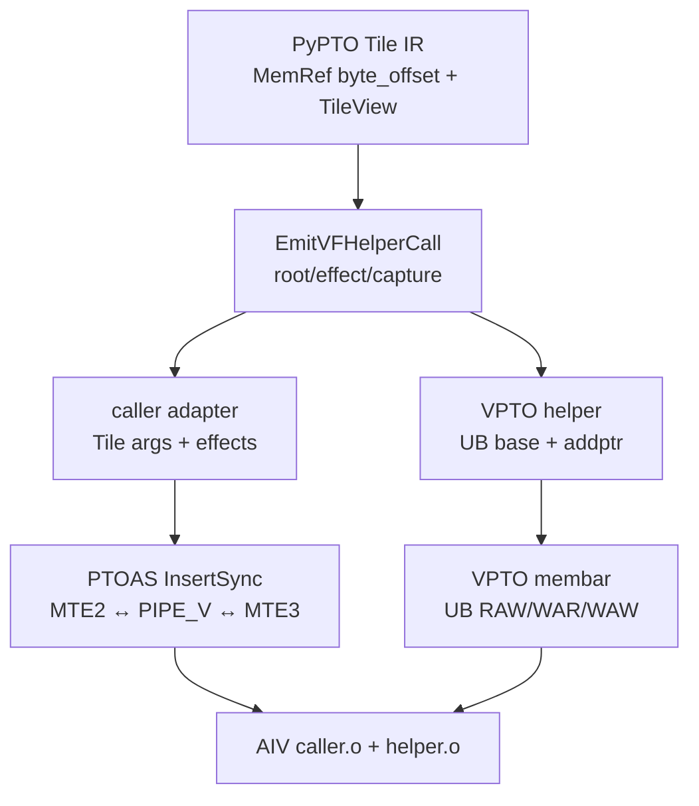
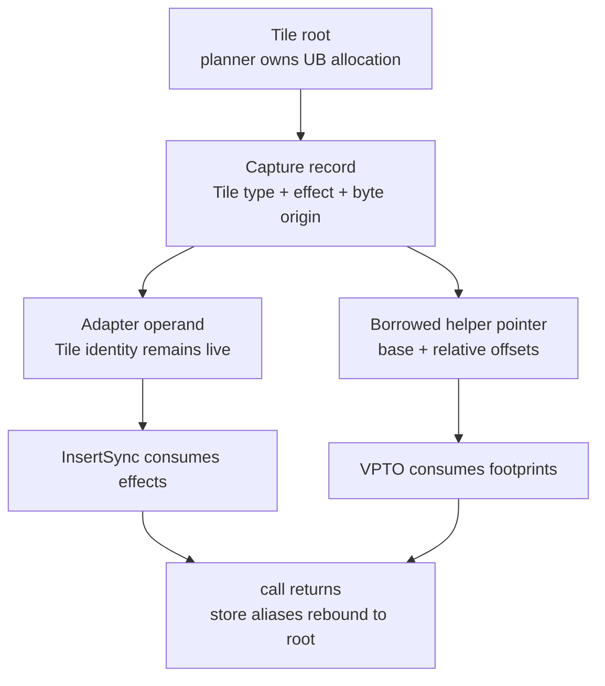
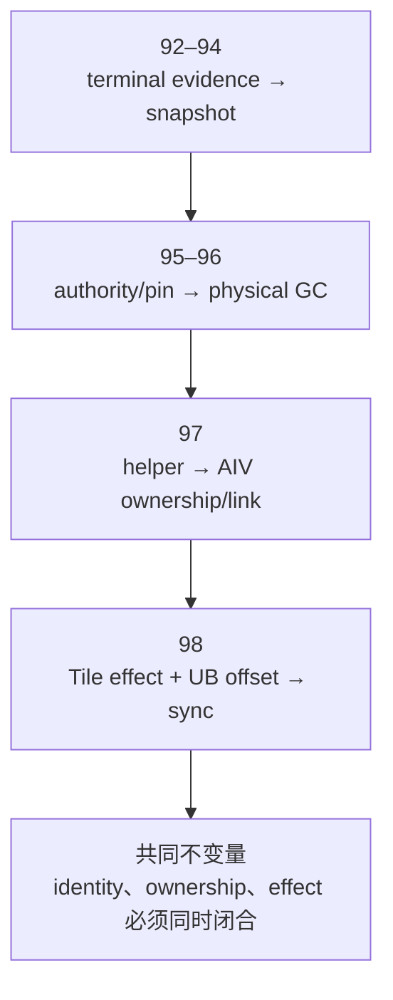

## 本篇在 PTO 课程路线中的位置

这是 PTO 全栈课程第 98 章。上一章追踪了 grouped A5 VF helper 如何只归属于 AIV entry、独立编译并链接；本章把镜头推进到真正的调用边界：caller 手里是 `Tile`，独立 helper 接收的却是 `!pto.ptr<..., ub>`。两边怎样在不复制 UB 数据的前提下对上地址、别名和同步？

分析基线仍是默认分支最新提交：PyPTO [`d0127ff79cc0`](https://github.com/hw-native-sys/pypto/commit/d0127ff79cc0e829e420cd01ffded5f4084cdadb)，PTOAS [`e26c3f2af051`](https://github.com/hw-native-sys/PTOAS/commit/e26c3f2af0517a37b71319e2b86ba452eeeecc3a)。两仓相对课程 97 都没有新提交；直接 grouped execution 合入仍是 PyPTO [PR #3416](https://github.com/hw-native-sys/pypto/pull/3416) / [`afa2f8358aac`](https://github.com/hw-native-sys/pypto/commit/afa2f8358aac63727e74ca4ebb8f8e3861a1b921)。

## 前置知识

1. PyPTO memory planner 已为 local UB `Tile` 分配 `MemRef.byte_offset`；VF helper 借用这些地址，不拥有 allocation。
2. `reg_scope` 被提取为独立 VPTO helper，caller 中保留一个 adapter call；上一章的 `entry_helpers` 决定 helper 最终只链接到 AIV。
3. A5 上有两类不同的同步问题：caller 的 MTE 与 Vector helper 之间需要跨 pipe event；helper 内的 Vector/Scalar UB 访问需要 memory barrier。只解决其中一个不等于整个调用安全。

## 今日两个紧密相连的核心问题

1. `parameter_indices` 与 `capture_byte_offsets` 怎样把多个 caller `Tile` 还原成 helper 的一个共享 UB base，并避免 `TileView.start_offset` 被重复计算？
2. `parameter_effects` 怎样在 caller 边界驱动 PTOAS `InsertSync`，而共享 base/offset 又怎样在 helper 内驱动 VPTO footprint 与 `mem_bar`？

第二问依赖第一问提供的地址事实；二者合起来才是一份可执行契约。

## PTO 全栈中的位置



上游是已经过 Tile memory planning 的 A5 AIV IR；下游分别是 PTOAS caller-level `InsertSync` 与 helper-level VMI→VPTO lowering。最终 consumer 是 Bisheng/device link 与 AIV runtime，但 ABI 在 codegen 时已冻结。

## 概念和精确语义

[`VFHelper`](https://github.com/hw-native-sys/pypto/blob/d0127ff79cc0e829e420cd01ffded5f4084cdadb/include/pypto/codegen/pto/pto_codegen.h#L80-L97) 同时保存两套签名：

| 字段 | 索引空间 | 精确含义 |
| --- | --- | --- |
| `caller_parameter_types[i]` | adapter/caller 参数 | 仍是 `TileBuf` 或 scalar，保留 caller 对 storage 的所有权与 PTOAS 可见的依赖对象 |
| `parameter_effects[i]` | adapter/caller 参数 | `read`、`readwrite` 或 scalar 的 `none`；当前 VF store/scatter 保守记为 `readwrite` |
| `parameter_types[j]` | helper 参数 | 一个共享 `!pto.ptr<dtype, ub>`，再加实际捕获的 scalars |
| `parameter_indices[j]` | helper → caller 映射 | helper 第 `j` 个实参从 caller 的哪个参数取得；它不是 Tile offset |
| `capture_byte_offsets[i]` | adapter/caller 参数 | 每个 memory capture 相对共享 UB base 的 byte displacement；scalar 为 0 |

三个长度并不相同：`parameter_indices.size() == parameter_types.size()`，而 `parameter_effects` 与 `capture_byte_offsets` 的长度等于 caller 参数数。[`EmitVFAdapter`](https://github.com/hw-native-sys/pypto/blob/d0127ff79cc0e829e420cd01ffded5f4084cdadb/src/codegen/pto/vf_codegen.cpp#L310-L372) 在发射前用这个 arity 关系做内部检查。

### 两种 offset 不能混为一谈

`MemRef.byte_offset` 是 allocation 内的**物理 UB byte origin**。codegen 在所有 capture 中选最小 origin 为 `base_index`，于是每个 `relative = origin[i] - origin[base]` 非负；再按目标 dtype 的 byte width 检查对齐，生成 `pto.addptr`。

`TileView.start_offset` 则是某个逻辑 view 内的元素 origin。VMI 在每次 load/store materialize address 时会自己加它。因此 [`vf_codegen.cpp`](https://github.com/hw-native-sys/pypto/blob/d0127ff79cc0e829e420cd01ffded5f4084cdadb/src/codegen/pto/vf_codegen.cpp#L178-L248) 明确只把 `MemRef.byte_offset` 放进 capture displacement；把 view origin 再加到 adapter 会发生 double offset。

### effect 是 caller 边界摘要，不是 helper 内 footprint

首次遇到一个 storage root 时，effect 从 `read` 开始；任何 `reg.store`/`reg.scatter` 都把对应 root 升为 `readwrite`。即使是 masked/partial store，也不能标成覆盖整 Tile 的纯 `write`，因为未写 lane 的旧内容仍需保留。store 产生的新 SSA version 会沿 alias root 合并到同一 capture。

manifest 将这组信息标为 `effect_scope: whole-tile`、`synchronization: ptoas-insert-sync`；见 [`pto_backend.py`](https://github.com/hw-native-sys/pypto/blob/d0127ff79cc0e829e420cd01ffded5f4084cdadb/python/pypto/backend/pto_backend.py#L1979-L2015)。这是保守的 caller-level summary，不声称精确到 64-lane 子区间。

### 把 ABI 写成前置条件与后置条件

这条边界可按“谁提供什么证明”精确拆开。输入不是任意 UB pointer，而是 memory planner 已确定物理地址的 local UB `Tile`，以及能直接编码进 helper 签名的 integer、`f32`、`index` scalar。caller 拥有 Tile/allocation 与调用次序；adapter 只在一次同步调用期间借出 pointer；helper 既不能延长其生命周期，也不能释放、重新分配或把它缓存到下一次调用。输出不是一个新 Tile，而是对原 storage root 的就地更新；store 结果回到 caller 后仍通过 alias version 指向同一 allocation。

调用前必须同时成立：所有 memory capture 可追到 scope 外同一个可用 storage root；每个物理 origin 静态可知；相对 byte displacement 能按目标 element width 整除；caller 参数、effect、offset 与 helper 参数映射的 arity 自洽。调用后则必须成立：helper 中每一次 VMI address 等于 `base physical origin + capture relative origin + logical view origin`，每一项恰好一次；PTOAS 已用 caller effect 建立所有跨 pipe 真依赖，并用 helper footprint 覆盖内部 RAW/WAR/WAW。

失败方式也分层。无法证明 owner、lifetime、静态地址或 alignment 时，PyPTO codegen 拒绝生成；metadata arity 不自洽时，adapter 发射失败；PTOAS 看不到 effect 或 effect 数量不匹配时，对 memory operand 保守回退为 `readwrite`，可能牺牲并行但不应静默放宽依赖；工具版本不满足 manifest gate 时，backend 在编译 helper 前失败。当前尚缺的是“effect 内容本身被错误低报”的独立 verifier，这也是本章保留的首要正确性知识债。

## 真实文件、类型、API 或指令逐段解读

### 1. `VFOperands`：先收集 memory op，再追根

[`VFOperands`](https://github.com/hw-native-sys/pypto/blob/d0127ff79cc0e829e420cd01ffded5f4084cdadb/src/codegen/pto/vf_codegen.cpp#L37-L81) 收集 `reg.load/store/gather/scatter`，并把 store 结果记录为旧 Tile 的 alias。`EmitVFHelperCall` 再沿 scope 内 aliases 与 planner 的 `tile_aliases` 找 storage root。身份而不是变量名决定同一 view；cycle 会直接报错。

合法 capture 必须是 A5 AIV、PyPTO Tile planner 产生的静态 local UB。parameter-backed Tile、FIFO-backed Tile、scope 内新建 storage、无法证明的 dynamic physical address、未按元素宽度对齐的 displacement 都 fail closed。PR #3416 把 direct FIFO 与 borrowed-pointer lifetime 明确列为后续，不是当前已支持能力。

### 2. `EmitVFHelperCall`：压成一个 base，再恢复每个地址

memory captures 先按首次使用顺序进入 caller 参数。codegen 选择最小 byte origin 对应的 caller 参数作为 helper base，把它写入 `parameter_indices[0]`；其他 capture 不再增加 helper pointer，而是在 helper source 中由 `castptr/addptr` 重建。不同 dtype 可以共享同一 byte root，但每个 displacement 必须按自身 element size 可整除。

scalar captures 排在 memory captures 之后，直接成为 helper 参数；它们的 effect 为 `none`、byte offset 为 0。当前只接受 integer、`f32` 与 `index`，而不是任意 Python/Tile 对象。

### 3. `EmitVFAdapter`：先让 PTOAS 看见 Tile，再取裸指针

adapter 仍以 caller `TileBuf` 为参数，并带：

```mlir
attributes {
  pto.ptodsl.subkernel_helper = "simd",
  pto.tileop.effects = ["readwrite", "read"]
}
```

PTOAS 在 `pto.tile_buf_addr` 降低前先分析这次 annotated call；之后 adapter 才取 base pointer并调用独立 helper。若反过来先把两个 Tile 都变成无来源裸指针，caller-level dependency analysis 就失去了 allocation/view 身份。

### 4. PTOAS：同一调用的两层同步

[`PTOIRTranslator::UpdateHelperCallInfo`](https://github.com/hw-native-sys/PTOAS/blob/e26c3f2af0517a37b71319e2b86ba452eeeecc3a/lib/PTO/Transforms/InsertSync/PTOIRTranslator.cpp#L1198-L1242) 识别 `subkernel_helper="simd"` 为 `PIPE_V`，按 `pto.tileop.effects` 把 caller operand 加入 use/def；缺失或 arity 不匹配时，memory operand 回退为 `readwrite`。由此，前序 `TLOAD` 与 helper read 形成 `MTE2→V`，helper write 与后序 `TSTORE` 形成 `V→MTE3`。

helper 本体另行以 `--enable-vecscope-mem-bar=true` 编译。这里没有 caller Tile effect；PTOAS 看的是 `%arg0 + constant` 形成的 UB footprint。重叠的 vector store/load 需要 `VST_VLD`，可证明不重叠则不插。它解决的是 helper 内部 hazard，不能替代 caller 的 event；caller event 也不知道 helper 内两条 VMI access 是否重叠。

## 对象、Tile、Buffer 与 IR 生命周期



allocation 从进入 `reg_scope` 前就存在，caller 持有它；capture record 只活到 bundle/manifest 生成；adapter call 消费 Tile handle，helper 在调用期间借用 UB pointer。helper 返回后，store 产生的 SSA alias 被重新绑定到原 root，供后续 `TSTORE` 或 Tile op 消费。没有新 UB allocation，也没有 UB copy；runtime 只持有最终 AIV image，不解释这份 Python/C++ metadata。

## 端到端调用链或指令链

`pl.load → planner MemRef → reg_scope → VFOperands → EmitVFHelperCall → EmitVFAdapter → annotated func.call → PTOAS InsertSync → tile_buf_addr → independent VPTO helper → vecscope membar → Bisheng object → AIV ELF`

对 load-compute-store kernel，逻辑顺序是：

```text
TLOAD(GM→UB, PIPE_MTE2)
  → set_flag/wait_flag(MTE2→V)
  → adapter(Tile args)
  → helper(vstore/vload on borrowed UB)
  → set_flag/wait_flag(V→MTE3)
  → TSTORE(UB→GM, PIPE_MTE3)
```

## 具体 shape、Tile 和状态演算

取 [`test_reg_bundle.py`](https://github.com/hw-native-sys/pypto/blob/d0127ff79cc0e829e420cd01ffded5f4084cdadb/tests/ut/codegen/test_reg_bundle.py#L789-L831) 的最小 alias 例子：

- allocation：`base: FP32[1,128]`，UB，共 `128 × 4 = 512 B`；
- `first = base[0:64]`，footprint `[0,256)` B；
- `second = base[32:96]`，footprint `[128,384)` B；
- helper：先 store `first`，再 load `second`。

状态逐步变为：

| 阶段 | caller 参数 | helper 参数 | metadata / 结论 |
| --- | --- | --- | --- |
| capture | `first`, `second` 两个 Tile | 尚无 | origins=`[0,128]` B；effects=`[readwrite,read]` |
| base 选择 | 同上 | `%arg0: !pto.ptr<f32,ub>` | `base_index=0`，`parameter_indices=[0]` |
| 地址恢复 | 同上 | `%arg0`, `%arg0+32 elements` | `capture_byte_offsets=[0,128]`；第二地址用 `addptr 32` |
| caller sync | Tile effects 可见 | helper 尚未执行 | 前序 MTE2 write 必须在 PIPE_V read/write 前完成；后序 MTE3 read 等待 PIPE_V write |
| helper sync | Tile 身份已降掉 | 两个 UB footprint | `[0,256)` 与 `[128,384)` 重叠 128 B，产生 `VST_VLD` |

若 `second` 从 element 64 开始，offset=`64×4=256 B`，两个 footprint 变为 `[0,256)` 与 `[256,512)`，PTOAS 可证明不交叠，helper 内不需要该 barrier；caller 的 whole-Tile effect 仍可能保守保留跨 pipe 同步。若先访问高地址 view、后访问低地址 view，`base_index` 改为第二个 caller 参数，得到 `parameter_indices=[1]`、offsets=`[128,0]`，仍不需要负 pointer displacement。

## 为什么这样设计及替代方案

当前设计从两个硬约束向上构造：caller 同步需要保留 Tile identity；独立 helper ABI 又只能消费可链接的 pointer/scalar。adapter 正是两种表示的窄桥。

替代方案一是给 helper 每个 view 都传一个独立 pointer。ABI 更直观，也能接动态地址；代价是丢失“同一 UB root”的证明，alias 要么未知而过度插 barrier，要么依赖 runtime 裸指针相等，且 FIFO/parameter-backed lifetime 仍没有 owner contract。

替代方案二是只传一个 base pointer，并把所有 caller effect 合并成一个 `readwrite`。metadata 最少且安全，但读-only Tile 也会成为 def，扩大 `InsertSync` 边和 event 压力。现有 per-Tile effect 保留了边界层能负担的最小精度。

替代方案三是在 `parameter_effects` 中携带精确 byte ranges。它可能减少 caller 端假依赖，却需要 PTOAS 扩展 range schema、view provenance、动态 extent 与版本兼容；在公开 benchmark 证明 whole-Tile over-sync 是瓶颈前，这个复杂度尚未被证据证明值得。

## 访存、计算、流水、并行和硬件约束

- **访存量**：adapter 只取地址，helper 原地访问 UB，不新增 GM/UB copy；`addptr` 是地址构造，不搬数据。
- **同步**：caller event 与 helper `mem_bar` 属于不同作用域。前者跨 MTE/Vector pipe，后者约束 vecscope 内 UB execution units。
- **并行**：共享 base 允许 PTOAS 比较静态 footprint；offset=64 的 disjoint case保留并行机会，offset=32 才付 barrier。
- **资源**：whole-Tile effect 可能过度同步，但不会低报 masked store；helper 只借 planner 已分配 UB，因此 UB 容量不因 outlining 翻倍。
- **硬件事实边界**：系统测试会在 object 与 linked ELF 中检查 `SMEM_BAR.*`。公开材料没有给出每种 barrier 的 cycle cost、stall 比例或 dual-lane contention；不能从“少一条 barrier”直接推出端到端加速。

## 测试证据与未覆盖风险

代码级 UT 证明：capture order deterministic；load/store/load aliases 合并为一个 `readwrite` capture；view origin 只在 VMI address 中加一次；offset `0/32/64`、反向 capture、mixed dtype、dynamic physical address rejection、schema-v4 metadata 与旧 PTOAS version gate 均有断言。

PyPTO [`test_alias_helper_sync.py`](https://github.com/hw-native-sys/pypto/blob/d0127ff79cc0e829e420cd01ffded5f4084cdadb/tests/st/runtime/vpto/test_alias_helper_sync.py#L56-L228) 构造 WR/RW/WW × offset `0/32/64/128`：LLVM 中 offset `<64` 恰有一条 membar，offset `≥64` 为零；测试还反汇编 helper object 与 linked ELF，检查 `VST_VLD`、`VLD_VST` 或 `VST_VST`，并用 32-element guard 做 120 次 exact numerical comparison。这里陈述的是当前测试程序所验证的不变量，本次研究没有重跑 A5 硬件。

PTOAS [`ptodsl_tileop_effect_autosync.pto`](https://github.com/hw-native-sys/PTOAS/blob/e26c3f2af0517a37b71319e2b86ba452eeeecc3a/test/lit/pto/ptodsl_tileop_effect_autosync.pto) 直接断言 annotated helper 产生 `MTE2→V` 与 `V→MTE3` 的 set/wait；[`insert_sync_tile_native_args.pto`](https://github.com/hw-native-sys/PTOAS/blob/e26c3f2af0517a37b71319e2b86ba452eeeecc3a/test/lit/pto/insert_sync_tile_native_args.pto) 还覆盖 native pointer helper 的 `PIPE_M→PIPE_V` hazard。

PR #3416 的公开验证记录是 focused UT 377 passed、mixed single/dual AIV 两个 Ascend 950DT case 共 64 次 1024-element exact comparison；兼容修复又记录 123 focused tests，以及两个 VF runtime example 的 108/192 次数值检查。它没有宣称全量 suite 绿色。

仍未覆盖的风险：effect 被错误低报时的 fail-closed verifier；跨 helper overlap 与异常退出；dynamic/FIFO borrowed pointer lifetime；manifest ABI 跨 PyPTO/PTOAS 版本矩阵；whole-Tile over-sync 的 event 数、barrier stall、cold compile/link 与 dual-lane 性能数据。

## 与前后章节的连接

向前，课程 97 解决 helper “属于哪个 entry”；本章解决它“以什么地址与同步契约被调用”。两章合起来才从 artifact ownership 走到执行正确性。

向后，下一章将继续沿当前已合入主链，研究 grouped A5 VF 的 hardware loop：loop-carried register/mask、动态 view origin、跨迭代 UB hazard 与 membar placement，避免把 ABI 已闭合误当成循环依赖也已闭合。

## 本篇结论、知识债、三个理解检查问题和下一章

结论：**`parameter_indices` 选择真实 caller base，`capture_byte_offsets` 在 helper 内重建共享 UB 别名，`parameter_effects` 在 caller 外围保留 Tile 依赖；前两者供内部 footprint/membar，后者供跨 pipe InsertSync。三者缺一，独立 helper 都可能“能链接但不正确”。**

知识债：effect schema 的低报验证、dynamic/FIFO capture owner、跨版本 ABI、跨 helper alias、异常路径，以及同步与编译成本 benchmark。

三个理解检查问题：

1. 为什么 `capture_byte_offsets` 不能包含 `TileView.start_offset`？
2. 两个 64-element FP32 view 相距 32 elements 与 64 elements 时，为什么内部 barrier 结论不同，而 caller event 可能相同？
3. 为什么 masked `reg.store` 要标 `readwrite`，而不是更直觉的 `write`？

下一章：**Grouped A5 VF hardware loop：loop-carried register/mask、动态 view origin 与跨迭代 UB hazard**。

## 第十四次七章知识图谱回顾（课程 92–98）

课程 92–96 建立的是 Host 侧“证据怎样安全退休”：distributed handle/remote completion 形成 terminal receipt，经 durable log、rank frontier、snapshot generation、compactor lease、Reader Pin、Delete Intent 与 Physical Census，最终才能释放 capacity。课程 97–98 回到 device artifact，把同一原则落到可执行对象：helper 先精确归属 AIV entry，再以 caller Tile identity、borrowed UB pointer、effect 与 offset 证明其调用安全。



路线调整：Host Artifact recovery 的协议知识债保留在账本，不再连续扩写；接下来优先完成已合入 grouped A5 VF 的 loop、dynamic view 与同步边界，再决定是否进入更宽 capture/runtime ABI。

## 课程账本增量

- 第 98 章；PyPTO `d0127ff7`、PTOAS `e26c3f2`，相对课程 97 无源码前进。
- 新覆盖：`VFOperands`、`EmitVFHelperCall`、`EmitVFAdapter`、`VFHelper.parameter_indices/capture_byte_offsets/parameter_effects`、schema-v4 manifest、`PTOIRTranslator::UpdateHelperCallInfo`、caller InsertSync 与 helper vecscope membar。
- 新不变量：caller Tile identity 与 helper pointer ABI 必须同时保留；physical MemRef byte origin 与 logical TileView origin 只各加一次；masked/partial store 为 `readwrite`；caller event 与 helper membar 不可互相替代；静态 shared base 允许对 overlap 做精确内部同步。
- 新测试证据：offset/反向 base/alias/effect UT，WR/RW/WW × 多 offset 的 LLVM/object/ELF barrier 与 120 次 exact comparison，PTOAS MTE2↔V↔MTE3 lit。
- 完成课程 92–98 七章回顾；下一章进入 grouped VF hardware loop 与跨迭代 hazard。
