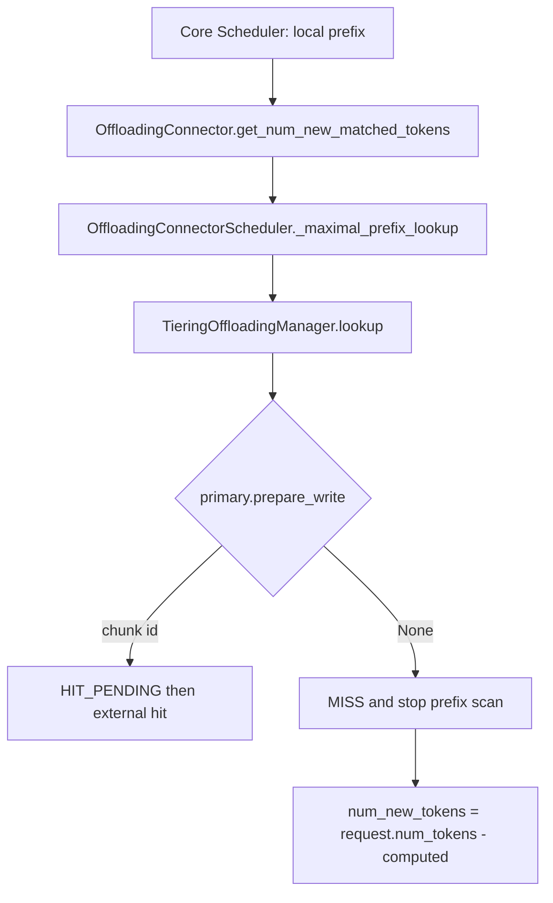

> 源码基线：[`1bf414e9`](https://github.com/vllm-project/vllm/commit/1bf414e97acf7563297726531f702cdbea6b2921)，研究时 `vllm-project/vllm` 默认分支最新提交。相对第 87 章基线前进 [27 个提交](https://github.com/vllm-project/vllm/compare/a16bfee11b92f1809628a8bd1f4bd70cdcb9b576...1bf414e97acf7563297726531f702cdbea6b2921)；本文直接分析的 manager、connector、core Scheduler 与 metrics 文件没有语义变化。

## 本篇在课程路线中的位置

第 87 章已经确认：secondary 命中后，primary 没有空间会让 `_initiate_promotion()` 返回 `False`，最终成为 `MISS`，不存在 capacity waiter。今天只补一个紧邻的性能问题：**这次 MISS 到底让 GPU 多算了多少，现有指标能否归因，何时等待才比重算划算？**

课程位置是：`secondary HIT → primary allocation failure → prefix 截断 → Scheduler token budget → recompute debt → wait-or-recompute Golden`。不扩展到通用 offload 命中率，也不把开放 PR 当作已合入行为。

## 前置知识回顾

CPU primary 是 secondary 与 GPU 之间的 staging tier。`OffloadKey` 是 `bytes`：block hash 后拼 4-byte KV group index；它没有 tensor shape。`CPULoadStoreSpec.chunk_ids` 给 worker 指明 CPU 物理 chunk。只有 `prepare_write()` 返回具体 chunk id 后，secondary 数据才可能进入 primary；容量不足时没有 job、没有 copy、也没有失败 key 的 slot ownership。

## 本篇要回答的核心问题

1. promotion allocation failure 怎样沿调用链缩短可复用前缀，并变成 `num_new_tokens`？
2. `promotion_allocation_failures` 为什么不能直接换算成浪费 token、FLOPs 或 P99？
3. 怎样定义不靠拍脑袋的 wait-or-recompute 阈值和 deterministic Golden？

## 组件在全局架构中的位置

这是一条 host 控制链。输入是 scheduler 进程中的 `Request`、Python `int` token count、`OffloadKey`；输出仍是整数命中长度与调度 token 数。此处没有 `torch.Tensor`，所以 shape/dtype/device 为“不适用”。真实 KV tensor 的 dtype、每层 shape 和 device buffer 由 KV cache config 与 worker 持有；控制面只决定哪些 token 已有可信 KV、哪些必须交给 ModelRunner 重算。

## 完整调用链

公开 connector 入口是 [`OffloadingConnector.get_num_new_matched_tokens`](https://github.com/vllm-project/vllm/blob/1bf414e97acf7563297726531f702cdbea6b2921/vllm/distributed/kv_transfer/kv_connector/v1/offloading_connector.py)。Core Scheduler 先取得 local prefix，再把 block-aligned local boundary 传入 connector。connector 转调 [`OffloadingConnectorScheduler.get_num_new_matched_tokens`](https://github.com/vllm-project/vllm/blob/1bf414e97acf7563297726531f702cdbea6b2921/vllm/distributed/kv_transfer/kv_connector/v1/offloading/scheduler.py)：

1. `_acquire_step()` 在 scheduler 线程持有 manager lock；若该请求尚有 transfer job，返回 `(None, False)`，本 step 延后。
2. `_lookup()` 最终由 `_maximal_prefix_lookup()` 按 key 顺序扫描。`HIT/HIT_PENDING` 增加连续 hit 数，`RETRY` 只标记 defer；首个 `MISS` 立即 `break`。
3. [`TieringOffloadingManager.lookup`](https://github.com/vllm-project/vllm/blob/1bf414e97acf7563297726531f702cdbea6b2921/vllm/v1/kv_offload/tiering/manager.py) 先查 primary，再查 secondary。secondary `HIT` 会调用 `_initiate_promotion()`。
4. `_initiate_promotion()` 同步调用 `primary_tier.prepare_write([key])`。返回 `None` 时只递增 `PROMOTION_ALLOCATION_FAILURES`，不创建 `PendingPromotion` 或 `TransferJob`，并把本次 lookup 变成 `MISS`。
5. connector 返回实际 external hit token 数。Core 在 [`Scheduler.schedule`](https://github.com/vllm-project/vllm/blob/1bf414e97acf7563297726531f702cdbea6b2921/vllm/v1/core/sched/scheduler.py) 合并 local 与 external boundary，计算 `num_new_tokens = request.num_tokens - num_computed_tokens`，再受 `token_budget`、`input_budget`、long-prefill threshold、Mamba alignment 和 encoder budget 约束。

所以“重算”不是 manager 直接启动一次 kernel；manager 只是缩短可信前缀。之后 Scheduler 把后缀作为普通 prefill 工作分批交给 executor/ModelRunner。

## 关键类型、字段和状态生命周期

跟踪第一个无法 promotion 的 key `K3`：

- **创建**：`RequestOffloadState.update_offload_keys()` 从 request block hashes 生成 `OffloadKey K3`，`ReqContext` 记录 request id 与 key 的 token 位置。
- **secondary 持有**：secondary `lookup(K3)` 返回 `HIT`；源副本仍由 secondary tier 持有。
- **分配失败**：[`CPUOffloadingManager._prepare_store`](https://github.com/vllm-project/vllm/blob/1bf414e97acf7563297726531f702cdbea6b2921/vllm/v1/kv_offload/cpu/manager.py) 计算完整 victim 数。free + 可合法驱逐 victim 不足时原子返回 `None`；不会部分驱逐，也不会生成 `ChunkStatus`。
- **前缀消费**：Tiering 返回 `MISS`，`_maximal_prefix_lookup()` 停在 K3；K3 之后即使也在 secondary，当前扫描也不再证明它们可用。
- **重算与复用**：Core 为实际 boundary 后的 token 分配 GPU KV slot并调度计算；完成后 `request.num_computed_tokens` 前移。旧 secondary 副本没有被释放，未来请求仍可重新尝试 promotion。

所有权边界很清楚：失败前后 K3 都归 secondary；primary 从未拥有 K3；Scheduler 只拥有“实际命中到哪里”的整数事实。失败发生在 scheduler 进程的 manager lock 内；tier-poll 线程不能并发改 primary allocator。进程崩溃恢复不由这把锁保证。

## 逐函数源码解读

### `_prepare_store`：失败是 all-or-nothing

`keys_to_store` 先排除 ready resident keys，再计算 `num_chunks_to_evict = need - free`。若它大于 `_num_evictable_cache_chunks`，直接返回 `None`；否则 policy 还要在本次输入的 protected keys 之外找到完整 victim 集。只有完整集合成立后才 `_free_chunk()`、`_allocate_chunks()`、`insert()`。因此 allocation failure 是 admission 失败，不是 transfer failure。

### `_maximal_prefix_lookup`：一个 MISS 截断后续价值

该函数返回连续 chunk 数，而不是任意命中集合。因 transformer KV prefix 必须连续，K3 缺失时 K4 的 KV 不能单独把 resume boundary 推到更后面。若前面刚启动的 promotion 仍是 `HIT_PENDING`，本 step 返回 `None` 等它完成；后续 step 才会以已落到 primary 的前缀重新扫描。

### Core Scheduler：债务最终进入 token budget

actual boundary 决定 `num_computed_tokens`；其后缀成为 `num_new_tokens`。若后缀超过本 step budget，只调度其中一段，因此一次 allocation failure 的代价可能跨多个 engine step，并与其他请求竞争同一个 token budget。`kv_load_failure_policy=recompute` 是另一条路径：它处理已经建立的 load job 失败；这里根本没有 job，策略开关不参与。

### Metrics：计数点早于可归因对象

[`TieringMetricsTracker.on_promotion_allocation_failure`](https://github.com/vllm-project/vllm/blob/1bf414e97acf7563297726531f702cdbea6b2921/vllm/v1/kv_offload/tiering/metrics.py) 只给无 label counter 加一。`PROMOTION_LATENCY` 从 `TransferJob.submit_time` 量到完成；allocation failure 没有 `TransferJob`，自然也没有 latency 样本。counter 不含 request、group、chunk position、实际 boundary 或随后调度的 token 数。

## 具体示例与 shape/状态演算

使用直接测试常见的 `block_size = tokens_per_chunk = 4`；这是教学 fixture，不宣称是生产默认值。单 request 有 21 个 prompt token，最后 1 token必须前向计算；前 20 token 对应 5 个连续 key：

| 范围 | 状态 | 对 boundary 的贡献 |
| --- | --- | ---: |
| token 0–3 | local GPU prefix HIT | 4 |
| token 4–11 | 2 个 primary HIT | 8 |
| token 12–15 | secondary HIT，但 promotion allocation fail | 0，首个 MISS |
| token 16–19 | secondary 也有，但未继续扫描 | 0 |
| token 20 | 必算 token | 0 |

实际 boundary 是 12，故 Core 看见 `num_computed_tokens=12`，得到 `num_new_tokens=21-12=9`。若 primary 能承接后两个 secondary chunks，反事实 boundary 为 20，只需计算 1 token。于是本例的 **allocation-failure recompute debt** 为：

`ΔN = B_counterfactual - B_actual = 20 - 12 = 8 tokens`

`ΔN=8` 是 token-work，不等于“8 个等价 FLOP 单元”。每个 token 的 attention 上下文长度、模型层数、hidden size、kernel、batch packing 与 padding 都影响 GPU 时间。若 `token_budget=4`，这 9 个实际新 token 还会分成至少 3 个 scheduling step；归因必须跨 step 累加，不能只看失败当步。

## 为什么这样设计及替代方案

当前 fail-fast MISS 用更多 GPU 计算换取简单且有界的调度：不维护 waiter，不让一个 CPU staging 缺口阻塞整个 batch，也没有取消、唤醒风暴和 fairness 状态。它适合 `ΔN` 小或容量释放时间不可预测的情况。

替代设计是异步等待 primary capacity。正确比较对象不是“copy 快还是 compute 快”，而是请求完成时间和系统外部性：

`wait iff E[T_capacity + T_promotion + T_reschedule] + R_tail < E[T_schedule + T_recompute(ΔN)] + C_gpu_contention`

`R_tail` 是等待超时/尾延迟风险；`C_gpu_contention` 是这批额外 token 挤占其他请求的代价。等待还可能保留已成功 promotion 的 primary chunks；重算则消耗 GPU token budget。阈值必须按模型、硬件、prompt length、并发与 tier 分桶校准，不能从一个全局 failure counter 推出。

开放 [PR #60128](https://github.com/vllm-project/vllm/pull/60128) 提议对 FS tier 延迟分配 primary chunk，并报告基准收益；截至本文它仍未合入，且改变的是 allocation 时机/占用，不是 wait-or-recompute 策略。开放 [PR #67052](https://github.com/vllm-project/vllm/pull/67052) 提议跟踪 promotion 落地后的 outcome；它解决“promote 后是否被使用”，也不提供 allocation-failure 的反事实 token debt。两者只能作为计划/实验事实。

| 证据层级 | 本文采用的结论 |
| --- | --- |
| 当前代码事实 | allocation failure 在 job 创建前变成 `MISS`，Core 用实际 boundary 计算 `num_new_tokens` |
| 测试事实 | 现有测试分别覆盖 counter、连续 prefix、store allocation 计数，尚未串成成本 Golden |
| Issue/PR 计划 | PR #60128/#67052 仍开放，不作为 main 行为 |
| 基于证据的推断 | `ΔN`、决策不等式与 side-effect-free peek 是本文提出的测量/设计框架 |

## 性能、并发、正确性与边界条件

- **延迟/吞吐**：MISS 让请求更早进入可运行集合，却增加 token-work；wait 节省 GPU 竞争，但可能放大 TTFT/P99 和 head-of-line blocking。
- **显存/主存**：重算需要正常 GPU KV slots；失败 key 不占 primary slot。等待方案若保留已成功的早期 promotions，会延长 primary residency。
- **并发**：actual boundary 在 scheduler/manager lock 下确定；后续 ModelRunner 是另一个执行阶段。指标关联必须携带稳定 request/cause id，不能按时间窗口猜测。
- **graphability**：两种策略都不改变模型 tensor dtype；重算增加本 step rows，可能选择更大的 CUDA Graph bucket或 padding。等待改变 batch membership。两者影响图选择与利用率，但不应改变数值正确性。
- **正确性**：只能从连续、已 ready 的 prefix 恢复。对失败点之后做“命中数相加”会越过 KV hole，是错误优化。
- **失败方式**：secondary lookup `RETRY`、promotion transfer failure、GPU load failure与 primary allocation failure 是四类不同原因；把它们合成一个 recompute 标签会让控制器学到错误阈值。

## 测试证据与未覆盖风险

[`test_tiering_metrics_tracker_records_promotion_allocation_failures`](https://github.com/vllm-project/vllm/blob/1bf414e97acf7563297726531f702cdbea6b2921/tests/v1/kv_offload/tiering/test_metrics.py) 构造 `num_primary_chunks=1`、`primary_chunk_size=16` 的 tracker，调用一次 `on_promotion_allocation_failure()`，断言 counter 为 1。它验证导出语义，但没有经过 `lookup → prepare_write → MISS → schedule`。

[`test_partial_lookup`](https://github.com/vllm-project/vllm/blob/1bf414e97acf7563297726531f702cdbea6b2921/tests/v1/kv_offload/tiering/test_tiering_offloading.py) 在 capacity=5 的 primary 中只存前 3/5 keys，验证连续 hit 数为 3；它证明首个 MISS 截断 prefix，但 MISS 原因是不存在，不是 allocation failure。

[`test_scheduler_reports_allocation_failure`](https://github.com/vllm-project/vllm/blob/1bf414e97acf7563297726531f702cdbea6b2921/tests/v1/kv_connector/unit/offloading_connector/test_scheduler.py) 用 block size 4、4-token request，让 `prepare_store` 两次返回 `None`，断言 connector allocation-failure metric 为 2（运行中一次、完成 step 一次）。它覆盖 store offer，不覆盖 secondary→primary promotion，也不验证 recompute token。

**测试结论**：现有测试分别守住 metric、连续 prefix 和 store allocation 计数，但没有一条 Golden 把三者串起来。最小新增 Golden 应固定 5 个 key 的 tier 分布和 primary capacity，记录 `(failure_key, actual_boundary, oracle_boundary, ΔN)`，再以小 token budget 跨 step 累加 cause-tagged scheduled tokens；同时验证失败不创建 `TransferJob`、不产生 promotion latency 样本、请求输出与全量重算一致。并发版本还要加入第二请求抢占刚释放 slot，比较 fail-fast 与 revisioned wait 两种策略的 deadline/goodput。

生产观测若要得到精确反事实，不能简单让正常 lookup 在 MISS 后继续：继续扫描会启动更多 promotion，反过来改变容量。应增加无副作用 `peek`/抽样 shadow scan，或只报告 `actual recompute tokens` 与“可复用上界”。没有 oracle 时，`remaining_tokens` 只是上界，不得写成节省量。

## 与前后章节的连接

第 87 章解释了为何 allocation failure 安全地变成 MISS；本章把 MISS 接到 Scheduler token budget，定义了 `ΔN` 和观测缺口。下一章应研究 **side-effect-free counterfactual lookup**：怎样在不触发 promotion、不过度扫描远端 tier 的前提下估计 oracle boundary，并给 attribution trace 一个可守恒的 schema。

## 本篇结论、知识债、三个理解检查问题和下一章

结论：promotion allocation failure 的直接产物不是 FLOPs，而是一个更短的可信 prefix。Core 再把缺失后缀转成分步的 `num_new_tokens`。当前 main 只有无 label 的失败次数；由于失败先于 `TransferJob`，promotion latency 也看不到它。精确成本必须比较反事实 boundary，并把 cause 贯穿后续 scheduling steps。

知识债：无副作用 secondary `peek` 的成本与一致性；request/group/chunk 归因 schema；cause-tagged scheduled token/GPU-time 指标；模型与并发分桶的 wait 阈值；promotion-full 端到端和双请求 race Golden；开放 PR #60128/#67052 的最终合入状态与 API 漂移。

理解检查：

1. 为什么一次 allocation failure 的 counter 不能直接乘 `tokens_per_chunk` 得到重算量？
2. 本例 actual boundary=12、oracle boundary=20，为什么债务是 8 而实际 `num_new_tokens` 是 9？
3. 为什么正常 lookup 在首个 MISS 后继续扫描，会污染我们想测的反事实？

下一章：**反事实 Prefix 怎样测而不改变现实——Side-effect-free Peek、Attribution Trace 与 Cost Golden。**

## 课程账本增量

- 第 88 章，阶段 9“测试、性能与故障诊断”。
- 新闭合链：`promotion allocation failure → first MISS → actual boundary → Scheduler num_new_tokens → multi-step recompute debt`。
- 新不变量：失败前没有 `TransferJob`；failure counter 是 attempt count，不是 request/token cost；精确债务是 oracle boundary 与 actual boundary 的差，需无副作用反事实证据。
- 当前实现边界：main 没有 allocation-failure request attribution、recompute-token cause、side-effect-free peek 或 wait-or-recompute controller；PR #60128/#67052 仍为开放计划。
