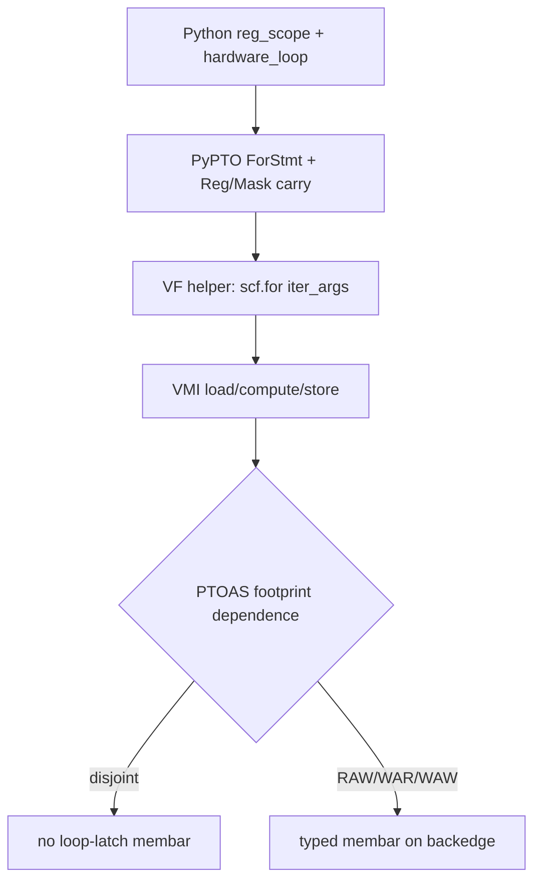
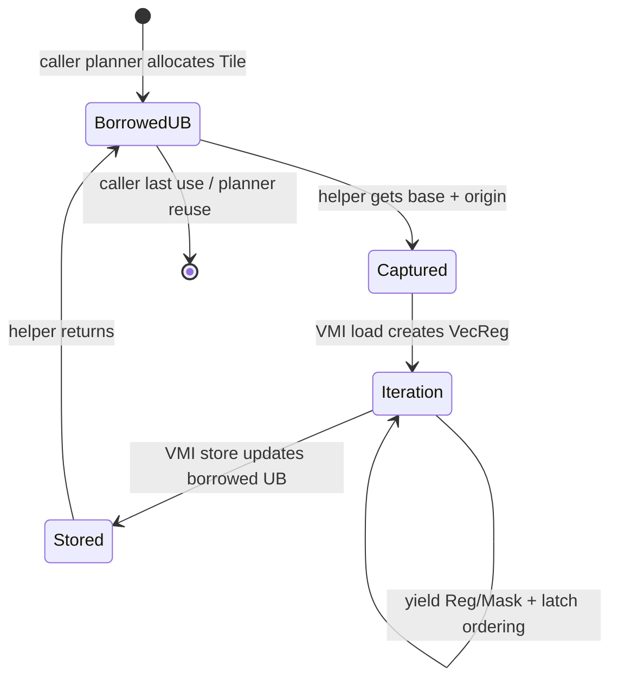

## 本篇在 PTO 课程路线中的位置

这是 PTO 全栈课程第 99 章。上一章闭合了 grouped A5 VF adapter 的 caller/helper ABI；本章只回答一个执行问题：`pl.hardware_loop` 每次回边到底带走什么状态，UB 中上一迭代留下的数据又怎样与下一迭代正确排序？

分析基线是研究时默认分支最新提交：PyPTO [`442b793f38ab`](https://github.com/hw-native-sys/pypto/commit/442b793f38ab7ff43ab6304d6bc34fb001841f81)，PTOAS [`5089169d517c`](https://github.com/hw-native-sys/PTOAS/commit/5089169d517c921842e644a0d5ec09921c6351ab)。相对课程 98，PyPTO 前进 [13 个提交](https://github.com/hw-native-sys/pypto/compare/d0127ff79cc0e829e420cd01ffded5f4084cdadb...442b793f38ab7ff43ab6304d6bc34fb001841f81)，PTOAS 前进 [9 个提交](https://github.com/hw-native-sys/PTOAS/compare/e26c3f2af0517a37b71319e2b86ba452eeeecc3a...5089169d517c921842e644a0d5ec09921c6351ab)。动态硬件循环最初由 PyPTO [PR #3253](https://github.com/hw-native-sys/pypto/pull/3253) / [`7d4ef913a25f`](https://github.com/hw-native-sys/pypto/commit/7d4ef913a25f5f0b5b806b318b6415c2a6124c32) 引入；当时明确不支持 loop-carried values。当前 grouped VF 代码已把边界收紧并推进为“只允许 `VecReg`/`MaskReg` carry”，这是本次重访旧主题的实质差异。

## 前置知识

1. `reg_scope` 被提取为独立 VPTO helper；caller 传入的是已规划 local UB 的借用地址，helper 不拥有或释放 allocation。
2. `TileView.start_offset` 是逻辑元素起点，`MemRef.byte_offset` 是物理 allocation 起点；二者各只能计入一次。
3. `scf.for iter_args` 传递 SSA value；UB 是可变存储，地址相同不意味着跨迭代访问天然有序。

## 今日两个紧密相连的核心问题

1. 为什么硬件循环只允许 `VecReg`/`MaskReg` 跨迭代，而不能把 `Tile` 或普通 scalar 当作 carry？动态 stop、动态 view origin 又属于哪一类状态？
2. 当迭代 `i` 与 `i+1` 访问同一 UB allocation 时，PTOAS 怎样证明 disjoint，证明不了时又把哪一种 `membar` 放在哪里？

## PTO 全栈中的位置



上游输入是 Python kernel 的 loop bound、UB view 与寄存器表达式；下游消费者是 PTOAS 的 VMI lowering、layout assignment 和 `VecScopeMemBar`。`hardware_loop_policy=Require` 只表达前端意图与合法形状，不是最终设备指令证书。当前开发文档明确把 lowering、同步和优化交给 PTOAS；公开测试也主要证明“生成 PTO 并通过 PTOAS”，不能据此声称每种动态循环都已在真机执行。

## 概念和精确语义

`pl.hardware_loop(stop, init_values=None)` 必须位于 `pl.reg_scope()` 内，对应顺序区间 `[0, stop)`，start 固定为 0、step 固定为 1、IV 为 `INDEX`。静态非空 stop 大于 65535 会被拒绝；动态整数 stop 可生成，但 PyPTO 不插入运行时上界 guard，调用者必须保证后端可接受。嵌套上限是 4；VF 内 runtime `if`/`while` 被拒绝。证据见 [`dsl_api.py`](https://github.com/hw-native-sys/pypto/blob/442b793f38ab7ff43ab6304d6bc34fb001841f81/python/pypto/language/dsl_api.py)、[`verify_hardware_loop_contract.cpp`](https://github.com/hw-native-sys/pypto/blob/442b793f38ab7ff43ab6304d6bc34fb001841f81/src/ir/verifier/verify_hardware_loop_contract.cpp) 与 [language statements](https://github.com/hw-native-sys/pypto/blob/442b793f38ab7ff43ab6304d6bc34fb001841f81/docs/en/dev/language/01-statements.md)。

循环中有三类状态，不能混为一谈：

| 状态 | 当前表示 | 能否 carry | 所有权/条件 |
| --- | --- | --- | --- |
| IV、dynamic stop、view origin | scalar SSA/captured scalar | stop/origin 是 capture，不是 iter_arg | origin 必须在 helper 调用时可捕获；动态 stop 无自动范围保护 |
| `VecReg` / `MaskReg` | immutable SSA value | 可以 | 类型变成 `!pto.vmi.vreg<...>` / `!pto.vmi.mask<...>`，每回边由 `scf.yield` 产生下一版本 |
| `Tile` / UB buffer | mutable reference + borrowed pointer | 不作为 iter_arg | allocation 由 caller/planner 持有；跨迭代正确性靠 footprint 与同步，不靠 SSA carry |

当前 [`vf_codegen.cpp`](https://github.com/hw-native-sys/pypto/blob/442b793f38ab7ff43ab6304d6bc34fb001841f81/src/codegen/pto/vf_codegen.cpp) 对 iter arg 要求 `RegType`；普通 scalar carry 会报 “register or mask loop-carried values only”。这不是说 scalar 不能参与地址计算：IV、stop、动态 origin 都可作为 scalar 使用；它说的是“回边的显式可变程序状态”只接受 VMI register/mask。若允许 `Tile` carry，就必须同时回答新 Tile 是否仍指向同一 capture root、别名/effect 如何跨回边变化，以及谁拥有其 UB lifetime；当前实现选择 fail closed。

## 真实文件、类型、API 或指令逐段解读

### 1. PyPTO 把 carry 变成 `scf.for iter_args`

[`pto_control_flow_codegen.cpp`](https://github.com/hw-native-sys/pypto/blob/442b793f38ab7ff43ab6304d6bc34fb001841f81/src/codegen/pto/pto_control_flow_codegen.cpp) 将 scalar 与 `RegType` 视为 immutable SSA，但只把合法的 loop-carried Reg/Mask 放入 `iter_args`，并筛选相应 `yield_buffer` 生成 `scf.yield`。`Tile`/`Tensor` 是原地写入的 mutable reference，直接映射到初始对象，不产生一个“新 Tile SSA result”。

简化后是：

```mlir
%final = scf.for %i = %c0 to %stop step %c1
    iter_args(%carry = %initial) -> (!pto.vmi.vreg<64xf32>) {
  %next = pto.vmi.vadd %carry, %carry
  scf.yield %next
}
```

`%carry` 的旧版本在本次迭代消费，`%next` 在回边成为下一版本；循环结束后的 `%final` 是唯一结果。这是值依赖，不是 UB memory ordering。

### 2. 动态 `TileView.start_offset` 是 capture，不是 per-iteration owner

`EmitVFHelperCall` 找到 local planned UB 的 capture root；动态、loop-invariant 的 `TileView.start_offset` 可作为额外 scalar 参数传入 helper。physical `MemRef.byte_offset` 只在构造 base 时应用一次，VMI load/store 再在每次访问时加 view origin 与显式 offset。测试 [`test_reg_bundle.py`](https://github.com/hw-native-sys/pypto/blob/442b793f38ab7ff43ab6304d6bc34fb001841f81/tests/ut/codegen/test_reg_bundle.py) 专门把 `origin: INDEX/UINT32` 只藏在 `TileType` 中，验证 helper 参数为 `UB pointer + origin`，并经 PTOAS 编译。

因此可以写 `address(i)=base+origin+i×64`；但这不等于让 `origin` 在每次迭代重新指向另一个 allocation。capture root 与 ownership 在 helper 调用期间保持不变，变化的是可分析的访问 offset。

### 3. PTOAS 把内存回边当作 dependence 问题

[`VecScopeMemBarAnalysis.cpp`](https://github.com/hw-native-sys/PTOAS/blob/5089169d517c921842e644a0d5ec09921c6351ab/lib/PTO/Transforms/VecScopeMemBar/VecScopeMemBarAnalysis.cpp) 收集 vecscope 内 load/store footprint、loop IV 与调度路径，用 Presburger dependence relation 枚举 same-iteration、inner-loop-carried 与 outer-loop-carried RAW/WAR/WAW。分析还会沿 `scf.for` result、region iter_arg 和 `scf.yield` 反向追值，避免把寄存器 relay 错判为无关存储。

若能证明相邻迭代 footprint 不相交，则没有回边屏障；若有依赖，则 barrier 放在 carrying loop 的 latch，而不是机械地塞在每条 load/store 之间。种类由 producer/consumer 决定：vector load→store 为 `VLD_VST`，store→load 为 `VST_VLD`，store→store 为 `VST_VST`；多个风险共享 cut 时可合并成 `VV_ALL`。

## 对象、Tile、Buffer 与寄存器生命周期



每个 `VecReg`/`MaskReg` 是 SSA 版本：被 `yield` 后旧版本不再代表下一迭代状态。UB Tile 的 lifetime 更长：caller 创建并持有，helper 只借用；helper return 后 caller 仍可 store 到 GM，或在最后使用后让 planner 复用物理地址。`membar` 只约束访问次序，不转移 ownership，也不延长 allocation lifetime。

## 端到端调用链或指令链

真实示例 [`05_register_add_mul.py`](https://github.com/hw-native-sys/pypto/blob/442b793f38ab7ff43ab6304d6bc34fb001841f81/examples/advanced/05_register_add_mul.py) 的主链是：

`Tensor[1,1024] FP32 in GM → pl.load 到 Vec UB → reshape[1024] → reg_scope → hardware_loop(16) → 两次 vload → vadd → vmul → masked vstore → pl.store 回 GM`。

PyPTO 先生成 grouped caller 与 VPTO helper；helper 中保留一个 `scf.for`。PTOAS 再做 VMI layout/lowering、loop counter 可选窄化以及 vecscope memory-bar 分析。[`PTONarrowVPTOLoopCounters.cpp`](https://github.com/hw-native-sys/PTOAS/blob/5089169d517c921842e644a0d5ec09921c6351ab/lib/PTO/Transforms/Passes/PTONarrowVPTOLoopCounters.cpp) 只在常量正边界/步长及最终 increment 都能安全表示时窄化到 i16；动态边界不会因“Require”而被假定安全。

## 具体 shape、Tile 和状态演算

令 `a,b,c` 都是 UB 中 `[1024] FP32`，每个 4096 B。循环 16 次，每次 64 lanes：

- `i=0`：offset 0，访问元素 `[0,64)`，每个 load 256 B，store 256 B；产生 `x0,y0,sum0,product0,mask0`，store 后这些临时寄存器死亡。
- `i=1`：offset 64，访问 `[64,128)`；与前一迭代半开区间不交叠。
- `i=15`：offset 960，访问 `[960,1024)`；恰好覆盖尾部，无 padding lane。

总计 UB vector traffic 是两次 load 加一次 store：`16×64×4×3=12288 B`；计算是 1024 次 add 和 1024 次 mul。这里没有 loop-carried Reg，因为每次都重新 load/compute；PTOAS 可从 `i×64` 与 64-lane footprint 证明相邻迭代 disjoint，不需要回边 membar。

再看动态 origin `o=32`：`address(i)=base+(32+i×64)×4`。`i=0` 为 `[32,96)`，`i=1` 为 `[96,160)`，仍 disjoint。若步长改成 32，则区间 `[32,96)` 与 `[64,128)` 重叠 32 个 FP32，即 128 B；若前者 store、后者 load，必须保留 `VST_VLD`。如果同一 loop 内 load/store 都落在 `%ub[%iv]`，PTOAS 的 direct lit 证明 RAW 与 WAW 共享 latch cut，最终合并为 `pto.mem_bar "VV_ALL"`。

## 为什么这样设计及替代方案

替代方案一是完全展开循环。它让地址与依赖显式、便于小常量 trip count 优化，却把 helper 代码体积放大 16 倍，增加编译、I-cache 与维护成本，也不能处理动态 stop。

替代方案二是给每个迭代无条件加 `VV_ALL`。正确性最简单，但会把本来独立的 64-lane chunk 强制串行化，损失 load/compute/store overlap。当前做法把问题拆成两个最小契约：SSA carry 精确描述值依赖；footprint analysis 精确描述内存依赖，只有证明失败或确有冲突才付 barrier 成本。

允许任意 scalar/Tile carry 看似更通用，却扩大 ABI、alias、owner 与 verifier 状态空间。当前只接受 Reg/Mask 是保守的可维护边界；如果未来放开 Tile carry，至少需要 capture-root 等价、effect 变化、dynamic subview bounds 和 lifetime 四类证明，不能只删掉类型检查。

## 访存、计算、流水、并行和硬件约束

- 64-lane FP32 footprint 是 256 B；mask 会缩小有效 footprint。PTOAS lit 用 16-lane prefix mask、32-element stride 证明相邻 WAW disjoint且不插 barrier。
- 动态上界并不必然阻断证明：[`vecscope_membar_dynamic_disjoint_vmi.pto`](https://github.com/hw-native-sys/PTOAS/blob/5089169d517c921842e644a0d5ec09921c6351ab/test/lit/vpto/vecscope_membar_dynamic_disjoint_vmi.pto) 用 `min(n,64)` 和 `i×64` 仍证明 VMI chunks disjoint。
- barrier 是 loop-latch ordering，不是线程块级 barrier，也不是 caller MTE2/MTE3 event；两层同步不能互相替代。
- “可能映射为 A5 hardware loop”是代码生成目标；公开仓库没有在本文基线上提供最终指令审计器或所有动态/carry 组合的设备执行证据。因此本文不臆测具体 loop control micro-op、周期或最大在飞迭代数。

## 测试证据与未覆盖风险

**代码/测试事实：**

1. PyPTO `test_hardware_loop_bundle_carries_register_values` 用 19 trips 分别 carry `VecReg` 和 `MaskReg`，检查 helper 含正确 VMI `iter_args` 类型与 `scf.yield`，并通过 PTOAS；scalar carry 有独立拒绝测试。
2. `test_hardware_loop_depth_and_dynamic_capture` 覆盖 1–4 层嵌套、`INDEX/INT32/UINT32` 动态 stop；5 层拒绝。另有测试表明 INT8/16/64、UINT64 stop 不要求范围证明。
3. PTOAS [`vecscope_membar_loop_carried.pto`](https://github.com/hw-native-sys/PTOAS/blob/5089169d517c921842e644a0d5ec09921c6351ab/test/lit/vpto/vecscope_membar_loop_carried.pto) 固定跨迭代 RAW+WAW → `VV_ALL`；[`loop_carried_war.pto`](https://github.com/hw-native-sys/PTOAS/blob/5089169d517c921842e644a0d5ec09921c6351ab/test/lit/vpto/vecscope_membar_loop_carried_war.pto) 固定 look-ahead load 与下一迭代 store → `VLD_VST`；mask/dynamic-disjoint lit 固定无 barrier。

**未覆盖风险：**这些 Reg/Mask carry 与动态 view-origin 测试的直接证据止于 PTOAS compilation；示例也明确打印 “codegen only”。尚缺动态 stop 0/1/65535/越界的真机矩阵、nested carry 的设备 Golden、跨 helper alias、异常退出、barrier stall/cycle 对照，以及最终 machine instruction 审计。不能把历史 PR 的生成测试扩写成当前所有组合均已在 Ascend 950 上验证。

## 与前后章节的连接

课程 98 解释了“helper 借哪块 UB、caller 如何同步”；本章解释“helper 在 loop 回边上如何传值并保护同一 UB”。下一章将继续沿这条真实链进入 **Reg/Mask layout fixed point 与 VMI group-slot allocation**：`scf.for iter_args` 的逻辑寄存器经过 layout assignment 后，怎样保证回边两端使用同一物理 slot，并在压力不足时 fail closed。

## 本篇结论、知识债、三个理解检查问题和下一章

结论只有一句：**hardware loop 的跨迭代状态分成 SSA 与 memory 两条通道——Reg/Mask 由 `iter_args/yield` 携带，borrowed UB 由稳定 base/origin 定址，并由 PTOAS footprint proof 或 loop-latch `membar` 保序。**

知识债：final instruction certificate、dynamic bound runtime guard、Tile carry 的 owner/alias contract、device Golden，以及 barrier 数量、stall、代码体积与展开版本的隔离 benchmark。

理解检查：

1. 为什么动态 `TileView.start_offset` 可以作为 helper capture，而 `Tile` 本身仍不能成为 loop iter_arg？
2. `VecReg` 经 `scf.yield` 传到下一迭代，为什么仍不能消除同一 UB 上独立 store→load 的 `VST_VLD`？
3. 对 64-lane FP32 store，stride=64 与 stride=32 分别会给相邻迭代带来怎样的 footprint 关系？

下一章：**Grouped A5 VF 的 Reg/Mask layout fixed point——`scf.for iter_args` 如何进入 VMI group-slot allocation。**

## 课程账本增量

- 新覆盖 PyPTO：`hardware_loop` DSL/contract、`VFOperands`、`EmitVFHelperCall`、`scf.for iter_args/yield`、dynamic `TileView.start_offset` capture、Reg/Mask carry tests。
- 新覆盖 PTOAS：`PTONarrowVPTOLoopCounters`、`VecScopeMemBarAnalysis`、loop-carried RAW/WAR/WAW 与 mask/dynamic-disjoint lit。
- 新确认不变量：Reg/Mask SSA carry 与 UB memory dependence 是两套互补机制；capture root 在 helper 调用期间稳定；能证明 disjoint 才能删除回边 barrier；`Require` 不是 final hardware certificate。
- ISA/全栈地图增量：补齐 grouped A5 VF 中 Python loop → `scf.for` → VMI register/memory → PTOAS loop-latch synchronization 的闭环。

