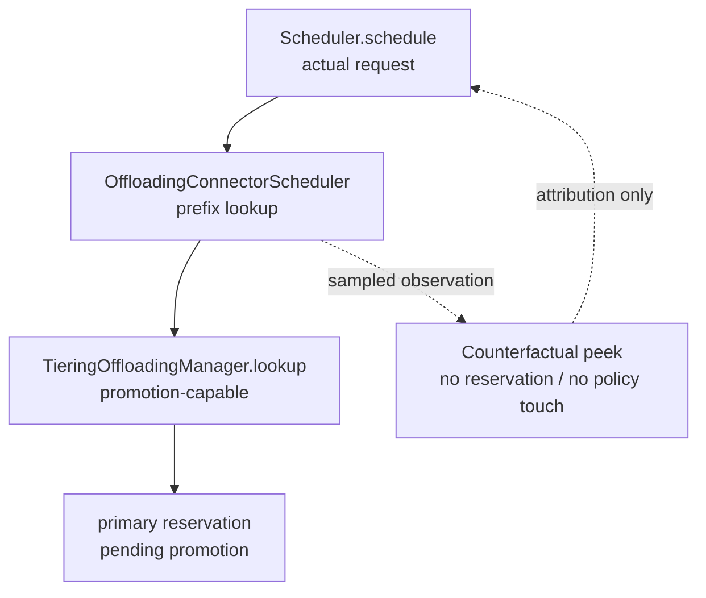
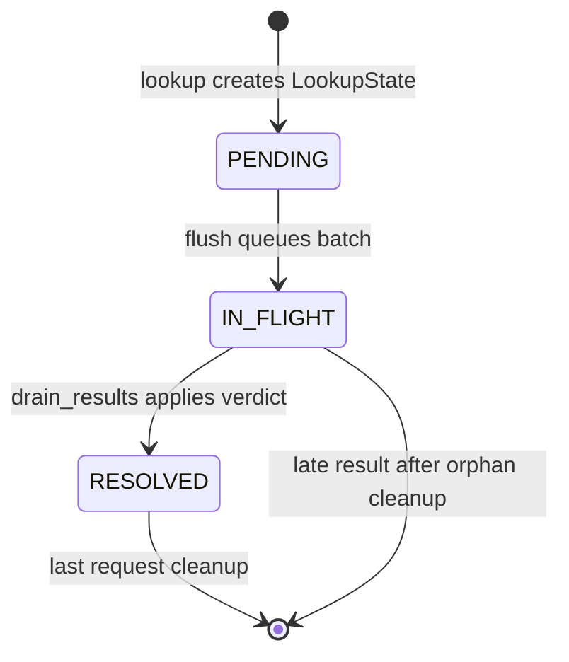

> 源码基线：[`3ea7fcdc`](https://github.com/vllm-project/vllm/commit/3ea7fcdc98380289bb496de0ffff24a2746c9c77)，研究时 `vllm-project/vllm` 默认分支最新提交。相对第 88 章基线前进 [116 个提交](https://github.com/vllm-project/vllm/compare/1bf414e97acf7563297726531f702cdbea6b2921...3ea7fcdc98380289bb496de0ffff24a2746c9c77)；`tiering/manager.py`、`tiering/async_lookup.py` 与 connector 入口未改变。新合入的 [`33ca7f41`](https://github.com/vllm-project/vllm/commit/33ca7f415b23346a8601ac6dc46297dafcfd9f64) 增加 `async_init` 就绪门，但没有增加 counterfactual peek。

## 本篇在课程路线中的位置

第 88 章把 promotion allocation failure 的成本定义成 `oracle_boundary - actual_boundary`，同时留下一个关键空洞：首个 `MISS` 之后，main 不再知道 secondary suffix 到底还存在多少块。今天只回答一个问题：**怎样观察那条反事实前缀，却不启动 promotion、不改变容量、不污染真实 lookup 状态？**

课程位置是：`allocation failure → actual boundary → observational peek → boundary interval → cause-tagged token debt`。本章不实现 wait queue，也不把建议接口描述成已合入功能。

## 前置知识回顾

`OffloadKey` 是 block hash 与 4-byte KV group index 拼成的 `bytes`；`ReqContext` 保存 request id、tier filter、per-request state 与 key 的 token end position。secondary `HIT` 还不能直接供 GPU 使用：数据必须先获得 primary CPU chunk，完成 promotion，才可能成为外部 prefix hit。

第 88 章的 21-token 例子中，actual boundary 为 12，理想 boundary 可能为 20。但“可能”不能直接记成 8-token debt：必须有一个不改写现实的观测证据。

## 本篇要回答的核心问题

1. 为什么继续调用 `TieringOffloadingManager.lookup()` 会改变被测系统？
2. 为什么绕过 manager 直接调用 FS tier 的 `lookup()` 仍不是纯读？
3. 最小 peek 结果、生命周期和归因守恒式应是什么？

## 组件在全局架构中的位置

当前生产链和建议观测链必须分离：

输入和输出都属于 Host 控制面：`OffloadKey: bytes`、token boundary: Python `int`、verdict: enum；没有 `torch.Tensor`，所以 shape/dtype/device 不适用。peek 只问 metadata/existence，不读取 KV payload，更不能把观测结果当作可执行的 GPU KV 所有权。

## 完整调用链

公开入口仍是 [`OffloadingConnector.get_num_new_matched_tokens`](https://github.com/vllm-project/vllm/blob/3ea7fcdc98380289bb496de0ffff24a2746c9c77/vllm/distributed/kv_transfer/kv_connector/v1/offloading_connector.py)。真实调用链如下：

1. [`Scheduler.schedule`](https://github.com/vllm-project/vllm/blob/3ea7fcdc98380289bb496de0ffff24a2746c9c77/vllm/v1/core/sched/scheduler.py) 先取得 local prefix，把 block-aligned boundary 交给 connector。
2. [`OffloadingConnectorScheduler.get_num_new_matched_tokens`](https://github.com/vllm-project/vllm/blob/3ea7fcdc98380289bb496de0ffff24a2746c9c77/vllm/distributed/kv_transfer/kv_connector/v1/offloading/scheduler.py) 更新 request keys；若 `async_init` 尚未收齐 worker readiness，直接返回 0 external tokens。这是 `OFFLOADING_DISABLED`，不能误归因为容量失败。
3. `_maximal_prefix_lookup()` 顺序调用 manager；`HIT/HIT_PENDING` 推进连续前缀，`RETRY` 让本 step defer，首个 `MISS` 截断。
4. [`TieringOffloadingManager.lookup`](https://github.com/vllm-project/vllm/blob/3ea7fcdc98380289bb496de0ffff24a2746c9c77/vllm/v1/kv_offload/tiering/manager.py) 先处理完成 job、查询 primary、记录 lookup metric，再扫描 secondary。secondary `HIT` 会立即进入 `_initiate_promotion()`。
5. `_initiate_promotion()` 调用 `primary.prepare_write([key])`。成功会分配具体 CPU chunk，写入 `_pending_load_submissions`；失败会递增 `PROMOTION_ALLOCATION_FAILURES` 并返回 `MISS`。

因此，在 failure key 后继续走同一 `lookup()`，既可能抢占刚释放的 primary chunk，也可能驱逐 victim、创建 pending promotion、改变后续请求看到的容量。这不是测量，而是一次新的调度决策。

## 关键类型、字段和状态生命周期

FS tier 更能说明“只查存在性”也不自动等于无副作用。[`FileSystemTierManager.lookup`](https://github.com/vllm-project/vllm/blob/3ea7fcdc98380289bb496de0ffff24a2746c9c77/vllm/v1/kv_offload/tiering/fs/manager.py) 委托给 [`AsyncLookupManager`](https://github.com/vllm-project/vllm/blob/3ea7fcdc98380289bb496de0ffff24a2746c9c77/vllm/v1/kv_offload/tiering/async_lookup.py)：

`LookupState` 持有 `generation`、`phase`、`result` 与 `request_ids`；`_req_keys` 是反向索引。第一次 lookup 会创建 state、把 `(key, ReqContext, generation)` 加入 `_lookup_batch`；`on_schedule_end()` 才 flush 到 worker；后台 `batch_lookup()` 对 FS 文件路径做批量 existence probe；结果回到 scheduler 线程后才进入 `RESOLVED`。request finish 必须 cleanup，否则状态泄漏。

这段生命周期有三个直接结论：

- 直接调 secondary `lookup()` 会修改正常 cache、queue、request reference 与后续 lookup 延迟；它不是 observational API。
- 直接在 scheduler 线程调用 `batch_lookup()` 虽少了 cache side effect，却违反“同步 backend probe 只在 worker thread 执行”的非阻塞假设，远端 tier 还可能拖长 scheduler critical path。
- 当前 worker 捕获 backend/iterator 异常后把该组结果降为 `False`。这适合 fail-closed 的真实 lookup；但 counterfactual attribution 若把 I/O error 当 `ABSENT`，会系统性低估可复用前缀。因此 peek 至少需要 `PRESENT/ABSENT/UNKNOWN` 三态。

### 建议观测对象的生命周期与接口契约

建议不要给现有 `lookup(key)` 增加一个容易被误用的 `dry_run=True`，而是建立独立、批量化的 `PeekTicket`。只有真实链已经提交 `actual_boundary` 且原因被确定为 `PROMOTION_NO_CAPACITY` 后，诊断层才创建 ticket；输入是连续后缀 keys、group、实际边界、最大探测数和 deadline，输出是带 `observation_id` 的三态向量。ticket 不持有 primary chunk、KV tensor、cache-policy node 或 request scheduling lease，所有权完全属于有界 observer。

| 阶段 | 持有者 | 允许动作 | 禁止动作 |
| --- | --- | --- | --- |
| `QUEUED` | observer scheduler | 合并同 backend 的 metadata probes、限流 | 调 `prepare_write`、触碰正常 `_lookup_batch` |
| `IN_FLIGHT` | tier observer worker | 查询存在性、记录开始时间与 backend revision（若有） | 读写 KV payload、刷新 eviction recency |
| `RESOLVED` | attribution collector | 计算连续 `PRESENT` lower bound 与 `UNKNOWN` upper bound | 回写 request 的 `num_computed_tokens` |
| `EXPIRED/CANCELLED` | collector | 关闭 trace、记 incomplete reason | 把迟到结果复活为新的调度事实 |

前置条件是 failure cause、key 顺序和 actual boundary 已冻结；后置条件是 allocator、policy、normal metrics、pending jobs 与 SchedulerOutput 完全不变。若 backend 不支持无扰动 metadata query、deadline 到期、revision 在观测中变化，结果必须是 `UNKNOWN` 或 `UNSUPPORTED`。request 已结束时可以保留聚合 cost trace，但迟到结果不能重新打开 request，也不能改变已经执行的 token charge；这与 `LookupState.generation` 防 stale result 的思想相同，却必须使用独立 namespace 和 retention。

## 逐函数源码解读

### `_maximal_prefix_lookup()`：结果是可消费连续前缀

它的返回值不是“后端有哪些 key”，而是“当前调用链能承诺加载多少连续 chunks”。`HIT_PENDING` 已意味着 promotion/写入在途，`RETRY` 也会驱动异步 lookup。复用这套 enum 做 shadow oracle，会把 presence、readiness 与 reservation 三个概念混在一起。

### `TieringOffloadingManager.lookup()`：读与写被刻意融合

manager 在同一锁域内完成查找、promotion reservation 与来源记录，目的是让 secondary HIT 到 primary slot 的 ownership 不留竞态窗口。这对执行正确，却恰好说明它不应承担反事实观测。所谓 side-effect-free 不是“不写 KV bytes”，而是不得改变 allocator、eviction policy、pending jobs、normal lookup metrics、request lifecycle 与真实 verdict cache。

### `AsyncLookupManager.lookup()`：existence probe 也有 ownership

probe 由 request 引用持有，重复 key 合并为一次 batch；generation 防止旧结果覆盖 cleanup 后重建的新 state。它是一套完整的共享异步对象，而不是无状态的 `exists(key)`。一个可用的 peek 可以复用 tier 的底层 existence primitive，却不能偷用这套正常 `_lookup_state`。

## 具体示例与 shape/状态演算

沿用 `tokens_per_chunk=4`、21-token request。local + primary 已确认到 token 12；K3=`[12,16)` 在 secondary 命中，但 primary full，所以 actual lookup 在 K3 返回 `MISS`。

建议的异步 peek 对 K3、K4 只返回 presence：

| key | token 区间 | peek verdict | 解释 |
| --- | --- | --- | --- |
| K3 | `[12,16)` | `PRESENT` | failure 时 secondary 可见，但没有 primary ownership |
| K4 | `[16,20)` | `PRESENT` | 连续反事实前缀可延伸到 20 |
| tail | `[20,21)` | 不查询 | 最后 1 token 本来就必须计算 |

于是 `observed_boundary=20`、`actual_boundary=12`，可归因 debt 为 8 tokens。若 step token budget=4，实际调度区间依次为 `[12,16)`、`[16,20)`、`[20,21)`；每步 charge 定义为：

`charged = length(scheduled_interval ∩ [actual_boundary, observed_boundary))`

三步分别计 4、4、0，总和恰为 8，不把必算 tail 误归因，也不会因跨 step 重复收费。

若 K4 因 backend timeout 返回 `UNKNOWN`，就不能伪造精确 oracle。此时已证实的 lower boundary 是 16，可报告 `debt_lower=4`；按请求剩余完整 chunks 得到 `debt_upper=8`，并将 trace 标成 `INCOMPLETE`。这比把异常当 MISS 后报告 4 更诚实。

建议的 `AttributionTrace` 至少携带：`observation_id`、内部 `request_id`、KV group、cause=`PROMOTION_NO_CAPACITY`、failure key position、actual boundary、lower/upper observed boundary、tokens-per-chunk、tier、status、start/end step sequence。它应进入有界采样事件或 request-local ring，而不是把 request id 放进 Prometheus label；聚合指标只保留低基数的 cause/tier/status。

## 为什么这样设计及替代方案

**方案一：继续真实 lookup。** 实现为零，但会 reservation/evict/promote，直接篡改 counterfactual，排除。

**方案二：同步扫描所有 secondary。** 容易得到单次结果，却把文件系统、对象存储或网络延迟塞进 scheduler critical path；长 suffix 还会制造查询放大。

**方案三：只报告 actual recompute。** 成本最低、完全准确，但只能回答“算了多少”，不能回答“其中多少由 promotion capacity failure 造成”。它应当保留为 peek 未完成时的基线指标。

**方案四：有界、采样、异步三态 peek。** 这是最小充分设计：独立 observation state；最多查询 N 个后续 keys；不触发 primary/policy；返回 lower/upper boundary；超时/错误为 `UNKNOWN`；只用于诊断，直到一致性协议足以支撑控制决策。代价是额外 secondary metadata I/O、状态清理和 race 解释，但这些成本可单独限流与关闭。

## 性能、并发、正确性与边界条件

- **延迟与吞吐**：peek 不应阻塞当前 request。预算应同时限制采样率、keys/trace、in-flight observations 和 backend QPS；否则诊断本身会争用 FS metadata 或网络。
- **显存与主存**：它不分配 GPU/primary KV chunk，只产生有界 Host metadata。若实现出现 `prepare_write`、policy touch 或 `TransferJob`，契约已经被破坏。
- **并发一致性**：manager lock 只能冻结进程内 tiering state，不能冻结共享 FS/P2P 后端。peek 结果是带时间窗口的 observation，不是 durable snapshot；store/delete race 应返回或升级为 `UNKNOWN`，不能参与正确性恢复。
- **graphability**：peek 不进入 ModelRunner，也没有 device tensor，不影响 CUDA Graph capture；它只改变诊断成本。归因出的额外 rows 可能解释 graph bucket/padding变化，但不能由此声称某个 kernel 时间就是 debt。
- **正确性**：只有连续 `PRESENT` 才推进 lower boundary；任一 `ABSENT` 截断，任一 `UNKNOWN` 终止精确结论。观测不得改变正常 request 的 schedule、输出 token 或 KV ownership。
- **维护成本**：所有 secondary tier 都要定义 presence 语义。FS 的 file exists、P2P 的 remote claim、对象存储 metadata 不是同一种一致性；统一接口必须允许 tier 返回 `UNSUPPORTED/UNKNOWN`。

## 测试证据与未覆盖风险

现有 [`test_async_lookup.py`](https://github.com/vllm-project/vllm/blob/3ea7fcdc98380289bb496de0ffff24a2746c9c77/tests/v1/kv_offload/tiering/test_async_lookup.py) 已证明普通 lookup 有状态：新 key 返回 `None` 并经历 `PENDING→IN_FLIGHT→RESOLVED`；同 key 重复 lookup 只入队一次；两个 request 共享 state，最后一个 cleanup 才删除；stale generation 结果不能覆盖新请求；iterator failure 被转为 misses，同时后续健康 request 继续执行。它验证的是 production lookup 的安全生命周期，不是 peek purity。

[`test_partial_lookup`](https://github.com/vllm-project/vllm/blob/3ea7fcdc98380289bb496de0ffff24a2746c9c77/tests/v1/kv_offload/tiering/test_tiering_offloading.py) 在 5 keys 中只放前 3，确认连续 hit 为 3；它没有制造“secondary present、primary promotion allocation fail”，也没有 oracle boundary。

最小新增 Cost Golden 应包含五组断言：

1. 在 primary-full fixture 中触发 K3 failure，快照 free list、eviction policy、jobs、pending promotions 与 normal lookup metrics；peek 前后完全相等。
2. FS peek 可异步得到 K3/K4 presence，但不创建正常 `LookupState/_req_keys`；timeout/iterator error 返回 `UNKNOWN`。
3. `PRESENT,PRESENT` 得到 debt `[8,8]`；`PRESENT,UNKNOWN` 得到 `[4,8]`；`PRESENT,ABSENT` 得到 `[4,4]`。
4. 小 token budget 下，逐 step interval charge 总和不超过 boundary debt；abort、后续 external recovery 与 request finish 都能终止 trace且不重复计费。
5. 开关 peek 前后 SchedulerOutput、KV block ownership 与最终 token 完全一致；双请求竞争刚释放 slot时也不得因 observer 改变胜者。

这些是建议测试，当前 main 没有实现。本次研究也没有运行 GPU/FS 真机实验。开放 [PR #60128](https://github.com/vllm-project/vllm/pull/60128) 仍在研究 lazy primary allocation；开放 [PR #67052](https://github.com/vllm-project/vllm/pull/67052) 跟踪 promotion 落地后的 outcome。它们截至 2026-11-17 均未合入，也都不提供 allocation-failure counterfactual peek。

## 与前后章节的连接

第 88 章定义了 token debt，却只有未知的 oracle；本章把 oracle 收缩为“有时间窗口、可不完整、绝不改写现实”的 observation，并给出跨 step 守恒计费。下一章将研究如何把这 8 个 cause-tagged tokens 接到 ModelRunner/GPU 时间，而不把排队、padding、其他 request 或 graph bucket 切换错误归因给一次 promotion failure。

## 本篇结论、知识债、三个理解检查问题和下一章

结论：当前 `lookup()` 的语义是“查找并尽力让数据可消费”，不是“只观察存在性”。manager lookup 会 reservation/promotion，FS lookup 也会创建异步 state；直接复用任一层都会污染反事实。可辩护的最小 peek 必须独立、有界、异步、三态，并只输出 lower/upper boundary。精确 token debt再通过 scheduled interval 与 `[actual, observed)` 的交集跨 step守恒累加。

知识债：跨 tier presence/consistency 契约；采样与 QPS 预算；request-local trace codec/retention；abort/recovery closing；GPU-time join；P2P/FS store-delete race；真机 observer-overhead 与双请求无扰动 Golden。

理解检查：

1. 为什么直接调用 `TieringOffloadingManager.lookup()` 测 K4，会改变 K4 之后的容量现实？
2. 为什么 FS `batch_lookup()` 的异常在生产 lookup 中可降为 MISS，而 attribution peek 必须保留 `UNKNOWN`？
3. 三个 scheduling step 的 token 数为 4、4、1，为什么只给 promotion failure 计 4、4、0？

下一章：**从 Token Debt 到 GPU Time——Cause-tagged Step Interval、Padding 分摊与 Cost Conservation Golden。**

## 课程账本增量

- 第 89 章，阶段 9“测试、性能与故障诊断”。
- 新闭合链：`normal lookup side effects → isolated async peek → lower/upper observed boundary → cross-step token charge`。
- 新不变量：正常 `lookup` 是 ownership-producing 操作；existence probe 也有异步状态生命周期；counterfactual error 必须是 `UNKNOWN`；observer 不得改变 allocator/policy/job/normal metric/SchedulerOutput；request id 不进入 Prometheus label。
- 当前实现边界：main 没有 peek、counterfactual trace 或 cause-tagged scheduled-token accounting；本文接口与 Golden 是证据约束下的最小设计，不是已合入计划。
