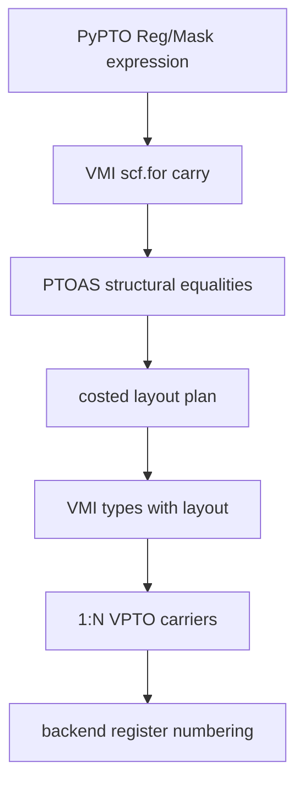
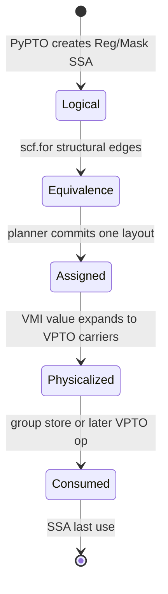

## 本篇在 PTO 课程路线中的位置

这是 PTO 全栈课程第 100 章。上一章已经说明 PyPTO 如何把 `VecReg`/`MaskReg` 作为 `scf.for iter_args` 跨回边传递；本章只向下追一层：这些尚未指定物理排布的 VMI SSA value，怎样在 PTOAS 中取得一个循环前后自洽的 layout，并变成 VPTO 可执行的 carrier。

分析基线是研究时默认分支最新提交：PyPTO [`1c445b337e5a`](https://github.com/hw-native-sys/pypto/commit/1c445b337e5af267fd8966fbf4480ed5501932bf)，PTOAS [`6c8f9e845496`](https://github.com/hw-native-sys/PTOAS/commit/6c8f9e845496adda51d7e5642caeb58006186742)。相对第 99 章分别前进 [8 个提交](https://github.com/hw-native-sys/pypto/compare/442b793f38ab7ff43ab6304d6bc34fb001841f81...1c445b337e5af267fd8966fbf4480ed5501932bf) 与 [4 个提交](https://github.com/hw-native-sys/PTOAS/compare/5089169d517c921842e644a0d5ec09921c6351ab...6c8f9e845496adda51d7e5642caeb58006186742)。直接相关的 cost-driven planner 由 PTOAS [`b8fa2e93b5dd`](https://github.com/hw-native-sys/PTOAS/commit/b8fa2e93b5dde141d5f58ac6d83928699e9dbd79) 合入；最新 HEAD 对控制流支持文件的变化是 codecheck 整理，本文结论以当前代码和测试为准。

## 前置知识

1. `!pto.vmi.vreg<NxT>` / `!pto.vmi.mask<Nxpred>` 描述逻辑 lanes，不等于某个硬件寄存器编号。
2. `scf.for` 的 init、body block argument、yield operand 和 result 是同一个循环状态在四个程序点的 SSA 版本。
3. VMI layout assignment 决定逻辑 lane 到物理 carrier/lane 的映射；之后的后端 register allocator 才决定实际寄存器号。两者不能混称“寄存器分配”。

还要区分 shape、layout 与 location。`vreg<8xf32>` 的 `8` 是逻辑元素数，`group_slots<8,8>` 说明八个元素放在哪些 carrier lane，`!pto.vreg<64xf32>` 才是 VPTO 可操作的载体类型；三者都不表示数据位于 GM/UB。GM/UB 只在 `!pto.ptr<f32, gm|ub>` 一侧出现，load 完成后 value 属于 vector register domain，store 才把语义 lane 写回存储。

## 今日两个紧密相连的核心问题

1. 为什么一次循环 carry 的四个 SSA 端点必须形成 layout fixed point？如果各自选择 layout，会在哪里破坏零次迭代或回边语义？
2. 当 grouped reduction 每组只产生一个标量时，`group_slots<G,K,LS>` 如何把 G 个结果装入 carrier，并让 `scf.for` 的逻辑 carry 变成 1:N 个 VPTO value？

## PTO 全栈中的位置



上游输入是 PyPTO helper 中无 layout 的 VMI register/mask；下游消费者是 VMI-to-VPTO lowering、调度和机器后端。本文停止在 VPTO carrier：不会把“一个 `!pto.vreg<64xf32>` SSA value”误说成“已占用物理寄存器 V0”。

这一链发生在单个编译 module 内，不存在 runtime 线程或跨进程共享对象。并发假设是：layout pass 在 IR 仍保持 SSA 与结构化控制流时运行，所有 producer、consumer 和回边都可见；若先把控制流破坏成不可追踪跳转，或把 helper 作为不透明外部调用而没有 ABI layout，planner 就无法凭局部信息恢复正确 fixed point。函数调用边界因此要么携带显式 ABI layout，要么作为求解边界处理，不能把调用方和被调方的物理排布靠名称猜在一起。

## 概念和精确语义

### 1. 循环 layout fixed point

[`VMIControlFlowSupport::addForConstraints`](https://github.com/hw-native-sys/PTOAS/blob/6c8f9e845496adda51d7e5642caeb58006186742/lib/PTO/Transforms/VMI/VMIControlFlowSupport.cpp) 对第 `j` 个 carry 建立：

```text
init[j] ≡ regionIterArg[j] ≡ yieldOperand[j] ≡ forResult[j]
```

这里的 `≡` 是 layout 相等，不是数值相等。它有两条必要性：正常回边要求 `yield` 能在下一迭代直接成为 block argument；零次迭代时 result 直接取 init，因此 result 也不能拥有另一种 layout。`MaskReg` 走同一结构约束；具体候选 layout 仍由 mask 的粒度、producer/consumer 支持关系决定。

planner 先由 [`VMILayoutStructuralEdgeProvider`](https://github.com/hw-native-sys/PTOAS/blob/6c8f9e845496adda51d7e5642caeb58006186742/lib/PTO/Transforms/VMI/Layout/VMILayoutStructuralAssignment.cpp) 收集控制流 equality，再由 [`VMILayoutPlanner.cpp`](https://github.com/hw-native-sys/PTOAS/blob/6c8f9e845496adda51d7e5642caeb58006186742/lib/PTO/Transforms/VMI/Layout/VMILayoutPlanner.cpp) 构造 SSA component、枚举每个 op 的合法 layout relation，并按已建模的 carrier/重排成本求解。提交计划前还会再次检查每条 structural equality；不一致会报 layout contract 错误，而不是悄悄在回边插转换。

这套约束有明确的前置与后置条件。前置条件是四个端点的逻辑 element count、element type 与 carry 次序已经由 `scf.for` 验证一致；layout pass 不负责修复一个 `8xf32` init 对 `16xf32` yield 的类型错误。后置条件是每个参与 VMI 运算的 value/use edge 都有已注册且可 lower 的 relation，结构边上的两端 layout 相同。候选为空、search budget 耗尽、函数 ABI 固定 layout 与循环 equality 冲突，都会 fail closed。只有普通 producer-consumer use edge 能通过显式 materialization 接驳不同 layout；控制流回边不能借这种转换逃避等价约束。

可以把求解过程压缩成四步：先从 VMI value 与 structural edge 划分连通 component；再为 load/reduce/add/store 分别查询支持表，得到“各端口 layout + intrinsic rearrangement”的 relation；然后在 equality 与 ABI 边界下搜索总代价最小的组合；最后以 exact request 提交并复核。这里的代价是编译器模型，不是实测周期数；相关合入提交也明确把 memory cost 作为 total 相等时的次级比较，避免把未校准单位直接相加。

### 2. `group_slots<G,K,LS>`

group-slot layout 只为每组结果保存有语义的 lane。设逻辑结果数 `N=G`，则第 `g` 组映射为：

```text
carrier(g) = floor(g / K)
lane(g)    = (g mod K) × LS
carrier_count = ceil(G / K)
```

`G` 是组数，`K` 是每个 carrier 容纳的组槽数，`LS` 是相邻槽的逻辑 lane stride；三者必须为正，最大 lane 必须落在 carrier 容量内。未映射 lane 是 padding，没有可被普通 dense op 读取的逻辑值。规范与 lowering cases 见 [`vmi-layout-assignment-lowering-design.md`](https://github.com/hw-native-sys/PTOAS/blob/6c8f9e845496adda51d7e5642caeb58006186742/docs/designs/vmi-layout-assignment-lowering-design.md) 和 [`vmi-layout-lowering-cases.md`](https://github.com/hw-native-sys/PTOAS/blob/6c8f9e845496adda51d7e5642caeb58006186742/docs/designs/vmi-layout-lowering-cases.md)。

`K` 不是固定等于 8。原生八组 FP32 reduction 可用 `K=8, LS=1`；某些 16-bit integer reduction 因结果 lane 宽化会用不同 stride；dense masked-row fallback 甚至用 `K=1`。消费者必须显式支持相同 group-slot 契约，例如 `group_store`/`group_broadcast`；普通 dense `vadd` 只有在双方 layout 相同且该 relation 已注册时才合法。

合法与非法组合可以直接列清：

| 组合 | 结果 | 原因 |
| --- | --- | --- |
| `group_slot_load → scf.for → group_store`，均为 `G=8,K=8` | 合法 | producer、carry equality、consumer 共享同一 relation |
| `group_reduce` 结果与同 layout accumulator 做 `vadd` | 合法 | 两个输入和结果都由已注册的 same-layout 算术 relation 约束 |
| `group_slots<8,8>` 直接喂给普通 contiguous store | 非法或需显式 materialization | padding lane 不属于逻辑 dense 值，不能静默 reinterpret |
| loop init 为 `group_slots<8,8>`、yield 为 contiguous | 非法 | 下一迭代 block argument 和 zero-trip result 无统一解释 |
| `G=8,K=8,LS=9` 放进 64-lane FP32 carrier | 非法 | 最后一槽 lane 63 之后越界 |

最后一行的判断来自 `(K-1)×LS` 必须落入 carrier lane 范围；它不是“只要总元素数小于 64 就行”。这正是 layout 属性比单纯 shape 更严格的地方。

## 真实文件、类型、API 或指令逐段解读

PyPTO 的 [`vf_codegen.cpp`](https://github.com/hw-native-sys/pypto/blob/1c445b337e5af267fd8966fbf4480ed5501932bf/src/codegen/pto/vf_codegen.cpp) 仍把 hardware-loop carry 限制为 `RegType`。[`pto_control_flow_codegen.cpp`](https://github.com/hw-native-sys/pypto/blob/1c445b337e5af267fd8966fbf4480ed5501932bf/src/codegen/pto/pto_control_flow_codegen.cpp) 只输出逻辑类型与 `iter_args/yield`，没有替下游猜 layout。这是正确的抽象边界：前端知道值依赖，却还不知道相邻 grouped op 支持哪些物理排布。

关键接口可按所有权与失败方式理解：

| 层次 | 输入 | 输出 | 所有权/设备 | 失败方式 |
| --- | --- | --- | --- | --- |
| PyPTO codegen | `RegType(lanes,dtype)`、loop init/yield | 无 layout 的 VMI SSA | helper 内 immutable value；register domain | 非 Reg/Mask carry、类型或 arity 不同即拒绝 |
| layout assignment | VMI op graph、ABI、control-flow edges | 带 `#pto.vmi.layout` 的同一逻辑 SSA graph | 编译器持有 IR；不搬数据 | 无合法 relation、equality 冲突或预算不足即诊断 |
| VMI-to-VPTO | assigned VMI types | 一个或多个 VPTO carrier | device vector/mask value；仍为 SSA | layout 无 lowering、shape/stride 不支持即 match failure |
| backend allocator | VPTO live ranges 与调度约束 | 实际寄存器/必要 spill | 最终设备资源 | 超预算时可能 spill 或编译失败，本文尚未追踪 |

PTOAS 的 [`VMILayoutPlanner.cpp`](https://github.com/hw-native-sys/PTOAS/blob/6c8f9e845496adda51d7e5642caeb58006186742/lib/PTO/Transforms/VMI/Layout/VMILayoutPlanner.cpp) 对 `group_slot_load` 枚举 `group_slots(groups, groups)`，对 `group_load`、group reduction、算术和 store 枚举成套 relation。solver 选择的是全 component 的合法组合，而不是逐 op 贪心选 layout；循环 equality 会把一次选择传播到 init、arg、yield 与 result。

[`VMIToVPTODataLayoutInternals.cpp`](https://github.com/hw-native-sys/PTOAS/blob/6c8f9e845496adda51d7e5642caeb58006186742/lib/PTO/Transforms/VMIToVPTO/VMIToVPTODataLayoutInternals.cpp) 负责 layout materialization。一个 dense `256xf32` 若选择 `block_deinterleaved=4`，会展开为四个 `64xf32` carrier，循环签名也随之出现四组 iter_arg/yield；而 `group_slots<8,8>` 的 `8xf32` 只需一个 `64xf32` carrier。它是 MLIR 1:N 类型转换，不是修改某个既有硬件寄存器的内容。

## 对象、Register 与 IR 生命周期



所有权始终是编译器 SSA 所有权，不涉及 UB allocation：load 创建逻辑 register value，loop block argument 借由 SSA edge 接收它，yield 创建下一版本，loop result 被 store 消费。物理化后，一个逻辑 value 可能对应多个 VPTO values；直到更低层 register allocation，才会为 live range 选择实际寄存器并在最后使用后复用编号。

“旧版本何时失效”也需要精确表达。SSA value 不会被原地修改：第 `t` 次迭代的 `%arg_t` 被 reduction/add 消费，`%next_t` 经 `scf.yield` 成为第 `t+1` 次的 `%arg`；只有当所有 use 完成后，其 live range 才结束。循环外只暴露 `%acc_final`。若 1:N conversion 将一个逻辑值拆成四个 carrier，这四条 live range 必须作为同一次逻辑转换的结果保持端口顺序，但可以在更低层分别分配与复用；任何一个分量缺失都不能把其余三个当作完整值。

## 端到端调用链或指令链

`pl.reg_scope / pl.hardware_loop(init_values)` → PyPTO `ForStmt` → `PTOCodegen::VisitStmt_(ForStmt)` → VMI `scf.for iter_args/scf.yield` → PTOAS `vmi-lower-unified-to-legacy` → `vmi-mask-granularity-assignment` → `vmi-layout-assignment` → structural equality + cost solver → 带 layout 的 VMI → `vmi-to-vpto` 1:N conversion → VPTO `vsldb/vcgadd/vadd/vstus` → 后续调度与设备产物。

其中 assignment 与 physicalization 是两个提交点：前者让类型显式携带 layout，后者才改变 value arity 与具体 VPTO 指令。

## 具体 shape、Tile 和状态演算

直接 lit 用例 [`vmi_layout_assignment_group_slots_scf_for.pto`](https://github.com/hw-native-sys/PTOAS/blob/6c8f9e845496adda51d7e5642caeb58006186742/test/lit/vmi_new/vmi_layout_assignment_group_slots_scf_for.pto) 足够小：`init[8]`、`src[8,16]`、`out[8]` 都是 FP32，数据位于 UB；循环执行两次。

每次迭代：

1. `group_load` 读 8 组 × 16 lane，逻辑类型 `vreg<128xf32>`，选 `block_deinterleaved=2`，物理化为两个 `vreg<64xf32>`。
2. `create_group_mask` 产生 `mask<128xb32, block_deinterleaved=2>`。
3. `group_reduce_addf` 每组归约 16 个数，输出逻辑 `vreg<8xf32, group_slots<8,8>>`。
4. accumulator 的 init、loop arg、`vadd` result、yield 与 loop result 全为同一 `group_slots<8,8>`。
5. 因 `ceil(8/8)=1`，它们物理上只携带一个 `vreg<64xf32>`；lane 0–7 对应八组，lane 8–63 是 padding。`PAT_VL8` 保证 add/store 只作用于语义 lanes。

状态表如下：

| 程序点 | 逻辑类型/layout | VPTO 载体 | 语义状态 |
| --- | --- | --- | --- |
| `%acc0` | `8xf32, group_slots<8,8>` | 1×`64xf32` | 从 `init[0..7]` 载入 lane 0–7 |
| `%x` | `128xf32, block_deinterleaved=2` | 2×`64xf32` | 八行各十六个源元素 |
| `%sum` | `8xf32, group_slots<8,8>` | 1×`64xf32` | 每行一个 reduction 结果 |
| `%next` / yield | 同 accumulator | 1×`64xf32` | `arg + sum`，只更新前八 lane |
| `%acc` / store | 同 accumulator | 1×`64xf32` | 第二次回边后的八个最终值 |

设 `src[r,c]=base[c]+r/32`，则测试 Golden 为：

```text
out[r] = init[r] + 2 × Σ(c=0..15) src[r,c],  r=0..7
```

`2` 来自两次 loop iteration；当前测试每次读取同一 UB source，重点验证 carry/layout，而不是动态地址推进。

还可以把数值完全算开。`base` 从 `-0.75` 等距到 `0.25`，十六项和为 `-4`；第 `r` 行每项再加 `r/32`，行和变为 `-4+r/2`。`init[r]=-0.25+r/8`，所以最终

```text
out[r] = -8.25 + 1.125r
       = [-8.25, -7.125, -6.0, -4.875,
          -3.75, -2.625, -1.5, -0.375]
```

这组具体值同时暴露三类错误：少执行一次迭代会少一个行和；group lane 排列错误会交换行；padding lane 泄漏通常会污染 store 范围或比较 shape。

## 为什么这样设计及替代方案

最小正确设计可以在每条回边插 `ensure_layout`，让 init、yield、result 各选局部最优 layout。但转换位于循环内时会按 trip count 重复，还可能因零次迭代让 result 缺少定义良好的转换路径。当前设计把控制流相等当硬约束，只在普通 use edge 上允许显式 materialization，正确性更直接，成本模型也能按循环权重比较候选。

固定点设计还有维护性收益：新增一种 control-flow op 时，只需把其值转运关系注册到共享 structural support，而不必让每个算术/访存 pass 各自理解循环。但代价也很真实——一个 consumer 的 layout 偏好可能通过 equality 约束整个 carry component；如果 component 很大，搜索空间和 budget 都会上升。当前实现选择“预算有限且失败可诊断”，而不是超时后随便退回 contiguous，这保证了编译结果可复现，却要求测试覆盖 budget 边界。

另一个替代是把八个 reduction 标量拆成八个独立 carry，或每次 spill 到 UB 再 reload。前者扩大 `scf.for` 签名与 live range 数量；后者增加 load/store 和跨迭代 memory dependence。`group_slots<8,8>` 用一个 carrier 保留八个有语义 lanes，代价是消费者必须理解 group-slot，不能把 padding 当 dense 数据。若后续确实需要 dense 向量，应显式 `group_broadcast`，而不是隐式猜测。

## 访存、计算、流水、并行和硬件约束

本例每迭代的 source 物理化为两个 64-lane载体，各做一次 `vcgadd`，再以 `PAT_VL8` 合并并累加到单 carrier accumulator。循环 carry 自身不访问 UB，避免引入新的 memory hazard；source load 与最终 group store 仍受 UB 对齐、mask 和同步规则约束。

资源权衡是可数的：`block_deinterleaved=2` 的 128-lane source 需要两个 carrier；`group_slots<8,8>` accumulator 需要一个；若 dense 256-lane carry 选 deinterleaved=4，则需要四个。carrier 数减少通常有利于寄存器压力和回边搬运，但本文没有 benchmark，不能据此承诺延迟或吞吐收益。actual register spill、bank conflict 和指令调度仍要以后端产物/真机数据确认。

流水上还存在一个容易忽略的区别：两个 source carrier 的 load/reduce 可以有并行机会，但 accumulator 回边形成严格的 loop-carried RAW，下一迭代不能在语义上越过上一迭代的 `%next`。group-slot 只减少这条依赖携带的 carrier 数，并没有消除 recurrence latency。`PAT_VL8` 也不是同步原语，它只限制有效 lane；UB load 完成、vector compute 与最终 store 之间仍需由既有 pipe/event 或 membar 机制保证可见性。若未来 scheduler 为隐藏 load 延迟而跨迭代移动指令，必须同时尊重 SSA recurrence 与 UB memory dependence，不能只看 carrier 数量。

容量约束同样不能由逻辑 shape 推断。逻辑 `8xf32` 只有 32 字节语义数据，但 VPTO 指令仍以 `64xf32` carrier 表达；padding 不增加逻辑结果，却会占用寄存器载体。反之，四个逻辑值分散在 `slots=1` 时可能需要四个 carrier，即使总语义字节更少。因此性能判断至少要同时统计 semantic lanes、carrier count、mask/rearrangement 指令和 live-range 重叠，单看 `N×dtype` 会系统性低估资源。

## 测试证据与未覆盖风险

PTOAS lit 同时运行 assignment-only 与 assignment+`vmi-to-vpto`：前者逐项检查五个 accumulator SSA 端点都是 `group_slots<8,8>`；后者检查循环只有一个 `!pto.vreg<64xf32>` carry、source 是两个载体、两次 `vcgadd` 以 `PAT_VL8` 合并，并以 grouped store 收尾。这验证了 IR 不变量，不是性能实验。

assignment-only 检查很重要：如果只看最终 VPTO，一个错误的 pass 可能先选错 layout、再插入转换，最终仍生成“看起来可执行”的指令，却把每迭代重排成本和 fixed-point 违约藏掉。反过来，只有 assignment 检查也不够，因为合法属性未必存在可执行 lowering。两个 RUN line 分别钉住“选择正确”与“可物理化”，DSL-ST 再补数值结果，形成结构、lowering、执行三层证据；三层仍没有覆盖性能与寄存器溢出。

设备侧 DSL-ST [`legacy_vmi_new_group_slots_scf_for_store.py`](https://github.com/hw-native-sys/PTOAS/blob/6c8f9e845496adda51d7e5642caeb58006186742/test/dsl-st/legacy_vmi_new_group_slots_scf_for_store.py) 把 GM 数据搬到 UB，执行同一两次循环，再将八个 FP32 结果搬回 GM；Golden 用 `np.allclose(atol=rtol=1e-4)` 比较上述公式。它证明该固定 shape 的数值链可运行，但没有覆盖：零 trip、动态 trip、MaskReg carry、`G` 不能整除 `K`、`LS>1`、跨分支 equality、layout search budget exhaustion、真实寄存器 spill 或多 helper 并发。

失败风险可分三层。语义层风险是 equality 漏边，使某个 branch/loop 端点独立选 layout；lowering 层风险是 support table 宣称合法但没有对应 materializer；设备层风险是 carrier 数和活跃区间组合触发 spill、调度停顿或未公开的对齐限制。现有三层测试主要覆盖前两层和一个固定设备数值点，尚没有构造高寄存器压力矩阵，也没有把编译器选择与最终汇编逐条对应。下一章必须先找到 actual allocator 的输入/输出证据，再决定能否做可重复的 spill threshold 实验。

事实边界还需明确：当前代码与测试证明 layout/physicalization 合法；`group_slots` 对 A5 指令的映射来自 PTOAS lowering；“更低寄存器压力”只是基于 carrier 数的推断，尚无测量。

因此本文不把一次编译成功外推为所有 shape 都正确，也不把一个固定数值用例外推为没有精度、对齐或资源边界；这些结论必须由各自的负向测试和设备矩阵单独建立。

## 与前后章节的连接

第 99 章回答“回边带什么值、UB 如何同步”；本章回答“这个值以什么 layout 穿过回边、如何展开为 VPTO carrier”。下一章应继续追同一链条的最后一段：actual live range、scheduler 与 backend register allocation 如何处理这些 1:N carriers，以及 layout 减少 carrier 是否真的避免 spill。

## 本篇结论、知识债、三个理解检查问题和下一章

结论只有三句：`scf.for` 的四个 carry 端点必须共享 layout；group-slot 保存的是每组结果而非 dense lanes；PTOAS layout assignment/physicalization 不等于最终硬件寄存器编号分配。

知识债：MaskReg carry 的粒度/物理化专项；partial packet 与 `LS>1`；零 trip/dynamic trip 数值测试；layout search budget 失败诊断；VPTO 后端 live range、spill 与真机性能。

理解检查：

1. 为什么 loop result 必须与 init layout 相同，即使循环 body 一次也没执行？
2. `group_slots<8,8>` 的 `8xf32` 为什么物理类型是 `64xf32`，而 lane 8–63 又不能被普通 dense consumer读取？
3. 若把 group-slot accumulator 每迭代转换成 contiguous，正确性是否仍成立？代价会落在哪条循环路径上？

下一章：**VMI 1:N carrier 的 live range 与实际寄存器分配——从 VPTO SSA 到 spill/reuse 的证据边界。**

## 课程账本增量

- 新确认：`init ↔ iter_arg ↔ yield ↔ result` 是硬 layout equality；zero-trip 是 result/init 相等的独立理由。
- 新覆盖：`VMILayoutPlanner`、`VMIControlFlowSupport`、structural assignment、VMI-to-VPTO data-layout materialization，以及 group-slot loop lit/DSL-ST。
- 新不变量：`group_slots<G,K,LS>` 只定义映射 lanes；1:N physicalization 改变 carrier arity但不分配寄存器号；不支持 group-slot 的 dense consumer 必须显式转换或诊断。
- 新知识债：Mask physicalization、partial packet/stride、allocator/spill 与设备性能。

