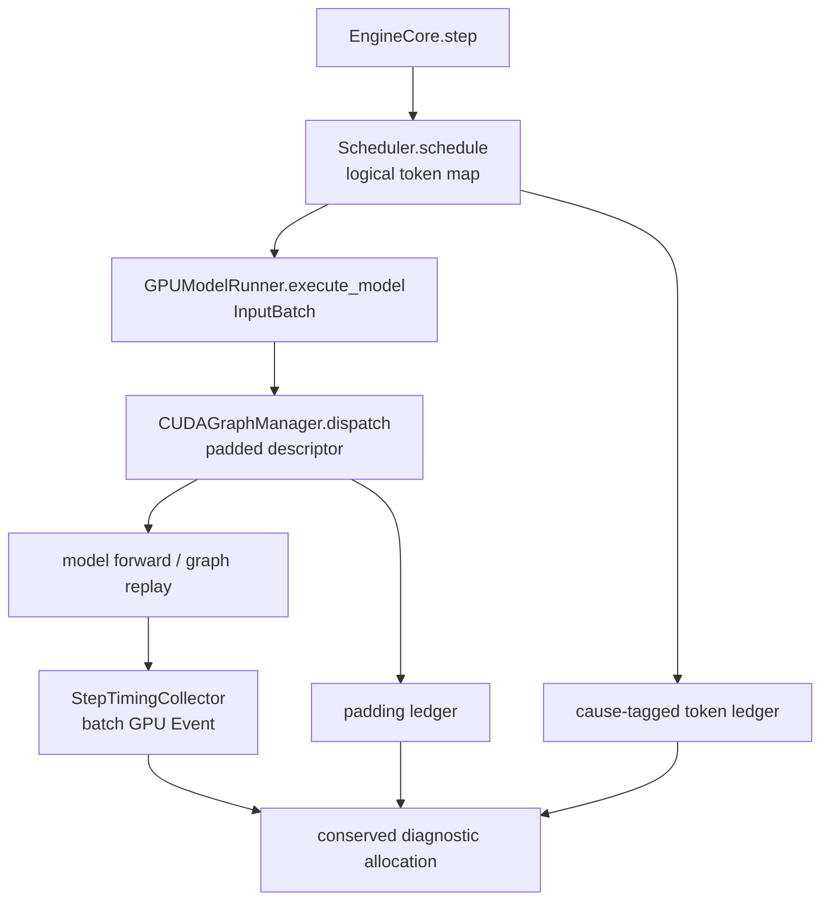

> 源码基线：vLLM 默认分支提交 [`a2915755`](https://github.com/vllm-project/vllm/commit/a2915755bf1dcaf80623e36d079713bfb190c1e7)。相对上篇基线 [`3ea7fcdc`](https://github.com/vllm-project/vllm/commit/3ea7fcdc98380289bb496de0ffff24a2746c9c77)，默认分支前进了 [91 个提交](https://github.com/vllm-project/vllm/compare/3ea7fcdc98380289bb496de0ffff24a2746c9c77...a2915755bf1dcaf80623e36d079713bfb190c1e7)；本文直接追踪的 Scheduler、ModelRunner、CUDA Graph dispatch 与 timing collector 生产路径没有语义变化。最新提交本身是 reload 参数标记修复，与本题无关。

## 本篇在课程路线中的位置

这是第 90 章，仍在“测试、性能与故障诊断”阶段。第 88 章定义 promotion MISS 的反事实 token debt，第 89 章用 side-effect-free peek 把它切成 cause-tagged、跨 step 的 token 区间。本篇只回答下一层问题：**这些 token 能否换算成 GPU 时间，以及怎样换算才不重复记账、不把共享成本冒充因果收益。**

课程链条推进为：`prefix attribution → Scheduler logical tokens → CUDA Graph padding → batch GPU Event → conservation ledger → counterfactual experiment`。

## 前置知识回顾

上篇的精确事实是：若请求的实际 prefix boundary 为 12，反事实可达 boundary 为 20，那么 debt 是区间 `[12,20)`；每个 step 只收取其 scheduled interval 与该区间的交集。这样 8 个 token 不会因跨三步执行而重复收费。

但“8 token”仍不是“8×某个固定毫秒数”。GPU forward 是一个共享 batch：不同请求的 context、MoE 路由、attention 工作量不同；CUDA Graph 还可能把 15 个真实 token 补成 18 个执行位置。我们必须先把逻辑工作、实际执行形状和测得时间分开。

## 本篇要回答的核心问题

1. `SchedulerOutput.num_scheduled_tokens`、`InputBatch.num_tokens` 和 `BatchExecutionDescriptor.num_tokens` 分别数什么？
2. 一个 batch 只有一次 GPU Event 时间时，怎样给 cause-tagged token 做**守恒的诊断分摊**？
3. 为什么这种分摊仍不是“修复 prefix promotion 后能节省的 GPU 时间”？

## 组件在全局架构中的位置



公开执行入口是 [`EngineCore.step`](https://github.com/vllm-project/vllm/blob/a2915755bf1dcaf80623e36d079713bfb190c1e7/vllm/v1/engine/core.py)：它先调用 `scheduler.schedule()`，有工作时把同一个 `SchedulerOutput` 交给 `model_executor.execute_model(..., non_block=True)`，完成后再由 Scheduler 消费输出。归因证据因此能在 Scheduler 的逻辑边界与 Worker 的物理执行边界之间 join，但二者不能混为一个计数器。

## 完整调用链

`Scheduler.schedule()` 为每个 request 算出 `num_new_tokens`，写入 `num_scheduled_tokens[req_id]`；随后求和并构造 [`SchedulerOutput`](https://github.com/vllm-project/vllm/blob/a2915755bf1dcaf80623e36d079713bfb190c1e7/vllm/v1/core/sched/output.py)。这个总数是**真实请求的逻辑 token 数**，源码明确要求它等于字典值之和。

`GPUModelRunner.execute_model()` 读取 request 数、逻辑 token 数与最大 query 长度，经 `dispatch_cg_and_sync_dp()` 选择执行模式。[`CUDAGraphManager.dispatch`](https://github.com/vllm-project/vllm/blob/a2915755bf1dcaf80623e36d079713bfb190c1e7/vllm/v1/worker/gpu/cudagraph_utils.py) 会选择能覆盖当前形状的最小兼容 graph；返回的 `BatchExecutionDescriptor.num_tokens` 可以大于逻辑数。DP 场景还会在各 rank 间协商最大形状，见 [`dp_utils.py`](https://github.com/vllm-project/vllm/blob/a2915755bf1dcaf80623e36d079713bfb190c1e7/vllm/v1/worker/gpu/dp_utils.py)。

接着 `prepare_inputs()` 令 `num_tokens_after_padding = max(num_tokens, batch_desc.num_tokens)`；[`InputBuffers`](https://github.com/vllm-project/vllm/blob/a2915755bf1dcaf80623e36d079713bfb190c1e7/vllm/v1/worker/gpu/input_batch.py) 中 `input_ids` 是 device 上的 `torch.int32[P]`，`positions` 是 `torch.int64[P]`。模型接收 padded shape；pipeline parallel 发送中间状态时却只发送未 padding 的 token。这再次说明 padding 是执行容器，不是新请求工作。

最后，[`StepTimingCollector`](https://github.com/vllm-project/vllm/blob/a2915755bf1dcaf80623e36d079713bfb190c1e7/vllm/v1/worker/gpu/async_utils.py) 用 GPU Event 记录一次 step 的 `forward_ms`，并附上 `input_batch.num_tokens`、request 数和是否 full cudagraph。它服务于 adaptive verification profiling，是**batch 级样本**，没有 request id 或 cause id。

## 关键类型、字段和状态生命周期

| 对象/字段 | shape、dtype、device | 所有权与生命周期 | 不变量 / 失败方式 |
| --- | --- | --- | --- |
| `SchedulerOutput.num_scheduled_tokens` | host `dict[str, int]` | Scheduler 创建；EngineCore、Executor、Scheduler 回写阶段共享本 step 快照 | `total == sum(values)`；超 token budget 会被截断 |
| `InputBatch.num_scheduled_tokens` | host `np.ndarray[int32]`, `[R]` | ModelRunner 按 batch order 构造 | adaptive verification 下是 upper bound；不能盲目当作实际执行总数 |
| `InputBatch.input_ids/positions` | device `int32[P]` / `int64[P]` | 预分配 buffer 的 step slice；forward 消费，下一步复用 | `P >= L`；超 capture shape 会退 eager 或选择另一图 |
| `BatchExecutionDescriptor` | host dataclass；`num_tokens=P` | dispatch 生成，准备输入与 graph replay 消费 | graph 必须覆盖 token/request/query shape；DP rank 需同意形状 |
| `StepTimingSample.forward_ms` | host `float`，来源为 GPU Event | collector 在 step 前后 record；同步后生成一次 batch 样本 | 不是 request 时间；event/stream 边界不完整会污染样本 |

状态不是从 `L`“变成”`P`，而是两个账本并行存在：Scheduler 持有 logical ownership；ModelRunner 持有 padded execution view。forward 结束后 buffer 可复用，`Scheduler.update_from_output()` 才按原 `num_scheduled_tokens` 推进/回滚 request 的 in-flight 状态。

```mermaid
stateDiagram-v2
    [*] --> Logical: "SchedulerOutput: L"
    Logical --> Padded: "dispatch: choose P >= L"
    Padded --> Executed: "forward / replay on P"
    Executed --> Timed: "one batch Event T"
    Timed --> Settled: "token + padding + residual = T"
    Settled --> [*]: "buffers reused; request state committed"
```



## 逐函数源码解读

**`Scheduler.schedule()`**：在 running/waiting 请求循环里产生每个 `num_new_tokens`，受 `max_num_scheduled_tokens` 等 budget 约束；构造输出前再次断言总数不越界。`_update_after_schedule()` 增加 `num_computed_tokens` 与 `num_in_flight_tokens`，`update_from_output()` 再按执行结果扣减 in-flight。归因区间必须绑定这份 step snapshot，不能事后用已变化的 request counters 重建。

**`dispatch_cg_and_sync_dp()` / `CUDAGraphManager.dispatch()`**：输入是逻辑 `num_tokens`、request 数和 query shape，输出是 `BatchExecutionDescriptor`。uniform decode 可为了 full graph 同时 padding token 与 request；非 uniform batch 可能选择 piecewise graph；无兼容图则保持精确逻辑形状并 eager。由 [`make_cudagraph_stats`](https://github.com/vllm-project/vllm/blob/a2915755bf1dcaf80623e36d079713bfb190c1e7/vllm/v1/worker/gpu/cudagraph_utils.py) 产生的 `CUDAGraphStat` 已保存 unpadded、padded、padding 数和 runtime mode，但没有 cause attribution。

**`StepTimingCollector` 与 `AdaptiveVerificationManager`**：collector 每个 timing context 只有一对 GPU Events。[`adaptive_verification.py`](https://github.com/vllm-project/vllm/blob/a2915755bf1dcaf80623e36d079713bfb190c1e7/vllm/v1/worker/gpu/spec_decode/adaptive_verification.py) 对 capture/tail 形状各 replay 5 次，取中位数形成 cost curve。当前 verify curve 主要按 target token 数分桶；这正提醒我们：它是 batch 成本曲线，不是 request 级因果计时。

## 具体示例与 shape/状态演算

采用现有 CUDA Graph 测试的真实形状：A–E 共 5 个请求，每个 uniform decode 3 token，所以

```text
num_scheduled_tokens = {A:3, B:3, C:3, D:3, E:3}
L = 15
FULL graph descriptor: P = 18, padded requests = 6
H = P - L = 3
```

假设 A 的 3 个 scheduled token 中，有 2 个落在上篇的 promotion-failure debt 区间。再假设 GPU Event 测得 `T=0.90 ms`；**0.90 ms 仅用于算术，不是 vLLM benchmark 结果。**

直接把整批 0.90 ms 记到 A 会在多 cause、多 request 时重复收费。若按逻辑 token 归一化，A 的 cause 得到 `0.90×2/15=0.12 ms`，但 3 个 padding 位置被悄悄摊给了真实 token。

本文建议用于诊断 Golden 的“执行位置守恒账”是：

```text
padding_account = T × (P-L)/P = 0.15 ms
cause_account   = T × debt_tokens/P = 0.10 ms
other_account   = T - padding_account - cause_account = 0.65 ms
```

三者严格相加为 0.90 ms；cause 不重叠时，每个 executed position 只收费一次。最终同时输出：`token_debt=2`（精确代码事实）、`gpu_account=0.10 ms`（线性诊断分摊）、`marginal_gpu_time=unknown`（尚未测量）。

## 为什么这样设计及替代方案

替代一：**每个 request 单独打 Event**。它看似精确，但 continuous batching 的 kernel/graph 是共享发射，单 request 没有天然开始/结束点；额外 event、拆 kernel 或 NVTX 也会增加开销并破坏 graphability。

替代二：**按 logical token 分摊全部 T**。实现最简单、总额也守恒，但隐藏 padding/DP dummy 的成本，跨 graph bucket 比较时会把形状税错误归到业务 request。

替代三：**把 token share 当成可节省时间**。这是最危险的。移除 2 个 debt token 后，15→13 可能仍落在同一个 padded bucket，也可能改变 full/piecewise/eager 模式；attention context、MoE expert、通信和 request slot 都是非线性的。因此守恒分摊只回答“这批观测时间怎样不重不漏地记账”，因果问题必须做 paired replay：固定其余 request、context、rank 与 graph policy，只改变该 debt 区间，再比较 GPU Events。

开放 [PR #62960](https://github.com/vllm-project/vllm/pull/62960) 也指出单一 adaptive-verification curve 会混合 token、request/context/slot 等因素，并提议拆分曲线及 graph cliff 修正；截至本文日期它仍是开放 PR，只能作为设计方向，不能当作 main 事实。

## 性能、并发、正确性与边界条件

- **延迟/吞吐**：padding 可能以固定 graph 换取更低 launch overhead 和更稳定吞吐；不能只看到 `H>0` 就判定浪费。
- **显存与 graphability**：预分配 `[P]` buffer 和固定 capture shape 提高复用与可捕获性，代价是 shape tax；归因记录应留在 host，避免进入 graph 输入。
- **并发**：一个 `SchedulerOutput` 对应一次执行快照；异步 executor 下必须用 step/sequence id join timing，不能用“最近一个样本”。DP 需记录协商后的 `P` 与各 rank event 聚合规则。
- **正确性**：cause intervals 必须互斥或有确定优先级；否则两个原因会同时认领同一 token。`UNKNOWN` 反事实区间只能进入 residual，不能被强制归因。
- **失败方式**：eager fallback、adaptive verification compact、PP 截去 padding、CUDA error 或 event 未完成都会让简单的 `P`/`T` join 失效；应丢弃或标为不完整样本，而不是补零。

## 测试证据与未覆盖风险

[`test_uniform_decode_pads_up_to_full_graph`](https://github.com/vllm-project/vllm/blob/a2915755bf1dcaf80623e36d079713bfb190c1e7/tests/v1/cudagraph/test_cudagraph_manager.py) 给出本文演算的直接证据：5 请求×3 token 的非 uniform 情况走 `PIECEWISE` 并 pad 到 16；uniform decode 走 `FULL`，pad 到 18 token、6 请求。相邻测试还证明 5 token/10 request 只能选覆盖 request 数的 piecewise graph，不能只看 token 数。

[`test_idle_dp_dummy_batch_respects_max_model_len`](https://github.com/vllm-project/vllm/blob/a2915755bf1dcaf80623e36d079713bfb190c1e7/tests/v1/worker/test_gpu_model_runner_v2.py) 验证 DP dummy rank 的 `sum(seq_lens)==padded_tokens` 且不超 request 容量；`test_prompt_tail_keeps_decode_graph_bound` 验证 prompt tail 的 query bound 会传播到 graph 选择。

[`test_profiled_batches_seed_cost_curves_via_consumer`](https://github.com/vllm-project/vllm/blob/a2915755bf1dcaf80623e36d079713bfb190c1e7/tests/v1/spec_decode/test_adaptive_verification.py) 用 fake `StepTimingSample` 验证 profile 样本进入 verify/draft cost curves；`test_compact_batch_preserves_totals_and_bounds` 验证 compact 后 token 总数与每行上界。

这些测试覆盖“逻辑形状怎样变成执行形状”和“batch timing 怎样进入 cost curve”，但没有覆盖：per-request/per-cause GPU time 守恒、padding 单列、同一 token 多 cause 冲突、DP 多 rank 聚合、paired replay 保持 graph bucket，以及“分摊值不等于边际值”的 oracle。

## 与前后章节的连接

向前，本篇消费第 89 章的 cause-tagged step interval，而不重新做 prefix peek。向后，下一章要把今天的三账本变成可执行 Golden：构造相同 co-batch/context 的 control/treatment，验证 step-id join、padding/residual 守恒，并检测 graph bucket cliff；只有那时才能给 wait-or-recompute controller 提供可校准的 GPU 边际成本。

## 本篇结论、知识债、三个理解检查问题和下一章

结论只有三条：第一，`L` 是 Scheduler 的真实请求工作，`P` 是 Worker 的执行形状，`T` 是共享 batch 时间；三者不可互换。第二，`T/P` 可形成包含独立 padding bucket 的守恒诊断账，但它是线性分摊假设。第三，是否真正节省 GPU 时间必须用保持 co-batch、context、rank 和 graph policy 的反事实实验验证。

仍欠缺：稳定的 step/timing join schema；cause overlap 规则；DP/PP event 聚合；MoE/context/slot 分桶；paired replay harness；真机 event overhead 与 graph cliff 数据；PR #62960 最终 API 漂移。

理解检查：

1. 为什么 `num_scheduled_tokens=15` 时模型可能执行 18 个位置，而这不表示 Scheduler 多推进了 3 token？
2. `0.10 ms` 的 cause account 与“修复后会快 0.10 ms”有什么本质区别？
3. 若移除 2 个 debt token 后仍落在同一个 graph bucket，paired replay 应固定哪些变量，才能避免把 co-batch 变化误归因给 prefix promotion？

下一章：**Cost Conservation Golden 怎样做成真——Paired Replay、Graph Bucket Cliff 与 Multi-rank Timing Join。**

## 课程账本增量

- 新增三层计数：logical `L`、padded execution `P`、batch GPU time `T`。
- 新确认不变量：`SchedulerOutput.total_num_scheduled_tokens == sum(num_scheduled_tokens.values())`；`P>=L`；padding 不推进 request；batch Event 不天然拥有 per-request/cause attribution。
- 新建议 Golden：`cause + padding + residual == T_batch`，同时保留 exact token debt 与 unknown marginal time。
- 新覆盖：`EngineCore.step`、`Scheduler.schedule`、`SchedulerOutput`、`InputBatch/InputBuffers`、`BatchExecutionDescriptor`、`CUDAGraphManager.dispatch`、`DPSyncState`、`StepTimingCollector/StepTimingSample`、adaptive verification cost curves 及其直接测试。
- 新知识债：step-id join、cause conflict、DP/PP timing、paired replay、bucket cliff、context/MoE/slot 非线性与真机开销。
