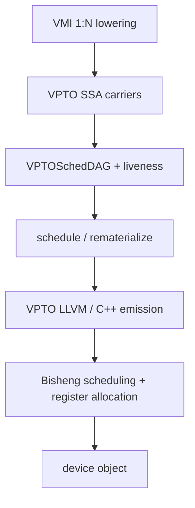
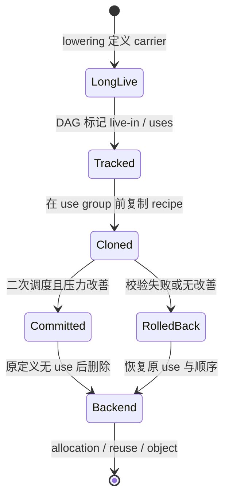

## 本篇在 PTO 课程路线中的位置

这是 PTO 全栈课程第 101 章。上一章把 VMI `scf.for` carry 物理化成一个或多个 VPTO carrier，但停在“仍是 SSA value、还不是 V0/V1”这一边界。本章继续追同一个 carrier：PTOAS 怎样根据 definition、use 与控制流估算 live range；压力超出 A5 模型预算时，怎样用 rematerialization 缩短活跃区间；哪些工作直到 Bisheng 后端才真正发生。

唯一研究仓库是 PTOAS，基线为默认分支最新提交 [`3b344c1277d8`](https://github.com/hw-native-sys/PTOAS/commit/3b344c1277d8b44d04ff9de6dd8325198b83a43c)。它比上一章基线 [`6c8f9e845496`](https://github.com/hw-native-sys/PTOAS/compare/6c8f9e845496adda51d7e5642caeb58006186742...3b344c1277d8b44d04ff9de6dd8325198b83a43c) 前进 8 个提交，但没有修改本文直接解读的 scheduler/rematerialization 文件，因此这里不是重访旧结论，而是补齐上一章明确留下的后端边界。直接相关功能由 [`566d6af8c017`](https://github.com/hw-native-sys/PTOAS/commit/566d6af8c017e7f44402fb2c4e8d204d8f195b9a) 与 [`63f6aa7ca4e4`](https://github.com/hw-native-sys/PTOAS/commit/63f6aa7ca4e48027531f0c6ab5575a44f8178654) 合入；最终事实以当前 HEAD 的代码和测试为准。

## 前置知识

1. VMI layout 决定逻辑 lane 到 VPTO carrier 的映射；它不决定硬件寄存器编号。
2. `!pto.vreg<64xi32>` 含 `64×32=2048 bit`，按 VMI 文档的公式占一个 256 B 物理 vector-register 容量；较大的 VMI value 已在 1:N lowering 中拆成多个这样的 carrier。
3. SSA live range 从定义延续到最后一次 use；跨 region 的 `live-in/live-out` 会让 value 即使不在当前 region 内定义，也持续占用压力预算。

这里的“压力”是编译器静态模型。它回答“某个调度点同时需要多少类寄存器容量”，不等于已经把 value 分配到具体寄存器，更不等于已经发生 spill。

把关键接口的契约拆开，会更容易看出边界：

| 接口 | 输入 | 输出/副作用 | 前置与失败 |
| --- | --- | --- | --- |
| `model.getPressure(value)` | VPTO SSA value | pressure set 与单位数 | 未识别 type 返回空，不猜测容量 |
| `tracker.evaluate(unit)` | 尚未 commit 的 sched unit | `delta/released/introduced/projected/excess` | 只读，不改变 use 计数 |
| `tracker.commit(unit)` | 同一 unit | 更新 live set、`current/peak` 与剩余 use | 负压力或 use 计数矛盾即 failure |
| `prepareVPTORematerialization` | 已首次调度的函数 | 暂存 clone、替换 use、记录原值 | 无高压或无合法预算方案时不改 IR |
| transaction `commit/rollback` | 二次调度结果 | 删除死原定义，或完整恢复 use/顺序 | 只有全 pressure set 合法且 vector 峰值下降才提交 |

所有值都仍在编译器 host 内存中的 MLIR IR 上；表中的“live”不是设备运行时对象在某个线程上存活，而是未来生成机器指令时必须保持其数值可用。也因此，`evaluate` 的 shape/dtype/device 输入已经被 VPTO type 固化：`64xi32` 是一个 vector carrier，mask 是 predicate carrier，pointer/scalar 不进入这两个 pressure set；它不接触实际设备地址。

## 今日 1–2 个核心问题

1. `VPTORegPressureTracker` 如何把 SSA use 变成 vector/predicate pressure，并识别 last use、live-through 与 bitcast 共享的同一物理值？
2. 当静态峰值超过预算，PTOAS 为什么选择复制便宜计算来缩短 live range；它又如何证明变换值得提交，而不是把“stack bytes 非零”误判成确定的 spill？

## PTO 全栈中的位置



PTOAS 在中间层知道 SSA 图、目标 pressure limit 和可复制 op，却不知道最终 V0/V1 编号。Bisheng 能看到更低层的指令与 ABI，完成真实 allocation，并报告 VF stack bytes。两层都影响 spill 风险，但所有权不同：PTOAS 只能主动塑造 live range，Bisheng 才决定最终复用、编号和必要的保存/恢复。

## 概念和精确语义

[`VPTOGenericA5SchedModel`](https://github.com/hw-native-sys/PTOAS/blob/3b344c1277d8b44d04ff9de6dd8325198b83a43c/lib/PTO/Transforms/VPTOScheduler/VPTOSchedModel.cpp) 定义两个 pressure set：`vector` 的 limit 为 32，`predicate` 的 limit 为 7。每个 `VRegType` 对 vector 集贡献 1，每个 `MaskType` 对 predicate 集贡献 1；其它类型不贡献。`vbitcast`/`pbitcast` 不产生新的容量需求，`getPressureRepresentative` 会沿 view-like op 回到源 value，避免把同一物理内容重复计数。

top-down 调度时，[`VPTORegPressureTracker`](https://github.com/hw-native-sys/PTOAS/blob/3b344c1277d8b44d04ff9de6dd8325198b83a43c/lib/PTO/Transforms/VPTOScheduler/VPTORegPressureTracker.cpp) 先把 DAG 的 `liveIns` 放进 `liveValues/current`，再统计每个 representative 的 `remainingUses`。对候选 op：

```text
delta = introduced results - operands whose remainingUses end here
projected = current + delta
projectedExcess = max(0, projected - limit)
```

operand 只有在“本 op 消耗其全部剩余 use，且它不是 region live-out”时才 release；result 只有在后面仍被 use 或属于 live-out 时才 introduce。`commit` 同时更新 `current`、`peak`、`remainingUses` 和 live set，若出现负压力或 use 计数不一致就失败。bottom-up 调度把规则反过来：跨过 definition 会释放 result，跨过 use 会让 operand 变 live。

调度策略并不是单独最小化某一个 `delta`。它还比较 projected excess、接近 limit 时的 release、是否开启新的 pressure frontier、关键路径和目标资源占用。所谓 frontier，是候选定义了新 value，却没有在同一 pressure set 内结束另一个 live range；释放 predicate 不能抵消新增 vector，反之亦然。只有当两个 SSA value 的 live range 在最终机器顺序中不重叠，后端才可能让它们复用同一个物理寄存器；PTOAS 在这里创造“可以复用”的条件，但不会指定复用哪一个编号。

`live-out` 的处理尤其容易误读：一个 operand 在当前 region 中出现最后一次，并不表示全函数已经死亡。只要它还要流向后继 region，tracker 会阻止本地 release。对于循环，这让循环外定义、循环内消费的索引稳定计入入口压力；对于 `scf.if` 两支汇合，也要求 value 在跨越结构化边界期间保持可用。这样的保守性可能高估某些后端可做的路径敏感复用，却能避免把互斥路径未经证明地当成同时可覆盖的寄存器槽。

这给出几个明确的非法或保守情况：未知 type 不被当成 vector 随意估算；region 边界外仍有 use 的 value 不能在局部最后一次 use 后释放；view-like representative 只有在同一 sched DAG 可追踪时才折叠；pressure 超限不会自动证明 spill，只会改变候选排序或触发后续 remat。

Rematerialization 的语义是“删除一个长寿命定义，在每组消费者附近重算等价值”。A5 只把 `vbr/vdup/vci/vmuls/vadds/vmaxs/vmins` 认作便宜候选。recipe 必须 pure、单结果、无 region、sched class 已知，递归 producer 深度至多 2；外部 operand 必须支配每个插入点。load、store、同步、原子、高价 `vexp`、未知 trip count 循环都不满足当前条件。

## 真实文件、类型、API 或指令逐段解读

[`VPTOSchedulerRematerializationInternal.h`](https://github.com/hw-native-sys/PTOAS/blob/3b344c1277d8b44d04ff9de6dd8325198b83a43c/lib/PTO/Transforms/VPTOScheduler/VPTOSchedulerRematerializationInternal.h) 把搜索限制写成显式预算：最多 16 个 candidate、4 个 use group/candidate、2 个 use/group、producer depth 2、use gap 64、96 个 clone op、2048 个动态 micro-op。目标不是盲目压到 limit，而是 `limit-1`，给随后调度产生的临时值留一个静态 headroom。

[`collectPressureRegions`](https://github.com/hw-native-sys/PTOAS/blob/3b344c1277d8b44d04ff9de6dd8325198b83a43c/lib/PTO/Transforms/VPTOScheduler/VPTOSchedulerRematPressure.cpp) 重建每个 region 的 DAG，按原顺序 `commit` 所有 unit，只有 `vector peak > 32` 才标记 `needsRelief`。注意 predicate 超限参与最终验收，却不会单独触发当前只处理 vector value 的 remat。

[`collectCandidates`](https://github.com/hw-native-sys/PTOAS/blob/3b344c1277d8b44d04ff9de6dd8325198b83a43c/lib/PTO/Transforms/VPTOScheduler/VPTOSchedulerRematCandidates.cpp) 从高压 region 的 live-in producer 出发，构造 recipe、按相邻消费者分 group，并用静态 loop trip count估算动态复制成本。planner 先偏好能帮助更多未满足 region 的 candidate，再比较 coverage benefit、能连带删除的原 recipe op 数，最后偏好更少动态 micro-op；它是有界启发式，不宣称全局最优。

[`VPTOSchedulerPass.cpp`](https://github.com/hw-native-sys/PTOAS/blob/3b344c1277d8b44d04ff9de6dd8325198b83a43c/lib/PTO/Transforms/VPTOScheduler/VPTOSchedulerPass.cpp) 执行“首次 schedule → prepare transaction → 第二次 schedule → 重算压力”。只有第二次 schedule 成功、所有 pressure set 不超 limit、且 vector peak 严格下降，transaction 才 `commit`；否则恢复旧 use、删除 clone，并恢复首次调度后的 block order。编译器因此不会为了一个预测收益永久接受更差或非法的 IR。

## 对象/Tile/Buffer/IR 生命周期

本章对象是 `!pto.vreg` SSA value，不是 GM/UB buffer：



clone 由 remat transaction 持有；每个被替换的 `OpOperand` 连同原 value 被记录。成功时先逆序删除无 use 的原 producer，再清理无 use clone；失败时先把 operand 指回原 value，再逆序 erase clone。这里没有分配 UB 地址，也没有插入 spill load/store。

## 端到端调用链或指令链

`ptoas --pto-backend=vpto --vpto-scheduler=on` 进入 `pto-vpto-scheduler` pass；driver 在 A5 的有效 `on` 模式下默认启用 remat，用户可显式关闭。`runFunction` 建 region/DAG、做 liveness 与双向调度；若高压，`prepareVPTORematerialization` 依次收集 region、candidate、plan 并 clone，随后再次 `runFunction` 和 `evaluateVPTOMaxPressure`，最后 commit/rollback。

下游 VPTO 被发射给 Bisheng。[`BishengScheduler.cpp`](https://github.com/hw-native-sys/PTOAS/blob/3b344c1277d8b44d04ff9de6dd8325198b83a43c/tools/ptoas/BishengScheduler.cpp) 的 `auto` 先以后端 scheduler=on 编译并解析每个 SIMD VF 的 stack bytes；若为非零，再用同一 LLVM IR 以 off 重编译，只有 off 总 stack 更小时才选 off 产物。报告缺失或两边函数集合不可比时保留成功的 on 产物。设计文档明确说：stack bytes 只是风险指标，不能证明存在 spill，也不能保证 ticks 更少。

## 具体 shape、Tile 和状态演算

直接看 [`vpto_scheduler_rematerialization_pressure_sets.pto`](https://github.com/hw-native-sys/PTOAS/blob/3b344c1277d8b44d04ff9de6dd8325198b83a43c/test/lit/vpto/vpto_scheduler_rematerialization_pressure_sets.pto)。函数有 31 个 `%x0..%x30 : !pto.vreg<64xi32>`；循环外用 `vci → vadds` 产生 `%index0/%index1`，循环内还活跃 `%m0..%m5 : !pto.mask<b32>`。

| 时刻 | vector live-in | predicate | 静态峰值/限制 |
| --- | ---: | ---: | --- |
| 首次调度进入循环 | 31 个输入 + 2 个索引 | 6 个 mask | vector `33/32`，predicate `6/7` |
| remat 规划 | `%index0` 两组 use，`%index1` 一组 use | 外部 mask 仍复用 | 3 个 group、2 个 candidate |
| 二次调度 | 长寿命索引被近用点 clone 替代 | producer mask 活跃区可能延长 | vector `32/32`，predicate `7/7` |

两次迭代使循环内 group 的动态 multiplier 为 2；`%index0` 还有一次循环后 use，倍率为 1。按当前 recipe/group 规则推导，两个 `vci→vadds` candidate 共克隆 6 个 op、估算 10 个动态 micro-op；这是由代码规则推导，测试的 FileCheck 只硬性验证 groups、峰值和最终 pressure，没有锁死这两个数字。

把状态逐步展开：首次调度后，`%index0/%index1` 的定义在循环之前，而最后 use 分别在循环后和循环内，所以两者贯穿循环入口；31 个参数又都被循环体消费，入口同时需要 33 个 vector value。candidate 0 为 `%index0` 建两个 use group：循环内同一 `vcmp` 的两个 operand 被合并为一组，循环后的 `%after` 是另一组；candidate 1 的 `%index1` 只有循环内一组。每组前复制 `vci` 与对应 `vadds` 后，原 `%root/%index*` 若无剩余 use 才被删除。这样保存的是数值等价与 mask 语义，不是复用同一个 SSA identity。

planner 的 `target=31` 只是“32 上限再留 1 个 headroom”的估计。它可能选择能覆盖多个高压 region 的两项方案，二次调度却只得到真实峰值 32；验收逻辑并不要求达到预测 target，只要求不再超限且比初始 33 小。这一点防止把启发式估算冒充精确 allocator。反过来，若选了方案却仍为 33，rollback 测试证明原定义、use 与 operation order 都会恢复。

关键结论不是“33 变 32”本身，而是 vector relief 让 predicate 从 6 升到 7：不同 register class 不能互相抵消。最终验收检查全部 pressure set，所以该方案恰好可接受；若 predicate 变 8，即使 vector 降低也必须 rollback。

因此，阅读 pressure trace 时必须同时看初值、峰值、每类 limit 和最终是否提交；只截取一行 vector 数字会丢掉决定正确性的另一半状态。

## 为什么这样设计及替代方案

从约束出发，目标是减少高峰 live state，同时不引入更贵的数据搬运或破坏语义。四种设计有不同代价：

| 方案 | 优点 | 主要代价/风险 |
| --- | --- | --- |
| 只重排原 op | 不增加计算和内存 | loop-carried/live-through 值未必能仅靠排序缩短 |
| rematerialize cheap pure op | 不需要 spill buffer；近消费者生成 | 增加动态计算、代码量和编译搜索；只适合便宜确定性 producer |
| PTOAS 主动插 spill/reload | 可直接释放寄存器 | 必须选择存储位置、插同步并证明 alias/容量；访存延迟和维护成本高 |
| 全交给 Bisheng allocator | 中层简单，使用完整机器信息 | 上层错失结构化 loop/use 信息；压力问题发现太晚且结果工具链相关 |

当前折中是：PTOAS 做有界、可回滚的 live-range shaping，Bisheng 做真实 allocation；再用后端 stack report 在 scheduler on/off 产物间保守选择。它避免 PTOAS 发明一套不完整的 spill ABI，也没有假装静态模型等于硬件结果。

历史合入提交 [`566d6af8c017`](https://github.com/hw-native-sys/PTOAS/commit/566d6af8c017e7f44402fb2c4e8d204d8f195b9a) 的说明曾在一个 E768/K9 TopK fixture 上报告 CA-model ticks 从 13281 降到 6412；这是该提交当时的实验事实，不是本文 HEAD 的复测，也不能推广为 remat 的普遍收益。另一个提交 [`63f6aa7ca4e4`](https://github.com/hw-native-sys/PTOAS/commit/63f6aa7ca4e48027531f0c6ab5575a44f8178654) 的多组实验显示 Bisheng on/off 的优劣随 kernel 改变，正好支持“变体比较而非固定相信某个 scheduler”的设计。

## 访存、计算、流水、并行和硬件约束

本例 remat 不搬 GM/UB 数据，理论上用额外 `vci/vadds` 换潜在 spill 访存；但没有公开证据说明最终 spill 目标一定是 UB、stack 的物理位置或具体 load/store 序列，因此这些不能写成事实。复制 op 仍占 vector issue/resource，可能拉长关键路径；scheduler 的资源与 latency 模型会重新排序，但当前测试没有给出该用例的 ticks。

A5 模型的 32 vector/7 predicate 是编译器目标约束。`64xi32` 恰为一个 2048-bit carrier；若上游 `256xf32` 已拆成四个 VPTO value，tracker 会看到四个独立 `VRegType` 单元。并行方面，pass 在函数内按 SSA/region 工作，transaction 是局部的；Bisheng auto 会额外编译一个变体，增加编译延迟，但不改变 kernel runtime 并发模型。

## 测试证据与未覆盖风险

- **压力集正例**：上述 lit 固定输入为 31 个 vector 参数、2 个索引和 6 个 predicate，验证 `33→32`、`6→7`、二次 schedule 成功且 transaction 被接受。
- **rollback**：[`vpto_scheduler_rematerialization_rollback.pto`](https://github.com/hw-native-sys/PTOAS/blob/3b344c1277d8b44d04ff9de6dd8325198b83a43c/test/lit/vpto/vpto_scheduler_rematerialization_rollback.pto) 构造初始/最终都为 33 的情况，验证 clone 不保留、原 `vci/vadds` 数据流恢复。
- **预算与合法性**：[`budget`](https://github.com/hw-native-sys/PTOAS/blob/3b344c1277d8b44d04ff9de6dd8325198b83a43c/test/lit/vpto/vpto_scheduler_rematerialization_budget.pto) 用 48 个 candidate 触发 16-candidate 上限，最终 33 仍超限而回滚；[`legality`](https://github.com/hw-native-sys/PTOAS/blob/3b344c1277d8b44d04ff9de6dd8325198b83a43c/test/lit/vpto/vpto_scheduler_rematerialization_legality.pto) 覆盖 producer depth、昂贵 op、uncovered use 与未知 loop cost 的拒绝。
- **跨 region live-through**：[`vpto_scheduler_live_through.pto`](https://github.com/hw-native-sys/PTOAS/blob/3b344c1277d8b44d04ff9de6dd8325198b83a43c/test/lit/vpto/vpto_scheduler_live_through.pto) 验证 `scf.for` 两侧 region 都保留 5 个 live-in/live-out，并检查对应 pressure trace。
- **真实工具链事实**：[`check_bisheng_scheduler.py`](https://github.com/hw-native-sys/PTOAS/blob/3b344c1277d8b44d04ff9de6dd8325198b83a43c/test/vpto/scripts/check_bisheng_scheduler.py) 在可用 CANN/SIM 环境中分别编译 on/off/auto、核对 stack 决策并做严格数值比较；普通 lit 不覆盖真实 Bisheng 参数、寄存器编号或设备 spill 指令。

仍未覆盖：本章没有取得 allocator 的 V0/V1 映射或 spill/reload dump；stack bytes 非零不能定位是哪条 SSA value 被 spill；合成 33-carrier 用例没有 GM/UB 访存瓶颈；动态 trip count 会拒绝 remat，尚无 profile-guided 替代；静态 pressure 降低也没有自动证明端到端性能提升。以上均列为知识债，不作硬件推断。

最后按证据等级归档：`32/7` limit、pressure 算法、candidate 白名单、预算和 commit 条件是**当前代码事实**；lit 的 `33→32`、`6→7` 与 rollback 是**测试事实**；历史 ticks 和真实工具链 stack 比较是**特定环境实验事实**；“更低静态峰值通常降低 spill 风险”只是**基于编译原理的推断**。公开材料没有给出本例实际寄存器号、spill slot 或设备访存序列，所以不能把推断升级为硬件事实。

## 与前后章节的连接

第 100 章回答“一个逻辑 carry 变成几个 VPTO carrier”；本章回答“这些 carrier 同时活跃时，PTOAS 能做什么、不能做什么”。下一章应沿唯一未闭合边界进入 VPTO emission 与 Bisheng 资源报告：选一个真实 kernel，从 `!pto.vreg` op 发射到 LLVM/hivm，再核对 stack/VReg report、scheduler auto 的变体选择和可获得的 allocator/spill 诊断，不再重复 remat 算法。

## 本篇结论、知识债、三个理解检查问题和下一章

结论：PTOAS 的 register-pressure tracking 是按 SSA liveness 计数的目标模型；rematerialization 是有预算、带 dominance/纯度/loop-cost约束、且二次调度后才提交的 live-range 变换。它能降低 spill 风险，却不分配实际寄存器。真实编号、复用与必要 spill 属于 Bisheng；VF stack bytes 是后端风险信号，不是 spill 证明。

知识债：真实 kernel 的 VPTO→LLVM/hivm carrier 表达；Bisheng `VReg number/MaskReg/Stack size` 与 SSA live range 的可追溯关系；可用时的 allocator/spill dump；stack 与 ticks、UB traffic 的相关性；动态循环的保守策略。

理解检查：

1. 为什么 `%v = pto.vbitcast %x` 不应让 vector pressure 从 1 变成 2？
2. 为什么 test 中 vector `33→32` 仍必须检查 predicate `6→7`，而不能只看 vector limit？
3. 为什么 `Stack size: 128 bytes` 不能单独证明某个 VPTO carrier 被 spill 到某一类存储？

下一章：**VPTO emission 到 Bisheng resource report——真实 kernel 的 carrier、VReg/MaskReg 数与 stack 证据链**。

## 课程账本增量

- 完成课程 101：闭合 VPTO SSA live range、A5 pressure set、last-use/live-through 计数和 rematerialization transaction。
- 已确认不变量：`VRegType→vector+1`、`MaskType→predicate+1`；bitcast 共享 pressure representative；remat 只有在二次 schedule 后所有 set 不超限且 vector peak 严格下降才提交。
- 已确认边界：PTOAS 不在此 pass 编物理寄存器号或插 spill；Bisheng stack report 仅是选择 scheduler 变体的风险指标。
- 仓库覆盖：PTOAS 新增 `VPTOScheduler/*`、remat planner/transaction、`BishengScheduler` 和相关 lit/真实工具链脚本；其它五仓本章无必要增量。
- ISA 知识地图：补齐“VPTO carrier lifecycle → static pressure → backend allocation”连接；实际 allocator mapping/spill dump 仍未闭合。
- 下一章按上述 emission/resource-report 主线推进。
