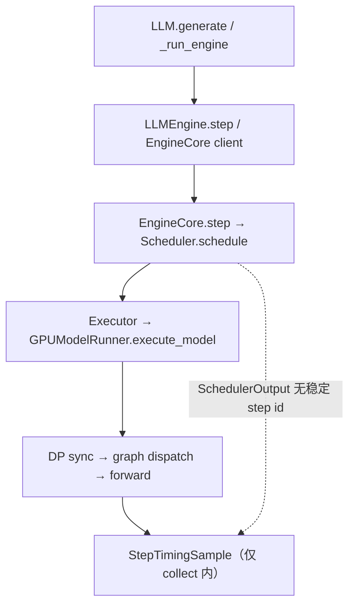
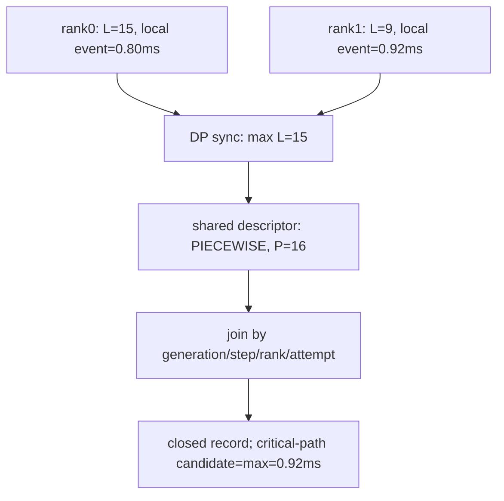

> 源码基线：vLLM 默认分支提交 [`79897d9f`](https://github.com/vllm-project/vllm/commit/79897d9f47cfe9727749a79253c5b220e71acb39)。相对上篇基线 [`a2915755`](https://github.com/vllm-project/vllm/commit/a2915755bf1dcaf80623e36d079713bfb190c1e7)，默认分支前进了 [118 个提交](https://github.com/vllm-project/vllm/compare/a2915755bf1dcaf80623e36d079713bfb190c1e7...79897d9f47cfe9727749a79253c5b220e71acb39)；本文直接分析的 Scheduler output、GPU ModelRunner、CUDA Graph dispatch、DP sync 与 timing collector 文件没有语义变化。最新提交是 CPU CI 自动分片，与本题无关。

## 本篇在课程路线中的位置

这是第 91 章，仍在“测试、性能与故障诊断”阶段，也是第 85–91 章这一组的收束篇。上篇建立了 `logical tokens L`、`padded execution positions P`、`batch GPU time T` 三本账；本篇只解决一个更基础的问题：**同一步的 L、P、T 和各 rank 状态，靠什么身份连接？**

课程链条推进为：`cause-tagged interval → SchedulerOutput → worker-side compaction → DP/graph descriptor → GPU Event → joinable evidence → paired replay`。

## 前置知识回顾

[第 90 章]({{ '/articles/vllm-token-debt-gpu-time-padding-cost-conservation/' | relative_url }})确认：`SchedulerOutput.total_num_scheduled_tokens` 是请求的逻辑工作量；`BatchExecutionDescriptor.num_tokens` 是真正送入执行路径的形状，可能含 padding；`StepTimingSample.forward_ms` 是共享 batch 时间。把 `T/P` 分给 cause、padding、residual 可以做守恒诊断，却不能证明移除某个 cause 会节省同样的时间。

若这三类证据连错一步或连错 rank，守恒等式仍可能“数值正确”却解释错误。因此今天先验证 join contract，再谈性能归因。

## 本篇要回答的核心问题

1. `SchedulerOutput` 从公开入口走到 GPU Event 的过程中，哪些字段保留、哪些身份丢失？
2. CUDA Graph bucket 与 DP 协调为什么必须进入 join key，而不能只记录 `num_tokens`？
3. 当前 main 能否直接生成 Cost Conservation Golden；若不能，最小补充记录是什么？

## 组件在全局架构中的位置

公开入口仍是 `LLM.generate`。离线驱动循环调用 `LLMEngine.step`；跨 EngineCore client/process 边界后，`EngineCore.step` 调用 `Scheduler.schedule`，再把 `SchedulerOutput` 交给 executor/worker。GPU worker 更新请求状态、计算实际 batch、协调 DP 与 graph shape，然后执行 forward。只有 adaptive verification 的 warmup profiling 把这一段包在 `StepTimingCollector.collect()` 内。



对应代码是 [`llm.py`](https://github.com/vllm-project/vllm/blob/79897d9f47cfe9727749a79253c5b220e71acb39/vllm/entrypoints/llm.py)、[`offline.py`](https://github.com/vllm-project/vllm/blob/79897d9f47cfe9727749a79253c5b220e71acb39/vllm/entrypoints/common/offline.py)、[`llm_engine.py`](https://github.com/vllm-project/vllm/blob/79897d9f47cfe9727749a79253c5b220e71acb39/vllm/v1/engine/llm_engine.py)、[`core.py`](https://github.com/vllm-project/vllm/blob/79897d9f47cfe9727749a79253c5b220e71acb39/vllm/v1/engine/core.py) 与 [`model_runner.py`](https://github.com/vllm-project/vllm/blob/79897d9f47cfe9727749a79253c5b220e71acb39/vllm/v1/worker/gpu/model_runner.py)。架构文档也明确把 scheduler、EngineCore 与 GPU worker 分层，见 [`arch_overview.md`](https://github.com/vllm-project/vllm/blob/79897d9f47cfe9727749a79253c5b220e71acb39/docs/design/arch_overview.md)。

## 完整调用链

1. `LLM.generate` 批量加入请求，`_run_engine` 循环调用 `llm_engine.step()`。
2. `LLMEngine.step` 从 EngineCore client 取回输出；实际 Core 进程中的 `EngineCore.step` 先 `scheduler.schedule(...)`，再 `model_executor.execute_model(scheduler_output)`。
3. `Scheduler.schedule` 产出 [`SchedulerOutput`](https://github.com/vllm-project/vllm/blob/79897d9f47cfe9727749a79253c5b220e71acb39/vllm/v1/core/sched/output.py)，其中 `num_scheduled_tokens: dict[str, int]` 与其求和值均在 host Python 内存，ownership 从 Scheduler 转交 executor。
4. `GPUModelRunner.execute_model` 用它更新 worker 本地 request state；adaptive verification 还可能把 Scheduler 给出的 draft upper bound compact 成实际 token 数。
5. [`dispatch_cg_and_sync_dp`](https://github.com/vllm-project/vllm/blob/79897d9f47cfe9727749a79253c5b220e71acb39/vllm/v1/worker/gpu/dp_utils.py) 先构造 `[7, dp_size]`、`torch.int32`、CPU tensor，all-reduce 后以 live ranks 的最大 token 数重新 dispatch graph，返回 `BatchExecutionDescriptor` 和 `DPSyncState`。
6. `prepare_inputs` 形成 `InputBatch`；`step_timing.record_batch(input_batch, full_cudagraph)` 只保存 `(full_cudagraph, input_batch.num_tokens, input_batch.num_reqs)`。
7. forward/drafter 的 accelerator `torch.Event` 被记录。退出 `collect()` 时只同步最后一个 `drafter_end`，依靠同一 stream 的 issue order 推出此前事件均完成，再把 elapsed time 变成 host `float`。
8. `profile_adaptive_verification` 把 samples 交给 `set_initial_cost_curves`：forward 按 token 数取 median，drafter 只接受 full-graph 样本并按 request 数取 median。事件对象随后失去引用，可回收；sample 也只进入成本表，不回到 Scheduler。

## 关键类型、字段和状态生命周期

| 证据 | shape / dtype / device | 所有者与生命周期 | 当前缺口 |
| --- | --- | --- | --- |
| `SchedulerOutput.num_scheduled_tokens` | `dict[str, int]`，host | Scheduler 创建；executor/worker 消费 | 无 `step_id`、rank、attempt |
| `BatchExecutionDescriptor` | host dataclass；`num_tokens/num_reqs` 为 int | graph dispatch 创建；本次 forward 消费 | 只有选中形状，无 Scheduler 身份 |
| `DPSyncState.num_tokens_across_dp` | `[dp_size]`、`torch.int32`、CPU | DP coordination 创建；forward context 消费 | 有 per-rank shape，却没有 per-rank timing |
| `StepTimingEvents` | 4 个 accelerator `torch.Event` | collector 临时持有；退出 block 后解析 | 只在 profiling block 激活 |
| `StepTimingSample` | 2 个 ms float、2 个 int、1 个 bool，host | collector 创建；cost curve 消费 | 无 request map、logical/padded 双计数、rank、descriptor key |

准确地说，main 不是“计时不准”，而是**没有可证明的一一对应关系**。`StepTimingCollector` 的 record 方法在 `collect()` 外 no-op；它是启动期 cost profiling 工具，不是线上每一步的审计日志。即使把 sample 导出，也无法仅凭 `num_target_tokens` 判断它对应哪次 `SchedulerOutput`。

把一个 step 按所有权拆开更容易看清断点。Scheduler 在 Core 进程中创建 `SchedulerOutput`，其中 request id 是逻辑身份；executor 把它送到 worker 后，`GPUModelRunner` 用 request id 查本地 slot，随后 `prepare_inputs` 把稀疏 request 视图压成连续 batch。此时 request→token 关系仍可从 worker state 还原，但 graph dispatch 只关心可执行形状。进入 forward 后，Event 只观察 stream 上两个时间点，不理解 request、cause 或 Scheduler step。最后 `collect()` 把 Event 转成 float，原始事件和 batch 三元组随临时列表释放。也就是说，数据不是在一次赋值中丢失，而是在“逻辑身份→slot→shape→时间”逐层投影时被有意抽象掉；每层对本职工作都正确，只有跨层诊断缺少共同主键。

这个生命周期还解释了为何不能事后用 request id 补救：一个 request 会跨多个 scheduler step，同一步又包含多个 request；async scheduling、speculative draft compaction 和 dummy rank 会让“第几个请求”“第几次 forward”都不是稳定身份。真正可复用的是由 Core 分配、跨 executor 传递、在重试时显式区分 attempt 的 step identity。

## 逐函数源码解读

`SchedulerOutput` 的注释把 `total_num_scheduled_tokens == sum(num_scheduled_tokens.values())` 写成不变量；`iteration_details` 还是 worker 调整前的调度快照。这正说明 logical work 需要独立保存，不能被 compact 后数字覆盖。

`sync_cudagraph_and_dp_padding` 把每个 rank 的 token、期望 graph mode、uniform token count、max query length、ubatching、request count、skip-drafts vote 放进 7 行 CPU tensor。只要任一 rank 要 eager，全部 rank eager；否则取最大 token 数，再重新 dispatch，最后把 `num_tokens_across_dp_full[:]` 改为共同的 padded size。这是 graphability 的同步契约，不是 timing 聚合器。

`StepTimingCollector.record_batch` 则只把 batch 三元组覆盖到 `_batch`。`drafter_end` 才把当前 events 与三元组 append 到 `_timed`；没有走到 drafter end 的 step 不产生完整 sample。前置条件是：调用顺序不嵌套、事件在同一有序 stream 上、退出 block 前最后事件可同步。失败方式包括 sample 缺失、profiling 未进入 `collect`、或 cost curves 为空后触发 `RuntimeError`。

这也意味着一次没有 sample 的 step 不能按零毫秒入账；它只能被标记为计时证据缺失，否则监控会把观测故障伪装成性能改善。

还有一个容易混淆的细节：`input_batch.num_tokens` 是 worker 已准备的目标 token 数，`batch_desc.num_tokens` 是 graph/DP 协调后的可执行宽度；两者即使恰好相等，也不代表身份相同。前者来自本地 batch 内容，后者还受 uniform decode、max query length、LoRA、ubatching 和其他 rank 影响。join 记录必须同时保存两者及 descriptor 结构，不能用“相等时省略”优化 schema，否则恰好命中的样本无法与真正没有 padding、没有跨 rank 约束的样本区分，后续一旦 graph capture ladder 改变，历史数据也无法重新解释。

因此最小建议记录（**设计提案，不是当前代码**）是：

```text
StepCostKey = (engine_generation, scheduler_step, dp_rank, pp_rank, attempt)
SchedulePart = {req_to_logical_tokens, cause_intervals}
ExecutePart  = {actual_tokens, descriptor, dp_shape_vector}
TimingPart   = {forward_ms, drafter_ms, event_status}
```

聚合器只有在预期 rank/phase 齐全、generation 与 attempt 完全相等时才能 close；否则输出 `INCOMPLETE`，不能用“最近一个 token 数相同的 sample”补洞。

三阶段记录的前后条件也应固定。`SchedulePart` 的前置条件是一次 `Scheduler.schedule` 已经提交，后置条件是 logical token 总数与 request map 求和一致；它不能在 worker compaction 后回写。`ExecutePart` 只有在 DP agreement 完成后才可提交，必须同时保存本地实际 token、共同 descriptor 和 live-rank membership，不能只存 padding 后的一个整数。`TimingPart` 只有在 start/end Event 都完成且属于同一 stream/attempt 时才有效；异常退出、取消或设备错误必须记录 terminal reason。close 时先验证三部分的 generation、step、attempt 相等，再验证需要参与的 rank 集合完整，最后才计算 `L`、`P`、`T`。这些检查把“数据缺失”与“性能退化”分开：前者是证据质量问题，不能被解释成零成本。

为了不让诊断机制反过来改变被测系统，建议采用两级输出。常态路径只累计低基数 counter，例如 `join_complete`、`missing_timing`、`bucket_transition`；抽样或故障窗口才保留带 request map 的 bounded trace。trace 达到容量上限时应明确丢弃并计数，不能阻塞 Scheduler。Event 也不应每步立即 synchronize，而应由异步回收队列在完成后填充 `TimingPart`；只有离线 Golden 或 paired replay 才允许在边界处等待全部记录 close。

## 具体示例与 shape/状态演算

先看仓库中的确定事实：`test_uniform_decode_pads_up_to_full_graph` 给 5 个请求、每个 query length 3，因此 logical token 数为 15；FULL graph descriptor 选择 18 tokens、6 requests。这里 `L=15`、`P=18`，descriptor 身份至少应包含 `FULL/18/6/uniform=3`，只存 15 会丢掉 bucket。

再做一个两 rank 的最小 join 演算。设 mixed batch 下 rank 0 有 15 logical tokens，rank 1 有 9；DP coordination 的 `[7,2] int32@CPU` 元数据取最大值 15，再共同选择可容纳它的 PIECEWISE 16-token descriptor。假设两个本地 Event 样本分别是 0.80 ms 与 0.92 ms：



`max=0.92 ms` 是基于同步执行关键路径的设计推断，不是 main 已实现的聚合规则。若 rank 0 消除 2 个 cause tokens，但 rank 1 和 descriptor bucket 不变，不能仅凭 `2/16×T` 宣称全局 step 变快。paired replay 必须固定 co-batch、context/KV、RNG、rank placement、编译状态和 graph policy；若 descriptor key 改变，则把它标为 `GRAPH_BUCKET_TRANSITION`，而非混进连续 per-token slope。

这里要区分两种 Golden。**守恒 Golden** 在单次真实执行中检查账是否闭合：每个 cause interval 只能收费一次，padding 独立记账，所有分项加 residual 必须等于同一 closed record 的 batch time。它能抓重复归因、漏 rank 和错 bucket，却不回答“修复后快多少”。**因果 Golden** 才做 baseline/candidate paired replay：二者从同一 workload snapshot 出发，固定模型权重、KV 内容、采样输入、co-batch 顺序和 rank placement，分别记录完整 descriptor。若 descriptor 相同，时间差可解释为同一执行状态内的边际变化；若 descriptor 不同，差值是“业务变化经过 graph policy 后的总效果”，必须额外报告 bucket transition，不能再除以 token 数冒充连续单价。

多 rank 还需要两层结果：每个 rank 的本地 `forward_ms` 用于定位 straggler；一次同步 step 的服务时间候选是 live ranks 的 critical path，而不是各 rank 时间求和。求和回答的是设备时间消耗，最大值更接近同步延迟，两者语义不同。若使用 pipeline parallel，还要再定义 stage overlap 和首尾 Event，不能把 DP 的 `max` 规则直接复制到 PP。本文只把这一点列为下一阶段知识债，不把未验证的 PP 聚合写成当前结论。

## 为什么这样设计及替代方案

最简单的替代方案是按到达顺序 zip `SchedulerOutput` 与 `StepTimingSample`。它几乎零开销，却会被 async scheduling、dummy batch、无 forward step、失败重试和多 rank 独立队列破坏；同 token 数的两个 step 也不可区分。

第二个方案是只用 `(num_tokens, num_reqs, graph_mode)` 做复合 key。它适合成本曲线分桶，却不具备唯一性，无法审计 cause，也无法防止旧 generation 的晚到 sample 污染新实例。

显式 `StepCostKey` 增加少量 host metadata 和 bounded trace 存储，但不要求把 request id 放进 Prometheus label，也不要求每步 device synchronize：事件可异步回收，低基数指标只导出 complete/incomplete、bucket transition 和 join latency。维护成本集中在跨进程 schema 与 timeout closure，换来的是正确性可证、故障可定位。

## 性能、并发、正确性与边界条件

- **延迟/吞吐**：每步强制同步 Event 会破坏 overlap；应让 record 异步完成，只在 bounded diagnostic mode 或 replay harness 中等待。join 本身是 host bookkeeping。
- **显存**：key 与 host record 不占显存；未回收的 Event/trace 会形成资源债，因此必须设容量、TTL 和 drop reason。
- **并发**：async scheduler 允许 CPU 规划 step N+1 时 GPU 执行 N，顺序不是身份。dummy batch 与 no-forward step也必须占据明确 outcome，不能偷偷跳号。
- **graphability**：descriptor 是离散执行状态。相同 logical tokens 可能因 uniform/max-query/LoRA/ubatch 条件选到不同 mode；跨 bucket 的差值不是平滑 token 单价。
- **正确性**：DP shape agreement不等于 timing quorum；dead rank 被 FT 路径排除时，record 必须携带 live-rank membership/version，否则“缺一个 rank”与“合法缩容”无法区分。
- **失败方式**：missing event、collector 未开启、重试 attempt 冲突、generation 漂移、rank timeout、descriptor 不一致都应 fail-closed 为 incomplete evidence，不能生成边际结论。

## 测试证据与未覆盖风险

**当前代码/测试事实：**

- [`test_cudagraph_manager.py`](https://github.com/vllm-project/vllm/blob/79897d9f47cfe9727749a79253c5b220e71acb39/tests/v1/cudagraph/test_cudagraph_manager.py) 的 uniform decode 测试精确验证 5×3 tokens 从 15 补到 FULL 18/6；非 uniform 15 则选择 PIECEWISE 16。它验证 bucket 选择，不验证 timing join。
- [`test_gpu_dp_utils.py`](https://github.com/vllm-project/vllm/blob/79897d9f47cfe9727749a79253c5b220e71acb39/tests/v1/worker/test_gpu_dp_utils.py) 模拟 rank 0 为 4 tokens、rank 1 为 8 tokens，证明 `skip_drafts` 必须两 rank 都同意；单 rank 返回 `sync=None`。它没有断言 per-rank Event 或全局 step latency。
- [`test_profiled_batches_seed_cost_curves_via_consumer`](https://github.com/vllm-project/vllm/blob/79897d9f47cfe9727749a79253c5b220e71acb39/tests/v1/spec_decode/test_adaptive_verification.py) 以捕获点 8/1024 和 tail 1536/2048/4096 构造 synthetic samples，验证 eager 样本不能污染 drafter graph curve。`test_compact_batch_preserves_totals_and_bounds` 验证 `[3,3,40]` 的 CPU placeholder 总数与 GPU budget 一致、每行不越界。它们没有把 SchedulerOutput、descriptor、rank 和 Event 串成同一条记录。

**未覆盖风险：** step key 唯一性、async/dummy/no-forward ordering、跨进程丢包、DP/PP quorum、FT live-rank revision、graph bucket transition、paired replay 输出一致性与 Event overhead，main 均无端到端 Golden。

**PR/实验事实：**开放的 [PR #62960](https://github.com/vllm-project/vllm/pull/62960) 提议把 adaptive verification 成本拆为 token/context/slot 曲线，恢复跨 capture limit 的 graph cliff，并报告 paired benchmark；截至 2026-11-19 仍未合入。它是有价值的实验与计划证据，不是本文基线的接口事实。

## 与前后章节的连接

前两章把 promotion failure 转成 cause-tagged logical token interval；第 90 章把 logical、padding、batch time 分账；本篇补上三本账之间必须存在的 identity/quorum。下一章才有资格实现因果层：用同一 workload snapshot 做 baseline/candidate paired replay，并区分“同 bucket 内边际变化”与“跨 bucket 离散跳变”。

## 本篇结论、知识债、三个理解检查问题和下一章

结论只有三条：第一，当前 main 能分别生成 logical work、DP/graph execution shape 和 warmup Event sample，却没有稳定 step/rank key 将三者审计式连接。第二，`DPSyncState` 解决的是控制流与 shape 一致，不是 timing quorum；全局时间如何聚合仍需明确契约。第三，Cost Conservation Golden 必须先 fail-closed 地完成 evidence join，paired replay 才能估计边际收益。

仍欠缺：`StepCostKey` 的 wire schema；PP stage timing；live-rank membership revision；bounded trace/TTL；event 异步回收；paired replay fixture；RNG、KV/context、MoE route、co-batch 与 graph policy 冻结；真机 cliff 与 overhead 数据；PR #62960 的最终状态。

理解检查：

1. 为什么两个 `num_target_tokens=15` 的 sample 不能自动与 token 数为15的 `SchedulerOutput` join？
2. `DPSyncState.num_tokens_across_dp` 已经相同，为什么仍不能推出全局 step time？
3. paired replay 中 descriptor 从 FULL 18 变为 PIECEWISE 16 时，为什么应单列 bucket transition？

下一章：**Paired Replay Fixture 怎样冻结反事实——Co-batch、Context、RNG、Rank 与 Graph Policy。**

## 课程账本增量

- 新确认：main 的证据链在 identity 层断开，而不是缺少 token 或 Event 数值。
- 新确认：DP coordination 使用 `[7, dp_size] int32@CPU` 元数据达成 shape agreement；它不携带 per-rank timing quorum。
- 新建议：以 `(engine_generation, scheduler_step, dp_rank, pp_rank, attempt)` 为 join key，三阶段记录 schedule/execute/timing；缺相位或 rank 时 fail-closed。
- 新覆盖：`LLM.generate/_run_engine`、`LLMEngine.step`、`EngineCore.step`、`SchedulerOutput`、`GPUModelRunner.execute_model/profile_adaptive_verification`、`dispatch_cg_and_sync_dp`、`DPSyncState`、`BatchExecutionDescriptor`、`StepTimingCollector/StepTimingSample` 及三组直接测试。
- 新知识债：wire schema、FT membership、PP timing、bounded collector、paired replay 与真机 graph cliff。

## 第十三次七章知识图谱回顾（第 85–91 章）

- 第 85–87 章从 protected HIT、guaranteed headroom 推到 backend fence 后的 capacity re-entry，再确认 primary full 时 main 直接 MISS、没有 waiter ownership。
- 第 88–89 章把 MISS 变成反事实 prefix boundary 与跨 step token debt，并用 side-effect-free tri-state peek 隔离观测与 ownership。
- 第 90–91 章把 logical work、padded shape、batch Event 分账，再指出跨进程、多 rank 的 identity/quorum 是 Cost Golden 的前置条件。
- 当前闭合链：`capacity authority → promotion outcome → counterfactual boundary → conserved token interval → graph/DP execution shape → joinable timing evidence`。
- 路线调整：下一组先完成 paired replay 的冻结与输出等价 Golden，再补 PP/MoE timing 和低开销线上采样，避免把诊断分摊误当因果优化收益。
