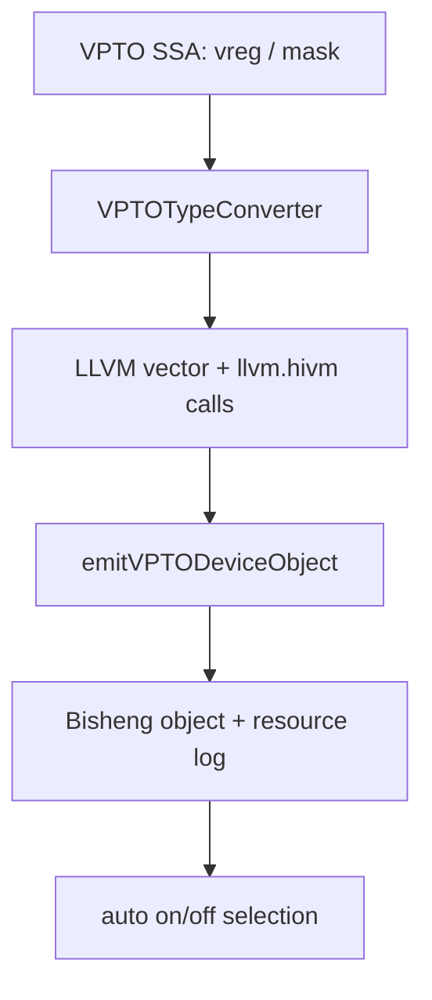
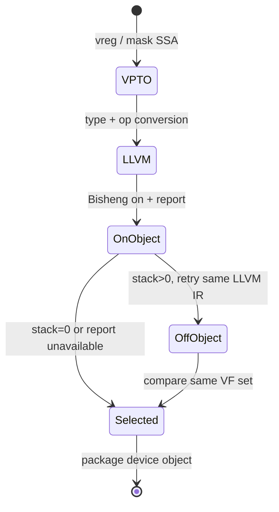

## 本篇在 PTO 课程路线中的位置

这是 PTO 全栈课程第 102 章。第 100 章把 VMI layout 物理化为 1:N VPTO carrier；第 101 章解释 PTOAS 如何用 live range、pressure set 和 rematerialization 塑造这些 SSA value，却明确停在“还不是 V0/V1”处。本篇只继续一个问题：**carrier 经 LLVM/HiVM 发射并交给 Bisheng 后，资源报告究竟证明了什么？**

唯一研究仓库是 PTOAS，默认分支 `master` 基线为 [`3ffcf6c7e204`](https://github.com/hw-native-sys/PTOAS/commit/3ffcf6c7e2046641db64be9346d3885ddd6ad701)。它比上一章基线前进 [10 个提交](https://github.com/hw-native-sys/PTOAS/compare/3b344c1277d8b44d04ff9de6dd8325198b83a43c...3ffcf6c7e2046641db64be9346d3885ddd6ad701)，但本文直接分析的 VPTO LLVM emitter、object emission、Bisheng policy 与测试文件均未改变；最新提交修复 Tile `f32→i16` saturation，与本题无关。

## 前置知识

- `!pto.vreg<64xf32>` 是 64 个 FP32 lane 的逻辑 carrier，总 payload 为 `64×4=256 B`；它仍由 MLIR SSA definition/use 标识。
- 第 101 章的 `vector peak=32`、`predicate peak=7` 是 PTOAS 调度模型上限，不是物理寄存器编号。
- register allocation 必须在最终机器级顺序、ABI、调用约定和全部临时值已知后完成；因此 PTOAS 可以缩短 live range，却不能凭中层 IR 宣布 `%x` 已分配到 `V3`。

## 今日 1–2 个核心问题

1. 一个 `!pto.vreg`/`!pto.mask` 怎样变成 LLVM vector、HiVM intrinsic 和 Bisheng device object？
2. 报告中的 `Stack size`、`VReg number`、`MaskReg number` 哪些被 PTOAS 真正解析并用于决策，哪些只是工具链附带文本？

## PTO 全栈中的位置



上游输入是已完成 VPTO scheduling/rematerialization 的 MLIR module；下游消费者是 Bisheng 的 instruction selection、machine scheduling、register allocator 与 object writer。PTOAS 再读取的不是 allocator 内部结构，而是 stderr 中按函数打印的资源摘要。

## 概念和精确语义

[`convertVPTOType`](https://github.com/hw-native-sys/PTOAS/blob/3ffcf6c7e2046641db64be9346d3885ddd6ad701/lib/PTO/Transforms/VPTO/VPTOCANN900LLVMEmitterCommon.cpp) 保留 carrier 的 lane 数和 element type：`!pto.vreg<64xf32> → vector<64xf32>`。`!pto.mask<b32>` 则统一变成 `vector<256xi1>`；这里的 256 是 predicate carrier 位宽，不是说 B32 mask 有 256 个 FP32 数据 lane。低精度类型还可能使用 LLVM extension vector 或 payload ABI bitcast，但本文 FP32 例子无需额外 packing。

这个转换只改变 IR type 表达，没有选择物理寄存器。LLVM 的 `%42 : vector<64xf32>` 仍是 SSA value；Bisheng 后端可以让两个不重叠的 SSA value 共用一个 VReg，也可以因指令约束、临时量或调用 ABI 使用更多寄存器。因此下列关系成立：

```text
VPTO carrier count ≠ LLVM SSA vector count ≠ peak physical VReg count
```

[`BishengScheduler.cpp`](https://github.com/hw-native-sys/PTOAS/blob/3ffcf6c7e2046641db64be9346d3885ddd6ad701/tools/ptoas/BishengScheduler.cpp) 的 `StackUsage` 只有 `map<function, bytes>` 与 `total`。parser 先匹配固定前缀，再按 `: Stack size:` 和 ` bytes` 切分，只把非负十进制 stack bytes 加入 map；逗号后的字段允许存在，但不会解析字段名或数值。也就是说，报告虽然可能显示 `VReg number` 与 `MaskReg(PReg) number`，当前 PTOAS auto policy **完全不消费这两个值**。

要避免把不同证据层混为一谈，可以把“寄存器压力”拆成五级：

| 证据层 | 能确认 | 不能确认 |
| --- | --- | --- |
| VPTO pressure trace | 某调度点需要多少个模型化 vector/predicate carrier | 最终机器临时值、编号与 spill |
| LLVM/HiVM IR | lane/dtype、值依赖和 intrinsic 调用契约 | allocator 如何合并或拆分 live interval |
| Bisheng 资源摘要 | 某 VF 的 stack bytes，以及可选的寄存器总数字段 | 某个 SSA 对应哪个寄存器、哪条指令 spill |
| allocator/debug dump | machine live interval、分配/拆分与 spill slot（若工具链提供） | 实际 traffic 是否成为性能瓶颈 |
| 反汇编 + trace/ticks | 最终指令、额外访存和该 workload 的时间 | 换硬件、shape 或工具链后的普遍收益 |

本章直接证据止于第三级：第二级有源码和 lit，第三级有 parser、单测及文档中的真实工具链记录。第四、第五级只作为下一章需要寻找的验证手段，不能从现有文本反推。

精确接口契约如下：

| 接口 | 输入 | 输出/所有权 | 失败与后置条件 |
| --- | --- | --- | --- |
| `VPTOTypeConverter` | host MLIR type | LLVM-compatible type，仍归 conversion IR | 不可转换 type 使 lowering 失败；无物理编号副作用 |
| `emitVPTODeviceObject` | `llvm::Module`、target、toolchain | 写 `.ll`，再产出 device object | ABI rename、写文件、bridge link 或 Bisheng 任一步失败即 failure |
| Bisheng compile callback | 同一 LLVM IR、scheduler enabled/report flags | object 与 stderr log | `auto` 首次为 on+report；显式 on/off 不请求报告 |
| `readStackUsage` | log path | 去重后的 `function→stack bytes` | 缺失、格式错、冲突重复、溢出均返回 unavailable |
| `compareAndSelect` | on/off 两份 stack map | 保留 on 或复制 off 临时 object | VF 函数集合必须相同；仅当 off total 更小才选 off |

## 真实文件、类型、API 或指令逐段解读

[`arith_select_vpto_llvm.pto`](https://github.com/hw-native-sys/PTOAS/blob/3ffcf6c7e2046641db64be9346d3885ddd6ad701/test/lit/vpto/arith_select_vpto_llvm.pto) 提供了最小而完整的发射例子。`arith_select_vreg` 先用同一 `PAT_ALL` mask 做两次 `pto.vdup`，得到 `%lhs/%rhs : !pto.vreg<64xf32>`；`arith.select` 产生 `%chosen`，最后 `pto.vsts` 写入 UB。FileCheck 要求 LLVM IR 中出现两个 `llvm.hivm.vdups...`、一个 `llvm.select ... vector<64xf32>` 和 `llvm.hivm.vstsx1.v64f32`。

同文件的 `arith_select_mask` 让 `%all/%tail : !pto.mask<b32>` 经过 scalar condition 选择。lowering 后是 `llvm.hivm.pset.b32`、`llvm.hivm.pge.b32` 和 `llvm.select ... vector<256xi1>`，选出的 predicate 再作为 store mask。这个测试直接证明 type/operation 映射，但它用 `--mlir-print-ir-after=convert-func-to-llvm` 检查中间 IR，并不观察 Bisheng allocator。

[`VPTOCANN900LLVMEmitterPipeline.cpp`](https://github.com/hw-native-sys/PTOAS/blob/3ffcf6c7e2046641db64be9346d3885ddd6ad701/lib/PTO/Transforms/VPTO/VPTOCANN900LLVMEmitterPipeline.cpp) 注册 type、memory、arithmetic、control-flow 等 conversion patterns；具体 arithmetic pattern 把 VPTO op 改成按 dtype/mask 选择的 `llvm.hivm.*` call。conversion 完成后，MLIR LLVM dialect 被导出为 `llvm::Module`，此时 VPTO dialect value 的生命周期结束，但其数值依赖已编码进 LLVM SSA use-def。

这里有一个重要的 shape 契约：`VRegType` 的 element count 原样成为 LLVM fixed vector 的 lane count，普通 FP32 使用 `vector<64xf32>`；mask 不按源 op 的“有效 lane 数”缩窄，始终以 `vector<256xi1>` carrier 传递，具体哪些 lane 生效由 `PAT_ALL/PAT_VL4` 等 predicate 生产者定义。后端因而同时看到数据 vector 和完整 predicate payload，不能把 inactive lane 当作不存在。若 type conversion 或某个 op pattern 找不到合法 intrinsic，conversion 整体失败，而不是用 scalar loop 静默兜底；这保护了 VPTO 到 HiVM 的性能与语义边界。

[`emitVPTODeviceObject`](https://github.com/hw-native-sys/PTOAS/blob/3ffcf6c7e2046641db64be9346d3885ddd6ad701/tools/ptoas/ObjectEmission.cpp) 先应用 vector/cube ABI suffix，写 LLVM module；若有 bridge bitcode，再链接成新的 `.ll`。`compileDeviceLLVMToObject` 用 `bisheng -c -x ir -` 编译。scheduler off 追加 `--cce-aicore-vec-misched=0`；需要报告时追加 `--cce-res-usage`。只有 vector target 参与 auto 比较，cube 的 auto 会退化为 off，除非用户显式要求 on。

## 对象/Tile/Buffer/IR 生命周期



关键对象是“同一个数值语义”的不同载体。VPTO SSA 在 conversion 后失效；LLVM SSA 被 `llvm::Module` 持有，写入 `.ll` 后交给 Bisheng；on object 直接写目标路径，off object/log 使用独立临时文件，由 `FileRemover` 持有并在决策后清理。只有 off stack total 严格更小时，临时 object 才复制覆盖最终输出。资源 log 只服务编译期选择，不进入 runtime/device。

若 on+report 因旧工具链不认识 `--cce-res-usage` 而失败，auto 会先用 on、不请求报告再编一次；成功就保留 on，并明确警告“report unavailable”。只有不带报告的 on 也失败，才尝试 off。这个顺序避免把“缺少观测能力”误判成“scheduler on 错误”。

文件所有权也影响正确性。首次 on 编译写最终 object path；off retry 写独立的临时 object/log，不能在比较前覆盖已经成功的 on object。报告不可比、off 失败时保留完整 on 产物并告警；复制失败则明确返回失败，临时文件在函数退出时回收。两个变体消费相同 `.ll`，所以 policy 差异主要来自 Bisheng scheduling/RA，而不是 PTOAS 重新 lowering 造成的 IR 漂移。若 bridge bitcode 存在，双方也共同消费链接后的同一 LLVM input。

这条路径是串行编译事务，不允许两个 retry 并发争用最终路径。它的提交点是“已选 object 安全位于输出路径”，而不是“报告已打印”；只拿日志、不确认 object 选择，会把诊断信息和实际部署产物错配。

## 端到端调用链或指令链

完整链为：

```text
pto.vdup / arith.select / pto.vsts
→ VPTOTypeConverter + op conversion patterns
→ vector<64xf32> / vector<256xi1> + llvm.hivm calls
→ llvm::Module → writeLLVMModule
→ optional bridge link
→ Bisheng on + --cce-res-usage
→ object + SIMD VF report
→ stack==0: keep on
  stack>0: Bisheng off on the same LLVM IR
→ comparable VF stack totals → select object
```

这条链的重要进程假设是 PTOAS 驱动拥有两个编译尝试的文件生命周期；Bisheng 是外部进程，report 通过 stderr 文件回传。它不是运行时并发协议，也没有跨设备同步。

## 具体 shape、Tile 和状态演算

先演算 `arith_select_vreg`：两个 `64xf32` 输入结果各 256 B，`%chosen` 也是 256 B 语义向量；mask lowering 为 `vector<256xi1>`，payload 32 B。SSA 文本看起来有 `%lhs/%rhs/%chosen` 三个 vector value，但若 condition 选择与 store 顺序允许，后端可以复用；HiVM call 也可能引入文本中不可见的 machine temporary，所以不能从“三个 SSA”推导“三个 VReg”。

再看设计文档记录的真实 #1506 报告：

```text
Stack size: 128 bytes, VReg number: 13, MaskReg(PReg) number: 7
```

若 on/off 都对同一 VF 报 128 B，`sameFunctions` 通过，`off.total < on.total` 为假，最终保留 on；13/7 即使不同也不会影响结果。若 on=128 B、off=0 B，才复制 off object。若 on=0 B，根本不会第二次编译。若 on 有两个 VF，分别 128/256 B，则总量为 384 B；重复的同名同值行去重，同名冲突值使整份报告 unavailable。

把 `arith_select_vreg` 的状态再走一遍：`%lhs/%rhs` 由两个不同 `vdups` 定义，`%chosen` 依赖 scalar `%cond`，store 只消费 `%chosen`。在 SSA 层，两个 source 都必须活到 select；select 之后 source 可死亡，chosen 活到 store。PTOAS scheduler 可以缩短这个区间，但无法知道 HiVM select 是否被 machine instruction 合并、是否要求固定 operand/result 约束，或 store 前是否需要临时寄存器。后端若允许 result 覆盖某个 source，三个 SSA carrier 可能只需两个同时活跃物理 VReg；若指令约束要求独立 destination，则可能需要三个。公开测试只锁定值依赖，不选择其中一种机器实现。

mask kernel 同理：`%all` 既用于 `vdup`，又与 `%tail` 一起进入 mask select；`%chosen_mask` 活到 store。文本里有三个 predicate SSA value，但 `MaskReg number: 7` 是整个 VF 的汇总，包含其它 lowering/ABI 临时量的可能性。没有 allocator mapping 时，不能把其中三个逐一对应到 P0/P1/P2，也不能用 `7-3` 推导“隐藏临时量”为 4。

这说明报告能建立的最强当前事实是“这个 Bisheng 变体为每个 SIMD VF 报告了多少 stack bytes，并据此选择了哪份 object”。它不能回答 `%chosen` 对应哪个 VReg、13 是 peak 还是 unique allocation、128 B 中哪些字节由哪条 SSA 的 spill 导致，甚至不能仅凭 stack 非零断定全部来自 vector spill。

## 为什么这样设计及替代方案

当前选择 stack bytes，而不解析所有字段，是一个保守兼容策略：parser 只依赖稳定前缀、字节数与单位；未来 Bisheng 添加逗号后字段不会破坏 PTOAS。它还把决策目标收窄为“避免更大的 VF stack 风险”，而不是伪装成完整 allocator 解释器。

替代一是解析 `VReg number/MaskReg number` 并做多指标排序。好处是能看见 register-class 变化；问题是字段是可选文本、不同工具链命名可能变化，而且总数仍不能映射 SSA 或证明 spill。除非 Bisheng提供版本化机器可读 schema，否则把它加入强决策会扩大兼容和维护风险。

替代二是总用 on 或总用 off，只编一次、编译延迟最低，但第 101 章已看到不同 kernel 对后端 scheduling 的反应相反。替代三是两份 object 都运行 CA-model/NPU，以 ticks 决策；它更贴近性能，却把编译变成需要设备、输入 Golden 和重复测量的昂贵流程，也不适合作为默认构建路径。当前“stack 触发第二次编译 + 离线真机/SIM复核”是成本与证据强度的折中。

从第一性约束看，默认构建必须先保证可编译和数值正确，再在有限编译开销内降低明显的资源风险。stack=0 时第二次编译最多只能得到同样或更大的非负 stack，因此提前停止是安全的支配规则；stack>0 时才有“off 更小”的可能，额外编译才有信息价值。相等时保留 on，则避免为了无 stack 改善而替换已经成功的首个产物。这个策略没有宣称最小 ticks，它只优化一个可观测、可比较且不需运行设备的代理量。

若未来引入 VReg/MaskReg 多指标，必须先定义优先级和可比性：例如 stack 下降但 VReg 上升是否接受，predicate 达到硬件上限是否比少 128 B stack 更危险。没有版本化 schema、硬件预算与配对 benchmark 时，任意权重都会制造伪精度；当前保持单一 stack 决策虽然信息少，却更容易审计和跨工具链降级。

## 访存、计算、流水、并行和硬件约束

LLVM type conversion 本身不产生 GM/UB 搬运；真实 load/store 由 HiVM intrinsic 保留。若后端确实 spill，才可能增加额外保存/恢复和 stack traffic，但公开代码没有给出 stack 的物理 memory location、具体 spill instruction 或同步序列，本文不作硬件映射臆测。

auto 的额外成本发生在编译期：on stack 非零时对相同 LLVM IR 再编一次 off 变体。文档在 CANN 9.1.0 的 #1506 三次中位数实验中记录 on/off 均为 128 B，auto 选择 on；完整 fatobj 编译约 1.616 s，对比旧默认 off 的 1.416 s 多约 0.20 s，而 ticks 的 on/auto差异落在测量波动内。这是特定工具链与 fixture 的实验事实，不是通用收益。

运行时并行度、流水与访存是否改善，最终取决于后端生成的 machine schedule。较少 spill 可能减少保存/恢复，却也可能因关闭某个 scheduler 改变 issue 顺序、依赖距离或 pipeline overlap；stack 相等也不保证指令顺序相同。可靠结论需要同一输入、同一工具链、相同 PTOAS IR，只切换 Bisheng mode，分别比较 object report、反汇编、严格数值结果和重复 ticks。缺任何一项，都只能说“风险指标变化”，不能说“吞吐已提升”。

## 测试证据与未覆盖风险

- **发射测试**：`arith_select_vpto_llvm.pto` 固定 `64xf32 → vector<64xf32>`、mask → `vector<256xi1>` 以及 vdups/select/vsts HiVM 调用；没有运行 register allocation。
- **纯决策测试**：[`pto-bisheng-scheduler-test.cpp`](https://github.com/hw-native-sys/PTOAS/blob/3ffcf6c7e2046641db64be9346d3885ddd6ad701/tools/pto-test-opt/pto-bisheng-scheduler-test.cpp) 有 32 个 scenario，覆盖 zero 跳过 retry、smaller/equal/larger、VF 去重/集合不一致、格式错误/溢出、报告不支持、on/off 编译失败、显式模式与临时文件清理。它使用 fake compile callback，不验证真实 Bisheng 参数或 allocator。
- **工具链/数值测试**：[`check_bisheng_scheduler.py`](https://github.com/hw-native-sys/PTOAS/blob/3ffcf6c7e2046641db64be9346d3885ddd6ad701/test/vpto/scripts/check_bisheng_scheduler.py) 通过标准 SIM runner 跑 off/on/auto，要求 strict compare，并区分 `zero/compared/unavailable` 三种预期。它验证 object 可执行与数值结果，不输出 carrier→VReg 映射。
- **文档实验**：[`vpto-scheduler-framework.md`](https://github.com/hw-native-sys/PTOAS/blob/3ffcf6c7e2046641db64be9346d3885ddd6ad701/docs/designs/vpto-scheduler-framework.md) 给出 #1506 的真实报告与 ticks/编译耗时；这是 2026-09-20 特定 CANN/Bisheng 构建的记录，不是当前环境复测。

这些测试形成了分层而非替代关系：lit 若失败，说明 VPTO→LLVM 契约已经改变；决策单测若失败，说明即使 report 文本正确也可能选错 object；SIM 若失败，说明最终产物数值不再等价。反过来，三层全绿仍不足以证明“某个 SSA spill 已消失”，因为测试没有保存 allocator 内部映射或对反汇编中的保存/恢复序列做 FileCheck。真正的 spill Golden 至少要固定同一 LLVM 输入、工具链版本与 scheduler mode，记录 VF 名、stack slot/指令、数值结果和重复 ticks，并在报告 unavailable 时明确跳过而非伪造零值。

未覆盖的核心风险是：没有 allocator dump、反汇编中的 spill/reload Golden、SSA-to-machine-value debug mapping，也没有测试证明 `VReg number`/`MaskReg number` 的精确定义在工具链版本间稳定。当前 parser 刻意忽略它们，所以不能把报告文本中“13/7”写入 PTOAS 的已确认 allocation 语义。

因此本章选择保留未知，而不是用报告中的总数填补缺失的映射证据。

## 与前后章节的连接

本章闭合了第 101 章“PTOAS 到 Bisheng”的控制链：static pressure 改变 LLVM 前的 live range；Bisheng 生成 object，并只通过 stack report 反馈一个粗粒度风险指标。下一章应补真正缺失的证书：在可用工具链上取得 allocator/disassembly 证据，把某个高压 fixture 的 machine register、spill/reload 与 stack traffic 对齐；若公开接口仍不可得，就明确停在工具链黑盒边界。

## 本篇结论、知识债、三个理解检查问题和下一章

结论：VPTO `vreg/mask` 会确定性转换为 LLVM vector 与 HiVM call，但物理编号属于 Bisheng。当前 auto policy 只解析每个 SIMD VF 的 `Stack size`；`VReg number` 与 `MaskReg number` 虽出现在某些报告里，却没有进入数据结构或选择逻辑。stack 是可操作的风险信号，不是 SSA spill 证书。

知识债：allocator/versioned resource schema；carrier→machine value mapping；spill/reload 指令与 stack 地址空间；MaskReg 数目的定义；同一真实 kernel 在 PTOAS remat on/off、Bisheng on/off 下的配对 report、反汇编、traffic 与 ticks。

理解检查：

1. 为什么 `vector<64xf32>` 已进入 LLVM，仍不能称为某个物理 VReg？
2. 报告带有 `VReg number: 13`，为何当前 PTOAS 的 on/off 选择完全不受 13 影响？
3. on/off stack 都为 128 B 时，为什么 auto 保留 on；这个结果又为什么不能证明两份 object 的 spill 行为相同？

下一章：**Allocator/Disassembly 证据怎样闭环——从 machine VReg 到 spill/reload 与 stack traffic。**

## 课程账本增量

- 课程 102，主仓 PTOAS，源码基线 `3ffcf6c7e204`。
- 新闭合链：`VPTO vreg/mask → LLVM vector → llvm.hivm → Bisheng object/report → stack-only auto decision`。
- 新不变量：`VReg/MaskReg` 尾字段当前不被 parser 消费；只有同 VF 集合的 stack total 可比较；report unavailable 时 fail-visible 地保留 on。
- ISA 知识地图：补齐 VPTO carrier 到 LLVM/HiVM ABI 的后端边界，不把 LLVM SSA 或报告总数等同物理编号。
- 新知识债：versioned allocator dump、SSA/machine mapping 与 spill/reload Golden。

