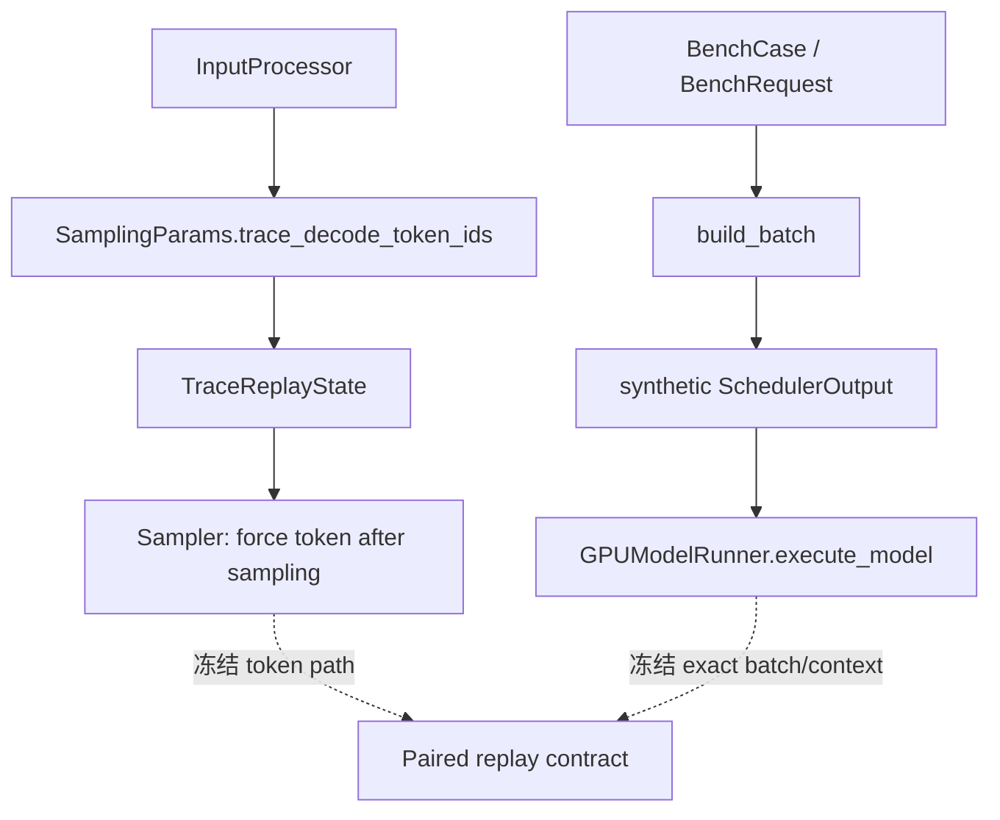
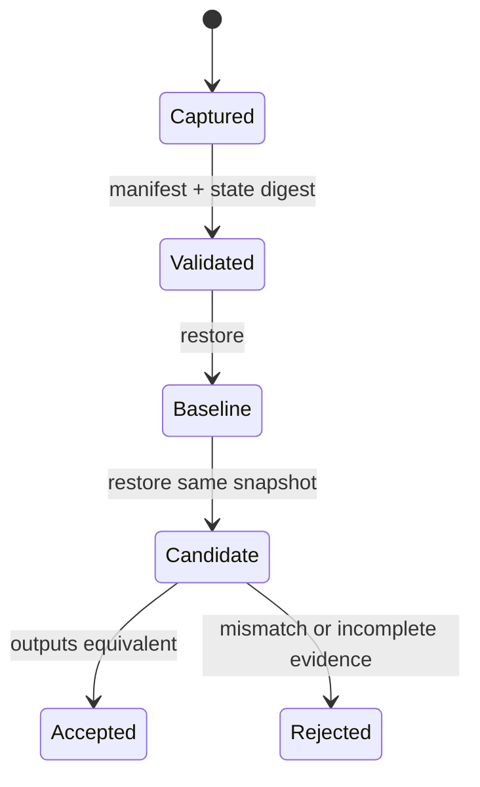

> 本文基于 vLLM `main` 的 [`07e4d6b957f70075b132b7e0c05c649dcbd0d4b7`](https://github.com/vllm-project/vllm/commit/07e4d6b957f70075b132b7e0c05c649dcbd0d4b7)。它比[上一章基线](https://github.com/vllm-project/vllm/commit/79897d9f47cfe9727749a79253c5b220e71acb39)前进 120 个 commit；[比较结果](https://github.com/vllm-project/vllm/compare/79897d9f47cfe9727749a79253c5b220e71acb39...07e4d6b957f70075b132b7e0c05c649dcbd0d4b7)显示本文直接涉及的 Trace Replay、forward benchmark 与对应测试没有变化。以下以已合入代码为事实边界。

## 本篇在课程路线中的位置

这是第 92 章，仍在“测试、性能与故障诊断”阶段。第 91 章建立了 logical work、actual batch、graph descriptor 与 per-rank GPU Event 的 join 契约；本篇只回答一个更靠前的问题：**比较策略 A/B 时，怎样保证两次执行面对的是同一个反事实输入？**

## 前置知识回顾

上一章的 `ΔT` 只有在两次测量属于同一逻辑 step 时才有意义。但“同一 request id”远远不够：另一条请求进入 co-batch、KV 长度多一个 token、spec token 不同、某个 DP rank 退出，都会改变实际 workload 和 graph route。没有冻结这些变量，差值只是两个不同实验的相减。

## 本篇要回答的核心问题

1. 当前代码已经能冻结哪些变量，分别由谁拥有、何时生效？
2. 为什么只固定 `seed`、只固定输出 token，或只固定 batch shape 都不能构成 paired replay？
3. 一个最小、可审计、遇到不一致就拒绝比较的 fixture 应记录什么？

## 组件在全局架构中的位置

当前 `main` 没有名为 `PairedReplayFixture` 的生产类型。本文把两条真实能力拼成证据链，而不是把设计建议冒充现状：

上半条仍走请求处理与 sampler，适合验证真实 logits 下的确定 token 路径；下半条绕过 Scheduler，直接构造 exact batch，适合隔离设备侧 forward。两者互补，但都没有单独冻结完整反事实。

## 完整调用链

**Token path 链。** 用户把 token 序列写入 [`SamplingParams.trace_decode_token_ids`](https://github.com/vllm-project/vllm/blob/07e4d6b957f70075b132b7e0c05c649dcbd0d4b7/vllm/sampling_params.py)。[`InputProcessor._validate_params`](https://github.com/vllm-project/vllm/blob/07e4d6b957f70075b132b7e0c05c649dcbd0d4b7/vllm/v1/engine/input_processor.py)先检查 engine 是否启用 Trace Replay；`_normalize_trace_replay_params`克隆 request-local 参数，把 trace 截断到 `max_model_len - prompt_len`，并禁用 EOS/stop 等早停。克隆后的参数进入 `EngineCoreRequest` 跨过进程边界。worker 侧 [`TraceReplayState`](https://github.com/vllm-project/vllm/blob/07e4d6b957f70075b132b7e0c05c649dcbd0d4b7/vllm/v1/worker/gpu/sample/trace_replay.py)把每条 trace 写入 request slot；[`Sampler.__call__`](https://github.com/vllm-project/vllm/blob/07e4d6b957f70075b132b7e0c05c649dcbd0d4b7/vllm/v1/worker/gpu/sample/sampler.py)先从未修改的 logits 采样，再原地替换 token，随后为这个被强制的 token 计算真实 logprob。

**Exact batch 链。** `vllm bench forward` 解析 [`BenchRequest(query_len, kv_len, num_draft_tokens, chunked)`](https://github.com/vllm-project/vllm/blob/07e4d6b957f70075b132b7e0c05c649dcbd0d4b7/vllm/benchmarks/forward/shapes.py)，[`build_batch`](https://github.com/vllm-project/vllm/blob/07e4d6b957f70075b132b7e0c05c649dcbd0d4b7/vllm/benchmarks/forward/batch.py)用 seeded RNG 创建 token、分配不重叠 KV blocks，并合成 `SchedulerOutput`。[`ForwardBench.run`](https://github.com/vllm-project/vllm/blob/07e4d6b957f70075b132b7e0c05c649dcbd0d4b7/vllm/benchmarks/forward/capture.py)通过真实 `GPUModelRunner.execute_model` 完成 input preparation、attention metadata、DP sync 与 target forward；warmup 后捕获只能重放同一 batch 的 one-shot graph，每次 replay 前恢复被模型改写的 state views。

## 关键类型、字段和状态生命周期

`TraceReplayState` 持有两个 UVA-backed staged tensor：`trace_token_ids` 的 shape 为 `[max_num_reqs, max_model_len]`、dtype 为 `int32`；`trace_len` 为 `[max_num_reqs] int32`。`add_request` 在 host/staging 侧写 slot，`apply_staged_writes` 使 accelerator 可见。kernel 用 `total_len - prompt_len` 计算 trace step，通过 `idx_mapping` 找到 slot，并覆盖 `[num_reqs] int64` sampled tokens。slot 在请求结束后等待复用；因此所有权属于 worker sampling state，而不是单次 `Sampler` 调用。

`BenchBatch` 则持有 synthetic `SchedulerOutput`、query token ids、KV block ranges，以及每个 request 预期的 `(scheduled, computed, is_decode)`。它从 `build_batch` 生成，贯穿 eager/warmup/capture/replay，最终由 `finish()` 生成含 finished ids 的 output，让 runner 清理 request state。KV cache 位于 accelerator、dtype 随模型配置；block 映射和 request 描述在 host。其重要后置条件是同一批次的 request 顺序、block 范围和 state view 在每次 replay 前完全恢复。

把两条生命周期合并成 fixture 时，不能只存一个“batch hash”。最小 manifest 至少要分四层：

| 层 | 必须冻结的字段 | 所有者与消费位置 | 不一致时的处理 |
|---|---|---|---|
| logical request | request 顺序、prompt/query token ids、sampling/spec 参数、trace | engine/request state；sampler 消费 | 拒绝配对 |
| mutable state | KV block table、有效 context 长度、KV/state digest 或 snapshot | KV/state manager；attention/model 消费 | 拒绝配对并报告首个差异 |
| execution topology | model/config hash、TP/DP/PP、live-rank revision、MoE routing | executor/worker；collective 与 layer 消费 | 重新生成 fixture |
| graph dispatch | eager/graph mode、descriptor、capture size、padding、地址稳定视图 | model runner/graph manager | 单列 bucket transition，不能归入策略收益 |

这里的“冻结”不一定意味着复制整块显存。不可变 token 和 shape 可以序列化；大型 KV 可记录 block identity 与内容 digest，并只快照两个 arm 会改写的尾块；graph state 则记录 descriptor 和待恢复 view。关键不是载体，而是 baseline 与 candidate 在消费前都通过同一个校验器。fixture 的状态机应当是：

`Accepted` 才能进入上一章的 timing join；`Rejected` 仍是有价值的诊断结果，但不能生成性能结论。这样的顺序还避免了一个常见错误：先看到 candidate 更快，再放宽等价标准为它辩护。

从接口契约看，capture 的输入不是“任意一次请求”，而应是已经闭合的 step：所有 request 都有稳定 key，`SchedulerOutput.total_num_scheduled_tokens` 与逐请求计数一致，block table 已完成分配，且没有异步 KV transfer 尚未兑现。输出是不可变 manifest、可恢复 state handle 与版本号；成功后不能再由 capture 方修改。restore 的前置条件是 model/config、topology 与 allocator generation 匹配，后置条件是所有可变视图恢复到 baseline 开始前；失败必须返回结构化 mismatch，而不是降级为新一轮随机运行。

执行两个 arm 时，fixture 应拥有唯一 `fixture_id`，每个 arm 再带 `attempt`。baseline 完成后先保存 token、logprob 和 state digest，再从原始 snapshot 恢复 candidate，不能从 baseline 的结果继续跑；否则第二个 arm 多消费了一次 KV 写入，顺序本身成为隐藏变量。时间样本也必须绑定同一个 `fixture_id/attempt/arm/rank/graph_descriptor`，避免异步 GPU Event 回调把上一轮样本接到下一轮 manifest。释放发生在两个 arm、输出校验和 timing join 全部结束之后；超时则取消未完成 arm，并在 event/state handle 安全回收前保持租约。

这也解释了为什么“先跑 candidate、再跑 baseline”不应改变结论：配对差值可以有顺序噪声，但语义输入必须相同。若担心温度、频率或 allocator cache 造成系统性顺序偏差，可以在多次 replay 中采用 AB/BA 交替，并把顺序作为显式因子；不能通过复用前一个 arm 的 mutable state 来节省恢复成本。

## 逐函数源码解读

`_normalize_trace_replay_params` 的关键不是“设一个 seed”，而是把 termination semantics 一起改写：`max_tokens` 等于有效 trace 长度，`ignore_eos=True`，stop 条件被清空。否则候选策略可能更早停止，后续 step 根本无从配对。非法组合也被显式拒绝，包括 `n > 1`、`prompt_logprobs`、structured output、bad words 等；完整限制见[官方 Trace Replay 文档](https://github.com/vllm-project/vllm/blob/07e4d6b957f70075b132b7e0c05c649dcbd0d4b7/docs/serving/online_serving/trace_replay.md)。

`Sampler.__call__` 的次序同样关键：先计算当前策略真实 logits，再用 trace token 覆盖 sample，最后查该 token 的 logprob。因此 token path 相同不等于模型结果相同；logprob 恰好保留了差异信号。spec decode 也只能在 draft token 与 trace token 相等时接受，相关支持由 [PR #63275](https://github.com/vllm-project/vllm/pull/63275) 合入。

`build_batch` 冻结的是更低层输入：每条请求的 query/KV 长度、decode/prefill 身份、token ids、spec tokens、block table 和顺序。`ForwardBench` 再拦截 `prepare_inputs`，逐请求断言 scheduled/computed 数与总 token 数。它刻意禁用 vLLM 自身 CUDA graph manager，捕获 exact one-shot graph；所以测得的是设备 forward/sampling/drafter 片段，不含 Scheduler 与 CPU step overhead。这是隔离能力，也是使用边界。

还要区分 `_dummy_run` 的用途。[`GPUModelRunner._dummy_run`](https://github.com/vllm-project/vllm/blob/07e4d6b957f70075b132b7e0c05c649dcbd0d4b7/vllm/v1/worker/gpu/model_runner.py) 也会构造空 `SchedulerOutput` 和 `_dummy_req_i`，按 `num_tokens`/`context_len` 进入 `execute_model`；adaptive verification 会对 capture sizes 及更大尾点重复 profile，再以中位数初始化 cost curve。它适合回答“某个合成 shape 大约多贵”，却没有真实 request identity、真实 co-batch 与真实 KV 内容，因而不能替代 paired replay。`randomize_inputs=True` 也只改变 dummy token，不会恢复生产状态。

## 具体示例与 shape/状态演算

取 `--seed 7 --kv-len-jitter 0`，case 为 `mix=16,2*1@65`，DP/TP 均为 1：

| request | 类型 | `query_len` | `kv_len` | 已计算 token | 本 step token |
|---|---:|---:|---:|---:|---:|
| A | prefill | 16 | 16 | 0 | 16 |
| B | decode | 1 | 65 | 64 | 1 |
| C | decode | 1 | 65 | 64 | 1 |

logical batch 是 3 个请求、18 个 scheduled tokens。再给 B、C 分别配置 trace `[101, 102]` 与 `[201, 202]`，第一个 decode step 强制输出 101/201，但 logprob 仍来自各自策略的真实 logits。

要比较 baseline 与 candidate，fixture 必须为同一个 step 固定：A/B/C 的顺序和 token ids、两个 64-token context、KV block 映射或内容 digest、trace 与 sampler 参数、routing、live rank set，以及 graph dispatch descriptor。然后只切换一个 policy，分别得到 `T_base(i)` 和 `T_candidate(i)`，计算：

\[
\Delta T_i = T_{candidate}(i) - T_{base}(i)
\]

只要 manifest 任一字段不同，这个 `ΔT_i` 就应作废，而不是“尽量比较”。此外，当前 forward benchmark 绕过 Scheduler；若被评估的是 admission/prefix policy，就必须先捕获真实 `SchedulerOutput` manifest，再让两个 arm 消费同一 manifest，不能拿 synthetic batch 证明调度收益。

这个例子也能算出 fixture 的资源下界：token manifest 只有 18 个本 step token，但 context 代表 B、C 各 64 个已计算位置；如果只保存长度而不保存对应 KV 内容，两个 arm 仍可能读到不同历史。最保守方案复制两条完整 KV 链，最省内存方案验证共享前缀 block 的只读 digest、仅复制两个可写尾块。前者恢复简单但增加显存带宽，后者减少复制却要求 allocator 在 fixture 生命周期内禁止复用共享 block。对吞吐测试，还要把 capture/restore 成本与 arm 执行时间分开报告，否则 fixture 自身开销会被误算成策略延迟。

因此文章中的 18 tokens 是执行 shape，不是完整状态大小；两者混为一谈会同时低估显存成本和恢复时间。

## 为什么这样设计及替代方案

最便宜的替代方案是只固定 RNG seed。它无法抵抗分支发散：一次额外抽样会改变后续 RNG 消耗；co-batch、KV context、rank 与 graph route 更完全不受 seed 控制。只固定 trace 稍强，却仍允许不同 workload 产生同一 token。只固定 exact batch 又没有跨 step 的输出路径和真实 scheduler causality。

另一极端是快照全部 device memory。它冻结最彻底，但复制量、额外显存与恢复延迟很高，还可能改变地址稳定性和 graph capture 条件，维护成本也随 backend/stateful model 增长。

更实际的是“结构化 manifest + 被改写状态的最小快照”：manifest 负责可审计身份，KV/state snapshot 负责可重放内容，trace 负责路径，rank/graph descriptor 负责执行环境。代价是必须持续枚举隐藏状态，例如 Mamba cache、MoE routing、spec draft 与 sampler state；漏掉一个就会制造伪因果。因此契约应 fail-closed。

为什么不直接让两个策略在同一个在线流量窗口交替执行？它减少了离线快照代码，却把 queue order、到达时间、prefix-cache 命中、allocator 状态和其他租户干扰一起带进实验。大量样本可以估计平均 A/B 效果，但不能解释某个 step 的边际代价，更不能作为回归测试 Golden。反过来，paired fixture 牺牲了部分真实并发噪声，换来可重放和可定位；二者应分别服务“线上总体效果”和“源码级因果诊断”，而不是互相替代。

## 性能、并发、正确性与边界条件

性能上，exact graph 减少 launch noise，适合 paired GPU timing；但不能外推 queueing、Scheduler、input preparation 的端到端延迟。并发上，co-batch identity 和 live-rank revision 是 workload 的组成部分，不能仅记录 batch size。graphability 上，exact one-shot graph 把 host 决策烘进 graph，重放只对同一 shape/state view 成立。正确性上，两个 arm 除目标策略外都必须一致，并先通过 token/logprob/KV-state 等价检查，再解释时间差。

并发还有一个容易漏掉的所有权问题：fixture 在 capture 后不能继续引用会被 Scheduler、KV allocator 或 request-slot allocator 原地复用的对象。要么取得不可变副本，要么用 generation/revision 做租约校验；否则 Python 对象仍存在，底层 block/slot 已属于另一请求。跨进程传输时也不能依赖对象地址，wire schema 应使用稳定 request key、逻辑 block 描述与显式版本。对于 DP，`rank_count` 不等于 live membership：一次重启或弹性缩容后，即使数量相同，collective 路径和本地 batch 都可能变化。

失败方式包括：engine 未启用 Trace Replay 时 validation 失败；trace 超长会被截断；不兼容 sampling feature 会被拒绝；forward case 非法或 KV blocks 不足会抛出 `ValueError`；默认 `kv_len_jitter=0.5` 会改变 context，正式 fixture 必须设为 0 或把 seed、case name 与实际长度写入 manifest。

## 测试证据与未覆盖风险

[`test_gpu_trace_replay.py`](https://github.com/vllm-project/vllm/blob/07e4d6b957f70075b132b7e0c05c649dcbd0d4b7/tests/v1/worker/test_gpu_trace_replay.py) 用 prompt length 5/8、trace `[100,101,102]` 与 `[200,201,202]` 逐 step 验证 exact token；还验证 trace 结束后 sample 不被改写、空 trace 不改写，以及 `idx_mapping` 能把 batch row 映射到 request slot。这证明 slot/step 语义，不证明 co-batch 与 KV 被固定。

[`test_forward_cli.py`](https://github.com/vllm-project/vllm/blob/07e4d6b957f70075b132b7e0c05c649dcbd0d4b7/tests/benchmarks/test_forward_cli.py) 对 `2*1@101,4@64:3,32,8@48c,16@316` 验证总 scheduled tokens 为 186、block ranges 不重叠、block 不足时报错；还验证相同 seed+case 的 jitter 一致，以及 graph output 与 eager、两次 graph replay 一致。这证明 exact batch/capture 不变量，不证明真实 Scheduler 与队列成本。

[`test_batch_invariance.py`](https://github.com/vllm-project/vllm/blob/07e4d6b957f70075b132b7e0c05c649dcbd0d4b7/tests/v1/determinism/test_batch_invariance.py) 比较请求单独运行与随机 co-batch，并验证启用 batch invariance 时 token/logprob 可保持一致；反向测试关闭后应出现差异。它证明特定数值模式，而非 paired fixture 已冻结同一 co-batch。

**未覆盖风险：** 当前没有端到端测试同时锁定真实 `SchedulerOutput`、KV 内容、trace/RNG、live ranks 与 serving graph policy，也没有通用 stateful-model snapshot/digest。本文提出的 manifest 是基于现有能力与缺口的设计推断，不是已合入 roadmap；[PR #46701](https://github.com/vllm-project/vllm/pull/46701)、[#63275](https://github.com/vllm-project/vllm/pull/63275)、[#61339](https://github.com/vllm-project/vllm/pull/61339) 和 [#66483](https://github.com/vllm-project/vllm/pull/66483) 只分别提供 trace/spec replay 与 forward/sampling timing 能力。

## 与前后章节的连接

本章为第 91 章的 timing join 提供了“同一逻辑 step”的可执行定义：先冻结反事实，再 join 时间证据。下一章将继续收紧接受条件：即使 manifest 相同，也要定义 token、logprob、KV/state digest 的等价规则，防止“跑得更快但语义已经变了”。

## 本篇结论、知识债、三个理解检查问题和下一章

结论：Trace Replay 冻结 token path，exact forward benchmark 冻结设备侧 batch/context；可靠 paired replay 必须再把 co-batch identity、KV/state、routing、live rank 与 graph descriptor 纳入同一 fail-closed manifest。固定 seed 只是其中最弱的一环。

仍欠缺：真实 SchedulerOutput 的捕获/回放 wire schema；KV 与 stateful cache 的最小 digest/snapshot；FT 下 live-rank revision；PP 各 stage 时间窗；fixture 开销与污染测量。

理解检查：

1. 为什么 forced token 的 logprob 仍能暴露 baseline/candidate 的语义差异？
2. 为什么 `vllm bench forward` 能证明 device forward 差值，却不能证明调度策略收益？
3. 当两个 arm 的 graph descriptor 不同但 token 相同时，为什么 `ΔT` 仍应拒绝归因？

下一章：**Paired Replay Golden 的等价判定——Token、Logprob、KV/State Digest 与 Fail-closed Mismatch。**

## 课程账本增量

- 阶段：测试、性能与故障诊断，第 92 章。
- 新确认不变量：trace 在真实 logits 采样后覆盖 token；exact forward graph 只重放同一 batch，并在 replay 前恢复 state views；paired delta 只有在完整 fixture manifest 相同时才可归因。
- 新覆盖文件：`sampling_params.py`、`input_processor.py`、`trace_replay.py`、`sampler.py`、`benchmarks/forward/{shapes,batch,capture,main}.py` 及三组直接测试。
- 新知识债：跨 Scheduler/worker 的 manifest wire schema，以及 KV/state equivalence golden。

