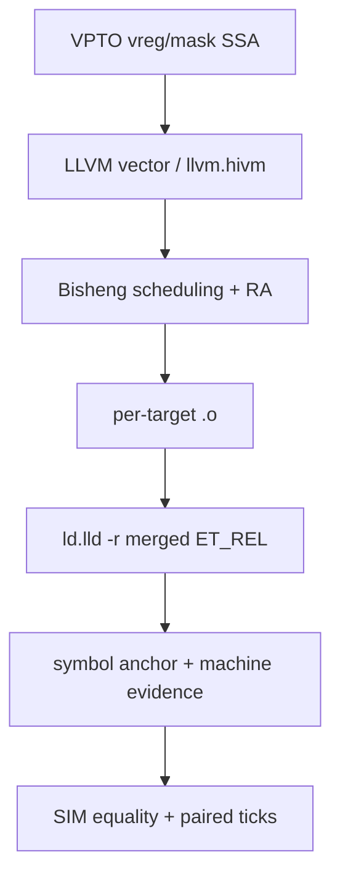
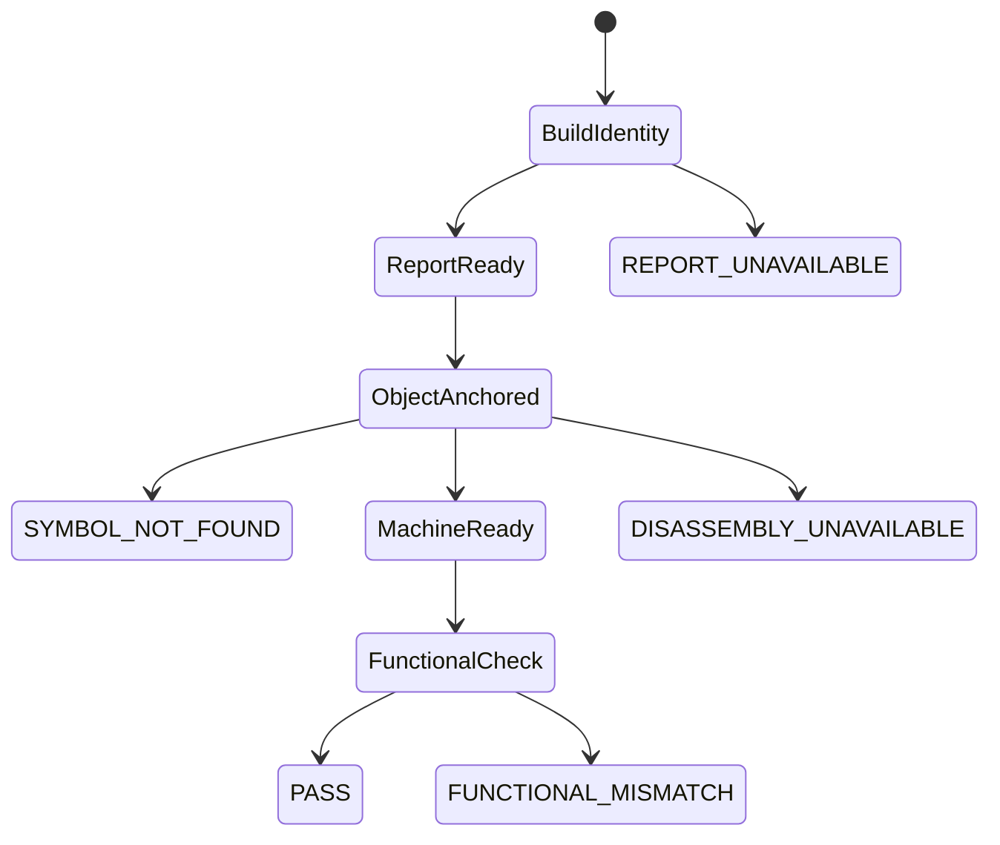

> 本文基于 PTOAS 默认分支提交 [`297a791c7c4f`](https://github.com/hw-native-sys/PTOAS/commit/297a791c7c4f632f7c1fc02bf4f777a313b4ea2a)。相对上一章的 [`3ffcf6c7e204`](https://github.com/hw-native-sys/PTOAS/commit/3ffcf6c7e2046641db64be9346d3885ddd6ad701) 前进 [4 个提交](https://github.com/hw-native-sys/PTOAS/compare/3ffcf6c7e2046641db64be9346d3885ddd6ad701...297a791c7c4f632f7c1fc02bf4f777a313b4ea2a)。本文区分代码/规范事实、测试事实、历史实验和推断；没有把未公开的 Bisheng allocator 行为写成 PTOAS 保证。

## 本篇在 PTO 课程路线中的位置

这是课程第 103 章，承接第 100 章的 group-slot→carrier、第 101 章的静态 pressure/rematerialization，以及第 102 章的 carrier→LLVM/HiVM→Bisheng resource report。今天只回答一个问题：**怎样才算证明某个 machine VReg 发生了 spill/reload？**

结论先行：当前公开 PTOAS 能稳定证明“哪个 LLVM/HiVM 输入产生了哪个 relocatable device object、该 object 有哪些 VF symbol、Bisheng 报告了多少 stack bytes、SIM 数值是否一致”；它不能稳定证明“SSA `%x` 被分配到 V7、随后在某条机器指令处 spill 到哪个 slot”。缺少 allocator dump 或受支持的反汇编契约时，正确结论是 `DISASSEMBLY_UNAVAILABLE`，不是“没有 spill”。

## 前置知识

VPTO 的 `!pto.vreg<64xf32>` 是一个 2048-bit、256 B 的逻辑 carrier；上一章已确认它降成 LLVM `vector<64xf32>`，但仍是 SSA value。PTOAS 的 `VPTORegPressureTracker` 只估算同时活跃的 vector/predicate 集合；Bisheng 才做 instruction selection、physical register allocation、reuse 与可能的 spill。

第 102 章还确认：`BishengScheduler.cpp` 的 [`StackUsage`](https://github.com/hw-native-sys/PTOAS/blob/297a791c7c4f632f7c1fc02bf4f777a313b4ea2a/tools/ptoas/BishengScheduler.cpp) 只保存 `function → stack bytes`。报告尾部即使出现 `VReg number`、`MaskReg(PReg) number`，parser 也允许但忽略；auto 只在 on/off VF 集合一致且 off 的 stack 总量严格更小时选择 off。

## 今日 1–2 个核心问题

1. `ET_REL + VF symbol + Stack size` 分别证明什么，不能证明什么？
2. 在公开仓没有稳定 allocator/disassembler API 时，最小可执行的 spill/reload Golden 应如何 fail closed？

第二问不是另一个独立主题，而是第一问的工程落点：先划清证据层，才能写不会制造假阳性的 Golden。

## PTO 全栈中的位置



上游输入是同一份已 fingerprint 的 LLVM/HiVM module 与 scheduler mode；下游消费者有三类：PTOAS 的 object selection、运行时/链接器消费 device object、研究 Golden 消费 symbol/resource/SIM/ticks。只有中间的 Bisheng 掌握 physical VReg 与 spill 决策，因此 PTOAS 侧不能从上游 SSA 数量反推 allocation。

## 概念和精确语义

把证据分成四层更清楚：

| 层 | 当前可观察事实 | 可证明 | 不可证明 |
| --- | --- | --- | --- |
| IR | VPTO、LLVM vector、`llvm.hivm.*` | shape、dtype、lane、SSA def-use | 物理寄存器号 |
| Resource | 每个 SIMD VF 的 stack bytes | 编译器声明的 frame/stack 规模 | 哪个 value spill、动态流量 |
| Object | ELF64 `ET_REL`、Machine 1029、symbols、relocations | 目标 object 身份与函数 anchor | instruction→SSA 映射 |
| Runtime | strict SIM output、ticks | 给定输入的功能一致性与观测时间 | 单靠 ticks 定位 spill 原因 |

关键前置条件是**身份可比**：source/VPTO/LLVM digest、PTOAS commit、CANN/Bisheng version、target `dav-c310-vec`、scheduler mode、全部 `pto.bisheng_args`、VF symbol 与 object SHA 必须同时记录。缺一项时，两个 stack/ticks 样本可能根本不是同一编译问题。

非法推导有三种：`stack_bytes / 256 = spill_count`、`LLVM vector 个数 = physical VReg 个数`、`stack 变小 = ticks 必然更低`。它们分别忽略 slot 对齐/复用与非 vector local、register coalescing/临时量，以及动态执行次数、memory path 和噪声。

为了让“相同输入”可审计，manifest 至少需要以下字段：

| 字段 | 作用 | 缺失后的处理 |
| --- | --- | --- |
| `ptoas_commit`、`cann_version`、`bisheng_version` | 固定 compiler implementation 与报告/指令 schema | `TOOLCHAIN_IDENTITY_MISSING` |
| post-pass VPTO 与 linked LLVM/bitcode digest | 排除 pass、bridge、文本打印差异 | `INPUT_IDENTITY_MISSING` |
| target/core/optimization/scheduler/remat | 固定 codegen policy | `POLICY_MISMATCH` |
| canonical Bisheng argv | 捕获 module attribute 与 CLI 透传的最终顺序 | `ARGV_MISMATCH` |
| object SHA、ELF machine、VF symbol | 把 resource/disassembly 绑定到同一产物与函数 | `OBJECT_IDENTITY_MISSING` |
| input seed、shape/dtype、SIM reference hash | 固定功能与动态路径 | `WORKLOAD_MISMATCH` |

这些状态不是为了增加仪式感。比如两次编译的 `.pto` 相同，但 bridge bitcode、`-O` 顺序或 scheduler 尾部不同，最终 live interval 就可能不同；若只记源码文件名，stack 差异没有可归因性。

## 真实文件、类型、API 或指令逐段解读

### 1. `ObjectEmission.cpp`：产物是锚点，不是反汇编证明

[`compileDeviceLLVMToObject`](https://github.com/hw-native-sys/PTOAS/blob/297a791c7c4f632f7c1fc02bf4f777a313b4ea2a/tools/ptoas/ObjectEmission.cpp) 组装 Bisheng 参数。off variant 追加 `-mllvm --cce-aicore-vec-misched=0`，resource probe 追加 `-mllvm --cce-res-usage`，固定尾部是 `-c -x ir - -o <object>`。同一 LLVM 输入可产生 on/off 两个临时 object，但二者必须各自保留日志与 hash，不能用最终文件名冒充身份。

[`--emit-vpto-device-object` 设计](https://github.com/hw-native-sys/PTOAS/blob/297a791c7c4f632f7c1fc02bf4f777a313b4ea2a/docs/designs/ptoas-emit-device-object.md) 定义输出为合并后的 relocatable AI Core ELF：`ET_REL`、Machine 1029，保留 symbols/relocations，不含 host container。vector entry 常见导出 `<logical>_mix_aiv`，内部 VF 可见 `<entry>.vector.thread`。`llvm-readelf --symbols/--relocations` 因而能定位函数边界与链接身份，但仓库测试并未把某个 opcode、VReg 或 spill slot 写成 ABI。

此模式要求 `--pto-backend=vpto`、显式文件 `-o`，拒绝 `-o -` 与不支持的 mixed 输入；输出用同目录临时文件后 rename 提交。也就是说，Golden 应在 rename 后 hash 最终 object，而不是抓取尚未提交的临时路径。

### 2. 参数透传：扩展点不等于稳定接口

[`bisheng_extra_arg_argv.pto`](https://github.com/hw-native-sys/PTOAS/blob/297a791c7c4f632f7c1fc02bf4f777a313b4ea2a/test/lit/vpto/bisheng_extra_arg_argv.pto) 证明 `-mllvm`、`-Xbisheng`、`--bisheng-arg` 与 module `pto.bisheng_args` 会按顺序逐 token 转发。测试原话的含义很严格：PTOAS 只负责 placement，拼写与是否被 Bisheng 接受属于 Bisheng contract。

因此，即使某个特定 CANN 包存在 register allocator debug flag，也只能建立“toolchain-versioned adapter”，不能把它写成 PTOAS 公共 API。裸 `-o`、`-x`、`-mllvm` 还可能吞掉固定尾部的下一个 token；测试明确把这种风险归给调用者。这是 Golden 必须记录完整 argv、拒绝未知 schema 的原因。

### 3. 最近提交：文本中间产物本身也可能消失

当前基线中的 [`15c43c4a0b25`](https://github.com/hw-native-sys/PTOAS/commit/15c43c4a0b25f1307160c1d163d4432bfd9f2c17) 修复 [#1760](https://github.com/hw-native-sys/PTOAS/issues/1760)：CANN 9.3.0 禁止 textual IR printing，旧 `llvm-link -S` 直接 fatal，修复改用 bitcode 链路。这个事实不说明反汇编一定不可用，却说明“抓某段文本”若没有版本与 schema 契约，就不是可长期维护的证据接口。

## 对象/Tile/Buffer/IR 生命周期

以一个 vector kernel 为例：`.pto` 产生 post-pass VPTO；emitter 生成 LLVM/HiVM module；可选 bridge 先以 bitcode 链入；Bisheng 编译 on object 并把 resource log 写到独立文件；若 auto 且 on stack 非零，再编译 off object；`compareAndSelect` 提交某一个 object；多个 target object 经 `ld.lld -r` 合并；原子 rename 后 object 才进入稳定输出生命周期。

研究侧不拥有其中任何 VReg。它只持有 immutable manifest：输入 digest、工具版本、argv、object SHA、VF symbol、resource fields、功能结果与性能样本。若 allocator dump/disassembly 存在，它们必须引用同一个 object SHA 与 symbol；否则即使文本看似合理，也可能属于另一轮编译。

所有权和失效点也要区分。VPTO/LLVM 临时文件由一次编译事务拥有，编译结束即可删除；on object 在 auto 比较完成前必须保持可读，off object 只有在严格更优且复制成功后才成为候选；最终 merged object 在原子 rename 前不能被外部消费者看到。resource log 是观测副产物，不参与运行时链接，却必须和生成它的临时 object 成对归档。任何重新链接、strip 或 fixup 都会改变 object SHA，使此前按地址记录的 disassembly 失效；此时必须重新取证，而不是沿用旧文本。

## 端到端调用链或指令链

最小 Golden 的状态机应是：



伪代码如下：

```text
manifest = fingerprint(ir, toolchain, target, mode, argv)
object = compile(manifest)
report = parse_resource_log_or(REPORT_UNAVAILABLE)
elf = readelf(object); require ET_REL && Machine == 1029
symbol = resolve_vf_symbol_or(SYMBOL_NOT_FOUND)
machine = versioned_disassemble(object, symbol)
          or DISASSEMBLY_UNAVAILABLE
require strict_sim_equal(reference, object)
collect repeated_ticks_only_after_identity_matches()
```

注意：`DISASSEMBLY_UNAVAILABLE` 是有效研究结果，但不能满足“spill 已消除”的验收条件。想比较 on/off，两个样本都必须走到同一 evidence grade；不能用 on 的 disassembly 对比 off 的 stack summary。

一个可落地的验收还要把“解析成功”与“结论成立”分开。对于 baseline/candidate 两侧，先分别执行完整性检查：manifest 字段齐全、object hash 可重算、ELF header 合法、目标 VF symbol 唯一、resource log 的函数集合与 object 中预期集合一致。随后才做成对比较。若两侧 stack 都为零，只能写 `ZERO_STACK_REPORTED`；若 candidate 更小，写 `STACK_REDUCED`；若 machine adapter 同时识别出受版本 schema 约束的 spill store/reload，并能关联相同 logical value，才允许写 `SPILL_EVENTS_REDUCED`。最后还要 strict SIM 一致；任何功能差异都会把资源结论降为无效样本。

建议每个判断输出结构化 reason，而不是一句“优化成功”。例如 `{identity: PASS, report: STACK_REDUCED, machine: DISASSEMBLY_UNAVAILABLE, functional: PASS, performance: NOT_MEASURED}` 表示资源信号改善但机器因果尚未闭合；`{machine: SPILL_EVENTS_REDUCED, functional: PASS, performance: NO_SIGNIFICANT_CHANGE}` 则表示静态 spill 事件减少，却没有可辨识的 ticks 收益。这样的 taxonomy 能阻止后续课程或 CI 把上一层事实悄悄升级成下一层结论。

对失败输入也应有可复现行为：重复 VF 报告若 stack 相同可以去重、不同则判 schema conflict；数值溢出、未知单位、symbol 缺失、on/off 函数集合不同都拒绝比较；disassembler 非零退出或输出版本不匹配不能回退为“零条 spill”。只有“证据缺失可见、对象身份稳定、功能先通过”，后续性能分析才有可信起点。

## 具体 shape、Tile 和状态演算

直接使用 [`arith_select_vpto_llvm.pto`](https://github.com/hw-native-sys/PTOAS/blob/297a791c7c4f632f7c1fc02bf4f777a313b4ea2a/test/lit/vpto/arith_select_vpto_llvm.pto)：两个 `vdup` 产生 `lhs/rhs : !pto.vreg<64xf32>`，`arith.select` 根据标量 `i1` 选择一个结果，再由 `vsts` 写回 UB。每个 data carrier 是 `64 × 4 = 256 B`；LLVM 检查固定两个 `llvm.hivm.vdups`、一个 `llvm.select vector<64xf32>` 和 store。

在 select 之前，`lhs` 与 `rhs` 同时活跃；select 之后，二者死亡，`chosen` 活跃。allocator 可以让 `chosen` 与已死亡 source 共用 physical register，也可能因 instruction constraint 或临时量选择别的寄存器。于是三段 SSA carrier 不等于三个 physical VReg。

再假设 resource log 写 `Stack size: 128 bytes, VReg number: 13, MaskReg(PReg) number: 7`。不能得出“半个 256 B VReg spill”：128 B 可能来自其他 local、alignment、split spill、复用 slot 或 ABI frame；13 是函数级汇总，不指出 `lhs/rhs/chosen`；静态 frame size 也不等于动态 traffic。只有机器证据把具体 store/reload、slot/address space、所属 symbol 与循环执行次数对齐后，才能估算 `traffic = Σ(dynamic_count × bytes)`。

把生命周期画成时间点会更直观。`t0` 时 `lhs` 定义，活跃集合 `{lhs}`；`t1` 定义 `rhs`，集合 `{lhs,rhs}`；`t2` 执行 select，消费两者并定义 `chosen`，在“use 后 release、def 后 acquire”的模型下边界峰值可能仍为 2，而不是 3；`t3` 的 `vsts` 消费 `chosen` 后集合归零。真实后端还可能为 `vdups`、predicate、address calculation 或 store constraint 引入临时量，所以这个演算只给出 SSA liveness 下界，不给 physical peak 上界。若 allocator dump 显示 `lhs→V3`、`rhs→V4`、`chosen→V3`，这是 reuse；若只看到 `VReg number: 13`，无法知道这三者是否复用。

即便反汇编中出现一对疑似 store/load，也需继续验证四件事：它们是否位于目标 VF symbol 范围；address space 是否为 compiler spill area 而非用户 UB；store 与 load 是否保存同一 live value；它们是否在动态执行路径上。缺少任一项，只能标为 `SPILL_CANDIDATE`，不能升级为 `SPILL_CONFIRMED`。

## 为什么这样设计及替代方案

仅比较 stack bytes 成本最低，且正好服务 PTOAS 的 on/off recovery policy；代价是定位能力弱。扩展 parser 读取 `VReg/MaskReg` 能发现总量变化，但字段 schema 可能随工具链变化，仍不能映射到 SSA。静态 disassembly 能看到机器指令，却未必提供 live interval、源 SSA 或动态执行次数。allocator dump 的因果定位最好，但高度依赖 vendor build 与 debug schema。真机/模拟器 profiling 最接近实际 traffic/ticks，却更昂贵，也可能只能看到聚合 counter。

因此合理的分层是：日常 CI 保留 `IR + resource + ELF + strict SIM`；在已知工具链矩阵中增加 versioned allocator/disassembly adapter；性能结论再要求固定输入、warmup、重复采样与分布。任何一层缺失都降低 evidence grade，而不是被默认值填平。

还可以给 evidence grade 一个单调定义：G0 只有 IR；G1 增加 resource；G2 增加 ELF identity/symbol；G3 增加可解析的 machine body；G4 增加 SSA/physical/slot mapping；G5 再增加动态 traffic 与配对 ticks。高等级可以回答低等级问题，反过来不行。PTOAS 当前公开、稳定的自动化大体到 G2，SIM functional evidence 与该轴正交；历史日志里的 VReg/MaskReg 总数仍属于 G1，而不是 G4。

## 访存、计算、流水、并行和硬件约束

spill 的收益/代价不应只按 frame bytes 描述。若 spill store/reload 落在某个本地 memory path，它会增加实际访存指令、占用带宽与 issue slot，并可能延长依赖链；若 slot 被循环复用，静态 128 B frame 可能对应大量动态流量。相反，较大的 frame 可能位于冷路径，对 ticks 影响很小。

`arith_select_vreg` 的算术量近乎为零，适合验证 mapping，却不适合声称真实 kernel 加速。要评估 on/off，应同时报告：机器 spill/reload 静态数、按 loop trip 展开的动态 bytes、SIM/真机 ticks、编译耗时和 object size。PTOAS auto 还可能多编译一个 off variant；这是 compile latency 成本，不应混入 kernel ticks。

本文对“stack 对应哪一级物理存储、具体 spill opcode 与 cache 行为”不下结论：公开规范和测试没有给出足够证据。这是有意保留的硬件映射边界。

## 测试证据与未覆盖风险

**代码/测试事实。** device-object 设计的真实工具链测试以 `llvm-readelf` 验证默认 fatobj 与 `ET_REL/Machine 1029/symbol`；scheduler fake-compiler tests 覆盖 parser、函数集合、on/off 选择与失败回退；[`check_bisheng_scheduler.py`](https://github.com/hw-native-sys/PTOAS/blob/297a791c7c4f632f7c1fc02bf4f777a313b4ea2a/test/vpto/scripts/check_bisheng_scheduler.py) 用标准 SIM runner 跑 off/on/auto，要求 strict compare，并记录 decision、ticks 与完整 fatobj compile time。参数 lit 只验证 argv composition，不验证 Bisheng 是否支持某个 debug flag。

**历史实验事实。** scheduler 设计文档记录过特定 CANN 9.1.0/Bisheng 构建的 `Stack=128 B, VReg=13, MaskReg=7` 与 ticks；这是旧工具链、特定 fixture 的观测，不是本章在 `297a791c` 上复测。

**公开接口检索结果。** 当前默认分支源码、设计文档、测试与公开 issue/PR 表面中，没有找到由 PTOAS 维护的 allocator dump、SSA→physical VReg map 或稳定反汇编 schema。这个结论只描述公开仓库，不等价于 Bisheng 内部没有相关能力。

**未覆盖风险。** `readelf` symbol size/relocation 未必足以可靠切出所有 machine body；链接可能改写 section/symbol；debug option 可能改变 allocation；静态反汇编无法给出动态路径；SIM 与真机 memory system 不同；MaskReg 字段含义仍未被 PTOAS schema 固化。

因此建议新增测试时分三层：纯 parser unit test 用固定文本验证版本/schema/溢出与未知字段；toolchain integration test 对同一 object 同时保存 `readelf`、resource 与 machine dump，并用 object SHA 交叉引用；E2E test 对固定 seed/shape 做 strict numerical compare，再在足够重复次数下输出 ticks 分布。若某个工具链只缺 machine adapter，integration 应明确 skip/fail 为 `DISASSEMBLY_UNAVAILABLE`，但 unit 与功能测试仍可通过；发布报告则不得把这个“部分通过”表述成 spill 结论。

## 与前后章节的连接

课程 101 解释“PTOAS 如何降低静态 pressure”，课程 102 解释“Bisheng object/resource log 如何被选择”，本章把二者之间的错误捷径切断：pressure、stack、VReg total、spill instructions、dynamic traffic、ticks 是五个不同证据层。

下一章将不继续臆测 allocator 内部，而是设计一个可执行的四象限配对实验：`PTOAS rematerialization on/off × Bisheng scheduler on/off`。在完全相同的 manifest 下同时采集 stack、功能、object hash、可用时的 machine evidence 与重复 ticks，以验证“中层 live range 改写是否真的穿透到后端”。

## 本篇结论、知识债、三个理解检查问题和下一章

本篇结论：`ET_REL` 给出可链接的机器产物，symbol 给出 VF anchor，resource log 给出函数级 stack 风险信号；三者叠加仍不自动成为 spill 证明。机器级结论必须绑定 object identity，来自受支持、版本化的 allocator/disassembly evidence，并由 strict functional result 守住正确性。

知识债包括：CANN/Bisheng 版本矩阵中的稳定 disassembler 命令与 schema、physical VReg/MaskReg 编号、spill slot address space/opcode、symbol body 切分、动态 traffic counter、SIM 与真机一致性，以及 remat×scheduler 的四象限因果实验。

理解检查：

1. 为什么 `Stack size = 128 B` 不能推出“一个 256 B carrier 发生半 spill”？
2. `llvm-readelf` 已确认 `ET_REL + Machine 1029 + VF symbol` 后，还缺哪些证据才能把 `%chosen` 映射到某个 physical VReg？
3. on 样本有 disassembly、off 样本只有 stack report 时，为什么二者不能用于“off 消除了 spill”的验收？

下一章：**PTOAS rematerialization × Bisheng scheduler 四象限：怎样把 stack、machine evidence 与 ticks 做成配对因果实验。**

## 课程账本增量

- 课程：103；阶段：PTOAS backend machine-evidence boundary。
- 主仓：`hw-native-sys/PTOAS`，基线 `297a791c7c4f632f7c1fc02bf4f777a313b4ea2a`。
- 新覆盖：device-object ELF contract、VF symbol anchor、Bisheng argv pass-through contract、CANN 9.3 bitcode compatibility、spill/reload Golden evidence grades。
- 新不变量：identity 先于比较；stack/VReg total 不是 SSA spill 证书；evidence unavailable 必须显式失败；功能与性能结论分层。
- 待验证：allocator/disassembler 稳定接口、machine opcode/slot、dynamic traffic 与 ticks 因果。

