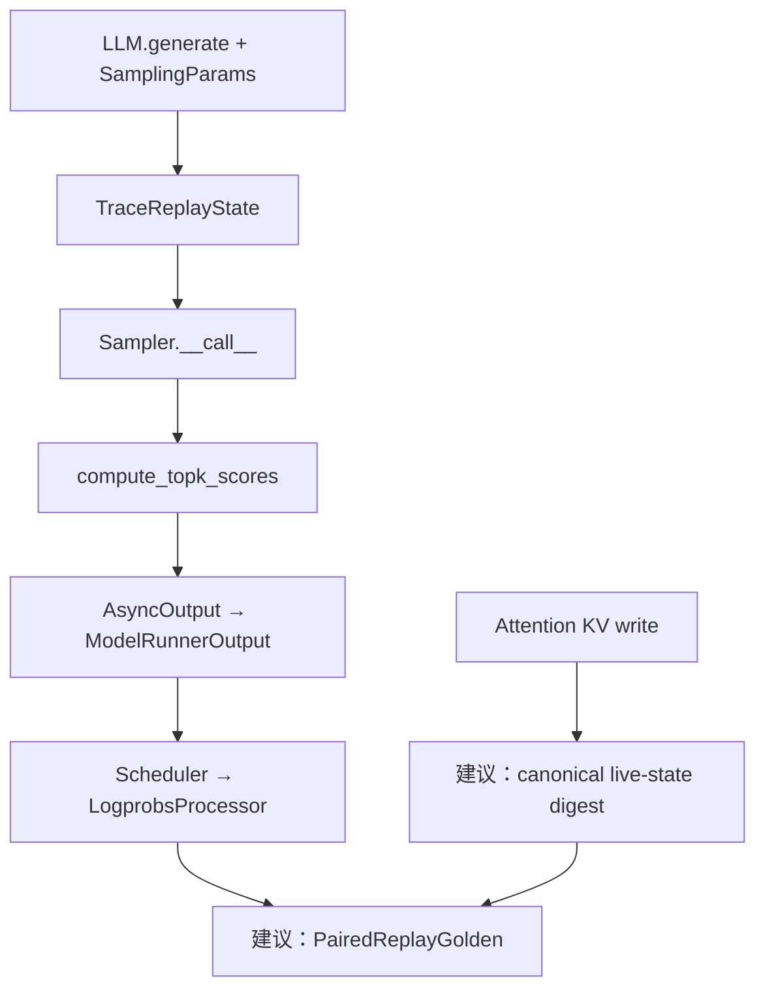
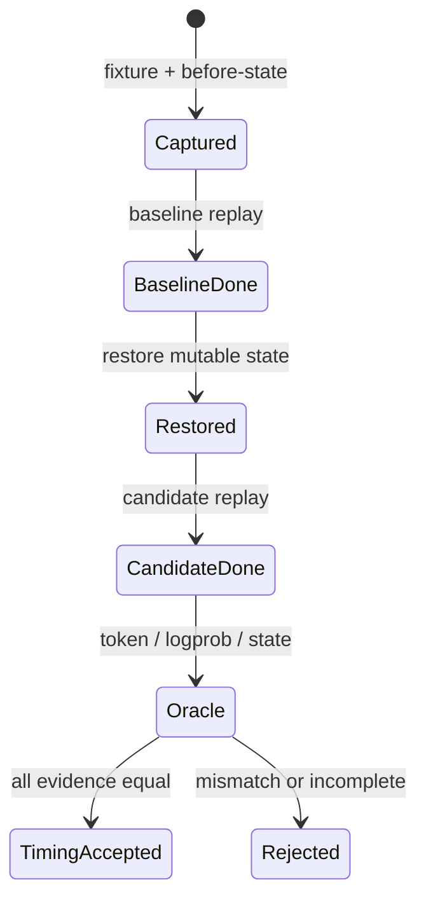

> 本文基于 vLLM `main` 的 [`2f170a0fed20fd84dfcf6da2a3a8188a32f67e4e`](https://github.com/vllm-project/vllm/commit/2f170a0fed20fd84dfcf6da2a3a8188a32f67e4e)。它比[上一章基线](https://github.com/vllm-project/vllm/commit/07e4d6b957f70075b132b7e0c05c649dcbd0d4b7)前进 118 个 commit；[比较结果](https://github.com/vllm-project/vllm/compare/07e4d6b957f70075b132b7e0c05c649dcbd0d4b7...2f170a0fed20fd84dfcf6da2a3a8188a32f67e4e)中，本文直接分析的 Trace Replay、Sampler/logprob、AsyncOutput、batch-invariance 与 KV 写入测试文件没有变化。最新提交修复 DSv4.1 draft model 的 MoE flag 读取，与本题无直接关系。以下以已合入代码为事实边界。

## 本篇在课程路线中的位置

这是第 93 章，位于“测试、性能与故障诊断”阶段。第 92 章回答了怎样冻结 token path、co-batch、KV context、rank 与 graph policy；本篇只回答下一道闸门：**两次 replay 跑完后，凭什么说它们语义等价，从而允许解释 timing delta？**

## 前置知识回顾

Trace Replay 不是“伪造一个结果”：它让模型照常算 logits，只在 sampling 后把 token 改为预定 trace，并用未被覆盖的分布计算该 token 的真实 logprob。于是 baseline 与 candidate 可以沿同一 token path 前进。但相同 token 只证明离散输出相同；logit 已漂移、KV 写坏但暂未影响下一 token，仍可能被漏掉。

## 本篇要回答的核心问题

1. 强制 token 的 logprob 从 GPU logits 怎样一路进入公开 `RequestOutput`？
2. token、logprob 与 KV/state 各该比较什么；为什么不能直接 hash 整块物理 cache？
3. 哪些 mismatch 必须拒绝计时结论，哪些数值差异只能按预先声明的实验契约解释？

## 组件在全局架构中的位置

当前 `main` 有生产输出链和各自的测试，但没有名为 `PairedReplayGolden` 的统一类型，也没有把实际 KV 内容 digest 随 `ModelRunnerOutput` 返回的通用接口。下面右侧的 canonical digest 与 Golden oracle 是本文基于现有边界提出的设计，不是已合入功能。

## 完整调用链

公开入口是 `LLM.generate(prompts, SamplingParams(trace_decode_token_ids=..., logprobs=k))`。[Trace Replay 文档](https://github.com/vllm-project/vllm/blob/2f170a0fed20fd84dfcf6da2a3a8188a32f67e4e/docs/serving/online_serving/trace_replay.md)明确：输出 token 遵循 trace，而 logprob 来自真实、未修改的分布。

请求进入 EngineCore、Scheduler 和 GPUModelRunner 后，[TraceReplayState](https://github.com/vllm-project/vllm/blob/2f170a0fed20fd84dfcf6da2a3a8188a32f67e4e/vllm/v1/worker/gpu/sample/trace_replay.py)按 request slot 保存 trace。[Sampler.__call__](https://github.com/vllm-project/vllm/blob/2f170a0fed20fd84dfcf6da2a3a8188a32f67e4e/vllm/v1/worker/gpu/sample/sampler.py)先产生正常 `sampled`，再 `apply_trace` 原地覆盖它，最后把覆盖后的 token 交给 [compute_topk_scores](https://github.com/vllm-project/vllm/blob/2f170a0fed20fd84dfcf6da2a3a8188a32f67e4e/vllm/v1/worker/gpu/sample/logprob.py)。因此返回矩阵的第一列就是 forced token 及其真实 score/rank，后面才是 top-k。

`SamplerOutput` 仍持有 GPU tensor；[AsyncOutput](https://github.com/vllm-project/vllm/blob/2f170a0fed20fd84dfcf6da2a3a8188a32f67e4e/vllm/v1/worker/gpu/async_utils.py)在 copy stream 上异步 D2H，event 完成后转成 NumPy/Python list 的 `ModelRunnerOutput`。[Scheduler.update_from_output](https://github.com/vllm-project/vllm/blob/2f170a0fed20fd84dfcf6da2a3a8188a32f67e4e/vllm/v1/core/sched/scheduler.py)把 token 与本请求对应的 logprob 行提交为 `EngineCoreOutput`；前端 [LogprobsProcessor](https://github.com/vllm-project/vllm/blob/2f170a0fed20fd84dfcf6da2a3a8188a32f67e4e/vllm/v1/engine/logprobs.py)再生成公开输出。

## 关键类型、字段和状态生命周期

| 接口 | shape / dtype / device | 所有权与条件 | 失败方式 |
| --- | --- | --- | --- |
| `TraceReplayState.trace_token_ids` | `[max_num_reqs,max_model_len]`、`int32`、UVA-backed | ModelRunner 按 slot staged-write；`step=total_len-prompt_len` 必须落在 trace 内 | stale slot、越界或 trace 未启用时不能产生可信 forced token |
| `sampled_token_ids` | `[num_reqs,1]`、`int64`、GPU | Sampler 产生并被 trace 原地改写；后置条件是本 step 每请求至多一个 normal sample | request/row mapping 错会把 token 归给错误请求 |
| `LogprobsTensors` | token IDs / scores 为 `[Σgenerated,max_logprobs+1]`；score `float32`，rank `int64`，GPU 后 D2H | 第一列绑定 selected token；spec decode 用 `cu_num_sampled_tokens` 划分变长行 | raw/processed mode、top-k tie、backend 数值路径不一致 |
| KV write | key/value `[num_tokens,num_kv_heads,head_size]`；cache 常见 `[num_blocks,block_size,num_kv_heads,head_size]` | Attention backend 按 `slot_mapping[num_tokens]` 写入；物理 block/slot 由当前 allocation 决定 | alias、错误 slot、layout/quant metadata 不匹配、迟到写 |

一个 forced token 的生命周期是：请求 admission 时 trace 写入复用 slot；sampling step 按已生成长度选 token；它覆盖采样结果、成为 logprob 第一列的 selected ID；D2H 后 Scheduler 同时提交 token 与对应行；请求结束后 slot 可被新请求复用。Golden 必须绑定 request/step/slot generation，不能只缓存一行数组。

## 逐函数源码解读

`TraceReplayState.apply_trace` 的 kernel 接收 `sampled[num_reqs]`、`idx_mapping[num_reqs]`、prompt/total length；负 mapping 跳过，trace 结束也不覆盖。它解决“沿指定 token path 走”，不承诺两个执行的 logits 相同。

`compute_topk_scores` 在没有自定义 logprob token IDs 时，先把 `sampled.unsqueeze(-1)` 放到候选第一列，再拼 top-k IDs；scores 明确分配为 FP32。于是 token equality 与 selected-token logprob equality能在同一行核对，不能把“top-1 候选相同”误当成 forced token score 相同。

`AsyncOutput.get_output` 先等待 copy event，再按每请求实际 `num_sampled_tokens` 截断，防止 speculative 宽度或静态 buffer 尾部进入 Host 输出。这里是 GPU buffer 生命周期转为序列化值的边界。

KV 侧的 [triton_reshape_and_cache_flash](https://github.com/vllm-project/vllm/blob/2f170a0fed20fd84dfcf6da2a3a8188a32f67e4e/vllm/v1/attention/ops/triton_reshape_and_cache_flash.py)按 `slot_mapping` 把每个 token 的 K/V 写到 block 与 offset。物理 slot 是 allocation 结果，不是语义身份：baseline 写 block 1/offset 15、candidate 写 block 3/offset 0，只要它们代表同一 request 的同一 logical token，直接 hash 整个 buffer 就会制造 false mismatch。

## 具体示例与 shape/状态演算

设两个请求 A/B，prompt 长度分别为 5/8，trace 为 `[100,101]` 与 `[200,201]`，当前都已生成一个 token。下一 step 的 `step=1`，Sampler 必须返回 `[[101],[201]] int64`。若 `logprobs=2`，每行宽度为 3：selected token 加 top-2；示意为 A 的 IDs `[101,7,42]`、scores `[-1.25,-0.40,-0.90]`，B 为 `[201,9,88]`、`[-2.00,-0.20,-1.10]`。这些数值只是演算，不是源码常量。

再设 `num_kv_heads=8`、`head_size=128`、BF16。每个新 token、每层的逻辑 K+V 载荷为 `2×8×128×2=4096` bytes；两请求共 8192 bytes/层。建议 digest 按 `(layer,request,logical_token,K|V,dtype,scale metadata)` 的固定顺序在 device 侧归并，只 D2H 固定尺寸 digest；排除 free block、padding、未写区域和物理 block ID。FP8/量化 cache 还必须纳入 scale/zero-point 等解释元数据，否则相同 bytes 未必表示相同值。

## 为什么这样设计及替代方案

只比最终文本最便宜，却受 tokenizer/detokenizer 影响，还会漏掉不同 token 序列映射到相同文本。比 exact token 加 selected-token logprob，D2H 成本小、定位直接，但会漏掉尚未影响当前输出的 state corruption。

把整块物理 KV 做 bitwise hash 看似最强，实则把 allocator 位置、padding、layout 与未初始化区域混入语义；读取整个 cache 还会占显存带宽、扰动 timing 与 graph。canonical live-state digest 更贴近不变量、D2H 固定，但需要每个 backend/layout/state 类型维护 adapter，并承担 hash collision 风险。另一个替代是再跑一步，把 state 当作黑盒验证；它能发现“状态是否可消费”，但增加计算、延迟定位，而且一个 probe token 不能覆盖全部状态。

因此最小分层 oracle 应是：L0 配置与证据齐全；L1 token IDs/数量 exact；L2 selected token、candidate IDs、score/rank 按声明的数值契约比较；L3 logical live KV/state digest；L4 request control state。任何层缺失都产生 `EVIDENCE_INCOMPLETE`，而不是默认为等价。

## 性能、并发、正确性与边界条件

在 [batch invariance](https://github.com/vllm-project/vllm/blob/2f170a0fed20fd84dfcf6da2a3a8188a32f67e4e/docs/features/batch_invariance.md)支持的配置上，既然目标就是跨 batch/order 的 bitwise 稳定，Golden 应要求 logprob bitwise equal；配置外若实验主动允许数值漂移，容差必须来自预先声明的 error budget 与参考实验，不能看到结果后调阈值。

digest 必须在写入完成 fence 之后、buffer 复用之前取样，并绑定 engine generation、step、rank、request 与 state schema version。并发请求共享物理 block pool时，只遍历本 fixture 的 live logical ranges；graph capture 下 digest kernel 本身若进入计时区会改变 graphability，因此应在 untimed validation pass 执行，或使用独立 stream/event 明确排除其成本。多 rank 则要求 expected-rank quorum；少一个 rank 的“相同”仍是证据不完整。

建议 verdict 至少区分 `TOKEN_MISMATCH`、`LOGPROB_MISMATCH`、`KV_STATE_MISMATCH` 与 `EVIDENCE_INCOMPLETE`，保存第一个 request/step/layer/field 差异。只有 `equivalent=true` 才接受第 91 章的 paired timing delta。

## 测试证据与未覆盖风险

[Trace Replay 单测](https://github.com/vllm-project/vllm/blob/2f170a0fed20fd84dfcf6da2a3a8188a32f67e4e/tests/v1/worker/test_gpu_trace_replay.py)用两请求、不同 prompt length、trace `[100,101,102]`/`[200,201,202]` 验证逐 step 覆盖，并覆盖空 trace、结束、`idx_mapping` 与 slot reuse；它证明 overwrite 生命周期，不证明 paired KV 等价。

[logprob E2E](https://github.com/vllm-project/vllm/blob/2f170a0fed20fd84dfcf6da2a3a8188a32f67e4e/tests/v1/sample/test_logprobs.py)在 Qwen3-0.6B 上生成 greedy、seeded sampling 和拼接 trace，各 32 tokens，再对无 spec 与 ngram spec 路径验证 token exact、accepted tokens 大于零，并以 `rel_tol=5e-2, abs_tol=2.5e-1` 比较 forced-token logprob。这个阈值是该 spec/non-spec 测试的实验事实，不是任意 paired replay 的通用容差。

[batch-invariance 测试](https://github.com/vllm-project/vllm/blob/2f170a0fed20fd84dfcf6da2a3a8188a32f67e4e/tests/v1/determinism/test_batch_invariance.py)让 32 个约 1920–2048 token 的 prompt 独跑与成批运行，16 个输出、`temperature=0.6`、`seed=1234`、`logprobs=5`，先断言 token exact，再用 `torch.equal` 验证 logprob tensors bitwise equal；这是覆盖配置上的强证据，不是所有 backend 的证明。

[KV cache 测试](https://github.com/vllm-project/vllm/blob/2f170a0fed20fd84dfcf6da2a3a8188a32f67e4e/tests/kernels/attention/test_cache.py)覆盖 NHD/HND、auto/FP8 等布局，并有 slots `[0,5,16,31]` 的非对称 K/V 写入，既检查目标值也检查其余 cache 未变。仍缺真实 SchedulerOutput→Attention→下一 step 的跨层 canonical digest、量化元数据、Mamba/stateful cache、TP/PP quorum、digest collision/adapter version 与 corruption injection Golden。

历史上，已合入 [PR #46701](https://github.com/vllm-project/vllm/pull/46701) 引入 Trace Replay，目标就是保留真实 logprob/rank；当前实现与测试才是本文事实依据。[Issue #27433](https://github.com/vllm-project/vllm/issues/27433) 是 batch-invariance 的持续跟踪，不代表所有限制已经消失。

## 与前后章节的连接

第 92 章冻结输入，本章冻结“可接受输出”的定义：两者合起来，才使第 91 章的 timing join具备因果解释。下一章应继续处理 Golden 的执行方式：如何安排 AB/BA 轮次、warmup、digest validation 与 GPU Event 计时，避免验证本身污染被测路径。

## 本篇结论、知识债、三个理解检查问题和下一章

结论只有一句：**paired replay 的提交点不是 token 相同，而是配置证据、token、数值输出与 logical live state 全部通过分层 oracle；否则 timing 结果必须 fail closed。**

知识债：当前没有统一 Golden schema、canonical KV/state adapter、device-side digest 与 rank quorum；量化 cache、Mamba/encoder/spec state 的语义域未统一；还缺 corruption injection、collision/version、digest overhead 与 graph pollution 测试。

理解检查：

1. 为什么 `trace_decode_token_ids` 相同仍不能证明 logits 或 KV 相同？
2. 为什么物理 cache 全量 hash 可能把正确的两次执行判成不同？
3. spec/non-spec 测试里的 `rel_tol/abs_tol` 为什么不能直接复制成通用 Golden 阈值？

下一章：**Paired Replay 的测量事务——AB/BA 顺序、Warmup、Validation Pass 与 Timing 污染隔离。**

## 课程账本增量

- 源码基线：`2f170a0fed20fd84dfcf6da2a3a8188a32f67e4e`。
- 新覆盖：`Sampler.__call__`、`compute_topk_scores`、`LogprobsTensors`、`AsyncOutput`、`Scheduler.update_from_output`、`LogprobsProcessor`、`triton_reshape_and_cache_flash`。
- 新不变量：forced token 必须位于 logprob 第一列；物理 slot 不是状态语义身份；digest 必须覆盖 logical live state 与解释元数据；evidence incomplete 不得进入 timing。
- 事实边界：生产链可返回 token/logprob，测试可分别证明 batch-invariant 数值与 KV 定点写入；统一 `PairedReplayGolden`、canonical digest 和 mismatch taxonomy 均为设计建议。
- 下一章：AB/BA、warmup、validation 与 timing pass 的事务边界。
