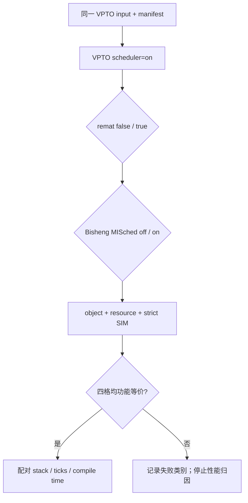
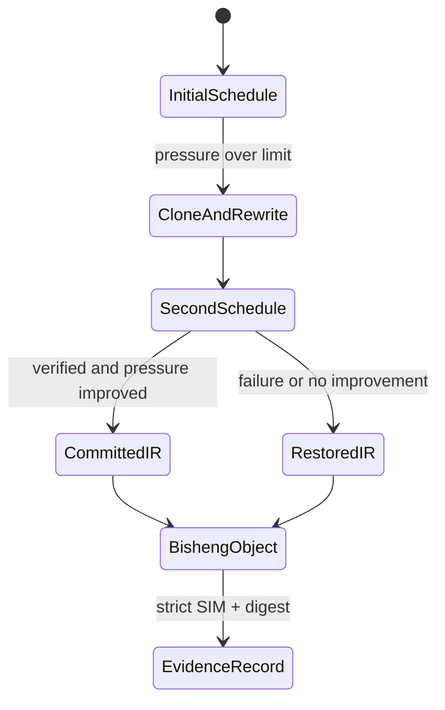

> 本文基于 PTOAS 默认分支提交 [`297a791c7c4f`](https://github.com/hw-native-sys/PTOAS/commit/297a791c7c4f632f7c1fc02bf4f777a313b4ea2a)。它与上一章基线相同：今天重访同一版本不是重复讲源码，而是补上上一章明确留下的“如何归因”知识债。相关 rematerialization 最初由提交 [`566d6af8c01`](https://github.com/hw-native-sys/PTOAS/commit/566d6af8c017e7f44402fb2c4e8d204d8f195b9a) 合入，用来处理 [#1446](https://github.com/hw-native-sys/PTOAS/issues/1446) 的高压案例。下文严格区分当前代码事实、测试事实、历史实验与建议协议。

## 本篇在 PTO 课程路线中的位置

这是课程第 104 章。第 101 章已经说明 VPTO rematerialization 怎样复制 cheap producer、缩短 live range；第 102～103 章把证据边界推进到 LLVM/HiVM、Bisheng resource report、ET_REL object、VF symbol 与 strict SIM。今天只回答一个问题：**若 stack 或 ticks 变化，怎样判断是中层 rematerialization、Bisheng machine scheduler，还是两者交互造成的？**

结论先行：应固定 `--vpto-scheduler=on`，只正交切换 `--vpto-scheduler-remat={false,true}` 与 `--bisheng-vec-misched={off,on}`。四格都通过 strict SIM 后，才计算配对差分；编译失败、功能不等价或某格缺少同等级 resource evidence 时，应保留为分类结果，不能用零、超时上限或 `auto` 的获胜对象替代。

## 前置知识

VPTO 的 `!pto.vreg<64xi32>` 是 64 lane、每 lane 32 bit 的逻辑 register carrier，共 2048 bit，即 256 B。到 VPTO 阶段，VMI layout 已 physicalize 成一个或多个 carrier；这里的 location 是逻辑 VReg SSA，不是 Global/UB，也没有物理 V0/V1 编号。

`VPTORegPressureTracker` 统计同时活跃的 vector/predicate value；它不做 physical register allocation。rematerialization 在 MLIR/VPTO 层改变 producer 的 definition/use 与操作顺序；Bisheng 在更低层做 instruction scheduling、allocation、reuse 和可能的 spill。两者都可能改变最终 stack/ticks，却位于不同因果层。

## 今日 1–2 个核心问题

1. 为什么不能只比较 `remat=false/true`，也不能拿 `--bisheng-vec-misched=auto` 直接做性能 A/B？
2. 四象限中应固定什么、记录什么、怎样计算主效应与交互，并在证据缺失时 fail closed？

## PTO 全栈中的位置

上游输入必须是同一 VPTO 文件或同一 digest 的 bitcode，并冻结 PTOAS/CANN/Bisheng 版本、完整 argv、target、shape 和模拟器配置。下游消费者不是生产环境的 `auto` selector，而是研究结果表：它把四个 object 的身份、resource report、strict SIM verdict、ticks 与重复编号绑定起来。

## 概念和精确语义

令 `R∈{0,1}` 表示 rematerialization 关闭/开启，`B∈{0,1}` 表示 Bisheng machine scheduler 关闭/开启，`Y(R,B)` 是同一指标的重复样本统计量。四格命令核心如下：

| 单元 | VPTO scheduler | remat | Bisheng MISched | 解释 |
| --- | --- | --- | --- | --- |
| `R0B0` | `on` | `false` | `off` | 两个待研究机制都关闭 |
| `R1B0` | `on` | `true` | `off` | 只改变 VPTO live range |
| `R0B1` | `on` | `false` | `on` | 只改变 machine scheduling |
| `R1B1` | `on` | `true` | `on` | 两机制共同作用 |

固定 `B` 时，remat 效应是 `ΔR|B0=Y(1,0)-Y(0,0)`、`ΔR|B1=Y(1,1)-Y(0,1)`；固定 `R` 时，Bisheng 效应是 `ΔB|R0=Y(0,1)-Y(0,0)`、`ΔB|R1=Y(1,1)-Y(1,0)`。交互项为 `I=(Y(1,1)-Y(0,1))-(Y(1,0)-Y(0,0))`。对 stack/ticks，负数通常更好，但“编译失败”不是一个极大的数，不能进入减法。

这个定义隐含四个前置条件。第一，四格的输入 VPTO/bitcode digest 相同；若 `R1` 是在更上游重新生成 kernel，输入差异就不再只有 remat。第二，除两个开关外，target、优化级别、Bisheng 额外参数和 simulator case 完全一致。第三，结果所有权按单元隔离，每格写独立 object、log 与 result record。第四，统计量来自同一重复编号内的配对样本，而不是分别取两个不同时段的大样本平均值。

后置条件也分层：编译成功只说明产物存在；resource report 可解析只说明可比较静态资源；strict SIM 通过才说明功能等价；完成若干重复才允许比较 ticks。一个单元可能是 `COMPILE_FAILED`、`REPORT_UNAVAILABLE`、`FUNCTIONAL_MISMATCH` 或 `VALID`。前三者不是“坏性能”，而是当前证据不足或正确性失败。

## 真实文件、类型、API 或指令逐段解读

[`tools/ptoas/ptoas.cpp`](https://github.com/hw-native-sys/PTOAS/blob/297a791c7c4f632f7c1fc02bf4f777a313b4ea2a/tools/ptoas/ptoas.cpp) 定义三组开关：`--vpto-scheduler={off,analyze,on}`、`--vpto-scheduler-remat` 与 `--bisheng-vec-misched={auto,on,off}`。A5 上未显式指定时，driver policy 会把 VPTO scheduler 和 remat 打开；实验必须显式写出全部值，不能依赖默认值随 arch 或版本变化。

[`VPTOSchedulerPass.cpp`](https://github.com/hw-native-sys/PTOAS/blob/297a791c7c4f632f7c1fc02bf4f777a313b4ea2a/lib/PTO/Transforms/VPTOScheduler/VPTOSchedulerPass.cpp) 的 `runFunctionWithRematerialization` 是事务：先调度并快照顺序，`prepareVPTORematerialization` 克隆 producer DAG、改写 consumer，再验证并二次调度；只有 final vector pressure 严格下降且所有 pressure set 不超限才提交，否则删除 clones、恢复 use 和原顺序。因此 `R1` 不是“强制保留克隆”，而是“允许一次可回滚尝试”。

这里还有一个容易忽略的非法组合：`--vpto-scheduler=off` 时没有“在同一 scheduler 上仅关闭 remat”的含义，因为 remat 挂在 scheduler pass 的 `on` 路径上。把 `scheduler=off` 命名为 `R0` 会同时删掉第一次 VPTO 调度，破坏单因素假设。`analyze` 也只适合观察，不应混入四格执行结果。

[`VPTOSchedulerRematerialization.cpp`](https://github.com/hw-native-sys/PTOAS/blob/297a791c7c4f632f7c1fc02bf4f777a313b4ea2a/lib/PTO/Transforms/VPTOScheduler/VPTOSchedulerRematerialization.cpp) 与 [`VPTOSchedulerRematPressure.cpp`](https://github.com/hw-native-sys/PTOAS/blob/297a791c7c4f632f7c1fc02bf4f777a313b4ea2a/lib/PTO/Transforms/VPTOScheduler/VPTOSchedulerRematPressure.cpp) 把“值得复制”和“复制后是否真的降压”分开：前者受 purity、schedule model、predecessor depth 和预算约束，后者重新计算所有 pressure set。也就是说，候选合法不等于方案可提交；局部缩短一个 vector 的 live range，也不能以另一个集合越界为代价。

[`ObjectEmission.cpp`](https://github.com/hw-native-sys/PTOAS/blob/297a791c7c4f632f7c1fc02bf4f777a313b4ea2a/tools/ptoas/ObjectEmission.cpp) 把 Bisheng `on` 表示为工具链默认，`off` 则追加 `-mllvm --cce-aicore-vec-misched=0`。resource report 只有 `reportUsage=true` 才追加 `-mllvm --cce-res-usage`。

[`BishengScheduler.cpp`](https://github.com/hw-native-sys/PTOAS/blob/297a791c7c4f632f7c1fc02bf4f777a313b4ea2a/tools/ptoas/BishengScheduler.cpp) 显示：显式 `on/off` 通常只编译一次，不解析报告；`auto` 才先编译 on，stack>0 时再编译 off，并仅在 off 的总 stack 严格更小时替换 object。故 `auto` 是**选择策略**，不是稳定的实验单元：它可能只生成 on object，也会把“哪个 object 被保留”与“哪个调度器更好”绑在一起。

最后，[`check_bisheng_scheduler.py`](https://github.com/hw-native-sys/PTOAS/blob/297a791c7c4f632f7c1fc02bf4f777a313b4ea2a/test/vpto/scripts/check_bisheng_scheduler.py) 虽然真实运行 `off/on/auto`、检查非空 fat object、执行 strict CA-model 并解析 `Total tick`，却在 `compile_sample` 中固定 `--vpto-scheduler-remat=false`。这是三种 Bisheng mode 的验证，不是今天的四象限。

## 对象/Tile/Buffer/IR 生命周期

本章追踪的是一个 `!pto.vreg<64xi32>` producer result。`R0` 中它在原 definition 创建，由远端 consumer 消费，last use 后退出 live set；`R1` 中 planner 可在 consumer 前创建 clone、把该 use 指向 clone，使原 value 更早死亡。若二次调度验收失败，clone 与 use rewrite 一起失效；若验收通过，新 IR 顺序成为 Bisheng 的输入。

随后每个 `R×B` 单元独立生成 object。object 一旦完成 strict SIM 和 digest 记录，就作为不可变实验产物保存；不得让下一格覆盖前一格。runtime 只消费获选单元的 device object，不再看到 MLIR clone。

所有权边界因此很清楚：scheduler pass 暂时拥有 clone 与 use rewrite，提交后由 IR module 持有；object emission 读取最终 module，但不拥有上游分析状态；实验 harness 拥有四个 object/log/result record；strict SIM 只读 object 与输入数据。失败清理也必须按层发生：remat rollback 不能残留 clone，某格编译失败不能删除其他格产物，SIM mismatch 不能让该 object 进入 ticks 汇总。

## 端到端调用链或指令链

公开链路是：`ptoas.cpp` 解析显式 flags → `VPTOSchedulerPass::runOnOperation` → `runFunctionWithRematerialization`（仅 `R1`）→ VPTO-to-LLVM/HiVM lowering → `emitVPTODeviceObject` → `compileDeviceLLVMToObject` → `compileWithBishengScheduler` → CA-model strict validation。研究 harness 应在最外层展开四格，而不是修改任一 pass 的内部语义。

每格至少产出：`cell_id`、完整 argv、input digest、PTOAS/Bisheng version、object SHA、compile verdict、stack report 状态、strict SIM verdict、ticks、重复编号。任何字段缺失都保留明确状态，如 `REPORT_UNAVAILABLE`，而不是空值默认为零。

可以把单格接口理解为一个纯函数：输入是不可变的 `VPTOArtifact`、`R/B` 两个布尔值和 `RunContext`，输出是 `CellEvidence`。前置条件是 input digest 与 manifest 一致、输出目录为空且 toolchain 可识别；后置条件是无论成功失败都写出终态 verdict，并且成功 object 的 SHA 在 SIM 前后不变。并发执行虽能缩短墙钟时间，却可能让编译器临时目录、CPU 争用或模拟器资源互相影响；在缺少隔离证明时，课程建议串行执行、轮换顺序，而不是并发跑四格。

失败方式也要保留阶段：flag 解析失败属于配置错误；第二次 VPTO 调度失败可能触发 remat rollback，但整体编译仍可继续使用恢复后的 IR；Bisheng 失败属于 machine compile failure；object 生成后 strict SIM mismatch 属于正确性失败。把这些都压成一个 `failed=true` 会丢掉最重要的定位信息。

## 具体 shape、Tile 和状态演算

直接测试 [`vpto_scheduler_rematerialization_pressure_sets.pto`](https://github.com/hw-native-sys/PTOAS/blob/297a791c7c4f632f7c1fc02bf4f777a313b4ea2a/test/lit/vpto/vpto_scheduler_rematerialization_pressure_sets.pto) 提供了足够小的状态演算：函数有 31 个 `!pto.vreg<64xi32>` 输入，每个 256 B；另有 root/index producer、6 个 predicate mask，loop trip count 为 2。

初次调度峰值是 `{vector:33,predicate:6}`，vector 超过模型上限 32。planner 选 2 个 candidate、形成 3 个 group；二次调度后变成 `{vector:32,predicate:7}` 并提交。它证明 remat 用额外重算与一个 predicate 活跃量，换回一个 vector live range；它不证明 stack 减少，因为测试没有运行 Bisheng allocator。

按时间点展开，可以把状态写得更具体：

1. 进入高压 region 前，31 个参数并非永远同时活跃，tracker 依据 definition/use、live-in 与 last use 更新集合。
2. 原始顺序在某个边界同时保留 33 个 vector representative 与 6 个 predicate；vector limit=32，因此触发规划。
3. planner 不复制 31 个大输入，而是从 target-approved 的 cheap producer DAG 中选择 2 个 candidate，并按共享 producer/consumer 关系形成 3 个 remat group。
4. clone 被放到 use 附近，远距离原 producer 可以更早退休；代价是新增重算以及某段 predicate 生命周期变长。
5. 二次调度重新得到 32/7。vector 从非法变合法，predicate 从 6 增至 7、仍未越界，于是事务提交。

这也给出 dtype/location 约束：输入与 clone result 都是 `64xi32` VReg carrier，shape 和 dtype 不变；remat 改变的是 SSA identity、定义位置和生命周期，而非把数据搬到 UB 或改变 layout。若 producer 有副作用、未知硬件成本、不可复制依赖或预算超限，就不是合法 candidate。

把该 fixture 放入四象限时，中层状态只有两种：`R0` 保持 33/6，`R1` 提交后为 32/7；`B0/B1` 不应反向改变这组 PTOAS trace。机器层的 stack 与 ticks 则是四个**待测结果**，本文不虚构数值。

历史提交 `566d6af8c01` 对 #1446 的 E768/K9 TopK 记录了部分证据：scheduler off + Bisheng off 为 13281 ticks；scheduler on + remat on + Bisheng off 为 6412 ticks；另两种配置发生 stack 超限编译失败。它证明 remat 方案曾解决一个特定工具链/shape 的失败并改善 CA ticks，但因同时改变了 VPTO scheduler，且没有覆盖固定 scheduler 下的 `R0B0/R1B0/R0B1/R1B1`，不能替代本章四象限。

## 为什么这样设计及替代方案

只做 `R0→R1`：若两次使用不同 Bisheng scheduler 或默认值变化，结果混入后端调度。只做 `B0→B1`：看不到 remat 改写后，machine scheduler 是否从有害变有益。直接用 `auto`：第二次编译是条件触发，最终 object 已经过 stack 选择，样本集合不对称。

四象限的优势不是“多跑两次”，而是能测交互：若 `ΔR|B0<0`、`ΔR|B1>0`，平均 remat 效应会掩盖机制冲突。代价是四倍编译/仿真与更复杂的 artifact 管理；对高成本 kernel，可先用一个固定 shape 做机制验证，再扩 shape，但不能把单 shape 结果外推成普遍收益。

还要区分“控制变量”和“观测变量”。VPTO input、toolchain、两个显式开关之外的 argv、输入 tensor 与 simulator 配置是控制变量；static pressure、stack、object size、compile time、ticks 是观测变量。把 stack 当作控制目标并让 `auto` 根据它选择 object，相当于在观测之后改变样本，随后再比较 ticks会产生选择偏差。

显式 on/off 当前不会稳定导出每格 stack。较安全的替代是新增 observation-only report：不改变 object selection，只保存每格 raw resource log 与 schema/version。现阶段也可为每个 `R` 附跑 `auto` 作为 sidecar，但 `stack=0` 时 auto 会短路、不生成 off report，因此只能标为不完整证据，不能补造 `B0` stack。

## 访存、计算、流水、并行和硬件约束

从第一性约束看，remat 在“容量”与“工作量”间交换：复制 producer 增加静态指令及动态 micro-ops，却缩短 vector live range，可能减少 spill/reload。若 producer 在 loop 内，动态代价还要乘 trip count；这正是 planner 限制 predecessor depth、clone count、dynamic micro-ops 与 work units 的原因。

Bisheng MISched 改变 machine instruction 顺序，可能提高 pipeline overlap，也可能延长某些 live interval。stack bytes 是静态 frame/resource 信号；spill 指令数是静态 machine evidence；动态 UB/stack traffic 还需执行次数；ticks 又叠加 pipeline、依赖和访存等待。四者不能互相代替。

重复实验应采用轮换顺序，例如每轮依次从 `R0B0/R1B0/R0B1/R1B1` 的不同起点开始，避免当前脚本固定 `off→on→auto` 把 cache warm-up、主机负载或模拟器漂移绑定到某一格。compile time 与 CA ticks 分开统计；前者不能解释 kernel runtime。

访存量也不能从 stack frame 静态推出。若某个 256 B carrier 被 spill，一次逻辑 spill 可能被拆成若干 machine memory operation；slot 可能复用，对齐也会放大 frame，而 loop trip count 会放大动态次数。相反，非零 stack 也可能包含与 vector spill 无关的对象。因此至少要分别记录静态 frame bytes、可识别的 spill/reload 指令、动态执行次数与最终 ticks，才可能讨论“少了多少流量导致快了多少”。公开 PTOAS 目前只稳定覆盖其中一部分。

## 测试证据与未覆盖风险

当前直接证据分四层：

- `pressure_sets.pto`：验证 33/6→32/7、跨 pressure set 的验收不变量。
- [`vpto_scheduler_rematerialization_rollback.pto`](https://github.com/hw-native-sys/PTOAS/blob/297a791c7c4f632f7c1fc02bf4f777a313b4ea2a/test/lit/vpto/vpto_scheduler_rematerialization_rollback.pto)：二次调度成功但 vector peak 33 未下降，要求 `accepted=false` 且 clones/order 恢复。
- [`vpto_scheduler_rematerialization_budget.pto`](https://github.com/hw-native-sys/PTOAS/blob/297a791c7c4f632f7c1fc02bf4f777a313b4ea2a/test/lit/vpto/vpto_scheduler_rematerialization_budget.pto)：48 candidates 中最多选 16、32 clones、64 dynamic micro-ops；最终仍超限时回滚，证明预算不是正确性豁免。
- `check_bisheng_scheduler.py`：真实 toolchain 的 off/on/auto、strict numerical compare 与 ticks，但 remat 固定 false。

这些测试分别验证局部不变量，却没有任何一个单独证明端到端因果。lit 的优势是确定、快速、能精确检查 trace；它的缺口是没有真实 allocator。Bisheng 脚本的优势是经过真实 toolchain 和 strict SIM；它的缺口是冻结 remat 且显式模式的 resource 可观测性不对称。历史 #1446 的优势是给出真实失败与 ticks；它的缺口是配置轴不正交、shape/toolchain 单一。把三类证据拼接时，只能取交集，不能把某层未测内容借给另一层。

未覆盖风险正是本章结论：仓库没有单一测试同时展开 `R×B` 四格；显式 on/off 没有稳定的 per-cell resource schema；run order 未 counterbalance；公开材料没有 allocator dump、dynamic spill traffic 或真机 counter。故本文给出的是由代码约束推导的可执行协议，不声称今天已经得到四格性能数值。

测试还缺两类负例。其一，四格均编译成功但某一格 strict SIM mismatch，harness 必须停止 ticks 归因并保留失败产物；其二，四格功能正确但只有部分格能解析 resource report，此时可以比较 ticks，却不能声称 stack 主效应。理想集成测试还应故意交换 object 路径或修改 input digest，确认 manifest 校验能在运行前拒绝“结果串格”。

## 与前后章节的连接

向前，本章把第 101 章的 static pressure transaction 与第 102～103 章的 object/resource/SIM evidence 接成因果实验。向后，四象限一旦落到真实 kernel，还需解决 artifact identity：同一 input 是否真的只改变两个开关、raw log 是否能复核、某格失败是否在编译还是 strict SIM 门禁。下一章将把这些字段做成可复现的 manifest/result schema，并选择真实 kernel 而非仅靠合成 pressure fixture。

## 本篇结论、知识债、三个理解检查问题和下一章

本篇确认：rematerialization 是可回滚的 VPTO live-range 变换，Bisheng MISched 是更低层 machine scheduling；两者必须正交切换，`auto` 只能验证生产选择策略，不能充当四象限单元。只有相同 input/toolchain、同等级 evidence、strict SIM 通过并采用重复配对后，stack/ticks 差分才有可解释性。

知识债：显式 on/off 的稳定 resource-report API；allocator/disassembly schema；每格 dynamic spill traffic；真机与 CA-model 一致性；跨 shape/Tile 的外部有效性；四象限 harness 的版本化 artifact manifest。

理解检查：

1. 为什么实验中 `--vpto-scheduler` 必须固定为 `on`，而不能把 scheduler off 当作 `remat=false`？
2. 若 `R1B1` 编译失败，为什么不能把 ticks 记成超时上限后继续算交互项？
3. `pressure 33→32`、stack 下降与 ticks 下降分别证明了什么，哪两条之间仍缺 allocator/dynamic-traffic 证据？

下一章：**真实 kernel 的四象限 Artifact Manifest——固定 VPTO input、Bisheng argv、object identity、strict SIM Golden 与轮换 run order。**

## 课程账本增量

- 课程：104；阶段：PTOAS backend evidence 与因果归因。
- 主仓：`hw-native-sys/PTOAS`；源码基线：`297a791c7c4f632f7c1fc02bf4f777a313b4ea2a`。
- 新覆盖：`ptoas.cpp` 三组 flags、`runFunctionWithRematerialization` transaction、`ObjectEmission.cpp` 的 explicit/auto argv、`compileWithBishengScheduler` 选择语义、`check_bisheng_scheduler.py` 的 remat=false 边界。
- 新不变量：四象限固定 VPTO scheduler；strict SIM 先于性能；失败是分类结果；`auto` 不作为实验格；同一指标只在同 evidence grade 间配对。
- 待验证：四格 stack/report 的稳定导出、真实 kernel 重复 ticks、allocator/dynamic traffic 与交互项。

