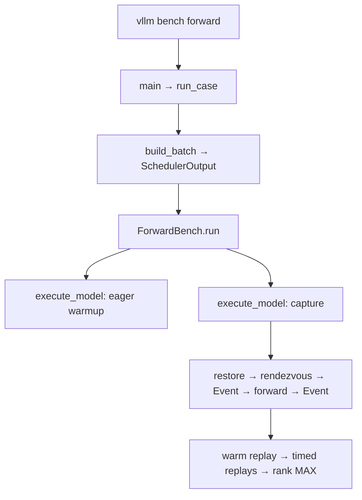
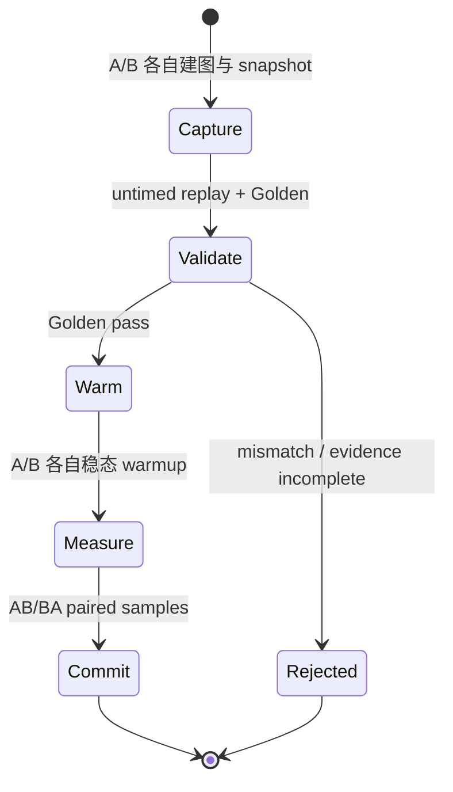

> 本文基于 vLLM `main` 的 [`8c17e4692a7cf393e3d1dacf6404fa4d48d993a1`](https://github.com/vllm-project/vllm/commit/8c17e4692a7cf393e3d1dacf6404fa4d48d993a1)。它比[上一章基线](https://github.com/vllm-project/vllm/commit/2f170a0fed20fd84dfcf6da2a3a8188a32f67e4e)前进 25 个 commit；[比较结果](https://github.com/vllm-project/vllm/compare/2f170a0fed20fd84dfcf6da2a3a8188a32f67e4e...8c17e4692a7cf393e3d1dacf6404fa4d48d993a1)没有改动本文直接分析的 `vllm/benchmarks/forward` 与 `tests/benchmarks/test_forward_cli.py`。最新提交优化 SM120 小矩阵 GEMM，与测量协议无直接关系。以下先陈述已合入事实，再明确标出本文建议。

## 本篇在课程路线中的位置

这是第 94 章，仍在“测试、性能与故障诊断”阶段。第 92 章冻结 paired fixture，第 93 章定义 token、logprob 与 logical KV/state 的等价 Golden；本篇只解决一个问题：**怎样先证明 A/B 语义等价，再测出可归因的延迟差，而且不让验证工作进入计时区间。**

## 前置知识回顾

paired replay 不是把两个独立 benchmark 的 median 相减。它要求 A（baseline）与 B（candidate）从同一 logical request、KV/state、routing、rank membership 与 graph descriptor 出发；上一章的 Golden 失败时，性能数字没有解释资格。另一方面，digest、logprob 搬回 Host、逐元素比较都可能引入 kernel、copy、同步与 cache 扰动，因此不能和 forward 共用同一个 timing pass。

## 本篇要回答的核心问题

1. 当前 `vllm bench forward` 的 warmup、state restore、CUDA Event、跨 rank 聚合和 profile 分别位于哪里？
2. 为什么“先验证、紧接着计时”仍可能污染结果？
3. 一个最小的 AB/BA 测量事务应冻结什么、在何处 fail closed、最终报告什么？

## 组件在全局架构中的位置

`vllm bench forward` 是公开 CLI，但它绕过真实 Scheduler，自己构造 exact `SchedulerOutput`，再进入真实 `GPUModelRunner.execute_model`。因此它适合比较设备侧 target forward、sampler 与 drafter，不覆盖 admission、排队和 CPU step 开销。



图中 B 到 H 是当前代码事实；“同时持有 A/B 两张 graph 并交错 replay”尚未在 `main` 中实现。

全文采用三种证据标签。源码事实指 `ForwardBench` 当前确实执行的顺序和 tensor/collective 关系；测试事实指仓库测试实际构造的输入与断言，不外推到未覆盖硬件；设计建议则是 `PairRecord`、AB/BA collector 与完整 Golden gate。尤其要避免把 PR 中某台机器上的稳定性数字当成通用阈值，也不能因为建议复用了现有 `CUDAGraph.replay` 就说 paired harness 已存在。

## 完整调用链

公开入口由 [`vllm/benchmarks/forward/main.py`](https://github.com/vllm-project/vllm/blob/8c17e4692a7cf393e3d1dacf6404fa4d48d993a1/vllm/benchmarks/forward/main.py) 注册。`main()` 解析 `--case`，用 `LLM.from_engine_args` 初始化 engine，取得 driver worker 的 `model_runner`；每个 case 进入 `run_case()`：

```text
parse_case
  → jitter_kv_lens
  → build_batch                 # exact SchedulerOutput
  → zero_kv_blocks
  → touched_kv_views            # 本 step 会改写的 state views
  → ForwardBench.run
  → GPUModelRunner.execute_model(warmup)
  → GPUModelRunner.execute_model(capture)
  → CUDAGraph.replay × warmup/timing
  → all_reduce(MAX) + all_gather_object
```

[`ForwardBench.run`](https://github.com/vllm-project/vllm/blob/8c17e4692a7cf393e3d1dacf6404fa4d48d993a1/vllm/benchmarks/forward/capture.py) 临时替换 `runner.prepare_inputs` 与 `model.forward`，但 input prep、attention metadata 和 DP sync 仍走真实 runner。第一次 `execute_model` 以 eager 方式触发 JIT、autotune 与 lazy init；第二次进入 `_capture_and_time()`。结束时 `batch.finish()` 构造 finished request，runner 清理 case 状态。

## 关键类型、字段和状态生命周期

`BenchBatch` 持有 exact `SchedulerOutput`、每个 request 的 `query_token_ids`、各 KV group 的不重叠 block range，以及 `(scheduled, computed, is_decode)` 期望值。它从 `build_batch()` 创建，被两次 `execute_model` 消费，最后由 `finish()` 终止请求。

`state_views` 是本 step 会改写的设备 tensor 视图；`_capture_and_time()` 为每个 view 建立同 shape、dtype、device 的 clone。每次 eager reference、capture 和 replay 前都 `copy_` 回 snapshot。snapshot 一直由 `ForwardBench` 持有，graph 销毁后即可释放；它保证同一步从同一 mutable state 出发，却只覆盖显式收集到的 views。

计时对象是两枚 device Event。多 rank 时还有 `[1]` 的 device rendezvous flag；`_time()` 把 `iters × samples` 个微秒值转成 device tensor，逐元素 `all_reduce(MAX)`，再回 CPU 计算 median、mean、p90 与 sample spread。所有 rank 必须执行相同 replay 顺序，否则 graph 内 collective 或后续 reduce 会挂起。

把几个接口的契约摊开看，能避免把“runner 已经执行成功”误解成“实验已经可比较”：

| 接口/对象 | 输入与所有权 | 输出/后置条件 | 并发与失败边界 |
| --- | --- | --- | --- |
| `build_batch` | case、KV group、block budget、seed；benchmark 持有生成的 request/block 描述 | exact `SchedulerOutput`；block range 不重叠、token 数与 `expected` 一致 | block 不足或非法 shape 直接失败；不经过 Scheduler admission |
| `execute_model` | runner 临时持有 `SchedulerOutput`；input/KV tensor 在 accelerator | 建立 `InputBatch`、attention metadata 和 forward context | DP/TP/PP 约束来自真实 runner；Host 调度时间不在 Event 中 |
| `restore` | `state_views` 与私有 clones，shape/dtype/device 一一相同 | capture/replay 的可变状态回到同一 snapshot | 漏收 view 不报错但会破坏实验；copy 在 graph stream 上有序执行 |
| `_time` | 已捕获 graph、两枚 Event、固定 `iters/samples` | raw `samples_us` 与 rank-max 汇总统计 | 任一 rank 少一次 replay/collective 都可能死锁；缺 rank 不能降级为单卡值 |

这里没有自动检查“snapshot 是否覆盖全部 live state”。所以 proposed manifest 不能只记录 view 数量，还应记录逻辑对象、字节数、schema/version 与 digest adapter；否则两个 A/B run 都稳定复现了同一个遗漏，`graph_deterministic=true` 仍会给出虚假的安全感。

## 逐函数源码解读

`_capture_and_time()` 先跑两次 eager：第一遍准备 capture stream 的惰性状态，第二遍得到 `reference`。capture body 的顺序是：

```text
restore(state_views)
→ [world_size > 1] all_reduce(flag)
→ start_event.record()
→ _run_model()                 # target + 可选 sampler/drafter
→ end_event.record()
```

所以 `latency_us` **不包含** state copy、rank skew 和 Host launch gap。capture 后两次 replay 检查 `graph_vs_eager`、`graph_deterministic`、finite；sampler 只检查第一列 token 是否在 vocabulary 范围及 replay 是否确定。这里没有上一章所说的 request-scoped token/logprob/KV digest oracle。

`_warmup(graph, seconds=1.0)` 先 replay 两次估计单次耗时，再取 `max(iters, floor(1s/per_replay))`；这个 count 经 CPU group `MAX` 对齐，随后连续 replay 并全设备同步。`_time()` 再执行默认 `20 × 5 = 100` 次：每次 replay 后 `end.synchronize()`，读取两枚 graph 内 Event 的 elapsed time。最后才运行 [`profile_graph`](https://github.com/vllm-project/vllm/blob/8c17e4692a7cf393e3d1dacf6404fa4d48d993a1/vllm/benchmarks/forward/profile.py)，因此 profiler 不污染已完成的 timing，但属于另一次 replay。

一个容易忽略的边界：restore 的**耗时**在 Event 外，不等于 restore 没有影响。copy 与 forward 在同一 stream 上，copy 可能改变 cache/带宽热态；A/B 若恢复字节数或顺序不同，仍会形成不公平的前置条件。

同理，Event 的后置条件只是“这条 stream 上 end 已完成且可读取 elapsed time”。它不证明异步错误已经被正确归因，也不证明其它 stream 没有排队工作，更不证明 Host 端完成了输出 commit。因此文章把该数字称为 device timing evidence，而不是请求完成时间。若 variant 把工作移到 Event 外或另一条 stream，即使数值下降也应先判定 timing scope mismatch。

## 具体示例与 shape/状态演算

沿用 `mix=16,2*1@65 --kv-len-jitter 0 --iters 20 --samples 5`。case 有一个 16-token prefill、两个各有 64-token prefix 的 decode，总 scheduled token 为 18。若模型 hidden size 为 `H`、dtype 为 BF16，则本例 target hidden 主体可视为设备 tensor `[18,H]`；`_compare` 会转 FP32 计算 `max_abs` 和 relative RMS。KV/state view 的实际 shape 随 attention backend 与 cache layout 而变，但 A/B snapshot 的 shape、dtype、device 和 logical live range 必须一致。

当前分别运行 A、B 会得到两组各 100 个值；即使 `median(B)-median(A)` 为负，也可能只是 B 总在更晚、更热的时段运行。建议把 5 个 sample block 改成统一 schedule：偶数 block 为 AB，奇数 block 为 BA；每个 block 内各跑 20 次，并按同一 pair index 计算 `δ_i = T_B(i)-T_A(i)`。

下面仅是算术示意，不是实测数据：

| block | 顺序 | A median (µs) | B median (µs) | paired δ (µs) |
| ---: | :---: | ---: | ---: | ---: |
| 0 | AB | 31.5 | 30.9 | -0.6 |
| 1 | BA | 31.8 | 31.2 | -0.6 |
| 2 | AB | 32.1 | 31.6 | -0.5 |
| 3 | BA | 32.4 | 31.8 | -0.6 |
| 4 | AB | 32.6 | 32.1 | -0.5 |

两边随时间共同漂移约 1 µs，但 paired delta 仍集中在 -0.5～-0.6 µs。独立 median 会丢掉这种同时间块配对关系。

在 2 个同步 rank 上，每个 pair 的语义还要再明确一层。假设同一次 A replay 的 rank0/rank1 Event 为 31.1/31.7 µs，B 为 30.8/31.0 µs；当前 `_time()` 的服务关键路径候选分别取 31.7 与 31.0，故该 pair 的 delta 为 -0.7 µs，而不是先在每个 rank 算 delta 再取最大值。后者会把“哪个 rank 是 straggler”与“这次请求何时完成”混为一谈。raw rank sample 应保留用于定位，但 paired 服务指标必须先按同一 replay identity 收敛 rank，再做 B-A。

## 为什么这样设计及替代方案

建议的最小事务分四段，每一段都带同一个 `fixture_id / generation / live_rank_revision / graph_descriptor`：



`Validate` 完成 token、logprob 与 canonical live-state digest，所有 copy、fence、Host compare 都在 timer 外；失败就不产生性能结论。`Warm` 必须分别让 A/B 达到稳定态。`Measure` 只允许 state restore、rendezvous、Event 和 forward 这条固定路径，按全 rank 一致的 AB/BA schedule 交错。`Commit` 保存 raw pairs、每对 delta、order、rank max 与 manifest，不能只保存两个 median。

最小控制逻辑可以写成下面的伪代码；它表达的是建议协议，不是当前 API：

```python
ga, gb = capture(A, fixture), capture(B, fixture)

gold_a = validate_untimed(ga, restore=True)
gold_b = validate_untimed(gb, restore=True)
require_equivalent(gold_a, gold_b)       # mismatch 时无 timing result

warm_to_steady_state(ga)
warm_to_steady_state(gb)

for block in range(samples):
    order = (ga, gb) if block % 2 == 0 else (gb, ga)
    for pair_id in range(iters):
        ta = timed_replay(order[0], pair_id)
        tb = timed_replay(order[1], pair_id)
        commit_pair(normalize_to_A_B(ta, tb), manifest)
```

`require_equivalent` 是事务的 correctness gate；`commit_pair` 则是 evidence gate。若 rank membership、graph descriptor、restore schema 或 pair id 在中途变化，已经采到的数字只能标为 aborted evidence，不能混进下一 generation。事务也不应在失败后自动回退到非 paired median，因为那会悄悄改变结论的统计语义。

一个可审计的 `PairRecord` 至少需要这些字段：`fixture_hash` 证明 request/token/KV 初态相同；`variant_build` 区分 A/B 代码与编译产物；`graph_descriptor` 记录 mode、token/request padding 和 capture bucket；`restore_schema` 记录每类 state view 的逻辑身份与字节数；`engine_generation/live_rank_revision` 防止重启或弹性成员变化后的样本串线；`block_id/pair_id/order` 保留配对关系；`rank_times_us` 保存每 rank 原始 Event；`critical_path_us` 保存按既定规则收敛的服务时间。Golden 结果应作为同一事务的前置引用，而不是复制到每个 timing sample 中。

统计提交也应分三层。第一层是 raw evidence：所有合法 pair 的 A/B 时间和顺序。第二层是 paired estimate：对每个 pair 先算 `δ_i=B_i-A_i`，再给 median、分位数和 block 间 spread；相对变化最好以每对 `δ_i/A_i` 形成分布，而不是用两个总体 median 相除。第三层才是结论状态：`PASS`、`NO_EQUIVALENCE`、`EVIDENCE_INCOMPLETE` 或 `GRAPH_BUCKET_TRANSITION`。这种分层会多占一些 JSON，但能避免后来只看到 “-3%” 却无法判断它来自哪个 rank、哪种顺序和哪张 graph。

为什么不把 validation 也 capture 进 graph，然后只用 Event 圈住 forward？形式上可以，但收益很小：digest、比较与 D2H 需要额外静态 buffer、地址和同步契约，扩大 graph 内状态面；即使 Event 没圈住这些 kernel，它们在同一 replay 内仍会改变 cache 和 stream 排队。独立 validation pass 牺牲一次额外 replay，却把 correctness 与 measurement 的资源生命周期拆开，维护成本更低，也更容易对“计时 graph 中没有验证节点”做结构性断言。

替代方案一是 A 跑完 100 次再跑 B，最简单但无法抵抗时钟、温度、共享系统负载漂移。方案二是完全随机顺序，统计上更灵活，却更难复现，也可能让 graph 切换和 cache 互相污染；短 AB/BA block 是较小的工程折中。方案三是 A/B 各启一个独立进程，隔离 allocator 与 graph，却把进程启动、权重布局和环境差异带进比较，且失去同一 snapshot 的配对优势。

## 性能、并发、正确性与边界条件

- **延迟语义**：当前 Event 只覆盖设备 forward/sampler/drafter，不是端到端 latency；capture、Golden、warmup、restore duration、Host launch 与 Scheduler 都应单独报告。
- **Graphability**：A/B 的地址、shape、capturable op 与 graph descriptor 必须稳定。若 candidate 改变 FULL/PIECEWISE bucket，就应标记 `GRAPH_BUCKET_TRANSITION`，不能伪装成同 shape kernel delta。
- **并发**：多 rank 的 schedule、warmup count、pair index 与 live-rank set必须一致；任何 rank 缺样本都令该 pair `EVIDENCE_INCOMPLETE`，不能用 0 补齐。
- **正确性**：capture 自带的 hidden tensor对照是有价值的局部检查，但不能替代公开 token/logprob 与 logical KV/state Golden。两者应分层保留。
- **污染**：validation 后要重新 restore 并 warmup；否则 digest kernel、D2H copy 和同步会直接改变下一次计时的 cache、stream 与 clock 状态。profile 已在 timing 后运行，这个顺序应继续保持。
- **失败方式**：snapshot 漏掉 mutable view、A/B restore 字节不同、采样 token 不等、digest adapter 缺失、Event scope 不同、collective 顺序不一致，都必须拒绝 paired delta。

还要区分“每次 replay 都同步”与“没有并发干扰”。当前 `end.synchronize()` 让 Host 在读取 Event 前等待本次 graph 完成，保证样本不重叠，却不会阻止同机其它 process、MPS/MIG tenant、功耗管理或后台通信改变设备状态。AB/BA 只能抵消缓慢、近似共同的漂移；突发干扰仍会扩大 pair 分布。因此报告应包含原始 pair、顺序、sample block、rank、设备/driver 与 clock policy，而不是只给一个百分比。`sample_spread_pct > 0.5` 的 warning 是当前代码的经验性诊断，不是所有模型、硬件和拓扑通用的正确性阈值。

## 测试证据与未覆盖风险

[`tests/benchmarks/test_forward_cli.py`](https://github.com/vllm-project/vllm/blob/8c17e4692a7cf393e3d1dacf6404fa4d48d993a1/tests/benchmarks/test_forward_cli.py) 的主 CLI 测试用 `decode=8*1@512`、`prefill=256`、`mix=128@256,4*1@512`，`iters=3,samples=2`，验证结果非零、finite、graph deterministic、sampler token 合法，并检查 profiler 产物。drafter 参数化测试覆盖 MTP、EAGLE3、DSpark、DFlash，要求 graph/eager relative RMS 为 0，并验证 exclude flags 改变 timing scope。PP=2 测试还检查每 rank 8 个 sample 与两 stage timeline 的 median 一致。

这些是测试事实，但没有任何测试创建同一 fixture 的 baseline/candidate 两张 graph、执行 AB/BA、在 untimed pass 比较完整 Golden、再证明 validation kernel 没进入 Event 区间。已合入 [PR #66483](https://github.com/vllm-project/vllm/pull/66483) 的验证说明每个 case 用 100 次 replay，并明确 sampler 已进入默认 timing scope；它支持“先定义 scope，再解释数字”，不构成 paired protocol 的实现证据。

仍未覆盖的风险包括：restore copy 对 cache 的非计时污染、A/B graph 交替的 I-cache/L2 影响、动态频率相关性、PP stage critical path、异步 NCCL error、Golden digest collision/adapter 缺失，以及 validation pass 与 timing pass 之间 state generation 漂移。

若把本文建议落成测试，至少应增加四类 Golden。第一，故意让 validation 内执行 D2H digest copy，断言 Event 区间不包含它；第二，注入不完整 `state_views`，要求第二次 replay 的 state digest 失败而不是仅依赖 hidden output；第三，构造 AB 与 BA 两种顺序和人工单调漂移，确认 paired delta 不随顺序翻转；第四，在两 rank 中删除一个 pair 或改变 generation，collector 必须 fail closed。真机性能测试还要把“连续 A 后连续 B”作为对照，证明 AB/BA 改变的是偏差控制而不是宣称必然降低方差。

## 与前后章节的连接

第 92 章给本事务提供 frozen fixture；第 93 章提供 `Validate` 的等价 oracle。本篇把 correctness gate 与 device timing 拆成两个 pass，并把独立样本改成 paired AB/BA。下一章应进入剩余的分布式缺口：PP 不是简单的 per-rank MAX，怎样把 stage overlap、bubble 与端到端 critical path 接入同一 pair identity。

## 本篇结论、知识债、三个理解检查问题和下一章

结论只有一句：**先用 untimed Golden 决定 A/B 是否可比，再独立 warmup，并用全 rank 一致的 AB/BA schedule 采 paired Event；否则“更快”可能只是验证污染、顺序漂移或 graph bucket 改变。**

知识债：当前 main 没有 paired harness、统一 Golden、双 graph schedule 或 pair schema；restore cache 污染尚无隔离实验；PP、动态 rank membership、MoE routing 与 graph 切换效应尚未并入事务。

理解检查：

1. `restore()` 在 start Event 前，为什么仍可能影响 forward 的测量公平性？
2. 为什么 `median(B)-median(A)` 不能替代 `median(T_B(i)-T_A(i))`？
3. graph/eager hidden tensor relative RMS 为 0，为什么仍不能跳过 token/logprob/KV Golden？

下一章：**PP Paired Timing——Stage Overlap、Bubble 与 Critical-path Golden。**

## 课程账本增量

- 源码基线：`8c17e4692a7cf393e3d1dacf6404fa4d48d993a1`；相对第 93 章前进 25 个 commit，forward benchmark 与直接测试未变化。
- 新覆盖：`main.py::main/run_case`、`capture.py::ForwardBench.run/_capture_and_time/_warmup/_time`、`profile.py::profile_graph`、`test_forward_cli.py`。
- 新不变量：validation 与 timing 必须分 pass；restore/rendezvous 在 Event 外；多 rank 使用逐样本 MAX；A/B 必须共享 manifest 与 schedule；pair 缺证据即 fail closed。
- 新建议：`Capture → Validate → Warm → Measure(AB/BA) → Commit`，保存 raw pair、order、delta、rank 与 manifest。
- 下一章：PP 的 stage timeline 如何收敛为 paired critical path。
