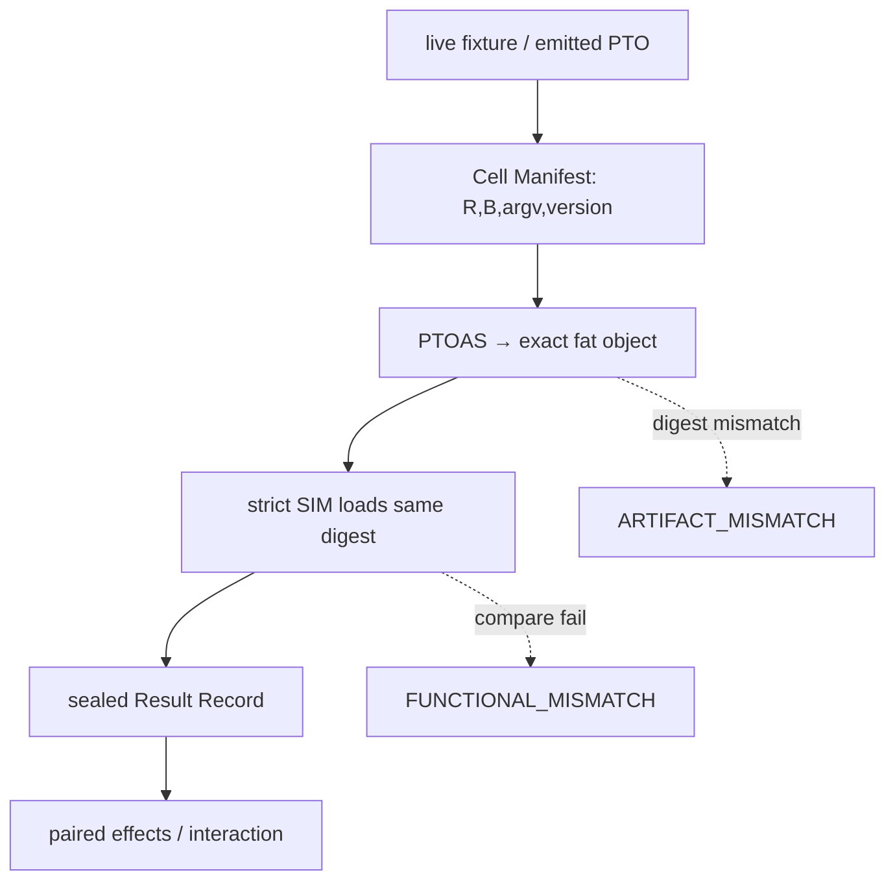

> 本文基于 PTOAS 默认分支提交 [`297a791c7c4f`](https://github.com/hw-native-sys/PTOAS/commit/297a791c7c4f632f7c1fc02bf4f777a313b4ea2a)，与上一章基线相同。相关历史节点是 Bisheng 自动选择提交 [`63f6aa7ca4e`](https://github.com/hw-native-sys/PTOAS/commit/63f6aa7ca4e48027531f0c6ab5575a44f8178654) 和 legacy VPTO 用例迁移提交 [`3b2bd5ed0ed`](https://github.com/hw-native-sys/PTOAS/commit/3b2bd5ed0ed88535c3f1ab2cbbd6edac413699a6)。下文把当前代码事实、历史测试事实和建议协议严格分开。

## 本篇在 PTO 课程路线中的位置

这是课程第 105 章。第 101～103 章已经从 VPTO live range 追到 LLVM/HiVM、Bisheng object 与 resource evidence；第 104 章把 `remat false/true × Bisheng off/on` 定义成四个正交单元。今天只解决一个更基础的问题：**四格输出怎样证明来自同一个 fixture、只改变两个开关，而且 strict SIM 验证的正是被计时和归档的 object？**

结论先行：当前 `check_bisheng_scheduler.py` 是有价值的真实工具链回归，却还不是可审计的四象限实验。它的默认 fixture 已被迁移，且“单独计时编译的 object”和“SIM runner 重新编译后执行的 object”没有身份连接。一个合格的 `Artifact Manifest` 必须把 input、完整 argv、工具版本、object digest、Golden、验证结果、重复编号和 run order 绑定成不可拆分的证据事务；任一环节缺失都写入稳定失败终态，而不是让该格从 `results.json` 消失。

## 前置知识

上一章固定 `--vpto-scheduler=on`，只切换：

- `R∈{0,1}`：`--vpto-scheduler-remat=false/true`；
- `B∈{0,1}`：`--bisheng-vec-misched=off/on`。

因此四格是 `R0B0/R1B0/R0B1/R1B1`。`auto` 会依据 resource report 选择 object，是生产策略而非对称实验格。static pressure、stack、spill evidence 与 ticks 属于不同证据层；在 strict SIM 证明数值等价之前，性能差分没有解释资格。

Artifact identity 也不是“文件名相同”。文件名可被覆盖，路径可指向不同 checkout；可复现身份至少要覆盖**内容**、**构建函数**和**消费者**：输入内容是什么、用何版本和 argv 编译、输出字节是什么、谁实际加载了这些字节。

## 今日 1–2 个核心问题

1. 当前真实脚本中的 fixture、编译 object、SIM object 和结果记录分别由谁创建、持有和消费，身份链在哪里断开？
2. 怎样设计最小 manifest 与 fail-closed 状态机，使四格可轮换、可恢复、可复核，又不把尚未实现的协议误写成当前 PTOAS 能力？

## PTO 全栈中的位置



上游消费者是 PTOAS driver、Bisheng 与 `run_host_vpto_validation.sh`；下游消费者是统计程序和人工复核者。manifest 位于“生成”和“解释”之间：它不改变 Tile、VReg 或 object，却决定这些产物是否可以被当作同一次实验的证据。

## 概念和精确语义

建议把一次实验的不可变身份拆成三层。下面是**建议 schema，不是当前公共 API**：

| 层 | 最小字段 | 拒绝条件 |
| --- | --- | --- |
| `FixtureIdentity` | emitted PTO SHA-256、case/golden digest、shape/dtype、目标 arch | 旧路径、内容变化、Golden 不同 |
| `BuildIdentity` | PTOAS commit/binary digest、CANN/Bisheng version、规范化 argv、`R/B`、环境白名单 | 隐式默认、额外 flag、版本未知 |
| `ArtifactIdentity` | object SHA-256/size、symbol/ELF anchor、compile log digest | 空文件、digest 不符、object 被覆盖 |
| `ValidationIdentity` | exact object digest、SIM/runtime version、input digest、strict compare verdict、ticks raw log digest | 重新编译未绑定、宽松比较、日志缺失 |

核心不变量写成等式更清楚：

`validated_object_sha256 == built_object_sha256 == recorded_object_sha256`。

此外，四格的 `fixture_sha256`、toolchain identity 和除 `R/B` 外的规范化 argv 必须相同。只有 `status=SEALED_VALID` 且 evidence grade 相同的单元才能进入差分。`COMPILE_FAILED`、`ARTIFACT_MISMATCH`、`FUNCTIONAL_MISMATCH`、`SIM_TIMEOUT`、`REPORT_UNAVAILABLE` 是证据状态，不是可代入 ticks 公式的数值。

### Cell record 的前置、后置与非法组合

一次 cell 开始前，harness 必须已经冻结 `experiment_id/repetition/R/B`、fixture digest、规范化 argv 和 run-order position；这些字段一旦进入 `PREPARED` 就不可原地修改。编译成功只允许把状态推进到 `BUILT`，并同时写入 object size、digest 与完整 compile log digest；strict SIM 只能消费该 `BUILT` 所指向的 object。验证结束后，成功路径写入 Golden/input/log digest、raw ticks 与 `SEALED_VALID`，失败路径写入稳定 reason code、阶段和原始日志 digest。终态记录不可回退；重试必须获得新的 `attempt_id`，再由 join 层判断哪个 attempt 可成为该 cell 的唯一有效结果。

以下组合应直接拒绝，而不是“尽量统计”：`SEALED_VALID` 却没有 strict verdict；记录了 ticks 却没有实际加载 object 的 digest；`R/B` 相同但 canonical argv 不同；四格 fixture digest 不一致；同一 `(repetition,R,B)` 出现两个不同 object digest 且没有显式 supersede 关系；`REPORT_UNAVAILABLE` 被填成 `stack=0`；失败后覆盖旧目录并丢失第一次日志。这些规则把“文件存在”提升为“状态迁移有证据”，也让中断恢复不依赖人猜测目录里哪个文件更新。

接口层面，最稳妥的所有权是 `compile_cell() -> BuiltArtifact`，返回只读路径与 digest；`validate_cell(BuiltArtifact) -> ValidationRecord` 不得自行编译。若短期无法改 runner，兼容方案至少要记录两次产物的 canonical digest，并在不等时 fail closed。前者减少一次编译、缩短总时延，也天然消除身份歧义；后者改动较小，却仍承担双编译成本和 canonicalization 维护成本。

## 真实文件、类型、API 或指令逐段解读

先看 [`check_bisheng_scheduler.py`](https://github.com/hw-native-sys/PTOAS/blob/297a791c7c4f632f7c1fc02bf4f777a313b4ea2a/test/vpto/scripts/check_bisheng_scheduler.py)。`validate_inputs()` 做了两件正确的事：要求 work space 全新创建，且拒绝带 `ptoas.flags` 的 case，避免 case 私有参数覆盖受控 scheduler flags。但它的默认 case 仍是 `micro-op/dsa-sfu/vmula`，并要求目录内存在 `kernel.pto`。

当前 tree 已没有这个目录。提交 [`3b2bd5ed0ed`](https://github.com/hw-native-sys/PTOAS/commit/3b2bd5ed0ed88535c3f1ab2cbbd6edac413699a6) 把 198 个 legacy 形状迁入 DSL ST；对应内容现在位于 [`legacy_micro_op_dsa_sfu_vmula.py`](https://github.com/hw-native-sys/PTOAS/blob/297a791c7c4f632f7c1fc02bf4f777a313b4ea2a/test/dsl-st/legacy_micro_op_dsa_sfu_vmula.py)，文件自己也声明来源是旧路径。由当前代码可直接推出：按设计文档中的默认命令运行，会在编译前因找不到现存 `kernel.pto` 被拒绝。这是 **stale fixture reference**，不是 kernel 数值失败。

更关键的断点在 `validate_sample()`。它先调用 `compile_sample()`，将 PTOAS 输出写成 `run_dir/timed.fatobj.o`，用墙钟计算完整 fatobj compile time，只检查文件非空。随后它设置 `PTOAS_FLAGS`，调用 [`run_host_vpto_validation.sh`](https://github.com/hw-native-sys/PTOAS/blob/297a791c7c4f632f7c1fc02bf4f777a313b4ea2a/test/vpto/scripts/run_host_vpto_validation.sh)。后者在 `build_one_impl()` 的 step 1/4 **再次运行 PTOAS**，生成另一个 `sim/.../kernel.fatobj.o`，再链接 `.so`、运行 host、生成 Golden 并以 `COMPARE_STRICT=1` 比较。

因此生命周期实际是：

```mermaid
sequenceDiagram
    participant H as check_bisheng_scheduler.py
    participant P as PTOAS
    participant R as run_host_vpto_validation.sh
    participant S as SIM / strict compare
    H->>P: compile fixture → timed.fatobj.o
    P-->>H: compile_seconds; nonempty
    H->>R: pass flags + case path
    R->>P: compile fixture again → kernel.fatobj.o
    R->>S: link and execute second object
    S-->>H: ticks + compare passed
    Note over H,S: 两个 object 当前无 digest equality check
```

`compile_seconds` 归属于第一份 object，ticks/Golden 归属于第二份 object。正常情况下两次编译应相同，但“应相同”不是证据：环境、隐式版本、非确定性产物或源文件在两次调用间变化，都可能打破连接。最小修正不是多写一个文件名，而是让 runner 接收已编译 object，或至少对两份 object 做规范化后 digest/ELF 内容等价校验；若 fat object 含时间戳等非语义字段，则需定义可版本化的 canonical digest，不能随意忽略字节。

脚本最后把成功单元 append 到内存列表，再直接 `write_text(results.json)`。当前记录只有 `mode`、compile seconds、ticks，auto 另有 decision；没有 fixture/toolchain/argv/object/Golden digest，也没有失败 record。若某格抛异常，该格不会 append，读者无法区分“未运行”“编译失败”与“strict compare 失败”。写入也不是临时文件→原子 rename 的 sealed transaction。

仓内其实已有一个可借鉴但不能照搬的局部模式。[`ptodsl/_runtime/cache.py`](https://github.com/hw-native-sys/PTOAS/blob/297a791c7c4f632f7c1fc02bf4f777a313b4ea2a/ptodsl/ptodsl/_runtime/cache.py) 的 `NativeBuildArtifacts` 固定 MLIR、kernel object、launch source、shared library 和 manifest 路径；`write_manifest()` 保存 MLIR、launch、compile config、link config 的 digest；`is_native_build_current()` 要求所有文件存在、JSON 可解析且四个 digest 全匹配，否则拒绝复用。这证明“内容 + 配置共同决定 artifact identity”已是 PTOAS 代码中的真实思想。

但 cache manifest 仍不足以证明实验：它不记录最终 object/shared library digest、PTOAS/Bisheng 版本、strict SIM verdict、Golden、run order 或失败状态。文件注释还明确指出 persistent cache 默认关闭，原因包括 specialization key 含进程地址、目录无界增长和并发发布缺少 locking/temporary name/fallback。把它升级成 benchmark ledger，必须先解决这些已知边界。

## 对象/Tile/Buffer/IR 生命周期

以迁移后的 `vmula` fixture 为例，嵌入的 PTO kernel 处理 1024 个 `f32`，即 4096 B；GM→UB 搬运使用 32 个 128 B burst，vecscope 以 `64xf32` VReg 分块，共 16 个逻辑 vector chunk。一个 chunk 的 `%acc/%lhs/%rhs/%sum` 都是 256 B carrier，mask 是 `b32` predicate；`pto.vmula` 计算后 `vsts` 回 UB，再由 MTE3 写回 GM。

这条 Tile/VReg/Buffer 生命周期没有因 manifest 改变。变化的是证据对象的所有权：

1. fixture/emitted PTO 在实验开始前冻结并求 digest；
2. 每个 cell 拥有独立临时目录、argv 与 object，禁止覆盖别格；
3. exact object 被 strict SIM 消费，input/Golden 与 compare log 被 cell 持有；
4. 成功或失败都生成 terminal record；
5. 只有 sealed record 可被统计读取，原始 artifact 在审计窗口内保持不可变。

换言之，Tile 的数值 ownership 由 kernel 保证，artifact 的证据 ownership 由 harness 保证；两者缺一不可。

## 端到端调用链或指令链

当前真实链是：

`CLI → validate_inputs → repetition × (off,on,auto) → compile_sample → timed.fatobj.o → run_host_vpto_validation.sh → second PTOAS compile → link .so → host execute → strict compare → parse Total tick → overwrite results.json`。

建议四象限链是：

`live fixture → emit/freeze PTO → write PREPARED manifest → compile exact R×B cell → hash artifact → execute exact artifact → strict Golden → record raw ticks → atomically seal terminal result → validate four-cell join → compute paired effects`。

这里的 join key 至少是 `(experiment_id, fixture_digest, repetition, R, B)`。少一格或同 key 出现两个冲突 digest 时，join 必须失败；不能挑“看起来最新”的文件。

## 具体 shape、Tile 和状态演算

设冻结的 emitted PTO digest 为 `Hpto`，输入/Golden digest 为 `Hin/Hgold`。第 0 次重复的 `R1B0` 单元使用：

```text
--pto-arch=a5
--pto-backend=vpto
--vpto-scheduler=on
--vpto-scheduler-remat=true
--bisheng-vec-misched=off
```

编译得到 `O10`。记录必须先验证：非空 ELF/fat object、`sha256(O10)=H10`；SIM loader 的实际 object 也报告 `H10`；1024 个 `f32` 的 strict compare 通过；随后才接收该次 raw ticks。若 runner 又编译出 `O10'` 且 `sha256(O10')≠H10`，状态是 `ARTIFACT_MISMATCH`，哪怕数值恰好通过也不进入性能统计。

固定 `off→on→auto` 会把 cache warming 和主机漂移绑定到模式。四格可用 4×4 Latin rotation：

| repetition | position 1 | position 2 | position 3 | position 4 |
| ---: | --- | --- | --- | --- |
| 0 | `R0B0` | `R1B0` | `R0B1` | `R1B1` |
| 1 | `R1B0` | `R1B1` | `R0B0` | `R0B1` |
| 2 | `R0B1` | `R0B0` | `R1B1` | `R1B0` |
| 3 | `R1B1` | `R0B1` | `R1B0` | `R0B0` |

这样每格各出现一次在四个位置。它不能消除所有温度和系统负载变化，却能避免单一位置与某个 cell 完全共线。重复数与停止规则必须预先记录；本文不发明阈值，实际样本量应由目标噪声、可接受置信区间和设备预算校准。

## 为什么这样设计及替代方案

替代方案一是“信任两次相同命令会产生相同 object”。它实现最简单，却无法检测 stale source、工具链漂移、隐式默认变化和非确定性构建；出现异常时也无法判断 compile time 与 ticks 是否属于同一产物。

替代方案二是只给文件路径加唯一后缀。它解决覆盖，不解决内容身份；路径可被替换，NFS/container 中的同路径也不保证同字节。

最小充分设计是 content digest + canonical argv + toolchain identity + exact consumer binding。代价是保存更多原始日志、处理 fat object canonicalization，并让 runner 支持“compile once, validate exact artifact”。这份复杂度直接服务两个硬约束：功能正确性与因果可解释性，因此值得；allocator dump、真机 counter 等尚未进入本章的字段则不应强塞进最小 schema。

## 访存、计算、流水、并行和硬件约束

manifest 不降低任何 UB/GM 字节，也不增加 VReg；它控制的是测量误差和错误归因。真正的硬件指标仍需分层：remat 可能增加动态 micro-op、缩短 live range；Bisheng MISched 可能改变 overlap 和 physical allocation；spill/reload 会增加机器访存；ticks 最终叠加 pipeline stall 与 simulator 行为。

编译四格可并行，但性能运行不应无控制地并行，否则共享 CPU、磁盘、SIM 进程和 cache 会引入竞争。compile time 和 runtime ticks 也应分开：前者可在独立阶段测量；后者采用轮换串行或受控设备独占。若为节省时间缓存 Golden/input，cache key 必须进入 manifest，且缓存命中不能绕过 digest 校验。

## 测试证据与未覆盖风险

当前直接证据有四层：

- `check_bisheng_scheduler.py` 确实检查 fresh work space、受控 flag、非空 fat object、SIM 成功标记、strict compare 和 ticks；但它固定 `remat=false`，运行 `off/on/auto`，不是四格。
- `run_host_vpto_validation.sh` 的 legacy 路径会重新编译、链接、生成 Golden、运行并 `COMPARE_STRICT=1`；这证明数值门禁存在，也证明 timed object 未直接被消费。
- [`pto-bisheng-scheduler-test.cpp`](https://github.com/hw-native-sys/PTOAS/blob/297a791c7c4f632f7c1fc02bf4f777a313b4ea2a/tools/pto-test-opt/pto-bisheng-scheduler-test.cpp) 覆盖 fake compile 的 decision/report parsing/cleanup，文件注释明确它不验证真实 Bisheng 命令和报告契约。
- 2026-10-13 的迁移提交报告迁移模块数值回归无失败，并保留 `legacy_micro_op_dsa_sfu_vmula.py`；但当前 scheduler 脚本和设计文档仍引用已删除的 legacy 路径。

公开代码未提供把 `timed.fatobj.o` digest 与 runner 加载对象相等的断言，也未见四格 manifest、轮换 order、失败 record 或 atomic seal 的直接测试。因此本文给出的是从现有断点推导的协议，不声称已经实跑四格，也不报告新 stack/ticks 数字。

仍未覆盖的风险包括：fat object 中非语义时间戳导致 raw digest 不稳定；SIM 与真机加载器对同一 fat object 的选择差异；并发写/断电造成半写 manifest；fixture 由 DSL 动态生成时的 Python/environment identity；跨 shape 的外部有效性；resource report 不可用但功能/ticks 可用时的 evidence-grade 分层。

## 与前后章节的连接

向前，本章把第 104 章的四象限数学定义落到可执行 artifact ownership，并修正了“默认 vmula fixture 仍可直接运行”的隐含假设。向后，manifest 只证明每格是谁、怎样生成、验证了什么；它还没有说明四格如何在中断后恢复、如何只提交完整 pair、如何对 raw ticks 做稳健统计。

下一章将研究 **Four-cell Join Transaction**：怎样让每个 repetition 的四格以 pair 为单位提交，处理 partial run、retry、duplicate/conflict 与 evidence-grade 降级，同时保持轮换顺序不被失败重试打乱。

## 本篇结论、知识债、三个理解检查问题和下一章

本篇确认两个当前代码事实：默认 `vmula` legacy fixture 已迁移，旧路径会在编译前失败；计时 object 与 strict SIM object 由两次 PTOAS 调用生成，当前没有 digest 绑定。已有 PTODSL cache manifest 证明 PTOAS 已采用“输入内容 + build config 决定 artifact”的局部契约，但它不是 benchmark evidence ledger。

知识债：live fixture adapter；compile-once/validate-exact-object runner；PTOAS/Bisheng/SIM version codec；fat object canonical digest；atomic manifest/result seal；失败 taxonomy 的直接测试；四格 partial/retry join；resource grade；真机 counter 与跨 shape 重放。

理解检查：

1. 为什么 `timed.fatobj.o` 非空且 strict SIM 通过，仍不能证明计时与执行属于同一 object？
2. `REPORT_UNAVAILABLE` 为什么可以保留功能/ticks原始证据，却不能与完整 report 单元混算 stack 主效应？
3. Latin rotation 解决了哪一种混淆，为什么它不能替代设备温度、负载和原始日志记录？

下一章：**Four-cell Join Transaction——完整 pair 提交、partial retry 与 evidence-grade 一致性。**

## 课程账本增量

- 课程：105；阶段：PTOAS backend evidence 与可复现实验。
- 主仓：`hw-native-sys/PTOAS`；源码基线：`297a791c7c4f632f7c1fc02bf4f777a313b4ea2a`。
- 新覆盖：`check_bisheng_scheduler.py::{validate_inputs,compile_sample,validate_sample,main}`、`run_host_vpto_validation.sh::build_one_impl`、`cache.py::{NativeBuildArtifacts,write_manifest,is_native_build_current}`、`native_build.py::_materialize_native_library`、迁移后的 `legacy_micro_op_dsa_sfu_vmula.py`。
- 新不变量：fixture 必须 live 且内容冻结；计时/验证/归档 object digest 相等；每格独立 ownership；失败也必须形成 terminal record；只有同 evidence grade 的 sealed cells 能进入配对差分。
- 待验证：canonical fat-object digest、exact-object runner、atomic seal、四格恢复/冲突 join、跨 SIM/真机 artifact parity。

