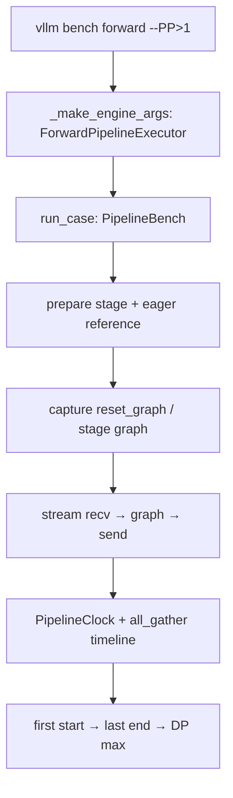

> 本文基于 vLLM `main` 的 [`edccd1e39ede897504babb9a50aa8bba26089bbb`](https://github.com/vllm-project/vllm/commit/edccd1e39ede897504babb9a50aa8bba26089bbb)。相对[上一章基线](https://github.com/vllm-project/vllm/commit/8c17e4692a7cf393e3d1dacf6404fa4d48d993a1)前进 [18 个提交](https://github.com/vllm-project/vllm/compare/8c17e4692a7cf393e3d1dacf6404fa4d48d993a1...edccd1e39ede897504babb9a50aa8bba26089bbb)，但本文直接分析的 `vllm/benchmarks/forward/*` 与 `tests/benchmarks/test_forward_cli.py` 未变化。最新提交更新模型 recipe，与 PP 计时机制无关。以下把当前代码事实、测试/历史实验事实和本文提出的 paired 诊断协议分开陈述。

## 本篇在课程路线中的位置

这是第 95 章，仍处于“测试、性能与故障诊断”。第 94 章建立了 `Capture → Validate → Warm → Measure → Commit` 的 AB/BA 事务，但只把多 rank 看成同一 replay 上的一个 `MAX`。本篇只深入一个问题：**Pipeline Parallel 下，一个 microbatch 的端到端 device critical path 怎样从不同 GPU 的局部 Event 重建，又怎样把 stage compute、跨 stage gap 与 steady-state bubble 放进同一个 pair identity？**

结论先行：当前 `PipelineBench` 已正确避免“把 stage 时长相加”这个常见错误。它在无 per-step 全局 barrier 的流水中，用相关时钟把所有 rank 的 Event 放到共同时间轴；每个 microbatch 的延迟取最早 first-stage start 到最晚 last-stage completion，并在 DP replica 间取最大值。代码尚未直接计算 bubble/overlap，也没有 A/B 双 variant 的显式 pair ID；这些必须从保存的原始 timeline 派生，不能从一个 median 反推。

## 前置知识回顾

普通 `ForwardBench` 把同一次 graph replay 在各 rank 的局部 `start.elapsed_time(end)` 做 `all_reduce(MAX)`。这适合所有 rank 同步参与同一 forward 的 TP/DP 情形，却不适合 PP：stage 0 与 stage 1 的计算本来就错开，跨设备 CUDA Event 不能直接相减；只取最慢 stage 还会漏掉 stage 间传输和等待。

上一章还确认 paired timing 的正确性门禁先于性能：A/B 必须共享 exact batch、KV/state、routing、rank membership 与 graph descriptor。今天额外加入 `microbatch_id` 和 stage timeline；否则 A 的第 17 个稳态 microbatch 可能被错误地配到 B 的填充或排空区间。

## 本篇要回答的核心问题

1. `vllm bench forward --pipeline-parallel-size > 1` 如何从公开 CLI 进入 `PipelineBench`，而不是普通 `ForwardBench`？
2. `PipelineClock` 怎样把各 GPU 的 Event 映射到 rank-0 单调时钟，公式的误差边界是什么？
3. 当前 `latency_us` 包含哪些 transfer/wait/bubble，排除了什么；paired A/B 还缺哪种身份和 Golden？

## 组件在全局架构中的位置

[`docs/benchmarking/cli.md`](https://github.com/vllm-project/vllm/blob/edccd1e39ede897504babb9a50aa8bba26089bbb/docs/benchmarking/cli.md) 把 `vllm bench forward` 定义为 exact-batch model timing，并明确覆盖 steady-state PP forward。它不是 serving benchmark：没有 Scheduler admission、queueing、请求返回和 TTFT/TPOT；测量目标是已构造 microbatch 在真实 model runner、PP/TP transfer 与 device graph 中的 traversal。



`ForwardPipelineExecutor` 只负责让 external launcher 每个 `torchrun` 进程加载一个 stage；其 `execute_model()` 会直接报错，防止误走 serving executor。真正的执行所有权在 `PipelineBench`。

## 完整调用链

公开入口在 [`main.py`](https://github.com/vllm-project/vllm/blob/edccd1e39ede897504babb9a50aa8bba26089bbb/vllm/benchmarks/forward/main.py)。`_make_engine_args()` 看到 `pipeline_parallel_size > 1` 后设置 `ForwardPipelineExecutor`；`run_case()` 构造同一 `BenchBatch`、清零目标 KV blocks、收集本 step 会改写的 state views，并选择 `PipelineBench`。

完整调用链是：

```text
CLI main
  → LLM.from_engine_args(ForwardPipelineExecutor)
  → run_case → build_batch / touched_kv_views
  → PipelineBench.run
  → runner.execute_model(..., intermediate_tensors=...)
  → _prepare_stage: recv eager input → local forward → send eager output
  → _capture_stage: capture reset_graph + local stage graph
  → _stream: real irecv.wait → graph.replay → isend.wait
  → PipelineClock.timestamp
  → all_gather_object(local timeline)
  → first-stage min(start), last-stage max(end), DP max
  → main all_gather result → JSON
```

这里没有每个 microbatch 的全局 barrier；PP 数据依赖由相邻 stage 的 point-to-point send/recv 保证。各进程循环次数必须完全一致，否则某个 `irecv`/`isend` 找不到配对，表现为 hang 而不是可恢复的缺样本。

## 关键类型、字段和状态生命周期

`BenchBatch` 在 `run_case()` 创建，持有 exact `SchedulerOutput`、request/token/KV block 描述；每个 rank 用相同随机 draw 构造平衡 shape。`PipelineBench._prepare_stage()` 让第一阶段使用 `input_ids`，后续阶段通过 `pp.recv_tensor_dict()` 接收 `IntermediateTensors`；输出非末 stage 时再 `send_tensor_dict()`。这次 eager 链产生每个 stage 的 `reference`。

随后有三类长期对象：

| 对象 | 创建与 shape/device | 所有者与消费 | 失效点 |
| --- | --- | --- | --- |
| `input_snapshots` | stage 输入 tensor 的同 shape/dtype/device clone；逻辑形状可写作 `[T_local,H]` | `PipelineBench`；capture 前恢复 intermediate input | case 结束 |
| `snapshots` | KV/状态 view 的 clone，device 与原 view一致 | `reset_graph` 每个 microbatch replay | graph 删除后 |
| `starts/ends` | 每次迭代各一对本地 CUDA Event | `_stream` 持有，结束后由两个 `PipelineClock` 映射 | timeline 写入 result 后 |

`graph` 只包含本 stage forward；`reset_graph` 只恢复 state views。传输在 graph 外，stage 输入通过 recv buffer 到达后，必要时做 TP `all_gather` 再写入 intermediate tensor。最后 stage 才 sampling，非末 stage 只 relay intermediate output。

接口契约也很明确：输入 tensor 的 dtype 来自模型/runner，recv buffer 用 `empty_like` 保持 dtype/device；TP shard 时先接收一片再 `all_gather`。前置条件是所有 stage 对 tensor key、`numel`、sharding 判定一致；后置条件是同一 microbatch 的 output 已安全送往下一 stage。任何 shape/key 不一致会在 copy、collective 或 P2P 配对处失败。

## 逐函数源码解读

### `PipelineBench.run`：先建立 stage-local Golden

[`pipeline.py`](https://github.com/vllm-project/vllm/blob/edccd1e39ede897504babb9a50aa8bba26089bbb/vllm/benchmarks/forward/pipeline.py) 临时替换 `runner.prepare_inputs` 和 `model.forward`，只调用一次真实 `runner.execute_model()` 来建立 input metadata、forward context 和 eager reference。`_prepare_stage()` 在非首 stage 收上游 tensor，保存 `input_snapshots` 与 state snapshots，运行 `_run_model()`，再把 eager 输出发送下去。

`_capture_stage()` 分别捕获两个 graph：`reset_graph` 恢复本 step 改写的 state；`graph` 执行本 stage model。capture 后 replay 一次并将各 intermediate/final tensor 与 eager reference 比较。这个 Golden 是 stage-local tensor equality；它没有验证端到端 request token/logprob/KV logical digest。

### `_stream`：真正的稳态流水

`margin = 4 * pp.world_size`，总迭代数为 `iters*samples + 2*margin`。每轮顺序固定：

```text
reset_graph.replay()
→ 非首 stage: irecv(...).wait() + 可选 TP all_gather
→ local start Event
→ stage graph.replay()
→ local end Event
→ 非末 stage: isend(...).wait()
```

因此局部 Event 只圈住 stage graph；recv、send、reset 都不在局部 compute 时长内。但全流水延迟从首 stage start 到末 stage end，天然包含中间 transfer、receiver wait、Host 发起抖动及因上游未就绪产生的 bubble。两端各裁掉 `margin` 个 microbatch，排除 pipeline fill/drain；裁剪依据是相同列表索引，而不是局部时间阈值。

### `PipelineClock`：跨 GPU 时间相关

跨设备 Event 不能直接 `elapsed_time`。`PipelineClock` 先通过 CPU group 做 20 次 rank-0↔peer ping-pong，取最小 RTT 候选估算 offset，并保留半 RTT 作为不确定性；再在本 GPU 上用 Host `perf_counter_ns` 包住一个空 Event，选 Host bracket 最窄的 anchor。

流开始和结束各建一个 `PipelineClock`。某 Event 的公共时间戳用其相对两个 GPU anchor 的 elapsed-time fraction，线性插值到两个 Host origin 之间。这同时允许长 stream 中的线性 clock drift，但不是严格的硬件全局时钟。最终 uncertainty 是 first-stage 与 last-stage 相关误差之和；若 A/B 差值与该误差同量级，仅凭该 timeline 不能完成归因。

## 具体示例与 shape/状态演算

直接测试使用 `PP=2`、`prefill=8*128`、`iters=4`、`samples=2`。逻辑上是 8 个请求、每个 128 scheduled tokens，共 1024 token；stage intermediate 可表示为 `[1024,H]`，实际 `H`、dtype 由 `meta-llama/Llama-3.2-1B-Instruct` 配置决定，测试没有把它们硬编码为断言。两个 stage 在不同 CUDA device，TP=1。

`margin=4*2=8`，所以每个 stage 实际流过 `8 + 16 = 24` 个 microbatch，只保留下标 `[8,16)` 的 8 个。假设保留区第一个 microbatch 的公共 timeline 为：

| 事件 | 时间（µs，示意） |
| --- | ---: |
| stage 0 start | 100 |
| stage 0 end | 160 |
| stage 1 start | 175 |
| stage 1 end | 245 |

则 stage compute 分别为 60、70 µs；stage 间 gap 是 `175-160=15 µs`；当前代码报告的 traversal 是 `245-100=145 µs`，不是 `60+70=130 µs`，也不是 `max(60,70)=70 µs`。若 stage 1 上一 microbatch 在 168 µs 结束，则它本次开始前的 stage bubble 是 `175-168=7 µs`。

推广到 TP/DP 后，对 DP replica `d`、microbatch `m`：

```text
L[d,m] = max(end of all last-stage TP ranks)
         - min(start of all first-stage TP ranks)
L[m]   = max_d L[d,m]
```

这就是代码第 330～338 行的实际聚合。注意：gap 或 bubble 受 clock uncertainty 影响，出现小负数时不能静默 clamp 为零；应先判断它是否落在相关误差范围内。

从原始数组还能定义三类诊断量，但它们是本文基于当前字段推导的离线分析，不是现有 JSON 的直接字段：

| 量 | 定义 | 回答的问题 |
| --- | --- | --- |
| stage compute | `C[s,m]=E[s,m]-S[s,m]` | 哪个 stage 的 graph 自身变慢 |
| inter-stage gap | `G[s,m]=S[s,m]-E[s-1,m]` | 前一 stage 结束后，传输、接收与 Host 发起暴露了多少 |
| same-stage bubble | `B[s,m]=S[s,m]-E[s,m-1]` | 同一 stage 在相邻 microbatch 间空闲多久 |

三者的索引必须先按相同 DP replica、TP rank集合和 microbatch 对齐。`G` 不是纯网络时间：sender 在 end Event 后才发起 `isend`，receiver完成 `irecv.wait` 后才记录 start，因此它还包含通信库排队、Host 调度和必要的 TP gather。`B` 也不是“浪费比例”，因为某 stage 空闲时，别的 stage 可能仍在处理另一个 microbatch。只有把 timeline放回全流水后，才能判断某段空闲是否处在端到端 critical path。

对于 PP>2，应逐边保存 `G[1,m]...G[P-1,m]`，而不是只保存总 `L[m]`。若 A 的总延迟下降 20 µs，而所有 stage compute配对差分接近零、某一条边的 gap下降 20 µs，证据才指向传输/等待；反之，某 stage快了 20 µs但总延迟不变，说明收益被其它 stage或 bubble吸收。这里的“接近”必须结合已记录的 clock uncertainty和样本分布判断，不能预设通用阈值。

```mermaid
sequenceDiagram
    participant S0 as "PP stage 0"
    participant Link as "P2P transfer"
    participant S1 as "PP stage 1"
    S0->>S0: "Event start → graph → Event end"
    S0->>Link: "isend().wait()"
    Link->>S1: "irecv().wait()"
    S1->>S1: "Event start → graph → Event end"
    Note over S0,S1: "critical path = earliest S0 start → latest S1 end"
```

## 为什么这样设计及替代方案

最简单的替代是把每个 stage 的 median 相加，但它破坏 microbatch identity，既丢掉传输/等待，也会把不同迭代的噪声拼在一起。第二种是取最慢 stage local duration；它接近 steady-state throughput 的一个瓶颈线索，却不是单个 microbatch 的 traversal latency。第三种是在每轮前后加全局 barrier，时钟简单，但 barrier 会清空或重塑流水 bubble，测到的已不是 steady state。

当前方案的复杂度——CPU ping-pong、GPU anchor、两次校准和 timeline gather——由一个硬约束产生：需要在不插入 per-step barrier 的前提下比较跨 GPU Event。它保留真实 overlap 与 transfer，代价是相关误差、更多 JSON 和对所有 rank 活性的依赖。

paired A/B 应复用这套 timeline，但增加显式身份：

```text
PairKey = (fixture_digest, graph_descriptor, live_rank_revision,
           dp_replica, microbatch_id, variant, order)
```

每个 pair 先分别重建 `L_A[m]`、`L_B[m]`，再算 `δL[m]=L_B[m]-L_A[m]`；stage compute、inter-stage gap 与 same-stage bubble 也按同一 `m` 配对。不能只比较两个最终 median，否则不知道收益来自某 stage kernel、传输缩短、bubble 减少，还是校准/顺序漂移。

最小的 evidence commit 应同时保存：输入 fixture digest、A/B build identity、PP/TP/DP topology、每个 rank 的 stage 与 device、两次 clock calibration 的 origin/uncertainty、裁剪前全部 start/end、`margin`、保留区间、Golden verdict 以及运行顺序。聚合值可以重算，原始 Event时间戳却无法从 median恢复。若任一 rank缺记录、topology revision变化、A/B 的 margin/count不同或 Golden失败，应把整个 pair标为 `EVIDENCE_INCOMPLETE`、`TOPOLOGY_CHANGED` 或 `NO_EQUIVALENCE`；不能退化成只比较剩余 rank。

AB/BA 也需要在完整 pipeline run层面交替，而不是在一个正在流动的 pipeline中每个 microbatch切换两张 stage graph。后者会改变 graph cache、权重路径和 transfer buffer ownership，并要求所有 stage在同一 microbatch边界一致切换，复杂度远高于当前证据需求。先做独立、可复现的 A-run/B-run，并以相同稳态索引和轮换顺序配对，是更小且可审计的方案。

## 性能、并发、正确性与边界条件

- **延迟与吞吐分离**：`L[m]` 是稳态负载下单个 microbatch traversal；相邻 first-stage start 或 last-stage completion 的间隔才更接近 initiation interval/throughput。两者不能混用。
- **测量边界**：包含首 stage compute、stage 间 transfer/wait、末 stage compute；排除 input preparation、state reset 的局部耗时、fill/drain、最终请求返回。sampling 只在 last stage graph 中执行。
- **并发假设**：每个 rank 循环相同次数、P2P tensor schema 一致、CPU/device groups 健康。没有 per-step global barrier 不等于没有同步；P2P `.wait()` 是真实依赖。
- **Graphability**：stage graph 要求稳定地址、shape 和 capturable op；input tensor 在 graph 外覆盖，state 由独立 reset graph 恢复。A/B 若改变 graph descriptor 或 transfer schema，不能作为同一 pair 比较。
- **正确性**：当前 `pipeline_vs_eager` 对每个 stage output 做数值比较，测试要求 relative RMS 为 0；这仍不等价于 token/logprob/KV-state 的 request-level Golden。
- **故障方式**：rank 缺失或 send/recv 次序错通常 hang；clock calibration 失败会污染所有时间戳；uncertainty 过大时 timeline 仍可保存，但不应给出微小差值结论。

从基本预算看，`L = stage compute + exposed transfer/wait + exposed bubble`，不是所有局部工作量之和。优化某个 stage 只有落在 critical path 上才降低 `L`；若更快 stage 只是增加等待，吞吐或 traversal 可能不变。判断优化价值时，应同时报告 paired `δL`、stage duration delta、gap/bubble delta 与 clock uncertainty，而不是给任意百分比阈值。

还要警惕把“满流水”误写成“没有 bubble”。稳态只表示观察窗口避开初始填充与最终排空；负载不平衡、通信抖动、不同 stage的算子组合仍会在窗口内部制造空闲。相反，某个 stage始终忙碌也不证明整体吞吐最优，它可能正是限制 initiation interval的瓶颈。判断时必须同时看 traversal、相邻 microbatch间隔与每 stage timeline。

## 测试证据与未覆盖风险

[`test_bench_forward_pipeline`](https://github.com/vllm-project/vllm/blob/edccd1e39ede897504babb9a50aa8bba26089bbb/tests/benchmarks/test_forward_cli.py) 在至少两张 CUDA GPU 上用 `torchrun --nproc-per-node=2`、PP=2、`prefill=8*128`、4×2 个测量 microbatch 运行完整 CLI。它验证：

1. 两个 result 的 `pp_rank` 为 0/1，只有末 stage 有 sampler；
2. 每 rank 输出 finite，`pipeline_vs_eager` 的每个 tensor relative RMS 都为 0；
3. profiler trace 存在且包含 NCCL kernel；
4. 每格 `latency_us.count=8`；
5. `median(last.ends[first kept:]-first.starts[first kept:])` 与顶层 `median_us` 一致。

已合入 [PR #63616](https://github.com/vllm-project/vllm/pull/63616) 是这条路径的历史来源。其外部验证在 4 节点×4 GB200 上覆盖 PP2/PP4、8192 query tokens、100 个测量 microbatch；报告 benchmark 与同边界 serving 测量差异均在 0.35% 内，估计跨 rank 时钟不确定性约 0.18～0.21 ms。这是特定模型、硬件、工具链的实验事实，不是当前代码的普适精度保证。

未覆盖风险：CI 测试没有 PP>2、跨节点、decode、PP+TP/DP 组合；没有断言 uncertainty 上界、bubble/overlap 公式或负 gap 处理；sampler 只检查末 stage 存在及 token ID 合法，未做 request-level Golden；也没有 A/B 两个 variant、AB/BA 顺序、显式 microbatch ID、rank membership 变化或注入 P2P timeout 的 fail-closed 测试。

一个针对本章不变量的最小新增测试可使用合成 timeline，而不必先占用多节点 GPU：构造 PP=3、两个 TP rank、两个 DP replica 的 start/end数组，手算 earliest-start、latest-end、DP-max、gap、bubble与 margin裁剪；再注入缺 rank、交换 microbatch索引、负 gap落入/超出 uncertainty 等情况，验证聚合器拒绝不完整证据。真实 GPU测试则继续负责证明 P2P、NCCL trace、graph replay和 eager equality。这样把纯聚合正确性与昂贵设备执行分开，覆盖更完整、维护成本也更低。

## 与前后章节的连接

向前，本篇把第 94 章的 paired replay 从“同一次 replay 的 rank MAX”扩展成真实 PP traversal：局部 Event 必须先相关到共同时间轴，再按 first/last stage 重建 critical path。向后，当前 timeline 只在一次 run 内依赖数组下标作为隐式 microbatch identity；下一章应把 `PairKey`、clock calibration、raw stage events、Golden verdict 和 abort reason 做成可持久化 evidence record，防止重启、弹性 rank 或 graph 变化后样本串线。

## 本篇结论、知识债、三个理解检查问题和下一章

本篇确认：`PipelineBench` 测的是 steady-state microbatch 的首 stage compute start 到末 stage compute end，包含暴露的 PP transfer/wait，却通过 margin 裁掉 fill/drain。`PipelineClock` 解决跨 GPU Event 不可直接相减的问题，但结果必须连同 uncertainty 解释。stage duration 求和、最慢 stage 和 full-pipeline traversal 是三个不同指标。

知识债：显式 microbatch/pair identity；bubble/overlap 派生 schema；cross-node drift 与 uncertainty gate；PP+TP/DP/EP 的 rank topology Golden；request-level token/logprob/KV digest；P2P timeout/partial-rank 故障；A/B graph 地址和执行顺序隔离。

理解检查：

1. 为什么 `max(stage duration)` 不能替代 `last_stage_end-first_stage_start`？
2. `_stream()` 的局部 Event 不包含 recv/send，为什么最终 traversal 仍包含 stage 间传输和等待？
3. 若某个 inter-stage gap 为轻微负数，为什么不能直接 clamp 为零？

下一章：**PP PairEvidence——把 microbatch identity、clock calibration、stage timeline、Golden 与 abort reason 提交为同一证据事务。**

## 课程账本增量

- 日期：2026-11-23；章节：95。
- 源码基线：`edccd1e39ede897504babb9a50aa8bba26089bbb`；较第 94 章前进 18 commits，直接 PP benchmark 文件未变化。
- 新覆盖：`main.py::_make_engine_args/run_case/main`、`pipeline.py::ForwardPipelineExecutor/PipelineClock/PipelineBench.run/_prepare_stage/_capture_stage/_stream`、`test_forward_cli.py::test_bench_forward_pipeline`、PR #63616。
- 新不变量：PP traversal 按共同时间轴上的 first-stage earliest start 与 last-stage latest end 计算；DP replica 取 max；margin 按 microbatch 索引裁 fill/drain；uncertainty 随结果保存；local stage、throughput interval、full traversal 不可混用。
- 下一章：版本化 `PairEvidence` 与跨 generation/rank 的 fail-closed join。
