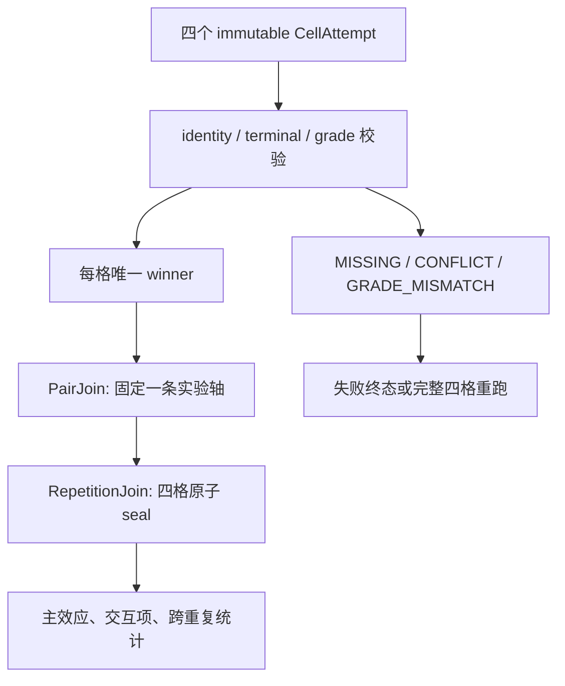
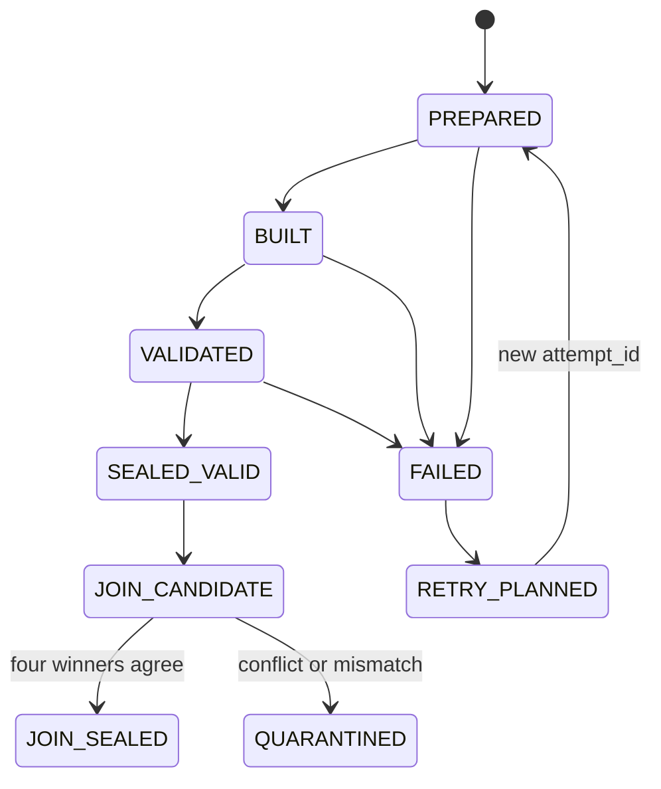

> 本文基于 PTOAS 默认分支提交 [`72e84642cbfc`](https://github.com/hw-native-sys/PTOAS/commit/72e84642cbfcc303ad06053a3f9ac820d10e13d7)。相对上一章的 [`297a791c7c4f`](https://github.com/hw-native-sys/PTOAS/commit/297a791c7c4f632f7c1fc02bf4f777a313b4ea2a)，默认分支前进了 [14 个提交](https://github.com/hw-native-sys/PTOAS/compare/297a791c7c4f632f7c1fc02bf4f777a313b4ea2a...72e84642cbfcc303ad06053a3f9ac820d10e13d7)；但本文直接研究的 scheduler runner、validation runner、cache 与 native build 四个文件 blob 均未变化。下文将当前代码事实、测试事实和建议协议严格分开。

## 本篇在 PTO 课程路线中的位置

这是课程第 106 章。第 104 章定义 `remat false/true × Bisheng off/on` 四象限，第 105 章为每个 cell 建立 fixture、argv、toolchain、object、Golden 与 raw log 的身份链。本章只解决下一道边界：**四份各自可信的 cell record，什么时候才共同构成一份可以计算主效应和交互项的实验结果？**

结论先行：cell 成功不是 repetition 成功。join 必须先对不可变身份做等值连接，再为每个 `R×B` 选择唯一、可证明的 attempt；缺格、冲突或 evidence grade 不同都只能产生终态失败记录，不能产生部分统计。执行已经开始后的失败还会污染 run order、cache 和温度条件，默认应重跑完整四格；只有执行前的确定性失败才适合单 cell retry。

## 前置知识

四格记作 `C00/C10/C01/C11`，其中第一位 `R` 控制 VPTO rematerialization，第二位 `B` 控制 Bisheng vector machine scheduler。指标记为 `Yrb`。固定 `B` 比较 `Y1b-Y0b` 才是 remat effect；固定 `R` 比较 `Yr1-Yr0` 才是 Bisheng effect；只有四格同身份、同证据等级时才能计算：

`I = (Y11 - Y01) - (Y10 - Y00)`。

上一章还确认当前真实脚本存在双编译：`timed.fatobj.o` 提供 compile time，validation runner 重新生成 `kernel.fatobj.o` 并做 strict SIM。本文沿用“被验证 object digest 必须等于被归档 object digest”的前置条件，不重复讨论其构建细节。

## 今日 1–2 个核心问题

1. 四格如何以一个 join transaction 提交，避免三格成功就被误读为完整实验？
2. partial failure 后怎样区分安全 retry、幂等 duplicate 与不可自动选择的 conflict，同时保持 run-order 和 evidence-grade 可审计？

## PTO 全栈中的位置

上游是 PTOAS/Bisheng/SIM 产生的 cell terminal record；下游是 paired effect、interaction、置信区间与后续真机复核。join 层不改变 Tile、VReg 或 object，它决定哪些 raw measurements 具有相同因果上下文，因而有资格相减。

## 概念和精确语义

下面是**建议 schema，不是当前 PTOAS 公共 API**。

| 类型 | 最小身份 | 作用 |
| --- | --- | --- |
| `CellKey` | `experiment_id, fixture_digest, toolchain_digest, repetition, R, B, base_argv_digest` | 定义一个逻辑格；`attempt` 不在其中 |
| `AttemptKey` | `CellKey + attempt_id` | 标识一次不可变尝试 |
| `CellTerminal` | status、artifact/validation/raw-log digest、grade、actual order、record digest | 成功和失败都可审计 |
| `PairJoin` | axis、两端 winner digest、pair status | 只允许固定另一条轴的对比 |
| `RepetitionJoin` | 四个 winner digest、join revision、interaction inputs、terminal status | 四格共同原子提交 |

join 的硬不变量有五条：

1. `C00/C10/C01/C11` 的 fixture、toolchain 和除 `R/B` 外的 canonical argv 完全相同。
2. 每格恰有一个被显式选择的 `SEALED_VALID` winner；“目录中时间最新”不构成选择证明。
3. exact duplicate 指同一 `AttemptKey` 且 `record_digest` 相同，只做幂等 no-op；同 key 不同 digest 是 `RECORD_CONFLICT`，必须封存。
4. 新 attempt 只有通过不可变 `supersedes_record_digest` 才能替换旧 attempt，形成无环链；没有显式边的两个成功 attempt 是 `RETRY_AMBIGUOUS`。
5. pair 两端及四格必须达到指标要求的同一 evidence grade。`REPORT_UNAVAILABLE` 可以保留 functional/ticks 原始记录，却不能参与需要 stack/report 的 effect。

`PairJoin` 与 `RepetitionJoin` 是两级提交：若研究问题只要固定 `B=0` 的 remat effect，可以 seal `C00+C10`；但 interaction 必须等四格齐全再 seal repetition。pair 结果不能偷偷填补另一个 pair，也不能把两个不同 repetition 拼成四格。

可以把 joiner 的接口写成 `join(manifest, terminal_records) -> JoinVerdict`。输入不是可变工作目录，而是已经按 record digest 寻址的只读 terminal records；输出也不是一个可缺字段的统计字典，而是 `SEALED / INCOMPLETE / QUARANTINED` 三类互斥 verdict，附稳定 reason code 和所引用的 record digest。joiner 拥有“选择并发布引用”的权力，却不拥有 cell artifact，因而不能删除失败日志、改 ticks 或重新解释 compare verdict。前置条件是 experiment manifest 已冻结、每条 record schema/version 可解码；后置条件是 `SEALED` 引用的每一条记录仍可按 digest 找回，所有 effect 都能由这些 raw values 重新计算。

并发假设也必须显式：多个 worker 可以并行产生不同 `AttemptKey`，但同一个 `JoinKey` 只能通过 revision compare-and-swap 发布一个下一版本。两个 joiner 同时看到相同输入时，应生成同一内容 digest；若输入集合在计算期间变化，旧 revision 的发布失败并重新读取，而不是强行覆盖。这里的 linearization point 是 join manifest 的原子 rename/对象存储 conditional put，不是最后一个 cell 进程退出的时刻。这样即使统计进程与 runner 分属不同容器，读者也不会看到“JSON 已出现但第四格还没落盘”的中间态。

| verdict/reason | 精确条件 | 是否允许统计 |
| --- | --- | --- |
| `INCOMPLETE/MISSING_CELL` | 四个逻辑 `CellKey` 至少缺一个 terminal winner | 否；保留缺口并等待或重跑 |
| `QUARANTINED/RECORD_CONFLICT` | 同一 `AttemptKey` 出现不同 record digest | 否；人工或上游修复后生成新 revision |
| `QUARANTINED/RETRY_AMBIGUOUS` | 同一 cell 有多个成功 attempt，却无唯一 supersedes 链 | 否；禁止按 mtime 猜 winner |
| `INCOMPLETE/GRADE_MISMATCH` | 指标所需 evidence grade 在 pair/四格间不同 | 否；可保留较低等级的原始观察 |
| `SEALED` | 唯一 winners、身份、grade、终态与四格基数全部满足 | 是；只按引用的 raw values 计算 |

## 真实文件、类型、API 或指令逐段解读

先看 [`check_bisheng_scheduler.py`](https://github.com/hw-native-sys/PTOAS/blob/72e84642cbfcc303ad06053a3f9ac820d10e13d7/test/vpto/scripts/check_bisheng_scheduler.py)。当前 `main()` 依次执行 `repetition × (off,on,auto)`；`compile_sample()` 又把 `--vpto-scheduler-remat=false` 写死。因此它既不是 `R×B` 四格，也没有 join key。`validate_sample()` 只有在编译、runner、SIM 成功标记、strict compare 和 ticks 全部通过后才返回字典；调用者随后 append 到内存列表，并用 `write_text()` 覆盖 `results.json`。

这带来三个精确后果。其一，中途异常时当前 cell 没有 terminal row；其二，前面已经完成的行虽可能已写盘，但没有“本 repetition 完整”标志；其三，没有 `attempt_id/supersedes/record_digest`，重跑目录只能靠人猜。当前逻辑适合线性 smoke，不足以支持可恢复四格事务。

[`run_host_vpto_validation.sh`](https://github.com/hw-native-sys/PTOAS/blob/72e84642cbfcc303ad06053a3f9ac820d10e13d7/test/vpto/scripts/run_host_vpto_validation.sh) 使用 `set -euo pipefail`，并按 case 构建、链接、运行、生成 Golden 和比较。它的失败传播很重要，但 shell 退出码只说明本次调用终止；若上层没有在异常边界写 terminal record，失败仍会在实验账本中表现为“缺行”。进程失败与证据持久化是两个不同契约。

再看 [`cache.py`](https://github.com/hw-native-sys/PTOAS/blob/72e84642cbfcc303ad06053a3f9ac820d10e13d7/ptodsl/ptodsl/_runtime/cache.py) 和 [`native_build.py`](https://github.com/hw-native-sys/PTOAS/blob/72e84642cbfcc303ad06053a3f9ac820d10e13d7/ptodsl/ptodsl/_runtime/native_build.py)。`is_native_build_current()` 要求五个文件存在、manifest 可解析且 MLIR/launch/compile/link 四个 digest 相等，否则 fail closed；`_materialize_native_library()` 先写输入、构建 object/so，最后才写 manifest。这已经体现“manifest 是发布标记”的方向。

但代码注释明确说明 persistent cache 默认关闭：specialization key 带进程地址、目录无界增长，而且发布缺少 locking、temporary name 和 fallback。`write_manifest()` 仍是直接 `write_text()`；manifest 也不绑定最终 object/so digest。它可作为 join transaction 的概念参考，却不能直接承担并发、崩溃恢复或实验 seal。

同仓的 [`report_a5_board_results.py`](https://github.com/hw-native-sys/PTOAS/blob/72e84642cbfcc303ad06053a3f9ac820d10e13d7/.github/scripts/report_a5_board_results.py) 提供了一个窄而真实的 fail-closed 模式：`BoardSummary.passed` 要求结果文件存在、至少一行、无 `FAIL`，且状态只能是 `OK/SKIP`；SKIP 与未生成 case 被显式呈现。相关可靠性改动可追到提交 [`d35de39a655`](https://github.com/hw-native-sys/PTOAS/commit/d35de39a65546c6bf6dc065c3bcb2b5ccd788cf0)。它证明“缺失不是成功”已在仓内另一条测试链成立，但没有解决四格唯一 winner 和原子 join。

规范文档 [`a5-nightly-board.md`](https://github.com/hw-native-sys/PTOAS/blob/72e84642cbfcc303ad06053a3f9ac820d10e13d7/docs/ci/a5-nightly-board.md) 也把这条原则写进运维契约：重复启动共享 `flock`，checkout conflict 使 run 失败，失败留下状态记录，SKIP 和生成前排除项必须进入“not validated”口径。这里不能直接复制 `flock` 作为分布式 join 的全部方案，但它提供了当前仓库对单 writer、显式缺口和 fail-closed 新鲜度的文档证据。

## 对象/Tile/Buffer/IR 生命周期

本章沿用 `vmula` fixture：1024 个 `f32`，共 4096 B，GM→UB 为 32 个 128 B burst；vecscope 按 `64xf32=256 B` carrier 分成 16 个逻辑 chunk。一次 cell 内仍是 `TLOAD/VMULA/VSTS/TSTORE` 的数值生命周期。

新增的是证据生命周期：`CellAttempt` 在执行前冻结 identity 与计划位置；编译、验证和计时只追加事实；异常也进入 terminal；joiner 读取不可变 terminal records，解析 supersedes 链选 winner；随后先写临时 join record，持久化后原子发布 `SEALED`。一旦 seal，旧 cell record 不被覆盖；新证据产生更高 join revision，而不是原地改历史结果。

## 端到端调用链或指令链

当前链是：

`main → validate_sample → compile_sample → timed object → run_host_vpto_validation.sh → second object → strict compare/ticks → append success → overwrite results.json`。

建议链是：

`freeze ExperimentManifest → schedule four CellKey positions → append PREPARED → compile/validate exact object → append terminal CellAttempt → resolve duplicate/conflict/supersedes → validate pair/grade → write+fsync temporary RepetitionJoin → atomic rename → statistics reads only SEALED join`。

注意统计读取者不扫描 cell 目录自行补齐。它只消费 join record 中列出的四个 winner digest；这使“选择了哪四份证据”成为可复核数据，而不是读取时策略。

恢复时也遵循同一条链。进程重启先枚举 immutable terminal records，再读取最新 sealed join revision；`PREPARED/BUILT/VALIDATED` 等非终态不能被猜成失败或成功，而应由 bounded recovery 查询原 worker/进程结果，无法确认时生成 `ORPHANED_ATTEMPT` 终态并按失败阶段决定重试粒度。旧 join 若仍引用完整 records 就继续有效；新 attempt 不会自动使旧历史失效，只有显式 supersedes 和新 join revision 才改变当前视图。这个区分让“历史可追溯”与“当前选择可前进”同时成立。

## 具体 shape、Tile 和状态演算

设 repetition 7 的四格初次运行如下：

| cell | attempt | terminal | grade | ticks |
| --- | ---: | --- | --- | ---: |
| `C00` | 1 | `SEALED_VALID` | G2 | 1010 |
| `C10` | 1 | `SIM_TIMEOUT` | G2 | — |
| `C01` | 1 | `SEALED_VALID` | G1（report unavailable） | 980 |
| `C11` | 1 | `SEALED_VALID` | G2 | 900 |

此时不是“三格可用”，而是 `JOIN_INCOMPLETE`；任何 interaction 都非法。`C10` attempt 2 若验证成功并显式 supersede attempt 1，可成为 winner。若研究指标需要 G2，`C01` 仍造成 `GRADE_MISMATCH`；不能把 G1 的 ticks 与 G2 的 stack/ticks record 混为同一证据级别。

假设完整重跑后四格同为 G2，得到 `Y00=1010,Y10=930,Y01=970,Y11=900`。则 B=0 时 remat effect 为 `-80` ticks，B=1 时为 `-70`；R=0 时 Bisheng effect为 `-40`，R=1 时为 `-30`；interaction 为 `(-70)-(-80)=+10` ticks。这里负值仅表示该配对中 ticks 较少，不自动等同真机加速；样本量、稳健估计和停止规则仍需依据设备噪声与目标置信区间校准。

## 为什么这样设计及替代方案

最简单方案是继续 append 成功行，并让分析脚本按最新 mtime 选文件。它几乎无实现成本，却把缺格、覆盖和冲突变成静默选择，无法复现。

第二种方案是失败一格就只重跑一格。若失败发生在执行前，例如参数验证或编译未产出 object，且未产生设备样本，单 cell retry 成本低且不污染性能顺序；但若 SIM/设备执行已开始，失败可能与温度、cache、系统负载或工具链不稳定相关。此时只补一格会让该格落在不同时间窗口。证据优先的默认策略是新建 repetition 并按轮换顺序重跑四格，旧 repetition 保持失败终态；若必须做 repair lane，则记录 planned/actual position，并禁止将其冒充原位置。

推荐方案是 immutable attempts + explicit supersedes + atomic join。它增加 record 数量、持久化与恢复逻辑，但复杂度分别对应三个硬约束：不可丢失失败、不可自动挑冲突、不可发布半个因果对。与统计模型、allocator dump 无关的字段不应借机塞入最小事务。

## 访存、计算、流水、并行和硬件约束

join 本身不增加 GM/UB 搬运，也不改变 VReg pressure；它约束的是实验运行方式。四格编译可以并行，但 device/SIM performance sampling 应使用受控独占或轮换串行，否则共享 CPU、磁盘、simulator 和 cache 会形成额外干扰。raw compile time 与 runtime ticks 继续分开持有。

重试策略的根本判断不是“失败类型名称好不好看”，而是失败是否可能改变测量窗口。执行前失败没有 device observation，可在原 repetition 下产生新 attempt；执行中/后失败已经消耗时间与资源，应默认废弃该 repetition 的性能 join。本文不制造超时值或差异阈值：这些值必须来自 runner SLA、历史噪声和设备预算。

## 测试证据与未覆盖风险

当前直接测试证据分三层：

- [`pto-bisheng-scheduler-test.cpp`](https://github.com/hw-native-sys/PTOAS/blob/72e84642cbfcc303ad06053a3f9ac820d10e13d7/tools/pto-test-opt/pto-bisheng-scheduler-test.cpp) 的 fake compiler 场景覆盖 zero/equal/larger stack、重复/冲突 report、on/off 编译失败、report unsupported、fallback 和 retry 文件清理；文件注释也明确它不验证真实 Bisheng 命令/report 契约。
- [`report_a5_board_results_test.py`](https://github.com/hw-native-sys/PTOAS/blob/72e84642cbfcc303ad06053a3f9ac820d10e13d7/.github/scripts/report_a5_board_results_test.py) 验证结果 TSV 缺失会得到 `results_found=false`、`passed=false`，并验证失败详情、SKIP 和通知失败不会覆盖 summary。
- PTODSL native-build 测试验证 backend/output 类型与缺失 object 会 fail fast；cache 代码验证输入/config digest 后才复用，但公开测试和注释都没有声称并发发布安全。

公开仓当前没有 Four-cell join、attempt supersedes、record conflict、atomic seal 或 crash-replay 直接测试。因此至少还需：缺一格拒绝 seal；相同 duplicate 幂等；同 key 不同 digest 进入 quarantine；显式 supersede 唯一选中；grade mismatch 不生成 effect；在临时写、fsync、rename 各阶段注入崩溃后只读到旧完整版本或新完整版本。真实 SIM 四格与真机 counter 仍是更高证据层，不能由这些单测替代。

这些测试不能只断言最终布尔值。每个 case 还要核对输出引用集合、reason code、join revision 和未被选择记录仍然存在；否则实现可能“返回失败”却在失败前覆盖了证据。并发测试应让两个 publisher 读取相同旧 revision、分别尝试 seal 不同 winner 集合，验证只有一个 conditional publish 成功，失败者重新读取后得到确定 verdict。property test 则可随机排列同一批 record 的到达顺序，要求 join digest 与输入顺序无关；只有显式 run-order 字段影响实验解释，文件枚举顺序不应影响 winner。

仍未覆盖的风险包括：共享文件系统的 rename/fsync 语义与本地盘不同；对象存储可能需要 ETag 条件写而非 POSIX rename；runner 被 kill 后实际 device 工作仍在继续；工具版本字符串相同但 binary 内容不同；raw ticks 日志部分写入却被误解析；evidence-grade 规则升级后旧 record 的迁移。协议必须版本化，并让未知版本 fail closed，不能用“字段缺失等于默认值”维持表面兼容。

发布前还应做一次反向重放：仅凭 sealed join 与内容寻址 artifact，在空目录中重建四格输入、校验 digest，并重新算出同一组 effect。若必须依赖原机器上的隐式环境或文件修改时间，说明 join 仍只是运行摘要，不是可携带的实验凭证。

## 与前后章节的连接

向前，本章把第 105 章“每格是谁”的 artifact identity 提升成“哪四格共同成为一次结果”的 join identity。向后，join 解决完整性和唯一性，却尚未定义跨 repetition 的稳健估计、异常值策略、停止规则和 SIM→真机外部有效性。

### 第 99～105 章知识图谱回顾

这七章形成了一条连续链：A5 grouped VF 的 hardware loop state/membar → VMI loop layout fixed point 与 group slots → VPTO live range/rematerialization → LLVM/HiVM/Bisheng resource report → ET_REL/symbol/spill machine evidence → remat×Bisheng 四象限 → artifact manifest。路线调整为先完成本章的 join transaction，再进入统计 seal；暂不扩展到 serving，也不把 stack、spill 和 ticks 合并成单一“性能证据”。

## 本篇结论、知识债、三个理解检查问题和下一章

当前 PTOAS 事实是：真实 scheduler script 只写成功 row、固定 remat=false，并逐次覆盖 JSON；cache manifest 以输入/config digest做 fail-closed reuse，却明确缺少并发安全；board reporter 已把缺结果和未验证项显式化。由这些边界可推出，四象限需要独立的 immutable attempt 与 atomic join，而不是再加一个“完成数量”字段。

知识债：Four-cell schema/version codec；terminal record append 与原子发布；supersedes DAG；execution-stage retry policy；evidence-grade lattice；compile-once/validate-exact-object；四格 crash/fault injection；跨 repetition 稳健统计；SIM/真机 parity 与 counter。

理解检查：

1. 为什么四个 `SEALED_VALID` cell 仍可能因 attempt 冲突或 grade 不同而不能 join？
2. 哪类失败可以安全地只重试一个 cell，为什么 SIM timeout 通常不属于这一类？
3. exact duplicate 与 record conflict 的 key 相同，joiner依据什么字段把二者区分开？

下一章：**Repetition Statistical Seal——配对样本、run-order block、异常值与停止规则怎样不破坏 Four-cell 因果边界。**

## 课程账本增量

- 课程：106；阶段：PTOAS backend evidence 与可恢复四象限实验。
- 主仓：`hw-native-sys/PTOAS`；源码基线：`72e84642cbfcc303ad06053a3f9ac820d10e13d7`。
- 新覆盖：`check_bisheng_scheduler.py::main/validate_sample`、`cache.py::{write_manifest,is_native_build_current}`、`native_build.py::_materialize_native_library`、`report_a5_board_results.py::BoardSummary/load_results` 及其直接测试。
- 新确认不变量：cell 成功不等于 repetition 成功；每格唯一 winner 必须由 record digest 与 supersedes 证明；duplicate 幂等、conflict 隔离；同 grade 才能配对；执行后失败默认重跑完整四格；统计只读 sealed join。
- 待验证推断：建议 `CellKey/AttemptKey/PairJoin/RepetitionJoin`、原子 seal 与 retry policy 均未在当前 PTOAS 实现。
- 下一章：Repetition Statistical Seal。
