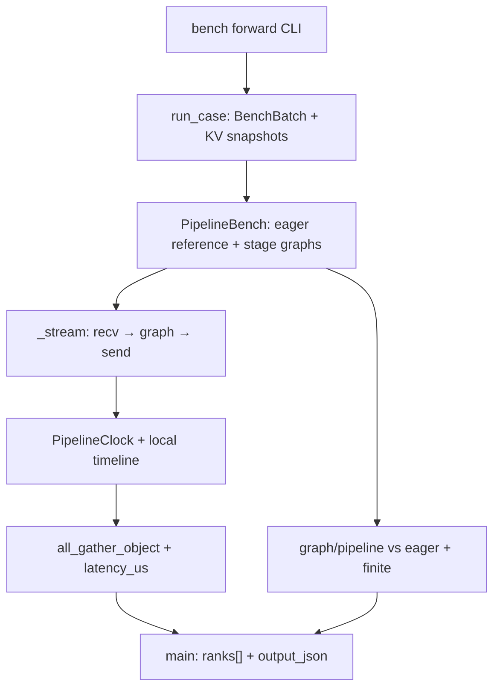
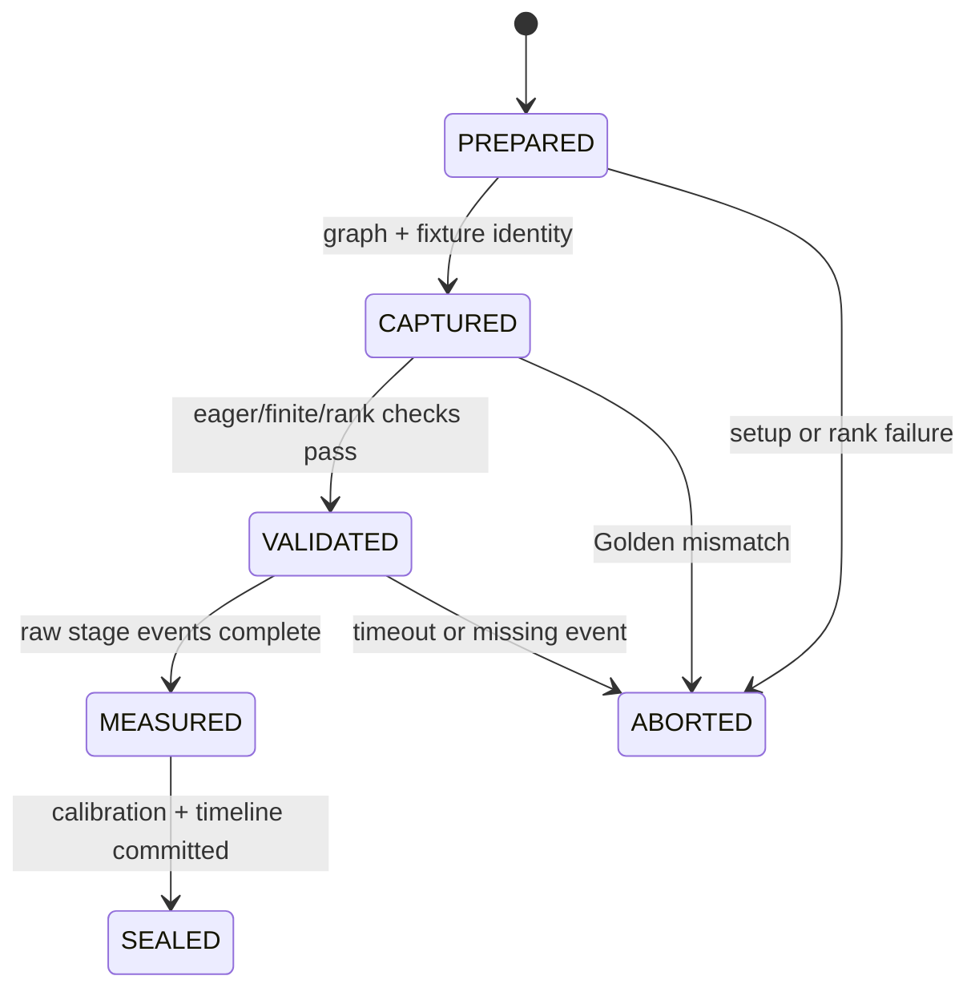

> 本文基于 vLLM `main` 的 [`66e8914fc93c1b49f27fda3da33b6f1126d37a37`](https://github.com/vllm-project/vllm/commit/66e8914fc93c1b49f27fda3da33b6f1126d37a37)。相对[上一章基线](https://github.com/vllm-project/vllm/commit/edccd1e39ede897504babb9a50aa8bba26089bbb)前进 [69 个提交](https://github.com/vllm-project/vllm/compare/edccd1e39ede897504babb9a50aa8bba26089bbb...66e8914fc93c1b49f27fda3da33b6f1126d37a37)；`pipeline.py`、`capture.py`、`main.py` 和直接测试没有变化，只有 benchmarking 文档增加了与本题无关的 MoE/attention 说明。最新提交修复 HiSparse resident page 回收，也不改变 PP benchmark。下文严格区分当前代码事实、测试事实和建议的证据协议。

## 本篇在课程路线中的位置

这是第 96 章，仍在“测试、性能与故障诊断”。第 95 章回答了 PP critical path 怎样由跨 GPU 的 stage Event 重建；本章只补一个紧邻缺口：**怎样证明 A/B 两次测量的第 `m` 个 microbatch 真的是同一个工作、使用同一套时钟校准和 rank 集合，并且功能 Golden 已通过；若中途失败，又怎样留下不可误读的终态？**

结论先行：当前 `PipelineBench` 已保存足以重算单次运行延迟的 raw timeline，但它仍是“成功结果 JSON”，不是 paired evidence transaction。microbatch 只靠数组下标对齐；校准只留下合成后的 uncertainty；`graph_vs_eager`、`pipeline_vs_eager`、`finite` 与 sampler check 被记录却没有统一 accept gate；异常会让整个 CLI 退出，`output_json` 不会写入失败 cell。要做可信 A/B，必须把 fixture、variant/order、microbatch identity、calibration、expected ranks、Golden、raw stage events 和 abort reason 一起提交。

## 前置知识回顾

PP 不能把各 stage duration 相加，也不能只取最慢 stage。当前实现先用 `PipelineClock` 把各 GPU Event 映射到 rank-0 monotonic clock，再按相同数组位置取 first-stage 最早 start 与 last-stage 最晚 end。`margin=4*PP` 用于裁掉 fill/drain；PP=2、`iters=4`、`samples=2` 时，实际流转 `8 + 2×8 = 24` 个 microbatch，最终保留中间 8 个。

上一章还确认 Event 只包住 `graph.replay()`；reset、`irecv.wait()`、`isend.wait()` 不在局部 Event 内，但 first→last 的共同时间轴跨度会包含暴露在 stage 之间的等待和传输。这个跨度是服务 critical path，不是通信纯耗时。

## 本篇要回答的核心问题

1. 当前成功结果中，exact batch、stage output、clock、timeline 与聚合 latency 分别在哪里产生，谁持有？
2. 为什么 `starts_us[i]` 与 `ends_us[i]` 长度相等仍不足以成为 A/B pair identity？
3. 最小 `PairEvidence` 应如何 fail closed，同时避免把 profiler 或 JSON 写盘塞进 device critical path？

## 组件在全局架构中的位置



这条链位于执行器/ModelRunner 之后、诊断与性能结论之前。它不覆盖 Scheduler queue、TTFT 或 serving backpressure；上游是 `BenchBatch.scheduler_output` 和 runner state，下游是 JSON、测试与人工分析。

## 完整调用链

公开入口是 [`vllm bench forward`](https://github.com/vllm-project/vllm/blob/66e8914fc93c1b49f27fda3da33b6f1126d37a37/vllm/benchmarks/forward/main.py)。PP>1 时 `_make_engine_args()` 选择 `ForwardPipelineExecutor`；`run_case()` 构造 exact `BenchBatch`、清零分配到的 KV blocks、收集 `touched_kv_views()`，然后创建 `PipelineBench`。

完整链为：

```text
CLI main
  → run_case → build_batch / zero_kv_blocks / touched_kv_views
  → PipelineBench.run
  → _prepare_stage: recv eager input → local eager → send reference
  → _capture_stage: reset_graph + stage graph → graph/eager comparison
  → _stream: reset → recv → Event start → graph → Event end → send
  → PipelineClock.timestamp → all_gather_object(local timeline)
  → first/last per-DP latency → DP max → margin crop
  → main all_gather_object(rank result) → output_json
```

注意两次 gather 的职责不同：`_stream()` 内 gather timeline，所有 rank 都能算出同一组 aggregate latency；`main()` 再 gather每个 rank 的完整结果，rank 0 把 `ranks[]` 写入 JSON。

## 关键类型、字段和状态生命周期

当前没有名为 `PairEvidence` 的类型。真实对象生命周期如下：

- `BenchBatch`：在 `run_case()` 创建，拥有 request 顺序、query/KV 长度、block ranges 与 `SchedulerOutput`；case 完成后通过 `batch.finish()` 交回 runner。
- `snapshots/input_snapshots`：`_prepare_stage()` 从 mutable state views 与 intermediate tensors 克隆；`reset_graph` 在每个 microbatch 前恢复，生命周期覆盖 capture 和两次 `_stream()`。
- `reference`：stage eager output 的 clone；capture 后生成 `graph_vs_eager`，stream 末生成 `pipeline_vs_eager`。
- `starts/ends`：每个 rank 为 `count+2*margin` 次 replay 创建 CUDA Event，设备同步后经 `PipelineClock.timestamp()` 变为浮点微秒数组。
- `local` timeline：只有 `stage`、`dp_rank`、`starts_us`、`ends_us`、`clock_uncertainty_us`；没有显式 microbatch ID、world/TP rank、calibration ID 或 attempt。
- `result`：成功路径汇总 timeline、latency、comparison、finite、sampler/drafter；异常则函数抛出，没有 terminal failure record。

隐含不变量是“所有 rank 以同样循环次数、同样顺序前进，所以数组下标就是 microbatch identity”。单次无故障 collective 中成立；跨 variant、retry、部分 rank 重启或人工拼接 JSON 时不再充分。

关键接口的精确契约可以压缩成下表：

| 接口 | 输入与 shape/device | 输出与所有权 | 前置/后置条件 | 当前失败方式 |
| --- | --- | --- | --- | --- |
| `run_case()` | `BenchCase`、runner config；构造 GPU KV/state views | rank-local `dict`，由调用者 gather | KV blocks 不重叠，draft/lookahead 不越界；结束后 `batch.finish()` | `ValueError` 或下游异常，未形成 case record |
| `_prepare_stage()` | first stage 的 token/input；其它 stage 的 `IntermediateTensors` | stage eager `reference` 与 mutable-state snapshots | PP 邻居/TP all-gather shape一致；send/recv顺序一致 | assert、collective异常或进程退出 |
| `_capture_stage()` | 固定地址的 snapshots、input tensors、stage forward | `reset_graph`、`graph`、comparison fields | capture stream稳定；replay后同步再比较 | comparison可非零但函数不自动拒绝 |
| `_stream()` | 相同 graph、固定 `count+2*margin` | GPU Event数组、local timeline、聚合 latency | 所有 rank loop次序相同；CPU/device groups存活 | hang/collective异常；没有 abort payload |
| `PipelineClock.timestamp()` | 同 GPU Event与前后 anchor | rank-0 clock上的 `float µs` | anchor elapsed time非零且校准窗口覆盖测量 | 没有版本化校准记录供离线重算 |

这里没有可变 batch dimension：每次 replay 都是同一个 exact batch；Event 本身位于对应 rank 的 GPU，转换后才成为 Host 浮点时间。`pipeline_timeline` 的所有权最终归各 rank 的 result，rank 0 JSON只是把这些 result复制进 `ranks[]`，并没有新的 canonical evidence owner。

建议的终态机也应保持小而明确：



这些状态是本文建议，不是当前类。`ABORTED` 也必须携带最后完成阶段、expected/observed ranks、异常类别和已产生 artifact digest；否则“没有 JSON”仍无法区分配置错误、功能错误与设备失联。

## 逐函数源码解读

[`PipelineClock.__init__()`](https://github.com/vllm-project/vllm/blob/66e8914fc93c1b49f27fda3da33b6f1126d37a37/vllm/benchmarks/forward/pipeline.py) 对每个 peer 做 20 次 CPU ping-pong，选 RTT 最小者估计 offset 与半 RTT uncertainty；随后用 Host 时间夹住 idle GPU Event，得到 GPU anchor。`timestamp(event,end_clock)` 用前后两套 anchor 线性插值。当前 timeline 只保留两端 uncertainty 的最大值，没有保留 trial、offset、anchor width 或 calibration digest，所以能判断“误差大概多大”，不能重放校准选择。

`PipelineBench._capture_stage()` 捕获 `reset_graph` 和 stage graph，replay 一次后计算每个 tensor 的 `max_abs/relative_rms`，并记录 sampler token 合法性。关键边界是：这些值只是结果字段；生产代码没有统一断言 `relative_rms` 必须为零，也不会因 `finite=false` 自动拒绝 timing。直接测试会断言 `pipeline_vs_eager.relative_rms == 0`，但 CLI 本身仍可能写出一个带 mismatch 的成功 JSON。

`_compare()` 先把 actual/expected转成 FP32，`max_abs=max|a-e|`，`relative_rms=RMS(a-e)/max(RMS(e),1e-12)`。这适合报告量级，却没有结合模型、dtype或算子给出 accept budget；因此不能把任意非零都视为错误，也不能把“代码没有抛异常”视为相等。正确做法是由 manifest携带预声明的 comparator与预算，validation据此产生布尔 verdict，timing层只消费 verdict。

`_stream()` 在 CPU barrier 后固定循环，局部 Event只围住 stage graph。同步完成后，它汇集每个 rank 的 timeline，按 `dp_rank` 选 first/last stages，以相同数组位置计算 latency，再裁掉两端 margin。缺少 rank、collective timeout或数组错位通常表现为 hang/异常，而不是结构化 `ABORTED`。

`main()` 只在所有 case 正常结束后 `json.dump(results)`。写入不是“每个 case 的 terminal commit”；前面任何异常都会使已完成 case 也没有最终文件。`sample_spread_pct>0.5` 仅告警，这是当前代码策略，不是可移植的正确性阈值。

## 具体示例与 shape/状态演算

沿直接测试：PP=2，case=`prefill=8*128`，每个 microbatch 有 8 个请求、共 1024 scheduled tokens；`iters=4,samples=2,margin=8`，rank 0/1 各保存 24 对 Event，稳态 identity 应为原始 ordinal 8～15，而不是裁剪后的 0～7。

以下数字仅用于演算。variant A 的 ordinal 10：stage 0 为 `100→160 µs`，stage 1 为 `175→245 µs`，critical path=`245-100=145 µs`，inter-stage gap=`175-160=15 µs`。variant B 为 `100→155` 与 `168→234`，critical path 134 µs，paired delta 为 -11 µs。这个 15/13 µs gap 只表示“stage0 end 到 stage1 start 的可见空隙”，包含传输、排队与校准误差，不能命名为 NCCL latency。

若 A/B 的 conservative clock bound 分别为 12/10 µs，那么 -11 µs 与两次测量的误差包络同量级；本文不发明通过阈值，应保存 raw bound 并标记 evidence不足。更重要的是，只要 B 的 `pipeline_vs_eager` mismatch、rank membership不同，或 ordinal 10 对应的 fixture digest不同，-11 µs 必须被拒绝，而不是进入统计。

数组 identity 还有一个容易忽略的陷阱：当前 `latency_us.samples_us` 已裁掉 margin，而 `pipeline_timeline.starts_us/ends_us` 保留全部24项。若离线工具把两者都从0编号，`samples_us[0]` 实际对应 raw ordinal 8。PairEvidence应同时保存 `raw_ordinal=8` 与 `steady_index=0`，A/B只能按前者以及相同 order slot连接；否则填充区或重试产生的偏移会制造看似合理的错误配对。

建议的 join key 是：

`(fixture_digest, graph_config_digest, topology_revision, dp_replica, original_microbatch_ordinal, attempt, variant, order)`。

## 为什么这样设计及替代方案

方案一是只保存 median。成本最低，但无法定位 stage、校准、margin、rank 或失败，不能做 paired replay。

方案二是每次保存完整 Kineto/Perfetto trace。证据最丰富，却增加 profiler 开销、文件体积和解析版本依赖；当前代码也刻意在 timing 后另跑 profile，说明它不是低扰动主路径。

最小充分方案是保留现有 CUDA Event 与 gather，在同步后构造小型 `PairEvidence`：fixture/config digest、明确 ordinal、rank topology、clock calibration摘要、raw stage start/end、Golden verdict、terminal state。它复用现有数据，不在 replay loop 内 hash、序列化或写盘；只有 commit 在 Host 侧发生。若将来需要分解 recv/send，再新增相应 Event，而不能从现有 stage gap伪造。

从维护成本看，证据 schema 应独立于 `PipelineBench` 的 Python 对象布局：字段按版本序列化，派生的 median/gap可随分析器重算，raw identity与Event不可被覆盖。这样修改统计方法不必重跑昂贵模型；反过来，若只保存派生指标，任何公式修正、rank聚合规则变化或clock bug都会让历史结果失去复核能力。

## 性能、并发、正确性与边界条件

性能上，Event 和 timeline gather 已经存在；新增字段主要增加 Host 内存、object collective 与 JSON。风险是把完整 tensor、每次 calibration trial 或 profiler trace塞进常态记录，因此 raw evidence应有有界保留策略，常态聚合保持低基数。

对一次 PP=2、24次流转，当前每 rank有24个start和24个end标量；增加 ordinal、rank与calibration ID是线性元数据，不增加KV或graph pool显存。真正昂贵的是为recv/send/reset再插Event、保存每次校准trial或持久化完整profile。应先用现有Event闭合身份与失败语义；只有当“gap到底是通信还是等待”成为决策瓶颈时，再用受控实验增加分段Event，并测量其扰动。

并发假设是 torchrun 各进程按同一 loop同步推进，CPU group可用，PP membership稳定。collective本身不是失败记录器：peer死亡可能导致 timeout/进程退出。正确性门禁至少要覆盖 exact fixture、预期 rank集合、数组长度/ordinal、finite、stage/pipeline eager comparison、sampler/drafter与 clock evidence；缺失字段是 `EVIDENCE_INCOMPLETE`，不能填零。

graphability不因 evidence 改变：device地址、reset views和stage graph仍保持固定。若在 replay内做 Host判断或动态写文件，反而会破坏低扰动测量，因此事务边界必须放在 device同步之后。

## 测试证据与未覆盖风险

直接测试 [`test_bench_forward_pipeline`](https://github.com/vllm-project/vllm/blob/66e8914fc93c1b49f27fda3da33b6f1126d37a37/tests/benchmarks/test_forward_cli.py) 启动2个进程，验证两个 PP rank、仅末 stage sampler、finite、每 rank 8个 latency样本、`pipeline_vs_eager.relative_rms==0`，并从 first start/last end 和 margin重算 median。它验证了成功链的关键不变量。

仍未覆盖：一个 rank 在第 k 个 microbatch退出；collective timeout后的结构化结果；重复/缺失 ordinal；clock calibration transcript损坏；Golden mismatch必须阻止 timing；A/B variant与AB/BA order；PP>2结合TP/DP的 expected-rank quorum；先完成 case 后后续 case失败时的原子保存。历史来源 [PR #63616](https://github.com/vllm-project/vllm/pull/63616) 已合入 steady-state PP benchmark，但没有引入 paired evidence API。

最小新增测试不需要先跑大型模型。其一，在纯数据层构造两个 rank timeline，显式给出 raw ordinal与margin，证明只允许 `8↔8`、不能把裁剪后的 `0` 与 raw `0` 连接；缺一项、重复一项或数组长度不同都返回 `EVIDENCE_INCOMPLETE`。其二，把 rank 1 的 Golden verdict改为 false，确认 aggregate latency即使可计算也不会进入 sealed record。其三，在第10个 microbatch注入 rank-local异常，预期 owner写出 `ABORTED(stage=MEASURE, observed_ranks=...)`，而不是空文件。其四，用相同Event时间但不同 topology revision/fixture digest验证pair join拒绝。最后才在2-GPU测试中复用现有 `prefill=8*128`，检查成功record能够从raw timeline确定性重算8个稳态sample与median。

这些测试验证的是证据闭包，不是性能阈值。clock uncertainty、数值容差和collective deadline必须由实际硬件噪声、dtype误差与运行环境校准；单测只应固定“缺证据必拒绝、失败有终态、同一identity可重算”三类不变量。

## 与前后章节的连接

向前，本章把第 95 章“怎样算 critical path”提升为“什么证据允许这条 critical path参与 A/B”。它也复用第 92～94 章的 exact batch、Golden与AB/BA事务。向后，`PairEvidence` 仍假定 expected ranks固定；一旦 elastic restart、DP replica变化或 collective卡死，需要专门的 topology revision、timeout owner与partial-rank reconciliation。

## 本篇结论、知识债、三个理解检查问题和下一章

当前 main 已保存 stage raw timeline、clock uncertainty、eager comparison与聚合 latency，但它们靠成功控制流松散组合：microbatch identity隐含于数组位置，Golden没有统一 accept gate，异常没有 terminal record。可信的 PP paired timing应先提交证据，再允许统计读取。

知识债：版本化 `PairEvidence` schema；calibration digest/transcript；world/TP/PP/DP rank identity；request-level token/logprob/KV-state Golden；collective timeout owner；atomic per-case commit；bounded raw-event retention；PP>2与跨节点故障注入。

理解检查：

1. 为什么同长度的 `starts_us/ends_us` 数组在一次成功运行中够用，却不足以跨 A/B、retry建立身份？
2. 为什么 `S(stage1)-E(stage0)` 不能直接称为通信耗时？
3. `finite=false` 或 eager mismatch 为何必须拒绝 latency，而不能只在 JSON 中附一个字段？

下一章：**PP Partial-rank Failure——Collective Timeout、Topology Revision 与 PairEvidence 的 Fail-closed Reconciliation。**

## 课程账本增量

- 课程：96；阶段：测试、性能与故障诊断。
- 基线：`66e8914fc93c1b49f27fda3da33b6f1126d37a37`。
- 新覆盖：`PipelineClock::{__init__,timestamp}`、`PipelineBench::{run,_prepare_stage,_capture_stage,_stream}`、`main.py::{run_case,main}`、`test_bench_forward_pipeline`。
- 新不变量：original microbatch ordinal不可在margin crop后重编号；PairEvidence必须同时绑定fixture/config/topology/calibration/raw events/Golden/terminal state；stage gap不是纯通信；失败或证据缺失不得进入paired统计。
- 仍欠缺：已合入schema、跨进程失败record、rank revision、request-level Golden、故障注入与跨节点校准重放。

