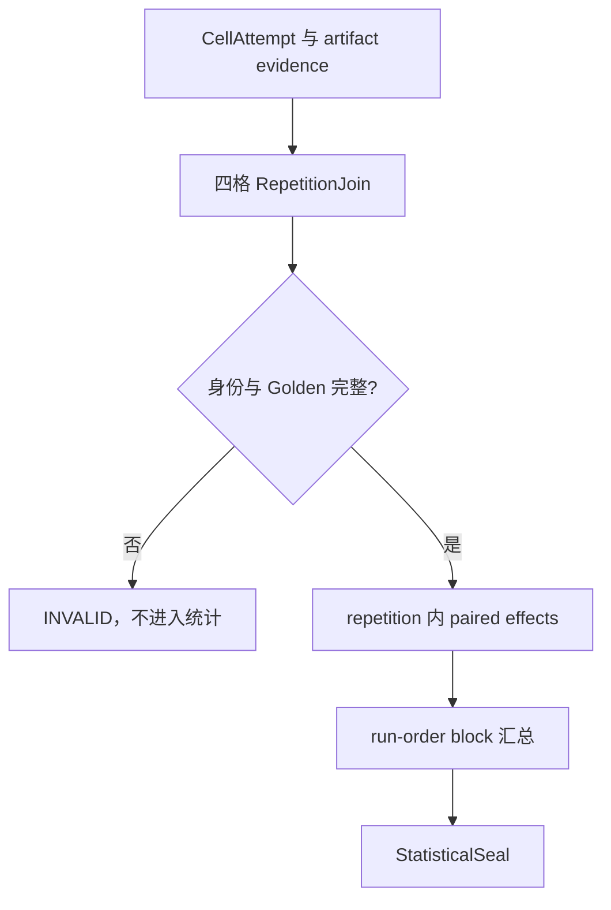
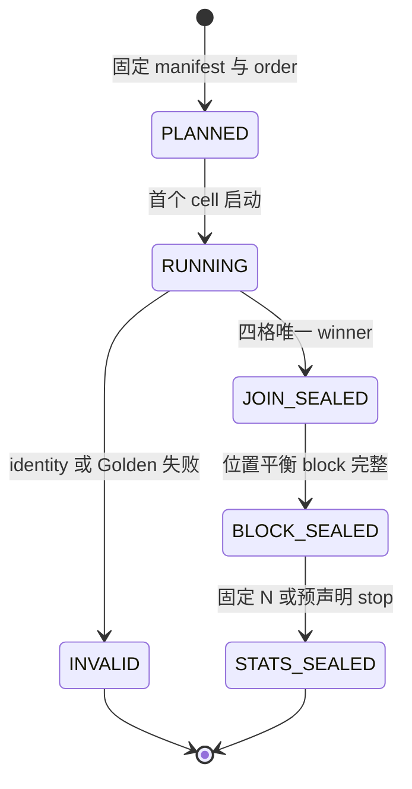

> 本文基于 PTOAS 默认分支提交 [`b43b44042831`](https://github.com/hw-native-sys/PTOAS/commit/b43b440428318953313ac5903c957755958d5197)。相对上一章的 [`72e84642cbfc`](https://github.com/hw-native-sys/PTOAS/commit/72e84642cbfcc303ad06053a3f9ac820d10e13d7)，默认分支前进了 [6 个提交](https://github.com/hw-native-sys/PTOAS/compare/72e84642cbfcc303ad06053a3f9ac820d10e13d7...b43b440428318953313ac5903c957755958d5197)；直接研究的 Bisheng scheduler runner、SIM validation runner、策略测试和设计文档在该区间没有语义变化。下文把当前代码事实、既有实验事实与建议的统计协议明确分开。

## 本篇在 PTO 课程路线中的位置

这是课程第 107 章。第 104 章把 VPTO rematerialization 与 Bisheng vector scheduler 组成四象限；第 105 章固定每个 cell 的 artifact identity；第 106 章要求四个唯一 winner 原子 join。本章只解决一个边界：**有了多个完整 `RepetitionJoin`，怎样汇总才不会把 run order、缺格、异常值或“看到结果后提前停止”伪装成编译策略收益？**

结论先行：统计样本不是单个 tick，也不是某个 cell 的 median，而是一个已经 seal 的四格 repetition。先在 repetition 内计算配对 effect 与 interaction，再跨 repetition 汇总；任何剔除必须作用于完整 repetition 或完整 run-order block。最简单、当前最可信的停止规则是预先固定 repetition 数；若将来引入 sequential stop，阈值、最大次数与多次查看校正必须在第一格运行前进入 manifest。

## 前置知识

令 `R` 表示 remat off/on，`B` 表示 Bisheng scheduler off/on，四格 tick 为 `Y00/Y10/Y01/Y11`，越小越好：

```text
remat effect at B=0 = Y10 - Y00
remat effect at B=1 = Y11 - Y01
Bisheng effect at R=0 = Y01 - Y00
Bisheng effect at R=1 = Y11 - Y10
interaction I          = Y11 - Y10 - Y01 + Y00
```

第 106 章已经规定：只有 fixture、toolchain、base argv、object/evidence grade 一致，且四格各有唯一 winner，才可生成 `RepetitionJoin`。本章不放宽这些正确性门槛，只定义 join 之后的测量生命周期。

## 今日 1–2 个核心问题

1. 为什么必须“先配对求差，再统计”，不能分别求四个 cell 的 median 后再相减？
2. 如何用 run-order block、整组异常处理与预声明停止规则，控制漂移而不制造选择偏差？

## PTO 全栈中的位置

本章位于 `PTOAS → Bisheng object → SIM/设备执行 → Golden → evidence analysis` 的末端。上游输入是四个已绑定 artifact digest 的 cell terminal；下游消费者不是设备 runtime，而是性能 gate、回归报告和后续真实 kernel/NPU 推广。它不修改 PTO 指令语义，也不把 SIM tick 外推为硬件周期。



## 概念和精确语义

建议的 `StatisticalSeal` 至少绑定：experiment/fixture digest、toolchain cohort、四格定义、run-order schedule、所有 `RepetitionJoin` digest、预声明 estimator、异常处理、停止规则、最终 effect/interaction 分布和终态原因。它不拥有 object；它只引用不可变 join。

统计协议有四条硬约束：

- **配对闭包**：一个 repetition 的任一格无效，整组不能产生 effect。缺 `Y11` 时，用别的 repetition 的 `Y11` 补格会混合温度、cache 和工具链状态。
- **位置平衡**：固定 `00→10→01→11` 会把单调升温或 cache warmup 混入 factor。一个四-repetition block 可以轮换为 `00100111`、`10110001`、`11011000`、`01001110`；这里每格恰好占据一次第 1～4 位置。该序列是建议协议，不是当前脚本行为。
- **异常分层**：identity/Golden/health gate 失败是 invalid evidence，按预声明规则整组隔离；合法但很慢的观测仍是 workload 事实，应保留在主分析，并以 median/MAD 或 paired bootstrap 做敏感性报告，不能因其“不好看”删除单格。
- **停止可审计**：固定 `N` 时，`N` 在运行前写入 manifest。Sequential stop 必须预先固定 `N_min/N_max`、目标 effect 或置信区间精度以及 repeated-look 校正；否则每完成一组就查看并在显著时停止，会系统性夸大收益。

可以把一次观测写成 `Y(r,b,p)=μ+Rr+Bb+RB(r,b)+D(p)+ε`：`D(p)` 是第几个执行位置带来的 warmup、温度或 cache 漂移，`ε` 是剩余噪声。四格差分能消去同 repetition 的公共项，却消不掉 factor 总在固定位置时的 `D(p)`；因此 join 解决“哪些值属于同一轮”，位置平衡 block 解决“factor 是否与先后顺序纠缠”。两者缺一不可。

建议 analyzer 的最小接口如下。输入不是任意 JSON 行，而是 digest 已验证的 join 引用；输出不是一个百分比，而是可重算的统计终态：

| 接口项 | 精确约束 | 失败方式 |
| --- | --- | --- |
| `repetition_digests` | 每项引用四个唯一 cell winner | missing/conflict → `EVIDENCE_INCOMPLETE` |
| `order_block` | 每个 repetition 的四格顺序与 block index 固定 | 重复位置或漏格 → `ORDER_INVALID` |
| `metric_schema` | tick、compile time、stack/report 分族，单位固定 | 混用单位/grade → `SCHEMA_MISMATCH` |
| `inclusion_rule` | 只依赖运行前可判定的 identity/health/Golden | 结果相关删除 → `SELECTION_BIAS` |
| `stop_rule` | fixed horizon 或预注册 sequential rule | 缺 manifest → `STOP_RULE_UNKNOWN` |

这里的 error 名称是本文建议的协议枚举，不是当前 PTOAS 诊断。关键不变量是：分析器不得自行“修好”采集缺陷；遇到未知 schema、未知停止原因或不完整 block，只能保留 raw evidence 并 fail closed。

## 真实文件、类型、API 或指令逐段解读

[`check_bisheng_scheduler.py`](https://github.com/hw-native-sys/PTOAS/blob/b43b440428318953313ac5903c957755958d5197/test/vpto/scripts/check_bisheng_scheduler.py#L30-L40) 把 `--repetitions` 限制在 1～10，默认 1。它是执行次数上限，不是统计充分性的证明。

[`compile_sample`](https://github.com/hw-native-sys/PTOAS/blob/b43b440428318953313ac5903c957755958d5197/test/vpto/scripts/check_bisheng_scheduler.py#L78-L88) 固定 PTOAS scheduler、关闭 remat，只改变 `--bisheng-vec-misched`，用 `perf_counter()` 测完整 fatobj 编译；[`validate_sample`](https://github.com/hw-native-sys/PTOAS/blob/b43b440428318953313ac5903c957755958d5197/test/vpto/scripts/check_bisheng_scheduler.py#L91-L107) 再调用 SIM runner，只有非空 object、`Model stopped successfully`、严格 compare passed 和 `Total tick` 同时出现才返回结果。这里的 tick 是 scalar list；它没有 shape/dtype/device tensor 接口，也不应被误称为 ISA cycle certificate。

关键边界出现在 [`main`](https://github.com/hw-native-sys/PTOAS/blob/b43b440428318953313ac5903c957755958d5197/test/vpto/scripts/check_bisheng_scheduler.py#L126-L140)：每轮固定执行 `off→on→auto`，每次成功后覆盖写 `results.json`，最后按 mode 分组并分别取 compile-time median。代码没有 repetition ID 字段、四格 remat 轴、轮换 order、paired delta、outlier policy 或 stop manifest；进程中途失败时也不会形成可统计的 terminal repetition。

还要注意 `auto` 不是四象限里的一个二值 factor level。显式 `off/on` 固定最终 Bisheng 策略；`auto` 会先尝试 on，再依据编译失败或 stack report 决定是否重编译和选择 off，因此它是一个带内部观测的决策策略，可能最终复用 on 语义，也可能落到 off。四格必须由 `remat={false,true} × Bisheng={off,on}` 构成；`auto` 可以作为额外 policy arm 单独报告，却不能拿来替代缺失的 remat 维度，否则 interaction 的代数含义已经改变。

还有一个容易混淆的所有权问题：`run_logged` 的 1800 秒 timeout 只是单个 subprocess 的失败边界；`results.json` 是采集进程的可变快照；`statistics.median(samples)` 是终端输出。三者都不是 durable statistical seal。若第 7 次运行在 SIM 中超时，现有文件最多证明前面的 success rows 曾被写出，不能证明第 7 个 repetition 已完整终结，也不能授权分析器用三个现存 mode 拼成一轮。

设计文档记录了一组真实工具链事实：CANN 9.1.0、Bisheng 2026-07-01 构建下，#1506 每模式三次，off/on/auto tick 中位数为 12009/11946/11953，单次范围分别为 12009–12010、11944–11956、11944–11956；文档明确说 on 与 auto 的差异落在波动范围内，并警告不能把同时改变两个设置的收益全归因于 Bisheng。见 [`vpto-scheduler-framework.md`](https://github.com/hw-native-sys/PTOAS/blob/b43b440428318953313ac5903c957755958d5197/docs/designs/vpto-scheduler-framework.md#L130-L140)。这正说明“一个 mode 一个 median”适合描述既有数据，却不足以估计四象限 interaction。

## 对象/Tile/Buffer/IR 生命周期

本章追踪的对象是 measurement state，而非新增 Tile 类型：



每个 cell 的 input/GM→VPTO value→Bisheng object→SIM output 生命周期在 Golden 通过后结束；统计层只消费 object digest、ticks、compile time、stack/report grade 和终态。原始结果不能在 seal 后原地改写；新增 repetition 产生新 revision，不能回填旧 seal。

所有权应随状态转移：collector 拥有 `RUNNING` cell 的进程与临时目录；joiner 只在四个 terminal record 可验证时拥有 `JOIN_SEALED` 的发布权；statistical analyzer 只读 join；reporter 只读 seal。这样 reporter 崩溃不会重跑 kernel，analyzer 重试不会产生新 object，采集重试也不能覆盖旧 join。删除 raw object/log 则必须晚于 seal 的 retention/reader 规则，本章不把“统计完成”误当成“artifact 可立即回收”。

`StatisticalSeal` 的线性化点应是对预期 experiment revision 的 conditional publish，而不是“最后一个 Python 进程退出”或“摘要打印完成”。发布前，analyzer 可反复从不可变 join 重算；发布后，同 revision 的不同摘要 digest 是冲突，不能以较新的 mtime 胜出。若进程在计算完区间、写 seal 前崩溃，恢复动作只是重新分析相同 join；若在固定 horizon 尚未收齐时崩溃，则保留 `COLLECTING/INCOMPLETE`，不能用现存轮数悄悄缩短实验。这个边界让统计失败不会反向触发设备写，也使 crash replay 与 kernel execution 解耦。

## 端到端调用链或指令链

当前真实链为：`main → validate_inputs → validate_sample → compile_sample → ptoas → timed.fatobj.o → run_host_vpto_validation.sh → SIM Total tick/strict compare → results.json → per-mode median`。建议在 `results.json` 之后新增独立 analyzer：读取第 106 章的 immutable `RepetitionJoin`，验证 block/order 与 stop manifest，逐 repetition 计算四个 paired contrasts，最后原子发布 `StatisticalSeal`。执行脚本不应同时决定异常剔除和性能结论，否则采集与分析互相污染。

## 具体 shape、Tile 和状态演算

沿第 106 章的协议例子，某完整 repetition 得到 `Y00=1010, Y10=930, Y01=970, Y11=900` ticks。于是两个 remat effect 为 `-80/-70`，两个 Bisheng effect 为 `-40/-30`，interaction 为 `+10`。这是完整 join 的五个派生量；四个 raw ticks 仍必须保留。

再设五个已 seal repetition 的 interaction 为 `[10, 10, 9, 8, 10]` ticks，其中第 4 轮四格整体都因公共漂移升高，但 join 内差分仍为 8。跨轮 median interaction 为 10；若健康证据完整，第 4 轮不能只删某一个慢 cell。相反，若第 4 轮在 `Y01` 前发生 simulator restart、toolchain digest 变化或 strict compare 失败，则整个 repetition 是 `INVALID`，不进入该数组。

“四个 median 再组合”为何危险，可以用三个合法 join 看清。假设三轮四格分别让 interaction 为 `[+100,-100,-100]`，但每个 cell 跨轮的中位数碰巧都是 1000；对四个 cell median 做 interaction 得到 0，而先逐轮求 interaction 再取中位数得到 -100。两者回答的不是同一问题：前者把不同轮的 cell 重新配对，后者保持每轮共同噪声和执行环境。真实数据不必如此极端；只要分布偏斜、cell 相关或存在位置漂移，交换“非线性汇总”和“配对差分”的顺序就可能改变结论。

对实际 #1506，公开材料只给每 mode 三次范围，没有逐轮 order 与四格 remat 轴，因此只能报告“历史三次中位数”，不能从公开数据反推本章的 paired interaction。对 #1446 的 `vmi_w128, T=4, E=768, K=9, token_tile=2` 结果同理：它证明指定 fixture 上 remat 解决编译失败并降低 CA tick，不是通用分布或停止规则的证据。

## 为什么这样设计及替代方案

替代方案一是分别汇总四个 cell，再做 `median(Y11)-median(Y10)-median(Y01)+median(Y00)`。它实现简单，但四个 median 可能来自不同 repetition，失去共同噪声抵消，也无法表示缺格。替代方案二是随机每个 cell 的顺序；长期可平衡，但小样本可能严重失衡，且复现困难。轮换 block 的维护成本稍高，却能把位置覆盖写成可验证不变量。

对异常值，winsorize 或自动 IQR 删除能缩小区间，却会在小样本中把真实抖动当错误；本文选择“invalid evidence 整组隔离、valid extreme 保留并做敏感性分析”。对停止，固定 horizon 可能多花 SIM/真机时间，却避免 optional stopping；只有当设备成本足以证明 sequential design 的复杂度值得时，才升级为预注册 precision/effect gate。

估计量也必须与问题对应：median of paired effects 对极端合法值较稳健，但不直接给出均值型容量/成本预算；paired mean 保留加总解释，却更受长尾影响。可同时发布两者，但主 gate 必须预声明一个，另一个只能做 sensitivity。bootstrap 也应以完整 repetition 或完整 order block 重采样，不能把 4×N 个 cell 当独立样本，否则置信区间会虚假变窄。

停止规则的最小充分设计是固定 horizon：例如调用者选择当前 CLI 支持范围内的 `N`，把 `N` 和 order schedule 先写入 manifest，全部运行后一次分析。若设备时间昂贵，需要 precision stop，则判断式应是“paired effect 区间宽度达到预先给定的工程精度，且已到 `N_min`”，不是“p 值首次小于某数”；精度阈值应来自可接受的 tick/延迟差，不应由本次曲线临时选择。

## 访存、计算、流水、并行和硬件约束

统计层不能修复底层不等价：四格必须使用同一输入、shape、dtype、GM/UB 布局、Golden 与设备 cohort；remat 和 Bisheng 可能改变 VPTO live range、physical register allocation、spill/reload、barrier 与指令顺序，因此 object identity 必须不同，但非实验因素必须相同。SIM `Total tick` 反映模型执行，不等于真机 cache、频率、并发租户或热状态。run-order block只能削弱位置漂移，不能证明硬件外部有效性。

编译时间与执行 ticks也不可混为一个 estimator：auto 可能多编译一次，执行 object 却与 on 相同；应分别产生 compile-cost seal 和 execution-effect seal。性能 gate最终还要记录静态 pressure、stack/report、object SHA、SIM/NPU ticks与 Golden，不能用更低 median 掩盖某轮错误输出。

并行采集也不是免费加速：若四格同时占用同一设备、共享 simulator 服务或竞争编译 cache，cell 间干扰会替代原来的位置漂移。除非资源租约证明隔离，四格应按 manifest 顺序串行；多个 repetition 可以并行到不同、已记录 cohort 的设备，但分析时必须保留 device/block 分层，不能把跨设备差异误当独立重复来缩小区间。

## 测试证据与未覆盖风险

代码测试事实：[`pto-bisheng-scheduler-test.cpp`](https://github.com/hw-native-sys/PTOAS/blob/b43b440428318953313ac5903c957755958d5197/tools/pto-test-opt/pto-bisheng-scheduler-test.cpp) 覆盖 report parsing、on/off/auto 选择、失败恢复、临时文件清理和显式模式；[`bisheng_vec_misched_cli.pto`](https://github.com/hw-native-sys/PTOAS/blob/b43b440428318953313ac5903c957755958d5197/test/lit/vpto/bisheng_vec_misched_cli.pto) 覆盖 CLI 非法值、旧新选项冲突与策略测试入口；真实 runner 要求 object、SIM success 与严格 compare 齐全。

未覆盖：四格 order 轮换、join digest、block 完整性、单格/整组 invalid、valid extreme、固定/顺序停止、analysis version、原子 seal、crash replay，以及 SIM→NPU paired parity。设计文档也明确 lit 不把硬件 ticks 当稳定文本断言，并把代表性性能 gate 列为后续目标。历史合入提交 [`63f6aa7c`](https://github.com/hw-native-sys/PTOAS/commit/63f6aa7ca4e48027531f0c6ab5575a44f8178654) 的三次中位数是实验事实，不是当前主干已有 `StatisticalSeal` API。

直接测试应按协议层次拆开。纯 analyzer property test 生成随机四格与公共 offset，验证 offset 不改变 paired interaction；打乱一个 repetition 的 cell digest 必须 fail closed。order test 检查一个完整 block 中每格各占一次位置。fault test 在第 1～4 格之后杀死 collector，恢复后只能追加新 attempt，不能把旧 partial 与新 cell 拼接。统计 test 同时保留一个合法极端轮和一个 Golden 失败轮，前者进入 sensitivity、后者只进入 exclusion ledger。最后才是相同 manifest 在 SIM 与 NPU 的 parity 测试；两者不能共享“通过”标签而隐藏 device cohort。

## 与前后章节的连接

向前，本章只接受第 106 章原子 seal 的 `RepetitionJoin`，因此 partial retry、duplicate/conflict 与 evidence grade 不再在统计层重新解释。向后，统计 seal 仍主要基于 SIM；下一章要研究怎样把同一 fixture/object/order 协议提升到真机 cohort，并明确 SIM/NPU parity 与外部有效性的边界。

## 本篇结论、知识债、三个理解检查问题和下一章

结论：**四格实验的最小统计单位是完整 repetition；先配对、再汇总，先预声明、再观察。** run-order block控制位置，整组 invalid 保持因果闭包，valid extreme保留真实波动，停止规则则必须成为 evidence identity 的一部分。

新增知识债：`StatisticalSealV1` canonical schema；order-block generator/verifier；paired estimator 与 bootstrap/MAD 实现；invalid/valid-extreme taxonomy；fixed/sequential stop manifest；analysis revision CAS；采集 crash replay；SIM/真机 cohort 与环境 telemetry。

理解检查：

1. 为什么 `median(Y11)-median(Y10)-median(Y01)+median(Y00)` 不一定等于 median interaction？
2. simulator restart 发生在第三格之前时，为什么不能只重跑第三、四格并保留前两格？
3. 若每轮查看置信区间并在首次排除 0 时停止，会给 effect estimate 引入什么选择偏差？

下一章：**Real-kernel Evidence Promotion——从 SIM StatisticalSeal 到 NPU cohort、clock/health evidence 与 parity 判定。**

## 课程账本增量

- 课程 107；主仓仅 `hw-native-sys/PTOAS`，源码基线 `b43b44042831`。
- 新闭合：sealed repetition 是统计单位；先计算 paired main effects/interaction，再跨 repetition 汇总；位置平衡 block、整组 invalid 与预声明 stopping 属于同一 seal contract。
- 代码现状：runner 仅有固定 `off→on→auto`、逐成功覆盖 JSON 和 per-mode median，没有四格/blocked/stop 实现。
- 待验证：统计 schema、直接 property/crash tests、真实 NPU block、SIM/NPU parity 与环境观测。

