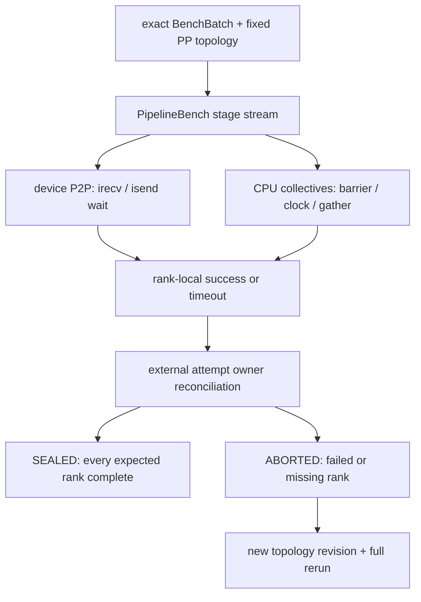
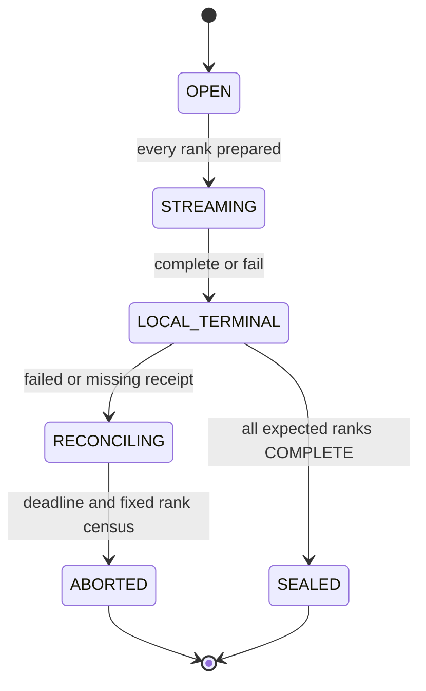

> 本文基于 vLLM `main` 的 [`b3bad87eb137c6d2fedda152ff2d3e3df3a32952`](https://github.com/vllm-project/vllm/commit/b3bad87eb137c6d2fedda152ff2d3e3df3a32952)。相对[第 96 章基线](https://github.com/vllm-project/vllm/commit/66e8914fc93c1b49f27fda3da33b6f1126d37a37)前进 [95 个提交](https://github.com/vllm-project/vllm/compare/66e8914fc93c1b49f27fda3da33b6f1126d37a37...b3bad87eb137c6d2fedda152ff2d3e3df3a32952)；本文直接研究的 `pipeline.py`、`main.py`、`test_forward_cli.py`、`ParallelConfig` 和 timeout 传播代码均未改变。下文把当前代码/测试事实与建议的 reconciliation 协议分开。

## 本篇在课程路线中的位置

这是第 97 章，仍位于“测试、性能与故障诊断”。第 95 章重建 PP microbatch critical path，第 96 章把 fixture、clock、rank、Golden 与 raw timeline 收进 `PairEvidence`。本章只回答紧邻的一问：**若某个 stage 在第 `k` 个 microbatch 退出，其余 rank 卡在不同 collective，谁宣布 attempt 失败，已经产生的 Event 能否保留，重启一个 rank 后能否续跑？**

结论是：timeout 只是“等待已超过某个 backend deadline”的局部事实，不是完整失败事务。PP 的每个 rank 持有不同模型层，丢掉一个 rank 就丢掉语义上不可替代的 stage；因此不能缩小 membership 后继续同一 case。原 attempt 必须以原 `topology_revision` 进入 `ABORTED`，缺失 rank 由外部 owner 合成 `MISSING` 回执；重启后建立新 process group、graph/address generation 和 attempt，完整重跑。

## 前置知识回顾

`PipelineBench._stream()` 对固定 exact batch 执行 `count + 2*margin` 次，其中 `count=iters*samples`、`margin=4*PP`。每轮是 `reset → recv → graph → send`；局部 CUDA Event 只包围 stage graph。成功后第二次 `PipelineClock` 完成校准，再用 CPU group `all_gather_object` 汇集 timeline；`main()` 还会再次 gather rank result，最后才由 rank 0 写 `output_json`。

第 96 章提出的 `PairEvidence` 要求 expected ranks、原始 ordinal、clock calibration、Golden 和 terminal state 同时闭合。今天研究失败路径，关键不是“怎样抢救一个 median”，而是“怎样证明这次测量没有完成，同时保存足够的诊断证据”。

## 本篇要回答的核心问题

1. rank 1 在流式 PP 中退出时，rank 0 会依次在哪些 P2P/collective 边界失去进展？
2. `--distributed-timeout-seconds` 与 `--cpu-distributed-timeout-seconds` 分别约束什么，为什么仍没有 per-case abort owner？
3. 为什么 restart/shrink 不能续写旧 timeline，最小 fail-closed reconciliation 应保存哪些状态？

## 组件在全局架构中的位置



本章仍在 benchmark/诊断层，不修改 serving 的 Scheduler、KV admission 或模型算子。上游是固定 PP partition 与 exact `BenchBatch`；下游是能否接受 latency、是否需要全量 rerun，以及保留什么故障证据。

## 完整调用链

公开入口与故障链为：

```text
torchrun → vllm bench forward → main
  → LLM.from_engine_args → ForwardPipelineExecutor
  → run_case → PipelineBench.run
  → _prepare_stage: eager recv / forward / send
  → _capture_stage: reset graph + stage graph + eager comparison
  → _stream
      → PipelineClock CPU send/recv + broadcast
      → world.cpu_group barrier
      → [reset → PP irecv.wait → graph → PP isend.wait] × N
      → accelerator synchronize
      → second PipelineClock
      → world.cpu_group all_gather_object(timeline)
  → main all_gather_object(rank result)
  → rank 0 json.dump(results)
```

故障可以发生在 eager/capture，也可以发生在测量循环。一个 rank 抛异常后，peer 不会立刻得到统一的 `CaseAborted`：它可能先卡在 device P2P `.wait()`，也可能到 CPU barrier、clock ping-pong 或两个 gather 才看到错误。当前控制流没有把这些局部异常归并成一个 case terminal record；任一异常都会跳过最终 `json.dump`。

## 关键类型、字段和状态生命周期

真实对象的生命周期决定了哪些证据还能相信：

- `BenchBatch` 与 `scheduler_output` 在 `run_case()` 创建并被各 rank 独立重建；case 正常或异常离开时，`finally` 仍尝试 `runner.execute_model(batch.finish())`。若 communicator 已坏，这个 cleanup 也可能失败，不能覆盖首个异常。
- `reset_graph`、`graph`、`snapshots` 与 `input_snapshots` 属于当前进程和当前 CUDA address generation。rank 重启后对象全部消失，即使 case 名和 shape 相同也不是旧 attempt 的延续。
- `starts/ends` 是 rank-local CUDA Event 列表。只有走过 `torch.accelerator.synchronize()` 并完成后置 `PipelineClock`，才会转换为共同时间轴上的 `starts_us/ends_us`；进程先死时，未提交 Event 不构成远端证据。
- `world.cpu_group` 和 `pp.device_group` 固定在初始化时的 membership。当前 benchmark 没有 `topology_revision`，也没有把 live-rank change 映射为新 attempt。
- `results` 仅存在于各 Python 进程内；`output_json` 是所有 case 成功后的整文件写入，不是逐 case WAL。旧文件若预先存在，也没有本次 run identity 可证明它属于新运行。

建议的最小记录不是“把异常字符串塞进 result”，而是每 rank 的不可变 `RankTerminal`：

| 字段 | 含义 |
| --- | --- |
| `AttemptKey` | fixture/config digest、attempt、variant/order |
| `TopologyKey` | world/DP/TP/PP ranks、process-group generation、graph generation |
| `Progress` | `PREPARED/CAPTURED/STREAMING/CLOCKED/GATHERED` 与最后 raw ordinal |
| `Terminal` | `COMPLETE/FAILED/TIMED_OUT/MISSING`；失败 rank、group、operation、exception class |
| `EvidenceRefs` | 已持久化的 Golden、calibration、raw timeline/partial events digest |

这里 `MISSING` 不能由失联 rank 自己写，只能由不依赖该 rank collective 的 attempt owner 在绝对 deadline 后合成。owner 也不能只设为 rank 0：rank 0 本身可能失败，且 rank 0 正在同一个坏掉的 collective 中。最稳妥的 owner 位于 torchrun/外部 harness 一侧，或使用各 rank 独立写入、外部进程原子聚合。

状态转换必须把“本地执行进度”和“全局可接受性”分开：



`LOCAL_TERMINAL` 不是 case 终态：rank 0 的 `COMPLETE` 只能证明它走完本地循环，不能证明 rank 1 的后置 clock/gather成功。`RECONCILING` 期间也禁止发布 latency；它只允许补收同一 attempt、同一 topology revision 的回执。到 deadline 后，owner冻结 rank census，把没有可验证回执的成员写成 `MISSING`，然后发布唯一 `ABORTED`。这样 reader只面对 `SEALED/ABORTED` 两类不可变结果，不必根据目录中有几个 rank 文件猜测状态。

接口前置条件同样需要明确：每个 `RankTerminal` 必须能在不进入 world/PP collective 的情况下提交；同一 `(AttemptKey, rank)` 的相同 digest是幂等 duplicate，不同 digest是冲突，不能按 mtime择新；`AttemptFinal` 必须引用所有 terminal digest或显式 synthesized-missing记录。后置条件是 `SEALED` 可从引用的 raw evidence重算 latency，而 `ABORTED` 的统计字段必须缺省，不能以0、NaN或已有前缀样本代替。

## 逐函数源码解读

[`PipelineClock.__init__()`](https://github.com/vllm-project/vllm/blob/b3bad87eb137c6d2fedda152ff2d3e3df3a32952/vllm/benchmarks/forward/pipeline.py) 先在 CPU group 做 rank 0 与每个 peer 的 20 次 send/recv，再 `broadcast_object_list` offset。任何 peer 缺席，校准就无法产生完整共同时间轴。即使前半段测量 Event 已完成，缺少后置 clock anchor 也不能把本地 Event 安全映射到 rank-0 时间。

`PipelineBench._stream()` 先 `dist.barrier(group=world.cpu_group)`，然后对上游 `irecv(...).wait()`、下游 `isend(...).wait()`。这两个 wait 使用 device process group；循环结束又进入 CPU collectives。也就是说一份 case 至少跨两个 failure domain：device backend负责 stage payload，Gloo/CPU group负责启动、校准和 evidence gather。一个 deadline 不能描述所有等待。

[`ParallelConfig`](https://github.com/vllm-project/vllm/blob/b3bad87eb137c6d2fedda152ff2d3e3df3a32952/vllm/config/parallel.py) 的 `distributed_timeout_seconds` 默认 `None`，文档说明此时使用 PyTorch backend 默认值；`cpu_distributed_timeout_seconds` 也默认 `None`。[`GroupCoordinator`](https://github.com/vllm-project/vllm/blob/b3bad87eb137c6d2fedda152ff2d3e3df3a32952/vllm/distributed/parallel_state.py) 将前者传给 device `new_group/split_group`，后者传给 Gloo group，并缓存 `cpu_timeout`。历史提交 [#45159](https://github.com/vllm-project/vllm/pull/45159) 修正 device group 的 timeout 传播，[#42968](https://github.com/vllm-project/vllm/pull/42968) 增加 CPU group timeout，[#63016](https://github.com/vllm-project/vllm/pull/63016) 则让自定义 `cpu_all_reduce_` 使用配置值。

这些配置解决“等待是否有上界”，却没有解决三件事：不同 rank 在不同 operation 超时；backend error 不等于所有 CUDA work 已停止；没有组件把 expected-rank set、partial evidence 与首次失败合成同一 terminal verdict。具体 timeout 何时表现为异常还依赖 PyTorch/NCCL/Gloo 与进程启动器，本文不把 backend 默认值当成精确的 case SLA。

[`main()`](https://github.com/vllm-project/vllm/blob/b3bad87eb137c6d2fedda152ff2d3e3df3a32952/vllm/benchmarks/forward/main.py) 在每个 case 成功后先做 world `all_gather_object(result)`，但只把结果 append 到内存；循环全部结束才写 JSON。这里不存在“已完成 case 的 durable commit”，更不存在失败 case。故障诊断若只看文件是否存在，会把“尚未开始、运行中、某 rank 超时、清理失败、旧文件残留”混在一起。

## 具体示例与 shape/状态演算

沿直接测试：PP=2，`prefill=8*128`，每个 microbatch 为 8 个请求、1024 scheduled tokens；`iters=4,samples=2`，所以 `count=8`、`margin=8`、每个 stage 计划执行 24 个 raw ordinal，稳态为 8～15。

设 rank 1 在已接收 ordinal 10、进入 stage graph 后发生设备异常：

1. rank 0 对 ordinal 10 的 `isend.wait()` 可能已经完成，因为 payload 已被接收；它随后进入 ordinal 11。
2. rank 1 不再为 ordinal 11 post `irecv`。rank 0 的 `isend.wait()` 无法推进，最终由 device group timeout/launcher termination打断。
3. rank 0 已有 ordinal 0～10 的 start/end Event；rank 1 可能只有 0～9 的完整 Event，ordinal 10 的 completion 未知。
4. 两者都未完成后置 `PipelineClock` 与 timeline gather；因此不存在共同时间轴，也不存在可接受的“前 10 个样本 median”。
5. attempt owner 应得到：rank 1=`FAILED(last_ordinal=10, phase=GRAPH)`，rank 0=`TIMED_OUT(last_ordinal=10, op=ISEND, peer=1)`；expected ranks `{0,1}` 齐全但均非 `COMPLETE`，case verdict=`ABORTED`。

若 rank 1 被重新拉起，它重新加载 stage 1、创建 process groups、CUDA graphs 和 anchors。即使仍叫 global rank 1，`topology_revision` 与 graph generation 已变；把新 rank 1 的 ordinal 11 接到旧 rank 0 的 0～10 后面，会跨越地址、clock、热态和进程代数，必须拒绝。正确动作是 attempt+1，从 ordinal 0 完整重跑 24 次。

## 为什么这样设计及替代方案

方案一是依赖 torchrun：任一进程失败就让整条命令失败。它对 CI “不误报成功”已经有价值，维护成本最低；但只有 stderr/exit code，没有 case/rank/ordinal、partial Golden 或可机器读取的终态，且最终 JSON 可能缺失。

方案二是发生故障后缩小 PP world size继续。对普通数据并行，某些系统可在容量允许时重组 replica；但 PP rank持有独占层，PP=2缩到1意味着存活 rank没有完整模型权重、KV/state和 stage graph。除非重新加载完整模型并建立新 fixture，这不是恢复旧 case，而是另一拓扑的新实验。

方案三是 rank-local terminal append + 外部 reconciliation。它增加小型 sideband record 和原子 publish，却保留现有 device fast path：循环中只更新内存 progress，失败/成功时各 rank独立写 terminal；外部 owner按 expected-rank set等待到绝对 deadline，合成 `SEALED` 或 `ABORTED`。这是最小充分设计，因为它同时满足固定拓扑语义、rank 0 也可能失败、partial evidence可审计三条硬约束。

还存在一种看似简单的变体：让 rank 0 在捕获任何异常后广播 abort。它只能处理 rank 0仍存活且CPU group可用的情况；若失败点就是 rank 0、Gloo group已坏，或其它 rank卡在device wait，abort广播本身会成为下一次 collective hang。因而 rank 0可以做成功路径聚合者，却不能是唯一的故障仲裁者。外部 owner不是为了引入新的分布式控制面，而是为了把“观察所有进程退出/回执”的职责放到唯一不依赖被观察 collective的位置。

## 性能、并发、正确性与边界条件

fast path 不应为每个 ordinal `fsync`，否则 Host I/O会扰动 steady-state timing。可只在内存记录最后 ordinal，正常结束一次性写完整 timeline；异常时由 surviving rank写最后确认 progress，missing rank由 owner合成。若要求崩溃前逐步 durable，则需要单独测量 sideband 开销并与 benchmark SLA比较，不能默认“更多日志总是更好”。

deadline也不能照搬backend默认值。case级预算至少要覆盖 `capture + warmup + 24次stream + post-clock + gather + terminal flush`，并把 containment/reap预留在总命令预算内；device与CPU group timeout可以更短地暴露局部失联，但二者都不能晚于外部 owner的最终裁决。合理的数值应由健康运行的分阶段分布、跨节点尾延迟和CI总预算校准。本文不制造通用秒数，只固定关系：局部operation deadline < attempt reconciliation deadline < launcher hard deadline，并保证最后一段仍足够持久化 `ABORTED` 与回收子进程。

正确性上，timeout 只能证明观察者没有按时取得完成，不能证明 peer 的 device work已停止。旧 attempt 的 graph/state应视为 completion unknown，进程组 teardown或进程退出只用于 containment；任何新 attempt必须使用新 generation，不能复用旧 partial output。

并发上，多个 rank可能几乎同时报告不同首因：一个看到 CUDA error，另一个看到 NCCL timeout，第三个看到 Gloo connection closed。reconciler应保存全部 rank-local terminal，并以稳定规则标记 `primary_failure`，但不覆盖其它症状。`topology_revision` 必须冻结 expected ranks；旧 revision 的迟到 record只能补全历史，不得把新 attempt 从 `ABORTED` 复活。

## 测试证据与未覆盖风险

直接成功测试 [`test_bench_forward_pipeline`](https://github.com/vllm-project/vllm/blob/b3bad87eb137c6d2fedda152ff2d3e3df3a32952/tests/benchmarks/test_forward_cli.py) 用 2 GPU、PP=2、`iters=4,samples=2`，断言两个 rank、8 个稳态样本、finite、pipeline/eager RMS=0，并从 raw first/last timeline重算 median。`subprocess.run(..., timeout=600)` 只给整个测试命令一个外部上限；若超时会抛 `TimeoutExpired`，不是一个可发布的 case abort record。

独立的 [`test_cpu_all_reduce_timeout`](https://github.com/vllm-project/vllm/blob/b3bad87eb137c6d2fedda152ff2d3e3df3a32952/tests/distributed/test_cpu_all_reduce.py) 让 rank 1 睡眠、rank 0 用 1 秒 p2p timeout，验证 3 秒内抛 `RuntimeError`。它证明 timeout 参数能约束该 CPU helper，但没有覆盖 PP device P2P、PipelineClock、两次 gather、partial Event 或 JSON durability。

当前缺口包括：在 ordinal `k` 注入 stage异常；分别卡住 device P2P、CPU barrier、clock ping-pong和 result gather；首因与派生 timeout并发；rank 0 失败；cleanup二次异常；已有 output文件的 stale-run 防护；新 process group迟到回执；PP>2与TP/DP组合expected-rank集合。最小 Golden应验证：缺任一 expected rank或任一非 COMPLETE terminal都不能 seal；旧 topology revision 的 late record不改变新 attempt；所有失败路径最终都有 `ABORTED`，且 raw latency统计为空而非零。

故障注入还应区分“进程仍活着但不再前进”和“进程已退出”。前者可在 graph前挂起、跳过某次 `irecv` 或阻塞 clock ping-pong，验证两类配置 timeout分别在预期 group生效；后者可在指定 ordinal直接结束 rank，验证 launcher退出码与外部 synthesized `MISSING`。每个 case都要断言首个业务异常仍保留，后续 timeout/cleanup错误作为关联症状追加，而不是最后一个异常覆盖根因。测试结束还应检查所有子进程已回收、输出文件带本次 run/attempt identity、旧文件未被误认成成功。

## 与前后章节的连接

向前，本章给第 96 章的 `PairEvidence` 增加了失败收敛条件：evidence owner不能依赖同一个可能损坏的 collective，timeout不是释放或完成证明，rank restart必须切换 revision。向后，终态 record仍需持久化协议；若 owner在写入中崩溃，还要解决 append、atomic checkpoint、重复 terminal与 replay。

## 本篇结论、知识债、三个理解检查问题和下一章

当前 main 的 PP benchmark在无故障路径上有真实 P2P、共同时间轴与可重算 timeline；在 partial-rank failure下，它依赖 process-group timeout和torchrun退出，不能形成 per-case terminal evidence。PP membership不能原地缩小，旧 partial timeline也不能跨重启续写。可信方案是固定 expected topology、rank-local immutable terminal、外部绝对 deadline与 fail-closed reconciliation；新 rank意味着新 attempt和完整重跑。

知识债：`RankTerminal/AttemptFinal` wire schema；独立 sideband与原子 per-case commit；首因选择与 cleanup error chain；process-group/graph generation；device completion containment；stale output fencing；PP>2+TP/DP故障矩阵；fault injection与跨节点真实 timeout校准。

理解检查：

1. 为什么 rank 0 已有若干完整 CUDA Event，仍不能在 rank 1 退出后计算“前缀 median”？
2. device timeout与CPU timeout分别约束哪些等待，为什么它们都不能独自成为 case terminal owner？
3. 为什么重启后的“同一个 global rank 1”必须属于新 `topology_revision`，不能从旧 ordinal继续？

下一章：**PP AttemptFinal 的持久化——Rank-local Terminal、Atomic Case Commit 与 Crash Replay。**

## 课程账本增量

- 课程：97；阶段：测试、性能与故障诊断。
- 基线：`b3bad87eb137c6d2fedda152ff2d3e3df3a32952`。
- 新覆盖：`PipelineBench._stream` 的 device/CPU failure domains；`ParallelConfig` 两类 timeout；`GroupCoordinator` timeout传播；`main` 的整文件提交边界；PP success与CPU timeout测试。
- 新不变量：PP缺一 stage不能缩容续跑；timeout不等于device completion；旧 partial timeline不能跨process-group/graph generation拼接；只有expected ranks全部 COMPLETE才允许 seal。
- 仍欠缺：已合入 terminal schema、sideband、原子 case commit、故障注入、stale output fence、跨节点校准与多轴 topology Golden。
