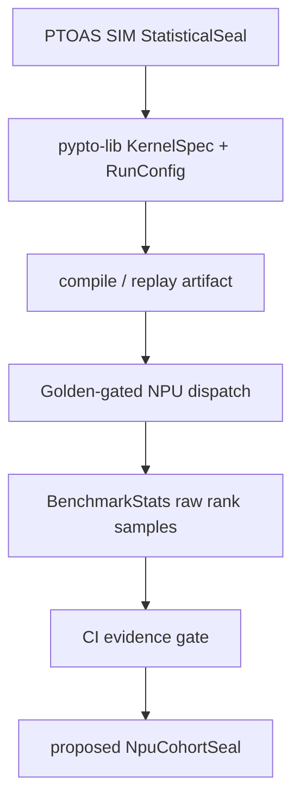
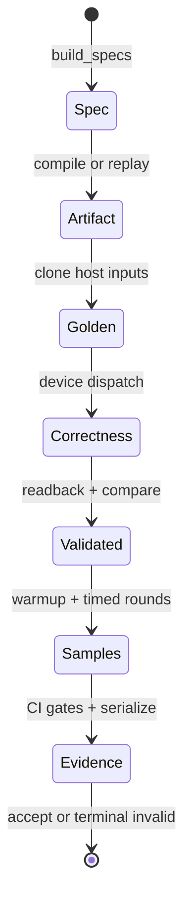

> 本文基于 `pypto-lib` commit [`1e801c98`](https://github.com/hw-native-sys/pypto-lib/commit/1e801c98d37b11e11ce21a03f99ffc2abc374d16) 与 `PTOAS` commit [`7cd970b7`](https://github.com/hw-native-sys/PTOAS/commit/7cd970b79963e051f35f6180b76f0350ffa64695)。所述“当前实现”均指这两个已合入版本；`NpuCohortSeal` 是本文根据现有证据边界提出的协议，不是仓库已有类型。

## 本篇在 PTO 课程路线中的位置

这是课程第 108 篇，仍处于“ISA 如何被上层生成和落地”的性能证据支线。第 107 篇已经把一次 SIM trace 提升为 `Repetition StatisticalSeal`：完整 repetition 才是统计单位，baseline/candidate 必须配对，run order 要分 block 平衡，invalid evidence 不能混入估计量。

今天只回答一个问题：**一个已封存的 SIM 统计结论，满足什么条件后，才能提升为真实 NPU kernel 的性能结论？**

主仓库是 `pypto-lib`，因为它同时拥有真实模型 kernel、Torch Golden、设备执行与 benchmark CI；`PTOAS` 只提供上一章的 SIM seal，二者是“语义候选 → 设备证据”的紧密上下游，不扩展到 serving。

## 前置知识

前篇确立了三条不变量：

1. `valid extreme` 仍是样本；证据缺失、schema 错误或计时域不可解释才是 `invalid`。
2. baseline 与 candidate 的 effect 必须在同一 repetition、同一位置 block 内计算，不能分别取两堆中位数再相减。
3. 停止规则在采样前声明；看见“好结果”才停会破坏估计量。

这些规则在 NPU 上仍成立，但不够：设备频率、温度、固件、runtime、profiling 状态和 artifact 身份都会让“同一组微秒”失去可比性。

## 今日核心问题

本篇把“提升”拆成两个彼此独立的判定：

- **semantic parity**：SIM 与 NPU 执行的是同一 kernel contract，输入、输出、shape、dtype、比较器和编译 artifact 可追溯；两端各自通过 Golden。
- **performance comparability**：baseline/candidate 位于同一健康 cohort，使用同一计时定义、round/warmup、rank 聚合规则和配对次序。

注意：parity 不是把 SIM tick 换算成 NPU µs。二者的时钟、调度器与成本模型不同；SIM 负责暴露依赖和结构变化，NPU 才能回答设备时间。可提升的是**语义身份与实验协议**，不是数值本身。

## PTO 全栈中的位置



上游是已经通过 SIM repetition 审计的候选变更；下游不是“一个更小的数字”，而是一份能回答“跑了什么、在哪跑、是否正确、计时域是什么、为何可比较”的证据包。

## 概念和精确语义

### 1. 当前 `golden.run` 已封住什么

[`golden/runner.py`](https://github.com/hw-native-sys/pypto-lib/blob/1e801c98d37b11e11ce21a03f99ffc2abc374d16/golden/runner.py) 的 `_run_pipeline` 将一次运行约束为：规范化 `RunConfig`、编译或 replay、验证 ABI、生成输入、计算 host Golden、做一次 correctness dispatch、读回并校验，最后才在 `PYPTO_BENCH=1` 时进入 benchmark。

`RunResult` 持有 `passed`、`error`、`execution_time`、`work_dir` 与可选 `bench`。这里的所有权边界很清楚：

- `TensorSpec` 定义 shape、dtype、初始化器、输入/输出方向和 resident placement；
- runner 拥有 host 输入与 Golden 副本；
- runtime 拥有设备 buffer 和编译 program；
- validation 把设备输出搬回 CPU，与 Golden 比较；
- benchmark 只在 correctness 已通过后产生 `BenchmarkStats`。

因此，“计时快但算错”在 runner 层不会成为可发布 benchmark。

### 2. `effective_us` 的计时契约

benchmark 的默认参数是 5 次 warmup、100 个 timed rounds；它保留每个 rank、每次 dispatch 的 raw sample。`effective_us` 来自已安装 runtime 的 post-graph-build 执行窗口，即 orchestration 与 scheduler span 的并集，不含 warmup。它既不是 Python CLI wall time，也不能自动等同于单条 Cube 指令时间。

在 simulator 或未启用 device profiling 的构建中，device span 可能全为零；runner 会把它报告为 unavailable，而 [`ci_perf.py`](https://github.com/hw-native-sys/pypto-lib/blob/1e801c98d37b11e11ce21a03f99ffc2abc374d16/.github/scripts/ci_perf.py) 更进一步 fail closed：正确性失败、round/warmup 不符、flattened fallback、dispatch slot 不稳定、全零 device span、round/rank 数量不完整，任一出现都拒绝生成有效 CI 指标。

### 3. 本文提出的 `NpuCohortSeal`

现有结果缺少一个跨阶段、不可变的封套。最小 seal 应包含：

```text
NpuCohortSeal = {
  source_commit, artifact_digest, KernelSpec_digest, RunConfig,
  toolchain/runtime/firmware/device/topology,
  clock_state, temperature, ECC/reset/health_before_after,
  input_digest, golden_digest, comparator,
  timing_schema, rounds, warmup, raw_rank_samples,
  rank_aggregation_policy, parent_statistical_seal_digest,
  terminal_reason
}
```

其中 frequency/temperature/ECC 等字段是**协议要求**；公开代码没有展示这些采集 API，因此不能声称当前 CI 已经实现。硬件上它们会影响频率保持与执行稳定性，这是基于设备测量常识的推断，具体阈值必须由目标机型规范或受控实验确定。

## 真实文件、类型、API 或指令逐段解读

### `TensorSpec` 与 validation：先固定语义

[`golden/spec.py`](https://github.com/hw-native-sys/pypto-lib/blob/1e801c98d37b11e11ce21a03f99ffc2abc374d16/golden/spec.py) 中，`TensorSpec` 把 tensor 的逻辑身份和 storage 行为放在一起。纯 output 不上传；resident `InOut` state 只上传一次，并在验证边界读回。这防止 benchmark 循环把 host/device copy 误算进执行域。

[`golden/validation.py`](https://github.com/hw-native-sys/pypto-lib/blob/1e801c98d37b11e11ce21a03f99ffc2abc374d16/golden/validation.py) 默认使用 `torch.allclose`，也允许按 output 注入 comparator。`ratio_allclose` 同时限定 `atol/rtol` 与错误点比例，NaN/Inf 直接失败，还能声明 valid region 与 zero tail。这意味着 parity 的单位不是“程序没崩”，而是每个 output 的显式数值契约。

### `out_proj.py`：真实 kernel contract

本文选用 [`models/qwen3_8_27b/out_proj.py`](https://github.com/hw-native-sys/pypto-lib/blob/1e801c98d37b11e11ce21a03f99ffc2abc374d16/models/qwen3_8_27b/out_proj.py) 的 Qwen3.8-27B A8W8 output projection。默认输入是：

| tensor | shape | dtype | location/role |
| --- | --- | --- | --- |
| `a_q` | `[512, 6144]` | `int8` | GM，量化 activation |
| `a_scale` | `[1, 512]` | `float32` | GM，per-token scale |
| `w_q` | `[5120, 6144]` | `int8` | GM，量化 weight |
| `w_scale` | `[5120]` | `float32` | GM，per-channel scale |
| `y` | `[512, 5120]` | `bfloat16` | GM output |

数学语义是 `y = BF16((a_q @ w_q.T) * a_scale.T * w_scale)`。host Golden 用 FP32 matmul 与 scale，再 cast 为 BF16；输出 comparator 为 `ratio_allclose(atol=3e-3, rtol=3e-3, max_error_ratio=0.02)`。

[`a8w8_linear.py`](https://github.com/hw-native-sys/pypto-lib/blob/1e801c98d37b11e11ce21a03f99ffc2abc374d16/models/qwen3_8_27b/a8w8_linear.py) 选择 `M=128,N=128,K=512`，`M_GROUP=8,N_GROUP=2`。实际 `m_group=gcd(4,8)=4`，所以 M 方向只有 1 个 group；N 方向有 `5120/128/2=20` 个 group，共 20 个 SPMD block。每个 block 的 K 循环有 12 个 chunk，采用两级 pipeline 和两个 int32 accumulator，末尾乘 FP32 scale 并转 BF16。

非法组合包括 M/N/K 不能满足 tile divisibility、`n_group` 非偶数，以及实际 TensorSpec 与 artifact ABI 不一致；runner 会在 dispatch 前校验 ABI，而不是等待设备端越界。

## 对象、Tile、Buffer 与 evidence 生命周期



`a_q/w_q` 从 host initializer 创建，在 correctness 与 benchmark 中由同一 compiled program 消费；`y` 在 dedicated correctness dispatch 后被读回并校验。随后 benchmark 可以重复覆盖 `y`，但不再改变“该 artifact 已通过 Golden”的事实。raw samples 从 runtime 进入 `BenchmarkStats`，再由 `ci_perf.make_capture` 序列化；seal 最终接受或以具体 `terminal_reason` 结束，不能把 invalid run 悄悄删除后继续凑样本。

## 端到端调用链或指令链

真实入口链为：

```text
out_proj.main
  -> golden.run(KernelSpec, RunConfig)
  -> _run_pipeline
  -> compiler.compile / replay artifact
  -> generate inputs + golden_fn
  -> runtime dispatch
  -> validate_golden
  -> runtime benchmark
  -> BenchmarkStats
  -> ci_perf.make_capture
  -> effective_us evidence gate
```

关键点不是函数数量，而是两个单向门：validation 失败不会进入 benchmark；benchmark schema 不完整不会进入有效 CI metric。

## 具体 shape、Tile 和状态演算

### Kernel 级资源演算

这次 projection 有 `512×6144×5120 ≈ 16.1B` MAC，按 2 ops/MAC 约 32.2 GOP。对每个 patch block，int8 逻辑 operand 读取量约为：

```text
(m_group*M_tile + n_group*N_tile) * K_total
= (4*128 + 2*128) * 6144
= 4,718,592 bytes
```

20 个 block 合计约 94.4 MB；若每个 `128×128` output tile 独立读取 A/B，则 160 个 tile 约需 251.7 MB。patch grouping 在不计 cache 的逻辑模型下减少约 `2.67×` operand 读取，代价是更大的 block 工作集与更长的单 block 生命周期。这是由源码 tile 结构推导出的逻辑流量，不是 HBM 实测。

### Cohort 级配对演算

下面只演示协议，数字**不是仓库实测**。设 baseline A 与 candidate B 都通过同一 input digest 和 comparator，5 warmup 后取 5 个 paired rounds：

| round | A `effective_us` | B `effective_us` | `B-A` |
| ---: | ---: | ---: | ---: |
| 1 | 410 | 393 | -17 |
| 2 | 408 | 391 | -17 |
| 3 | 412 | 395 | -17 |
| 4 | 409 | 390 | -19 |
| 5 | 411 | 392 | -19 |

paired delta 的中位数为 `-17 µs`，相对 A 中位数 410 µs 为 `-4.15%`。只有当 A/B 的 artifact、runtime、频率状态、温度区间、health before/after 和 timing schema 同属一个 cohort 时，这个 effect 才可解释。若 B 运行前发生 device reset，或者频率 governor 改变，即使 Golden 仍通过，也只能得到“语义正确、性能 cohort invalid”。

## 为什么这样设计及替代方案

**方案 A：直接比较 SIM ticks 与 NPU µs。** 最省事，但单位和成本模型不同；一个 SIM pass 可能改善结构性空洞，却被设备 DVFS、runtime queue 或 cache 行为淹没。它适合筛选候选，不适合宣称真实提速。

**方案 B：先 benchmark 多轮，再用最后一轮 output 做一次 validation。** 吞吐高，但 benchmark 可能覆盖 output 或改变 resident state，最后一轮无法证明每个 measured dispatch 都遵守 contract。当前 runner 选择 dedicated correctness dispatch，再进入 benchmark，维护成本略高，却把“正确性门”放在计时之前。

**方案 C：使用 CLI wall time。** 它能回答端到端体验，但混入编译、队列、上传与日志；当前 `effective_us` 更适合 execution-only 调优。两种指标都可保留，前提是 seal 中写清 metric contract，不能混成同一序列。

## 访存、计算、流水、并行和硬件约束

`a8w8_linear` 的收益来自三层复用：一个 M patch 复用 4 个 128-row activation tile，一个 N patch 复用 2 个 128-column weight tile，K loop 用双 accumulator 将 matmul 与后续 chunk 准备流水化。瓶颈可能在 GM→片上搬运、int8 Cube 吞吐、FP32 scale/bf16 conversion，或 20 个 block 对实际 AIC 数量的占用；公开代码不能单独证明哪一项在特定芯片上主导。

CI 的 multi-card 聚合当前取“每 rank 中位数的最小值”。这适合描述最快 rank 或调优上界，但不是服务 critical path；后者通常更接近最大 rank 或显式 barrier 完成时间。它不是实现错误，而是结论范围：seal 必须带上聚合策略，禁止把 `min(rank median)` 写成端到端多卡延迟。

## 测试证据与未覆盖风险

[`tests/golden/test_runner.py`](https://github.com/hw-native-sys/pypto-lib/blob/1e801c98d37b11e11ce21a03f99ffc2abc374d16/tests/golden/test_runner.py) 提供了直接证据：

- `test_nonresident_validation_precedes_benchmark_mutation` 让 benchmark 把 `y` 改成 1，而 correctness output 为 0；测试仍通过，证明 validation 先于 benchmark mutation。
- `test_benchmark_propagates_device_runtime_error` 验证真实 device dispatch 错误不能被吞掉。
- `test_l3_benchmark_tolerates_only_missing_strace` 只允许“缺少 STRACE”降级为 unavailable，其他异常仍失败。
- `test_raw_samples_lists_every_dispatch_per_rank` 验证 raw rank samples 的完整列表和稳定排序。

测试事实之外仍有四个缺口：没有测试把 clock/temperature/ECC/reset 前后快照绑定到 capture；没有 artifact/source/input digest 的强一致校验；没有 SIM seal 与 NPU capture 的 parent digest；也没有证明 `min(rank median)` 可代表 multi-card critical path。

还有一处文档漂移：[`compile-runtime-workflow.md`](https://github.com/hw-native-sys/pypto-lib/blob/1e801c98d37b11e11ce21a03f99ffc2abc374d16/docs/run-and-validate/compile-runtime-workflow.md) 把 benchmark 描述为 validation 前的步骤，但当前代码和上述测试都证明 validation 在前。本文以已合入代码与直接测试为准，并把文档一致性记为知识债。

近期合入记录也展示了“测量契约必须写清”的必要性：Qwen3.8-27B block 在 [`63a3d479`](https://github.com/hw-native-sys/pypto-lib/commit/63a3d4793c15dc372b4df2cdc77f3217e32ab703) 引入了真实 Golden 与手工 benchmark；[`18299026`](https://github.com/hw-native-sys/pypto-lib/commit/182990263ee87ef29c835ead20a716e3f4aa3d19) 明确记录 5 warmup、100 rounds 与重复 baseline；[`b29bf5b6`](https://github.com/hw-native-sys/pypto-lib/commit/b29bf5b65c638ae96fe2d704dab638c368a4bc97) 则恢复了 A5 PyPTO pin。它们是合入事实，不自动等价于本文提出的完整 health cohort。

## 与前后章节的连接

向前，本篇继承课程 107 的 paired repetition、run-order block 与 terminal invalid，把 SIM seal 作为 NPU evidence 的 parent，而不是丢弃前史重新跑一堆数字。

向后，课程 109 将专门处理 cohort 内的 baseline/candidate 轮换：怎样用 AB/BA block 抵消温频漂移，怎样记录 health transition，以及 multi-card 应选择 fastest-rank、slowest-rank 还是 barrier critical path。那时才把今天的 seal 从“字段完整”推进到“配对调度完整”。

## 本篇结论、知识债、理解检查与下一章

结论只有一句：**真实 NPU 结论 = Golden 语义门 × 可重放 artifact 身份 × 完整计时样本 × 同质 health cohort × 预声明配对统计；任一为零，SIM 候选都不能被提升为设备性能事实。**

知识债：

1. `NpuCohortSeal` 尚未在仓库实现，尤其缺少 device health/clock/firmware capture。
2. 文档中的 validation/benchmark 顺序与当前实现不一致。
3. multi-card `min(rank median)` 的适用结论边界还未由端到端测试封住。

三个理解检查问题：

1. 为什么 SIM tick 与 NPU `effective_us` 不能直接求 speedup，但 SIM seal 仍然有价值？
2. 为什么 dedicated correctness dispatch 必须发生在 benchmark 之前？
3. 一个 candidate Golden 通过、raw samples 完整，但运行中发生 device reset，应归类为“性能退化”还是“cohort invalid”？为什么？

下一章：**NPU Cohort Pairing——Baseline/Candidate 轮换、Clock/Temperature Drift 与 Multi-card Aggregation。**

## 课程账本增量

- 课程：108
- 主仓库：`hw-native-sys/pypto-lib@1e801c98d37b11e11ce21a03f99ffc2abc374d16`
- 关联仓库：`hw-native-sys/PTOAS@7cd970b79963e051f35f6180b76f0350ffa64695`
- 新覆盖：`golden.run/_run_pipeline`、`TensorSpec`、`validate_golden/ratio_allclose`、`BenchmarkStats`、`ci_perf.make_capture/effective_us`、Qwen3.8-27B `out_proj/a8w8_linear`
- 新确认不变量：validation 先于 benchmark；无 Golden pass 不产生有效性能证据；NPU effective span 与 SIM tick 不同量纲；聚合策略是结论的一部分
- 待验证推断：目标 A5 环境中可稳定采集哪些 clock/temperature/ECC/reset/firmware 字段，以及各字段的合法 cohort 阈值
- 下一章：NPU cohort 的配对轮换、漂移检测与多卡 critical-path seal
