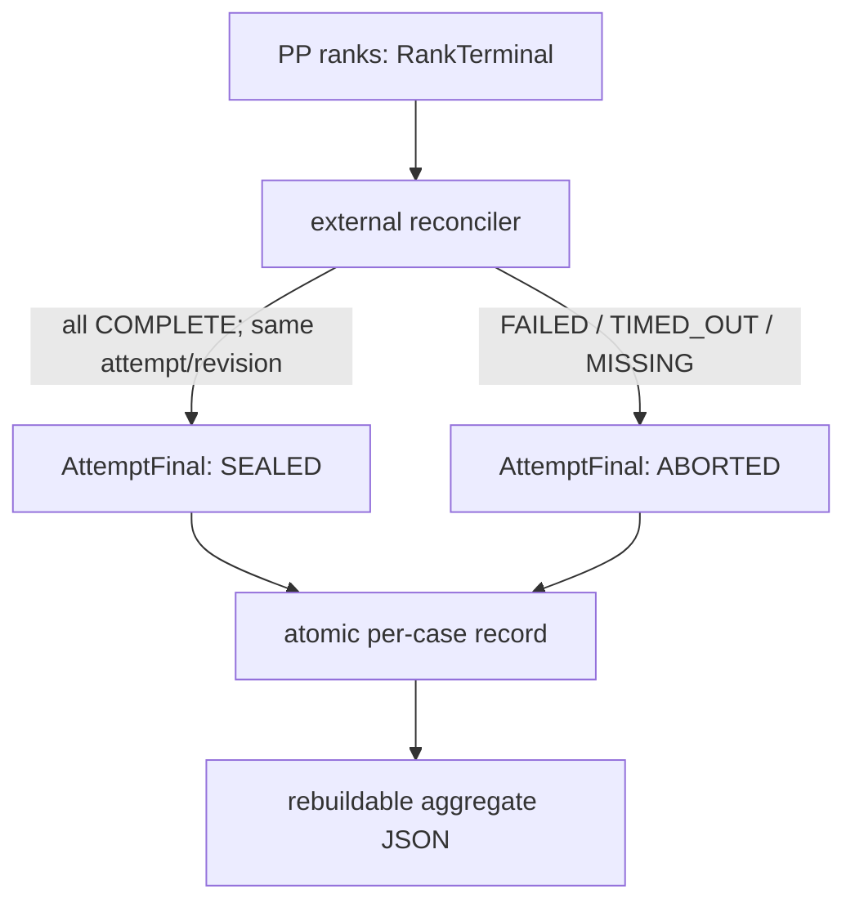
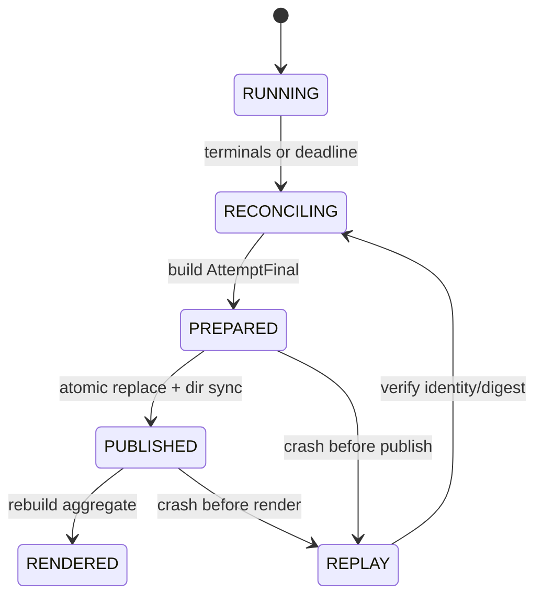

> 本文基于 vLLM `main` 的 [`ed686ccec527b48de4c8a67927184933886f062a`](https://github.com/vllm-project/vllm/commit/ed686ccec527b48de4c8a67927184933886f062a)。相对[第 97 章基线](https://github.com/vllm-project/vllm/commit/b3bad87eb137c6d2fedda152ff2d3e3df3a32952)前进 [82 个提交](https://github.com/vllm-project/vllm/compare/b3bad87eb137c6d2fedda152ff2d3e3df3a32952...ed686ccec527b48de4c8a67927184933886f062a)；本文直接研究的 `main.py`、`pipeline.py` 与 `test_forward_cli.py` 没有语义变化。最新提交是 HiSparse/NIXL host KV 修复，与本题无关。下文把**当前代码事实**、**测试事实**和**建议协议**严格分开。

## 本篇在课程路线中的位置

这是第 98 章，仍位于“测试、性能与故障诊断”。第 96 章定义 `PairEvidence`，第 97 章确认 partial-rank failure 必须封存旧 attempt、重建完整 PP topology 后全量重跑。本章只解决下一道边界清晰的问题：**各 rank 已经有了终态证据之后，何时才能说一个 case 的最终状态已持久化？进程在任意写入点崩溃，重启后如何得到唯一结论？**

答案不是“rank 0 已经 append 到 Python list”，也不是“`json.dump` 返回”。可恢复协议需要把 rank-local terminal 收敛为不可变 `AttemptFinal`，再用原子 per-case commit 发布；聚合 JSON 只是能从这些源记录重建的视图。

## 前置知识回顾

PP=2 时两个 rank 各持有不可替代的模型 stage。`PipelineBench._stream()` 的本地 Event、P2P、CPU clock/barrier/gather 共同组成证据链；任一 expected rank 未完成，同一 attempt 就不能产生 latency。timeout 只表示观察者超过等待期限，并不证明 peer device work 已停止。

因此第 97 章留下两个约束：旧 attempt 必须保留首因和 partial evidence，但统计字段为空；同 global rank 重启后也必须使用新的 `attempt_id`、`topology_revision` 与 graph/address generation，从 ordinal 0 重跑。

## 本篇要回答的核心问题

1. 当前 `run_case → main → json.dump` 的可见性与崩溃窗口在哪里？
2. `RankTerminal`、`AttemptFinal` 和磁盘记录各自应由谁拥有，什么条件下才能进入 `SEALED`？
3. temp write、`fsync`、rename 与聚合 JSON 之间崩溃时，怎样幂等 replay，怎样识别冲突而不是覆盖？

## 组件在全局架构中的位置



上游是上一章定义的 rank-local terminal；下游不是 Scheduler 或 ModelRunner，而是 benchmark harness 的结果接受、重试与诊断。reconciler 必须位于故障 collective 之外，否则缺 rank 时它自己也无法完成。持久化也必须在 Event timing、clock calibration 和 result gather 之后，不能把文件系统延迟计入 `median_us`。

## 完整调用链

当前公开入口沿 [`vllm bench forward`](https://github.com/vllm-project/vllm/blob/ed686ccec527b48de4c8a67927184933886f062a/vllm/benchmarks/forward/main.py) 进入：

```text
torchrun → main(args)
  → LLM.from_engine_args
  → for case in cases
      → run_case
          → build_batch / PipelineBench(...)
          → bench.run()
          → finally: runner.execute_model(batch.finish()); fixture.remove()
      → world.cpu_group all_gather_object(rank result)
      → rank 0: results.append(case row)
  → rank 0: open(output_json, "w"); json.dump(results)
```

[`PipelineBench.run()`](https://github.com/vllm-project/vllm/blob/ed686ccec527b48de4c8a67927184933886f062a/vllm/benchmarks/forward/pipeline.py) 只在第一次 eager prepare 的 `finally` 中恢复 monkey patch 与 `execute_model_state`，随后 capture、stream、profile；它没有持久化 terminal。`main()` 的 `results` 也是纯内存对象，只有所有 case 和 gather 都成功后才整文件写出。故障路径既没有 case record，也没有 commit point。

## 关键类型、字段和状态生命周期

以下是基于现有缺口推导的**建议协议**，不是已合入类型：

| 对象 | 关键字段 | owner 与生命周期 | 前置/后置条件 |
| --- | --- | --- | --- |
| `RankTerminal` | `case_id, attempt_id, topology_revision, rank, status, first_cause, cleanup_errors, last_ordinal, evidence_digest` | 每个 rank 或独立 sideband 产生一次；创建后不可变 | status 为 `COMPLETE/FAILED/TIMED_OUT/MISSING`；cleanup 只能追加为派生错误，不能替换首因 |
| `AttemptFinal` | identity、expected ranks、terminal digests、`SEALED/ABORTED`、result/evidence refs | external reconciler 收齐 terminal 或 deadline 到期后生成 | 仅同 attempt/revision 的 expected ranks 全部 `COMPLETE` 才可 `SEALED`；否则 `ABORTED` 且无 latency |
| `CaseRecord` | canonical payload、schema version、content digest | writer 将 `AttemptFinal` 原子发布；发布后不可覆盖 | 同 key+同 digest 为幂等；同 key+不同 digest 为冲突并 fail closed |
| aggregate JSON | ordered case rows | rank 0 或离线 renderer 随时重建 | 不是源记录；丢失不触发 kernel 重跑 |

identity 至少是 `(experiment_id, case_id, attempt_id, topology_revision)`。只用 `case.name` 会让旧文件、retry 和相同参数的不同实验互相覆盖；只用 global rank 则无法区分 restart 后的新 process group 与 graph generation。

对象的失效规则同样重要。`RankTerminal` 在相应 rank/attempt 结束时冻结；它引用的 Event 或 raw timeline 可以被压缩到内容寻址的 evidence blob，但 digest 不能变化。`AttemptFinal` 一旦发布便永久终止该 attempt，后续只能创建新 attempt，不能从 `ABORTED` 原地跃迁到 `SEALED`。aggregate row 则没有独立身份：源 final 变化只能来自新增 attempt，renderer 重新选择策略允许的 winner 并生成新视图。把这三种寿命混成一个可修改 JSON row，会同时失去审计性与幂等性。

## 逐函数源码解读

### `run_case()`：`finally` 不是 terminal commit

[`run_case()`](https://github.com/vllm-project/vllm/blob/ed686ccec527b48de4c8a67927184933886f062a/vllm/benchmarks/forward/main.py) 在 `try` 中执行 `bench.run()` 和 routing fixture 检查，在 `finally` 中调用 `batch.finish()` 对应的 `execute_model`，再移除 fixture。这里有一个重要 Python 失败语义：若 `bench.run()` 先抛首因，cleanup 又抛新异常，后者可能成为向上传播的异常，首因只留在 exception context。诊断协议应显式保存 `first_cause`，把 cleanup 错误放入 `cleanup_errors[]`，而不是让最后抛出的异常自动代表 case。

### `main()`：一次性 whole-file snapshot

[`main()`](https://github.com/vllm-project/vllm/blob/ed686ccec527b48de4c8a67927184933886f062a/vllm/benchmarks/forward/main.py) 对每个成功 case 做 `all_gather_object`，rank 0 把 row append 到 `results`；循环结束才执行普通 `open(..., "w") + json.dump`。这产生三个事实：

- 在最终 open 前崩溃，本轮没有任何新持久化进度，旧同名文件甚至会原样留下；
- open 已截断而 dump 未完成时，可能留下语法不完整的 JSON；
- 文件即使可解析，也没有 experiment/attempt/revision fence，不能证明它属于本轮。

所以线性化点不能定义为“最后一个 rank 返回”或“`json.dump` 开始”，而应定义为：**特定 identity 的 canonical `AttemptFinal` 被原子发布并达到约定的 durability level。**

## 具体示例与 shape/状态演算

设 PP=2，case A 是 `prefill=8*128`：每个 microbatch 有 8 个请求、1024 scheduled tokens；`iters=4,samples=2,margin=8`，两个 stage 各流过 24 个 raw ordinal，统计中间 8 个。case B 是 `decode=8*1@512`。

1. A/attempt 0：rank 0、1 都写出 `COMPLETE` terminal；reconciler 验证相同 identity、Golden 与 expected ranks，生成 `SEALED`，原子提交 `A/0/final.json`。
2. B/attempt 0：rank 1 在 ordinal 10 graph 失败，rank 0 随后 P2P timeout；分别为 `FAILED` 与 `TIMED_OUT`。reconciler 生成 `ABORTED`，保存首因、last progress 和 partial refs，但不写 `median_us`。
3. B 的 final 已发布、aggregate 尚未刷新时进程崩溃。重启扫描 per-case finals：A 无须重跑，B 的 attempt 0 仍是确定的 `ABORTED`。若策略允许 retry，则创建 attempt 1 和新 topology revision，完整执行 24 个 ordinal；不能把 attempt 0 的 0～10 前缀拼进去。



## 为什么这样设计及替代方案

最简单的替代方案是保持当前“最后写一次整文件”：steady-state 没有额外 I/O，但任何中途失败都丢失本轮所有 case，并且旧文件与新运行难以区分。

第二种方案是每完成一个 case，就把整个 `results` 写入 temp 后 replace。它能提供原子 snapshot，却随 case 数增长反复序列化 O(n) 数据；若没有 `attempt_id`、digest 与冲突规则，仍会把 stale retry 当成当前结果。

per-case immutable final 加 derived aggregate 多了 schema、目录和 replay 代码，但写入量与单 case 证据成正比，已完成 case 不会被后续崩溃拖回未完成。核心代价不在 GPU 路径：serialize、`fsync` 和 rename 必须放在 timing transaction 外，只增加 harness wall time，不影响 graphability 或 Event latency。

建议提交序列是：canonical serialize → 写同目录 temp → flush/`fsync(temp)` → atomic replace/rename → `fsync(parent directory)`。文件 rename 的原子可见性与断电后目录项的 durability 不是同一承诺；若环境无法证明后者，recovery 应保守标记 `UNKNOWN`，而不是推断已提交。

简化伪代码如下，关键是 `publish` 接受已经完成 reconciliation 的不可变 payload，而不是一边写文件一边等待 rank：

```python
payload = canonical_json(attempt_final)
digest = sha256(payload)
existing = lookup(identity)
if existing:
    return OK if existing.digest == digest else CONFLICT
write(temp_in_same_dir, payload)
flush_and_fsync(temp)
atomic_publish(temp, final_path(identity, digest))
fsync(parent_dir)
```

`canonical_json` 必须固定 schema version、字段顺序、数字/缺省值表示和 evidence digest 算法；否则两个 reconciler 对同一逻辑结果可能算出不同 digest，制造伪冲突。反过来，digest 一致只证明 bytes 一致，不能替代 schema 校验、expected-rank 完整性和 Golden gate。

## 性能、并发、正确性与边界条件

- **幂等性**：同 identity、同 digest 的重复提交直接接受；同 identity、不同 digest 进入 quarantine，不能 last-writer-wins。
- **晚到消息**：`AttemptFinal` 发布后，late terminal 可以作为旁证保存，但不能重开或改写 final；retry 必须使用 attempt+1。
- **并发 writer**：使用 create-if-absent/CAS 或 manifest generation。rename 只解决单文件可见性，不自动解决两个 reconciler 竞争。
- **四个 crash 窗口**：temp durable 前无 final；temp fsync 后、rename 前仅有可回收 orphan；rename 后、dir sync 前需验证 durability；final 发布后、aggregate 前可无损重建视图。
- **空间**：源记录约为 O(cases × attempts × ranks)，可用 digest 引用较大的 raw timeline；不能为了节省空间先删除唯一首因证据。
- **正确性**：`ABORTED` 不应填 0 或 NaN latency，因为两者容易被统计工具误当数值；字段应缺省并附 terminal reason。

非法组合应在提交前拒绝：`SEALED` 却缺一个 expected rank；`ABORTED` 却携带可参与统计的 `median_us`；terminal 的 `attempt_id` 与 final 不同；同 rank 出现两个不同 digest 的 terminal；topology revision 相同而 process-group/graph generation 已变化；cleanup error 被提升为 `first_cause`；以及 aggregate 引用了尚未发布的 temp 文件。这些都不是“尽量恢复”的场景，而是证据不闭合。可用性优先的 benchmark 也可以继续后续 case，但必须把当前 case 隔离为 conflict/unknown，不能静默挑选一个看起来更完整的记录。

## 测试证据与未覆盖风险

当前 [`test_bench_forward_pipeline`](https://github.com/vllm-project/vllm/blob/ed686ccec527b48de4c8a67927184933886f062a/tests/benchmarks/test_forward_cli.py) 用两张 CUDA 卡、PP=2、`prefill=8*128`、`iters=4,samples=2` 执行 CLI，要求 subprocess 成功，再读取完整 JSON。它验证一个 row、rank `[0,1]`、finite、仅末 stage sampling、每 rank 8 个计时样本、profile 含 NCCL，并由 first/last timeline 重算 median。这证明**全成功 snapshot 的内容不变量**，不证明 crash safety。该 pipeline benchmark 的历史合入证据是 [PR #63616](https://github.com/vllm-project/vllm/pull/63616)；PR 中的成功测量也不能外推为持久化协议已经存在。

直接缺口包括：已有旧 output 时新进程提前崩溃；首因后 cleanup 再失败；rank 0/1 分别在指定 ordinal 退出；missing terminal 合成；temp write、file fsync、rename、dir fsync 与 aggregate 各点 kill；相同 identity 的 duplicate/conflict；retry generation fence。建议先做纯 CPU serializer/recovery 单测，再做 2-GPU fault injection，避免把所有协议错误都拖进昂贵集成测试。

本章未发现已合入 `RankTerminal`、`AttemptFinal` 或 atomic case writer；这些都是由现有失败语义推导的设计建议，不代表 PR/Issue 计划。

## 与前后章节的连接

第 97 章回答“partial rank failure 后为何必须 abort 整个 attempt”；本章回答“这个 abort 或成功结论怎样成为 crash 后仍唯一的事实”。下一章还要解决生产端：故障 collective 已经不可用时，rank terminal 通过什么 sideband mailbox 送出，由谁在 deadline 后合成 `MISSING`，并如何避免 mailbox 自身成为第二个单点。

### 第 92–98 章知识图谱回顾

七章已经形成一条闭合但仍缺传输层的证据链：第 92 章固定 exact batch/state snapshot；第 93 章补 request-level Golden；第 94 章把 A/B 顺序、untimed validation 与 paired timing 分开；第 95 章重建 PP stage timeline、bubble 与 critical path；第 96 章把 microbatch、clock、Golden、rank 和 abort 连接成 `PairEvidence`；第 97 章对 partial-rank failure 做 fail-closed reconciliation；本章把 reconciliation 结果变成可 replay 的 durable final。后续路线调整为：sideband terminal transport → 直接 fault/crash matrix → 跨节点 clock/timeout 校准。

## 本篇结论、知识债、三个理解检查问题和下一章

结论：当前 forward benchmark 的 `output_json` 是所有 case 全成功后的整文件视图，不是 per-case 事务日志。可靠的 PP 证据提交必须先固定 attempt identity，以不可变 rank terminal 保留首因，再由外部 reconciler 生成 `SEALED/ABORTED` 的 `AttemptFinal`；原子 per-case publication 才是可恢复线性化点，aggregate JSON 可以丢失并重建。

仍欠缺：terminal wire schema；sideband 的 owner、认证与 backpressure；CAS/manifest 的具体实现；断电 durability 在目标文件系统上的验证；raw timeline retention；PP>2、TP/DP/EP 组合故障；device completion containment；跨节点故障注入。

理解检查：

1. 为什么 rank 0 已经拿到两个 `COMPLETE` 对象，仍不能把内存 `results.append` 当作 commit？
2. `rename` 已返回但父目录尚未 `fsync` 时，进程重启应依据什么决定 `PUBLISHED` 还是 `UNKNOWN`？
3. attempt 0 的 late `COMPLETE` terminal 为什么不能覆盖已发布的 `ABORTED`，即使它携带更多样本？

下一章：**PP AttemptFinal 的侧带传输——不依赖故障 collective 的 RankTerminal Mailbox 与 Missing-rank Synthesis。**

## 课程账本增量

- 新增边：`rank-local terminal → external reconciliation → AttemptFinal → atomic per-case record → crash replay → derived aggregate`。
- 新确认不变量：final identity 必须包含 attempt/topology revision；同 key 不同 digest 必须冲突；首因不可被 cleanup 覆盖；只有全部 expected ranks `COMPLETE` 才能 `SEALED`；aggregate 不是源记录。
- 新覆盖：`main.py::run_case/main` 的 cleanup、内存 results、rank gather 与 whole-file `json.dump`；`pipeline.py::PipelineBench.run/_stream`；`test_forward_cli.py::test_bench_forward_pipeline`。
- 新知识债：sideband mailbox、missing-rank synthesis、CAS/manifest、fault injection、filesystem durability 与证据保留策略。

