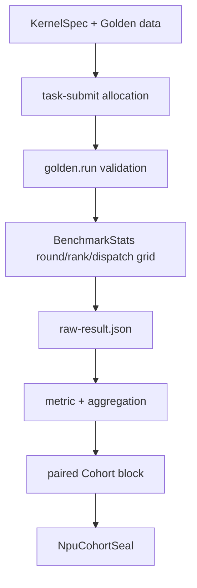
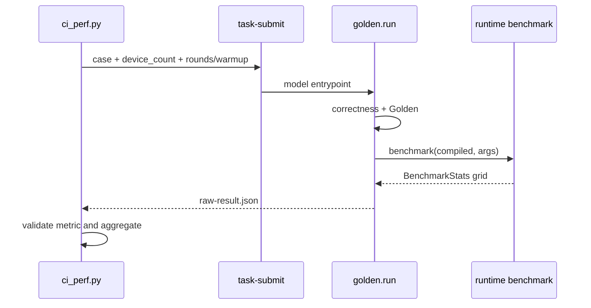

> 本文基于 `pypto-lib` `main` commit [`f4c950ce`](https://github.com/hw-native-sys/pypto-lib/commit/f4c950cea9e038000f7318a840f5f8b0c764751f)。相对第 108 章的 [`1e801c98`](https://github.com/hw-native-sys/pypto-lib/commit/1e801c98d37b11e11ce21a03f99ffc2abc374d16) 前进 15 个提交；最新一笔 DSpark 变更没有触及本文研究的 runner、CI reducer、文档与测试。直接相关的计时契约来自 [PR #1982](https://github.com/hw-native-sys/pypto-lib/pull/1982) 与 [PR #1983](https://github.com/hw-native-sys/pypto-lib/pull/1983)。本文提出的 `NpuPairBlock/NpuCohortSeal` 仍是证据协议，不是仓库已有类型。

## 本篇在 PTO 课程路线中的位置

这是课程第 109 篇，位于第二阶段“真实 kernel/model library 如何形成可复核设备证据”。第 107 篇规定完整 repetition 才能进入统计；第 108 篇确认 Golden 必须先于 NPU benchmark，SIM tick 与 NPU 微秒不能换算。

今天只深入两个紧密相连的问题：

1. baseline `A` 与 candidate `B` 为什么必须按 `AB/BA` 成对轮换，而不是各跑一大段再比较 median？
2. 多卡结果究竟应取 fastest-rank median，还是每轮 slowest-rank critical path？

答案不是二选一：**先声明要估计的量，再对同一估计量做配对。** fastest-rank median 适合隔离 kernel 可达到的执行时间；slowest-rank/host-union 才能描述同步作业或服务关键路径。

## 前置知识

- `golden.run` 的 correctness dispatch 先生成并校验输出；只有 `result.passed` 才保存 benchmark。
- `BenchmarkStats.rounds_dispatches` 的逻辑形状是 `[round][rank][dispatch]`，每个 dispatch 记录 `effective_us`、`device_wall_us` 和 span。
- `effective_us` 是 post-graph-build 的 device `orch ∪ sched` 窗口；A5 host graph 没有有效 Effective 时，当前 CI 改用 `aicore_wall_us`。两种 metric 不能混比。
- warmup 只丢弃前几次 launch，不会消除随时间持续变化的 clock、temperature 或其他设备状态。

## 今日 1–2 个核心问题

核心问题可写成一个最小模型：

\[
Y_{v,t,r}=\mu_v + D_t + R_r + \epsilon_{v,t,r}
\]

`v` 是 A/B 版本，`D_t` 是随时间变化的漂移，`R_r` 是 rank/device 差异。若先跑完全部 A 再跑全部 B，版本效应与 `D_t` 混在一起；若 candidate 又总落在另一组 device 上，版本效应还会与 `R_r` 混同。

因此最小可辩护方案是：同一 device map、输入、artifact family、metric 和 aggregation 下，以相邻 `AB` 与 `BA` 组成一个 block；每个 run 保存完整 raw rank matrix 和运行前后 health snapshot，再在 block 内求 B-A。

## PTO 全栈中的位置



上游是 kernel/spec/input/artifact identity；下游消费者是 Daily CI、调优报告和最终性能结论。本章不改变 PTO ISA 指令，也不改变 kernel 输出，只约束“什么观测可以被称为同一 cohort 内的性能差异”。

## 概念和精确语义

### 1. runner headline：每轮的最慢 rank

[`golden/runner.py::_report_effective`](https://github.com/hw-native-sys/pypto-lib/blob/f4c950cea9e038000f7318a840f5f8b0c764751f/golden/runner.py#L771-L795) 调用 `stats.per_round("effective")`。对 L3，这个序列是每轮跨 rank 的 max，因此回答：**这一轮何时所有 rank 都完成？**

A5 fallback 的 [`_report_aicore_wall`](https://github.com/hw-native-sys/pypto-lib/blob/f4c950cea9e038000f7318a840f5f8b0c764751f/golden/runner.py#L803-L823) 也先把同一 rank 的多个 dispatch 相加，再对每轮所有 rank 取 max。它是同步作业的 critical-path 视角，但可能包含 rank 起步偏斜。

### 2. Daily CI：最快 rank 的跨轮 median

[`ci_perf.py::rank_median`](https://github.com/hw-native-sys/pypto-lib/blob/f4c950cea9e038000f7318a840f5f8b0c764751f/.github/scripts/ci_perf.py#L313-L344) 先对每个 `(round, rank)` 的 dispatch 求和，再对每个 rank 的 rounds 求 median，最后返回这些 median 的最小值：

```python
totals[rank].append(sum(dispatches))
return min(median(values) for values in totals.values())
```

这回答的是：**去掉慢启动 rank 后，至少一张卡稳定达到的 kernel 时间是多少？** [当前性能指南](https://github.com/hw-native-sys/pypto-lib/blob/f4c950cea9e038000f7318a840f5f8b0c764751f/docs/debug-and-tune/performance-tuning.md#L87-L122) 明确要求调优报告使用它，同时声明这不是 end-to-end step latency。

### 3. 非法组合

以下比较应直接判 invalid，而不是“谨慎解读”：

- A 用 `Effective`，B 用 `AICore wall`；
- A 是 fastest-rank median，B 是 slowest-rank headline；
- rounds/warmup、rank set、dispatch slots 或 device map 不同；
- 任一侧 `fallback_flattened`、`unstable_dispatch_slots`、all-zero 或缺 rank；
- A/B 输入、Golden comparator、artifact/toolchain 或 runtime identity 不同；
- 运行前后出现 reset/ECC/firmware 变化，或 health 字段未知而策略要求它必须可知。

公开代码没有 clock/temperature/ECC/reset 的统一采集 API，也没有可引用的阈值；因此阈值不能臆造，只能先把字段与 missing policy 固定，再由目标机型测量校准。

## 真实文件、类型、API 或指令逐段解读

### `_benchmark_and_report`：一次注册，多轮 steady-state replay

[`golden/runner.py::_benchmark_and_report`](https://github.com/hw-native-sys/pypto-lib/blob/f4c950cea9e038000f7318a840f5f8b0c764751f/golden/runner.py#L627-L680) 复用 compiled program、ordered args 和 config，调用 runtime `benchmark(rounds, warmup)`；L3 还保持 `CommDomain`，使测量贴近 steady-state serving。返回的 `BenchmarkStats` 既是报告输入，也是后续 CI 捕获的原始对象。

### `benchmark_payload`：不丢掉 rank/dispatch 身份

[`ci_perf.py::benchmark_payload`](https://github.com/hw-native-sys/pypto-lib/blob/f4c950cea9e038000f7318a840f5f8b0c764751f/.github/scripts/ci_perf.py#L225-L246) 把每种 timing 都保存为 rounds of `{rank: [dispatch durations]}`。这一步非常重要：若只保存一个 median，就无法重算 slowest-rank、fastest-rank，也无法发现某个 rank 持续变慢。

`checked_benchmark` 随后验证 manifest 的 rounds/warmup，并拒绝 flattened、unstable、all-zero；`rank_median` 再验证每轮 rank 集合和正数 timing。PR #1982 将 A5 `AICore wall` 与 TMR `Effective` 明确分开，并把 invalid timing 与执行失败分开报告。

### 真实 workload：EP8、384 rows、96 experts

当前 head 的 [`gate.py`](https://github.com/hw-native-sys/pypto-lib/blob/f4c950cea9e038000f7318a840f5f8b0c764751f/models/deepseek_v4_1_flash/gate.py#L108-L165) 把 raw/bias/score Tile 放在 `pl.Mem.Vec`，采用 FP32 score 与 bias、UINT32 expert index；`xg_buf` 输入为 BF16。96 experts 被装入 128-column envelope，tail 通过 valid columns 与 `PadValue.min` 排除。直接相关的 [`7fa8fb31`](https://github.com/hw-native-sys/pypto-lib/commit/7fa8fb316be78f426bcfaa67ee3fc75237b4835e) 把 128-column selector 的 AIV workers 上限放宽，并报告 Ascend 950DT、EP8、384 active rows 下 router service time `44.38 → 42.54 µs`；这是 commit 中的设备实验事实，不是跨机器保证。

本章用 Daily CI 中同形状的 `dsv4.1-flash-decode-moe-ep8-b64-eplb` 作为具体对象：8 张卡、384 tokens、每 rank 12 experts、balanced routing。它让 rank 聚合不再是抽象统计问题，而是直接决定这次 router 优化被称为 kernel win 还是同步 step win。

## 对象/Tile/Buffer/IR 生命周期

1. `TensorSpec` 和 frozen Golden data 固定 BF16 input、FP32 bias、输出 indices/weights 及 comparator。
2. `task-submit` 分配 8 个 device；`make_capture` 验证实际 device IDs 与 case manifest 完全一致。
3. `golden.run` 完成独立 correctness dispatch；失败则不产生 benchmark payload。
4. runtime 创建 `BenchmarkStats`，warmup 被丢弃，measured rounds 保留 `round → rank → dispatch` 身份。
5. `benchmark_payload` 序列化三组 timing 到 `raw-result.json`；文件成为本次 run 的可重算原始对象。
6. `checked_benchmark/median_timing` 选择且只选择一个 metric，生成当前 CI 数字。
7. 本文建议的 `NpuPairBlock` 引用 A/B 两个 raw-result digest、固定 device map 和 health before/after；任一成员 invalid，整个 pair 不进入 effect estimator。
8. `NpuCohortSeal` 只引用 immutable pairs；新增 pair 产生新 revision，不改写旧结论。

## 端到端调用链或指令链



这条链没有 AB/BA coordinator：当前 Daily CI 每个 case 运行当前 revision，并没有在同一 allocation/cohort 内交替加载 baseline 与 candidate。因此“轮换配对”是本章根据现有 raw evidence 能力提出的下一层协议，不应写成已合入功能。

## 具体 shape、Tile 和状态演算

### A. 代码测试已经展示的两个聚合量

[`tests/golden/test_runner.py::TestBenchReports`](https://github.com/hw-native-sys/pypto-lib/blob/f4c950cea9e038000f7318a840f5f8b0c764751f/tests/golden/test_runner.py#L3129-L3188) 构造两轮：

| rank | round 0 dispatches | round 1 dispatches | per-rank median |
| ---: | --- | --- | ---: |
| 10 | 15 + 25 = 40 | 19 + 27 = 46 | 43 |
| 11 | 80 | 90 | 85 |

runner 的 per-round max 是 `[80, 90]`，headline median=85；Daily CI 的 `min(43,85)=43`。两个数都按代码正确，却相差近 2 倍。43 只能表达 fastest-rank tuning floor，不能说“两卡 step latency 是 43 µs”。

### B. AB/BA 如何抵消线性漂移

设 A 的真实时间 100 µs，B 的真实时间 97 µs；设备状态令观测值每个相邻 run 增加 1 µs。

| 顺序 | 观测 | pair effect `B-A` |
| --- | --- | ---: |
| AB | A=100，B=98 | -2 |
| BA | B=99，A=103 | -4 |

单看 AB 会把 3 µs 真改进估成 2 µs；单看 BA 会估成 4 µs。两个方向平均为 `(-2-4)/2=-3 µs`，一阶线性漂移抵消。若漂移非线性或 health snapshot 越界，block 应 invalid，而不是继续依赖平均“修正”。

### C. 多卡结论可能反向

若 baseline 的两 rank median 为 `[101.5,113.5]`，candidate 为 `[97.5,118.5]`：fastest-rank 从 101.5 降到 97.5，说明 kernel floor 改进 4 µs；critical path 却从 113.5 升到 118.5，说明同步 step 退化 5 µs。正确报告是“局部 kernel 改进但 rank imbalance/critical path 回退”，不能只挑一个数字。

## 为什么这样设计及替代方案

**各自连续跑 AAAAA、BBBBB。** 实现最简单，也最容易让版本与温频时间趋势混同；只有设备状态已被外部固定且有证据证明稳定时才可接受。

**随机化每次 A/B。** 对长期复杂漂移更稳健，但 artifact 切换、compile/cache 污染和复现成本更高。固定 AB/BA block 是更小、可审计的第一步。

**只发布 fastest-rank median。** 适合寻找 kernel execution floor，能减弱 start skew；但会隐藏坏卡、负载不均和通信等待。

**只发布 per-round max 或 host union。** 更接近同步作业关键路径，却可能把 host dispatch skew 当成 kernel 回退。最合理的做法不是互相替代，而是把 `estimand` 写入 seal：`kernel_floor`、`synchronous_device_path` 或 `host_observed_union`。

## 访存、计算、流水、并行和硬件约束

本章不宣称 AB/BA 改善 kernel 本身。对于 384×96 router，score 与 per-token FP32 bias 的逻辑矩阵各含 36,864 个元素，单份约 144 KiB；128-column envelope 为每行补 32 列。实际 HBM/片上搬运量还取决于融合、缓存和生成代码，不能仅凭逻辑 shape 当成实测字节。

多卡 measurement 的主要混杂项是：rank 启动偏斜、设备频率/温度、通信等待、不同 device 映射、persistent state 与 cache 热度。raw per-rank/dispatch 序列保留了诊断入口；只有 aggregate median 时，这些因素无法再分离。

## 测试证据与未覆盖风险

直接测试已经验证：

- A5 无 Effective 时按完整 rank/dispatch grid 汇总 `aicore_wall_us`；
- raw samples 按 rank 保存；多 dispatch 先在 round 内求和；
- per-rank breakdown 与 CI headline 的正则不会互相误匹配；
- resident path 将 warmup 至少钳为 1，避免 validation dispatch 破坏 round segmentation。

仍未覆盖：

- `ci_perf.py::rank_median/median_timing` 的独立单元测试；
- baseline/candidate 同 allocation 的 AB/BA 执行与 crash resume；
- clock/temperature/ECC/reset/firmware before/after snapshot；
- device map 置换与 rank identity；
- fastest-rank 与 slowest-rank 两种 effect 的联合 gate；
- health 越界、字段缺失、非线性漂移时整 block fail closed。

## 与前后章节的连接

向前，本章把第 108 章的单次 `NpuCohortSeal` 拆成可比较的 paired block，并明确 metric/aggregation 是 identity 的一部分。向后，下一章需要定义 health snapshot 和 artifact identity 的 canonical manifest：哪些字段必须相等，哪些允许作为 covariate，哪些变化会让整组证据失效。

## 本篇结论、知识债、三个理解检查问题和下一章

结论：**NPU 性能差不是两个 median 相减，而是同一 metric、aggregation、device map 与 health cohort 中的 paired effect。AB/BA 能抵消一阶时间漂移；fastest-rank median 与 slowest-rank critical path 是两个不同 estimand，必须分别命名、分别配对、分别报告。**

知识债：当前无 `NpuPairBlock`、health snapshot、AB/BA coordinator、artifact canonical digest 和 paired estimator；telemetry API 与阈值仍需目标机型实测。

三个理解检查问题：

1. warmup 已经丢掉前 10 次 launch，为什么仍不能替代 AB/BA 轮换？
2. 测试中的 rank10 median=43、rank11 median=85 时，43 与 85 分别回答什么问题？
3. candidate 的 fastest-rank 变快、slowest-rank 变慢时，为什么不能宣布整体 speedup？

下一章：**NPU Cohort Manifest——Clock/Temperature/ECC/Reset/Firmware 与 Artifact Digest 的 Canonical Seal。**

## 课程账本增量

- 课程：109
- 源码基线：`hw-native-sys/pypto-lib@f4c950cea9e038000f7318a840f5f8b0c764751f`
- 主知识点：AB/BA paired cohort；fastest-rank median 与 per-round slowest-rank critical path 的估计量边界
- 新覆盖：`_benchmark_and_report`、`_report_effective`、`_report_aicore_wall`、`benchmark_payload`、`checked_benchmark`、`rank_median`、`median_timing`、`TestBenchReports`
- 新不变量：metric/aggregation/device map 属于 evidence identity；pair 先于跨 pair 汇总；health invalid 导致整 pair invalid；fastest rank 不能冒充 step latency
- 下一章：health/artifact canonical manifest 与 cohort seal
