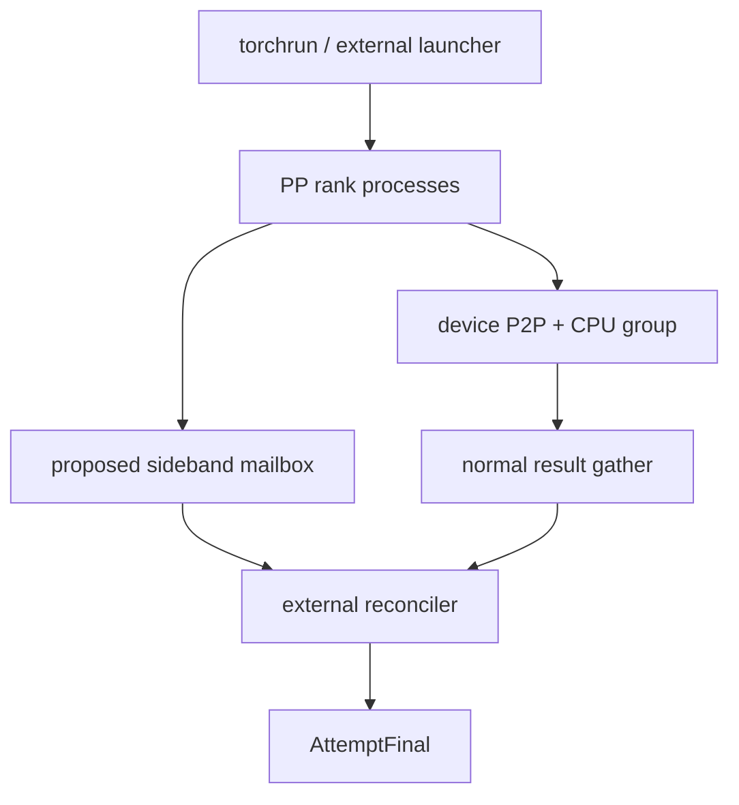
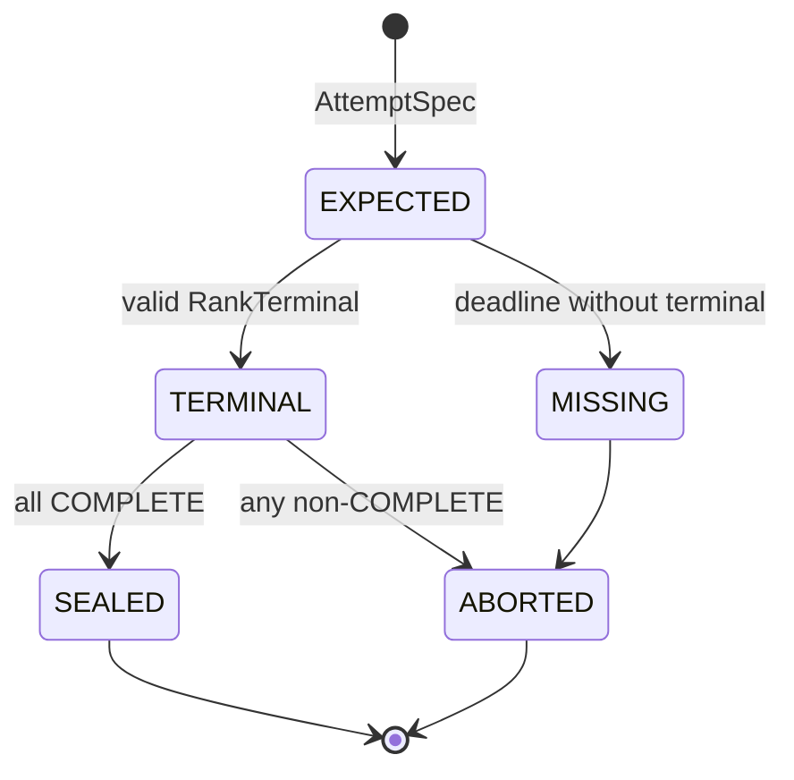

> 本文基于 vLLM `main` 的 [`3aad861c8dcd`](https://github.com/vllm-project/vllm/commit/3aad861c8dcd5101b865bb846615a5f9425b426d)。相对第 98 章的 [`ed686cce`](https://github.com/vllm-project/vllm/commit/ed686ccec527b48de4c8a67927184933886f062a) 前进 [76 个提交](https://github.com/vllm-project/vllm/compare/ed686ccec527b48de4c8a67927184933886f062a...3aad861c8dcd5101b865bb846615a5f9425b426d)；本文直接研究的 forward benchmark、multiprocess executor 与相关测试在该区间没有语义变化。最新 renderer、QSA 和 NIXL 变更与本题无关。

## 本篇在课程路线中的位置

这是第 99 章，仍位于“测试、性能与故障诊断”。第 97 章确认 PP partial-rank failure 不能缩容续跑；第 98 章要求同一 attempt 的 rank 终态收敛为不可变 `AttemptFinal` 并原子提交。

今天只解决两者之间缺失的传输层：**如果故障 rank 已经不能参加 collective，外部 reconciler 怎样拿到其余 rank 的终态？没有终态的 rank 又应怎样被确定地合成为 `MISSING`？**

结论是：终态通道必须位于待判定的 PP process group 之外。collective 可以传正常结果，但不能兼任“谁没来”的权威观察者。

## 前置知识回顾

`AttemptFinal` 的成功条件是同一 `attempt_id/topology_revision` 下所有 expected rank 都有 `COMPLETE`。任一 `FAILED/TIMED_OUT/MISSING` 都使 attempt `ABORTED`，latency 缺省。

rank-local Python exception 是 rank 自述；process exit code、launcher timeout 和 socket EOF 是外部观察。两者可以并存，但不能把观察者看见的“进程消失”伪装成 rank 已成功发布的 `FAILED` terminal。

## 本篇要回答的核心问题

1. 当前 `vllm bench forward` 的结果为什么无法在缺 rank 时完成汇合？
2. vLLM 已有的 `MessageQueue + proc.sentinel + death pipe` 分别证明了什么，又没有证明什么？
3. `RankTerminalMailbox` 的 identity、所有权、deadline 与 `MISSING` 合成规则最少需要哪些字段？

## 组件在全局架构中的位置



数据面仍由 device P2P 和 CPU group 完成时钟校准、timeline 与正常结果汇合；sideband 只承载很小的进度/终态记录。它不进入 CUDA Graph，不复制 activation，也不参与 latency 估计。

## 完整调用链

公开入口位于 [`BenchmarkForwardSubcommand`](https://github.com/vllm-project/vllm/blob/3aad861c8dcd5101b865bb846615a5f9425b426d/vllm/entrypoints/cli/benchmark/forward.py)：

```text
vllm bench forward / torchrun
  -> BenchmarkForwardSubcommand.cmd
  -> benchmarks.forward.main.main
  -> LLM.from_engine_args
  -> ForwardPipelineExecutor
  -> run_case
  -> PipelineBench.run
  -> PipelineBench._stream
  -> per-rank result dict
  -> dist.all_gather_object(world.cpu_group)
  -> rank 0 results[] / output_json
```

[`main.py`](https://github.com/vllm-project/vllm/blob/3aad861c8dcd5101b865bb846615a5f9425b426d/vllm/benchmarks/forward/main.py) 的 `_setup_env` 显式设置 `VLLM_ENABLE_V1_MULTIPROCESSING=0`；多 GPU 用 `torchrun` 一卡一进程，PP 时 backend 替换为 `ForwardPipelineExecutor`。每个 case 的 `run_case` 返回后，所有 rank 执行：

```python
gathered = [None] * world.world_size
dist.all_gather_object(gathered, result, group=world.cpu_group)
```

这条链在全员存活时简洁正确；但 `all_gather_object` 的前置条件正是 group 全员参与。rank 2 在到达调用前崩溃时，剩余 rank 无法通过同一 collective 得知“rank 2 永远不会来”。

## 关键类型、字段和状态生命周期

### 当前代码中的 `result`

`PipelineBench.run` 填充本地 result：batch order、PP rank、graph/eager 误差、sampler、timeline 与 latency。随后 `run_case` 补充 token、KV block 与 routing。对象由本 rank 持有，`all_gather_object` 成功后才在 rank 0 变成 `results[]` 的一行；失败前没有 durable owner。

### 建议的 `RankTerminal`

以下是本文提出的协议，不是当前 vLLM 类型：

```text
RankTerminal = {
  experiment_id, case_digest, attempt_id, topology_revision,
  rank, expected_ranks_digest,
  state: COMPLETE | FAILED | TIMED_OUT,
  first_cause, cleanup_errors,
  last_completed_ordinal, result_digest?,
  process_generation, emitted_at_monotonic,
  record_digest
}
```

terminal 由 rank 在 `run_case` 外层产生，一次写入、不可修改；mailbox/reconciler 只保存和去重。相同 identity 与 digest 是幂等重传，相同 identity 不同 digest 是冲突。

`MISSING` 不由 rank 发送，而由 reconciler 在 attempt deadline 后按 `expected_ranks - accepted_terminal_ranks` 合成。它可附带 `proc.sentinel`、exit code、launcher 日志或最后 heartbeat 等 observer evidence，但仍叫 `MISSING`，因为 rank 没有发布自证 terminal。



## 逐函数源码解读

### `ForwardPipelineExecutor.collective_rpc`

[`pipeline.py`](https://github.com/vllm-project/vllm/blob/3aad861c8dcd5101b865bb846615a5f9425b426d/vllm/benchmarks/forward/pipeline.py) 先让每个外部 rank 只执行自己的 local worker RPC，再用 CPU group `all_gather_object` 恢复 world-rank 顺序。这是正常控制面的合理设计，但仍绑定 PP membership；CPU backend 不等于 failure-independent。

`PipelineClock` 同样依赖 CPU point-to-point 和 barrier 建立 clock interval。若 rank 在 calibration、stream 或后置 timestamp 阶段消失，其余 rank 既得不到共同时间轴，也不能靠该 group 发布最终状态。

### `MultiprocExecutor.start_worker_monitor`

[`multiproc_executor.py`](https://github.com/vllm-project/vllm/blob/3aad861c8dcd5101b865bb846615a5f9425b426d/vllm/v1/executor/multiproc_executor.py) 提供了一个重要的已合入模式：

- 正常 RPC 返回经每 worker 的 `MessageQueue`；
- parent 用每个 `proc.sentinel` 调用 `multiprocessing.connection.wait`；
- sentinel 就绪后，monitor 标记 `is_failed`、记录进程与 exit code、关闭 executor，再调用 failure callback；
- parent 还持有 `death_writer`，worker 的 `death_reader` 在 parent 消失时收到 EOF，从而关闭自己的队列。

提交 [#38641 / `92046997`](https://github.com/vllm-project/vllm/commit/920469974afd2adca8382bab372a018398d18291) 进一步把退出码加入 monitor 日志。这证明“业务响应”和“进程存活观察”应是两条通道。

但 sentinel 只能说明本地 child 已退出，不能说明哪个 case/ordinal 首先失败；death pipe 的方向是 child 观察 parent，并不是 rank 发布结构化 terminal。forward benchmark 又关闭了这套 multiprocessing，因此不能声称现有 monitor 已解决 PP mailbox。

## 具体示例与 shape/状态演算

设一次协议演算使用 PP=4、case `decode=8*1@512`，`iters=4,samples=2,margin=8`，每 rank 计划 24 个 raw ordinal。`AttemptSpec.expected_ranks={0,1,2,3}`，演算 deadline 为启动后 60 秒；该数仅用于展示状态转换，不是推荐默认值。

| rank | 最后动作 | mailbox 记录 | observer evidence |
| ---: | --- | --- | --- |
| 0 | 等待 rank 1 P2P 后超时 | `TIMED_OUT, ordinal=11` | process alive |
| 1 | ordinal 10 device error | `FAILED, ordinal=10` | process exits 1 |
| 2 | 收到 SIGKILL | 无 | sentinel ready, exit=-9 |
| 3 | 完成本地 24 次 | `COMPLETE` | process alive |

deadline 前 accepted terminal ranks 是 `{0,1,3}`，reconciler 因而合成 `rank 2 = MISSING(NO_TERMINAL_BEFORE_DEADLINE, exit=-9)`。`AttemptFinal` 为 `ABORTED`，保存四个 rank slot 和证据引用，不生成 median。

rank 3 的 `COMPLETE` 只说明本地流程完成；rank 2 也不能被写成 `FAILED(first_cause=SIGKILL)`，因为这个 first cause 是 observer 推断，而非 rank 自述。

## 为什么这样设计及替代方案

**继续使用 CPU collective。** 正常路径最简单，但 failure detector 与被检测 membership 相同，一个缺席成员足以阻塞结论。

**只看 process sentinel/exit code。** 能确定本地进程死亡且开销很小，但覆盖不了进程存活却 GPU hang、网络隔离、terminal 写完后再死，以及多节点远端 rank。

**每 rank 写共享目录。** terminal 可持久化，crash replay 简单；代价是要求共享且语义可靠的文件系统，并处理 stale attempt、原子 rename 和目录可见性。它适合作为 benchmark 最小实现。

**独立 mailbox coordinator。** 能跨节点区分 terminal、process evidence 与 deadline，代价是认证、backpressure、重连和 coordinator 可用性。本课程建议把它作为协议边界；单节点可先用 Unix socket/pipe 或 append-only files，wire format 保持一致。

## 性能、并发、正确性与边界条件

sideband 每 rank 每 attempt 只需一个 terminal，加少量有界 progress marker；它不发送 activation、CUDA Event 或逐 replay 样本，因此不在 kernel latency budget 中。核心约束是：

- terminal 写入不能等待 PP collective，也不能因 backpressure 永久阻塞 `finally`；
- coordinator 从 `AttemptSpec` 获取 expected set，不能从“来过的 rank”反推 membership；
- monotonic timestamp 只用于本地 deadline，不能当跨节点公共时钟；
- terminal 与 process sentinel 有竞态，先后顺序不能改变同一 identity 的结论；
- mailbox partition 与 live-but-hung rank 在 deadline 前不可区分，统一合成 `MISSING`；
- attempt final 后不接受 late terminal 改写；retry 使用新 attempt。

这套通道提升的是故障可判定性，不宣称改善 kernel latency 或吞吐。

## 测试证据与未覆盖风险

[`test_forward_cli.py::test_bench_forward_pipeline`](https://github.com/vllm-project/vllm/blob/3aad861c8dcd5101b865bb846615a5f9425b426d/tests/benchmarks/test_forward_cli.py) 用两张 GPU 验证成功路径：subprocess 成功、PP ranks 为 `[0,1]`、每 rank 有相同数量样本，并可从 first/last timeline 重算 median。它没有杀死 rank，也没有覆盖缺员后的结果汇合。

[`test_executor.py::test_multiproc_executor_worker_termination_timeout`](https://github.com/vllm-project/vllm/blob/3aad861c8dcd5101b865bb846615a5f9425b426d/tests/v1/executor/test_executor.py) 用 fake clock 验证 worker 在 shutdown deadline 前退出时不调用 `terminate`，超过 deadline 时升级终止；同文件还验证 worker 经 response MQ 返回 failure 时后续 RPC 仍对齐。它们证明 cleanup deadline 和显式 error payload，但没有直接 fault-test `start_worker_monitor` 的 sentinel、callback 与竞态。

仍未覆盖：rank 在 terminal serialize 中死亡、terminal/sentinel 乱序、重复或冲突 record、多节点 mailbox partition、coordinator crash/replay、expected-rank manifest 错误、live-but-hung rank，以及 PP 与 TP/DP/EP 混合 topology identity。

## 与前后章节的连接

向前，mailbox 为第 98 章 `AttemptFinal` 提供输入：atomic commit 不能补救“rank terminal 根本收不到”。向后，下一章把协议变成故障矩阵，在 calibration、P2P send/recv、CUDA replay、CPU gather 与 terminal publish 五个位置注入故障，验证每个位置都只能得到一个稳定 final。

## 本篇结论、知识债、三个理解检查问题和下一章

结论：**故障结论的权威集合来自预先封存的 expected ranks；rank terminal 必须走 PP group 外的通道；deadline 后缺少自述 terminal 的 slot 只能合成为 `MISSING`，外部 exit code 是证据，不是替 rank 编造的状态。**

知识债：

1. 当前 forward benchmark 没有 `AttemptSpec/RankTerminal/Mailbox` 类型和外部 reconciler。
2. `MultiprocExecutor` 的 sentinel/death-pipe 只覆盖本地受管 worker，尚未形成跨节点 terminal wire protocol。
3. 缺少 terminal/sentinel 竞态、mailbox partition、coordinator crash 与混合并行 topology 的直接测试。

三个理解检查问题：

1. 为什么 `world.cpu_group` 使用 CPU backend，仍不能作为 PP rank failure 的独立侧带通道？
2. rank 2 的 process sentinel 返回 exit=-9，但没有 terminal，为什么最终状态是 `MISSING` 而不是 `FAILED`？
3. `MessageQueue`、`proc.sentinel` 与 `death pipe` 分别承载什么事实，为什么不能互相替代？

下一章：**PP Fault Matrix——Calibration、P2P、Replay、Gather 与 Terminal Publish 的分点注入。**

## 课程账本增量

- 章节：99
- 源码基线：`vllm-project/vllm@3aad861c8dcd5101b865bb846615a5f9425b426d`
- 新覆盖：`BenchmarkForwardSubcommand`、`main._setup_env/_make_engine_args/main`、`ForwardPipelineExecutor.collective_rpc`、`PipelineClock`、`MultiprocExecutor.start_worker_monitor`、`WorkerProc.make_worker_process/monitor_death_pipe`
- 新不变量：failure sideband 不依赖被检测 collective；expected set 先于 observed set；无 rank-authored terminal 只能合成 `MISSING`；process evidence 与 semantic terminal 分层
- 知识债：跨节点 wire、coordinator durability、竞态测试、fault matrix、混合 topology identity
- 下一章：PP 五个故障位置的可重复 fault injection 与唯一 final 验证
