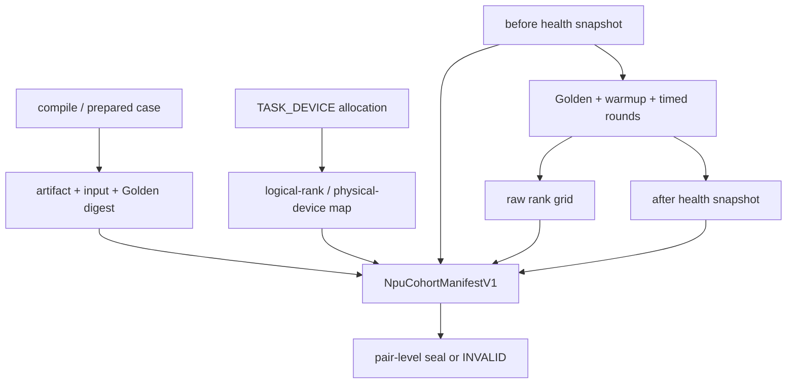

> 源码基线：[`hw-native-sys/pypto-lib@dcfa6d601d91`](https://github.com/hw-native-sys/pypto-lib/commit/dcfa6d601d91b1e4f0cb21b0183a8ea8462f0621)。本篇只选择 `pypto-lib`：固定六仓中没有第二个仓提供已合入的 NPU clock/temperature/ECC/reset/firmware 采集接口，机械扩仓只会把推断写成事实。文中的 `NpuCohortManifestV1`、health policy 与 seal 均是基于现有边界提出的设计，不是当前 API。

## 本篇在 PTO 课程路线中的位置

第 109 讲已经得到 paired benchmark 的统计单位：同一 identity 下执行 AB/BA，先在 pair 内作差，再跨 block 汇总；而 runner 的 per-round max-rank headline 与 Daily CI 的 lowest per-rank median 是两个不同 estimand。本篇是课程 110，补上“同一 identity”中最容易被一句话略过、却决定结果能否比较的内容：**到底运行了哪份 artifact、哪组输入与 Golden、落在哪几张真实卡上，运行期间设备健康状态有没有变化。**

课程位置因此是：

`Golden correctness → raw rank grid → metric/aggregation → AB/BA pair → canonical cohort manifest → pair-level seal`。

## 前置知识

我们沿用三条结论。第一，`raw-result.json` 中的 `[round][rank][dispatch]` 是源证据，单个 median 不能恢复 rank imbalance。第二，`TASK_DEVICE` 是 allocator 给出的本次逻辑设备列表，不是永久设备身份。第三，warmup 只能丢弃 leading launches，不能证明频率、温度、ECC 或 reset 在 timed region 内稳定。

## 今日两个紧密相连的核心问题

1. 当前 `pypto-lib` 已经在哪些位置建立了 artifact、参数 ABI、device allocation 与 benchmark evidence 的锚点？
2. 如何把这些锚点与 before/after health snapshot 封成 canonical manifest，使任一身份漂移、健康异常或缺失证据都让整个 pair fail closed，同时不污染 kernel timing？

## PTO 全栈中的位置

本篇不改变 Python/kernel 表达、PTOAS lowering 或 PTO ISA。它位于 runtime/device 执行与性能结论之间：上游消费者是 `golden.run`、编译产物、冻结的 input/Golden 与 allocator；下游消费者是课程 109 的 AB/BA coordinator 和后续统计 seal。



## 概念和精确语义

`manifest` 不是“把环境变量多打印几行”，而是一个不可变、可重算摘要。建议把字段分成四组：

| 组 | 必须封存的内容 | 比较语义 |
| --- | --- | --- |
| workload identity | `case_id`、entrypoint、argv、shape/dtype、rounds/warmup、metric、aggregation | baseline/candidate 除明确 treatment 外必须一致 |
| artifact identity | repo commit、toolchain/runtime/backend 版本、loaded binary bytes digest、compiled ABI digest | 精确相等；路径、mtime 不能代替内容 digest |
| data identity | input tensor digest、Golden output digest、comparator/tolerance policy digest | 精确相等；任何一侧缺失即不可比较 |
| device/health | rank→physical-device stable identity、firmware、before/after clock/temperature/ECC/reset snapshot、policy version | identity 精确相等；health 按机型校准 policy 判定 |

这里必须区分三个 hash：`cohort_key` 只覆盖“应该相等”的静态 identity；`evidence_digest` 覆盖 raw grid 与 before/after snapshot；`seal_digest` 覆盖 schema version、前两者以及 verdict。这样 candidate 的二进制本来就因 treatment 而不同，不能误要求 baseline/candidate artifact digest 相等；正确做法是分别记录精确 digest，并由 experiment spec 声明允许变化的 artifact role，其他 identity 仍相等。

Canonical 的含义也要具体：UTF-8 JSON、固定 schema version、对象 key 排序、整数不转浮点、拒绝 NaN/Infinity；path 只作 locator，内容 digest 才进 identity；缺字段不能被默认值悄悄补齐。设备不支持某项 telemetry 时写成带 reason 的 `unsupported`，不能伪装成零，也不能直接省略。

可以把建议结构压缩为下面的伪代码。它故意不规定某家工具的命令输出，只规定进入 seal 前必须得到的语义：

```text
NpuCohortManifestV1 {
  schema, attempt_id, role,
  workload: {case_id, argv, tensor_abi, sampling, metric, aggregation},
  software: {repo_commit, toolchain, runtime, backend, firmware},
  artifacts: [{logical_name, byte_size, sha256}],
  data: {inputs_digest, golden_digest, comparator_digest},
  allocation: [{rank, physical_id, stable_device_id}],
  health: {policy_version, before_digest, after_digest, verdict},
  evidence: {raw_result_digest, correctness_verdict},
  cohort_key, evidence_digest, seal_digest
}
```

字段所有权必须跟进程边界对齐。host preparation 只能声明它亲自读取并 hash 的 artifact/data；allocated worker 才能声明本次实际 device map 与健康状态；coordinator 只能验证和 join，不能凭 host 目录推测 device worker 加载了什么。`attempt_id` 标识一次不可变尝试，重试必须生成新 attempt；`role` 标识 A/B 与执行位置，而不是把文件名中的 `baseline` 当身份。后置条件是三种 digest 都能从 document 与引用的 immutable blobs 重算。若无法重算，document 只能是诊断日志，不能成为统计输入。

关键接口契约可进一步列清：

| 接口 | 输入 / 输出 | 所有权与进程假设 | 失败方式 |
| --- | --- | --- | --- |
| `hash_prepared_case`（建议） | runtime files、frozen tensors → artifact/data digests | host preparation；文件在 hash 后只读 | 文件变化、读失败、集合不完整即拒绝提交 |
| `resolve_allocation`（建议） | `TASK_DEVICE` → rank map + stable identity | allocated worker；不能由 submitter 预填 | 数量/唯一性/身份查询失败即 invalid |
| `snapshot_health`（建议） | device set + policy → canonical snapshot | 同一 allocation 内 before/after 调用 | 部分卡失败、字段缺失、counter 回退均保留错误并 fail closed |
| `seal_attempt`（建议） | identity + health + raw evidence → immutable manifest | coordinator；只接收完整引用 | digest 不匹配、schema 不兼容、非终态 verdict 均不发布 |

这里的 tensor digest 还要同时绑定 `shape/dtype/stride`。只 hash storage bytes 会让同一字节串被不同 shape 或 dtype 解释；只 hash逻辑值又可能掩盖会影响 DMA/packing 的 stride 与物理布局。最小安全做法是把 canonical metadata 与确定的 byte traversal 一起输入 hash，并把 packing policy 作为 artifact/data contract 的一部分。

## 真实文件、类型、API 逐段解读

### 1. prepared dispatch 已经有“产物在哪里”，还没有“产物是什么”

新合入的 [PR #1992](https://github.com/hw-native-sys/pypto-lib/pull/1992) 把 host compile/golden 与 device allocation 解耦。[`run_device_tests.py`](https://github.com/hw-native-sys/pypto-lib/blob/dcfa6d601d91b1e4f0cb21b0183a8ea8462f0621/.github/scripts/run_device_tests.py) 为每个 entry 创建独立 `PYPTO_PROG_BUILD_DIR`，避免多个同名 JIT function 在并行编译时写进同一秒级目录。这个改动不是性能装饰：PR review 明确指出混写 generated sources/binaries/golden data 会让 allocated reload 执行错误的 artifact。

随后 [`ci_device.py::submit_dispatch`](https://github.com/hw-native-sys/pypto-lib/blob/dcfa6d601d91b1e4f0cb21b0183a8ea8462f0621/.github/scripts/ci_device.py#L108-L161) 把 `work_dir`、spec-derived args、run options、distributed config 与输入 tensor 写入 `request.pt`；device worker 再由 [`execute`](https://github.com/hw-native-sys/pypto-lib/blob/dcfa6d601d91b1e4f0cb21b0183a8ea8462f0621/.github/scripts/ci_device.py#L164-L218) reload `work_dir`。**代码事实**是路径跨进程传递且每 case 隔离；它没有计算 loaded binary、`request.pt` 或输入 tensor 的 cryptographic digest。因此目录没碰撞不等于 bytes 已被封存。

### 2. ABI validator 防“接口漂移”，不防“同 ABI 错二进制”

[`_validate_compiled_spec_abi`](https://github.com/hw-native-sys/pypto-lib/blob/dcfa6d601d91b1e4f0cb21b0183a8ea8462f0621/golden/runner.py#L1007-L1089) 比较参数名与顺序、kind、shape、dtype、direction；动态 `-1` dimension 可接受具体尺寸。它的前置条件是 compiled metadata 可读，后置条件是 spec 与 artifact 的调用接口一致；失败时在输入分配和 dispatch 前报错。

这个 validator 很重要，但边界同样明确：两个不同二进制可以具有相同 ABI。因此 manifest 应把 ABI canonical form 和 binary bytes 分别 hash：前者解释“能否合法调用”，后者证明“实际调用了哪一份实现”。

### 3. logical rank 映射到了 physical ID，但 ID 还不是稳定设备身份

`execute(directory, devices)` 先要求数量相等、ID 唯一且非负，再用 `physical(rank)=devices[rank]` 改写单卡 `device_id` 与 `DistributedConfig.device_ids`。Daily performance path 同样在 [`ci_perf.py::run_case`](https://github.com/hw-native-sys/pypto-lib/blob/dcfa6d601d91b1e4f0cb21b0183a8ea8462f0621/.github/scripts/ci_perf.py#L271-L285) 解析 `TASK_DEVICE`，并由 `make_capture` 检查模型实际使用的列表等于 allocation。

这验证了本进程内的 map 一致性，却没有回答“physical 3 今天是否仍是昨天那张卡”。manifest 需要 allocator 或平台 telemetry 给出的稳定 device identity；若公开接口只能提供临时 ID，就必须把结论降级为“同 allocation 内 paired comparison”，不能宣称跨 allocation 的同卡比较。

### 4. raw benchmark 是结果证据，还不是 sealed run

[`benchmark_payload`](https://github.com/hw-native-sys/pypto-lib/blob/dcfa6d601d91b1e4f0cb21b0183a8ea8462f0621/.github/scripts/ci_perf.py#L225-L246) 保存 rounds、warmup、flatten/unstable/all-zero 标志，以及 effective/AICore-wall/device-wall 三种 `[round][rank][dispatch]` samples；`run_ci` 把 `raw-result.json` 与 logs 发布，明确不发布 build trees。现状因此有可重算 timing evidence，却无法仅靠已发布 artifact 反推 exact binary/input/Golden，也没有 health snapshot。

## 对象与状态生命周期

建议的 manifest 生命周期如下。注意 hash 和 telemetry 都在 timed region 外；timed rounds 只产生 raw grid。

```mermaid
stateDiagram-v2
    [*] --> Prepared: hash artifact/input/Golden
    Prepared --> Allocated: resolve rank/device identity
    Allocated --> Armed: write before snapshot
    Armed --> Measured: Golden passes; collect raw grid
    Measured --> Sealed: write after snapshot; canonicalize; digest
    Prepared --> Invalid: missing or digest error
    Allocated --> Invalid: map mismatch
    Armed --> Invalid: health/policy failure
    Measured --> Invalid: crash or incomplete evidence
    Sealed --> [*]
    Invalid --> [*]
```



所有权也要单一：compile/preparation 进程拥有 immutable artifact/data digest；allocated worker 拥有 physical-device map、before/after snapshot 与 raw samples；coordinator 只在收到完整 document 后原子发布 seal。worker 在 after snapshot 前崩溃时不能把已有 `raw-result.json` 当成功样本，因为缺失的 after state 无法证明运行中没有 reset/ECC 变化。

## 端到端调用链

真实链路是：`run_device_tests.py::run_case` 建立 per-entry build root → `golden.run` compile/Golden → `prepare_dispatch` assemble 并释放 compile slot → `submit_dispatch` 写 `request.pt` → `run_device_tests.sh --submit` 请求 N 张卡 → `ci_device.py::execute` 将 logical rank 映射为 physical ID → reload + `_validate_compiled_spec_abi` → `_dispatch`/`_run_l3_resident` → `outputs.pt` 回到原进程 → correctness validation。

性能链在 `ci_perf.py` 中继续：`task-submit` → `run_case` 解析 `TASK_DEVICE` → `make_capture(golden.run)` → correctness 通过 → runner `_benchmark_and_report` → `benchmark_payload` → `raw-result.json` → `median_timing`。Manifest 的最佳插入点不是 kernel 内部，而是 allocation 后、`golden.run` 前采 before；benchmark 返回后采 after，再由 host 读取既有 raw JSON 并 seal。

## 具体 shape、设备与状态演算

使用当前 [`perf_cases.json`](https://github.com/hw-native-sys/pypto-lib/blob/dcfa6d601d91b1e4f0cb21b0183a8ea8462f0621/.github/scripts/perf_cases.json) 中真实 case：`dsv4.1-flash-decode-moe-ep8-b64-eplb`，platform `a5`，8 cards，384 tokens，EP=8，每 rank 12 experts，balanced routing。

假设 allocator 返回临时 physical IDs `[4,5,6,7,0,1,2,3]`，则 rank 0→4，rank 7→3；这 8 个映射必须进入 document。Baseline A 与 candidate B 各有自己的 binary digest，但共享 case/argv/input/Golden/comparator、rounds/warmup、metric/aggregation 和 device identity。一次 AB/BA block 的判定可逐步写成：

1. A1 before→after：8 张卡的 mandatory fields 完整，reset/ECC counters 没有 policy 判定的异常变化，raw grid 完整。
2. B1 使用相同 rank/device map；若 rank 3 被换到另一 stable device identity，即使临时 ID 仍是 7，B1 整个 pair invalid。
3. B2 若 after snapshot 缺失，不保留 A2 单边结果；整个 BA pair invalid。
4. A2/B2 均 sealed 后，才按课程 109 的 pair 内差分产生一个 effect。

这里不虚构通用温度或频率阈值。哪些 clock state 合法、温度变化多大可接受、corrected ECC delta 是否拒绝，都必须由 `platform + firmware + health_policy_version` 的设备校准结果决定。当前公开代码没有给出这些阈值，因此本篇只确定 fail-closed 结构，不宣称具体数值。

再看三个容易混淆的状态。第一，`physical_id=4` 不等于 `stable_device_id`；前者是本 allocation 的寻址句柄，后者才用于判断 AB/BA 是否落在同一实体。第二，reset/ECC counter 的**绝对值**可能在进入实验前就非零，是否有效取决于 policy；而 before→after 的变化至少必须被记录，不能只保存 after。第三，温度是连续观测，不应被塞进 `cohort_key` 要求逐值相等；`cohort_key` 绑定 policy 与采集能力，具体观测进入 `evidence_digest`，由 policy 产生 verdict。

假设 A1、B1 都生成完整 raw grid，但 B1 的 `inputs_digest` 与 A1 不同。即使两者 output 都通过各自 Golden，也不能比较：它们证明的是两道不同题各自做对了。反过来，若二者 inputs/Golden 相同而 candidate binary digest 不同，这是 treatment 的预期；experiment spec 必须明确只允许 `artifacts[candidate_kernel]` 变化，并固定 toolchain、runtime、firmware 和 comparator。把“允许差异”写成字段级白名单，比“除了我们认为无关的都忽略”更容易审计，也能在新增字段时默认 fail closed。

## 为什么这样设计及替代方案

**只记 commit/path/mtime** 成本低，却无法发现同 commit 的不同 toolchain、cache 污染、目录混写或重新链接；content digest 才覆盖实际 bytes。**只采 before snapshot** 少一次查询，却看不到 timed region 内 reset/ECC/降频；before/after 是最小闭环。**每轮 hash 大 tensor** 虽最严格，却会增加 host I/O 并扰动调度；更合理的是 preparation 时对 immutable input/Golden 只 hash 一次，用 content-addressed reference 复用。**把 health 查询插进每个 timed round** 可获得细粒度轨迹，却污染 launch 间隔并改变被测系统；第一版应在计时域外采边界快照，只有诊断 run 才启用高频 telemetry。

维护成本来自 schema/version/policy 演进，但它换来三项正确性收益：结果可复算、身份漂移可定位、失败不会静默进入统计。Manifest 写入和 SHA-256 类 digest 不是安全认证本身；若要防恶意篡改，还需要可信签名与密钥管理，这不属于当前性能 CI 的已证需求。

## 访存、计算、流水、并行和硬件约束

Manifest 不改变 Tile load-compute-store，也不进入 NPU kernel graph。其主要成本是 host 侧读取 artifact/input/Golden 一次及两次 telemetry RPC。大数据应在 frozen-data 生成时 streaming hash，避免复制第二份 tensor；binary digest 应针对 device worker 实际 reload 的文件集合，而不是 host 以为会加载的目录。并行 CI 中每个 case 已有独立 build root，这是 identity isolation 的必要条件；seal 还必须避免多个 worker 共写同一临时 JSON，采用 per-attempt temp file + atomic rename。

多卡约束尤其严格：`device_count=8` 只说明数量，不能证明 topology、rank order 或 device health 相同。若当前接口无法给出 topology，就把它列为 `unknown` 并限制结论范围，而不是从连续 device ID 推断物理邻接。

### Health policy 为什么必须版本化

健康快照本身只是观测，不能直接等同于有效/无效。建议 policy 至少把字段分为三类：身份字段（device serial、firmware、driver/runtime compatibility）要求前后一致；单调计数字段（reset、uncorrected/corrected ECC 等）比较 before/after delta；连续状态字段（clock、temperature、power state）由平台校准规则判定是否落在允许域。某个型号没有某项 telemetry 时，能力声明也必须被版本化，否则同名 manifest 在工具升级后会悄悄改变含义。

这里不能用一个跨机型的“神奇阈值”。相同温度在不同散热配置下可能对应不同 frequency state；某些 corrected ECC 计数是设备寿命累计值，另一些接口可能在 reset 后归零。policy 的输入因此应是原始值、采集时间、单位、counter scope 与设备/firmware identity，输出才是结构化 verdict 和 reason。文章能确认的是规则形态，不能从当前仓库证据推出数值边界。

并发采集还要防止“拼接快照”：8 卡查询若逐张执行，第一张与第八张并非同一瞬间。第一版可以记录每卡采集时间与整组时间窗，并由 policy 限制最大 skew；若平台支持批量查询则优先使用。不能把部分成功的 7 卡结果和稍后补采的第 8 卡无标记合并，因为这会掩盖运行边界。telemetry timeout 也不是性能 regression，它是 evidence failure，应与 kernel timing failure 分开编码。

最后，health 查询不能持有会改变被测调度的全局锁，也不能在 `PYPTO_BENCH` 的 launch loop 内执行。before 必须在模型、device map 和 artifact 都已确定之后采；after 必须在最后一个 measured dispatch 完成、但 allocation 尚未释放时采。若 after 只能在释放设备后查询，稳定身份与 counter scope 可能已经丢失，此接口就不足以支撑强 seal，只能产生降级诊断记录。

因此 manifest 的状态不能只有 `pass/fail`。至少要区分 correctness failure、timing evidence invalid、identity mismatch、health invalid 与 evidence incomplete；它们都不能进入 paired effect，却决定不同的排障方向。统计器只接受 `SEALED_VALID`，不会根据错误文本猜测哪些失败“也许可以忽略”。

## 测试证据与未覆盖风险

当前 [`tests/golden/test_runner.py`](https://github.com/hw-native-sys/pypto-lib/blob/dcfa6d601d91b1e4f0cb21b0183a8ea8462f0621/tests/golden/test_runner.py#L808-L868) 用缺失/多余/重复参数名、shape 与顺序 mismatch 验证 compile-only ABI fail closed；[`TestRuntimeDir`](https://github.com/hw-native-sys/pypto-lib/blob/dcfa6d601d91b1e4f0cb21b0183a8ea8462f0621/tests/golden/test_runner.py#L1037-L1272) 验证 runtime-dir 重放跳过 compile、shape/dtype mismatch 在 input/runtime 前失败、缺目录不 dispatch，并验证 requested benchmark 能返回 raw per-rank samples。这些测试证明“错误接口不能进入设备执行”，不证明“同接口就是同 bytes”。

本次在当前 main 未找到 `ci_device.py`、canonical digest 或 health snapshot 的直接测试。至少仍需：key 顺序/path 变化不改变 canonical digest；任一 binary/input/Golden byte 改变会改变对应 digest；rank permutation/device replacement 被拒绝；mandatory telemetry 缺失、before/after counter 异常、after 前 crash 均使 pair invalid；同 attempt 重试幂等；schema/policy version 不兼容 fail closed。真实设备测试还需覆盖 telemetry 查询本身的权限失败与多卡部分成功，单元测试不能替代这些故障面。

测试还应分三层。纯函数层用固定 fixture 验证 canonicalization 和 digest；进程边界层启动 host/worker 临时目录，故意在 `request.pt` 写完后替换一个 runtime file，确认 worker 不执行；真机层在不触发硬件破坏的前提下模拟 telemetry timeout、单卡查询失败和 rank-map permutation。故障注入的核心断言不是“报了某句错误”，而是没有产生可被统计器消费的 terminal seal，且重试不会覆盖原 attempt 的证据。

## 与前后章节的连接

前一讲给出了 AB/BA 的统计顺序，本讲给它加上可比较性的物理前提。后一讲将实现逻辑推进到 pair-level join：baseline/candidate 的两个 manifest 如何按 `cohort_key` 关联，missing telemetry、worker crash 与重复提交如何得到唯一、可重放的 `NpuCohortSeal`。

## 本篇结论、知识债、三个理解检查问题和下一章

结论只有一句：**ABI 相同、卡数相同、Golden 通过，都不足以证明两次 NPU benchmark 属于同一 cohort；必须把实际 artifact/data bytes、stable device map、计时契约和 before/after health evidence 一起封存。**

这也给性能工程划出一条很实用的责任线：kernel 作者负责 treatment 与 shape/layout 语义，harness 负责 correctness 和 raw timing，allocator/telemetry 负责设备事实，coordinator 负责 canonical join。任何一层都不能用自己的局部成功替代下一层证据；只有完整 seal 才允许进入统计结论。

换言之，先证明“同一实验”，再讨论“谁更快”。这是本章的最小闭环。

知识债：尚无公开 telemetry adapter 与机型校准 policy；尚无实际 loaded-file census；prepared data 还没有 content-addressed index；seal 没有 crash-safe join 与重复提交语义；跨 allocation 的 stable device identity 能否获得仍待验证。

理解检查：

1. 为什么 `_validate_compiled_spec_abi` 通过仍不能替代 binary digest？
2. 为什么 candidate artifact digest 可以与 baseline 不同，但 `cohort_key` 仍能证明二者可比较？
3. 若 B 的 after health snapshot 缺失，为什么不能保留同 pair 的 A 作为独立有效样本？

下一章：**NPU Cohort Seal——Manifest Join、Missing Telemetry 与 Pair-level Fail-closed。**

## 课程账本增量

- 课程 110；主仓 `hw-native-sys/pypto-lib@dcfa6d601d91`。
- 新覆盖：`run_device_tests.py::{run_case,main}`、`ci_device.py::{prepare_dispatch,submit_dispatch,execute}`、`ci_perf.py::{prepare_case,make_capture,run_case,benchmark_payload,run_ci}`、`golden/runner.py::_validate_compiled_spec_abi`、`tests/golden/test_runner.py::{TestRuntimeDir, ABI tests}`。
- 新不变量：artifact ABI 与 artifact bytes 是两层证据；logical/physical ID map 不等于 stable device identity；health 必须 before/after 闭环；hash/telemetry 必须在 timed region 外；缺失 mandatory evidence 使整个 pair invalid；建议 schema 与当前实现必须明确分开。
- 新知识债：telemetry adapter、platform-calibrated health policy、loaded-file census、content-addressed frozen data、atomic seal/join、稳定设备身份。
