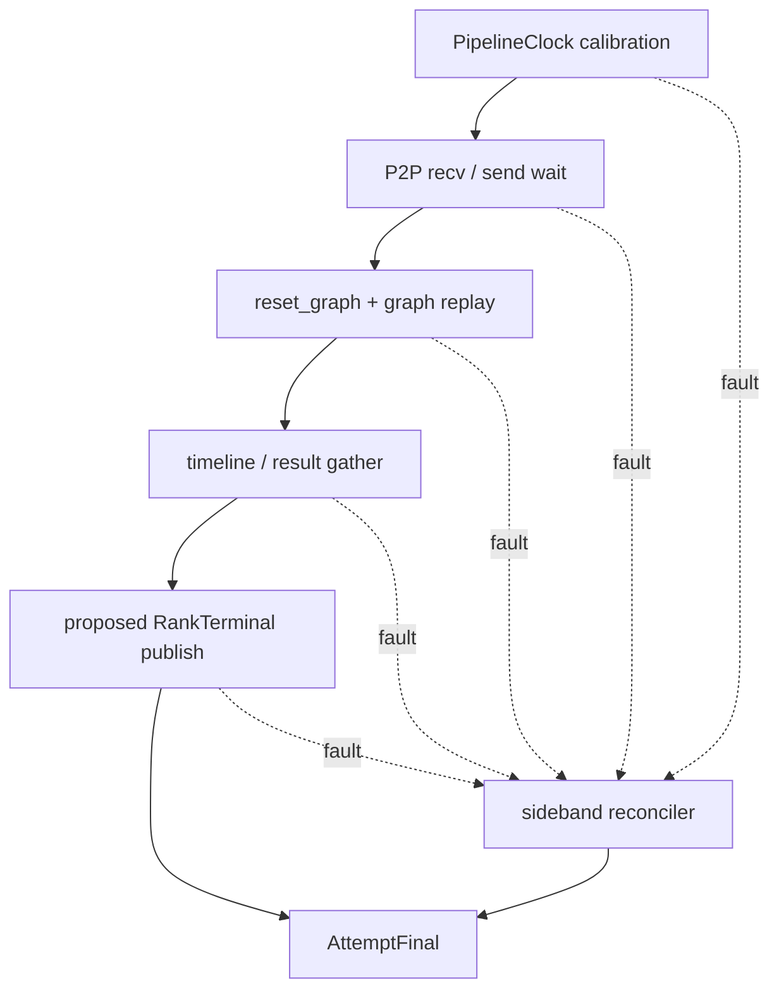
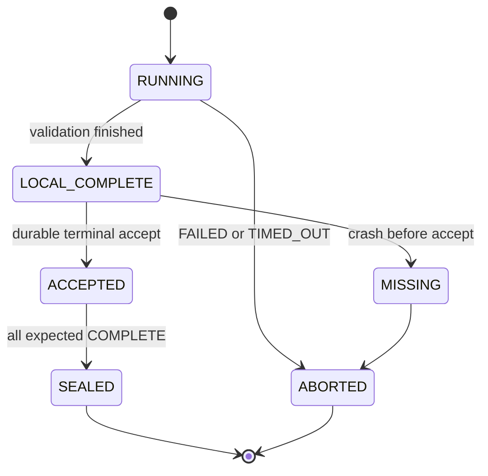

> 本文基于 vLLM `main` 的 [`e5515106efc2`](https://github.com/vllm-project/vllm/commit/e5515106efc2cbdd51c84a5428062c6b5db90566)。相对第 99 章的 [`3aad861c8dcd`](https://github.com/vllm-project/vllm/commit/3aad861c8dcd5101b865bb846615a5f9425b426d) 前进 [77 个提交](https://github.com/vllm-project/vllm/compare/3aad861c8dcd5101b865bb846615a5f9425b426d...e5515106efc2cbdd51c84a5428062c6b5db90566)；本文直接研究的 forward benchmark、pipeline 测试和 CPU timeout 测试在该区间没有语义变化。最新 ROCm、kernel 与 CI 变更与本题无关。

## 本篇在课程路线中的位置

这是第 100 章，仍位于“测试、性能与故障诊断”。第 97～99 章依次建立了 partial-rank fail-closed、不可变 `AttemptFinal` 和 failure-independent sideband；但这些结论还缺一个关键验证：**同一个 rank 在不同阶段消失，系统是否都能在有界时间内得到唯一、可解释且不可改写的 final？**

今天只研究一个知识点：PP benchmark 的最小 fault matrix。它不是异常类型大全，而是覆盖五个真实所有权边界：calibration、P2P、replay、gather，以及尚未实现的 terminal publish 线性化点。

## 前置知识回顾

同一 `attempt_id/topology_revision` 只有在 expected ranks 全部提交 `COMPLETE` 时才能 `SEALED`。任一 `FAILED/TIMED_OUT/MISSING` 都使 attempt `ABORTED`，失败 attempt 不产生 latency。rank 自述的 terminal 与外部观察到的 exit code、EOF、launcher timeout 不能混写。

第 99 章还确认：`world.cpu_group` 虽然使用 Gloo，却与 device group 共享 membership，因此不是 failure-independent sideband。

## 本篇要回答的核心问题

1. 为什么只在 worker 外层 `SIGKILL` 一次，不能证明 PP benchmark 的故障协议正确？
2. 五个注入点各自破坏了哪个前置条件，哪些已产生的对象仍可诊断、哪些绝不能进入统计？
3. 如何用最少的 action 覆盖 Python failure、collective hang、process disappearance 和 durable publish crash？

## 组件在全局架构中的位置



前四个节点是当前代码；`RankTerminal publish` 和 sideband reconciler 是课程提出、尚未合入的协议边界。注入测试的目标不是恢复同一次 PP stream，而是证明失败能被封存，旧 timing/state 不会越过 attempt fence。

## 完整调用链

公开入口 [`BenchmarkForwardSubcommand.cmd`](https://github.com/vllm-project/vllm/blob/e5515106efc2cbdd51c84a5428062c6b5db90566/vllm/entrypoints/cli/benchmark/forward.py#L10-L23) 最终进入：

```text
vllm bench forward / torchrun
  -> main
  -> LLM.from_engine_args
  -> run_case
  -> build_batch -> PipelineBench
  -> PipelineBench.run
  -> _prepare_stage -> _capture_stage
  -> _stream(timed) -> _stream(profile)
  -> per-rank result
  -> world.cpu_group all_gather_object
  -> rank-0 results[] -> output_json
```

[`run_case`](https://github.com/vllm-project/vllm/blob/e5515106efc2cbdd51c84a5428062c6b5db90566/vllm/benchmarks/forward/main.py#L159-L254) 创建 exact `BenchBatch`、清零相关 KV blocks、安装 routing fixture，再构造 `PipelineBench`。`bench.run()` 无论成功与否都会进入 `finally`，执行 `batch.finish()` 并移除 fixture；但若 cleanup 再失败，当前代码没有结构化字段保存 original cause 与 cleanup cause。

所有 case 成功后，[`main`](https://github.com/vllm-project/vllm/blob/e5515106efc2cbdd51c84a5428062c6b5db90566/vllm/benchmarks/forward/main.py#L257-L332) 才把每 rank result 做第二次 `all_gather_object`，rank 0 最后整体写 `output_json`。这说明“局部 replay 完成”到“结果持久化”之间仍有两个 collective 和一个进程级写入窗口。

## 关键类型、字段和状态生命周期

真实对象 `BenchBatch` 在 `build_batch` 创建，持有 scheduler output、token/KV 布局和 finish 动作；`PipelineBench._prepare_stage` 把 runner 输入、state views 和 eager reference 克隆为 snapshot；`_capture_stage` 生成 `reset_graph` 与 `graph`；`_stream` 每个 raw ordinal 创建 start/end CUDA Event。

成功路径中，Event 经前后两个 `PipelineClock` 映射为 `starts_us/ends_us`，再由 timeline gather 合成 critical-path samples，写入 rank-local `result`；随后 main-level gather 才形成 `ranks[]`。`output_json` 写完后，这条生命周期才有当前实现中的持久结果。

故障路径必须保留对象所有权边界：未完成后置 calibration 的 Event 只是本 rank 的设备事件；未完成 timeline gather 的 local arrays 不是全局 latency；未完成 result gather 的 rank result 不是 case final。它们可以作为 partial evidence 引用，但不能伪装成统计结果。

五个边界的接口语义也不同，不能用一个“worker failed”布尔值抹平：

| 边界 | 输入与位置 | 输出/副作用 | 前置与后置条件 |
| --- | --- | --- | --- |
| calibration | CPU `[1]`、`int64` message；本 rank CUDA Event | `origin_us`、`uncertainty_us`、GPU anchor | 所有 rank 参加同一轮 ping-pong；前后 anchor 都完成才可换算 Event |
| P2P | `_tensors(output)` 中的 CUDA tensor；dtype/shape 由本 stage model output 决定 | 下游 persistent receive buffer 被填充 | peer、group generation、tensor shape/dtype 必须一致；`.wait()` 完成后才能消费 |
| replay | 固定地址的 graph input、KV/state snapshot | 原地更新 persistent output/state buffer | reset 先于 forward；completion 必须在当前 CUDA context 可观察 |
| gather | CPU 上的 timeline/result Python dict | 每 rank 相同 membership 下的 ordered list | expected ranks 全员参加；缺员时没有“部分成功”的 case 聚合 |
| terminal publish | 建议的 canonical terminal bytes | mailbox durable accept/digest | identity 唯一、内容不可变；accept 后重传只能幂等 |

这里的中间 tensor 没有一个固定通用 shape：PP stage 可能发送 `hidden_states`，TP 下还可能先取 shard 并在接收端 `all_gather`。但 shape、dtype、device 和 group generation 对一对 send/recv 必须完全匹配；不匹配不是可以跳过的样本，而是该 attempt 的正确性失败。CUDA Graph 的输入输出则由 capture 时的 persistent buffer 持有，replay 不创建新的逻辑结果对象，而是改写原地址上的状态，因此失败后不能让下一 attempt 继续复用这代 graph/state。

建议的测试对象 `FaultPlan` 至少包含：

```text
FaultPlan = {
  experiment_id, case_digest, attempt_id, topology_revision,
  target_global_rank, target_pp_rank,
  point, raw_ordinal?, phase?, action,
  hold_until_monotonic?, plan_digest
}
```

`raw_ordinal` 只对 stream 内注入有效；calibration 和 publish 使用命名 `phase`。计划由外部 harness 在启动前封存，各 rank 只读取属于自己的 entry。这样 expected fault 本身可重放，且不能因某个 rank 已经消失而从“实际触发记录”反推原计划。

## 逐函数源码解读

### 1. `PipelineClock`：通信校准本身就是故障域

[`PipelineClock.__init__`](https://github.com/vllm-project/vllm/blob/e5515106efc2cbdd51c84a5428062c6b5db90566/vllm/benchmarks/forward/pipeline.py#L83-L126) 用 20 次 CPU ping-pong 选择最小 RTT，再用 host-bracketed CUDA Event 建立 GPU anchor。任一 peer 在 `send/recv` 序列中退出，其他 rank 无法得到共同 origin；任一 rank 在后置 clock 前退出，已有 Event 也不能进入跨 rank critical path。

代码事实是这些调用依赖 process-group timeout，而不是函数级 deadline。`ParallelConfig` 把 device 和 CPU timeout 分开；默认仍采用 PyTorch backend 默认值。[`GroupCoordinator`](https://github.com/vllm-project/vllm/blob/e5515106efc2cbdd51c84a5428062c6b5db90566/vllm/distributed/parallel_state.py#L427-L528) 为 device group 和 Gloo group 分别传入配置的 timeout。历史 PR [#45159](https://github.com/vllm-project/vllm/pull/45159) 修复了 device group 曾忽略配置 timeout 的问题。

### 2. `_stream`：P2P wait、replay 与 async error 不能混成一个点

[`PipelineBench._stream`](https://github.com/vllm-project/vllm/blob/e5515106efc2cbdd51c84a5428062c6b5db90566/vllm/benchmarks/forward/pipeline.py#L238-L385) 对每个 raw ordinal 依次执行 `reset_graph.replay()`、上游 `irecv().wait()`、`graph.replay()`、下游 `isend().wait()`，循环后才 `torch.accelerator.synchronize()`。

因此“replay failure”至少有两种观测：受控 Python exception 可准确落在 replay 前；真实异步 device fault 可能到 send wait 或最终 synchronize 才暴露。terminal 应记录 `first_observed_at` 和原始异常，不能仅凭 host 栈声称某个 kernel 是根因。

### 3. 两次 gather：都有完整 membership 前置条件

timed stream 结束后，line 354 的 timeline gather 汇合 raw arrays；`main.py` line 295 的 result gather 汇合完整 rank dict。前者缺失时不能算 latency，后者缺失时不能形成 case row。两者都不应被 sideband 替换：sideband 只负责终态与证据引用，不搬运整套 timing payload。

## 具体示例与 shape/状态演算

沿直接测试使用 PP=2、case=`prefill=8*128`：一个 microbatch 有 1024 scheduled tokens，`iters=4,samples=2`，`margin=4*PP=8`，所以每 rank 实际 replay `8 + 2*8 = 24` 个 raw ordinal，只保留 ordinal 8～15 的八个 steady samples。

每个 rank 因而先拥有 24 个 start Event 和 24 个 end Event；前后 clock 完成后，它们才转成两个长度为 24 的微秒数组。rank 0 的 start 与 rank 1 的 end 按相同 ordinal 相减，裁掉两端各八项，最终才得到长度为八的 `latency_us.samples_us`。如果 ordinal identity、数组长度或 clock generation 任一不一致，正确行为是拒绝 join，而不是截到较短长度或按本地时间排序配对。

因此，raw Event “存在”不等于样本“有效”：有效性来自 identity、共同时间轴、全员证据和 Golden 的联合约束。

以下是建议的最小 fault basis；它描述应实现的测试，不是当前 API：

| 注入点 | target rank / action | 已生成状态 | 唯一合法结论 |
| --- | --- | --- | --- |
| 前置 calibration | rank 1 在第 3 次 ping-pong 前 `os._exit(42)` | 无共同 clock、无 replay | rank 1 `MISSING`，观察者保存 exit=42；attempt `ABORTED` |
| ordinal 10 P2P | rank 1 在 `irecv.wait` 前退出 | rank 0 可能卡在相应 `isend.wait` | rank 0 `TIMED_OUT`、rank 1 `MISSING`；无 latency |
| ordinal 10 replay | rank 1 replay 前抛受控异常 | ordinal 0～9 Event 为 partial evidence | rank 1 `FAILED`；peer timeout/missing；禁止前缀 median |
| timeline gather | rank 1 完成 24 次后退出 | 两 rank local Events 可能完整，但未汇合 | `ABORTED`；完整 local arrays 仍不是 case latency |
| terminal publish 前 | rank 1 在 durable accept 前退出 | local result 完整，mailbox 无 terminal | rank 1 `MISSING`；`ABORTED` |
| terminal publish 后 | rank 1 的 immutable `COMPLETE` 已被 durable accept 后退出 | canonical terminal 已越过线性化点 | 若其余 expected rank 也 `COMPLETE`，允许 `SEALED` |

最后两行只差一个 durable accept，却必须得出不同结论。这正是 fault matrix 不能只靠“随机杀一个 worker”替代的原因。

一次可重复的 fault case 应按如下顺序运行。外部 harness 先持久化 `AttemptSpec + FaultPlan`，其中 expected ranks 固定为 `{0,1}`；随后启动 `torchrun`，但 harness 自身不加入 PP process group。两个 rank 通过独立 sideband 报告 `ARMED(point, ordinal)`，只有目标 rank 抵达预定边界时才执行 action，非目标 rank 继续真实代码路径。harness 同时监听 terminal、process sentinel 与总 deadline：收到合法 terminal 就按 identity/digest 去重；看到进程退出只增加 observer evidence；deadline 到期仍为空的 slot 才合成 `MISSING`。最后先发布唯一 `AttemptFinal`，再清理残留进程和 device context。

验收不能依赖谁先报错。以 P2P case 为例，可能先看到 rank 1 exit，也可能先看到 rank 0 NCCL timeout；两种时序都应得到相同 slot 集合和同一个 final digest。若测试重跑，同一个 `FaultPlan` 可以重现注入位置，但必须分配新的 `attempt_id`；它不能复用上次 ordinal 0～9 的 Event、capture graph、clock anchor 或 KV/state snapshot。这样测试的确定性来自计划与最终状态，而不是并发错误恰好按固定日志顺序出现。



## 为什么这样设计及替代方案

最小方案不是在每行代码加 hook，而是让一个外部 `FaultPlan` 绑定 `attempt_id、target_rank、point、raw_ordinal、action`，每个子进程只在明确的 host boundary 查询一次。正常 benchmark 不加载 plan，因而不增加 timed path 分支。

action 需要分层：`raise` 验证 exception/cleanup/terminal；`sleep or skip` 验证 timeout；`os._exit` 验证 missing synthesis。真实 illegal-kernel、GPU reset 或 `SIGKILL` 属于破坏性 integration tier，必须独立 subprocess 运行，因为 CUDA context 可能不可复用，而且 async error 的暴露位置不稳定。

每个 action 验证的东西并不相同。`raise` 的成功标准是 first cause 保留、`finally` 仍尝试 cleanup、cleanup error 不覆盖首因；`sleep/skip` 的成功标准是未参加操作的一侧不需要主动报错，观察侧仍能在 backend deadline 内产生 `TIMED_OUT`；`os._exit` 的成功标准是 rank 没机会伪造 terminal，外部 observer 只能提交 process evidence，reconciler 到期合成 `MISSING`。把三者都实现成 `RuntimeError` 会让测试快速通过，却完全绕开最难的缺员和不可达路径。

注入 hook 还必须位于 benchmark 控制面，而非被 capture 进 CUDA Graph。否则正常性能路径多一个 data-dependent 分支，capture key 也会混入测试状态。对 replay 的受控异常，可以在调用 `graph.replay()` 前后放 host hook；对真实 device fault，则另开 destructive test，用独立进程和新 CUDA context，不要求错误精确在某一 host 行抛出，只要求 attempt 最终收敛且旧 generation 不再被消费。

替代方案是复用已有 [`_kill_worker_process`](https://github.com/vllm-project/vllm/blob/e5515106efc2cbdd51c84a5428062c6b5db90566/tests/v1/fault_tolerance/test_fault_tolerance_e2e.py#L257-L306)。它能证明 DP/EP server 在 worker `SIGKILL` 后进入 DEAD/UNHEALTHY，并能测试 scale-down；但它不知道 PP raw ordinal，也不能区分 calibration、P2P、gather 和 publish 前后，所以只适合作为 process-loss action 的参考实现。

## 性能、并发、正确性与边界条件

失败 attempt 不应生成性能数字，因此 fault hook 的首要预算不是微秒开销，而是 normal run 必须零影响、fault run 必须有界收敛。deadline 层级至少满足：

```text
outer test deadline > backend collective deadline + sideband reconciliation + cleanup
```

具体数值必须来自目标集群配置，不能在协议里硬编码。当前 pipeline CLI 测试的 `subprocess.run(..., timeout=600)` 只是整条测试的保险丝，不是 per-case terminal deadline。

并发边界还包括：rank 在 replay enqueue 后、异常可见前消失；terminal 与 sentinel 乱序；同一 terminal 重传；cleanup 二次失败；late terminal 到达已封存 final。测试必须断言相同 identity+digest 幂等、不同 digest 冲突、final 不被 late evidence 改写。

对成功判定也要避免“进程退出码为非零即测试通过”。每个 fault case 至少应断言四层结果：外层命令在预算内结束；每个 expected rank 都有 accepted terminal 或 synthesized `MISSING`；恰好一个 immutable `AttemptFinal`，状态符合矩阵；失败 final 中 `latency_us` 缺省，且下一 attempt 使用新 identity、重新从 raw ordinal 0 开始。只有这样才能同时验证 liveness、证据完整性、统计隔离和 retry fence。

## 测试证据与未覆盖风险

[`test_bench_forward_pipeline`](https://github.com/vllm-project/vllm/blob/e5515106efc2cbdd51c84a5428062c6b5db90566/tests/benchmarks/test_forward_cli.py#L423-L476) 用两张 CUDA GPU 验证 PP=2 成功路径：rank `[0,1]`、finite、仅末 stage sampling、NCCL profile、每 rank 八个 steady samples，并从 raw first/last Event 重算 median。它不杀 rank，也不跳过 collective。

[`test_cpu_all_reduce_timeout`](https://github.com/vllm-project/vllm/blob/e5515106efc2cbdd51c84a5428062c6b5db90566/tests/distributed/test_cpu_all_reduce.py#L90-L107) 让 rank 1 五秒不参加，断言 rank 0 的一秒 P2P wait 在三秒内抛 `Timed out`。它直接证明有界 wait，但测试的 helper 不是 pipeline 使用的 `all_gather_object`，不能外推为五个点都已覆盖。

PR [#63616](https://github.com/vllm-project/vllm/pull/63616) 的实测表明 benchmark 与 serving 的 matched-microbatch first/last Event 边界在 PP2/PP4 上可对齐，且保存 clock uncertainty；这支持 fault test 必须保护相同 ordinal/clock 语义。仍未覆盖：分点 hook、device async fault、timeline/result gather 缺员、primary+cleanup 双异常、terminal publish 线性化、PP>2、跨节点和 TP/DP 混合 identity。

## 与前后章节的连接

向前，本篇把第 97～99 章的 `AttemptFinal + sideband` 从设计不变量变成可证伪测试：每个故障点都必须收敛到一个 final。向后，五个点暴露出下一项依赖：NCCL、Gloo、launcher、sideband 与 cleanup 的 deadline 不能各自独立拍脑袋设置，必须形成跨节点有序预算。

## 本篇结论、知识债、三个理解检查问题和下一章

结论：**有效的 PP fault matrix 按所有权边界选点，而不是按异常名枚举。calibration、P2P、replay、gather 和 publish 分别决定 clock、peer progress、device completion、global evidence 与 durability；除 durable terminal accept 后的进程退出外，其余不完整路径都必须 fail closed，且不得产生 latency。**

知识债：

1. 当前 forward benchmark 没有 `FaultPlan`、rank terminal、sideband reconciler 或 per-case deadline owner。
2. 缺少 `all_gather_object` 缺员、异步 device fault、terminal/sentinel 竞态和 cleanup 二次失败的直接测试。
3. process-group timeout、outer launcher timeout 与 proposed sideband deadline 尚未形成一个可检查的预算。

三个理解检查问题：

1. 为什么 ordinal 0～9 的 Event 完整，也不能在 ordinal 10 replay 失败后计算前缀 median？
2. timeline gather 与 main-level result gather 分别失去什么信息，为什么 sideband 不应直接替代它们？
3. rank 在 terminal durable accept 前后退出，为什么一个是 `MISSING/ABORTED`，另一个可能仍然 `SEALED`？

下一章：**PP Deadline Budget——NCCL、Gloo、Launcher 与 Sideband 的跨节点超时层级。**

## 课程账本增量

- 章节：100
- 源码基线：`vllm-project/vllm@e5515106efc2cbdd51c84a5428062c6b5db90566`
- 新覆盖：`PipelineClock`、`PipelineBench.run/_prepare_stage/_capture_stage/_stream`、`run_case/main`、`GroupCoordinator`、`cpu_all_reduce_`、现有 PP 成功测试和 DP/EP process-kill 参考
- 新不变量：注入点绑定所有权边界；失败 attempt 无 latency；async device error 记录 first-observed boundary；publish durable accept 是 COMPLETE 是否存续的线性化点
- 知识债：可执行 FaultPlan、五点 fault tests、跨节点 deadline budget、mixed-parallel identity
- 下一章：PP 的 device/CPU/launcher/sideband deadline 顺序与跨节点校准
